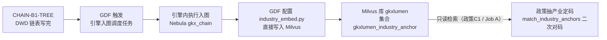

# 12 — DWD 后加工：产业链入向量库（CHAIN-B4-VEC-REBUILD）

> **读者**：GDF 数据中台产线。本文件描述"产业链入向量库"这一环节在 GDF 侧的**触发条件、执行方式、验收口径与禁止事项**。  
> **版本**：v2.2.7（2026-11-02）。正式图空间是 lumen 的 `gkx_chain`。上图由 GDF 触发燕大知识图谱引擎的入图调度任务，再轮询到成功或失败；GDF 不直接调入图脚本。入向量库由 GDF 按 [`script/README.md`](script/README.md) 配置 `industry_embed.py`，直接写入 Milvus 库 `gkxlumen` 的集合 `gkxlumen_industry_anchor`。demo 用数据库 `default`。政策产业抽取、技术节点产业映射、子学科产业关联都读 `gkxlumen` 里的这一集合。编排落点见 §5.4。环境红线见 `23-核对签收与答复.md` §1（GDF 禁读 demo 库）。  
> **为什么要有这一步**：产业链洗数（Wave B）只是把链树写进 DWD。下游"政策抽取产业"（政策派单包 `12` 的 POLICY-C1）检索的锚点集合，要等**本环节执行后才有内容**。锚点为空时政策 C1 对不上链码、只记 `no_match`——这是**设计内行为**，不是故障。

---

## 0. 一句话

**链表洗完 → 上图 VID 稳定 → 整库一次 rebuild。映射过程逐行 embed、政策重灌调 rebuild，都是禁止的。**



### 与算法中台按钮的关系（背景）

研发算法中台 demo 的**「产业链入向量库 → 写入向量库」**（`demo-ui-system-test` `/chain/vector`）走 `demo-svc-platform /v1/industry/internal/embed-load` → entan-py `/internal/industry/embed/load`，读 demo 库链树，整库替换**数据库 `default`** 里的集合 `gkxlumen_industry_anchor`。它对应图空间 `demo_gkx_chain`。demo 代码把 `dbName` 写成 `default`。

本派单的正式集合名与 demo 相同，仍是 `gkxlumen_industry_anchor`（前缀 `gkxlumen_industry_`）。隔离改在 Milvus 数据库：正式库 `gkxlumen`，demo 库 `default`。同一台 Milvus `10.50.69.111:19530`。drop/create 带着 `dbName`，正式 rebuild 只替换 `gkxlumen` 里的同名集合，不会碰到 `default` 里那一份。

上图在燕大知识图谱引擎的调度任务里面执行。入向量库不在该任务里。入图调度任务轮询到成功后，GDF 按 [`script/README.md`](script/README.md) 配置 `industry_embed.py` 的 `rebuild`，直接写库 `gkxlumen`。2026-11-02 已在库 `gkxlumen` 建好集合 `gkxlumen_industry_anchor` 并 load，当前 0 条。**2026-11-03 路线 A**：脚本已全环境变量化；作业设 `MILVUS_DB_NAME=gkxlumen`（未配或 `default` 会拒绝写入），不必改代码。

---

## 1. GDF 侧定位

**上图不在 GDF 实现。** GDF 只触发引擎调度任务并轮询终态。

**入向量库在 GDF 实现。** 平台上配置 [`script/industry_embed.py`](script/industry_embed.py) 的 `rebuild`，直接写 Milvus。不调用 `POST /internal/industry/embed/rebuild`。配置改动见 [`script/README.md`](script/README.md)。

> **round2 问 8~13 已定（2026-11-02）**：正式空间是 lumen 的 `gkx_chain`。上图只走两个调度平台的触发和轮询，见 §5.1。入向量库见问 9 与 `script/README.md`。

| GDF 职责 | 说明 |
|---|---|
| **顺序保证** | 每日批内：Wave B `success` → 触发入图调度任务并轮询到成功 → GDF 跑入向量库脚本 → 才排政策 C1。入向量库失败不回滚已成功的 B1 和上图 |
| **不抢跑** | 链表未 `success` 时不触发入图调度任务。入图未轮询到成功时不跑入向量库脚本。脚本未成功时不排政策 C1 |
| **不旁路** | 入向量库只跑 `industry_embed.py` 的 `rebuild`，只写库 `gkxlumen` 的 `gkxlumen_industry_anchor`。不写库 `default`，不调用我方 HTTP。政策 C1 的 `MILVUS_URI` 只做检索。正式批 `MILVUS_DB_NAME=gkxlumen`，`MILVUS_COLLECTION_PREFIX=gkxlumen_industry_` |
| **回执带索引版本** | 当日回执注明 `industry_index_version`（rebuild 成功后的版本号；**跳过时诚实写 `skip`，不写数字**——此条已定） |

> 与**政策派单包** `GDF-POLICY-WORKPACK-v2/15-GDF触发调度与回执.md` 的关系：本环节**排在 Wave B 之后**、与其他后加工并列；失败语义同政策包 C 系——只记本环节，不回滚 B，不连带其他作业失败。

---

## 2. 触发条件（全部满足才发生）

| # | 条件 | 检查方式 |
|---|---|---|
| 1 | Wave B `CHAIN-B1-TREE` 当日 `success`（`industry_chain` / `industry_chain_node` 有当日批次数据） | ETL 调度状态 |
| 2 | 入图调度任务已轮询到成功 | 未成功不跑入向量库脚本 |
| 3 | GDF 已按 `script/README.md` 把 `DB_NAME` 改成 `gkxlumen`，词表改读 `gkxlumenx_dwd` | 未改不执行 |

**每日节奏**：Wave B `success` → GDF 触发入图调度任务并轮询到成功 → GDF 跑入向量库脚本 → 才排政策 C1。政策 C1 与脚本 drop+create 窗口禁止并排。

---

## 3. 物理口径（引用，不在 GDF 配置）

| 项 | 口径 |
|---|---|
| 向量库 | 现网 Milvus **2.5.4** standalone `10.50.69.111:19530`（**没进 K8s**，2026-11-02 由 metrics `milvus_build_info` 读到）。支持 Database。不采购第二套向量云 |
| database | 正式库 **`gkxlumen`**。集合 `gkxlumen_industry_anchor` 已于 2026-11-02 建好并 load，**0 条**。demo 库 **`default`** 里是同名集合。正式批不读、不写、不 drop `default` |
| collection | 两边同名 **`gkxlumen_industry_anchor`**（前缀 `gkxlumen_industry_`，只用下划线；连字符名 Milvus 拒绝 `code 1100`）。正式 rebuild、正式检索只打 `dbName=gkxlumen`。同实例上的 `amcpdp-*` 等他人集合同样禁止碰 |
| embedding | `bge-base-zh-v1.5`，dim 768，COSINE。集群内 `http://gkxlumen-embed-tei:8080/v1/embeddings`。GDF 代理机 `EMBED_BASE_URL=http://10.50.69.111:30903`（Service `gkxlumen-embed-tei-nodeport`，脚本自行补 `/v1/embeddings`） |
| 词表 | DWD `industry_chain`（链名）+ `industry_chain_node`（环节名），当前约 1,516 点（102 chain + 1414 segment）。**词表真源 = DWD 链表 + 图**，禁止另建第二份产业 embedding |
| VID | 只用图上链码（`chain:INB*` / `segment:INB*`），与上图 VID 同码。ODS 短码 / 中文名不得当 VID |
| 锚点别名 | 链名/环节名按"与/和/、//"拆词生成别名（≥3 字），环节额外挂父链名——检索命中靠这些文本，定码仍走 VID |

---

## 4. 禁止事项（硬闸，违反=返工）

| # | 禁止 | 原因 |
|---|---|---|
| 1 | **映射/Wave B 过程中逐行 embed** | 锚点词表 = 图上稳定点。边洗边嵌会产生半成品索引；正确做法是整库一次 rebuild |
| 2 | **政策/企业重灌同步调 rebuild** | 消费切面 ≠ 建库切面。政策重灌只读 L0+L1，不碰 Milvus/LLM |
| 3 | **把向量分数写成 `industry_link_code` / `chain:INB*`** | 向量分只表示"像不像"；政策 C1 拿 top-k 候选后还要过 `match_industry_anchors` 二次对码（名称须在政策文本中命中，环节优先于链），禁止采 top1 直写。分 ≥0.55 写入、≥0.45 且名称出现在切块里也写入，其余 `no_match` 不插空链码行 |
| 4 | **入向量库不走本包脚本，或写入库 `default`** | 只配置 `industry_embed.py` 的 `rebuild`，只写库 `gkxlumen` 的 `gkxlumen_industry_anchor`。不调用 `POST /internal/industry/embed/rebuild`。政策 C1 的 `MILVUS_URI` 只检索 |
| 5 | **rebuild 失败后伪造 `index_version` 或拿旧索引冒充新索引** | 失败跳过时保留上一版并诚实记录；引擎不可用 `degraded=true` 时不给半可信候选（Python 侧 HTTP 503 / Java 门面未就绪 501） |
| 6 | **Job A 与灌链 rebuild 并排跑** | drop+create 秒级窗口内 search 返 `code≠0`；两步必须串行（先 rebuild 后 Job A） |
| 7 | **正式批碰数据库 `default`** | demo 的 `gkxlumen_industry_anchor` 在库 `default`，由中台按钮整库替换，对应图空间 `demo_gkx_chain`。正式集合同名，但在库 `gkxlumen`。正式 rebuild、正式检索、drop/create 的 `dbName` 只许 `gkxlumen` |

---

## 5. 接口契约（v2.2 补全，round2 问 8~13 答复；实现源 = 我方 `lumen-algo-py`）

> 正式图谱写入空间 **`gkx_chain`**。上图发生在燕大知识图谱引擎的调度任务内部。GDF 与引擎之间只做任务转发和结果接收，不调用入图脚本，不写 Nebula。入向量库由 GDF 配置 [`script/industry_embed.py`](script/industry_embed.py)，见 [`script/README.md`](script/README.md)。`graph_project.py`、`chain_routes.py` 不配进 GDF 的 DAG。

### 5.1 上图：两个调度平台的对接

链树 DWD 作业 `success` 之后：

1. GDF 调用燕大知识图谱引擎已经配好的入图调度任务的触发接口。
2. 引擎立刻返回已收下，并给出任务号。任务此时开始执行。收下不等于图已经更新。
3. GDF 调用该任务的状态轮询接口，直到调度任务成功或失败。
4. 成功之后，GDF 跑入向量库脚本。失败则不跑脚本，当日 `industry_index_version` 写 `skip`，不回滚 B1。

接口形状见《亿级科技知识图谱API文档》§2.7 触发、§2.9 查询、§2.11 轮询。具体任务号由燕大配置后线下给 GDF，不进本包。不要用内置图谱构建的默认实体去触发，也不要另写一套 Java 受理路径。

下面这段 JSON 是引擎任务内部入图实现的返回，**不是 GDF 要调用的接口**（GDF 不配 `POST /internal/v1/chain/graph/project`）。**本段仅供理解上图产物形态；GDF 的判定与回执只认 §5.4 的回执口径（入图工作流终态），不使用本段任何字段**（round2 勘误：原「GDF 判定与回执依据」措辞与上句矛盾，已统一）。

- 请求体（均可选）：`{"dry_run": false, "ensure_schema": true}`
- **响应字段（引擎内部形态参考，非 GDF 判定依据）**：

```json
{
  "status": "ok",                  // ok / skipped / dry_run / failed；GDF 只认 ok 为「上图完成」
  "space": "gkx_chain",
  "wrote": true,
  "vertex_counts": {"chain": 53, "segment": 1220, "enterprise": 0, "institution": 0},
  "edge_counts": {"belongs_to": 1220, "depends_on": 0, "participates": 0},
  "vertices_written": 1273,        // 入图脚本内部的写入点数。入向量库不拿它做判定
  "edges_written": 1220,
  "skipped_total": 0,
  "dwd_rows": {"industry_chain": 53, "industry_chain_node": 1220, "...": "读取的 DWD 行数"},
  "industry_index": {"status": "ok|skipped|failed", "index_version": "...", "indexed": N, "detail": "..."},
  "industry_index_version": "20261102174000",   // 末段 rebuild 成功后的版本；跳过/失败 = null
  "trace_id": "..."
}
```

### 5.2 入向量库（GDF 配置 `industry_embed.py` 的 `rebuild`）

说明见 [`script/README.md`](script/README.md)。不调用 `POST /internal/industry/embed/rebuild`。

- 请求体：可空（锚点取 `gkxlumenx_dwd` 的链名、环节名）
- 响应：`{"code": 0, "data": {"indexed": N, "index_version": "...", "kinds": {...}}, "msg": ""}`；`code≠0` 回执写 `skip`
- **`index_version` 格式 = 时间戳字符串 `yyyyMMddHHmmss`**（如 `20261102174000`）
- database / collection：`dbName=gkxlumen`，集合 `gkxlumen_industry_anchor`（前缀 `gkxlumen_industry_`，dim 768 / COSINE）。整库 drop+create 只替换这一库里的这一集合。副本默认 `DB_NAME=default`，配作业前改掉。`default` 里的同名集合是算法中台 demo 的

### 5.3 「点数稳定」判定（问 12）

点数指即将写入 `gkxlumen_industry_anchor` 的锚点条数。不是 Nebula 里 Tag `chain`、`segment` 的顶点数，也不读入图回执的 `vertex_counts`、`vertices_written`。上图完成与否只看问 8 的调度任务终态。

| # | 判定 | 不过则 |
|---|---|---|
| 1 | 读 `gkxlumenx_dwd.industry_chain`、`industry_chain_node` 无错 | 不替换现有集合 |
| 2 | 两表未删除行都大于 0。现网为 53 与 1,220 | 空表会把已有索引用空索引换掉 |
| 3 | 有名称的行数等于本次锚点数，且 `data.indexed` 与之相等 | 写入条数对不上，索引不完整 |
| 4 | 链名、环节名非空 | 名称全空则向量没有检索意义 |

任一不过，`rebuild` 不执行 drop+create，当日回执 `industry_index_version` 写 `skip`，沿用上一版。

`script/graph_project.py` 里的 `_index_skip_reason` 比较的是图上写入点数，那是入图脚本内部逻辑。GDF 不配置该文件，入向量库作业不使用那四条。

### 5.4 GDF 编排落点（汇总）

```text
每日批：Wave B(CHAIN-B1-TREE) success
  → GDF 调用引擎入图调度任务的触发接口（立刻得到已收下 + 任务号）
  → GDF 轮询任务状态，直到成功或失败
  → 成功后 GDF 跑 industry_embed.py 的 rebuild，直接写库 gkxlumen
  → 脚本 code=0 → 回执记 data.index_version
     脚本失败或跳过 → 回执写 skip，沿用昨日索引
  → 只有脚本成功，才排 Job A（政策 C1）
```

---

## 6. 验收与回执口径

| 检查项 | 期望 |
|---|---|
| rebuild 触发次数 | 每日批**至多一次**；由 GDF 在入图调度任务成功后配置执行。多余的手动 rebuild 属异常（需登记） |
| 回执字段 | `industry_index_version`（成功=版本号字符串；跳过=字面 `skip`，禁止空着或编造） |
| 失败语义 | rebuild 失败/跳过：**不回滚** B1/上图，当日政策 C1 若因锚点缺失大量 `no_match` 属预期（设计内空态），次日锚点就绪后政策重跑补上 |
| 抽样验证 | rebuild 成功后，以一条已知链名（如"集成电路"）做检索自检，top 候选应含该链/其节点（我方算法侧自检，GDF 不执行但回执需注明本环节状态） |

---

## 7. 与其他文件的关系

| 文件 | 关系 |
|---|---|
| `09-产业链域-ETL-Mapping明细` | 09 只管 DWD 洗数；本环节是 B 之后**独立**的后加工，不进 09 字段矩阵 |
| 政策派单包 `12`、技术节点产业映射、子学科产业关联 | 三处只用库 `gkxlumen` 里的 `gkxlumen_industry_anchor`。政策 C1 检索它。两张映射的产业候选与集合里的链、环节是同一批节点，不另建集合，也不读 `default`。本环节未执行 → 集合还不存在时检索记 `degraded`；集合在但没有锚点时记 `no_match` |
| `15-GDF触发调度与回执`（政策包 `GDF-POLICY-WORKPACK-v2/15`） | 本环节纳入每日批调度顺序：Wave B → 上图 → **rebuild** → Job A（串行） |
| CROSS-VEC 总控 §0 | #2 建库切面 / #3 消费切面 / #16 前缀守卫 / #17 禁 top1 定码 / #19 Job A 互斥——本文件第 4 节即其派单包投影 |
| [`script/`](script/README.md) | 入向量库脚本。GDF 配置 `industry_embed.py`。入图两份不配置 |

---

## 8. 版本

| 版本 | 日期 | 变更 |
|---|---|---|
| v2.2.7 | 2026-11-02 | 入向量库改由 GDF 配置 `script/industry_embed.py` 直接写库 `gkxlumen`。不调用我方 HTTP。问 9 指向 `script/README.md`。 |
| v2.2.6 | 2026-11-02 | 现网库 `gkxlumen` 已建集合 `gkxlumen_industry_anchor` 并 load，0 条。schema 与 demo 同名集合一致。 |
| v2.2.5 | 2026-11-02 | 上图改为两个调度平台对接：GDF 触发引擎入图调度任务，轮询到成功或失败。不直接调入图脚本。 |
| v2.2.4 | 2026-11-02 | 隔离改为 Milvus 数据库。正式库 `gkxlumen`（已建，空）。demo 库 `default`。集合名两边都是 `gkxlumen_industry_anchor`。v2.2.2 的异名集合作废。 |
| v2.2.3 | 2026-11-02 | 正式集合同时给政策 C1、技术节点产业映射、子学科产业关联使用。三处不另建集合。当时集合名仍是 `gkx_chain_industry_anchor`，v2.2.4 改回同名、分库。 |
| v2.2.2 | 2026-11-02 | 正式向量集合改为 `gkx_chain_industry_anchor`。算法中台 demo 集合 `gkxlumen_industry_anchor` 与之隔离。硬闸增加第 7 条。 |
| v2.2.1 | 2026-11-02 | 问 8~13 五项已定。正式图空间 `gkx_chain`（lumen）。契约见 §5。文首与第 1 节与 §5 对齐。 |
| v2.2 | 2026-11-02 | 补 §5 接口契约（上图/rebuild/`index_version`/点数稳定/GDF 编排落点）。验收改为第 6 节，关系改为第 7 节。 |
| v2.1 | 2026-10-31 | 新增本文件（架构师要求：产业入向量库入派单包；政策的抽产业依赖产业入库）。口径全部引用 §9 / CROSS-VEC，无新决策 |
