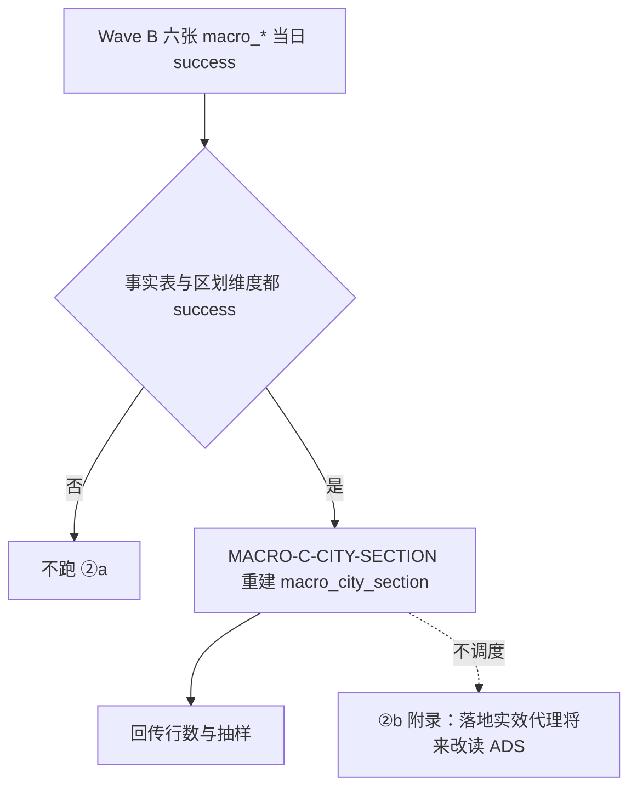

# 12 — DWD 完成后：②a 城市宏观截面 ADS ＋ ②b 落地实效代理（仅附录）

> **读者**：GDF。②a 是本包的后加工交付物（纯 SQL）。②b **只是附录**，不建作业、不建表、不配调度。  
> **前置（②a）**：Wave B 六表（尤其事实表 `macro_index_data` 与五张维度）当日 `success`。只完成贴源，或事实表 Mapping 失败，不跑。  
> **与 Wave B 的边界**：09 只洗 DWD 六表。②a 只读 DWD、只写 `gkxlumenx_ads.macro_city_section`，不改任何 DWD 列。  
> **不是算法**：②a 是「按序列取最新一期」的 SQL 聚合。没有打分、归一、加权。打分在 Python 算法侧，不在本包。  
> **状态**：草稿；**未建表、未灌数、未在 GDF 上跑通**。

---

## 0. 总流程



1. Wave B 把六表洗进 `gkxlumenx_dwd.macro_*`，事实表带区划反解列。  
2. 当日 B 成功后，②a 跑一次：先清空 `macro_city_section`，再整体重建（同一事务）。ADS 表是派生物，可整体重建。  
3. ②a 失败不回滚已成功的 B。  
4. 不写进 09 的字段矩阵，也不做成 CDC 字段映射。

---

## 1. ②a 做什么

**粒度**：城市 × 指标 × 计算维度 × 时间维度 的**最新一期**非空值，一行一个序列。

**收什么行**（事实表 `macro_index_data`）：

| 条件 | 值 | 为什么 |
|---|---|---|
| `is_deleted` | `= 0` | 应用口径 |
| `index_value` | `IS NOT NULL` | 取不到不写 0 |
| `area_code_type` | `= 1` | type=3 / 4 含义待澄清（OPEN-MACRO-01） |
| `area_resolve` | `IN ('city_by_city_code','municipality_by_province_code')` | 只收能落到**城市**的行；区县行不向上聚合（OPEN-MACRO-03）；国家 / 境外不收（OPEN-MACRO-04） |

**不收**：`district_by_area_code`、`unresolved`、type 3 / 4。这些行仍在 DWD，原样保留。

**不做**：不选指标白名单（白名单是 ②b 消费方的事）；不做窗口过滤（消费方自己加 `occur_period >= 202101`；因为取的是序列最新一期，`MAX` 落在窗口内等价于窗口内最新一期，所以不损失信息）；不做极值裁剪（原值入库，裁剪归算法侧）；不做同期对齐（各城最新期不对齐，原样带 `occur_period`）。

**2026-11-09 在 gkx 上按同口径试算（只读，未写任何库）**：2,201 个序列、103 个城市、128 个指标；同一 `(city_code, index_code, dim_cal, dim_dur)` 在 type=1 下没有来自不同 `area_code` 的冲突（0 个）；四个政策城市对 9 个白名单指标的 `TB·DNLJ` 覆盖与 `pipeline-macro-effect-proxy.md` §1 一致（深圳 / 广州 / 北京 / 上海各指标的有值城市集合相同）。这是**从供应方源表**模拟出的数，不是 GDF 回传值；GDF 回传后以回传为准，并与本数对照说明差异。

---

## 2. ②a 建表草稿（`gkxlumenx_ads`）

```sql
CREATE TABLE IF NOT EXISTS `gkxlumenx_ads`.`macro_city_section` (
  `id`              bigint       NOT NULL AUTO_INCREMENT COMMENT '自增主键',
  `city_code`       varchar(50)  NOT NULL COMMENT '12 位市码（反解得到）',
  `city_name`       varchar(150)          DEFAULT NULL COMMENT '城市名',
  `province_code`   varchar(50)           DEFAULT NULL COMMENT '省码',
  `fact_area_code`  varchar(32)  NOT NULL COMMENT '事实表原 area_code（直辖市为 2 位省码，其他为 12 位市码）',
  `area_code_type`  int          NOT NULL COMMENT '区划类型，本表恒为 1',
  `area_resolve`    varchar(32)  NOT NULL COMMENT 'city_by_city_code / municipality_by_province_code',
  `index_code`      varchar(50)  NOT NULL COMMENT '指标代码',
  `index_name`      varchar(255)          DEFAULT NULL COMMENT '指标名称（macro_index_attribute）',
  `data_freq`       varchar(50)           DEFAULT NULL COMMENT '指标公布频率',
  `dim_cal`         varchar(32)  NOT NULL COMMENT '计算类型代码 HB/TB/JDZ',
  `dim_cal_name`    varchar(150)          DEFAULT NULL COMMENT '计算类型名称',
  `dim_dur`         varchar(32)  NOT NULL COMMENT '时间特征代码',
  `dim_dur_name`    varchar(50)           DEFAULT NULL COMMENT '时间特征名称',
  `occur_period`    int          NOT NULL COMMENT '该序列最新一期（非空值）YYYYMM。各城各指标不对齐',
  `index_value`     decimal(38,8)         DEFAULT NULL COMMENT '最新一期的值，原值不裁剪',
  `unit_use`        varchar(50)           DEFAULT NULL COMMENT '该行真实单位（来自事实表，非属性表）',
  `source_code`     varchar(100)          DEFAULT NULL COMMENT '来源代码',
  `series_points`   int          NOT NULL COMMENT '该序列（非空、未删）的数据点数。很稀，样本期常为 1–6',
  `etl_batch_id`    varchar(64)           DEFAULT NULL COMMENT 'ETL 批次',
  `created_time`    datetime     NOT NULL DEFAULT CURRENT_TIMESTAMP COMMENT '写入时间',
  `updated_time`    datetime     NOT NULL DEFAULT CURRENT_TIMESTAMP ON UPDATE CURRENT_TIMESTAMP COMMENT '更新时间',
  PRIMARY KEY (`id`),
  UNIQUE KEY `uk_macro_city_section` (`fact_area_code`, `area_code_type`, `index_code`, `dim_cal`, `dim_dur`),
  KEY `idx_macro_section_city` (`city_code`, `index_code`, `dim_cal`, `dim_dur`),
  KEY `idx_macro_section_idx` (`index_code`, `dim_cal`, `dim_dur`, `occur_period`)
) ENGINE=InnoDB DEFAULT CHARSET=utf8mb4 COLLATE=utf8mb4_0900_ai_ci
  COMMENT='城市宏观截面（②a）。来源 gkxlumenx_dwd.macro_index_data 聚合；只读给展示/专题；整体重建';
```

本表 DDL **未在任何库上执行过**。

---

## 3. ②a 灌数 SQL（草稿）

一个事务内清空并重建。`:batch` 为作业批次号。

```sql
START TRANSACTION;

DELETE FROM `gkxlumenx_ads`.`macro_city_section`;

INSERT INTO `gkxlumenx_ads`.`macro_city_section`
  (city_code, city_name, province_code, fact_area_code, area_code_type, area_resolve,
   index_code, index_name, data_freq, dim_cal, dim_cal_name, dim_dur, dim_dur_name,
   occur_period, index_value, unit_use, source_code, series_points, etl_batch_id)
SELECT f.city_code, f.city_name, f.province_code, f.area_code, f.area_code_type, f.area_resolve,
       f.index_code, a.index_name, a.data_freq, f.dim_cal, c.dim_cal_name, f.dim_dur, u.dim_dur_name,
       f.occur_period, f.index_value, f.unit_use, f.source_code, s.n, :batch
FROM `gkxlumenx_dwd`.`macro_index_data` f
JOIN (
  SELECT area_code, area_code_type, index_code, dim_cal, dim_dur,
         MAX(occur_period) AS mp, COUNT(*) AS n
  FROM `gkxlumenx_dwd`.`macro_index_data`
  WHERE is_deleted = 0 AND index_value IS NOT NULL AND area_code_type = 1
    AND area_resolve IN ('city_by_city_code','municipality_by_province_code')
  GROUP BY area_code, area_code_type, index_code, dim_cal, dim_dur
) s ON  s.area_code = f.area_code AND s.area_code_type = f.area_code_type
    AND s.index_code = f.index_code AND s.dim_cal = f.dim_cal AND s.dim_dur = f.dim_dur
    AND s.mp = f.occur_period
LEFT JOIN `gkxlumenx_dwd`.`macro_index_attribute` a ON a.index_code = f.index_code AND a.is_deleted = 0
LEFT JOIN `gkxlumenx_dwd`.`macro_index_cal`       c ON c.dim_cal    = f.dim_cal    AND c.is_deleted = 0
LEFT JOIN `gkxlumenx_dwd`.`macro_index_dur`       u ON u.dim_dur    = f.dim_dur    AND u.is_deleted = 0
WHERE f.is_deleted = 0 AND f.index_value IS NOT NULL AND f.area_code_type = 1
  AND f.area_resolve IN ('city_by_city_code','municipality_by_province_code');

COMMIT;
```

要点：

1. 同一序列、同一最新期若在事实表有多行（UK 已禁止，理论上不会），UK 冲突会让插入失败——**不要**用 `IGNORE` 吞掉，失败即回滚并回传。  
2. 维度 `LEFT JOIN`：维度缺行时名称为 NULL，行仍写入（实测无孤儿）。  
3. 不加 `WHERE index_code IN (…白名单…)`。

回传：`SELECT COUNT(*), COUNT(DISTINCT city_code), COUNT(DISTINCT index_code) FROM macro_city_section`；抽样四城 × 白名单指标 × `TB·DNLJ` 各 ≥1 行（有值才有行，空则空，不补）。

---

## 4. 数据血缘（D9 占位）

| 项 | 值 |
|---|---|
| 数据集 | `gkxlumenx_ads.macro_city_section` |
| metric_id | **占位**，未登记。指标 8 件套由 data-agent 在注册表正式化，**不在本包**（本叶未查注册表、未登记）。注册前不得在界面上给这张表的数字挂 metric_id |
| algorithm_type | `UNKNOWN`（纯 SQL 聚合，无算法） |
| 口径 | 城市 × 指标 × 计算维度 × 时间维度的最新一期非空值；只收 `area_code_type=1` 且能反解到城市的行 |
| 源表 | `gkx.dwd_macro_index_data` ⋈ `dwd_dim_index_attribute` / `dwd_dim_admin_area` / `dwd_dim_index_cal` / `dwd_dim_index_dur` / `dwd_dim_source_code`（经 `gkxlumenx_ods` → `gkxlumenx_dwd.macro_*`） |
| 源系统 | 供应方宏观行业要素库；数据来源代码 `LBS`（地方统计局）/ `NATIONALSTAT`（国家统计局）/ `GACC`（海关总署）/ `worldbank`（世界银行） |
| 更新频率 | 随供应方更新（本包不设自己的频率；GDF 回写调度） |
| 版本 | `macro-section-v1` |
| D4 状态 | 本包交付时**未灌数**；以 GDF 实际灌数为准。灌数前下游不得宣称 live |
| 已知局限 | 样本期每城每指标仅 1–6 个点；各城最新期不对齐；`DNLJ` 混 3 月累计与 12 月累计（见 `pipeline-macro-effect-proxy.md` §5） |

---

## 5. ②b 落地实效结果面代理（**附录，不是交付物**）

> **性质**：口径说明。**不建作业、不建表、不调度、不进字段矩阵。** 本节不改变任何现行行为。

### 5.1 背景与边界

- 现状：深圳政策现状分析的落地实效城市卡，临时默认读宏观结果面代理（`ext.caliber=macro_outcome_proxy`），算法**过渡期直读三方 `gkx`**（已签收的 `POL-EFFECT-MACRO-*`；口径真源 `pipeline-macro-effect-proxy.md`）。登记：QPOL-02 · 2026-11-09 增补（human:淮政玮）；🟡 待甲方确认。
- **正本三维（实施日 / 对象 / 问卷）仍不可算**：宏观表和行业分析表都没有 `policy_id`，补不出启动 / 覆盖 / 问卷。宏观代理是**结果面**，不是启动率 / 兑现率 / 满意度。
- **禁止 silent 改正本**：不得把代理分写进 `M_POLICY_IMPLEMENTATION_EFFECT` 的三维字段，也不得换名不换实。

### 5.2 ②a 落地后代理怎么改读（将来，须会签）

白名单 `macro-eff-v1` 与区划键沿用 `pipeline-macro-effect-proxy.md` §1–§2（真源；下表仅为方便阅读的引用，**不一致时以真源为准**）：

| index_code | 指标 | 频率 | 档 |
|---|---|---|---|
| `gmjj_gnmy_01` | 社会消费品零售总额 | 月度 | P0 |
| `gmjj_jjzl_01_03` | 第三产业增加值 | 月度 | P0 |
| `dwjj_dwmy_01` | 进出口总额(人民币计价) | 月度 | P0 |
| `dwjj_dwmy_01_02` | 出口总额(人民币计价) | 月度 | P0 |
| `dwjj_dwmy_01_01` | 进口总额(人民币计价) | 月度 | P0 |
| `gmjj_tzjs_01` | 固定资产投资总额 | 月度 | P0 |
| `gmjj_jjzl_01_02` | 第二产业增加值 | 月度 | P0 |
| `gmjj_jjzl_01_02_01_01` | 按规模分:规上工业企业增加值 | 月度 | P0 |
| `gmjj_jjzl_01` | 地区生产总值 | 季度 | P1（4 城截面下被 `min_cities_per_index=3` 剔除） |

读法：城市截面；`dim_cal='TB'`、`dim_dur='DNLJ'`；窗口 `occur_period >= 202101`；每城每指标取最新一期；`JDZ·DNLJ`（元）只展示不进分。

取数骨架（读 ②a，替代直读 `gkx`）：

```sql
SELECT city_name, index_code, occur_period, index_value, unit_use
FROM gkxlumenx_ads.macro_city_section
WHERE city_code IN ('440300000000','440100000000','110100000000','310100000000')   -- 深圳 广州 北京 上海
  AND dim_cal = 'TB' AND dim_dur = 'DNLJ' AND occur_period >= 202101
  AND index_code IN ('gmjj_gnmy_01','gmjj_jjzl_01_03','dwjj_dwmy_01','dwjj_dwmy_01_02',
                     'dwjj_dwmy_01_01','gmjj_tzjs_01','gmjj_jjzl_01_02','gmjj_jjzl_01_02_01_01','gmjj_jjzl_01');
```

方向统一、min-max、等权、极值裁剪（|TB| 过大值裁剪或剔除，并写 `proxy_notes`）、`min_cities_per_index`、`ext` 里带每城 `period_used` / `whitelist_version` / `track_a_status`：**全部留在 Python 算法侧**，不进 ADS。ADS 里的值是原值。

### 5.3 前置条件（三条全满足才改读）

1. ②a 已在 GDF 灌数，回传的行数 / 抽样经本侧验收，`macro_city_section` 的 D4 不再是「未灌」。  
2. 算法侧另开叶改读来源（`gkx` → ADS），双仓同文（`demo-algo-ent-analysis` 与 `lumen-algo-py`），并重冻白名单版本（如补数后 `macro-eff-v2`）。本包不改算法。  
3. **会签**：甲方归一 QPOL-02（保留代理 / 回切三维 / 双轨展示三选一），`human:淮政玮` 会签。会签前 UI 保持 ⚠️「待甲方确认」。

### 5.4 诚实性约束

- 卡面不宣称同期（各城最新期不对齐）。  
- 样本期数据稀，覆盖随补数变化。  
- 深圳独有指标（深圳有 128 个，其余三城只有共有的 10 个；如战略性新兴产业、生物医药类）可进旁注，不进代理分。  
- 行业分析六表只可作行业叙述旁注，不进分母，不进本包（现行只贴 ODS）。
