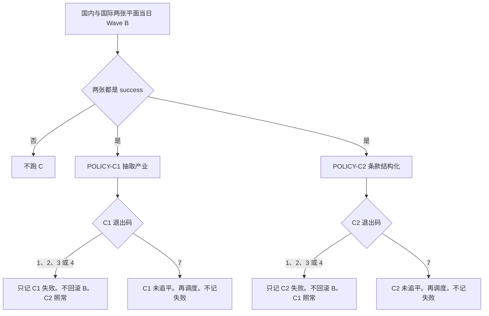
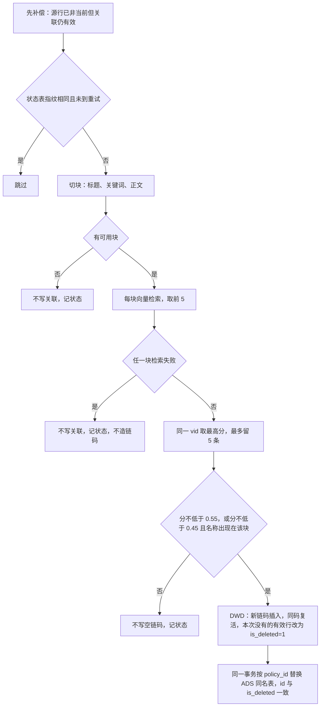
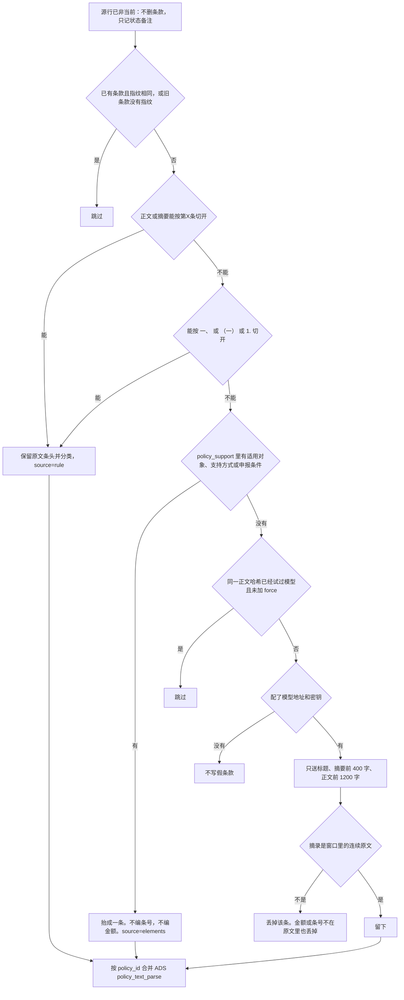

# 12 — Wave C：DWD 完成后的抽取产业与条款结构化

> **读者**：GDF。把本目录 `scripts/` 下两个 Python 文件复制到 GDF 的 Python 节点（人工拷贝或同步均可），在节点上配置并执行。  
> **前置**：国内、国际两张平面当日 Wave B 都 `success`。只完成贴源，或任一平面 Mapping 失败，不跑。  
> **不配置 HTTP**。GDF 不需要、也不要配置国科信内部地址。加工就是这两份脚本。  
> **与 Wave B 的边界**：09 只洗主表。本文件两作业不改 `policy_base_info` 任何列（含 `theme`、`policy_support`）。  
> **何时跑**：见 `15`。  
> **键**：关联表和条款表都只有 `policy_id`，没有 `source_plane`。两平面若 `policy_id` 相同，脚本先退出、不写。不改 UK 来绕。

派单口语里的「条件结构化」就是本文件的 **条款结构化**：从正文拆条款，并抽出额度与准入条件。不是把 `policy_support` 再洗一遍。

## 脚本（配进 GDF）

节点需要 Python 3.9+ 和 `pymysql`。代理机完全给 GDF 独立使用，GDF 自行安装 `python3-pip` 和 `pymysql`。本包不带安装清单。口令不进本包。

| 作业 | 文件 | 日批命令 |
|---|---|---|
| POLICY-C1 抽取产业 | `scripts/policy_c1_industry.py` | `python policy_c1_industry.py --limit 100` |
| POLICY-C2 条款结构化 | `scripts/policy_c2_clauses.py` | `python policy_c2_clauses.py --limit 100` |

重做一条：必须同时加 `--policy-id <id>` 和 `--force`。只有 `--force` 时退出码 2。`--limit` 只能是 1 到 100。退出码 0 表示本批已追平。退出码 7 表示还没追平，要再调度，不算作业失败，也不回滚 B。退出码 1、2、3、4 才记该作业失败。C1 缺 `EMBED_BASE_URL` 或 `MILVUS_URI` 时退出码 3。缺 `script_state` 时退出码 4，脚本不建表。先执行 `sql/update_round1.sql`。

| 环境变量 | 含义 |
|---|---|
| `POLICY_MYSQL_HOST` / `POLICY_MYSQL_PORT` / `POLICY_MYSQL_USER` / `POLICY_MYSQL_PASSWORD` | 产线 MySQL。端口默认 3306 |
| `POLICY_DWD_DB` | 默认 `gkxlumenx_dwd` |
| `POLICY_ADS_DB` | 默认 `gkxlumenx_ads` |
| `EMBED_BASE_URL` | 代理机填 `http://10.50.69.111:30903`。2026-11-02 devops 另开 Service `gkxlumen-embed-tei-nodeport`，对应容器端口 8080。不要填集群内短名。脚本会补 `/v1/embeddings`。空则退出码 3。不要写成字面「（留空）」 |
| `EMBED_API_KEY` | 不设。空字符串。当前 TEI 无 token |
| `EMBED_MODEL` | 可不设。默认 `BAAI/bge-base-zh-v1.5`，768 维 |
| `MILVUS_URI` | `http://10.50.69.111:19530`。空则退出码 3。不要用 `192.168.88.48` 或 `10.50.75.136` |
| `MILVUS_DB_NAME` | 可不设。默认 `gkxlumen`。这是 lumen 正式库。不要写成 `default`（那是算法中台 demo 的库） |
| `MILVUS_TOKEN` | 不设。空字符串。现网未开鉴权 |
| `MILVUS_COLLECTION_PREFIX` | 可不设。默认 `gkxlumen_industry_`，集合 `gkxlumen_industry_anchor`。与产业链包 `12` 写入的正式集合同名。正式批只在库 `gkxlumen` 里检索 |
| `LLM_BASE_URL` | `https://open.bigmodel.cn/api/paas/v4`。不要再手写 `/chat/completions`。没有也不阻断规则切条 |
| `LLM_API_KEY` | 测试密钥 `2d4129c2df4740f79cb3f0cba3edcd2a.2i5TTfMfeKO7mcCA`。无密钥不写假条款 |
| `LLM_MODEL` | 可不设。默认 `glm-5.3-flash` |

不连库自检：`python policy_c1_industry.py --self-check` 与 `python policy_c2_clauses.py --self-check`。缺表时脚本不建表，直接失败。空表归 `SYSINT-06-03-DDL-L01`，DDL 在本包 `10/`。

禁止把 `demo_gkxlumenx_*` 配成目标库。禁止在 CDC / SeaTunnel 里再写一套切条或对码。

---

## 0. 总流程

1. Wave A 贴源，Wave B 把两张源洗进 `gkxlumenx_dwd.policy_base_info`。
2. 两张平面当天都 `success` 之后，C1、C2 各跑一次。两作业互不依赖。
3. 退出码 1、2、3、4 只记该作业。退出码 7 是未追平，再调度，不记失败。已成功的 B 不回滚，另一作业不跟着标失败。
4. 不写进 09 的字段矩阵，也不做成 CDC SQL。

---

## 1. POLICY-C1 抽取产业

1. 待办只读 `is_deleted=0` 且 `IFNULL(is_history,0)=0` 的行。这是用数过滤，不是 Wave A/B 的取数条件。Wave A/B 取数仍然不过滤这两列。`is_history` 为 `NULL` 视为当前，不改写成 0。每趟开始前做一次补偿：关联表 `is_deleted=0`，且主表不存在当前行（`is_deleted=0` 且 `IFNULL(is_history,0)=0`）的 `policy_id`，把这些关联行改为 `is_deleted=1`，并按 `policy_id` 同步 ADS。源行同时还有一条当前行时不动。
2. 查询文本只用 `title`、`keywords`，以及 `content`（空则用 `abstract`）。标题和关键词各一块；正文按 `。；;` 和换行切开，丢掉套话，每块最多 120 字，正文最多 12 块。不用 `theme`，也不用 `keypoints`。
3. 每块先做向量，再在库 `gkxlumen` 的集合 `gkxlumen_industry_anchor` 里检索。这个集合已在正式库建好并 load，政策 C1 只读，不建第二套集合，也不读数据库 `default`。地址缺失时进程以退出码 3 结束，不静默空跑。单条调用失败不写链码，并在 `script_state` 记下 `degraded`。锚点由产业链产线完成后的「产业链入向量库」写入。集合还没有锚点时对不上链码。C1 不建锚点。
4. 同一 `vid` 取各块最高分。分 ≥ 0.55 就留下；分 ≥ 0.45 且链名（不少于 3 字、不是套话）出现在打出该分的那一块里，也留下。最多 5 条。没有过线的不插入空 `industry_link_code`，记 `no_match`。没有切块记 `empty`。
5. 增量看 `script_state`：同一 `job=c1`、内容指纹相同，且 `next_try_at` 为空或未到，则跳过。无产出也要留一行，否则队头不会前进。不用「目标表已有非空链码」判断已抽过。`--force` 必须带 `--policy-id`。
6. 写入见下表。不改主表。

| 库 | 表 | 动作 |
|---|---|---|
| `gkxlumenx_dwd` | `policy_industry_rel` | 新链码插入；同一 `industry_link_code` 复活（`is_deleted` 改回 0，名称更新）；本次没有的有效行改为 `is_deleted=1`。不物理删除 |
| `gkxlumenx_ads` | `policy_industry_rel` | 同一事务内按 `policy_id` 整份替换，`id` 与 `is_deleted` 与 DWD 一致 |

列见 [policy_industry_rel-MySQL.md](10-DWD-MySQL-DDL/policy_industry_rel-MySQL.md)。

---

## 2. POLICY-C2 条款结构化（条件结构化）

1. 行范围与 C1 相同。读 `title`、`abstract`、`content`，以及 `policy_support` 里的适用对象、支持方式、申报条件。
2. 先按「第X条」切，条头用原文，不编「第一条」。没有再按「一、」「（一）」「1.」或「1、」切。
3. 规则没切开，才看 `policy_support`。能抬出对象、方式或条件时写一条，`source=elements`，条号和金额留空。
4. 仍然没有，才调模型。无密钥时记 `llm_unavailable`，不写假条款。调用失败，或摘录不是原文连续片段：不写假条款。已有条款且内容指纹相同则跳过；旧条款没有 `clause_meta.content_hash` 时也跳过，避免把存量整表重算。`--force` 必须带 `--policy-id` 才重试。模型返回空时只记下 `llm_tried` 和哈希，不编条款。
5. 类别只在这六类里：责任主体、保障机制、补贴标准、准入条件、政策目标、扶持措施。金额只认原文里的「亿元 / 万元 / 元 / % / 个百分点」。
6. 每趟开始时，`policy_text_parse` 里已有行、但主表没有当前行的 `policy_id`：不删条款。`script_state` 的 `job=c2` 把备注写成「源行已非当前，条款保留」，`next_try_at` 置空，`status` 记 `done`。不新增状态值。
7. 日批每轮最多处理 100 条尚未写过条款、且不是「同一哈希已试过模型」的行。已经写过的不占这 100 条名额。没追平退出码 7。

只更新 `gkxlumenx_ads.policy_text_parse`：

| 字段 | 内容 |
|---|---|
| `structured_elements.clauses` | 条款数组 |
| `structured_elements.clause_meta` | `source`（`rule` / `elements` / `llm`）、`content_hash`、`llm_tried` |
| `title` / `model_version` | 与本次结果一致 |
| `update_time` | 本次写入时间 |

按 `policy_id` 合并 JSON。没有行则插入，只写上表这些列。表上若另有无默认值的必填列，本条失败并退出，不猜列。禁止 `TRUNCATE`。不写 ES。不回写 DWD。

---

## 3. 验收

| 检查 | 通过 |
|---|---|
| 抽一条国内政策 | DWD 与 ADS `policy_industry_rel` 该 `policy_id` 行一致（含 `is_deleted`） |
| 主表 | `policy_base_info` 行内容与 Wave B 抽样一致，没有被 C1/C2 改写 |
| 条款 | `clause_meta.source` 为 `rule`、`elements` 或 `llm`。无正文或模型失败时不落假条 |
| 失败 | B 未成功时 C 不跑。退出码 1、2、3、4 只记该作业，不回滚已成功的 B。退出码 7 是未追平，再调度，不记失败 |
| 脚本 | GDF 节点上跑的是本目录 `scripts/` 两份文件。`--self-check` 通过。不配置内部 HTTP |
