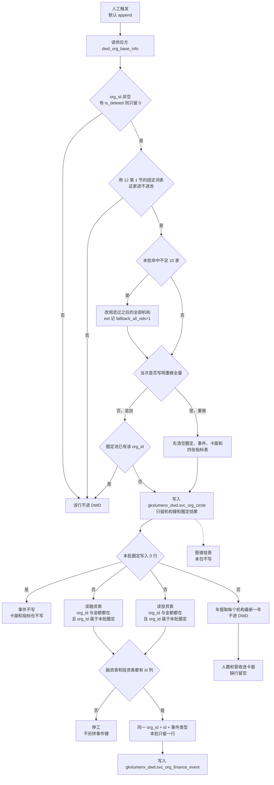

# 供应方四张表如何进入服务机构 DWD

> **读者**：GDF 产线  
> **口径来源**：加工链路 [`02-asbuilt-process-chain.md`](../../../../data-design/storage/SVC/02-asbuilt-process-chain.md) §1.1、§1.2。这里按正式库这一趟重画判断顺序，不把现网那张图搬过来。  
> **列**：只认 [`09`](09-服务机构-抽取字段对照.md)。**进池词**：只认 [`12`](12-DWD后加工-圈定与指标.md) 第 1 节，跑数前就写死，不从圈定池倒推。**追加 / 重做**：只认 [`04`](04-技术字段与过滤规则.md)。  
> **图号**：`SVC-GDF-DWD-ENTRY-20261102`  
> **状态**：说明。未建作业，未执行建表，未灌数。源上四张表没核对前不要配。

服务机构在 `gkxlumenx_dwd` 里和本主题有关的结果表有三张。这一趟只让数据进入前两张。

| DWD 表 | 这一趟 | 数据从哪来 |
|--------|--------|------------|
| `svc_org_circle` | 写 | 供应方主表里通过圈定的机构，只留机构键和圈定结果 |
| `svc_org_finance_event` | 写 | 供应方融资表、投资表里，挂得上本批圈定机构的事件 |
| `svc_org_graph_hang` | 不写 | 不读这四张供应方表。要等圈定池已经在正式库里，再由另一次作业去读圈定池。那次作业不在本包 |

年报不进任何一张 DWD。人数和营收只进 `gkxlumenx_ads.svc_org_card`。主表上的名称、地区、行业、规模原文也不进圈定池，同样只进卡面。

读的是供应方这四张表，不是 `gkxlumenx_ods`，也不是库名以 `demo_` 开头的库。

| 供应方表 | 进不进 DWD |
|----------|------------|
| `dwd_org_base_info` | 进圈定池。工商全列不复制进去 |
| `dwd_org_financing_info` | 进事件表，类型 `FINANCING` |
| `dwd_org_invest_info` | 进事件表，类型 `INVEST` |
| `dwd_org_annual_financial_info` | 不进 DWD |

## 1. 判断顺序

箭头是判断先后，不是四张表各配一趟作业。圈定没写完，事件不写，已经写下的本批行撤回。

「本批命中不足 10 家」先按整批看，再决定用关键字命中的机构，还是用滤过之后的全部机构。不是每一行各数一次。

## 2. 圈定池里的一行怎么来

一行对应一个 `org_id`。池里不出现主表的名称、地址、经营范围。

1. 从供应方 `dwd_org_base_info` 取行。`org_id` 空的丢掉。表上有 `is_deleted` 时只留 `0`；没有这列就不按删除标记滤，也不因此停工。
2. 用 [`12`](12-DWD后加工-圈定与指标.md) 第 1 节的固定词表决定进不进池。词来自 2026-08-20 拍板的临时规则 `svc_rule_demo_kw_v1.1`，原文在 [`svc_rule_demo_kw_v1.md`](../../../../data-design/storage/SVC/seeds/svc_rule_demo_kw_v1.md)。`12` 第 2 节的指标要等圈定池写下之后才算，不算回这张词表。`org_type` 不参与。高校表、科研院所表不参与。
   - 行业、行业分层、行业代码、经营范围里有字：一级行业等于「科学研究和技术服务业」，或一级行业含「金融」，或命中六类词，或命中「咨询」「广告」，这家进池。
   - 这些文本都空：只看 `name_cn` 是否命中名称收紧词。光杆「投资」「咨询」「广告」「银行」「基金」「保险」不够进池。
3. 关键字命中不足 10 家：改为把第 1 步滤过之后剩下的机构全部进池。`pending_client_confirm` 仍是 `1`，`ext` 记 `fallback_all_ods=1`。已删除或没有 `org_id` 的行不拉回来。
4. 进池之后再分类，顺序 `FINANCE`、`IP`、`HR`、`MKT`、`CONSULT`、`INNOV`，先命中先得。对不上就空，不补成某一类。一级行业是「科学研究和技术服务业」只说明可以进池，不能单凭这一句记成 `INNOV`。
5. 默认追加。圈定池里已经有的 `org_id` 不再插一行。只有当次写明重做全量，才先清空 [`04`](04-技术字段与过滤规则.md) 点名的七张表，再写入当次全部命中。
6. 写入的列只有：`org_id`、`rule_version`（固定 `svc_rule_demo_kw_v1.1`）、`hit_fields`、`service_type_candidate`、`pending_client_confirm`（固定 `1`）、`etl_batch_id`、以及上面那种整表回退时的 `ext`。

批次号用运行当天，形如 `svc-fseed-YYYYMMDD`。同一天再跑仍用这一串。

## 3. 投融资事件里的一行怎么来

事件表不单独开读。圈定本批没有写完，或者写入是 0 行，事件一行都不写。

本批能挂事件的 `org_id`：

- 追加：只含这一次新插入圈定池的机构。池里原有机构的旧事件不删，也不在这一步重写。
- 重做：清空之后，用当次重新写入的全部圈定机构。

然后分两路读供应方表，两路都只保留 `org_id` 落在上面这批机构里的行。

| 供应方表 | 留下的条件 | 写成 |
|----------|------------|------|
| `dwd_org_financing_info` | 同时有 `org_id` 和 `funding_amount` | `event_type=FINANCING`。金额用 `funding_amount` 解析成元。日期用 `completion_date`，空就空 |
| `dwd_org_invest_info` | 同时有 `org_id` 和 `investment_amount` | `event_type=INVEST`。金额用 `investment_amount` 解析成元。业务日空着。源上的 `created_time` 放进 `ext`，不当成业务日 |

`event_id` 用源表的 `id`。两张表里只要有一张没有 `id` 列，整趟停工，不另用 `org_id` 加日期拼一个键。金额文本解析不成元就空，不写成 0。同一 `org_id` + `event_id` + `event_type` 在本批内只留一行。

`ext` 里融资保留 `funding_round`、`investors_name`；投资保留 `inv_org_id`、`inv_name`、`created_time`。这张表不写图库。

## 4. 不进 DWD 的两路

**年报。** `dwd_org_annual_financial_info` 按 `org_id` 取 `year` 最大的一行，只要人数和营收，写入卡面。没有这一行，卡面这两列空着。不在内存里另造一行，也不把合成结果写回供应方库。

**图谱挂表。** `svc_org_graph_hang` 的行不是从这四张供应方表洗出来的。现网那次是圈定池落库之后，另一次作业再去读圈定池。本包不配那次作业，不写这张表，不写图库。

## 5. 和卡面的先后

卡面在 `gkxlumenx_ads`，不是 DWD。它跟事件一样，只处理本批圈定机构：名称、地区、行业、规模从主表读，人数和营收从年报读，服务类型候选从刚写下的圈定池读。行业分层和经营范围只参与第 2 节的进池判断，不新增卡面列。圈定是 0 行时，卡面也是 0 行。
