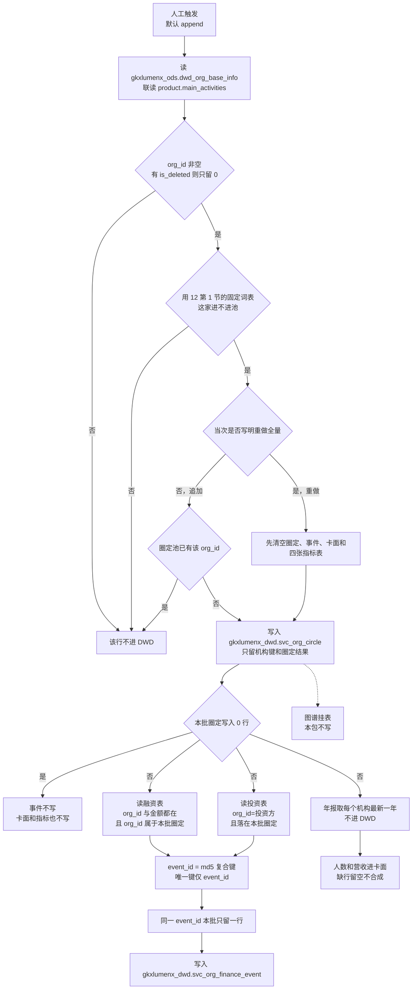

# 供应方表如何进入服务机构 DWD

> **读者**：GDF 产线  
> **口径来源**：加工链路 [`02-asbuilt-process-chain.md`](../../../../data-design/storage/SVC/02-asbuilt-process-chain.md) §1.1、§1.2；**2026-11-04 round1 答复落地**（`GDF-SVC-WORKPACK-R1A-L01`）。  
> **列**：只认 [`09`](09-服务机构-抽取字段对照.md)。**进池词**：只认 [`12`](12-DWD后加工-圈定与指标.md) 第 1 节。**追加 / 重做**：只认 [`04`](04-技术字段与过滤规则.md)。  
> **图号**：`SVC-GDF-DWD-ENTRY-20261104`  
> **状态**：说明。未建作业，未执行建表，未灌数。

服务机构在 `gkxlumenx_dwd` 里和本主题有关的结果表有三张。这一趟只让数据进入前两张。

| DWD 表 | 这一趟 | 数据从哪来 |
|--------|--------|------------|
| `svc_org_circle` | 写 | 主表 + 经营范围文本通过圈定的机构，只留机构键和圈定结果 |
| `svc_org_finance_event` | 写 | 融资表、投资表里，挂得上本批圈定机构的事件 |
| `svc_org_graph_hang` | 不写 | 不在本包 |

年报不进任何一张 DWD。人数和营收只进 `gkxlumenx_ads.svc_org_card`。主表上的名称、地区、行业、规模原文也不进圈定池，同样只进卡面。

**读源（Q0）**：优先读平台贴源 `gkxlumenx_ods` 中与供应方一致的镜像表（四表 + 经营范围用的产品表）。与供应方 `gkx` 同表同名；禁止读库名以 `demo_` 开头的库。

| 源表（在 `gkxlumenx_ods`） | 进不进 DWD |
|----------|------------|
| `dwd_org_base_info` | 进圈定池。工商全列不复制进去 |
| `dwd_org_org_product_info` | **不进 DWD**。只提供 `main_activities` 作文经营范围，供圈定扫词（Q4） |
| `dwd_org_financing_info` | 进事件表，类型 `FINANCING` |
| `dwd_org_invest_info` | 进事件表，类型 `INVEST` |
| `dwd_org_annual_financial_info` | 不进 DWD |

## 1. 判断顺序

箭头是判断先后，不是每张表各配一趟作业。圈定没写完，事件不写，已经写下的本批行撤回。

**禁止**「关键字命中不足 10 家 → 过滤后全部机构进池」。命中多少就入多少；0 行则圈定空、下游不写（Q9）。

## 2. 圈定池里的一行怎么来

一行对应一个 `org_id`。池里不出现主表的名称、地址、经营范围全文。

1. 从 `gkxlumenx_ods.dwd_org_base_info` 取行。`org_id` 空的丢掉。有 `is_deleted` 时只留 `0`。经营范围文本：按 `org_id` 联读 `dwd_org_org_product_info.main_activities`（主表无 `business_scope` 列）。区县只用主表 `area`（无 `district` 列，不做回退）。
2. 用 [`12`](12-DWD后加工-圈定与指标.md) 第 1 节的固定词表决定进不进池。词来自临时规则 `svc_rule_demo_kw_v1.1`。`org_type` 不参与。高校表、科研院所表不参与。
   - 行业、行业分层、行业代码、`main_activities` 里有字：一级行业等于「科学研究和技术服务业」，或一级行业含「金融」，或命中六类词，或命中「咨询」「广告」，这家进池。
   - 这些文本都空：只看 `name_cn` 是否命中名称收紧词。光杆「投资」「咨询」「广告」「银行」「基金」「保险」不够进池。
3. ~~不足 10 家整表回退~~ **已取消**。
4. 进池之后再分类，顺序 `FINANCE`、`IP`、`HR`、`MKT`、`CONSULT`、`INNOV`，先命中先得。对不上就空。一级行业是「科学研究和技术服务业」只说明可以进池，不能单凭这一句记成 `INNOV`。
5. 默认追加。圈定池里已经有的 `org_id` 不再插一行。只有当次写明重做全量，才先清空 [`04`](04-技术字段与过滤规则.md) 点名的七张表，再写入当次全部命中。
6. 写入的列：`org_id`、`rule_version`（`svc_rule_demo_kw_v1.1`）、`hit_fields`、`service_type_candidate`、`pending_client_confirm`（固定 `1`）、`etl_batch_id`。`ext` 本批不因 fallback 写入。

批次号用运行当天，形如 `svc-fseed-YYYYMMDD`。

## 3. 投融资事件里的一行怎么来

事件表不单独开读。圈定本批没有写完，或者写入是 0 行，事件一行都不写。

本批能挂事件的 `org_id`：

- 追加：只含这一次新插入圈定池的机构。
- 重做：清空之后，用当次重新写入的全部圈定机构。

| 源表 | 留下的条件 | 写成 |
|----------|------------|------|
| `dwd_org_financing_info` | 同时有 `org_id` 和 `funding_amount`；`org_id` ∈ 本批圈定 | `FINANCING`。金额解析成**元**（万×10000、亿×1e8）。外币**不换汇**，只取可解析数字；币种写入 `ext`（若有）。解析不了就空，不写成 0。日期用 `completion_date` |
| `dwd_org_invest_info` | 同时有 `org_id` 和 `investment_amount`；**`org_id` = 投资方**（Q3）；`org_id` ∈ 本批圈定 | `INVEST`。金额按元。业务日空着。`inv_org_id` / `inv_name` / `created_time` 进 `ext`。挂不上圈定的行**丢弃** |

**`event_id`（Q1）**：复合键再 md5，与现网 `svcseed._event_id` 一致：

- 融资：`md5("F\|" + org_id + "\|" + completion_date + "\|" + funding_round + "\|" + dwd_id)`（缺段用空串；须保证同批唯一）
- 投资：`md5("I\|" + org_id + "\|" + inv_org_id + "\|" + created_time + "\|" + dwd_id)`

表唯一键：**仅** `UNIQUE(event_id)`（不再用 `(org_id, event_id, event_type)`）。`org_id`、`event_type` 仍写入，供查询。

`ext` 只放稀疏附属键，禁止源行全字段 dump。

## 4. 不进 DWD 的两路

**年报（Q5）。** `dwd_org_annual_financial_info` 按 `org_id` 取 `year` 最大的一行，只要人数和营收，写入卡面。没有这一行，卡面这两列空着。**禁止**内存合成或从别处加工补数，也不写回源库。覆盖率低属可接受数据现状。

**图谱挂表。** 本包不配、不写。

## 5. 和卡面的先后

卡面在 `gkxlumenx_ads`。只处理本批圈定机构。圈定是 0 行时，卡面也是 0 行。`svc_org_card.ext` 本批不映射（占位，Q6）。
