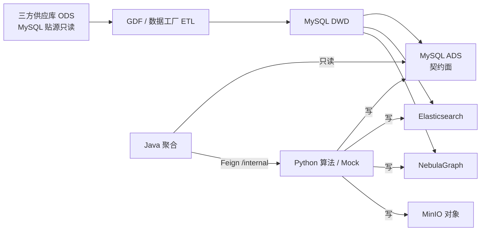
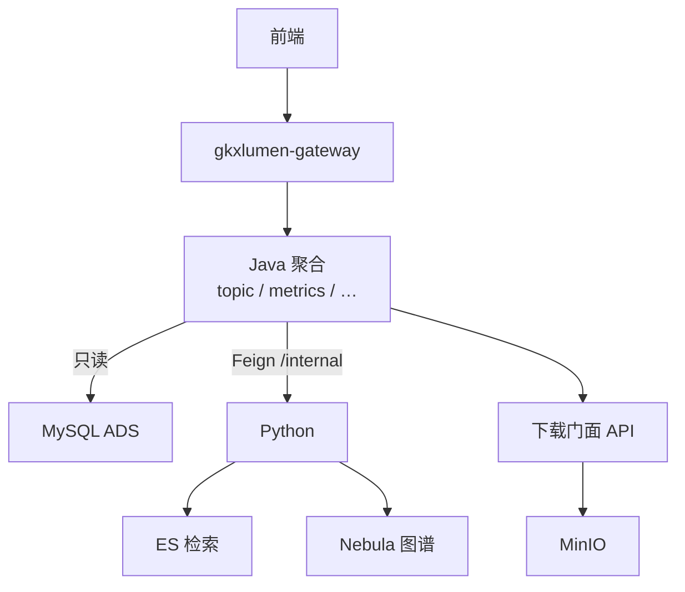
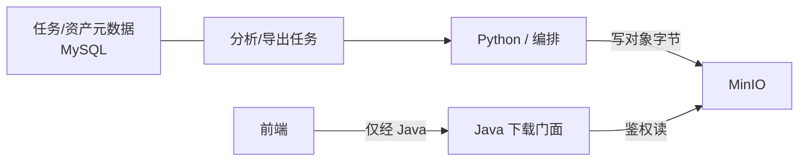
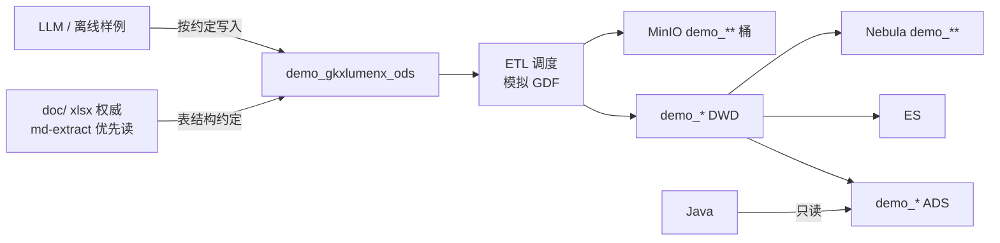
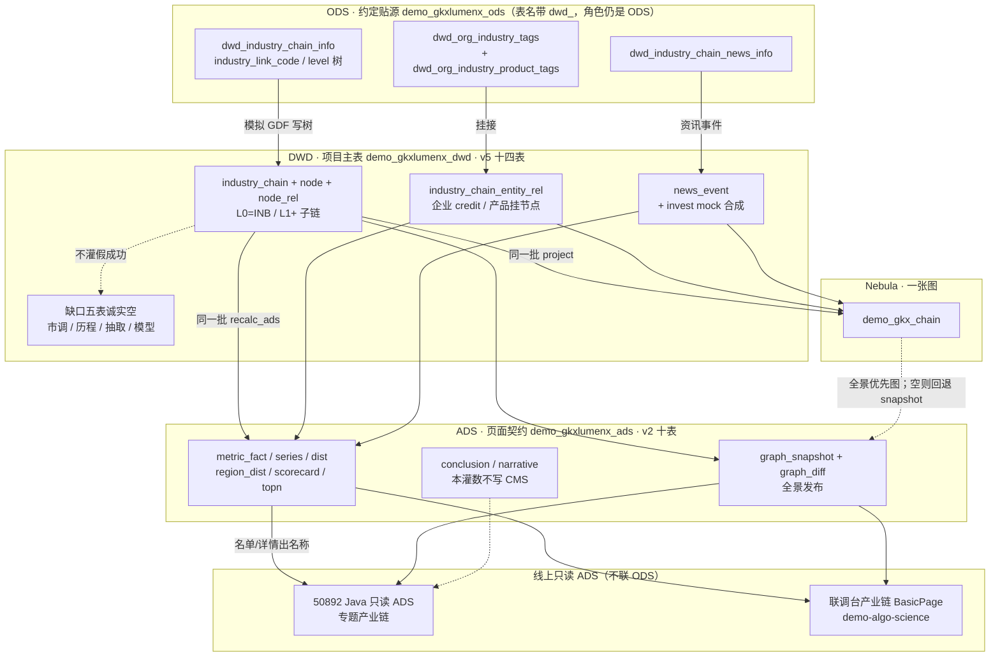
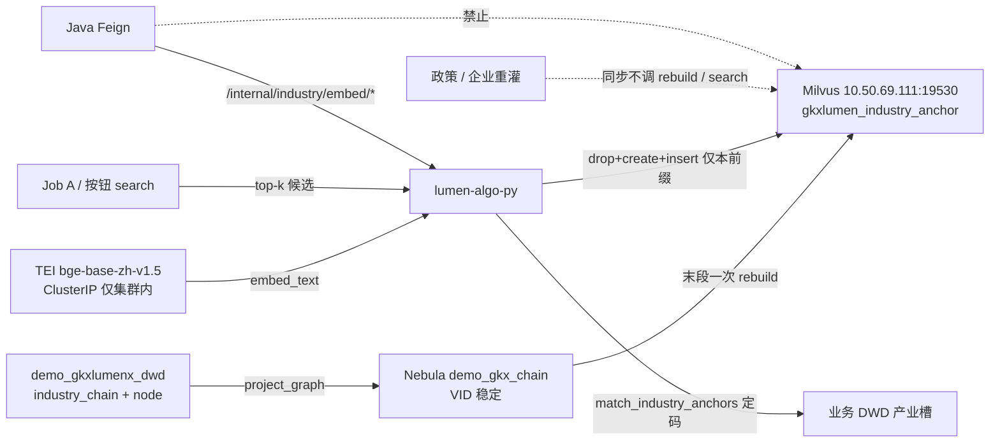
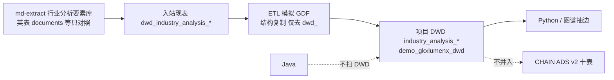
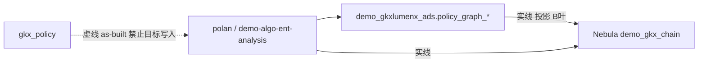

# 产业链维 · 端到端数据流

```yaml
---
doc_id: CHAIN-STORAGE-FLOW
element: CHAIN
role: data-flow
status: approved
version: "2026-09-11"
updated: 2026-09-11
engine: multi
signoff_owner: human:李伟
signoff_status: approved
signoff_by: human:李伟
signoff_at: 2026-08-13
amendment_note: "S1 会签通过：同构 ENT 三图 + Demo ODS 真源锁定（doc/md-extract）+ demo_gkxlumenx_ods；放行 S2 建表。2026-08-20 增 §8 表级数据血缘图（S4 后人读；不改 §1–3 拓扑、不翻签）。2026-08-21 增附录 B 政策挂接 demo_gkx_chain（DATA-POLICY-STORAGE-S1-L01；不翻签主图；政策流图由 human:淮政玮 会签，不经李伟）。2026-09-11 增 §9 产业锚点向量面（CROSS-VEC；不改 §1–3 会签边、不翻签；李伟增量会签 OPEN-CHAIN-VEC-01）。"
---
```

> **会签 Owner：`human:李伟`**（2026-08-13 **approved**）。  
> 本流图会签通过后，允许启动 **S2**（sources/etl/seeds + **按在线文档在** `demo_gkxlumenx_ods` **建表**）与后续 S3。  
> **仍禁止**：在未完成对应 `stores/*` 文档评审前，将细表标为「结构已批准 / approved」。  
> **§7**：Demo「约定 ODS → ETL 模拟 GDF」口径（结构与 §1 同构）。  
> **§8**：S4 后表级血缘图（人主看）；**不翻签**、细表仍 draft。  
> **§9**：产业锚点向量面（Milvus 新 collection + 灌链末段一次 rebuild）。**不改** §1–3 会签边、**不翻签**。施工真源：`agent-handoffs/产品整体定义/跨系统-向量库/CROSS-VEC-长任务总控.md`。增量会签 `human:李伟`（OPEN-CHAIN-VEC-01）。

## 1. 批处理主链（工厂）




| 生产者                 | 消费者                       | 触发                                                          | 失败语义                                                                                | 禁止事项                                         |
| ------------------- | ------------------------- | ----------------------------------------------------------- | ----------------------------------------------------------------------------------- | -------------------------------------------- |
| 三方 / GDF            | MySQL DWD                 | **批**：GDF 作业；具体 cron / DAG 名 → **OPEN-CHAIN-FLOW-01**（S2 填） | 本批失败则**不晋升**依赖该批的下游；保留上一成功 DWD 快照；飞书知会供应方 / GDF / 数据 Lead；不自动回滚 ADS                 | 业务 API / Java / 前端直读 ODS；Java 写 DWD          |
| DWD ETL（GDF/Python） | ADS / ES / Nebula         | **批**：DWD 门禁通过后串联；或算法刷新任务触发派生                               | 管道失败 → 该目标存储**不发布半成品**；ADS 保留上一成功契约切片；ES/Nebula 可降级，**ADS 仍为指标权威**；作业标 failed + 可重试 | Java 写 ADS；三方字段泄漏进 ADS 契约面（D7）；Neo4j         |
| Python（含 Mock）      | ADS / ES / Nebula / MinIO | **Demo 主路径见 §7**。可选旁路：直写 ADS（D7）。生产：批或任务写计算产物               | 写失败 → 任务态 `failed`；禁止静默部分成功；Java 只读既有成功数据                                           | 前端造假；Java/前端写 ADS；以现网 as-built 当 Demo ODS 真源 |
| Java                | （读）ADS；Feign→Python       | **在线** HTTP                                                 | 4xx/5xx 统一错误体；**不写回** ODS/DWD/ADS；不因读失败扫 DWD                                        | 扫 ODS/DWD；直连 nGQL；对前端暴露 `/internal`          |


**拓扑要点**

- 工厂主链：`ODS → GDF → DWD → ADS`（D7）；派生：`DWD → ES / Nebula`。
- **Demo**：同构；调度**模拟 GDF**；ODS 按**三方在线约定**写入 `demo_`*（§7）。
- Java **只读 ADS**；图谱 = **NebulaGraph**；关系库 = **仅 MySQL**（禁止 PostgreSQL 叙述）。
- **向量面不进本图**：产业锚点索引是灌链派生面（§9），不是 ADS 契约面，也不是第二张图。Java / 前端 **不**直连 `19530`。


## 2. 在线读路径




| 生产者    | 消费者  | 触发                  | 失败语义                                     | 禁止事项                                      |
| ------ | ---- | ------------------- | ---------------------------------------- | ----------------------------------------- |
| Java   | 前端   | 用户操作 → HTTP         | 统一错误体 + trace；不把存储异常细节泄给前端               | 前端直连 ES / MinIO / Nebula / MySQL / Python |
| Python | Java | Feign `/internal/*` | 同步失败 → Java 映射 5xx/业务码；长任务 → 任务态可查，禁止假成功 | 对前端暴露 `/internal`；Java 直连 nGQL            |
| 下载门面   | 前端   | 鉴权后下载               | 对象缺失 → 业务错误；**不**下发直连凭证                  | 前端持 MinIO 永久密钥；门面扫 DWD                    |


## 3. 对象 / 报告产物




| 生产者         | 消费者               | 触发                  | 失败语义                           | 禁止事项                        |
| ----------- | ----------------- | ------------------- | ------------------------------ | --------------------------- |
| Python / 编排 | MinIO + MySQL 元数据 | 分析/导出完成时写对象；元数据同步落库 | 对象写失败 → 任务 `failed`，元数据不标可下载   | 用 MinIO 替代业务表；元数据只放对象桶      |
| Java 下载门面   | 前端                | 鉴权下载                | 鉴权失败 401/403；对象不存在 404；不回源 DWD | 前端直连 MinIO；下载 API 扫 ODS/DWD |


平台约定见 [`../platform/minio.md`](../platform/minio.md)；本域对象前缀见 [`etl/README.md`](./etl/README.md)（S2 补 `pipeline-to-minio.md`）。  
现网 Endpoint / bucket / TTL → **OPEN-CHAIN-FLOW-02**。

## 4. 架构师会签清单

- [x] 主链与在线读路径与 `architecture-baseline` 一致（D3 ADS / 调用链 / D6 Nebula / D7 工厂）  
- [x] ADS 为唯一 Java 契约面已在图中明示  
- [x] MinIO 仅为对象面、元数据在 MySQL  
- [x] 无 PostgreSQL / Neo4j  
- [x] ODS 真源 = `doc/` xlsx（优先 `md-extract/`）；Demo 落 `demo_gkxlumenx_ods` 已写死  
- [x] 调度与失败语义已填（具体 cron/DAG/bucket 为开放项，不阻塞拓扑会签）
- [ ] **2026-09-11 增量**：§9 向量面进入存储树（不进 ADS）；待 `human:李伟` 增量会签（OPEN-CHAIN-VEC-01）

> 已由 `human:李伟` 于 2026-08-13 会签：`signoff_status=approved`。§9 **不改签**。


## 5. 开放项（不阻塞本流图拓扑会签）


| ID                 | 项                                                       | Owner           | 关闭阶段                                                |
| ------------------ | ------------------------------------------------------- | --------------- | --------------------------------------------------- |
| OPEN-CHAIN-FLOW-01 | GDF ODS→DWD / DWD→ADS 具体调度（cron、DAG、门禁脚本路径）             | 数据 Lead / GDF   | S2+                                                 |
| OPEN-CHAIN-FLOW-02 | MinIO 现网 Endpoint、默认 bucket、TTL（可复用平台 OPEN-ENT-FLOW-02） | 平台 / 架构         | `platform/minio.md`                                 |
| OPEN-CHAIN-FLOW-03 | CHAIN 对象前缀与任务表字段对照                                      | data / GDF      | S2（建议 `chain/{task_id}/`）                           |
| OPEN-CHAIN-FLOW-04 | ES / Nebula 同步失败告警与重试 SLA                               | data + 算法       | S2/S3                                               |
| OPEN-CHAIN-FLOW-05 | 产业链 ODS **在线约定**入口与 `sources/inventory` 表级清单            | 数据 / 李伟         | **S1 已钉真源**；表级清单 S2 充实；权威 xlsx + **md-extract 优先读** |
| OPEN-CHAIN-FLOW-06 | `demo_*` 建表 + 灌数脚本（对齐 ENT `llm_ods` 模式）                 | 李伟 / data-agent | **S2 主责**：按要素库在 `demo_gkxlumenx_ods` 建表             |
| OPEN-CHAIN-FLOW-07 | seeds 覆盖矩阵                                              | Demo / 数据       | S2                                                  |
| OPEN-CHAIN-FLOW-08 | ODS（4 表）→ 项目 DWD（v5 `industry_chain_*`）字段映射与拆分规则        | 架构 / 数据         | S2 后 Mapping；不挡 S1                                  |
| OPEN-CHAIN-FLOW-09 | 旧稿废弃声明（`DATA-CHAIN-db-design` PG 版、7 Mock 映射）           | 架构              | S1 handoff 起标注冲突以本树为准；S4 stub                       |
| OPEN-CHAIN-INDANA-01 | Demo `demo_gkxlumenx_dwd` 行业分析六张 `dwd_industry_analysis_*` 2026-08-16 抽检不存在；结构暂以三方 `gkx` live `SHOW CREATE` 复制 | data / 李伟 | 增量切片 · 未会签 |
| OPEN-CHAIN-INDANA-02 | CSV 主键=`document_id` vs 现表 PRI=`pk_id`；技术列 CSV 无。**现表 DDL 赢** | 数据 Lead | 增量切片 · 未会签 |
| OPEN-CHAIN-INDANA-03 | GDF 派单包无行业分析 Mapping 作业名（现行仅「企业」域），禁止编造 | GDF | 增量切片 · 未会签 |
| OPEN-CHAIN-INDANA-04 | 行业分析正文不并入 CHAIN ADS v2；图谱抽边读 DWD `industry_analysis_*` | 算法后续叶 | 增量切片 · 未会签 |
| OPEN-CHAIN-INDANA-05 | 本附录行业分析切片待 `human:李伟` 会签；**不**把主图 `signoff_status=approved` 改成本叶批准 | `human:李伟` | 增量切片 · 未会签 |
| OPEN-CHAIN-POLICY-01 | 附录 B 政策挂接；施工范围见 POLICY 流图 §3 | `human:淮政玮` | **已放行** · 2026-08-21 · 不经李伟 |
| OPEN-CHAIN-VEC-01 | §9 向量面增量会签：灌链末段一次 rebuild + Milvus `gkxlumen_industry_anchor` 进入 CHAIN 存储树（不进 ADS） | `human:李伟` | 增量 · **未会签**；施工已按 CROSS-VEC 总控特殊授权先行 |
| OPEN-CHAIN-VEC-02 | 每日凌晨定时灌链（= 索引刷新）；排在 Job A 之前且串行 | devops | 已拍板 · 施工叶 `CROSS-VEC-CHAIN-CRON-L01` backlog |
| OPEN-CHAIN-VEC-03 | 设计稿 `88.48` / `gkxlumen-industry-*` 订正为 `10.50.11.76` / `gkxlumen_industry_`（SAD 01/02/03） | 李伟 / 徐滕强 | 文档项 · 不挡施工 |


## 6. 下游放行（会签通过后生效）


| 阶段                                 | 结论                                                                                                                              |
| ---------------------------------- | ------------------------------------------------------------------------------------------------------------------------------- |
| **S2** `DATA-CHAIN-STORAGE-S2-L01` | **放行开工**：sources/etl/seeds + **必须按 md-extract「产业链要素库」在** `demo_gkxlumenx_ods` **建表**（表名/字段对齐文档；禁止只写清单不建表；禁止写正式 `gkxlumenx_ods`） |
| **S3** `stores/`*                  | 会签流图**不**等于细表 approved；S3 另单灌清单                                                                                                 |
| **S4** 旧路径 stub                    | 另单；冲突以本树为准                                                                                                                      |
| `data-design/产业链/*` legacy         | 输入可参考；**ODS 建表真源不认**旧稿，只认 `doc/`                                                                                                |


## 7. Demo / 约定 ODS 全链路

> 不改变 §1–3 拓扑；细化 Demo 如何稳定供数。细则：`[etl/pipeline-demo-mock.md](./etl/pipeline-demo-mock.md)`。




| 项               | 约定                                                                                                                                              |
| --------------- | ----------------------------------------------------------------------------------------------------------------------------------------------- |
| ODS 结构真源        | **权威** = `agent-delivery/data/third-party-source/doc/` xlsx；**优先读** = `doc/md-extract/`；**不是** `gkx-mysql-raw` as-built                         |
| 产业链要素库（S2 建表范围） | `dwd_industry_chain_info`、`dwd_org_industry_tags`、`dwd_org_industry_product_tags`、`dwd_industry_chain_news_info`（供应方命名带 `dwd_`，**角色为约定 ODS 表**） |
| 落库实例            | `demo_gkxlumenx_ods`（账号 `gkxlumenx`）；**禁止**默认写 `gkxlumenx_ods`                                                                                  |
| 调度              | Demo 灌数基于 ETL **模拟 GDF**（与正式同构）                                                                                                                 |
| 项目 DWD          | v5 `industry_chain_*` 经映射灌入 `demo_gkxlumenx_dwd`（后续）；**S2 不要求**一次建齐 14 张项目 DWD                                                                  |
| 旁路              | 直写 ADS 仅冒烟；**全链路验收以本图为准**                                                                                                                       |
| 行业分析六表（增量） | 入站现表 `dwd_industry_analysis_documents` / `_companies` / `_industries` / `_topics` / `_content_types` / `_countries` → 项目 DWD **仅去前缀** `industry_analysis_*`。**不**并入 ADS v2 十表。详见附录 A。 |


## 8. 表级数据血缘图

> **不改变** §1–3 工厂拓扑会签。本图给人看表怎么走；细表仍 **draft**。字段对照见 [`etl/ods-to-dwd-mapping.md`](./etl/ods-to-dwd-mapping.md)，步骤见 [`etl/pipeline-demo-sim-process.md`](./etl/pipeline-demo-sim-process.md)。  
> **灌数时序就一句**：ODS 四表 → 模拟 GDF 写十四表 → **同一批**重算 ADS + 投影 Nebula → **VID 稳定后再一次** `embed/rebuild`（§9）→ 线上只读 ADS。名单/详情要名称时读 ADS（`topn` / `graph_snapshot` / `metric_*`），**不要再回 ODS**；产业锚点检索走 Milvus，**不要**把向量分数写成链码。  
> 本域 **没有** SVC 那种 circle / card：主体就在 DWD 树里。行业分析六表 **不并入** 本图（附录 A）。产业集群 DIM（`CL-*`→L0）是对照表，不是灌数主链。



| 跳 | 谁写 | 失败 |
|---|---|---|
| ODS → DWD | Demo：Python `gdf_sim`（模拟 GDF）。生产：GDF（OPEN-CHAIN-FLOW-01） | 本批不晋升 ADS |
| DWD → ADS | Python `ads_v2.recalc_ads`（append/replace **都** TRUNCATE 后全量重算） | 不发布半成品；不写假 `M_CHAIN_MARKET_SIZE` / `M_CHAIN_INVEST_*` |
| DWD → Nebula | Python `project_graph` / `project_nebula` | fail-soft，不阻断 ODS/DWD/ADS |
| DWD+图 → Milvus | Python 灌链末段 **一次** `embed/rebuild`（§9） | 点未稳定则跳过，保留上一 `index_version`；rebuild 失败不回滚已成功的 DWD/图 |
| 线上 | Java **只读** ADS；联调台可触发灌数/读 status | Java 不写库、不扫 ODS/DWD、不直连 nGQL、**不直连 19530** |

**禁止**：Java/前端回 ODS 取名称；用 `industry_analysis_*` 冒充本图；平行第二张图；把 CMS 历程灌进 `narrative`/`conclusion` 装成功。

企业上链（`enterprise_industry_chain` → `entity_rel.entity_id=org_id`）是 ENT 侧 hang，投影进 **同一张** `demo_gkx_chain`，不另起主体表。

政策挂接（附录 B）同样投影进 **同一张** `demo_gkx_chain`，不另起 `gkx_policy` 目标态 space。


## 9. 产业锚点向量面（增量 · 不翻签主图）

> **本节省不是 2026-08-13 主图会签范围。** `signoff_status` 仍为 `human:李伟` **approved**（产业链拓扑），**不改签**。  
> 施工按 CROSS-VEC 总控特殊授权先行。增量会签 `human:李伟`（OPEN-CHAIN-VEC-01）。  
> 真源：[`../../../../agent-handoffs/产品整体定义/跨系统-向量库/CROSS-VEC-长任务总控.md`](../../../../agent-handoffs/产品整体定义/跨系统-向量库/CROSS-VEC-长任务总控.md) §0 #2–#8 / #16–#19。  
> **向量不替代建图**；RAG 不是建图开工条件。Java 契约面仍是 ADS。



| 项 | 架构口径 |
|---|---|
| 建库切面 | **仅**产业链灌数。DWD 链表写完 **且** 上图 `chain`/`segment` VID 稳定后，整库 **一次** `POST /internal/industry/embed/rebuild`。禁止映射逐行 embed。 |
| 消费切面 | 政策 / 企业 **重灌同步** = L0+L1，**不调** Milvus / LLM / rebuild。search 只走按钮或 ETL Job A。 |
| 引擎 | 现网 Milvus **2.5.4 standalone** `10.50.69.111:19530`。不采购第二套向量云。原设计稿 `88.48` **作废**。 |
| database | lumen 正式库 **`gkxlumen`**。demo 用库 **`default`**。正式 rebuild / 检索的 `dbName` 只许 `gkxlumen`。2026-11-02 正式集合已建并 load，0 条。 |
| collection | 两边同名 **`gkxlumen_industry_anchor`**。前缀必须下划线 `gkxlumen_industry_`（连字符名物理建不出，`code 1100`）。**禁止**读写 / drop `amcpdp-*` / `aip_kb_*` / `spk_id_*`，也禁止正式批 drop 库 `default` 里的同名集合。 |
| 客户端守卫 | 现网 `authorizationEnabled=false`。`create`/`drop`/`insert` 必须以 `MILVUS_COLLECTION_PREFIX` 开头，否则拒绝。这是当前唯一隔离。 |
| embedding | 目标态 `bge-base-zh-v1.5` dim **768** COSINE；端点 `http://gkxlumen-embed-tei:8080/v1/embeddings`（ClusterIP）。query 侧加指令前缀，锚点侧不加。客户端 **不再** L2 归一。 |
| 定码 | 向量 `score` **不得**写成 `industry_link_code` / `chain:INB*`。定码仍走图谱 VID + `match_industry_anchors`。禁止采 top1 写槽。 |
| VID | 只用图上链码（例 `chain:INB170101`）。禁止 ODS 短码 / 中文名当 VID。 |
| 调度 | 每日凌晨灌链一次（= 索引刷新）。Job A **不得与灌链并排**（rebuild 窗口 `search` 返 degraded，不给假 VID）。 |
| 失败 | 点未稳定 / 词表空 → **跳过** rebuild，保留上一 `index_version`。rebuild 失败不回滚已成功的 DWD/图。引擎不可用 → HTTP 503 + `degraded=true` + 空 items。 |

| 生产者 | 消费者 | 触发 | 失败语义 | 禁止事项 |
|---|---|---|---|---|
| `project_graph` 末段 | Milvus `gkxlumen_industry_anchor` | 上图 `status=ok` 且 chain/segment 点数稳定后 **一次** rebuild | 跳过则旧索引仍服务；日志带 `industry_index_version`（skip 时诚实 `null`） | 政策/企业重灌调 rebuild；第二条 rebuild 调用点；drop 他人 collection |
| TEI | Python `embed_text` | rebuild / search | 端点不可达 → 503 + degraded，禁止假 VID | 进程内装 torch；Java 直连 TEI |
| Java `gkxlumen-topic-chain` | 运维 / 后续 Job 门面 | Feign `/internal/industry/embed/*` | 未就绪 **501** + honesty，不带候选 VID | Java 直连 19530；把 score 加工成 `chain:` 码 |

**与 §8 的关系**：ADS 仍是名单/KPI 权威；Nebula 仍是点边权威；Milvus 只存「图上已有产业锚点」的向量副本。三者不同构、不互相替代。


## 附录 A · 增量切片 · 未会签（行业分析六表）

> **本附录不是 2026-08-13 主图会签范围。** `signoff_status` 仍为 `human:李伟` **approved**（产业链拓扑）。  
> 任务 `DATA-CHAIN-INDANA-STORAGE-L01` 只登记切片，**禁止**把主图改签成本叶批准。待 `human:李伟` 会签增量（OPEN-CHAIN-INDANA-05）。



| 生产者 | 消费者 | 触发 | 失败语义 | 禁止事项 |
|---|---|---|---|---|
| 三方 `gkx` / 拟 Demo 入站六表 | 项目 DWD `industry_analysis_*` | 批：模拟 GDF（GDF 作业名缺席 → OPEN-CHAIN-INDANA-03） | 本批失败不晋升依赖下游；不半成品写 ADS | 用 `dwd_industry_chain_news_info` 冒充文档表；Java 扫 DWD；塞进 ENT `dwd-entity` |
| Python 算法 | Nebula（后续叶） | 读 DWD 正文及关联五表 | 读失败不伪造边 | 本叶写推理；Neo4j |

细表店面：[`stores/mysql/dwd-industry-analysis.md`](./stores/mysql/dwd-industry-analysis.md)（**draft**）。


## 附录 B · 政策挂接一张 G（`human:淮政玮` 放行 · 不翻签主图）

> **本附录不是 2026-08-13 主图会签范围。** CHAIN `signoff_status` 仍为 `human:李伟` **approved**（产业链拓扑），**不改签**。  
> 政策投影由 **`human:淮政玮`** 于 2026-08-21 在 `POLICY-STORAGE-FLOW` 放行，**不经李伟**。  
> 真源：[`../POLICY/01-data-flow.md`](../POLICY/01-data-flow.md)（**approved**）。



| 生产者 | 消费者 | 触发 | 失败语义 | 禁止事项 |
|---|---|---|---|---|
| polan | `demo_gkx_chain` | B 叶投影 | fail-soft；ADS 镜像可读 | DROP SPACE 底图；写 `gkx_chain`；CREATE SPACE `gkx_policy` 作目标 |
| 政策 ADS 镜像 | 图谱 API 兜底 | Nebula 不可用 | `source` 诚实非 nebula | 用独立政策图冒充一张 G |

点边映射见 POLICY `01-data-flow.md` §3（**draft**）。


