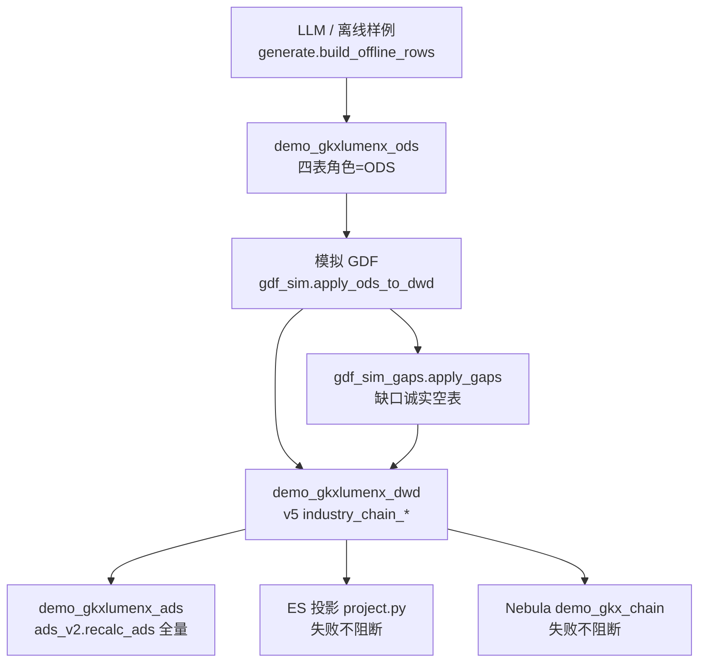

# CHAIN · Demo 全链路模拟过程（详细设计）

> **任务**：`DEMO-CHAIN-SIM-PROCESS-L01` · Owner `agent:algorithm-agent` · 监管 `human:淮政玮`  
> **对照**：ENT [`../../ENT/etl/pipeline-demo-mock.md`](../../ENT/etl/pipeline-demo-mock.md)  
> **灌数入口已有**：`DEMO-CHAIN-UI-SEED-ODS-L01`（`run_all.py --chain` / BasicPage split-button）——**本叶不重做按钮**  
> **字段级映射**：[`ods-to-dwd-mapping.md`](./ods-to-dwd-mapping.md)（字段名仅来自 inventory + v5）  
> **流图**：[`../01-data-flow.md`](../01-data-flow.md) **已会签，本叶不翻签**

```yaml
---
doc_id: CHAIN-ETL-DEMO-SIM-PROCESS
element: CHAIN
role: etl
status: draft
version: "2026-08-16"
updated: "2026-08-16"
task: DEMO-CHAIN-SIM-PROCESS-L01
engine: multi
---
```

## 0. 意图与诚实口径

产业链维 Demo 模拟过程对齐企业域：**离线确定性样例（可接 LLM，主键不变）→ `demo_gkxlumenx_ods` 四表 → 模拟 GDF → `demo_gkxlumenx_dwd` v5 十四表 → ADS v2 / ES / Nebula `demo_gkx_chain`**。

| 项 | 现行 as-built |
|---|---|
| 「LLM Mock」 | **现行 = 离线种子** `chainan/llm_ods/generate.py`（`SEED=20260814`）；注释约定「LLM 不改主键」。**无** ENT 同款 `--llm` 入口 |
| 模拟 GDF | `gdf_sim.py`（本叶 **只读**；`map_entity_rel` / `entity_id` 交给 `ENT-CHAIN-HANG-MOCK-L01`） |
| 缺口面 | `gdf_sim_gaps.py`：replace 清空 5 张缺口表；**不 INSERT**；上链叶应继续在 `apply_ods_to_dwd` **之后**调 `apply_gaps` |
| 项目 DWD | v5 `industry_chain_*` **十四表**，**不是**供应方四表去 `dwd_` 前缀 |
| 行业分析 | 六表 `industry_analysis_*` **切片**（去前缀）；禁止 `dwd_industry_chain_news_info` 冒充 `documents` |

禁止：写正式 `gkxlumenx_*`；`init_schema()`；Neo4j；灌假算法结果装成功；改科技新闻页；翻签 `01-data-flow.md`。

---

## 1. 总流程图



调度编排：`scripts/run_all.py --chain --mode append|replace` → `seed.run_seed`。  
UI 指针（已有，勿重做）：`demo-ui-system-test` 产业链 BasicPage split-button → `POST /internal/run-chain-pipeline`。

---

## 2. 逐步过程

每步：**输入表 / 输出表 / 脚本函数 / 失败语义 / 禁止项**。

### 2.1 约定结构解析

| 项 | 值 |
|---|---|
| 输入 | `third-party-source/doc/md-extract/` 产业链要素库（权威 xlsx；日常 md-extract） |
| 输出 | 内存 schema：四表列名 + 「是否为主键」 |
| 脚本 | `chainan.llm_ods.schema_src.load_chain_schema`（转调 `entan.llm_ods.schema`；K8s 回退 `_schema_parser` + vendor CSV） |
| 失败 | 缺表 / 主键与 inventory 不符 → `--self-check` / `run_seed` **硬失败**，不写库 |
| 禁止 | 以 `gkx-mysql-raw` as-built 改写约定列；造 `dwd_org_industry_chain_dtl` |

### 2.2 离线样例（LLM 位）

| 项 | 值 |
|---|---|
| 输入 | schema 列集合；`batch_no`（replace/空库=0；append 按 ODS 企业数递增） |
| 输出 | 四表行字典（只保留 schema 列；`_city`/`_district` **不进 ODS**） |
| 脚本 | `generate.build_offline_rows` / `build_tree_rows` / `build_enterprises` / `build_products` / `build_news` |
| 失败 | 形状不满足 SEED-01～09 → self-check 失败 |
| 禁止 | 改 SEED-01～09 主键语义；用 LLM 覆盖 `industry_link_code` / `credit_code` / 资讯 `id` |

确定性覆盖见 [`../seeds/README.md`](../seeds/README.md)。

### 2.3 写入 Demo ODS

| 项 | 值 |
|---|---|
| 输入 | 2.2 行集 |
| 输出 | `demo_gkxlumenx_ods`：`dwd_industry_chain_info` / `dwd_org_industry_tags` / `dwd_org_industry_product_tags` / `dwd_industry_chain_news_info` |
| 脚本 | `load.ensure_ods_tables` + `load.write_rows`；门禁 `dbconn.assert_demo_mysql_targets` |
| 失败 | 库名不以 `demo_` 开头 → `RuntimeError refusing`；建表/插入异常 → 本批失败，**不晋升** DWD |
| 禁止 | 默认写 `gkxlumenx_ods`；`init_schema()`；append 时 TRUNCATE 四表（仅 replace） |

业务键：`industry_link_code` / `credit_code` / `credit_code` / `id`。物理主键 `_demo_id`。

### 2.4 模拟 GDF（已映射表）

| 项 | 值 |
|---|---|
| 输入 | ODS 四表 `SELECT *` |
| 输出 | DWD：`industry_chain` / `node` / `node_rel` / `entity_rel` / `news_event` / `investment_event` / `investment_participant` / `event_entity_rel`（见 `gdf_sim.MAPPED_DWD`） |
| 脚本 | `gdf_sim.apply_ods_to_dwd`；映射函数 `map_chains` / `map_nodes` / `map_node_rel` / `map_entity_rel` / `map_news` / `map_invest_synthetic` |
| 失败 | ODS 单表读失败 → 该表当空列表，**不中断**（log warn）；INSERT 走 `insert_filtered`（缺列跳过） |
| 禁止 | 改 `map_entity_rel` 的 `entity_id` 语义（并行叶）；把 `level>=2` 行写入 `industry_chain`；把 `news_info` 写入行业分析 `documents` |

`MAPPED_DWD` 含 `industry_chain_event_metric_observation`，但 **`apply_ods_to_dwd` 未 INSERT**（无浏览/互动量字段）。本 Demo **不灌假互动量**。见 OPEN-CHAIN-SIM-02。

replace：TRUNCATE `MAPPED_DWD` 中已存在表。append：按 `chain_id` / `(chain_id,node_id)` / `relation_id` / `event_id` 去重后 INSERT。

投融资：无 `dwd_org_financing_info`（Q054）→ `map_invest_synthetic` 🧪 `source_system=mock`；ADS **不写** `M_CHAIN_INVEST_COUNT`（QC07）。

### 2.5 缺口面（本叶新文件）

| 项 | 值 |
|---|---|
| 输入 | 无业务行（故意） |
| 输出 | 五表保持 **0 行**：`market_observation` / `milestone_event` / `extraction_result` / `model_run` / `model_result_detail` |
| 脚本 | `gdf_sim_gaps.apply_gaps`（`seed.run_seed` 在 2.4 **之后**调用） |
| 失败 | 缺口表不存在 → skip truncate；**不**因此失败整批 |
| 禁止 | 为「十四表都有数」灌假抽取/模型结果；把市场规模写入 `market_observation` |

**上链叶合并点**：继续只在 `seed.py`（或未来编排）调用 `apply_gaps`；**不要**改 `gdf_sim.py` 去 hook。`ENT-CHAIN-HANG-MOCK-L01` 改 `map_entity_rel` 后，gaps 仍应后置，避免抢 entity_id 语义。

### 2.6 ADS v2 全量重算

| 项 | 值 |
|---|---|
| 输入 | 当前 demo DWD（chain/node/node_rel/entity_rel/news_event） |
| 输出 | `demo_gkxlumenx_ads`：`metric_fact` / `metric_series` / `region_dist` / `region_scorecard` / `topn` / `graph_snapshot` |
| 脚本 | `ads_v2.recalc_ads`（append **与** replace 都先 TRUNCATE 已存在 ADS 表） |
| 失败 | 读 DWD 单表失败 → 当空（log warn）；不写 CMS `narrative`/`conclusion` |
| 禁止 | 写 `M_CHAIN_MARKET_SIZE` / `M_CHAIN_INVEST_*` 装成功；把 ADS 当 DWD 边真源 |

SEED-09：`region_scorecard` L0×城市 MOCK 四力+三维（`honesty=mock`，`gap_ref=GAP-CHAIN-REG-METRICS`）；资讯序列覆盖 2020–2025。

### 2.7 ES / Nebula 投影

| 项 | 值 |
|---|---|
| 输入 | DWD 关系真源（投影读取；现行 `project.py` **未真正 bulk**） |
| 输出 | ES 建议 `demo_chain_*`；Nebula space **`demo_gkx_chain`**（正式目标 `gkx_chain`） |
| 脚本 | `project.project_safe` → `project_es` / `project_nebula` |
| 失败 | `enabled=false` → `skipped`；客户端未装 → `failed`；**不阻断**灌数；`/internal/status.projection` 诚实 |
| 禁止 | Neo4j；Java 直连 nGQL；前端直连 ES |

MinIO：本路径 **未投影**（OPEN-CHAIN-SIM-03）。

### 2.8 入口命令（不重做 UI）

仓根：`${GKX_ROOT}/repos/demo-algo-science`

```text
python scripts/run_all.py --self-check
python scripts/run_all.py --chain --mode append
python scripts/run_all.py --chain --mode replace
POST /internal/run-chain-pipeline  body {"mode":"append"|"replace"}
```

| mode | ODS/DWD | ADS | 缺口表 |
|---|---|---|---|
| append（默认） | 保留明细，新批次 INSERT（结构链去重） | TRUNCATE 后按当前 DWD 全量重算 | 不灌；不 truncate |
| replace | TRUNCATE 约定四表 ODS + `MAPPED_DWD` | 同上 | `apply_gaps` truncate 五张缺口表 |

UI：`demo-ui-system-test` 产业链「灌数据」split-button（`DEMO-CHAIN-UI-SEED-ODS-L01`）。旧旁路仅 `CHAIN_SEED_LEGACY_MOCKGEN=1`。

---

## 3. ODS 四表 → DWD 14 表映射矩阵（表级）

字段级见 [`ods-to-dwd-mapping.md`](./ods-to-dwd-mapping.md)。图例：**直接** / **合成🧪** / **n.a.**

| # | DWD 表 | 主 ODS | 映射 | 说明 |
|---|---|---|---|---|
| 1 | `industry_chain` | `dwd_industry_chain_info` | 直接（`level`∈{0,1}） | Q053：`chain_id`/`industry_id`=INB |
| 2 | `industry_chain_node` | 同上 | 直接（`level`≥2） | `chain_id`←`parent_code` |
| 3 | `industry_chain_node_rel` | 同上 | 合成🧪 | 同 L1 内相邻 L2；非供应方边表 |
| 4 | `industry_chain_entity_rel` | `dwd_org_industry_tags` + `dwd_org_industry_product_tags` | 直接+合成🧪 | 企业=`credit_code`；产品=`p:{credit}:{id}`；城市←`credit_geo_map` |
| 5 | `industry_chain_market_observation` | — | **n.a.** | 平台市场规模走 ADS；外部市调未到 |
| 6 | `industry_chain_investment_event` | — | 合成🧪 | Q054；`source_system=mock` |
| 7 | `industry_chain_investment_participant` | — | 合成🧪 | 随 mock 事件；正式源无逐方金额 |
| 8 | `industry_chain_news_event` | `dwd_industry_chain_news_info` | 直接 | `event_id=news:{id}`；缺日期则平台日+`ext.publish_date_missing` |
| 9 | `industry_chain_milestone_event` | — | **n.a.** | CMS 历程；不灌 |
| 10 | `industry_chain_event_entity_rel` | tags + news / mock invest | 合成🧪 | 资讯 publisher 截前 40；投融资 financing_subject |
| 11 | `industry_chain_event_metric_observation` | — | **n.a.**（listed 未写） | 无互动量 ODS；禁止假浏览量 |
| 12 | `industry_chain_extraction_result` | — | **n.a.** | 不装抽取成功 |
| 13 | `industry_chain_model_run` | — | **n.a.** | 不装模型运行成功 |
| 14 | `industry_chain_model_result_detail` | — | **n.a.** | 不装模型原子结果 |

ODS 未进 DWD 的列：`node_company_count`（ADS 聚合企业数）；`parent_name` / `industry_name` 冗余名（名称以 link_name 为主）。

---

## 4. 与行业分析六表切片边界

| 切片 | 入站 | 项目 DWD | Demo 路径 |
|---|---|---|---|
| **产业链四表** | `dwd_industry_chain_*` / `dwd_org_industry_*` | `industry_chain_*` 十四表（v5 映射，**非**去前缀） | 本过程 **主路径** |
| **行业分析六表** | `dwd_industry_analysis_*` | `industry_analysis_*`（**仅去 `dwd_` 前缀**） | `DATA-CHAIN-INDANA-STORAGE-L01`；**不**走 `gdf_sim` |

禁止：

- 用 `dwd_industry_chain_news_info`（产业动态资讯）冒充 `dwd_industry_analysis_documents`（研报/文档）
- 把资讯 `abstract`/`title` 写入 `industry_analysis_documents.body`
- 把六表并进 `storage/ENT` 或 `industry_chain_*`
- 本 Demo 对行业分析六表 `--apply` 正式 `gkxlumenx_*`

清单：[`../sources/inventory-industry-analysis.md`](../sources/inventory-industry-analysis.md)。

---

## 5. OPEN 清单

| ID | 说明 | 状态 |
|---|---|---|
| OPEN-CHAIN-FLOW-01 | 正式 GDF DAG/cron 未回写；本路径手工/API 模拟 | 开放 |
| OPEN-CHAIN-SIM-01 | CHAIN 无 ENT 同款 `--llm` 入口；现行仅离线种子 | 开放 |
| OPEN-CHAIN-SIM-02 | `event_metric_observation` 在 `MAPPED_DWD` 但 apply 未写；互动量后期埋点 | 开放 |
| OPEN-CHAIN-SIM-03 | MinIO / ES bulk / Nebula 投影未落地；`project.py` fail-soft | 开放 |
| OPEN-CHAIN-SEED-01 | 样例行业/企业是否用甲方脱敏清单 | 开放 |
| Q054 | 投融资 ODS 0 行；DWD mock 🧪；ADS 不写 INVEST_COUNT | 开放 |
| OPEN-CHAIN-INDANA-01 | Demo `industry_analysis_*` 六表尚未建出 | 开放（他叶） |
| ENT-CHAIN-HANG-MOCK-L01 | `map_entity_rel.entity_id` 语义；本叶未改 `gdf_sim.py` | 并行 |

---

## 6. 架构自检（本过程）

| 铁律 | 结果 |
|---|---|
| 只写 `demo_*` | `assert_demo_mysql_targets` |
| 算法/ETL 在 Python | `chainan/llm_ods` |
| 图谱 Nebula，禁 Neo4j | `project_nebula`；失败不阻断 |
| 不翻签 01-data-flow | 本文件 draft |
| 不灌假算法成功 | `gdf_sim_gaps` 五表 0 行 |
