# 管道 · → Nebula（产业链投影一张 G）

```yaml
---
doc_id: CHAIN-ETL-TO-NEBULA
element: CHAIN
role: etl
status: draft
version: "2026-09-01"
updated: 2026-09-01
task_id: DEMO-CHAIN-GRAPH-TRIPLE-UI-L01
p1_task_id: DEMO-CHAIN-GRAPH-TRIPLE-UI-L01
asbuilt_from: "chainan/llm_ods/seed.py + project.py + graph/nebula_project.py + nebula_schema.py + read_v2.panorama"
amendment: "步1/4：§1–§9 现网 as-built；§10–§16 与 POLICY 同构（102/103 需规 + 边清单 + LLM + 过程图）；§17–§20 每关系 op_id I/O、灌数零图谱清单、CHAIN-GRAPH-TRIPLE。"
---
```

> **§1–§9 是现网 as-built**（精读 `demo-algo-science` `seed` / `project_nebula` / `nebula_project.project_from_dwd` / `nebula_schema` / `read_v2.panorama` / 联调台 `BasicPage`+全景页，**不改代码**）。**§10–§16 是 102/103 详细设计**。**§17–§20 是 DEMO-CHAIN-GRAPH-TRIPLE-UI-L01 步1 契约**（每关系独立 `op_id`、灌数剥离清单、目标态过程图）。
> 拓扑真源 [`../01-data-flow.md`](../01-data-flow.md)（**approved · human:李伟**，本叶**不翻签**）· 细表 [`../stores/nebula/graph-chain.md`](../stores/nebula/graph-chain.md)（draft）。
> 本叶只写文档：**不改 demo-algo-\* / demo-ui-\* / lumen-ui-\* 代码、不 APPLY DDL、不灌数、不顺带 hang**。步2 实现必须对照 §17 / §18，禁止继续把 `project_from_dwd` 挂在 `run_seed` 上当对外契约。
> 与政策叶同构：[`../../../POLICY/etl/pipeline-to-nebula.md`](../../../POLICY/etl/pipeline-to-nebula.md) §10–§20。

## 1. 意图

把产业链 **L0 产业 / L1 子链 / L2+ 环节** 及链内结构边投影进一张 G。`enterprise` / `institution` / `policy` 复用他域已有顶点，链侧 **不另建 space**、不复制工商/政策本体。企业上链的 **MySQL 真源**仍是 [`pipeline-ent-hang.md`](./pipeline-ent-hang.md)；本管道 C 档只 hang 已存在的 `ent:` / `inst:` / `pol:`，**禁止**灌数顺带 hang。

## 2. 入口与源

| 项 | 值 |
|---|---|
| 仓 / 模块 | `demo-algo-science` · `chainan/llm_ods/seed.py` · `chainan/llm_ods/project.py` · `chainan/graph/nebula_project.py` · `chainan/graph/nebula_schema.py` |
| 灌数入口 | `run_seed(mode)`；`scripts/run_all.py --chain`；`POST /internal/run-chain-pipeline`（联调台经 Java `/innov/v1/industry/internal/run-chain-pipeline`） |
| 图写入入口（现网，**混在灌数里**） | `project_safe` → `project_nebula` → `project_from_dwd`（`seed.run_seed` 末步） |
| schema 入口（现网，独立内部接口） | `POST /internal/graph-schema-init` → `init_schema_from_code`（`CREATE SPACE` + `CREATE TAG/EDGE IF NOT EXISTS`；**不灌点边**） |
| 读路径 | `GET /v1/chain/{chain_id}/panorama` → `read_v2.panorama`：先 `nebula_project.read_panorama`，空则 ADS `industry_chain_graph_snapshot`，再空则 DWD node/node_rel |
| 源表 | DWD `industry_chain` · `industry_chain_node` · `industry_chain_node_rel` · `industry_chain_entity_rel` ·（现网计数后丢弃）`industry_chain_event_entity_rel` |
| 目标 | Nebula space **`demo_gkx_chain`** |
| Demo 库 | `demo_gkxlumenx_ods` / `_dwd` / `_ads`；禁正式 `gkxlumenx_*` |

旁路：`CHAIN_SEED_LEGACY_MOCKGEN=1` 走 `LEGACY_CHAIN_STEPS`（含 `chainan.graph.build.run` / `run_sz` 写旧 SQLite 全景表）。**不算主路径验收**，步2 仍须从该旁路 grep 掉图谱写入。

2026-10-24 demo 实查（按产业、产业节点能命中的条数，上图前的关联事实）：

| 要素 | 实查 |
|---|---|
| 政策 | [产业检索政策条数](../../../../../qa/test-cases/SDWJSF-KJZTFWSFK/policy-政策分析/产业检索政策条数-20261024.md) |
| 企业 | [产业检索企业条数](../../../../../qa/test-cases/SDWJSF-KJZTFWSFK/enterprise-企业分析/产业检索企业条数-20261024.md) |
| 服务机构 | [产业检索服务机构条数](../../../../../qa/test-cases/SDWJSF-KJZTFWSFK/svc-产业服务分析/产业检索服务机构条数-20261024.md) |

## 3. Space 与 VID 约束（代码强制）

`chainan/graph/nebula_schema.py` 把一张 G 写死为常量；`chain_space()` / `assert_demo_nebula_space()` 校验：

| 项 | 值 | 违反后果 |
|---|---|---|
| space | 仅 `demo_gkx_chain` | `NonDemoNebulaSpaceError` |
| 拒绝 | `gkx_chain` / 非 `demo_[A-Za-z0-9_]+` | 同上 |
| vid_length | 必须 **80**（`FIXED_STRING(80)`） | `_vid()` 超长返回 `None`，计数 skip |
| VID 前缀 | `chain:` / `segment:` / `ent:` / `inst:` | 与政策 C 档 `FETCH` 对齐 |
| 正式图库 | `gkx_chain` | 本管线零写入 |
| 废作 | 第二空间 `gkx_policy` / `gkx_service` / `demo_entan` | 禁止 `CREATE SPACE` 作目标 |

配置：`GKX_CHAIN_NEBULA_SPACE` / settings `nebula.space`；**不用** `GKX_NEBULA_SPACE`（企业 `demo_entan`），避免串库。

## 4. Schema 增量（`init_schema_from_code` / 投影内嵌）

现网投影 **会**调用 `init_schema_from_code()`：无 space 则 `CREATE SPACE`，再 `CREATE TAG/EDGE IF NOT EXISTS`。与政策叶「灌数禁 schema」冲突——**步2 必须把该调用从 `run_seed` 摘掉**，只允许图谱菜单 A/B/C 或独立「初始化图谱」触发。

as-built DDL（与 `graph-chain.md` / lumen `graph_project` 同文）：

```ngql
CREATE TAG  IF NOT EXISTS chain       (name string, chain_id string, chain_stage string, node_level int, is_key_node bool, enterprise_count int, weight double, props string)
CREATE TAG  IF NOT EXISTS segment     (name string, segment_key string, chain_id string, chain_stage string, weight double, props string)
CREATE TAG  IF NOT EXISTS enterprise  (name string, enterprise_code string, chain_role string, weight double, props string)
CREATE TAG  IF NOT EXISTS institution (name string, institution_type string, weight double, props string)
CREATE EDGE IF NOT EXISTS belongs_to  (node_stage string, weight double, props string)
CREATE EDGE IF NOT EXISTS participates(chain_role string, participation_depth double, chain_score double, props string)
CREATE EDGE IF NOT EXISTS supplies    (relation_type string, relation_strength double, props string)
CREATE EDGE IF NOT EXISTS depends_on  (dependency_type string, weight double, props string)
```

> 现网 `map_graph` **从未写出** `supplies`。`event_entity_rel` 因无 event Tag 整表计数跳过。技术 / 人才 / 政策 **无 Tag**。

## 5. 挂接解析（对不齐则不上图）

现网投影 **在本批 DWD 集合内造点再连边**，**不** `FETCH PROP ON *` 证明他域顶点已在一张 G。目标态 C 档必须 FETCH，解析不到就计数跳过，**不按名称猜测**：

| 源 / 终点 | 取值字段 | 目标前缀 | 现网 |
|---|---|---|---|
| 产业 L0/L1 | `industry_chain.chain_id` | `chain:` | 本批 INSERT VERTEX `chain` |
| 环节 L2+ | `industry_chain_node.node_id` | `segment:` | 本批 INSERT VERTEX `segment` |
| 企业 | `entity_rel.entity_id`（目标 = `org_id`） | `ent:` | **现网会新建** `enterprise` 点（不是 FETCH） |
| 科研 / 服务机构 | `entity_type=institution\|service_institution` | `inst:` | **现网会新建** `institution` 点 |
| 技术 / 人才 | — | — | 无 Tag（`OPEN-CHAIN-GRAPH-01`） |
| 政策 | `policy_id` | `pol:` | **未挂**（政策叶可已有 `pol:`） |
| 事件 | `event_entity_rel` | — | `event_entity_rel_no_event_tag` |

边两端任一顶点未解析则整条丢弃。`relation_type` 不在白名单 → `not_in_wave`。

## 6. 写入与幂等（as-built）

| 动作 | 现网 | 目标态 |
|---|---|---|
| 顶点 / 边 | `INSERT VERTEX` / `INSERT EDGE`，`chunk=80` | 按 `op_id`+`calc_batch_id`+主键覆盖 |
| `mode=replace` | **`CLEAR SPACE demo_gkx_chain`**（保留 schema）后全量 upsert | **禁止灌数 CLEAR**；图谱菜单危险操作另议 |
| `mode=append` | 直接 upsert，不删底图 | 保持 |
| 删除底图 | replace 清整图；不做 `DROP SPACE` | 禁止灌数清图；禁止 DROP `chain`/`ent`/`inst`/`pol` |

同 VID 可重复执行。

## 7. fail-soft 与开关

`project_nebula`：`nebula.enabled=false` → `skipped`；客户端未装 / 异常 → `failed`；**不阻断** ODS/DWD/ADS。`/internal/status.projection` 回传该对象。

读全景：Nebula 有点才 `source=nebula`；否则 ADS/DWD 且 `source=ads`。**只有真实 nGQL 读成功才标 nebula**。

| 环境 / 门闩 | 作用 |
|---|---|
| `is_live("chain")` | 顶栏正式库：灌数 / schema-init 拒绝写入 |
| `assert_demo_mysql_targets()` | 只写 `demo_*` MySQL |
| `chain_space()` | 只认 `demo_gkx_chain` |
| `GKX_CHAIN_NEBULA_*` | hosts/user/password；与 `POLAN_*` / `ENTAN_NEBULA_SPACE` 隔离 |

## 8. 现网基线（代码事实，非本叶实测灌数）

本叶**未连库、未投影**。下列是 as-built 行为，不是验收数字。

| 项 | 现网 |
|---|---|
| 灌数 `run_seed` | ODS 四表 → 模拟 GDF → DWD v5 → `recalc_ads` → **`project_safe`（含 Nebula）** |
| 投影 `project_from_dwd` | 读四张关系表 + event 表；写 chain/segment/ent/inst 点；`belongs_to` / `depends_on` / `participates` |
| replace | `CLEAR SPACE` 后整图重灌 |
| 读图 | 全景优先 Nebula `segment`+`depends_on`；空则 ADS snapshot / DWD |
| 双全景 UI | `/chain` 下 `PanoramaGraph`（M1）与 `TopicPanoramaPage`（专题全景）**共用** `GET …/panorama`，无第二写接口 |
| 联调台文案 | `BasicPage` seedFlow 第 4 步明确「ES / Nebula 投影」 |

## 9. 禁止

Neo4j；Java 直连 nGQL；`CREATE SPACE` 第二张图；写正式 `gkx_chain`；`DROP SPACE demo_gkx_chain`；灌数调用 `project_nebula` / `project_from_dwd` / `init_schema_from_code` / `CLEAR SPACE` / hang 脚本；名称猜 VID；lumen Feign 打 `demo-*`（D12）。本叶不改 `01-data-flow.md` 会签边。

---

## 10. 需求挂接（102 识别 / 103 抽取）

两叶都在算法库 SRS **分册 05 · 产业链 · 图谱**（`bid-reference/srs/05-深度挖掘算法/科技专题服务算法库/产业链/图谱.md`）。excel 行 11–12。专题页对照 `04-科技专题服务系统/科技专题战略分析/产业链分析.md`（全景可视化 / 下钻，**不是**本叶边集真源）。

| 项 | 产业实体识别构建 | 产业实体关系抽取 |
|---|---|---|
| metric_id | **`M_CHAIN_GRAPH_102_1`**（设计占位；本会话 metric-registry MCP 未挂，步2 不得因未注册改边名） | **`M_CHAIN_GRAPH_103_1`** |
| 中文名 | 产业实体识别构建 | 产业实体关系抽取 |
| SRS | 05 seq **102** | 05 seq **103** |
| algorithm_type | GRAPH | GRAPH |
| 现网算子 | `map_graph` 写 `chain`/`segment`（及错误地写 ent/inst） | `node_rel`→`depends_on`；`entity_rel`→`participates`；`belongs_to` 环节→产业 |
| ADS / DWD | DWD 树 + ADS `graph_snapshot` | 同上；Nebula 边 |
| 页消费 | 联调台全景 / 专题全景；apiview `chain.panorama` / `chain.topic-panorama` | 同上 |

> 页面 `M_CHAIN_NODE_COUNT` 是全景节点计数，**不是** 102/103。

### 10.1 需规原文在要求什么

**102**：对接多源产业库；预处理去重/补全/纠错；规则 + 词典 NER 提取名称、类型、行业、地理位置；维护增删改；按名称抽投融资规模、市场容量、区域分布、企业与机构数量等属性并周期更新。

**103**：对接产业 / 技术 / 企业 / 人才 / 科研机构 / 服务机构 / 政策专题库；配置关系类型后抽取；清洗后定时同步。需规点名六类跨域边：**产业-技术、产业-企业、产业-人才、产业-科研机构、产业-服务机构、产业-政策**。

现网**没有**六类专题库稳定 ID 接口（除企业 hang 的 `org_id`、链树 `INB*`）。Demo 用 DWD 树 + entity_rel 抄字段投影——这是规则基线，不是需规终态。

---

## 11. 总过程（先 DWD/ADS，再投影）

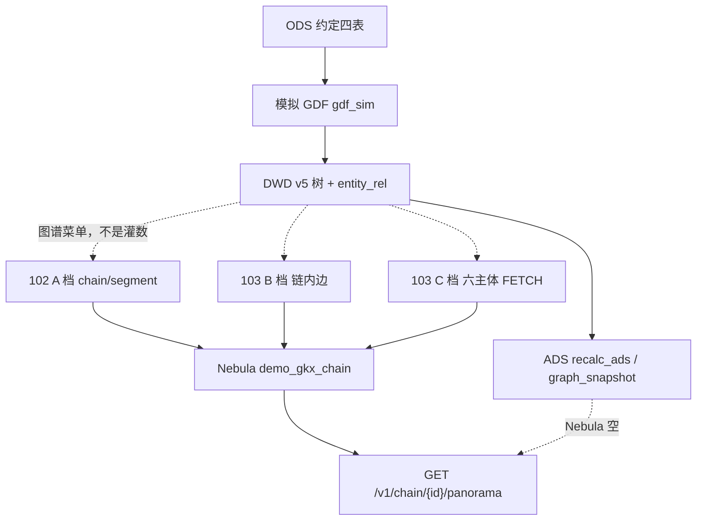

| 层 | 做什么 | 失败 |
|---|---|---|
| 102 | A 档写 `chain`/`segment` 点（属性可进 DWD/ADS，不强制新 Tag） | 空 `chain_id`/`node_id` 不写；VID>80 skip |
| 103 B | `belongs_to` / `depends_on`（`supplies` 本波无源） | 缺端点 skip |
| 103 C | 六主体 hang；须 FETCH 既有 VID | 无 ID / 本波不上图 → 四码 |
| 灌数 | 只 ODS→DWD→可选基础指标 ADS | **零** nGQL、**零** hang 脚本 |

Java 不抽实体、不写 nGQL。LLM 若上，只许在 Python，经 `/internal/*` 被 Java 调用。厚包 §7.0：Feign **`demo-platform-innov-py`**；网关勿让 `/chain/internal` 直连抢走写图。

> **目标态**：NER/RE/`project_from_dwd` **不再**挂在 `run_seed` / `run-chain-pipeline` 上；只由图谱菜单 A/B/C 对应 `op_id` 触发。过程图以 §19 `CHAIN-GRAPH-TRIPLE` 为准。

---

## 12. 支持的边关系

需规 103 点名 **产业 → 六主体**。厚包 §7.0 另加本域 **链内边** 为 B 档、**产业/环节点** 为 A 档、**双全景** 为 D 档。

方向：链内结构边按 DWD `relation_direction`；跨域一律 **产业/环节 → 对象**，不建反向边（政策已有 `support`/`apply_to` pol→chain 时，本域 C **不**再造 chain→pol 反向，见 §17.3）。

| 边（Nebula） | 中文 | 档 | 终点 | 现网 as-built | 上图条件 |
|---|---|---|---|---|---|
| （Tag `chain`） | 产业 / 子链本体 | **A** | — | `industry_chain` INSERT VERTEX | `chain:{chain_id}` ≤80 |
| （Tag `segment`） | 环节本体 | **A** | — | `industry_chain_node` INSERT VERTEX | `segment:{node_id}` ≤80 |
| `belongs_to` | 环节归属产业 | **B** | `chain:` | node.`chain_id` 在本批 | 两端本批已建 |
| `depends_on` | 上下游 / 依赖 | **B** | `segment:` | `node_rel` 映射 `upstream/downstream/depends*` | 两端 segment 已建 |
| `supplies` | 供需（schema 有） | **B** | `segment:` | **循环未抽** | 本波无 DWD 源 → `empty_field`/`not_in_wave` |
| `participates` | 企业/机构参与链 | **C** | `ent:` / `inst:` | entity_rel 映射并 **新建** 点 | 目标态改为 FETCH 既有点 |
| （无 EDGE） | 产业-技术 | **C** | 技术 | 未抽 | `not_in_wave` |
| （无 EDGE） | 产业-人才 | **C** | 人才 | 未抽 | `not_in_wave` |
| （无 EDGE / 复用已有） | 产业-政策 | **C** | `pol:` | 未抽 | FETCH `pol:`；无点则 `no_stable_id` |

---

## 13. 102 实体：每一类怎么入库

### 13.0 总图

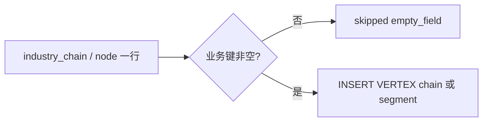

属性（规模、区域分布、企业数）走 ADS 指标，**不另建属性 Tag**。关联六主体 **不得**在 A 档 hang。

### 13.1 产业本体 `chain`

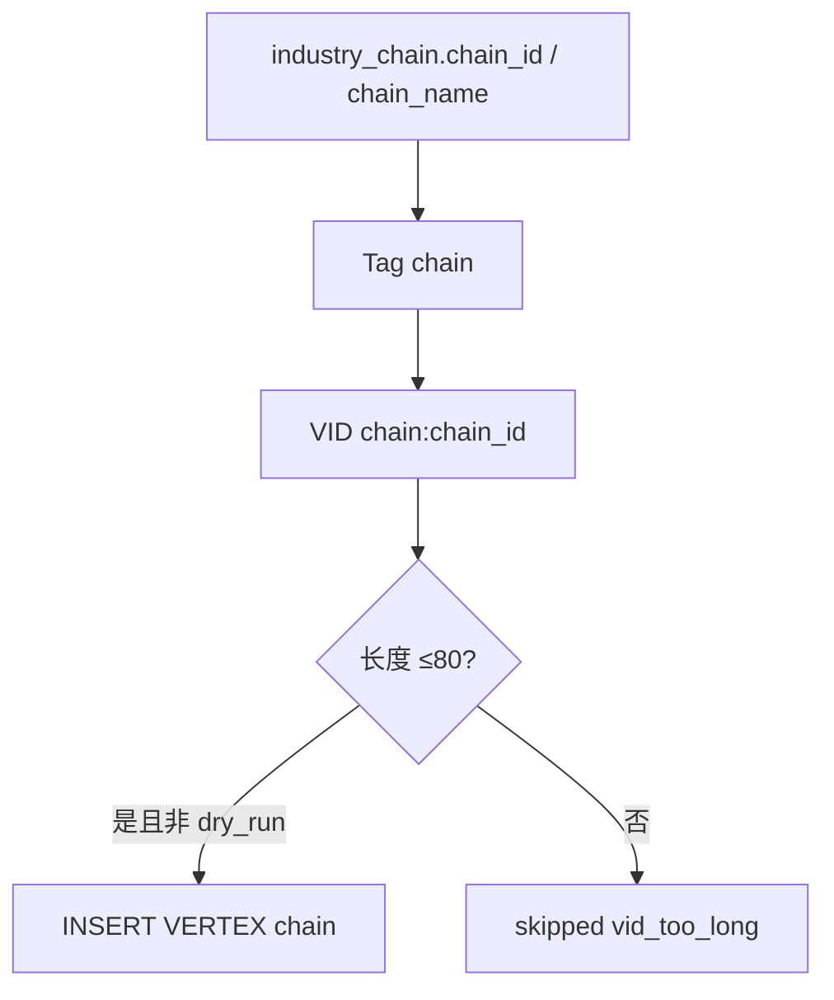

### 13.2 环节本体 `segment`

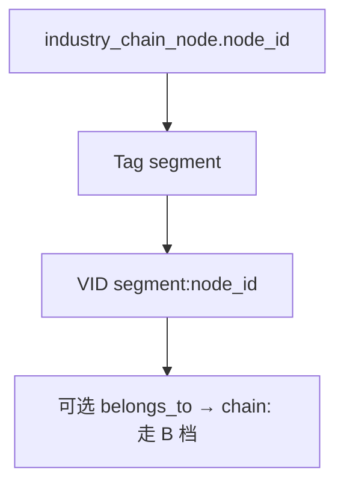

### 13.3 六主体（只 NER 备查，上图走 C）

| 主体 | 现网 | A 档 | C 档 |
|---|---|---|---|
| 企业 | entity_rel 可写点 | 禁止建 `ent:` | FETCH `ent:` |
| 科研机构 | 可写 `institution` | 禁止 | FETCH `inst:` |
| 服务机构 | `service_institution`→institution | 禁止 | FETCH `inst:` |
| 技术 | 无 | 可写 DWD 抽取表，不上图 | `not_in_wave` |
| 人才 | 无 | 同上 | `not_in_wave` |
| 政策 | 无 | 禁止新建 `pol:` | FETCH `pol:` |

**禁止**用名称相似度伪造 `ent:` / `inst:` / `pol:`。

---

## 14. 103 关系：每一组怎么入库

### 14.1 B · `belongs_to`

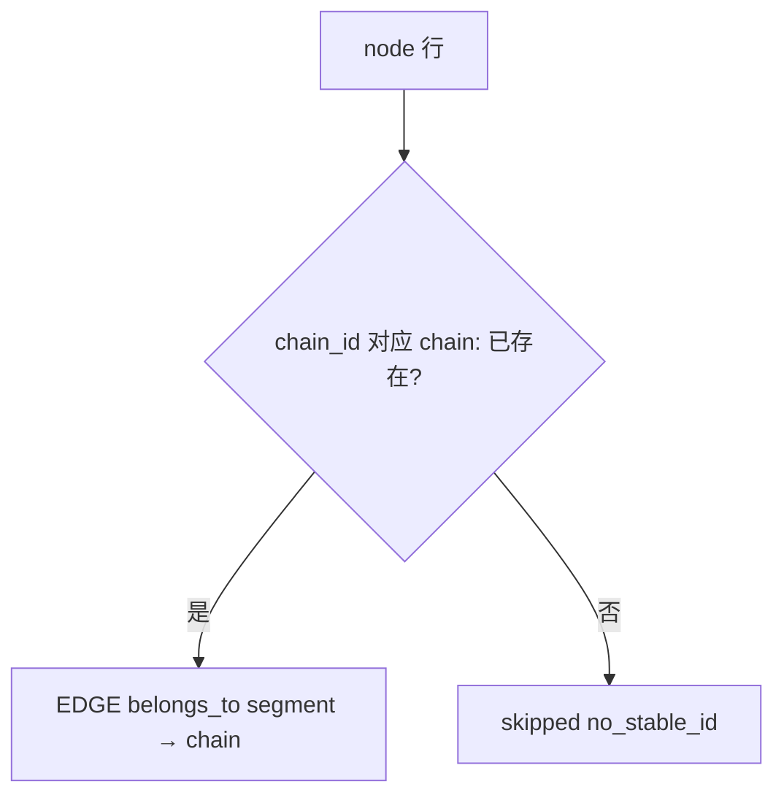

### 14.2 B · `depends_on`

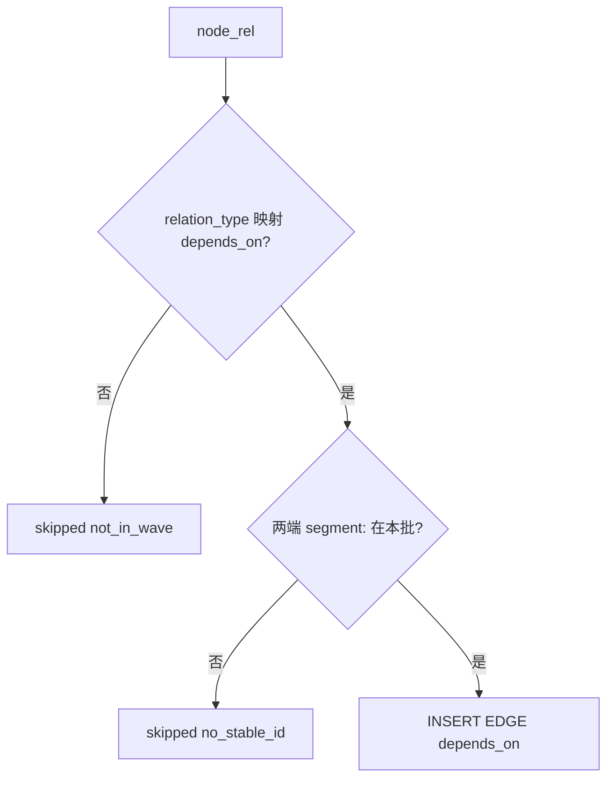

现网 `relation_direction=reverse` 时对调 src/dst。

### 14.3 B · `supplies`

schema 有、映射无。本波 **不上图**；表 §17.3 保留行，`skipped.reason=empty_field` 或 `not_in_wave`，**禁止静默删行、禁止私自造供应边**。

### 14.4 C · 产业-企业 / 科研 / 服务（`participates`）

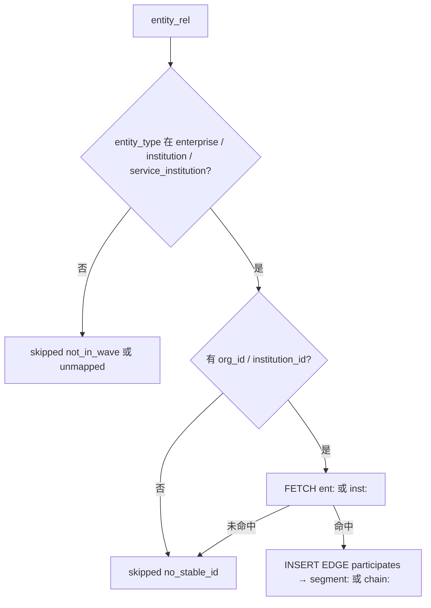

目标态 **不** `INSERT VERTEX enterprise|institution`。无点 = 缺口，不是 loader 该造点。

### 14.5 C · 产业-技术 / 人才 / 政策

| 关系 | 处理 |
|---|---|
| 产业-技术 | 本波不上图 `OPEN-CHAIN-GRAPH-01` |
| 产业-人才 | 同上 |
| 产业-政策 | FETCH `pol:{policy_id}`；无稳定 ID 不上图；**不**新建政策点（政策 A 档负责） |

---

## 15. 哪些场景要 LLM、推什么

现网投影 **全程规则，不调 LLM**。对照需规「NER / 多源」的升级清单。无 Key 必须回退规则，禁止编造 ID。

| 编号 | 触发 | 推什么 | 写入 | 不推 |
|---|---|---|---|---|
| L1 | 环节名/产业名脏、别名多 | 归一到已有 `INB*` | 只改展示名 props | 不改 `chain_id`/`node_id` |
| L2 | entity_rel 仅有企业名无 `org_id` | 抽名称槽 | NER 备查；**不上图** | 不按店名猜 `ent:` |
| L3 | 需规要产业-技术/人才，DWD 空 | 从资讯/行业分析正文抽短语 | 抽取表；无 Tag 不上图 | 不新建 tech/talent Tag（未拍板） |
| L4 | 政策名在资讯里、无 `policy_id` | 解析文号 → 本批 `pol:` | 仅 FETCH 命中才 hang | 不造悬挂 `pol:` |
| L5 | `supplies` 无边表 | 从产品标签推断供需 | 仅 `mode=llm` 且淮政玮拍板 | 默认关闭 |
| L6 | 名称链指已有 VID | **须李伟拍板** | 只写 FETCH 成功 | 相似度伪造边 |

推荐默认：**L1 可先上**（不碰 VID）。**L6 默认关闭**。调用形态：`mode=rule|llm`；Java 只转发。

---

## 16. 和投影缺口怎么对

| 现象 | 归属 | 不是 |
|---|---|---|
| 灌数后面图被填满 / replace 整图清空 | `run_seed` 调用 `project_safe` | 全景页自己建图 |
| 企业点被链投影新建 | as-built `map_graph` 造 ent/inst | C 档 FETCH 设计 |
| tech/talent/政策零上图 | `OPEN-CHAIN-GRAPH-01` | 漏配 EDGE |
| `supplies` 零边 | 映射未抽 | schema 缺 EDGE |
| 全景 `source=ads` | Nebula 空或 fail-soft | 必须先 Nebula |
| 流图 §8 仍画「同一批 project」 | 文档债；**本文件 §18 才是剥离真源** | 本叶翻签 01-data-flow |

公式 / 是否为技术人才补 Tag：不改 D1；补 Tag 须架构拍板。

---

## 17. 关系 × op_id × I/O（步2 契约真源）

> **禁止**「一个 `project_from_dwd()` / `project_safe()` 包打天下」当对外契约。现网 as-built 仍是灌数末步一次投影——那是 §1–§9 现状，**不是**步2 接口。
> 每条需规关系（或一组同构边）必须有独立 `op_id`。Java **只转发** Python `/internal/*`，不写 NLP、不直连 nGQL。
> Space 固定 **`demo_gkx_chain`**。

### 17.1 档位与 op_id 清单

| op_id | 档 | 中文 | SRS | HTTP（前端经 Java） | Python `/internal` | 写什么 | 本波 |
|---|---|---|---|---|---|---|---|
| `CHAIN_NER_INDUSTRY` | **A 实体识别** | 产业 + 环节点 | 102 | `POST /v1/chain/graph/ner` | `POST /internal/chain/graph/ner` | Tag `chain` + `segment` | **上图** |
| `CHAIN_RE_BELONGS_TO` | **B 链内边** | 环节归属产业 | 103 结构 | `POST /v1/chain/graph/intra` | `POST /internal/chain/graph/intra` | EDGE `belongs_to` | **上图** |
| `CHAIN_RE_DEPENDS_ON` | **B** | 上下游/依赖 | 103 结构 | 同上（`relation_whitelist` 含 `depends_on`） | 同上 | EDGE `depends_on` | **上图** |
| `CHAIN_RE_SUPPLIES` | **B** | 供需 | schema 加性 | 同上 | 同上 | EDGE `supplies` | **本波无源** |
| `CHAIN_RE_INDUSTRY_ENTERPRISE` | **C 关联主体** | 产业-企业 | 103 | `POST /v1/chain/graph/hang` | `POST /internal/chain/graph/hang` | `participates` → FETCH `ent:` | **上图**（须已有点） |
| `CHAIN_RE_INDUSTRY_RESEARCH` | **C** | 产业-科研机构 | 103 | 同上 | 同上 | `participates` → FETCH `inst:` | **上图** |
| `CHAIN_RE_INDUSTRY_SERVICE` | **C** | 产业-服务机构 | 103 | 同上 | 同上 | `participates` → FETCH `inst:` | **上图** |
| `CHAIN_RE_INDUSTRY_TECH` | **C** | 产业-技术 | 103 | 同上 | 同上 | — | **本波不上图** |
| `CHAIN_RE_INDUSTRY_TALENT` | **C** | 产业-人才 | 103 | 同上 | 同上 | — | **本波不上图** |
| `CHAIN_RE_INDUSTRY_POLICY` | **C** | 产业-政策 | 103 | 同上 | 同上 | hang → FETCH `pol:` | FETCH 到才上图；**不新建 pol:** |
| `CHAIN_GRAPH_PANORAMA` | **D 浏览** | 产业链全景 | 专题 25/26 | `GET /v1/chain/{chain_id}/panorama` | `GET /internal/chain/{id}/panorama`（或现网查询） | **不写库** | 只读 |
| `CHAIN_GRAPH_TOPIC_PANORAMA` | **D** | 专题全景 | 专题 25/26 | 现网无独立 GET；页 `/chain/topic-panorama` 拼装 list+panorama | 同左 | **不写库** | 只读；步4 不得另造写接口 |

C 档共用 `/hang` 时，**请求体必须带 `op_id` 或 `relation_whitelist`**，禁止一次 hang 写六类。可选 `POST /v1/chain/graph/ops/{op_id}`。

A 档**只认本域自身实体**：`chain` + `segment`。禁止 A 档 FETCH/挂 `participates`。

### 17.2 公共入参 / 出参

所有写入 `op_id`（A/B/C）共用。**禁止无稳定 ID 猜 VID**。

#### 入参

| 字段 | 类型 | 必填 | 说明 |
|---|---|---|---|
| `op_id` | string | 是 | §17.1 写入之一（D 不用 POST） |
| `scope` | `one` \| `batch` | 是 | `one` 必须给 `id`；`batch` 必须给过滤；禁止空过滤扫全库除非 `filter.all=true` |
| `id` | string | `scope=one` | L0/L1 稳定 ID = `chain_id`（`INB*`，不是名称） |
| `filter` | object | `scope=batch` | 允许：`chain_ids[]`、`industry_id`、`chain_level`。**禁止**用名称当主键 |
| `mode` | `rule` \| `llm` | 否，默认 `rule` | LLM **只**在 `mode=llm`；无 Key/失败回退规则 |
| `dry_run` | bool | 否，默认 `false` | `true`：**不写** ADS 图镜像、**不写** Nebula、不 `CREATE`/`INSERT`/`CLEAR`/`DELETE` |
| `relation_whitelist` | string[] | B/C 是 | 只处理列出的边。空数组 = 拒绝执行 |
| `dest_types` | string[] | C 档可选 | `enterprise` / `research` / `service` / `tech` / `talent` / `policy`。未列入本波上图表 → `not_in_wave` |
| `calc_batch_id` | string | 否 | 不传则服务端生成；同批重跑覆盖 |

#### 出参

| 字段 | 说明 |
|---|---|
| `op_id` | 回显 |
| `written_nodes[]` | `{ vid, tag, name, props }`。A 档 `chain:`/`segment:`。C 档**不新建**他域 Tag，本数组通常为空 |
| `written_edges[]` | `{ src, rel, dst, weight, props }`。必须是已解析 VID |
| `skipped[]` | `{ src?, dst?, rel?, name?, reason, detail }`。`reason` 仅四码 |
| `source` | `nebula` \| `ads` \| `dry_run` \| `rule_fallback`。只有真实 nGQL 写入成功才 `nebula` |
| `model_version` | NER/RE 版本；`mode=llm` 另记模型名 |
| `calc_batch_id` | 本批 |
| `mode_effective` | `rule` 或 `llm` |
| `llm_fallback` | bool |
| `space` | 恒为 `demo_gkx_chain` |

`skipped[].reason`：

| 原因码 | 何时 | 现网对照 |
|---|---|---|
| `empty_field` | 业务键空 / 字面量 NULL | `_vid` 空串；`supplies` 无行 |
| `no_stable_id` | 无 `chain_id`/`node_id`/`org_id`/`policy_id`；或 `FETCH` 不存在 | `belongs_to_missing_chain`、`node_rel_missing_vertex`、`entity_rel_missing_dst` |
| `not_in_wave` | tech/talent；未映射 `relation_type`；`supplies` 无规则 | `node_rel_unmapped:*`、`entity_rel_unmapped`、`event_entity_rel_no_event_tag` |
| `vid_too_long` | 候选 VID > 80 | `_vid()` 返回 `None` |

幂等：同 `calc_batch_id` + 主键（节点=`vid`；边=`src+rel+dst`）可重跑覆盖。`dry_run` 仍给将要写的数组，库不变。

### 17.3 需规最低集：边 × 终点（禁止静默删行）

对照厚包 §3 + SRS 103 六主体 + 本域链内边。做不到的标「本波不上图 / 无 ID」，**禁止从本表删行**。

| 边 / 关系 | 终点 | op_id | 档 | 上图？ | VID 规则 | as-built 源 | 缺口 |
|---|---|---|---|---|---|---|---|
| （点）产业 | — | `CHAIN_NER_INDUSTRY` | A | **上图** | `chain:{chain_id}` | `industry_chain` | — |
| （点）环节 | — | `CHAIN_NER_INDUSTRY` | A | **上图** | `segment:{node_id}` | `industry_chain_node` | — |
| `belongs_to` | 产业 | `CHAIN_RE_BELONGS_TO` | B | **上图** | segment→chain | node.`chain_id` | 缺 chain 点 → `no_stable_id` |
| `depends_on` | 环节 | `CHAIN_RE_DEPENDS_ON` | B | **上图** | segment→segment | `node_rel` | 未映射类型 → `not_in_wave` |
| `supplies` | 环节 | `CHAIN_RE_SUPPLIES` | B | **本波不上图** | — | EDGE 有、循环未抽 | 无供应边表 |
| 产业-企业 | 企业 | `CHAIN_RE_INDUSTRY_ENTERPRISE` | C | **上图** | FETCH `ent:` | `entity_rel` enterprise | 无 org_id；现网会造点（步2 禁止） |
| 产业-科研机构 | 科研 | `CHAIN_RE_INDUSTRY_RESEARCH` | C | **上图** | FETCH `inst:` | entity_type=institution | 常空 |
| 产业-服务机构 | 服务 | `CHAIN_RE_INDUSTRY_SERVICE` | C | **上图** | FETCH `inst:` | service_institution | 常空 |
| 产业-技术 | 技术 | `CHAIN_RE_INDUSTRY_TECH` | C | **本波不上图** `OPEN-CHAIN-GRAPH-01` | — | 未抽 | 无 Tag |
| 产业-人才 | 人才 | `CHAIN_RE_INDUSTRY_TALENT` | C | **本波不上图** `OPEN-CHAIN-GRAPH-01` | — | 未抽 | 无 Tag |
| 产业-政策 | 政策 | `CHAIN_RE_INDUSTRY_POLICY` | C | FETCH 到才上图 | FETCH `pol:` | 未抽 | 无 policy_id → `no_stable_id`；禁止新建 pol: |

### 17.4 分 op 过程（目标态）

#### A · `CHAIN_NER_INDUSTRY`

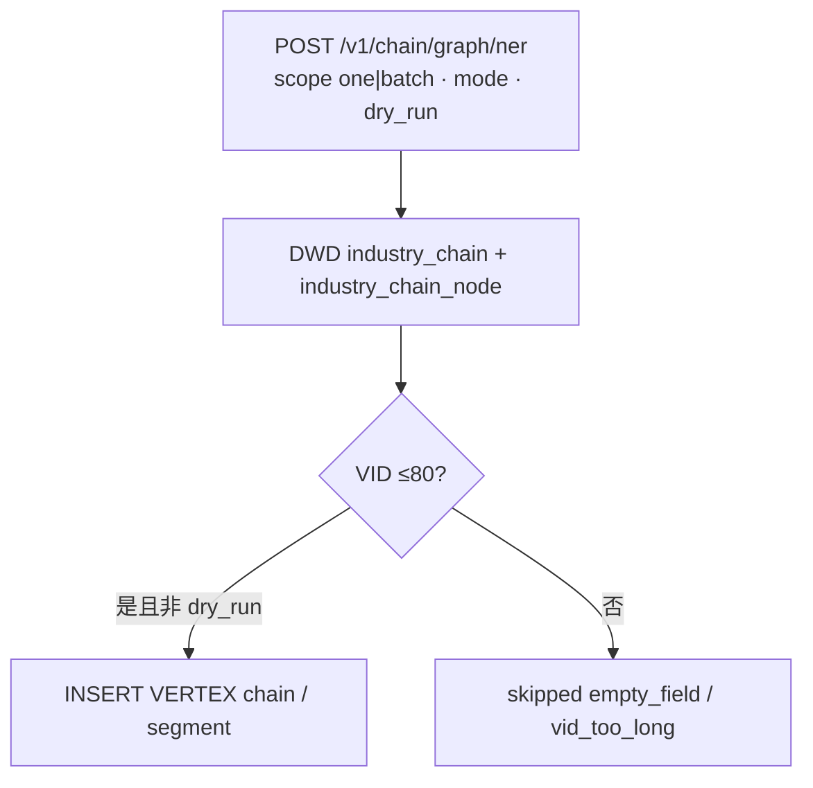

#### B · intra

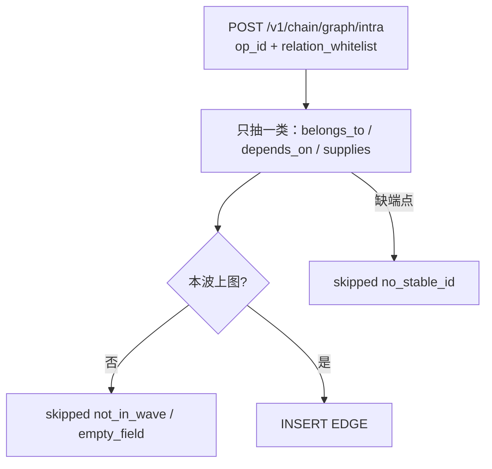

#### C · hang

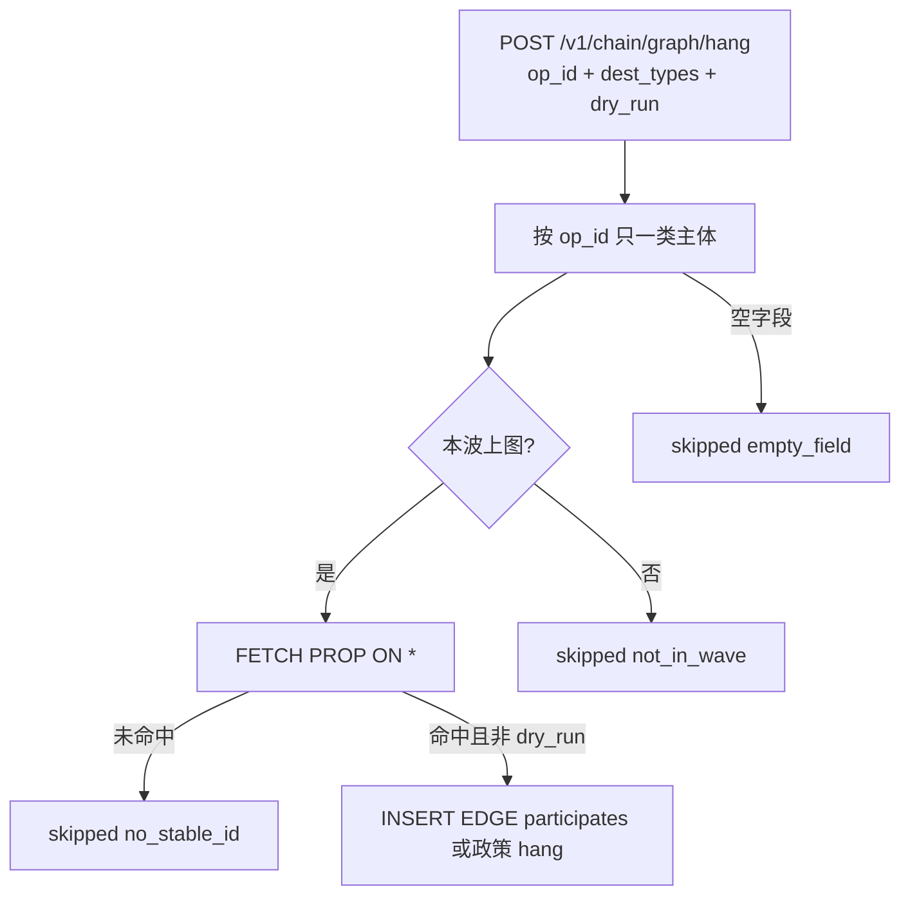

### 17.5 LLM 与规则分界

| 规则 | 说明 |
|---|---|
| 默认 | `mode=rule`：§12–§14 抄 DWD，不调模型 |
| 显式 LLM | 仅 `mode=llm` 可走 §15 L1；L6 **须李伟拍板**，本波默认关闭 |
| 回退 | 无 Key / 超时 / 4xx/5xx → `mode_effective=rule`，`llm_fallback=true` |
| Java | 禁止 NLP；只转发；样板抄政策 `PolicyGraphController`，Feign **innov-py** |

---

## 18. 灌数剥离清单（P0 · 步2 checklist）

识别 / 关系 / 跨域挂接 / schema / nGQL 写 **不是**贴源灌数。灌数只允许：三方或 Mock → ODS → DWD（+ 可选基础指标 ADS）。**禁止** NER / RE / 建点 / 建边 / `CREATE TAG/EDGE` / `INSERT VERTEX|EDGE` / `CLEAR SPACE` / hang / 图投影。

**重灌后图空（或保留旧图、不再被灌数填满）是预期。** 禁止灌数静默把图填满。图只允许从「产业链 → 全景/专题全景」菜单 A/B/C（及 `/v1/chain/graph/{ner|intra|hang}`）触发。

硬闸（厚包 §7.0）：**链灌数禁 Nebula 投影、禁顺带 hang。**

### 18.1 现网要摘掉的调用（文件 / 函数级 · 步2 对照删除）

| # | 仓 · 文件 | 符号 | 现网行为 | 步2 动作 |
|---|---|---|---|---|
| 1 | `demo-algo-science/chainan/llm_ods/seed.py` | `from chainan.llm_ods.project import project_safe` | 灌数 import 投影 | **删除该 import** |
| 2 | 同上 | `run_seed()` 内 `proj = project_safe(db, replace=replace)` | 灌数末步写 Nebula（replace 会 CLEAR SPACE） | **整步删除**；返回值去掉 `projection` 或恒为未跑 |
| 3 | `demo-algo-science/chainan/llm_ods/project.py` | `project_nebula` / `project_safe` | 灌数调用链 | **禁止**从 `run_seed` / `run_all` 进入；仅 A/B/C 内部调用 |
| 4 | `demo-algo-science/chainan/graph/nebula_project.py` | `project_from_dwd` / `upsert` / `map_graph` | `INSERT VERTEX\|EDGE`；replace 时 `CLEAR SPACE` | 保留作核，**禁止灌数调用**；C 档改为 FETCH、禁止造 ent/inst 点 |
| 5 | `demo-algo-science/chainan/graph/nebula_schema.py` | `init_schema_from_code` | `CREATE SPACE` + `CREATE TAG/EDGE`；被 `project_from_dwd` 调用 | **禁止**从灌数进入；可留图谱菜单「初始化图谱」 |
| 6 | `demo-algo-science/scripts/run_all.py` | `run_chain` → `build_chain_steps` → `_seed_step` | 唯一主路径即 `run_seed` | 随 seed 删除投影后自动干净；**grep 不得再出现 project_nebula** |
| 7 | 同上 | `LEGACY_CHAIN_STEPS` `M1_panorama`/`M2_sz_chain` = `chain_graph.run`/`run_sz` | 旧 SQLite 全景 | 旁路仍须零图写入；或文档声明禁止 `CHAIN_SEED_LEGACY_MOCKGEN=1` 验收 |
| 8 | `demo-algo-science/api/main.py` | `_run_chain_pipeline` / `POST /internal/run-chain-pipeline` | 基础指标页「追加/重建灌数」 | **保留灌数**，流水线不得再含投影；去掉 `last_projection` 语义或标未跑 |
| 9 | 同上 | `POST /internal/graph-schema-init` | 独立建库建 schema | **不要**并进灌数；不要从 BasicPage 灌数按钮调用 |
| 10 | `demo-algo-science/chainan/llm_ods/read_v2.py` | `panorama()` 读 Nebula | **读路径可留** | 不是灌数；D 档只读 |
| 11 | `demo-algo-ent-analysis/scripts/run_ent_chain_hang.py` | hang MySQL 两表；可选图指针 | 企业上链 | **禁止**从 `run_seed`/`run-chain-pipeline` 调用；本叶不顺带 hang |
| 12 | `demo-ui-system-test/src/views/chain/pages/BasicPage.vue` | `onSeed`；`seedFlow`「ES / Nebula 投影」；卡片文案「图库投影」「整图重灌」 | 灌数承诺建图 | **步4** 去文案；步2 先让后端零图调用，使按钮即使未改也不再建图 |
| 13 | 同上 | `ElMessageBox` HTML「Nebula 图库投影现网未接通；目标是…重灌」 | 确认框承诺投影 | 改成只清 DWD / 重算 ADS；**禁止提 Nebula / 整图重灌** |
| 14 | `demo-ui-system-test/src/api/chain/index.ts` | `runChainPipeline`；`initChainGraphSchema` | 灌数 vs schema | 灌数路径可留；schema API **不得**被灌数点击调用 |
| 15 | `demo-ui-system-test/src/views/chain/index.vue` | 页头「全景图谱优先 Nebula」 | 浏览说明 | 步4 可留 D 档说明；禁止写进灌数帮助 |
| 16 | CLI | `python scripts/run_all.py --chain`；`python -m chainan.graph.nebula_project` | 运维手跑 | 全流水线摘投影；后一模块只允许图谱菜单/API |
| 17 | 编排文档债 | [`pipeline-demo-sim-process.md`](./pipeline-demo-sim-process.md) §1/§2.7 仍画灌数→Nebula | 旧设计 | **本文件 §18 为剥离真源**；不在本叶改该稿（避免范围扩散） |

### 18.2 灌数允许留下的

| 允许 | 文件 / 符号 |
|---|---|
| Demo MySQL 目标门禁 | `assert_demo_mysql_targets` |
| 约定 ODS 写入 | `llm_ods.load` / `generate.build_offline_rows` |
| 模拟 GDF | `gdf_sim.apply_ods_to_dwd`（**无** nGQL） |
| 缺口空表 | `gdf_sim_gaps.apply_gaps` |
| ADS 指标 / snapshot **切面** | `ads_v2.recalc_ads`（可继续写 `graph_snapshot` 作读兜底；**禁止**在同一步 `INSERT` Nebula） |
| ES 投影 | `project_es` 若仍 fail-soft 且非图；步2 可一并移出灌数（本叶不强制 ES） |
| 只读全景 | `read_v2.panorama` / `read_panorama` |

### 18.3 过关自检（步2 handoff 必附 grep）

在 `demo-algo-science` 对下列入口跑 grep，**不得**再命中 `project_safe` / `project_nebula` / `project_from_dwd` / `init_schema_from_code` / `CLEAR SPACE` / `INSERT VERTEX` / `INSERT EDGE` / `run_ent_chain_hang`：

- `chainan/llm_ods/seed.py`
- `scripts/run_all.py`（`run_chain` / `build_chain_steps`）
- `api/main.py` 的 `_run_chain_pipeline` / `run_chain_pipeline`

基础指标页灌数成功后：**不**自动 `INSERT` Nebula 点边、**不** `CLEAR SPACE`。A/B/C 才写图。企业 hang **不**被灌数触发。

---

## 19. 图 · CHAIN-GRAPH-TRIPLE

> **diagram_id：`CHAIN-GRAPH-TRIPLE`**（L1 · 图即契约）。每类实体 + 每组关系入库。改边集 / 上图范围只改本图与 §17.3，禁止 UI/apiview 另造边名。

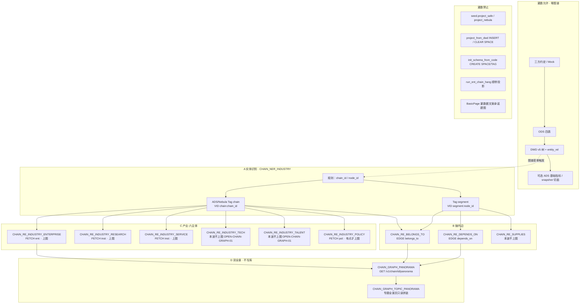

实体（Tag / 本波）：

| 实体 | Tag 或复用 | VID | 本波上图 | 谁写入 |
|---|---|---|---|---|
| 产业 / 子链 | **本域** Tag `chain` | `chain:{chain_id}` | 是 | A |
| 环节 | **本域** Tag `segment` | `segment:{node_id}` | 是 | A |
| 企业 | 复用 ENT `enterprise` | `ent:` | 是（须 FETCH） | C，不新建 Tag |
| 科研机构 | 复用 `institution` | `inst:` | 是（须 FETCH） | C |
| 服务机构 | 复用 `institution` | `inst:` | 是（须 FETCH） | C |
| 政策 | 复用 POLICY Tag `policy` | `pol:` | FETCH 到才是 | C，不新建 |
| 技术 | **无 Tag** | — | **否** `OPEN-CHAIN-GRAPH-01` | skipped `not_in_wave` |
| 人才 | **无 Tag** | — | **否** `OPEN-CHAIN-GRAPH-01` | skipped `not_in_wave` |

关系入库：

| 边 | 语义 | 典型三元组 | 写入 op |
|---|---|---|---|
| `belongs_to` | 环节∈产业 | `segment:` → `chain:` | `CHAIN_RE_BELONGS_TO` |
| `depends_on` | 上下游 | `segment:` → `segment:` | `CHAIN_RE_DEPENDS_ON` |
| `supplies` | 供需 | — | `CHAIN_RE_SUPPLIES`（本波不上图） |
| `participates` | 主体参与链 | `ent:`/`inst:` → `segment:`/`chain:` | 企业/科研/服务三个 C op |
| （政策 hang） | 产业-政策 | `chain:`/`segment:` → `pol:` 或只记 ADS，不重复政策边名 | `CHAIN_RE_INDUSTRY_POLICY`（不改政策已有 `support`/`apply_to` 边名） |

---

## 20. 诚实缺口（本波）

| ID | 缺口 | 本波处理 | 不是 |
|---|---|---|---|
| `OPEN-CHAIN-GRAPH-01` | 无 tech/talent Tag；无六类专题库稳定 ID | §17.3 全部保留行；上图列写「本波不上图」；skipped=`not_in_wave` / `no_stable_id` | 漏配 EDGE |
| 现网造 ent/inst 点 | `map_graph` 非 FETCH | 步2 C 档改 FETCH；禁止灌数造点 | 本叶改 Python |
| `supplies` 空 | schema 有、映射无 | 保留 op_id；不上图 | 私自造供应边 |
| 产业-政策边名 | 政策叶已用 `support`/`apply_to` | 本域 C 只 FETCH + hang 表/participates props；**不**发明 `industry_policy` EDGE | 第二套政策边 |
| 双全景无第二 GET | 专题全景是 UI 拼装 | D 档两个 op_id；共享 panorama 读 | 步1 造新写接口 |
| L6 链指 | 名称 → 已有 VID | **须李伟拍板**；默认关闭 | 名称相似度伪造边 |
| D12 | 本设计服务 Demo `demo-algo-science` + `demo-ui-system-test` | lumen apiview **禁止**直连 demo 服务；正式复刻走 `lumen-algo-py` | 步1 改 lumen 前端打 demo |
| 注册表 | `DEMO-CHAIN-GRAPH-TRIPLE-UI-L01` 拉取后 MCP `task-get` 仍 not found | 文档与 handoff 先落盘；认领/cost 回填待 coordinator 建单 | data-agent 手改 `task-registry.yaml` |
| 流图债 | `01-data-flow.md` §8 / `pipeline-demo-sim-process.md` 仍画灌数投影 | 本文件 §18 为剥离真源；不翻签主图 | 本叶改会签流图 |

---

## 指针（S2/S3 旧入口，仍有效）

| 项 | 路径 |
|---|---|
| 流图 | [`../01-data-flow.md`](../01-data-flow.md) |
| stores | [`../stores/README.md`](../stores/README.md) |
| ENT 参考 | [`../../ENT/etl/pipeline-to-nebula.md`](../../ENT/etl/pipeline-to-nebula.md) |
| 企业上链（MySQL 真源） | [`pipeline-ent-hang.md`](./pipeline-ent-hang.md) |
| 政策投影同构 | [`../../../POLICY/etl/pipeline-to-nebula.md`](../../../POLICY/etl/pipeline-to-nebula.md) |
