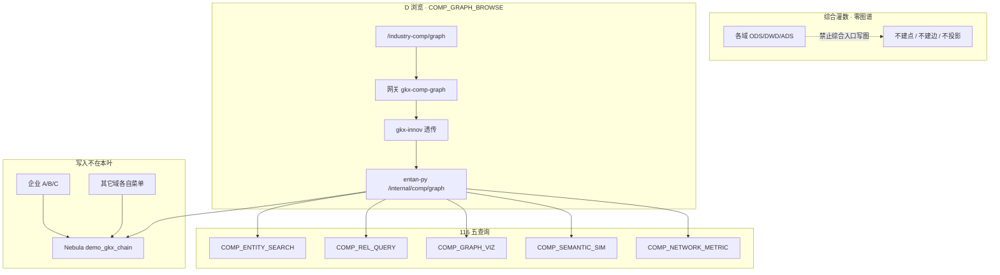

# 管道 · → Nebula（综合只读一张 G）

```yaml
---
doc_id: COMP-ETL-TO-NEBULA
element: COMP
role: etl
status: draft
version: "2026-09-02"
updated: 2026-09-02
task_id: DEMO-COMP-GRAPH-TRIPLE-UI-L01
srs: "05 seq 116 · 综合/图谱API.md"
amendment: "2026-09-02 徐滕强步1：综合无 A/B/C；只 D + 五查询；space=demo_gkx_chain；Python=demo-algo-ent-analysis / demo-platform-entan-py /internal/comp/graph*；禁止第二张图、禁止名称猜 VID、禁止灌数建图。"
---
```

> **本文件是 `DEMO-COMP-GRAPH-TRIPLE-UI-L01` 步1 DEMO 契约。** 与企业叶同构写 `op_id` I/O，但综合 **没有写入档**。  
> 拓扑真源仍是各域已会签流图；本叶 **不** 新建 / 翻签 `01-data-flow.md`。  
> 本步只写编排仓文档：**不改代码、不 APPLY DDL、不灌数**。  
> 调用链只写 demo。正式 `lumen-*` 不在本叶。

### 审核定稿（2026-09-02 · `human:徐滕强` 开工）

| # | 定 |
|---|---|
| 1 | 目标 space **`demo_gkx_chain`**。禁止 `CREATE SPACE`、禁止综合第二张图、禁止把 `entan` / `gkx_policy` 当目标 |
| 2 | **无 A/B/C**。不 `INSERT VERTEX|EDGE`，不 hang，不 `ensure_schema` 为综合新建 Tag/Edge |
| 3 | 只读已上图点边。VID 必须已存在；**禁止名称猜 VID** |
| 4 | SRS 116 五查询全表保留，做不到标诚实缺口，**禁止静默删行** |
| 5 | **Demo 调用链**：`demo-ui-system-test` `/industry-comp/graph` → demo 网关（`/industry-comp/**` 前插 graph Path）→ `demo-svc-platform` `gkx-innov` → Feign **`demo-platform-entan-py:8000`** `/internal/comp/graph*`。禁止 Feign 指 `innov-py` |
| 6 | 综合「灌数据」现网已禁用（消费上游、无独立贴源）。步2/4 仍须保证该按钮/任何综合 pipeline **零图谱写** |

---

## 1. 意图

综合是 **窗口**，不是生产者。产业全要素图谱 API 读一张 G 上各域已经挂好的点边，提供检索 / 关系 / 可视化 / 语义相似 / 网络指标。写入仍在各域图谱菜单。

前序：`DEMO-ENT-GRAPH-TRIPLE-UI-L01` 四步已走完（看板 `pending_test`）。本叶不改企业写入契约。

## 2. 范围与实现（对照 SRS 116）

| 项 | 产业全要素图谱 API 服务开发 |
|---|---|
| seq | **116** |
| metric_id | `M_COMP_GRAPH_116_1`（占位；本会话 metric-registry MCP 未挂，**不伪 8 件套**） |
| 本步落点 | 档 **D** 浏览 + 五查询 `op_id` |
| 原文要点 | 实体检索（分页排序）；实体关系（方向/权重/跨类型）；可视化（关系图/词云）；语义相似度（名称/属性，需规写深度学习）；网络指标（密度/中心度） |
| 本波诚实 | 只读 `demo_gkx_chain`；空中心可 ADS 回退（与企业 D 同口径）；语义相似默认 `mode=rule`（名称/属性字面），`mode=llm` 才走向量，无 Key 回退规则且 `llm_fallback=true`；词云=标签频次，不是第二套布局引擎 |

档 **A/B/C** = **本叶不存在**。行不删，标 `not_in_wave`。

## 3. 现网 as-built（对照，不是目标）

| 项 | 值 |
|---|---|
| 系统测试菜单 | `/industry-comp/*` 十模型 + 基础指标；**无** `/industry-comp/graph` |
| 基础页灌数 | `BasicPage.vue` 按钮 **disabled**：「消费上游七类基础指标 ADS，请在各算法库灌数」 |
| 协同页图 | `compModelCatalog.ts` 内嵌 **Mock** 节点边（`USE_MOCK=false` 时步4 禁止再靠这份 fixture 填 116） |
| 网关 | `gkx-gateway-dev.yml` **未见** `industry-comp` graph 插队路由（步3 补） |
| Python | `demo-algo-ent-analysis` **无** `/v1/comp/graph*`（步2 加查询模块，不写图） |
| Space | 企业叶目标已是 `demo_gkx_chain`；综合只 FETCH / GO / LOOKUP |

## 4. 关系 × op_id × I/O（需规最低集 · 零遗漏）

公共：查询接口 **不写** ADS/Nebula；`dry_run=true` 只回将访问的 VID/边类型，仍不写。`skipped.reason` ∈ `empty_field` / `no_stable_id` / `not_in_wave` / `vid_too_long`。Java 只转发 `Map`，禁止 NLP / nGQL / 改边名。

| op_id | 档 | HTTP | 输入要点 | 输出要点 | 本波 |
|---|---|---|---|---|---|
| `COMP_GRAPH_BROWSE` | D | `GET /v1/comp/graph` → `/internal/comp/graph` | `center`（稳定 VID 或 `ent:{org_id}`）；`hops`；`limit` | `nodes[]`/`edges[]`；`space`；`source=nebula\|pg` | 只读；无 center 时 ADS 回退允许 0 边 |
| `COMP_ENTITY_SEARCH` | 查询 | `GET /v1/comp/graph/entities` | `q` 关键词/名称；`types` 可选；`page`/`size`；`sort` | 分页 `items[]`（vid, type, name, props）；`total` | LOOKUP/ADS 已有点；无命中空页，不新建 |
| `COMP_REL_QUERY` | 查询 | `GET /v1/comp/graph/relations` | `src` 必填稳定 ID；`dst` 可选；`rel` 白名单可选；`direction`；`limit` | `edges[]`（src, rel, dst, weight, props） | 只返回图上已有边；对端无点 → `no_stable_id` |
| `COMP_GRAPH_VIZ` | 查询 | `GET /v1/comp/graph/viz` | 同 browse + `layout=graph\|wordcloud` | 图：nodes/edges；词云：`tags[]{name,count}` | 不写库；词云只统计已返回点的 type/name |
| `COMP_SEMANTIC_SIM` | 查询 | `POST /v1/comp/graph/similar` | `a`,`b`（名称或稳定 ID）；`mode=rule\|llm`；`dry_run` | `score` 0–1；`source`；`model_version`；`llm_fallback` | rule=字面/属性重叠；llm=向量；两端都无法解析 → `empty_field`，**不猜 VID** |
| `COMP_NETWORK_METRIC` | 查询 | `GET /v1/comp/graph/metrics` | `center` 可选；`hops`；`limit` | `density`；`centrality[]`（vid, degree）；`edge_count`/`node_count` | 在本次子图上算；空图返回 0，不造边 |
| `COMP_NER_*` / `COMP_RE_*` | A/B/C | — | — | — | **本叶不实现**；行保留 `not_in_wave` |

需规（1）–（5）对应：`COMP_ENTITY_SEARCH` / `COMP_REL_QUERY` / `COMP_GRAPH_VIZ` / `COMP_SEMANTIC_SIM` / `COMP_NETWORK_METRIC`。`COMP_GRAPH_BROWSE` 是菜单 D，与可视化可共用读核。

### 4.1 边 × 终点（综合不另造边）

综合 **不定义** 新边名。关系查询的 `rel` 白名单 = 一张 G **已出现** 的边类型（企业 `cooperate`/`invest`/`parent_sub`/`located_in`/… 及其它域已上图边）。未知 `rel` → `not_in_wave`，不 500、不改写成别的边。

| 需规例子 | 本波 |
|---|---|
| 产业 / 技术 / 企业股权 | 图上有 `invest`/`parent_sub` 才返回 |
| 人物社交 | 无稳定人才点则空；禁止名称建 `person:` |
| 跨类型 | 只 FETCH 已有 VID |

## 5. 步2 / 步3 落点（本步不改代码）

| 项 | 值 |
|---|---|
| Python 仓 / 进程 | `demo-algo-ent-analysis` · `demo-platform-entan-py:8000` |
| 对外 | `/v1/comp/graph*` 与 `/internal/comp/graph*` **成对** |
| 实现核 | 新建查询模块（建议 `entan/comp_graph/` 或同等）；**禁止** 调 `entity.run` / `load_nebula_safe` / hang 写 |
| Java | `gkx-innov` Controller + Feign → **entan-py** `/internal/comp/graph*`；body/query 原样 |
| 网关 | 在 `/industry-comp/**` catch-all **之前**插 `gkx-comp-graph`：Path `/industry-comp/v1/comp/graph*` + `/industry-comp/internal/comp/graph*` → `lb://gkx-innov`；**不配** 额外 StripPrefix（全局若已剥 `/industry-comp`，再剥会 404） |
| 禁 | Feign 指 `innov-py`；catch-all 直连 Python 写图；lumen Feign → `demo-*`（D12） |

若现网还没有 `/industry-comp/**` catch-all：步3 **只加** graph 具体路由，不要顺手把十个综合模型页改走新 catch-all。

## 6. 灌数剥离清单（P0）

综合 **没有** 独立贴源灌数。现网基础页按钮已禁用。本叶仍禁止任何人「补一个综合 run_all 来建图」。

| # | 仓 · 位置 | 现网 | 步2/4 动作 |
|---|---|---|---|
| 1 | `demo-ui-system-test/.../industry-comp/pages/BasicPage.vue` | 灌数据 disabled | **保持**不调 graph/nebula；文案不得写成「灌数会建图」 |
| 2 | 综合任意 `run-pipeline` / `run_all_*`（若步2 发现） | 待 grep | **禁止** 增加 NER/RE/`INSERT VERTEX\|EDGE`/hang |
| 3 | `compModelCatalog.ts` Mock 图 | 协同页演示图 | 步4：`USE_MOCK=false` 时 116 **禁止**用这份 fixture 填数 |
| 4 | 企业 `scripts/run_all.py` | 企业叶已摘 B/B+/M | 本叶 **不改** 企业灌数；禁止从综合入口再挂回去 |

### 6.1 过关自检（步2 handoff 必附）

在 `demo-algo-ent-analysis` 对综合查询入口 grep，**不得**命中 `INSERT VERTEX` / `INSERT EDGE` / `CREATE SPACE` / `entity.run` / `load_nebula_safe` / hang 写。  
`/internal/comp/graph*` 必须可 curl，且响应无 `written_nodes`/`written_edges`（查询不写）。

## 7. 图 · COMP-GRAPH-TRIPLE

> **diagram_id：`COMP-GRAPH-TRIPLE`**。综合只有读边。改查询集合只改本图与 §4，禁止 UI/apiview 另造写入 `op_id`。



生产者：各域图谱菜单。  
消费者：综合 D + 五查询。  
触发：用户打开 `/industry-comp/graph` 或 apiview `comp.graph`。  
失败：图空 / 无稳定 ID → 空结果 + `skipped`，不猜 VID。  
禁止：综合第二张图、灌数建图、Java NLP/nGQL、名称当 VID。

## 8. 步4 UI / apiview（本步不改代码）

| 项 | 值 |
|---|---|
| 菜单 | 补 `/industry-comp/graph`：仅 D + 五查询档，**不要** A/B/C 按钮 |
| 请求 | `/industry-comp/v1/comp/graph*`，禁止直打 `:8000` |
| apiview | `comp.graph` 纳入 `GRAPH_IDS`；每 `op_id` 一条（6 条查询，不含伪写入） |
| D8/D9/D10 | 统计数字旁 ⓘ；Mock 仅评审态 |

## 9. 开放项

| ID | 口径 |
|---|---|
| `OPEN-COMP-GRAPH-SPACE` | 现网企业 as-built 仍可能读到旧 space；综合目标只认 `demo_gkx_chain` |
| `OPEN-COMP-GRAPH-SEMANTIC` | 需规深度学习；本波 rule 字面分 + llm 可选，不伪称已上专用语义模型 |
| `OPEN-COMP-GRAPH-NACOS` | 与企业叶同口径：外网 Nacos 看不到 demo 网关路由则 **记缺口**，不挡步1 |

## 10. 本步禁止

- 改 `demo-algo-*` / `demo-ui-*` / `lumen-ui-*` / `demo-svc-platform` 代码  
- 开别人的叶、改企业写入 `op_id`  
- APPLY DDL、灌数、`CREATE SPACE`
