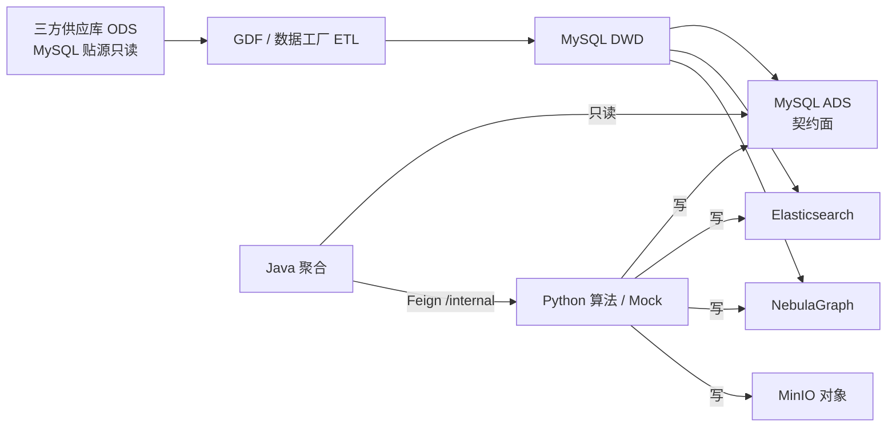
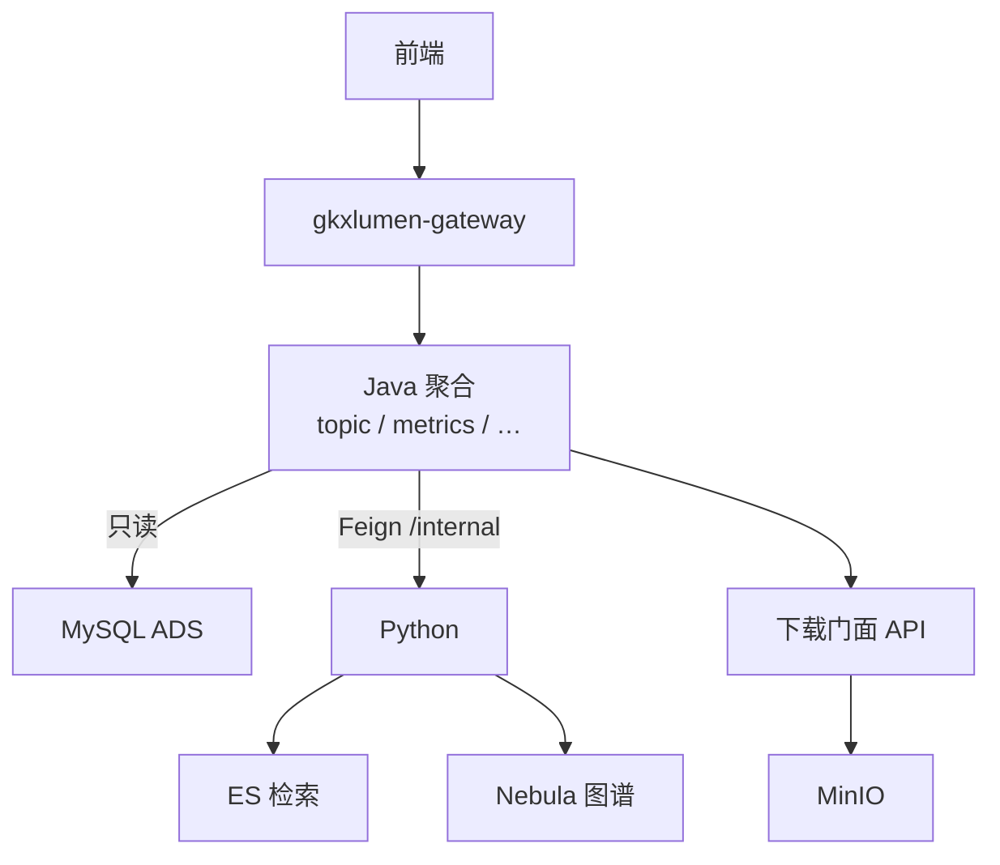
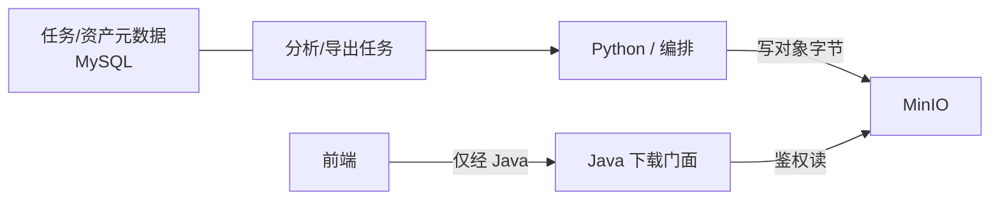
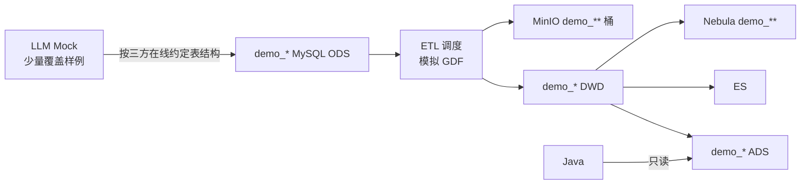

# 企业维 · 端到端数据流

```yaml
---
doc_id: ENT-STORAGE-FLOW
element: ENT
role: data-flow
status: approved
version: "2026-08-12"
updated: 2026-08-12
engine: multi
signoff_owner: human:淮政玮
signoff_status: approved
signoff_by: human:淮政玮
signoff_at: 2026-08-12
amendment_note: "2026-08-12 §7 Demo/LLM Mock 全链路口径补记（不改变 §1–3 拓扑会签结论）"
---
```

> **会签 Owner：human:淮政玮**（2026-08-12 **approved**）。  
> 本流图会签通过后，允许启动 **S2**（`sources` / `etl` 清单）与 **S3**（`stores/*` as-built 灌入）。  
> **仍禁止**：在未完成对应 `stores/*` 文档评审前，将细表标为「结构已批准 / approved」。  
> **§7**：同日补记 Demo「LLM→约定 ODS→ETL 模拟 GDF」口径（结构仍与 §1 同构）。

## 1. 批处理主链（工厂）



| 生产者 | 消费者 | 触发 | 失败语义 | 禁止事项 |
|---|---|---|---|---|
| 三方 / GDF | MySQL DWD | **批**：GDF 作业；具体 cron / DAG 名 → **开放项 OPEN-ENT-FLOW-01**（S2 填） | 本批失败则**不晋升**依赖该批的下游；保留上一成功 DWD 快照；飞书知会供应方 / GDF / 数据 Lead；不自动回滚 ADS | 业务 API / Java / 前端直读 ODS；Java 写 DWD |
| DWD ETL（GDF/Python） | ADS / ES / Nebula | **批**：DWD 门禁通过后串联；或算法刷新任务触发派生 | 管道失败 → 该目标存储**不发布半成品**；ADS 保留上一成功契约切片；ES/Nebula 可降级（检索/图谱不可用），**ADS 仍为指标权威**；作业标 failed + 可重试 | Java 写 ADS；三方字段泄漏进 ADS 契约面（D7）；Neo4j |
| Python（含 Mock） | ADS / ES / Nebula / MinIO | **Demo 主路径见 §7**（LLM→ODS→模拟 GDF）。可选旁路：任务/手工直写 ADS（D7）。生产：批或任务写计算产物 | 写失败 → 任务态 `failed`；禁止静默部分成功冒充完成；Java 只读既有成功数据 | 前端造假数据；Java/前端写 ADS；以现网三方 as-built 当 Demo ODS 真源 |
| Java | （读）ADS；Feign→Python | **在线** HTTP 请求 | 4xx/5xx 统一错误体；**不写回** ODS/DWD/ADS；不因读失败扫 DWD | 扫 ODS/DWD；直连 nGQL；对前端暴露 `/internal` |

**拓扑要点（与基线对齐）**

- 工厂主链：`ODS → GDF → DWD → ADS`（D7）；派生：`DWD → ES / Nebula`。
- **Demo**：同构主链，调度**模拟 GDF**；ODS 由 LLM 按**三方在线约定表结构**灌入 `demo_*`（§7）；可选旁路直写 ADS 不替代全链路。
- Java **只读 ADS**；图谱引擎 = **NebulaGraph**；关系库叙述 = **仅 MySQL**。

## 2. 在线读路径



| 生产者 | 消费者 | 触发 | 失败语义 | 禁止事项 |
|---|---|---|---|---|
| Java | 前端 | 用户操作 → HTTP | 统一错误体 + trace；不把存储异常细节泄给前端 | 前端直连 ES / MinIO / Nebula / MySQL / Python |
| Python | Java | Feign `/internal/*` | 同步失败 → Java 映射 5xx/业务码；长任务 → 任务态可查，禁止假成功 | 对前端暴露 `/internal`；Java 直连 nGQL 绕过 Python |
| 下载门面 | 前端 | 鉴权后下载请求 | MinIO/对象缺失 → 业务错误；**不**下发直连凭证 | 前端持 MinIO 永久密钥；门面扫 DWD |

## 3. 对象 / 报告产物



| 生产者 | 消费者 | 触发 | 失败语义 | 禁止事项 |
|---|---|---|---|---|
| Python / 编排 | MinIO + MySQL 元数据 | 分析/导出任务完成时写对象；元数据同步落库 | 对象写失败 → 任务 `failed`，元数据不标可下载；禁止「库有路径、桶无对象」的成功态 | 用 MinIO 替代业务表；元数据只放对象桶 |
| Java 下载门面 | 前端 | 鉴权下载 | 鉴权失败 401/403；对象不存在 404 业务码；不回源 DWD | 前端直连 MinIO；下载 API 扫 ODS/DWD |

平台约定见 [`../platform/minio.md`](../platform/minio.md)；本域前缀见 [`etl/pipeline-to-minio.md`](./etl/pipeline-to-minio.md)。  
现网 Endpoint / bucket / TTL → **开放项 OPEN-ENT-FLOW-02**（平台补全 `platform/minio.md`）。

## 4. 架构师会签清单

- [x] 主链与在线读路径与 `architecture-baseline` 一致（D3 ADS / 调用链 / D6 Nebula / D7 工厂）  
- [x] ADS 为唯一 Java 契约面已在图中明示  
- [x] MinIO 仅为对象面、元数据在 MySQL  
- [x] 无 PostgreSQL / Neo4j  
- [x] 调度与失败语义已填（具体 cron/DAG/bucket 登记为开放项，不阻塞流图拓扑会签）

## 5. 开放项（不阻塞本流图 approved）

| ID | 项 | Owner | 关闭阶段 |
|---|---|---|---|
| OPEN-ENT-FLOW-01 | GDF ODS→DWD / DWD→ADS 具体调度（cron、DAG、门禁脚本路径） | 数据 Lead / GDF | S2 `etl/*` |
| OPEN-ENT-FLOW-02 | MinIO 现网 Endpoint、默认 bucket、TTL、凭证落点 | 平台 / 架构 | `platform/minio.md` |
| OPEN-ENT-FLOW-03 | ENT 对象前缀与任务表字段对照 | data / GDF | S2 `etl/pipeline-to-minio.md` |
| OPEN-ENT-FLOW-04 | ES / Nebula 同步失败的告警与重试次数 SLA | data + 算法 | S2/S3 |

## 6. 下游放行（本会签结论）

| 阶段 | 结论 |
|---|---|
| **S2** `sources` + `etl` | **放行开工**（须遵守本流图拓扑与禁止事项） |
| **S3** `stores/*` as-built | **放行灌入**；灌入后单独评审表结构，**不得**仅因本流图会签将 `stores/*` 标 `approved` |
| **S4** 旧路径 stub | 待 S3 有实质内容后再由 coordinator 排 |
| `data-design/企业/*` legacy | **本单不改**；冲突时以本树为准（待 stub） |

## 7. Demo / LLM Mock 全链路（2026-08-12 补记 · 会签人口径）

> 不改变 §1–3 拓扑与禁止事项；细化 **Demo 如何稳定供数**。细则：[`etl/pipeline-demo-mock.md`](./etl/pipeline-demo-mock.md)。



| 项 | 约定 |
|---|---|
| 调度 | Demo 灌数基于 **ETL 工程调度**，**模拟 GDF**（与正式同构，非另造加工拓扑） |
| Mock 写入 | **完整依靠 LLM** → **ODS**（及管道下游）；落 `demo_***` 库、MinIO `demo_**` 桶、Nebula `demo_**` |
| ODS 结构真源 | **与三方约定的在线文档**；**不是**现网三方库 as-built（屏蔽进度导致「现网 ≠ 约定」） |
| 目标 | 为后续数据流程提供**稳定的内部研发输入** |
| 样本量 | 按数据特点与场景的**少量覆盖集**；**先不考虑性能**，完成全链路开发/测试闭环 |
| 结构 | 与 `stores/*` 一致；仅实例/桶/space 前缀隔离 |
| 旁路 | 直写 ADS 仅用于不跑工厂的冒烟；**全链路验收以本图为准** |

新增开放项：

| ID | 项 | Owner | 关闭阶段 |
|---|---|---|---|
| OPEN-ENT-FLOW-05 | 三方 ODS **在线约定文档**入口与 `sources/` 镜像 | 数据 Lead / 供应对接 | S2 |
| OPEN-ENT-FLOW-06 | `demo_*` 库 / 桶 / Nebula space 命名表 + LLM Mock 脚本入口 | Demo / 数据 | S2 |
| OPEN-ENT-FLOW-07 | seeds 覆盖矩阵（场景 × 数据特点） | Demo / 数据 | S2 `seeds/` |
