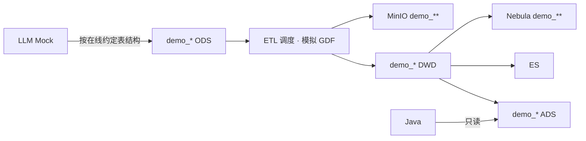

# ENT · Demo / LLM Mock 全链路（模拟 GDF）

> **口径 Owner**：`human:淮政玮`（2026-08-12 确认）  
> **地位**：Demo 灌数 **主路径**（全链路开发/测试闭环）  
> 规范：[`../../README.md`](../../README.md) §5.1 · 流图：[`../01-data-flow.md`](../01-data-flow.md) §7  
> **禁止**另起 DDL；库表/索引/图谱**结构**与正式共用 `stores/*`，仅落在 `demo_*` 实例 / 桶 / space

```yaml
---
doc_id: ENT-ETL-DEMO-MOCK
element: ENT
role: etl
status: approved
version: "2026-08-12"
updated: 2026-08-12
engine: multi
signoff_by: human:淮政玮
signoff_at: 2026-08-12
---
```

## 1. 意图（拍板口径 · 全文）

Demo 里的灌数过程，都是基于 **ETL 工程中的调度**，**模拟 GDF** 的过程。

**Mock** 使用 **LLM**，往下列隔离实例写入：

| 目标 | 命名约定 |
|---|---|
| 关系库 | `demo_***` 数据库（含 ODS 及下游，按管道写出） |
| 对象存储 | MinIO 的 `demo_**` 桶 |
| 图谱 | NebulaGraph 的 `demo_**`（space / 同等命名隔离） |

Mock **完整依靠模型能力**，向 **ODS** 写入模拟数据。ODS 表结构以 **与第三方数据源约定的在线文档**为准，**不以**现有三方数据源数据库中的 as-built 表结构为准。

**目的**：屏蔽因三方进度导致「现网三方库结构 ≠ 约定在线表结构」的问题，为后续数据流程提供**稳定的内部研发输入**。

Mock 数据按**数据特点**和**应用场景**，只列出**少量**能覆盖各数据特点的样例，确保在**先不考虑性能**的前提下，完成**全链路数据流程**的开发与测试闭环。

## 2. 主路径（与正式同构）

```text
LLM Mock（少量覆盖样例）
  → 写入 demo_* MySQL · ODS
       （结构 = 三方「在线约定文档」，非现网三方 as-built）
  → ETL 工程调度（模拟 GDF）
  → demo_* DWD
  → demo_* ADS / ES / Nebula(demo_**) / MinIO(demo_**)
  → Java 只读 ADS（与正式同一读模型）
```



可选旁路（仅 UI/契约冒烟、不跑工厂时）：Python 直写 ADS —— 见基线 D7 / [`pipeline-mock-to-ads.md`](./pipeline-mock-to-ads.md)；**不替代**本 Demo 全链路主路径与验收。

## 3. 结构 vs 实例

| 维度 | Demo | 正式 |
|---|---|---|
| 表 / 索引 / 图 schema | 与 `stores/*` **一致** | 同左 |
| ODS 字段口径 | **在线约定文档** | 同约定；现网三方 as-built 经 GDF **映射**对齐，不倒逼 Demo |
| 物理落点 | `demo_***` 库 / `demo_**` 桶 / `demo_**` Nebula | 非 demo 前缀实例 |
| 数据量 | 少量覆盖样例 | 全量 / 增量 |
| 写入者（ODS） | **LLM** | 三方入站 / GDF |

## 4. 开放项（S2 关闭）

| ID | 项 | Owner |
|---|---|---|
| OPEN-ENT-FLOW-05 | 三方 ODS **在线约定文档**入口与 `sources/` 镜像指针 | 数据 Lead / 供应对接 |
| OPEN-ENT-FLOW-06 | `demo_*` 库 / 桶 / Nebula space 命名表 + LLM Mock 脚本/入口 | Demo / 数据 |
| OPEN-ENT-FLOW-01 | ETL 调度工程（模拟 GDF 的 DAG/作业名；可与正式调度文档对齐） | 数据 Lead / GDF |
| OPEN-ENT-FLOW-07 | seeds 覆盖矩阵（场景 × 数据特点） | Demo / 数据 · [`../seeds/README.md`](../seeds/README.md) |

## 5. 禁止

- 以**现网三方库 as-built** 作为 Demo ODS 建表 / Mock 写入真源（与约定文档冲突时，**以约定在线文档为准**）
- `demo_ads_*` 等**第二套表结构**；Demo 仓私有列不回写 `stores`
- 前端 / Java 造假绕过 ADS
- 为性能压测在 Mock 阶段灌全量（**全链路闭环优先于性能**）
- 在本文粘贴大段 SQL / 复制在线约定全文
- 用「直写 ADS 旁路」冒充全链路验收通过
