# 管道 · → Nebula（企业投影一张 G）

```yaml
---
doc_id: ENT-ETL-TO-NEBULA
element: ENT
role: etl
status: as-built
version: "2026-09-01"
updated: 2026-09-01
task_id: DATA-ENT-STORAGE-S2-L01
p1_task_id: DEMO-ENT-GRAPH-TRIPLE-UI-L01
asbuilt_from: repos/demo-algo-ent-analysis/docs/nebula-space-schema.md
amendment: "2026-09-01 徐滕强步1六条审核 + 调用链收口为本叶 DEMO：VID=ent:org_id；A只建企业点；B投资上图源=DWD enterprise_invest（股东ODS本波不画）；C一企多产业、他域只FETCH；调用链=demo 前端→demo Java→demo-platform-entan-py /internal/entan/graph*；灌数流水线不准顺带建图。正式 lumen 链不写进本叶。"
---
```

> **§1–§9 是企业分析联调 as-built**（space `entan` / Demo 定名 `demo_entan`，`vid_type=FIXED_STRING(64)`，灌数串行建图）。**§10–§16 是 108/109 详细设计**（需规 + 现网规则 + LLM 升级）。**§17–§20 是 DEMO-ENT-GRAPH-TRIPLE-UI-L01 步1 契约**（每关系独立 `op_id`、灌数剥离清单、目标态过程图）。
> 拓扑真源 [`../01-data-flow.md`](../01-data-flow.md)（**approved**，本叶不翻签）· 细表指针 [`../stores/nebula/graph-enterprise.md`](../stores/nebula/graph-enterprise.md)（draft）。
> Schema 代码真源：`${GKX_ROOT}/repos/demo-algo-ent-analysis/docs/nebula-space-schema.md` · `entan/graph/nebula_loader.py`。
> 本叶只写文档：**不改代码、不 APPLY DDL、不灌数**。禁止继续用一个 `entity.run()` / `load_nebula_safe()` 当对外契约。
> 旧 20 行指针（引擎规约 / `demo_entan` / `gkx_enterprise`）只作 as-built 对照，**不是**本波目标。
> 本叶是 **DEMO** 契约。调用链只写 demo，不写正式 `lumen-*`。`/internal/entan/graph*` 落在现网企业 Python：**仓 `demo-algo-ent-analysis`，进程 `demo-platform-entan-py`**。正式链另叶，禁止塞进本文。

### 审核定稿（2026-09-01 · `human:徐滕强` 逐条过）

| # | 定 |
|---|---|
| 1 | 目标 space `demo_gkx_chain`；企业 VID = `ent:{org_id}`（值来自 `org_id`，不用名称/信用代码） |
| 2 | A 档只建企业点；属性进 `entity_recognition` / `props`，不上图、不挂边 |
| 3 | B：合作 / 归属 / **投资都上图**。投资源 = DWD `enterprise_invest`（`org_id`→`inv_org_id`，对端须在 `enterprise_base`）。股东 `dwd_org_shareholder_info` 仅 ODS，本波不画 |
| 4 | C：一企可挂**多条**产业边；技术/人才/政策/机构点用一张 G **已有** Tag/VID，本叶只 FETCH，不新定他域点 |
| 5 | **Demo 调用链**：`demo-ui-system-test` → demo 网关（`/entan/**` 前插 graph Path）→ `demo-svc-platform` `gkx-innov` → Feign `demo-platform-entan-py:8000` `/internal/entan/graph*`。禁止 Feign 指 `innov-py`。正式 lumen 链不在本叶 |
| 6 | 「允许/禁止」= **灌数据这条流水线**的范围：只装 ODS/DWD（+可选基础指标），不准顺带 NER/RE/写 Nebula。建图能力仍在，改走图谱菜单 |

## 1. 意图

企业点与企业边**增量投影**进产业链一张 G。`chain` / `segment` / `policy` / `institution` 复用各域既有顶点，企业侧不另建第二套七要素本体、不另建目标 space。

现网 as-built 仍把图写进企业分析 space `entan`（Demo 定名 `demo_entan`），并由灌数流水线顺带建图——那是 §1–§9 现状，**不是**步2 目标。

## 2. 入口与源（as-built）

| 项 | 值 |
|---|---|
| 仓 / 模块 | `demo-algo-ent-analysis` · `entan/graph/` · `entan/yiji_sim/` |
| 灌数入口 | `scripts/run_all.py` → `entity.run` + `load_nebula_safe()`（先 `yiji_sim.pipeline.run(apply=True, persist=True)`，失败再 `nebula_loader.run(from_ads=True)`） |
| 旧 CLI | `python -m entan.graph.entity`；`python -m entan.graph.nebula_loader --from-ads`；`scripts/run_yiji_sim.py --apply --persist`；`scripts/seed_demo_graph.py` |
| 源表 | DWD `enterprise_base` / `enterprise_industry_chain` / `enterprise_cooperation` / `enterprise_supply_chain` / `enterprise_parent_subsidiary` / **`enterprise_invest`（本波 B 档投资；现网灌图脚本未吃，as-built 投影没用）**；ADS 镜像 `{ads}.graph_node` · `{ads}.graph_edge` · `{ads}.entity_recognition`（Demo = `demo_gkxlumenx_*`） |
| 目标（as-built） | Nebula space **`entan`**（settings）/ 文档定名 **`demo_entan`** |
| 目标（本波契约） | Nebula space **`demo_gkx_chain`**（禁止第二空间） |
| 读路径 | `entan/graph/nebula_query.py` → 现网 `GET /v1/graph/*` · `POST /internal/graph/subgraph` |

源可以是 **DWD 事实边**（yiji-sim）或 **ADS 镜像**（`nebula_loader --from-ads`）。镜像两表同时是 Nebula 不可用时的读兜底。

上链 MySQL（**不是**本叶灌数建图）：CHAIN [`../../CHAIN/etl/pipeline-ent-hang.md`](../../CHAIN/etl/pipeline-ent-hang.md) → `enterprise_industry_chain` + `industry_chain_entity_rel`；脚本 `scripts/run_ent_chain_hang.py`。本叶不把 hang 塞回灌数。

2026-10-24 demo 实查：按产业、产业节点能命中多少企业，见 [产业检索企业条数](../../../../../qa/test-cases/SDWJSF-KJZTFWSFK/enterprise-企业分析/产业检索企业条数-20261024.md)。政策、服务机构同口径见 [产业检索政策条数](../../../../../qa/test-cases/SDWJSF-KJZTFWSFK/policy-政策分析/产业检索政策条数-20261024.md)、[产业检索服务机构条数](../../../../../qa/test-cases/SDWJSF-KJZTFWSFK/svc-产业服务分析/产业检索服务机构条数-20261024.md)。

## 3. Space 与 VID 约束

### 3.1 as-built（现网强制，不得假装已并）

`entan/yiji_sim/entities.py::vid` / `nebula_loader.ensure_schema`：

| 项 | 值 | 违反后果（现网） |
|---|---|---|
| space | settings `entan`；Demo 文档名 `demo_entan` | 现网 **会** `CREATE SPACE IF NOT EXISTS`（与政策「拒绝非一张 G」相反） |
| vid_length | `FIXED_STRING(64)`（`VID_MAX=64`，超长 MD5 收口） | 超长截断哈希，**不丢弃** |
| 正式图库 | 模型注册仍见过渡名 `gkx_enterprise` | 文档债，不是第二套本体 |
| 废作当目标 | 继续把 `demo_entan` / `gkx_enterprise` 写成目标态 | 本波禁止 |

VID as-built：

| 实体 | 前缀 | 例 | 诚实 |
|---|---|---|---|
| 企业 | `ent:` | `ent:{org_id}` | 稳定 ID，目标沿用 |
| 产业领域 | `ind:` | `ind:{产业名}` | **名称当 VID**，目标禁止再写 |
| 产业环节 | `chn:` | `chn:{chain_id}:{node_id}` | 接近挂接；目标须 `FETCH` 一张 G 已有点 |
| 科研 / 人才 / 服务 | `{tag}:` | `research:清华` | **名称当 VID**，目标禁止再写 |
| 技术点 | `tech:` | `tech:先进封装` | 名称/环节名；禁止 `patent_no` |

### 3.2 目标态（步2 强制，对齐政策）

| 项 | 值 | 违反后果 |
|---|---|---|
| space | 仅 `demo_gkx_chain` | 拒绝写入 `entan` / `demo_entan` / `gkx_enterprise` / 第二张图 |
| vid_length | 必须 `80`（与政策一张 G 对齐） | 候选 VID >80 → `skipped.reason=vid_too_long`，禁止 MD5  silently 截断当成功 |
| 正式图库 | `gkx_chain` | 本管线零写入 |
| 废作 | `CREATE SPACE` / `DROP SPACE` | 代码中目标态禁止；只 `USE` 已存在 space 后 `IF NOT EXISTS` 增量 |

VID 目标：本域企业 `ent:{org_id}`。跨域 **只 FETCH** 复用 `chain:` / `segment:` / `pol:` / `inst:`（及一张 G 已有的 `enterprise` / `institution`）。人才 / 技术无稳定 ID → `no_stable_id` 或 `not_in_wave`，**禁止名称猜 VID**。对不齐标「本波不上图」，**禁止静默删行**。

> as-built `64` vs 目标 `80`：见 `OPEN-ENT-GRAPH-VID`。步2 不得假装 vid 已是 80；接入一张 G 时按目标 80 校验。

## 4. Schema（as-built `ensure_schema()`）

现网在**自己的** space 内可 `CREATE SPACE` + `CREATE TAG/EDGE IF NOT EXISTS`，随后 sleep 等就绪：

```ngql
CREATE TAG  IF NOT EXISTS enterprise  (name string, node_type string, weight double, props string)
CREATE TAG  IF NOT EXISTS industry    (name string, node_type string, weight double, props string)
CREATE TAG  IF NOT EXISTS research    (name string, node_type string, weight double, props string)
CREATE TAG  IF NOT EXISTS talent      (name string, node_type string, weight double, props string)
CREATE TAG  IF NOT EXISTS service     (name string, node_type string, weight double, props string)
CREATE TAG  IF NOT EXISTS chain_node  (name string, node_type string, weight double, props string)
CREATE TAG  IF NOT EXISTS technology  (name string, node_type string, weight double, props string)
CREATE EDGE IF NOT EXISTS industry_belong (weight double, props string)
CREATE EDGE IF NOT EXISTS research_coop   (weight double, props string)
CREATE EDGE IF NOT EXISTS talent_coop     (weight double, props string)
CREATE EDGE IF NOT EXISTS service_provide (weight double, props string)
CREATE EDGE IF NOT EXISTS cooperate       (weight double, props string)
CREATE EDGE IF NOT EXISTS supply          (weight double, props string)
CREATE EDGE IF NOT EXISTS parent_sub      (weight double, props string)
CREATE EDGE IF NOT EXISTS located_in      (weight double, props string)
CREATE EDGE IF NOT EXISTS produces        (weight double, props string)
```

目标态：只在已存在的 `demo_gkx_chain` 上 `USE` 后增量 `IF NOT EXISTS`。企业点 Tag 复用一张 G 已有 `enterprise`（若无则补，不另造 `gkx_enterprise` space）。**禁止**为产业/科研/人才/服务/技术在企业侧新建第二套本体 Tag 当挂接终点——跨域终点必须已在。as-built **无** `invest` Edge：目标补 `CREATE EDGE IF NOT EXISTS invest (weight double, props string)`（不另开 space）。政策适用仍无边类型，见 `OPEN-ENT-GRAPH-POLICY`。股东 ODS 本波不画，见 `OPEN-ENT-GRAPH-SHAREHOLDER`。

## 5. 挂接解析（对不齐则不上图）

目标态既有实体必须经 `FETCH PROP ON *` 证明顶点真实存在才挂边，解析不到就计入 `skipped`，**不按名称猜测**：

| 源 / 终点 | 取值字段 | 目标前缀 | as-built 对照 |
|---|---|---|---|
| 企业本体 | `org_id` | `ent:` | 已对齐 |
| 对端企业（合作/投资/归属/供应链） | `partner_org_id` / `inv_org_id` / `parent_org_id` / `related_org_id` | `ent:` | 投资对端 = DWD `enterprise_invest.inv_org_id`；无 ID 则现网用名称或丢行 |
| 产业所属 | `chain_code`/`node_id` 或 `industry_link_code` | `chain:` / `segment:`（或已有 `chain_node`） | as-built `industry_belong` 用产业名 → `ind:` |
| 科研 / 服务 | 稳定 `institution_id` / `org_id` | `inst:` | as-built `{tag}:{name}` |
| 政策适用 | `policy_id` | `pol:` | **现网无边** |
| 人才 / 技术 | 稳定专题库 ID | 一张 G 已有点才 FETCH | as-built 名称 VID；无 ID → 不上图 |

`relation_type` 不在 §12 清单内的一律 `not_in_wave`。边两端任一顶点未解析则整条丢弃并记账，**禁止静默删行**。

## 6. 写入与幂等

as-built：`INSERT VERTEX` / `INSERT EDGE` 分类型批量提交，`chunk=100`。同 VID 重跑覆盖。`nebula_loader.ensure_schema(rebuild=True)` 会 `DROP SPACE`——目标态**禁止**。

目标态：同 `calc_batch_id` + 主键（节点=`vid`；边=`src+rel+dst`）可重跑覆盖。本管线默认不做删除，**不清空既有底图**（`chain` / `pol` / `inst` 禁止 DROP）。`dry_run` 不写 ADS、不写 Nebula、不 `ensure_schema`。Demo 图谱菜单写入允许对白名单 Tag/Edge 做 `CREATE … IF NOT EXISTS` 后立即 INSERT（等心跳），**禁止** `CREATE/DROP SPACE`。

## 7. fail-soft 与开关

as-built：`nebula.enabled` 关则跳过；`load_nebula_safe` 失败不阻断灌数，API 回退 PG ADS。`source` 只有真实 nGQL 成功才标 `nebula`。

| 环境变量 | 作用 | 回退键 |
|---|---|---|
| `ENTAN_NEBULA_ENABLED` | 投影/读图总开关 | settings `nebula.enabled` |
| `ENTAN_NEBULA_HOSTS` | 图库地址 | `GKX_NEBULA_HOSTS` |
| `ENTAN_NEBULA_USER` / `_PASSWORD` | 凭据 | `GKX_NEBULA_*` |
| `ENTAN_NEBULA_SPACE` | as-built 常为 `entan`；目标只接受 `demo_gkx_chain` | `GKX_NEBULA_SPACE` |
| `ENTAN_GRAPH_BACKEND` | 读路径 `nebula` \| `pg` | `GKX_GRAPH_BACKEND` |

政策投影已与 `ENTAN_NEBULA_SPACE=demo_entan` 隔离。步2 企业写入改打一张 G 后，**禁止**再靠共用 `GKX_NEBULA_SPACE` 把企业点写回 `entan`。

## 8. 首轮 as-built 基线（文档，非本叶实测）

本叶**未**连 graphd 重新计数。下列摘自 schema 文档与代码路径，当缺口对照，不当验收绿：

| 项 | 值 |
|---|---|
| space（现网） | `entan`（`docs/nebula-space-schema.md`） |
| Demo 定名 | `demo_entan`（`pipeline-demo-mock.md` §4） |
| Tag / Edge | §4 全表 |
| 灌数建图 | `run_all` 步「B 实体识别+关系图谱」「B+ 图谱灌入 Nebula」「M 图谱成员初始化」 |
| Demo 灌边债 | `scripts/seed_demo_graph.py` 要求 ≥1 条 `supply` |
| 读兜底 | ADS `graph_node` / `graph_edge`；`POST /internal/graph/subgraph` |

跳过/名称 VID 的原因：合作对象常只有 `partner_name`、产业常只有中文名、人才/技术无专题库 ID。**这是缺口不是故障**。

## 9. 禁止

Neo4j；Java 直连 nGQL；`CREATE SPACE gkx_enterprise` / 继续把 `demo_entan` 当目标态；写正式 `gkx_chain`；`DROP SPACE demo_gkx_chain`；用名称相似度伪造 `ent:` / `chain:` / `pol:` / `inst:`；灌数路径 NER/RE/建点建边/`ensure_schema`/`INSERT VERTEX|EDGE`；网关 `/entan/**` catch-all 直连 Python 写图；lumen Feign 指 `demo-*`（D12）。

---

## 10. 需求挂接（108 识别 / 109 抽取）

两叶都在算法库 SRS **分册 05 · 产业全要素图谱**（`bid-reference/srs/05-深度挖掘算法/科技专题服务算法库/企业/图谱.md`）。招标章节 `§1.1.1.1.1.1.1.2.7` / `.2.8`。公式未签（`pending_cosign: human:唐绍祖`）。metric-registry MCP 本会话不可用，ID 以算法库登记名为准，**不把 D1 说成 aligned**。

| 项 | 企业实体识别构建 | 企业实体关系抽取 |
|---|---|---|
| metric_id | **`M_ENT_GRAPH_108_1`** | **`M_ENT_GRAPH_109_1`** |
| 中文名 | 企业实体识别构建 | 企业实体关系抽取 |
| SRS | 05 seq **108** · `ALGO-ENT-GRAPH-108` | 05 seq **109** · `ALGO-ENT-GRAPH-109` |
| algorithm_type | GRAPH | GRAPH |
| 现网算子 | `entan/graph/entity.py` B1 段 | 同文件 B2 + `yiji_sim.facts` / `infer` |
| ADS | `entity_recognition` | `graph_node` + `graph_edge`（+ `graph_membership`） |
| 页消费 | 专题企业分析 / 算法库图谱；展示企业工作区 | 同左；system-test `/entan/graph`；apiview `entan.graph` |

### 10.1 需规原文在要求什么

**108**：对接工商 / 新闻 / 财报 / 招聘等多源；规则（正则/关键词）+ 专业词典 NER；抽取**企业名称、类型、所属行业、地理位置**等基础属性，以及**营收、员工人数、高管、融资额、市值、产品、技术**等核心属性；支持批量增删改与定期更新；对接企业专题库去重纠错补全。

**109**：对接企业、产业、技术、人才、政策、科研机构、服务机构专题库；关系类型明确为 **合作、投资、归属、产业所属、技术应用、人才关系、政策适用、科研合作、服务提供**；正则 / 字段关联 / 语义映射；去重纠错补全后入关系库，支持可视化、图分析、智能推演。

现网**没有**六类专题库的稳定 ID 接口，也**没有**企业→政策 DWD 边。投资**有** DWD：`enterprise_invest`（模拟 GDF 来自 ODS `dwd_org_invest_info`）。股东 `dwd_org_shareholder_info` 仅 ODS、无 DWD 对表，本波不画。Demo 其余边用 DWD 结构化列 + 合作 `partner_type` 抄字段，部分边来自新闻推理（`produces` / 部分 `located_in`）——这是规则/推理基线，不是需规终态。

---

## 11. 总过程（先 ADS，再投影）

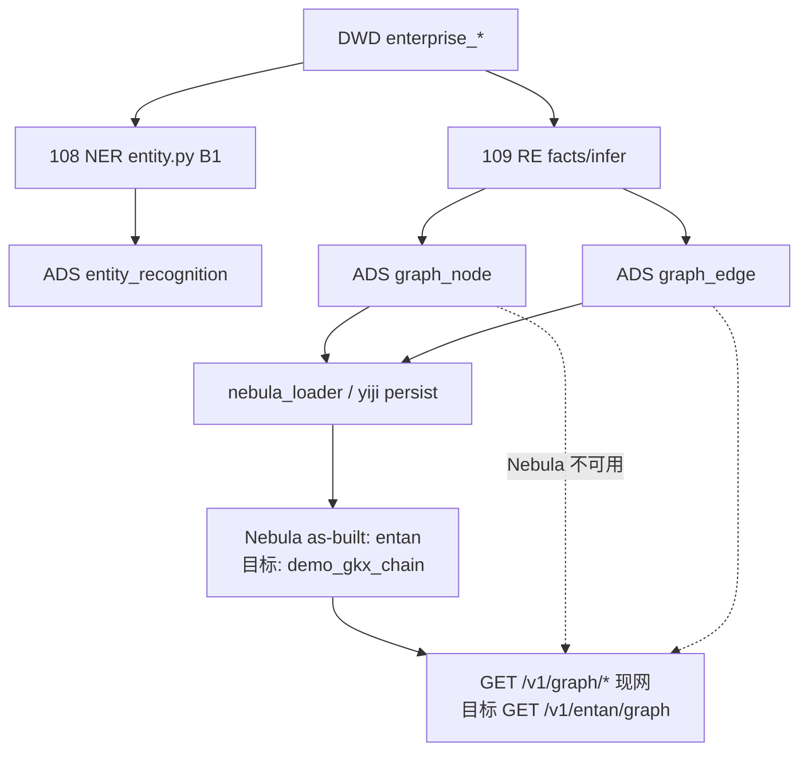

| 层 | 做什么 | 失败 |
|---|---|---|
| 108 | 每条企业抽属性行（类型/名/源字段/置信度） | 空字段不写该属性 |
| 109 | 企业点 + 关联点 + 边写入 ADS | 无稳定 ID / 空名丢弃并记账 |
| 投影 | 只把解析到既有 VID 的点边写入一张 G | 对不齐跳过，见 §5 |

Java 不抽实体、不写 nGQL。LLM 若上，只许在 Python（`entity.py` / `yiji_sim.infer_llm` 后继）里，经 `/internal/*` 被 Java 调用。

> **目标态（§17–§18）**：上图仍「先 ADS 再投影」，但 NER/RE/`nebula_loader.run` / `yiji_sim.pipeline persist` **不再**挂在灌数 `run_all` / `run-pipeline` 上；只由图谱菜单 A/B/C 对应 `op_id` 触发。上图过程图以 §19 `ENT-GRAPH-TRIPLE` 为准。

---

## 12. 支持的边关系

需规 109 点名九种。现网多一种 **`supply`（供应链）**，需规未单列但 Demo 灌边 / GraphView 在用。方向默认 **本企 → 对象**（`parent_sub` as-built 是母 → 子）。

| 边 | 中文 | 需规 | 档 | 终点类型 | DWD / 推理源 | 上图条件（目标） |
|---|---|---|---|---|---|---|
| `cooperate` | 合作 | 109 合作 | B | enterprise | `enterprise_cooperation` 且 `partner_type=enterprise` | 两端 `ent:` 且 FETCH 到 |
| `invest` | 投资 | 109 投资 | B | enterprise | **DWD `enterprise_invest`**（`org_id`→`inv_org_id`；模拟 GDF 来自 ODS `dwd_org_invest_info`） | 两端 `org_id` 均在 `enterprise_base` 且 FETCH `ent:`；`inv_org_id` 空或对端不在主表 → 不上图。**股东** `dwd_org_shareholder_info` 仅 ODS，本波不画 |
| `parent_sub` | 归属 | 109 归属 | B | enterprise | `enterprise_parent_subsidiary` | 母/子均有 `org_id` 且 FETCH |
| `supply` | 供应链 | 现网加性 | B′ | enterprise | `enterprise_supply_chain` | 两端 `ent:`；**不是**需规最低集，禁止当「投资」顶替 |
| `industry_belong` / `located_in` | 产业所属 | 109 产业所属 | C | 产业 / 环节 | `enterprise_industry_chain` | `FETCH` `chain:`/`segment:`（或已有环节点）；禁止 `ind:{名}` |
| `produces` | 技术应用 | 109 技术应用 | C | 技术 | 现网主路径 = `infer_org_produces_tech`（新闻） | 一张 G 已有技术点才 FETCH；无 ID → 不上图 |
| `talent_coop` | 人才关系 | 109 人才 | C | 人才 | `enterprise_cooperation` `partner_type=talent` | 有稳定人才 ID 才 FETCH；名称 → `no_stable_id` |
| （无 as-built 边） | 政策适用 | 109 政策适用 | C | 政策 | **无企业→政策 DWD 边** | 有 `policy_id` 且 FETCH `pol:`；否则缺口行保留 |
| `research_coop` | 科研合作 | 109 科研 | C | 科研机构 | `partner_type=research_institution\|university` | FETCH `inst:` |
| `service_provide` | 服务提供 | 109 服务 | C | 服务机构 | `partner_type=service_org` | FETCH `inst:` |

要点：

1. **投资 ≠ 供应链 ≠ 归属**。禁止用 `supply` / `parent_sub` 冒充 `invest`。`supply` 仍是加性，不准顶替投资。
2. 产业所属现网双轨：`industry_belong`（名）+ `located_in`（环节）。目标优先环节/链 VID，名称产业点不再新建。**一企可多行** `enterprise_industry_chain`：每一行能 FETCH 到的链/环节各挂一条；`run_ent_chain_hang.py`「一企一节点」是 Mock 上链脚本，不是本叶契约。
3. `produces` 现网是推理边，不是 DWD 抄字段。技术/人才/政策/机构点 **架构已定**，本叶不新定 Tag/VID；只 FETCH 一张 G 已有点。对端不在图上就 skipped，不补造 `ind:软件` / `talent:张三`。
4. 政策适用整行保留，本波标「无企业→政策 DWD 边 / 挂不上」，禁止从表删掉。

---

## 13. 108 实体：每一类怎么入库

### 13.0 总图

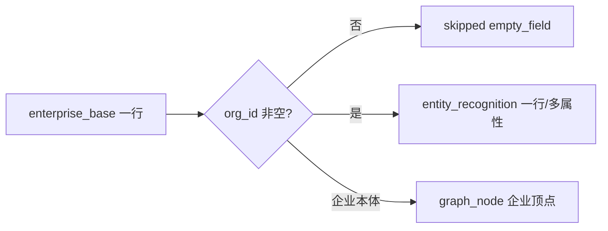

企业**属性**（行业/地区/营收/高管…）只进 `entity_recognition`（及企业点 `props`），**不按属性建图点**。图点 A 档只有企业本体。关联主体不得在 A 档 `FETCH` / 挂边。

### 13.1 企业本体 `enterprise`

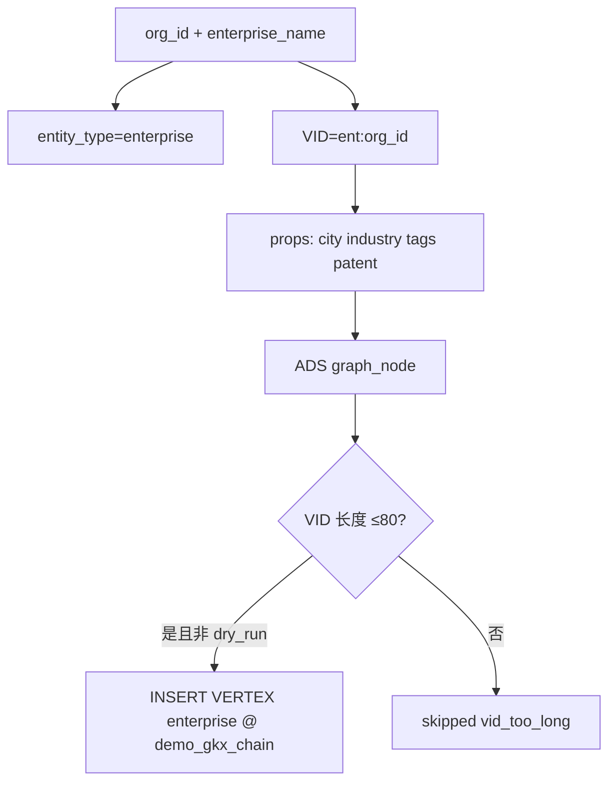

### 13.2 属性实体（只 NER，不上图）

| 属性 | 需规 108 | as-built 源列（`entity.py`） | 本波 |
|---|---|---|---|
| 企业名称 | 基础 | `enterprise_name` | 写入识别结果 |
| 类型 | 基础 | **未单列**（高新/上市/专精特新在 `props.tags`） | 缺独立 type 列 → 缺口，不编造枚举 |
| 所属行业 | 基础 | `industry_category` | 属性；**不**当 `ind:` 上图 |
| 地理位置 | 基础 | `headquarters_city` | 属性 |
| 法定代表人 / 高管 | 核心（高管） | `legal_representative` | 仅法人；班子名单无表 → `empty_field` |
| 注册资本 | 现网加性 | `registered_capital` | 属性 |
| 营收 | 核心 | `revenue_latest` | 属性 |
| 员工 / 研发人数 | 核心 | `rd_staff_count`（研发，非正式员工总数） | 正式员工总数缺列 → 缺口 |
| 融资额 / 市值 | 核心 | **无列** | `empty_field` |
| 产品 / 技术 | 核心 | 专利数 `patent_grant_count`；技术名不进 NER | 技术名走 C `produces`，不在 A 建技术点 |
| 来源类型 | 108 多源 | Mock 从「工商/新闻/财报/招聘」抽样 | Demo 抖动，不是专题库对接 |

### 13.3 关联主体（NER 可备查，上图只走 C）

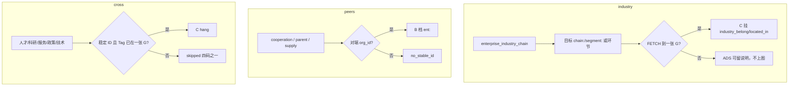

**禁止**用名称相似度在投影层伪造 `ent:` / `chain:` / `pol:` / `inst:`。

---

## 14. 109 关系：每一组怎么入库

### 14.1 `cooperate` 合作（B）

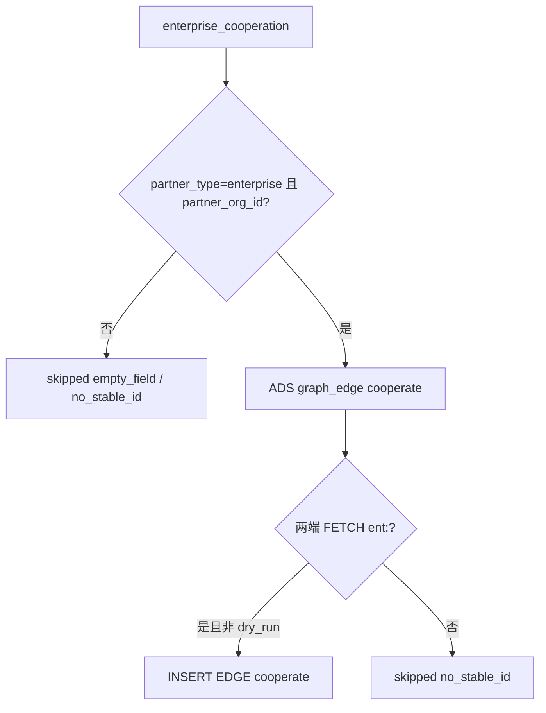

### 14.2 `invest` 投资（B）

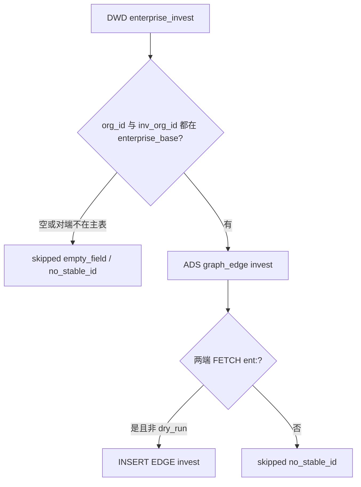

源只吃 DWD `enterprise_invest`（投资方 `org_id` → 被投 `inv_org_id`）。as-built Nebula 无 `invest` Edge：目标 `CREATE EDGE IF NOT EXISTS invest`。股东 ODS `dwd_org_shareholder_info` **本波不画**（`OPEN-ENT-GRAPH-SHAREHOLDER`）。禁止把 `supply` / `parent_sub` 改名交差。

### 14.3 `parent_sub` 归属（B）

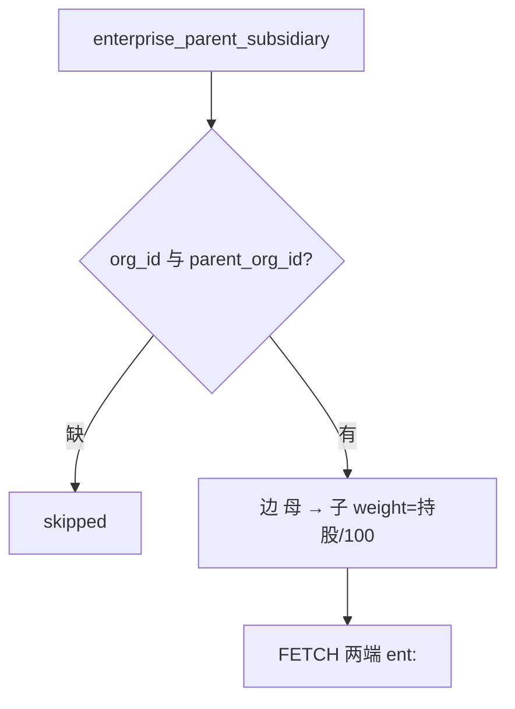

### 14.4 产业所属（C）

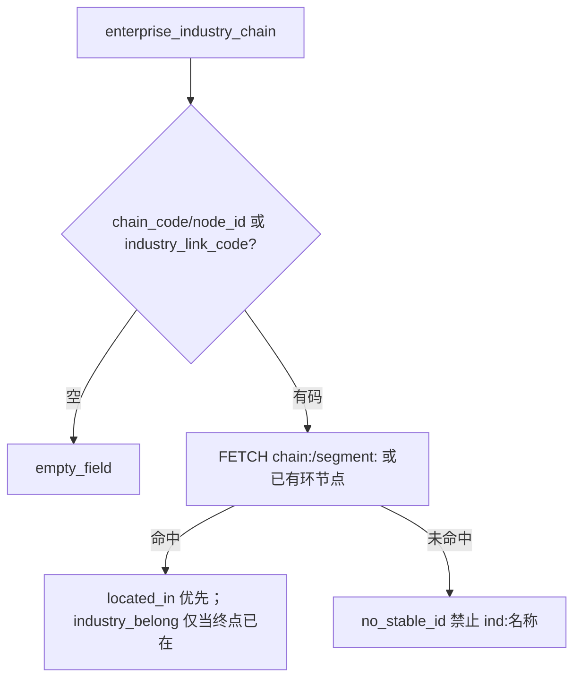

### 14.5 `produces` 技术应用（C）

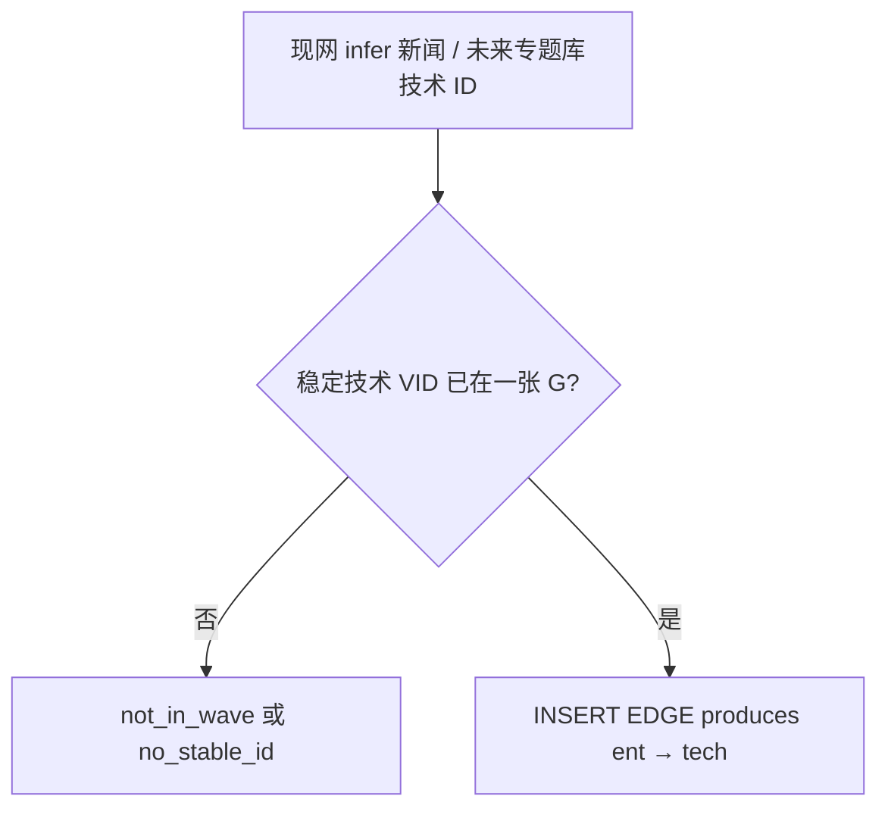

### 14.6 `talent_coop` / `research_coop` / `service_provide`（C）

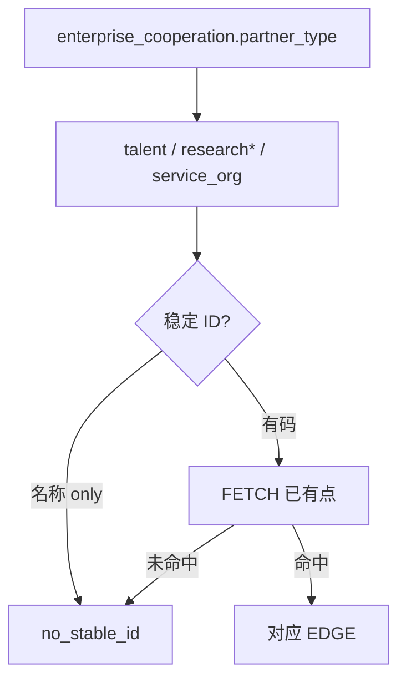

as-built `partner_id()` 对非企业用名称当键——目标态废除。

### 14.7 政策适用（C）

现网无边。保留需规行：有 `policy_id` 且 `FETCH pol:` 才写（边名待结构拍板，建议 `policy_apply`，**本叶不落 DDL**）。否则 `empty_field` / `OPEN-ENT-GRAPH-POLICY`。

### 14.8 `supply`（as-built 加性，非需规最低集）

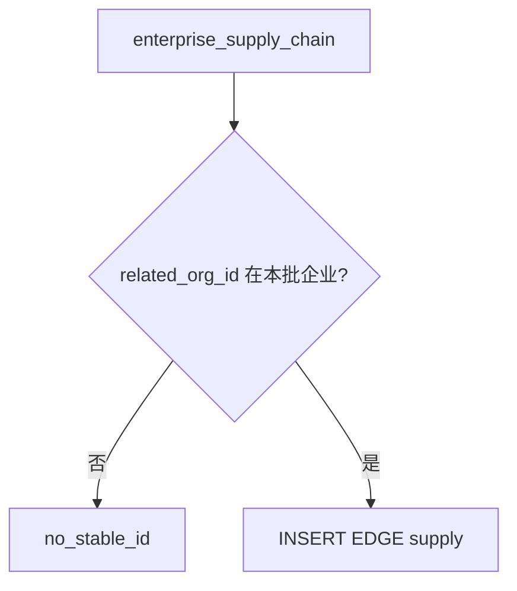

步2 可实现 `ENT_RE_SUPPLY`，但 **不得**用来顶替投资。菜单 B 档默认白名单不含 `supply`，除非 UI 显式勾选加性边。

---

## 15. 哪些场景要 LLM、推什么

现网 **108 全程规则**（属性 Mock 置信抖动）。**109** 事实边规则抄 DWD；`yiji_sim.infer` / `infer_llm.py` 可从新闻推 `located_in` / `produces` / 部分合作（`ALLOWED_RELS`）。下面是对照需规「语义映射 / NLP」的升级清单。无 Key 必须回退规则，禁止编造 ID。

| 编号 | 触发（规则不够） | 推什么 | 写入 | 不推 |
|---|---|---|---|---|
| L1 | 行业/城市空，但新闻/简介有领域与驻地 | 抽行业短语、城市 | NER 属性 | 不改 DWD 源列；不建 `ind:` |
| L2 | 合作表空，正文有「与××公司战略合作」 | 对端企业名 | NER 备查；无 `org_id` **不上图** | 不按店名猜 `ent:` |
| L3 | 只有集团名，正文有子公司/持股 | 归属候选 | 有双侧 ID 才 `parent_sub` | 不把供应链当归属 |
| L4 | 新闻像投资（融资、入股）但对不上 `enterprise_invest` 行 | 投资事件槽 | 仅 `mode=llm` 且双侧 ID；规则档只吃 DWD 投资表 | 不发明持股比例；不拿股东 ODS 顶替 |
| L5 | 技术应用只有专利数 | 产品/技术短语 | C 档有稳定技术点才 `produces` | 不用专利号当 VID |
| L6 | ADS 有名称、无链/机构/政策 ID | **链指** → 已有 VID | 只写 FETCH 成功的挂接 | 相似度伪造边（须徐滕强拍板，默认关） |
| L7 | 政策适用无表 | 正文「适用××政策 / 国发××」 | 解析到本批 `policy_id` 才挂 | 不造悬挂 `pol:` |

推荐默认：**L1/L2 文本槽可先上**（不上图）。**L6 须监管人拍板**。**L4/L7** 无稳定 ID 只记账。调用形态：`mode=rule|llm`；Java 只调 Python。

---

## 16. 和投影缺口怎么对

| 现象 | 归属 | 不是 |
|---|---|---|
| 合作对象大量名称点 | as-built `partner_id` 用名 | loader 随机丢边 |
| 产业点 `ind:软件` | 旧 GraphView 子图 | 目标一张 G 已挂 `chain:` |
| 现网无 `invest` Edge / 只见 `supply` | as-built schema 无投资边；目标增量补 Edge + 吃 `enterprise_invest` | 漏配，用 `supply`/`parent_sub` 顶替 |
| 无政策适用边 | `OPEN-ENT-GRAPH-POLICY` | 漏配 EDGE 就可上 |
| `produces` 靠新闻 | 推理基线 | DWD 已有技术应用表 |
| 灌数后图很满 | as-built B/B+/yiji persist | 目标态预期：重灌图空 |
| space 仍是 `entan` | as-built | 目标已是 `demo_gkx_chain` |

公式 / 边权：仍挂唐绍祖会签，本设计不改 D1。`invest` Edge 目标增量 `IF NOT EXISTS`，不另开 space。

---

## 17. 关系 × op_id × I/O（步2 契约真源）

> **禁止**「一个 `entity.run()` / `load_nebula_safe()` 包打天下」当对外契约。现网 as-built 仍是 `entity.py::run` TRUNCATE 后写 NER+RE，再 yiji/nebula 投影——那是 §1–§9 现状，**不是**步2 接口。
> 每条需规关系（或一组同构边）必须有独立 `op_id`。Java **只转发** Python `/internal/*`，不写 NLP、不直连 nGQL。
> Space 固定 **`demo_gkx_chain`**（禁止 `CREATE SPACE gkx_enterprise` / 继续目标写 `demo_entan`）。
> HTTP 前缀 **`/entan/graph*`**（与政策 `/policy/graph*` 同构）。**本叶 Demo 链**：`demo-ui-system-test` → demo 网关 → `demo-svc-platform` `gkx-innov` → Feign **`http://demo-platform-entan-py:8000`** `/internal/entan/graph*`（代码仓 `demo-algo-ent-analysis`）。禁止 Feign 指 `demo-platform-innov-py`。禁止网关 `/entan/**` catch-all 直连 Python 写图。正式 `lumen-ui-*` / `lumen-topic-py` / `lumen-algo-py` **不写进本叶**。

### 17.1 档位与 op_id 清单（写入 9 + 只读 1 + 加性 1）

| op_id | 档 | 中文 | SRS | HTTP（前端经 Java） | Python `/internal` | 写什么 | 本波 |
|---|---|---|---|---|---|---|---|
| `ENT_NER_ORG` | **A 实体识别** | 企业本体 NER（企业点 + 属性） | 108 `M_ENT_GRAPH_108_1` | `POST /v1/entan/graph/ner` | `POST /internal/entan/graph/ner` | ADS `entity_recognition`；企业点 `graph_node`；Nebula `INSERT VERTEX enterprise` `ent:{org_id}` | **上图**（属性不上图，见 §13.2） |
| `ENT_RE_COOP` | **B 本域边** | 企业↔企业：合作 | 109 合作 | `POST /v1/entan/graph/intra` | `POST /internal/entan/graph/intra` | 边 `cooperate` | **上图**（两端本批/已有 `ent:`） |
| `ENT_RE_INVEST` | **B** | 企业↔企业：投资 | 109 投资 | 同上（白名单含 `invest`） | 同上 | 边 `invest`；源 DWD `enterprise_invest`（`org_id`→`inv_org_id`） | **上图**（两端须在 `enterprise_base` 且 FETCH `ent:`） |
| `ENT_RE_BELONG` | **B** | 企业↔企业：归属 | 109 归属 | 同上（白名单含 `parent_sub`） | 同上 | 边 `parent_sub` | **上图** |
| `ENT_RE_SUPPLY` | **B′ 加性** | 供应链 | 现网加性 | 同上（须显式白名单） | 同上 | 边 `supply` | 可上图；**不得**顶替投资；默认菜单可不展示 |
| `ENT_RE_INDUSTRY` | **C 跨域** | 产业所属 | 109 产业所属 | `POST /v1/entan/graph/hang` | `POST /internal/entan/graph/hang` | `located_in` / `industry_belong` | 产业/环节 **上图**（须 FETCH） |
| `ENT_RE_TECH` | **C** | 技术应用 | 109 技术应用 | 同上 | 同上 | 边 `produces` | 有稳定技术点 **上图**；否则 `no_stable_id` / `not_in_wave` |
| `ENT_RE_TALENT` | **C** | 人才关系 | 109 人才 | 同上 | 同上 | 边 `talent_coop` | 有稳定人才 ID **上图**；名称 → `no_stable_id`（现网有 talent Tag，故不用政策那条「无 Tag 一律 not_in_wave」一刀切） |
| `ENT_RE_POLICY` | **C** | 政策适用 | 109 政策适用 | 同上 | 同上 | 待拍板边名；终点 `pol:` | **本波默认不上图** `OPEN-ENT-GRAPH-POLICY`；行保留 |
| `ENT_RE_RESEARCH` | **C** | 科研合作 | 109 科研 | 同上 | 同上 | 边 `research_coop` | **上图**（`inst:` FETCH） |
| `ENT_RE_SERVICE` | **C** | 服务提供 | 109 服务 | 同上 | 同上 | 边 `service_provide` | **上图**（`inst:` FETCH） |
| `ENT_GRAPH_BROWSE` | **D 浏览** | 只读子图 | 109 可视化 | `GET /v1/entan/graph` | `GET /internal/entan/graph` | **不写库** | 现网 `GET /v1/graph/*` · `POST /internal/graph/subgraph` 可并存只读，不得再当写入入口 |

C 档六个写入 `op_id` 共用 `/hang`，**请求体必须带 `op_id` 或 `relation_whitelist`**，禁止一次 hang 偷偷写齐九种边。B 档三个需规写入共用 `/intra`，同样必须带 `op_id` 或白名单。可选更细路径（步2 可并存，不得替代上表）：`POST /v1/entan/graph/ops/{op_id}` → `/internal/entan/graph/ops/{op_id}`。

A 档**只认本域自身实体**：企业点 + 属性 NER。关联主体名称可以进 `entity_recognition` 备查，但 **不得**在 A 档挂 B/C 边。

现网写入入口（`POST /v1/graph/nodes`、`DELETE /v1/graph/nodes/{org_id}`、`POST /v1/graph/infer`、`add_enterprise`）步2 起不得再被灌数或基础指标页调用；增量加入图应改走对应 `op_id`。

### 17.2 公共入参 / 出参

所有写入 `op_id`（A/B/C）共用同一套字段。缺字段按表内默认；**禁止无稳定 ID 猜 VID**。

#### 入参

| 字段 | 类型 | 必填 | 说明 |
|---|---|---|---|
| `op_id` | string | 是 | §17.1 写入之一（D 不用 POST） |
| `scope` | `one` \| `batch` | 是 | `one` 必须给 `id`；`batch` 必须给过滤，禁止空过滤扫全库除非显式 `filter.all=true` |
| `id` | string | `scope=one` | 企业稳定 ID = DWD `org_id`（不是企业名称、不是信用代码冒充） |
| `filter` | object | `scope=batch` | 允许：`org_ids[]`、`industry_category`、`city`、`year`。**禁止**用名称当主键 |
| `mode` | `rule` \| `llm` | 否，默认 `rule` | LLM **只**在 `mode=llm` 出现；无 Key / 调用失败必须回退规则，并在出参标明 |
| `dry_run` | bool | 否，默认 `false` | `true`：**不写** ADS、**不写** Nebula、不 `ensure_schema`、不 `INSERT`/`DELETE` |
| `relation_whitelist` | string[] | B/C 档是；A 不用 | 只处理列出的边类型。空数组 = 拒绝执行（不要默默当全开） |
| `dest_types` | string[] | C 档可选 | 终点白名单：`industry` / `technology` / `talent` / `policy` / `research` / `service`。未列入本波上图表的类型必须 `skipped.reason=not_in_wave`，**禁止静默丢行** |
| `calc_batch_id` | string | 否 | 不传则服务端生成；同批次重跑覆盖 |

#### 出参

| 字段 | 说明 |
|---|---|
| `op_id` | 回显 |
| `written_nodes[]` | `{ vid, tag, name, props }`。A 档企业点 `vid=ent:{org_id}` `tag=enterprise`。C 档**不新建**他域 Tag（`chain`/`segment`/`policy`/`institution` 复用既有点） |
| `written_edges[]` | `{ src, rel, dst, weight, props }`。`src`/`dst` 必须是已解析 VID，禁止名称 |
| `skipped[]` | `{ src?, dst?, rel?, name?, reason, detail }`。`reason` **必须**是下列四码之一 |
| `source` | `nebula` \| `ads` \| `dry_run` \| `rule_fallback`。只有真实 nGQL 写入成功才 `nebula` |
| `model_version` | NER/RE 注册版本；`mode=llm` 另记模型名 |
| `calc_batch_id` | 本批 |
| `mode_effective` | 实际生效：`rule` 或 `llm` |
| `llm_fallback` | bool。`mode=llm` 但无 Key/失败而走规则时为 `true` |
| `space` | 恒为 `demo_gkx_chain` |

`skipped[].reason` 枚举（步2 对外只这四码）：

| 原因码 | 何时 | 现网 as-built 对照 |
|---|---|---|
| `empty_field` | 源字段空 / 字面量 `NULL` / `inv_org_id` 空 / 无政策关系表 | `entity.py` 跳过空属性；`iter_*` `continue` |
| `no_stable_id` | 无 `org_id` / `partner_org_id` / `inv_org_id` / `parent_org_id` / `related_org_id` / `industry_link_code` / `policy_id` / 机构 ID；或 `FETCH` 证明顶点不存在；或投资对端不在 `enterprise_base` | `partner_id` 用名称；`ind:{名}` |
| `not_in_wave` | 终点类型本波不上图；或 `relation_type` 不在清单；政策适用无企业→政策边；股东 ODS 本波不画 | — |
| `vid_too_long` | 候选 VID 长度 > 80 | as-built 是 MD5 截成 64，目标改为本码，禁止静默截断当成功 |

幂等：同 `calc_batch_id` + 主键可重跑覆盖。`dry_run` 出参仍给 *将要* 写的数组，但库不变。**不清空既有底图**。

### 17.3 需规最低集：边 × 终点（禁止静默删行）

对照厚包 §3 + SRS 109（合作 / 投资 / 归属 / 产业所属 / 技术应用 / 人才关系 / 政策适用 / 科研合作 / 服务提供 × 产业 / 技术 / 人才 / 政策 / 科研 / 服务）+ 本域企业↔企业。做不到的标「本波不上图 / 无 ID」，**禁止从本表删行**。

| 边 | 终点 | op_id | 档 | 上图？ | VID 规则 | as-built 源 | 缺口 |
|---|---|---|---|---|---|---|---|
| `cooperate` | 企业 | `ENT_RE_COOP` | B | **上图** | 两端 `FETCH` `ent:` | `enterprise_cooperation` `partner_type=enterprise` | 对端常无 `partner_org_id` → `no_stable_id` |
| `invest` | 企业 | `ENT_RE_INVEST` | B | **上图** | 两端 `FETCH` `ent:` | DWD `enterprise_invest`（`org_id`→`inv_org_id`） | as-built 无 `invest` Edge → 目标 `IF NOT EXISTS`；对端不在主表 → `no_stable_id` |
| `parent_sub` | 企业 | `ENT_RE_BELONG` | B | **上图** | 母/子 `ent:` | `enterprise_parent_subsidiary` | 缺一侧 ID → `no_stable_id` |
| `industry_belong` / `located_in` | 产业 | `ENT_RE_INDUSTRY` | C | **上图** | `FETCH` `chain:` / `segment:`（或已有环节点） | `enterprise_industry_chain`；旧 `ind:{名}` | 仅有产业名 → `no_stable_id` |
| `produces` | 技术 | `ENT_RE_TECH` | C | 有稳定技术点则 **上图**，否则 **本波不上图** | `FETCH` 已有技术点；禁止 `tech:{名}` 新建 | `infer_org_produces_tech` | 无专题库技术 ID |
| `talent_coop` | 人才 | `ENT_RE_TALENT` | C | 有稳定 ID **上图** | `FETCH` 已有人才点 | `partner_type=talent` 名称键 | 无人才稳定 ID |
| （待拍板） | 政策 | `ENT_RE_POLICY` | C | **本波不上图** `OPEN-ENT-GRAPH-POLICY` | `FETCH` `pol:` | 无表 | 无边 |
| `research_coop` | 科研机构 | `ENT_RE_RESEARCH` | C | **上图** | `FETCH` `inst:` | `partner_type=research_institution\|university` | 名称键 → `no_stable_id` |
| `service_provide` | 服务机构 | `ENT_RE_SERVICE` | C | **上图** | `FETCH` `inst:` | `partner_type=service_org` | 同上 |
| `supply` | 企业 | `ENT_RE_SUPPLY` | B′ | 可上图（加性） | 两端 `ent:` | `enterprise_supply_chain` | **不是** 109 投资 |

方向：本企 → 对象（归属 as-built 母→子，步2 保持，须在 `props` 写清）。`relation_type` 不在上表 → `not_in_wave`。

### 17.4 分 op 过程（目标态；替换「一次 entity.run + load_nebula_safe」）

#### A · `ENT_NER_ORG`

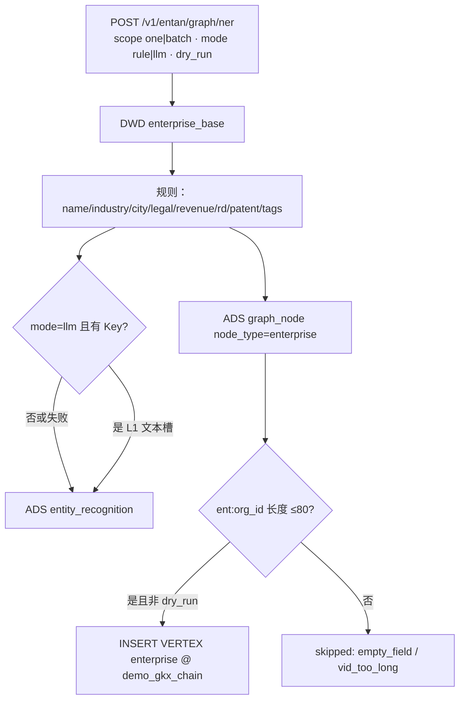

属性只进 `entity_recognition` / `props`，**不建图点**。A 档 **不 hang**。

#### B · intra（`ENT_RE_COOP` / `INVEST` / `BELONG` [/ `SUPPLY`]）

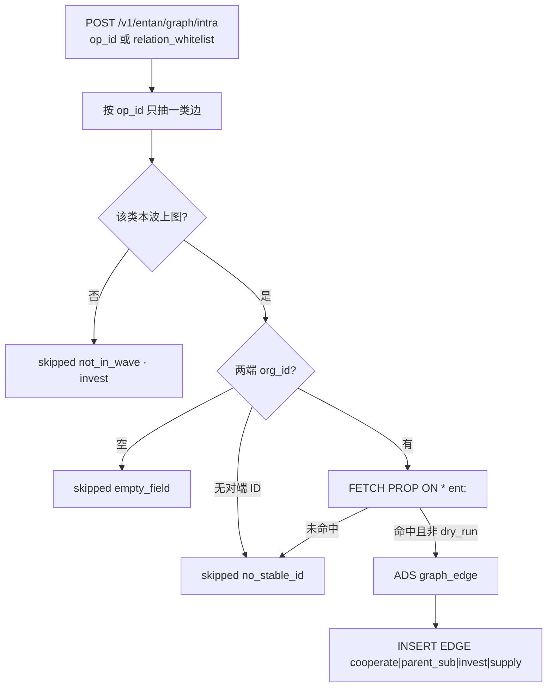

#### C · hang（产业 / 技术 / 人才 / 政策 / 科研 / 服务）

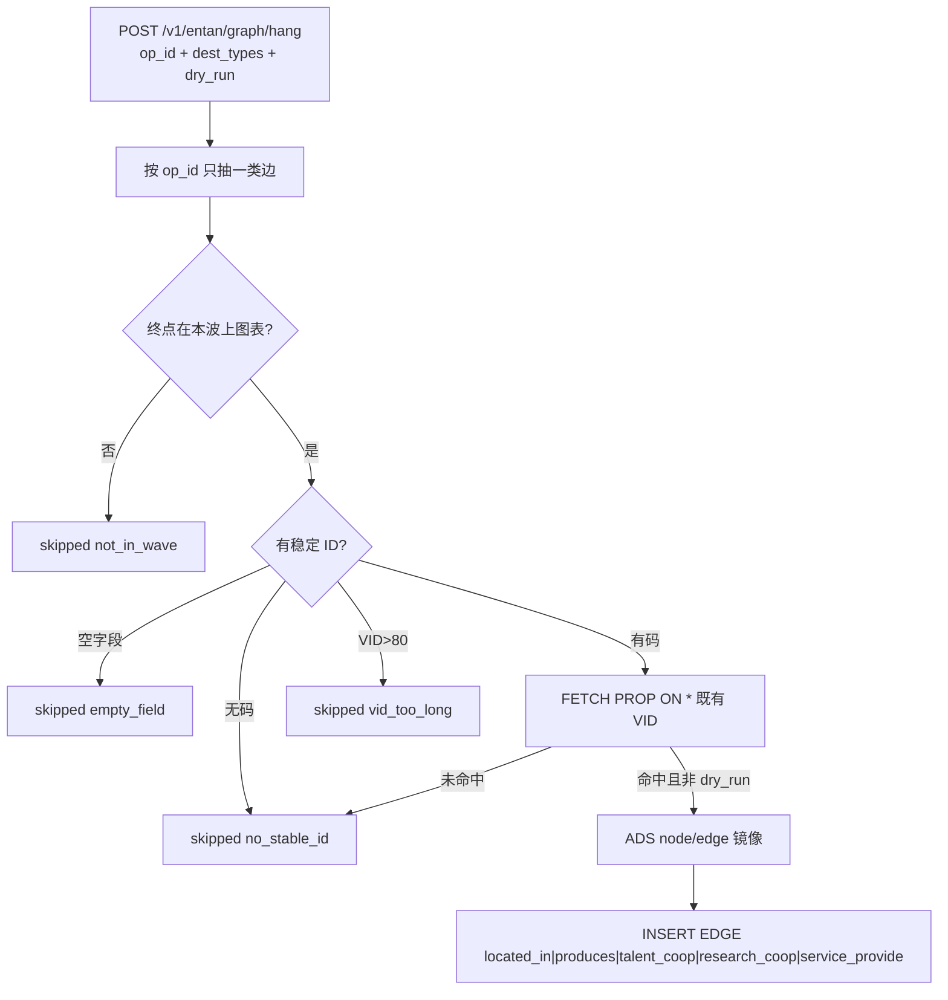

### 17.5 LLM 与规则分界

| 规则 | 说明 |
|---|---|
| 默认 | `mode=rule`：全程 §12–§14 抄 DWD 字段，不调模型 |
| 显式 LLM | 仅 `mode=llm` 可走 §15 L1/L2（推荐先上）；L4/L5/L7 无 ID 不上图；**L6 链指须 `human:徐滕强` 拍板**，本波默认关闭 |
| 回退 | 无 Key / 超时 / 4xx/5xx → `mode_effective=rule`，`llm_fallback=true`，`source` 不得假装 `llm` |
| Java | 禁止 NLP；只转发。网关在 `/entan/**` catch-all **之前**插 `/entan/v1/**/graph**` → `lb://gkx-innov` → Feign `demo-platform-entan-py:8000` `/internal/entan/graph*`。样板：政策 `31582b9e`。禁止指 `innov-py`。 |

### 17.6 步3 Java Path（本步只写清，不改代码）

| 项 | 值 |
|---|---|
| 本叶链 | `demo-ui-system-test` → demo 网关 → `demo-svc-platform` `gkx-innov` → Feign `demo-platform-entan-py:8000` `/internal/entan/graph*` |
| 抄 | 政策 `gkx-policy-graph` · `PolicyGraphController` · Feign `policy-algo` · commit `31582b9e`；企业换 Path `/entan/graph*`，Feign 仍 **entan-py** |
| 步2 Python | `demo-algo-ent-analysis` 出 `/v1` + `/internal/entan/graph*` 成对（现网进程名 `demo-platform-entan-py`） |
| 闸门 | `/internal/entan/graph*` 齐了才能写 Java；网关未插禁止接线 UI |
| 禁 | Java 写 NLP / 直连 nGQL；`/entan/**` catch-all 直连 Python 写图；Feign 指 `innov-py`；**lumen** Feign → `demo-*`（D12，正式链不在本叶） |

---

## 18. 灌数剥离清单（P0 · 步2 checklist）

「允许 / 禁止」= **灌数据这条流水线**能干什么，不是系统永远不许建图。灌数只装：三方或 Mock → ODS → DWD（+ 可选基础指标 ADS）。做完图可以是空的。建图只走图谱菜单 A/B/C。

识别 / 关系 / 跨域挂接 / schema / nGQL 写 **不是**贴源灌数。灌数路径 **禁止** NER / RE / 建点 / 建边 / `ensure_schema` / `INSERT VERTEX|EDGE` / hang / 图投影 / yiji persist 写图。

**重灌后图空（或保留旧图、不再被灌数填满）是预期。** 禁止灌数静默把图填满。图只允许从「企业 → 图谱」菜单 A/B/C（及对应 `/v1/entan/graph/{ner|intra|hang}`）触发。

现网 `run_all` 的 B/B+/M、`load_nebula_safe`、页面「NER/RE 建图」仍挂在灌数上。下表在 `demo-algo-ent-analysis`：**灌数路径要摘**；图谱 `/internal/entan/graph*` **也在本仓实现**（本步仍不改代码）。正式 `lumen-*` 不在本叶。

### 18.1 现网要摘掉的调用（文件 / 函数级）

| # | 仓 · 文件 | 符号 | 现网行为 | 步2 动作 |
|---|---|---|---|---|
| 1 | `demo-algo-ent-analysis/scripts/run_all.py` | `from entan.graph import entity as b` | 灌数编排 import NER/RE | **删除该 import**（或不再写入 STEPS） |
| 2 | 同上 | `build_steps()` 一步 `"B 实体识别+关系图谱", b.run` | 灌数串行 `entity.py::run` | **整步删除** |
| 3 | 同上 | `load_nebula_safe()` | 先 `yiji_sim.pipeline.run(apply=True, persist=True)`，失败再 `nebula_loader.run(from_ads=True)` | **删除函数及 STEPS `"B+ 图谱灌入 Nebula"`** |
| 4 | 同上 | `init_membership_safe()` → `incremental.init_membership` | 灌数重置图谱成员 | **从灌数 STEPS 删除 `"M 图谱成员初始化"`**；成员改由图谱菜单维护 |
| 5 | `demo-algo-ent-analysis/entan/graph/entity.py` | `run()` | TRUNCATE `entity_recognition`+`graph_node/edge` 后全量 NER+RE | **保留作 A/B/C 核，禁止被灌数调用**；拆成按 `op_id` 可 `dry_run` |
| 6 | `demo-algo-ent-analysis/entan/graph/nebula_loader.py` | `ensure_schema` / `run` / `_load_nodes` / `_load_edges` | 灌数 B+ / CLI 灌图；可 `CREATE/DROP SPACE` | **禁止**进 `run_all` / `run-pipeline`；仅 A/B/C 内部调用；目标禁 DROP SPACE |
| 7 | `demo-algo-ent-analysis/entan/graph/incremental.py` | `add_enterprise` / `_nebula_upsert` / `DELETE VERTEX` | 增量写图 | 可留作图谱菜单「加入/移除」实现核，**禁止**被灌数 `init_membership` 顺带灌满 |
| 8 | `demo-algo-ent-analysis/entan/yiji_sim/pipeline.py` | `run(apply=True, persist=True)` | 事实+推理+写 Nebula | 灌数路径摘 persist/写图；推理只由图谱 C/LLM `mode=llm` 触发 |
| 9 | `demo-algo-ent-analysis/scripts/run_yiji_sim.py` | `--apply --persist` | 运维灌图 | 不得进灌数 runbook / `run-pipeline` |
| 10 | `demo-algo-ent-analysis/entan/llm_ods/demo_graph.py` | `INSERT VERTEX` / `ensure_schema` / `_load_nodes` / `_load_edges` | LLM ODS 旁路建图 | **从灌数/llm_ods 主路径摘掉** |
| 11 | `demo-algo-ent-analysis/scripts/seed_demo_graph.py` | 灌 ≥1 条 `supply` 进 `demo_entan` | Demo 命名债 | **不进灌数**；目标改一张 G 后本脚本不得再写 `demo_entan` 冒充验收 |
| 12 | `demo-algo-ent-analysis/scripts/run_ent_chain_hang.py` | 写 MySQL 上链表；文档写「可选 Nebula 投影」 | 链挂接 | MySQL hang **可以**留在「链挂接」作业，**不得**当「灌数据建图」；任何 nGQL 写从灌数摘掉 |
| 13 | `demo-algo-ent-analysis/api/main.py` | `POST /internal/run-pipeline` → `_run_pipeline` → `run_all.build_steps` | 基础指标页「灌数据」 | **保留灌数**，流水线不得再含 B/B+/M |
| 14 | 同上 | `POST /v1/graph/nodes` · `DELETE` · `POST /v1/graph/infer` · `POST /v1/graph/mock-enterprise` | 现网写图 | 不得挂到灌数；infer 迁 C/`mode=llm` |
| 15 | `demo-ui-system-test/src/views/entan/pages/BasicPage.vue` | 主按钮「灌数据」`onSeed` | `runPipeline` 全流水线含 B/B+/M | **步4 去「会建图」文案**；步2 先让后端零图调用 |
| 16 | 同上 | `seedFlow`「B 实体识别 + 关系图谱」children「实体识别 / 关系图谱 / Nebula 灌入 / 图谱成员初始化」；hint「NER/RE 建图」 | UI 明示灌数含图谱 | **删除该步**（步4；步2 checklist 须点名） |
| 17 | CLI | `python scripts/run_all.py`；`python -m entan.graph.entity`；`python -m entan.graph.nebula_loader` | 运维手跑 | 全流水线摘 B/B+/M；后两个只允许图谱菜单/API |

### 18.2 灌数允许留下的

| 允许 | 文件 / 符号 |
|---|---|
| Schema 初始化（dwd+ads+cfg，**不含** Nebula `CREATE TAG/EDGE`） | `entan.common.db.ensure_entan_ads_tables` |
| Mock / LLM→约定 ODS→模拟 GDF→DWD | `entan.llm_ods.seed.run_seed` · `scripts/run_llm_ods.py`（**无** `demo_graph` 写 Nebula） |
| A 基础指标 A1–A5 | `entan.basic.indicators.run` |
| C1/C2 技商力 | `entan.eval.tech_power` / `biz_power`（读已有 ADS，不得在灌数 **写入** 图） |
| D 深度分析 | `entan.depth.run_depth`（中心性若读图：只读已有边，灌数不写图） |
| 链挂接 MySQL | `scripts/run_ent_chain_hang.py` **只写两张 MySQL 表**（见 CHAIN `pipeline-ent-hang.md`） |
| D 只读查询 | `GET /v1/graph/*` · `POST /internal/graph/subgraph`（不写） |

### 18.3 过关自检（步2 handoff 必附 grep）

在 `demo-algo-ent-analysis` 对下列入口跑 grep，**不得**再命中 `entity.run` / `nebula_loader` / `ensure_schema` / `INSERT VERTEX` / `INSERT EDGE` / `yiji_sim.pipeline` persist / `load_nebula_safe` / `demo_graph`：

- `scripts/run_all.py`（含 `build_steps`）
- `api/main.py` 的 `_run_pipeline` / `run_pipeline`
- `entan/llm_ods/seed.py` 及 llm_ods 主入口

基础指标页灌数成功后：**不**自动增加 `graph_node/edge` 行、**不**自动 `INSERT` Nebula 企业点边。A/B/C 才写 ADS 图面与 Nebula。

---

## 19. 图 · ENT-GRAPH-TRIPLE

> **diagram_id：`ENT-GRAPH-TRIPLE`**（L1 · 图即契约）。每类实体 + 每组关系入库。改边集 / 上图范围只改本图与 §17.3，禁止 UI/apiview 另造边名。

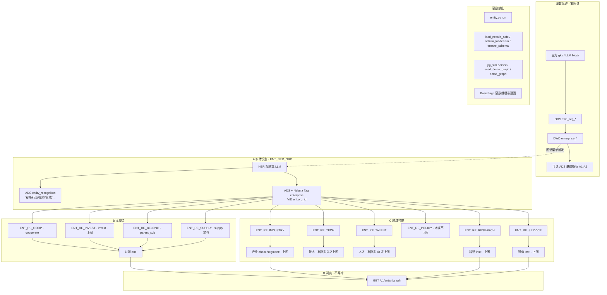

实体（Tag / 本波）：

| 实体 | Tag 或复用 | VID | 本波上图 | 谁写入 |
|---|---|---|---|---|
| 企业本体 | Tag `enterprise` | `ent:{org_id}` | 是 | A |
| 对端企业 | 复用 `enterprise` | `ent:` | 是（须 FETCH） | B |
| 产业 / 环节 | 复用 CHAIN `chain` / `segment` | `chain:` / `segment:` | 是（须 FETCH） | C |
| 科研 / 服务机构 | 复用 `institution` | `inst:` | 是（须 FETCH） | C |
| 人才 | 一张 G 已有点才复用 | 稳定 ID | 有 ID 才是 | C |
| 技术 | 一张 G 已有点才复用 | 稳定 ID | 有点才是 | C |
| 政策 | 复用 `policy` | `pol:` | **否**（无源） | C skipped |
| 属性（行业/城市/营收/高管…） | 不上图 | — | 否 | 仅 A → `entity_recognition` |

关系入库：

| 边 | 语义 | 典型三元组 | 写入 op |
|---|---|---|---|
| `cooperate` | 合作 | `ent:` → `ent:` | `ENT_RE_COOP` |
| `invest` | 投资 | `ent:` → `ent:` | `ENT_RE_INVEST`（DWD `enterprise_invest`） |
| `parent_sub` | 归属 | `ent:`（母）→ `ent:`（子） | `ENT_RE_BELONG` |
| `supply` | 供应链（加性） | `ent:` → `ent:` | `ENT_RE_SUPPLY` |
| `located_in` / `industry_belong` | 产业所属 | `ent:` → `chain:`/`segment:` | `ENT_RE_INDUSTRY` |
| `produces` | 技术应用 | `ent:` → 已有技术点 | `ENT_RE_TECH` |
| `talent_coop` | 人才关系 | `ent:` → 已有人才点 | `ENT_RE_TALENT` |
| （待拍板） | 政策适用 | `ent:` → `pol:` | `ENT_RE_POLICY` |
| `research_coop` | 科研合作 | `ent:` → `inst:` | `ENT_RE_RESEARCH` |
| `service_provide` | 服务提供 | `ent:` → `inst:` | `ENT_RE_SERVICE` |

---

## 20. 诚实缺口（本波）

| ID | 缺口 | 本波处理 | 不是 |
|---|---|---|---|
| `OPEN-ENT-GRAPH-VID` | as-built space `entan` + `FIXED_STRING(64)` + 超长 MD5；目标 `demo_gkx_chain` + vid 80 | §3 分列 as-built / 目标；接入一张 G 时按目标校验，禁止假装已并 | 本步改 graphd / APPLY SPACE |
| `OPEN-ENT-GRAPH-INVEST` | as-built Nebula **无** `invest` Edge（旧稿误写成「无 DWD 边表」，已作废） | 目标 `CREATE EDGE IF NOT EXISTS invest`；源 = DWD `enterprise_invest` | 用 `supply`/`parent_sub` 顶替；假装无投资表 |
| `OPEN-ENT-GRAPH-SHAREHOLDER` | ODS `dwd_org_shareholder_info` 股东表 Demo **无 DWD 对表** | 本波不画；行不进 B 档白名单 | 拿股东 ODS 冒充 `enterprise_invest` |
| `OPEN-ENT-GRAPH-POLICY` | 需规「政策适用」无企业→政策源、无边 | 留行；默认不上图 | 删行或发明未拍板 DDL 当已上线 |
| `OPEN-ENT-GRAPH-NAMEVID` | as-built 对科研/人才/服务/产业用名称当 VID | 目标 FETCH；名称 → `no_stable_id` | 名称相似度伪造边 |
| L6 链指 | 名称 → 已有 VID | **须 `human:徐滕强` 拍板**；默认关闭 | 静默打开链指 |
| 108 属性缺口 | 融资额/市值/正式员工/高管班子/产品名无列 | 属性表标缺口；`empty_field` | 用专利数冒充产品技术点 |
| D12 | 本叶只做 **demo** 闭环：`demo-ui-system-test` + `demo-svc-platform` + `demo-algo-ent-analysis` / `demo-platform-entan-py` | lumen 前端/Java **禁止**打 `demo-*`；正式复刻另叶，不写进本契约 | 本叶改 lumen 仓；lumen Feign 回落 demo |
| 灌数文档债 | `pipeline-demo-mock.md` §4 仍写 Nebula `demo_entan` + `seed_demo_graph.py`；`01-data-flow` 批处理仍画 DWD→Nebula | 步2 剥代码后由 data/doc 另单改全景图；**本文件 §18 已是剥离真源** | 本步改 mock 全景稿 / 翻签 01-data-flow |
| 综合叶 | `DEMO-COMP-GRAPH-TRIPLE-UI-L01` 只消费各域 C 档写进同一张 G | 本叶四步走完再开；综合无 A/B/C 写入 | 本步开综合叶 |

公式 / 边权 / 政策适用边名：仍挂唐绍祖会签，本设计不改 D1。`invest` 上图已由 `human:徐滕强` 拍板（源 = DWD `enterprise_invest`）。GDF-ENT-WORKPACK-v2.1 **仍暂缓**，不在本叶投递。
