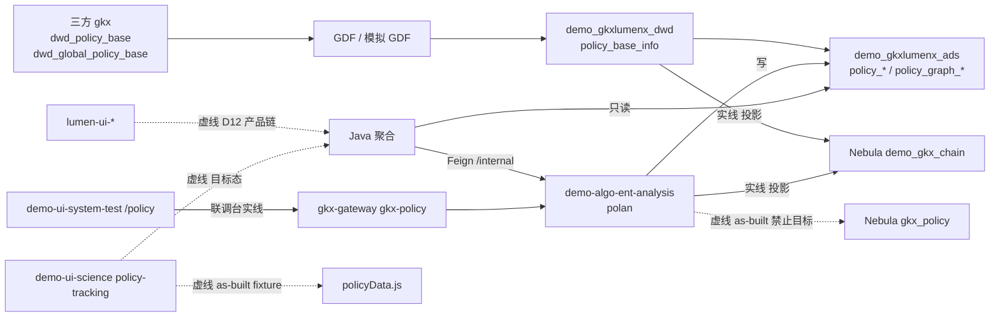
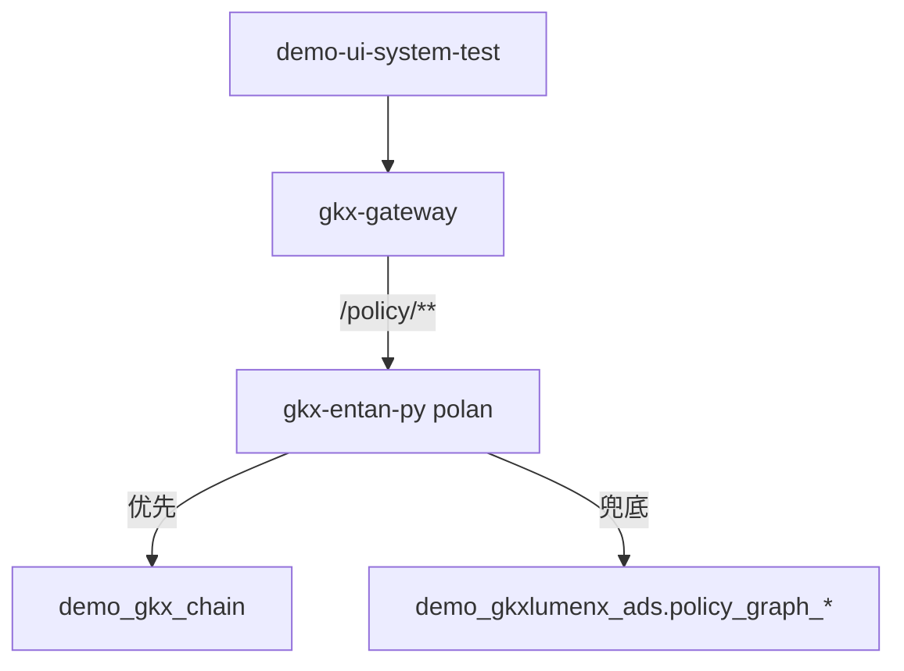
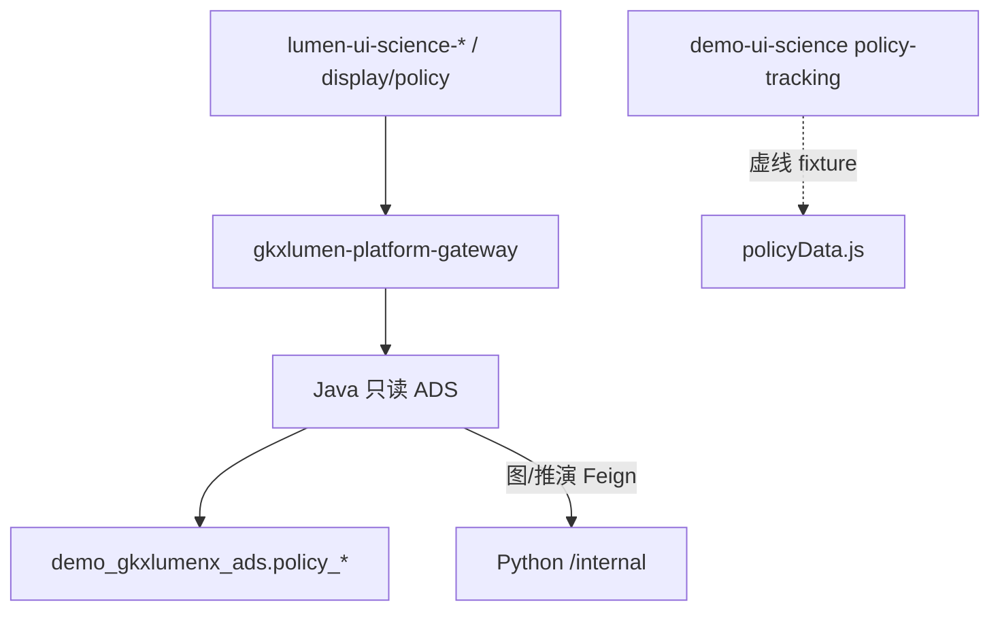

# 政策维 · 端到端数据流

```yaml
---
doc_id: POLICY-STORAGE-FLOW
element: POLICY
role: data-flow
status: approved
version: "2026-08-21"
updated: 2026-08-21
engine: multi
signoff_owner: human:淮政玮
signoff_status: approved
signoff_by: human:淮政玮
signoff_at: 2026-08-21
task_id: DATA-POLICY-STORAGE-S1-L01
amendment_note: "S1：政策投影一张 G demo_gkx_chain。展示窗口 DS10-12；ODS 表名 dwd_policy_base / dwd_global_policy_base；结构真源 sources/ods-ddl.md（不改工厂拓扑、不翻签）。细表 stores 仍 draft。"
---
```

> **会签 Owner / 已签：`human:淮政玮`** · 2026-08-21 **approved**。不经 `human:李伟`。  
> **执行**：`human:淮政玮` · `DATA-POLICY-STORAGE-S1-L01`。  
> **细表**（S3 `stores/*`）仍 draft，不得因本流图标 approved。

## 1. 批处理主链（工厂 + 投影）

实线 = 本管线授权施工（A 设计 / B 编码后）。虚线 = 目标态或 as-built，本单禁止当目标写入。



| 生产者 | 消费者 | 触发 | 失败语义 | 禁止事项 |
|---|---|---|---|---|
| 三方 / Mock ODS | DWD `policy_base_info` | 批：模拟 GDF / `run_all_policy` | 本批失败不晋升 ADS；保留上一成功 DWD | 默写正式 `gkx`/`gkxlumenx_*`；仍用 `dwd_zck_*`；PG 叙述 |
| `polan` Python | ADS `policy_*` | 流水线 append/replace | 半成品不发布；任务 failed | 前端造假填数 |
| `polan` Python | `demo_gkx_chain` | **B 叶** 投影（本叶不编码） | fail-soft：ADS 镜像仍可读；`source` 不得标 nebula | `CREATE SPACE gkx_policy`；`DROP SPACE demo_gkx_chain`；写 `gkx_chain` |
| Java | 前端 | 在线 HTTP | 不写回库；不扫 ODS | 直连 nGQL；lumen 调 demo 服务当正式链；展示前端把 fixture 当 ADS |

## 2. 在线读路径（算法库现网）



| 生产者 | 消费者 | 触发 | 失败语义 | 禁止事项 |
|---|---|---|---|---|
| polan `/v1/policy/graph` | 前端 | 用户打开政策图谱 | Nebula 不可用 → `source=mysql`/`ads` 诚实兜底 | ADS 全表扫却 `source=nebula` |
| Tempo-Demo | 排障 | 响应头 X-Trace-Id | 2026-08-21 抽样仅 MySQL ADS | 把 as-built 当已投影 |

## 2.1 在线读路径（展示系统 · 目标态）

真源对照：[`windows/display-ds10-12.md`](./windows/display-ds10-12.md)。**不改** §1 工厂边。



| 生产者 | 消费者 | 触发 | 失败语义 | 禁止事项 |
|---|---|---|---|---|
| ADS `policy_*` | 展示全景/评价/推演 KPI | 打开 DS-10/11/12 | 缺表诚实空 + D9 角标 | 第二套展示 DWD；直连 Nebula |
| Java 任务快照 | 未出台仿真 | 用户点运行 | I2-12 单飞；当天成功可复用 | 前端假装算完 |

## 3. 点/边挂接映射（拓扑已放行；细表 DDL 仍 draft）

CHAIN 现网 schema（`chainan.graph.nebula_schema`，禁止另起第二套本体）：

- Tag：`chain` / `segment` / `enterprise` / `institution`
- Edge：`belongs_to` / `participates` / `supplies` / `depends_on`

今日 `polan` as-built（独立 space 思路，**废作目标态**）：

- Tag：`policy` / `industry` / `tech` / `enterprise` / `talent` / `org` / `service`
- Edge：`support` / `apply_to` / `regulate` / `cite`

**B 叶已放行施工范围**（`human:淮政玮` · 2026-08-21）：仅 `demo_gkx_chain` 上 `CREATE TAG IF NOT EXISTS policy` 与 `CREATE EDGE IF NOT EXISTS` 四边 `support` / `apply_to` / `regulate` / `cite`。禁止 DROP SPACE、禁止写 `gkx_chain`、禁止新建 `gkx_policy`。

| polan 产出 | 一张 G 落点 | 本波 | 说明 |
|---|---|---|---|
| `policy` 节点 `pol:{policy_id}` | Tag `policy`（name/weight/props） | **施工** | B 叶 CREATE TAG IF NOT EXISTS |
| `industry` | hang `chain` 或 `segment`（`industry_link_code`） | **施工** | 对不齐则不上图 |
| `enterprise` | 已有 Tag `enterprise`（`org_id`） | **施工** | 与 ENT hang 同一 VID |
| `org` | 已有 Tag `institution` | **施工** | 不新建 `org` Tag |
| `service` | Tag `institution` + props.institution_type | **施工** | 不平行 SVC 本体 |
| `tech` / `talent` | 缺 Tag | **本波不上图** | OPEN-POLICY-GRAPH-01 |
| `support` / `apply_to` / `regulate` / `cite` | 同名新 Edge | **施工** | 不改 CHAIN 已有 EDGE_DDL 语义 |

**VID**：政策点 `pol:{policy_id}`；长度遵守 CHAIN `vid_length=80`。禁止截断导致碰撞。

## 4. 会签清单

- [x] 投影目标仅 `demo_gkx_chain`；`gkx_policy` 保持虚线  
- [x] 不 DROP 底图；不写 `gkx_chain`  
- [x] Tag/Edge 本波施工范围已写清（policy + 四边；tech/talent 不上图）  
- [x] 无 PostgreSQL / Neo4j  
- [x] ADS 仍为 Java 契约面；图失败 ADS 可兜底  

> 已由 `human:淮政玮` 于 2026-08-21 会签：`signoff_status=approved`。

## 5. 开放项

| ID | 项 | Owner | 关闭 |
|---|---|---|---|
| OPEN-POLICY-GRAPH-01 | `tech`/`talent` 是否上图、Tag 名 | `human:淮政玮` | 本波跳过；不挡 B |
| OPEN-POLICY-GRAPH-02 | 四类边是否日后折进 `participates` | `human:淮政玮` | 本波用同名新 Edge |
| OPEN-POLICY-GRAPH-03 | `policy` Tag 细列与 SAD 对齐 | 架构 | S3 stores/nebula |
| OPEN-POLICY-FLOW-01 | 正式调用链改 Java 门面 | api-agent | 展示+专题目标态 |
| OPEN-POLICY-DISP-01～09 | 展示窗口缺口（收藏/订阅/舆情/仿真快照等） | 见 `windows/display-ds10-12.md` | 不挡 B 投影 |

## 6. 下游放行

| 阶段 | 结论 |
|---|---|
| 本叶 | 流图已签；细表仍 draft |
| B `POLICY-NEBULA-PROJECT-CHAIN-L01` | **放行 ready**：按 §3 施工范围投影 `demo_gkx_chain` |
