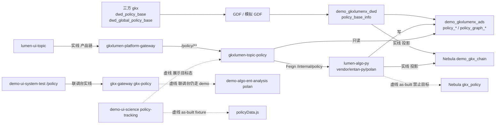
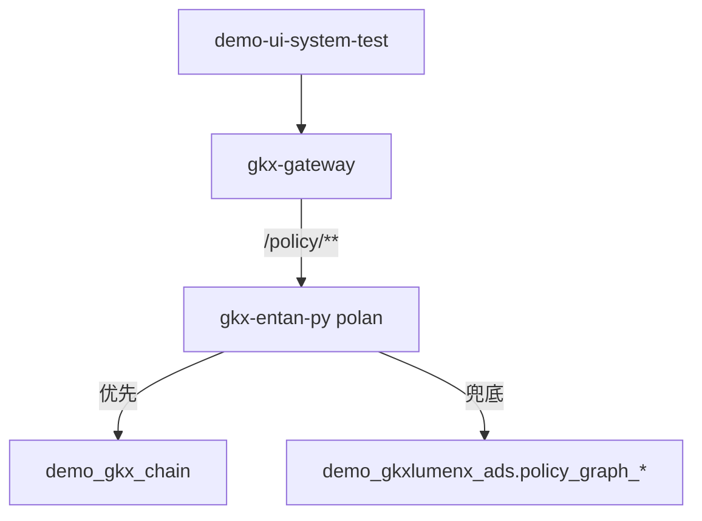
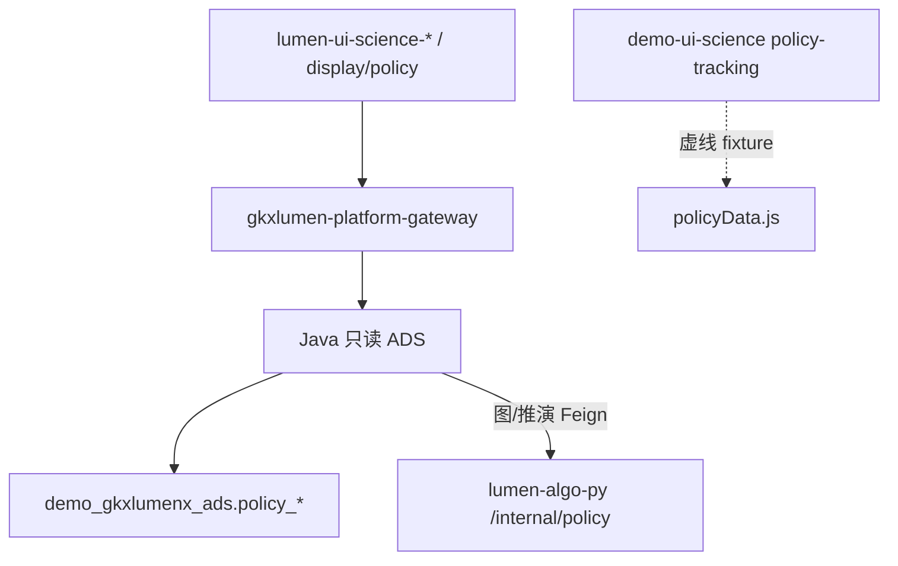
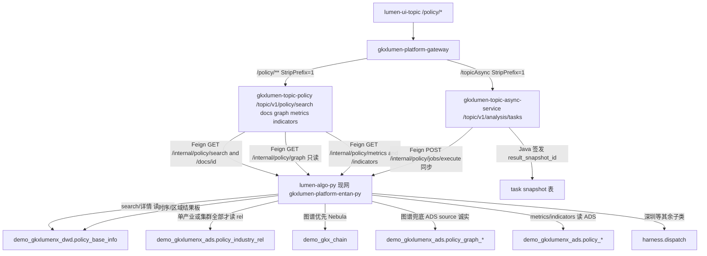
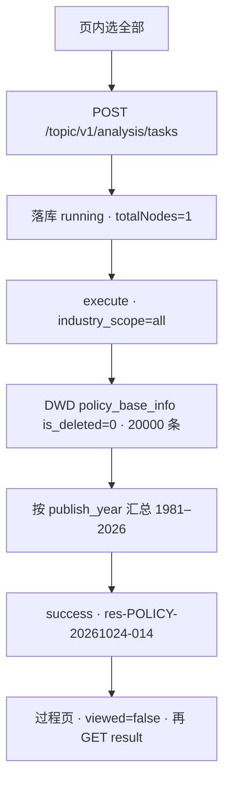
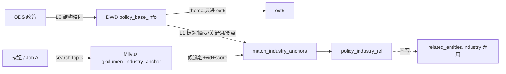

# 政策维 · 端到端数据流

```yaml
---
doc_id: POLICY-STORAGE-FLOW
element: POLICY
role: data-flow
status: approved
version: "2026-09-11"
updated: 2026-10-24
engine: multi
signoff_owner: human:淮政玮
signoff_status: approved
signoff_by: human:淮政玮
signoff_at: 2026-08-21
task_id: LUMEN-POLICY-E-DEVOPS-L01
amendment_note: "E0 只补发布边：helm 装出 gkxlumen-platform-topic-policy:7097；网关 /policy/** → 30899；政策 HTTP 现网 gkxlumen-platform-entan-py:8000；Nacos FORCE_NACOS_REPUBLISH 灌 async.policy.algo-base-url。工厂 ODS→GDF→DWD→ADS→demo_gkx_chain 拓扑不改、不翻签。2026-09-11 增 §2.4 产业向量消费切面 + L0 theme 只进 ext5（CROSS-VEC；不改 §1 工厂边、不翻签）。2026-10-23：related_entities.industry 贴源后弃用；产业抽取只写 DWD policy_industry_rel，并按政策同步到 ADS 同名表，不回写主表 JSON。2026-10-24：§2.2.1 补时序 Job 同步执行（样例 POLICY-20261024-014）。时序/区域走结果板读 DWD，不把 Job 写成一律 harness.dispatch，不翻签。"
---
```

> **会签 Owner / 已签：`human:淮政玮`** · 2026-08-21 **approved**。不经 `human:李伟`。  
> **执行**：`human:淮政玮` · `DATA-POLICY-STORAGE-S1-L01`。  
> **细表**（S3 `stores/*`）仍 draft，不得因本流图标 approved。  
> **§2.4**：产业锚点向量是**消费面**，不是政策建库面。政策重灌不同步调 Milvus。建库切面在 CHAIN [`01-data-flow.md`](../CHAIN/01-data-flow.md) §9。

## 1. 批处理主链（工厂 + 投影）

实线 = 本管线授权施工（A 设计 / B 编码后）。虚线 = 目标态或 as-built，本单禁止当目标写入。



| 生产者 | 消费者 | 触发 | 失败语义 | 禁止事项 |
|---|---|---|---|---|
| 三方 / Mock ODS | DWD `policy_base_info` | 批：模拟 GDF / `run_all_policy` | 本批失败不晋升 ADS；保留上一成功 DWD | 默写正式 `gkx`/`gkxlumenx_*`；仍用 `dwd_zck_*`；PG 叙述；**`theme` 写入 `related_entities.industry`（该键已弃用）** |
| `lumen-algo-py` polan | ADS `policy_*` | 流水线 append/replace | 半成品不发布；任务 failed | 前端造假填数；专题调 `/v1`；专题 Job 一次 load 全表 4 万+（须走 `polan.harness` 分片） |
| `lumen-algo-py` polan | `demo_gkx_chain` | 投影（算子冻结，本叶只迁代码） | fail-soft：ADS 镜像仍可读；`source` 不得标 nebula | `CREATE SPACE gkx_policy`；`DROP SPACE demo_gkx_chain`；写 `gkx_chain` |
| Java `gkxlumen-topic-policy` | 前端 | 在线 HTTP | 不写回库；不扫 ODS | 直连 nGQL；lumen 调 demo 服务当正式链；展示前端把 fixture 当 ADS |

## 2. 在线读路径（算法库现网）



| 生产者 | 消费者 | 触发 | 失败语义 | 禁止事项 |
|---|---|---|---|---|
| polan `/v1/policy/graph` | 前端 | 用户打开政策图谱 | Nebula 不可用 → `source=mysql`/`ads` 诚实兜底 | ADS 全表扫却 `source=nebula` |
| Tempo-Demo | 排障 | 响应头 X-Trace-Id | 2026-08-21 抽样仅 MySQL ADS | 把 as-built 当已投影 |

## 2.1 在线读路径（展示系统 · 目标态）

真源对照：[`windows/display-ds10-12.md`](./windows/display-ds10-12.md)。**不改** §1 工厂边。



| 生产者 | 消费者 | 触发 | 失败语义 | 禁止事项 |
|---|---|---|---|---|
| ADS `policy_*` | 展示全景/评价/推演 KPI | 打开 DS-10/11/12 | 缺表诚实空 + D9 角标 | 第二套展示 DWD；直连 Nebula |
| Java 任务快照 | 未出台仿真 | 用户点运行 | I2-12 单飞；当天成功可复用 | 前端假装算完 |

## 2.2 在线读路径（专题系统 · 产品链 · C-SEARCH / C-GRAPH / C-METRICS / C-TASK 实线）

真源对照：总控 §2.1。**不改** §1 工厂 ODS→DWD→ADS 边。C-TASK 补分析 Job：任务中心在 `gkxlumen-topic-async-service`，不复制第二套。



| 生产者 | 消费者 | 触发 | 失败语义 | 禁止事项 |
|---|---|---|---|---|
| Java `gkxlumen-topic-policy` | `lumen-ui-topic` | 网关 `/policy/topic/v1/policy/search` · `/docs/{id}` · `/graph` · `/metrics` · `/indicators` | 下游挂 HTTP 200 + honesty.empty + degraded，不 5xx 填假数 | Feign `demo-platform-entan-py`；暴露 Python `/v1` 给前端；`/v1/policy/mock`；暴露 `POST .../graph/hang`；Java 自填 8 件套 / 改绿 D1 |
| polan `GET /internal/policy/search` | Java | 用户检索 | DWD 空/异常 → `honesty.empty`，不造名 | Java 写 nGQL；专题调 `/v1`；查询入对比篮 / 发起分析 |
| polan `GET /internal/policy/graph` | Java | 用户打开政策关联子图 | Nebula 失败 `source≠nebula`（mysql/ads/unavailable）；Java 原样透传 | Java 把失败 source 改成 nebula；专题前端调 hang/ner/intra |
| polan `GET /internal/policy/metrics` | Java | 全库指标总览。时序结果四张卡不读此接口 | ADS 空/Feign 挂 → 空 headline + `fabricated=false`；数字原样透传 | Java 自造 metric_id 口径；把 D1 改绿；fixture 填 KPI；用峰值年发布量填时序「最近一年发布量」 |
| polan `GET /internal/policy/indicators` | Java | 分布 indicators（kind 透传） | ADS 空/Feign 挂 → 空列表 + `fabricated=false` | Java 填假分布行；暴露 `/v1/mock` |
| Java `gkxlumen-topic-async-service` | `lumen-ui-topic` | `POST/GET /topic/v1/analysis/tasks` 政策 types + result | Job failed 诚实 failed，不签发 snapshot；I2-12 同指纹 running 复用、当天 success 复用、force 重跑 | 第二套任务中心；Feign `demo-*`；Python 自签 `result_snapshot_id`；直调 `eval.*.run()`；一次 load 4 万+；暴露 hang |
| polan `POST /internal/policy/jobs/execute` | Java async-service | 开始分析（非切条件自动 create）。时序/区域在创建请求内同步返回结果板 | 400 VID/灌入上限；Java 不把 Python id 当 snapshot | 一次灌入 40000+；industry_vid 用 ODS 树码/中文名；时序/区域改走 harness 空 items；把过程页四段文案写成 `totalNodes=4` |

### 2.2.1 时序 Job（as-built · 样例 `POLICY-20261024-014`）

不改 §1 工厂。时序与区域不读 ADS `policy_timeseries` 填在线卡。单产业用 ADS `policy_industry_rel` 等值筛 DWD；`industry_scope=all` 不筛产业；`industry_scope=cluster` 用该集群多个 INB。



本单 2026-10-24 22:03:13–22:03:14，用户 `guest`。请求粒度是月，结果序列按年。2026 年发布 3 条，2025 年为 0，年度增长率留空。有效占比 100%。峰值年 2020 的 2402 条是切片内最大年发布量。交互说明见 FUNC-DESIGN §4.1.1。调用链见详设 `05.6.1-政策时序分析.md`。

## 2.3 发布边（E0 · K8s `dev` · 不改 §1 工厂）

现网实线，只记发布资源。禁止把 innov / 厨房 `lumen-platform-algo-py` 当本轮 E0。

| 点名 | K8s | 入口 |
|------|-----|------|
| `lumen-ui-topic` | `gkx-lumen-topic` | NodePort **30892** |
| `gkxlumen-topic-policy` | `gkxlumen-platform-topic-policy:7097` | 网关 `/policy/**` → `http://192.168.88.50:30899/policy/topic/v1/policy/health` |
| `gkxlumen-topic-async-service` | `gkxlumen-platform-topic-async-service:7094` | `gkxlumen.topic.async.policy.algo-base-url` → entan-py |
| 政策 HTTP | `gkxlumen-platform-entan-py:8000`（entan-api 制品） | `/internal/policy/**`；**不是** `lumen-platform-algo-py` |
| 产业向量 HTTP | `lumen-platform-algo-py:8000`（CHAIN 模块 Feign） | `/internal/industry/embed/*`；政策重灌 **不**走这条 |

## 2.4 产业向量消费切面（CROSS-VEC · 不改 §1 工厂）

> **政策重灌不是建库切面，也不是 search 的同步执行切面。** 建库见 CHAIN [`01-data-flow.md`](../CHAIN/01-data-flow.md) §9。  
> 施工真源：CROSS-VEC 总控 §0 #3 / #6 / #7 / #17。`POLICY-SEARCH` / `JOB-A` 仍 `blocked`（等 `EMBED-SWITCH`），本节省写**目标态口径**，不是宣称语义抽槽已上线。



| 层 | 产业关联落点 | 进重灌同步？ | 进 ETL / 按钮？ |
|---|---|---|---|
| L0 结构映射 | `theme` → **仅** `ext5`。**不**写 `related_entities.industry`（贴源后该键弃用） | **是** | 否（已在重灌做完） |
| L1 规则 / 图名 | 标题 + 摘要 + 关键词 + 要点 + `policy_support`；`match_industry_anchors`。链码写入 `policy_industry_rel`，不回写主表 JSON | **是** | 否（已在重灌做完） |
| 锚点向量检索 | 查询 embed → top-k → **再** L1 对码。按钮 / Job A **只**写 DWD `policy_industry_rel`（`is_deleted` 逻辑删除），并同步 ADS 同名表 | **否** | **是**（Job A / 「抽取产业」按钮） |
| L2 LLM 抽名 | 只输出中文名，再 L1 对码；失败回退 L1。同样只写关联表 | **否** | **是**（Job B，默认关） |

| 生产者 | 消费者 | 触发 | 失败语义 | 禁止事项 |
|---|---|---|---|---|
| polan 重灌 `run_all_policy` / append | `policy_industry_rel`（L1 对码） | 灌数 HTTP | 无码只留名称行；上图 skip | 同步调 `embed/rebuild` / `search` / LLM；`theme` 或链码写入 `related_entities.industry` |
| `POST /internal/industry/embed/search` | Job A / 按钮 | 重灌成功之后的下游步 | 503 + degraded + 空 items；**不写假 `chain:`** | 采 top1 当 `industry_link_code`；与灌链并排跑 |
| Java `POST /chain/topic/v1/industry/embed/search` | 后续门面 | Feign | 未就绪 501 + honesty | Java 直连 19530 / TEI；把 score 加工成链码 |

**定码铁律**：向量分数不是码。top-k 候选必须再过 `match_industry_anchors`。VID 只用图上链码（`chain:INB170101`），禁止 ODS 短码 / 中文名。

**与 OPEN-POLICY-XDOM-01**：覆盖度分母仍是 CHAIN 维 / 图上点数。分子只认 DWD `policy_industry_rel` 中 `is_deleted=0` 且带 `industry_link_code` 的行。ADS 同名表是镜像，不另计。`ext5` 的 theme 与已弃用的 `related_entities.industry` **不计入**产业覆盖。

## 3. 点/边挂接映射（拓扑已放行；细表 DDL 仍 draft）

CHAIN 现网 schema（`chainan.graph.nebula_schema`，禁止另起第二套本体）：

- Tag：`chain` / `segment` / `enterprise` / `institution`
- Edge：`belongs_to` / `participates` / `supplies` / `depends_on`

今日 `polan` as-built（独立 space 思路，**废作目标态**）：

- Tag：`policy` / `industry` / `tech` / `enterprise` / `talent` / `org` / `service`
- Edge：`support` / `apply_to` / `regulate` / `cite`

**B 叶已放行施工范围**（`human:淮政玮` · 2026-08-21）：仅 `demo_gkx_chain` 上 `CREATE TAG IF NOT EXISTS policy` 与 `CREATE EDGE IF NOT EXISTS` 四边 `support` / `apply_to` / `regulate` / `cite`。禁止 DROP SPACE、禁止写 `gkx_chain`、禁止新建 `gkx_policy`。

| polan 产出 | 一张 G 落点 | 本波 | 说明 |
|---|---|---|---|
| `policy` 节点 `pol:{policy_id}` | Tag `policy`（name/weight/props） | **施工** | B 叶 CREATE TAG IF NOT EXISTS |
| `industry` | hang `chain` 或 `segment`（`industry_link_code`） | **施工** | 对不齐则不上图 |
| `enterprise` | 已有 Tag `enterprise`（`org_id`） | **施工** | 与 ENT hang 同一 VID |
| `org` | 已有 Tag `institution` | **施工** | 不新建 `org` Tag |
| `service` | Tag `institution` + props.institution_type | **施工** | 不平行 SVC 本体 |
| `tech` / `talent` | 缺 Tag | **本波不上图** | OPEN-POLICY-GRAPH-01 |
| `support` / `apply_to` / `regulate` / `cite` | 同名新 Edge | **施工** | 不改 CHAIN 已有 EDGE_DDL 语义 |

**VID**：政策点 `pol:{policy_id}`；长度遵守 CHAIN `vid_length=80`。禁止截断导致碰撞。

## 4. 会签清单

- [x] 投影目标仅 `demo_gkx_chain`；`gkx_policy` 保持虚线  
- [x] 不 DROP 底图；不写 `gkx_chain`  
- [x] Tag/Edge 本波施工范围已写清（policy + 四边；tech/talent 不上图）  
- [x] 无 PostgreSQL / Neo4j  
- [x] ADS 仍为 Java 契约面；图失败 ADS 可兜底  
- [x] **2026-09-11 增量（不翻签）**：政策重灌不同步调 Milvus；`theme` 只进 `ext5`；定码不采向量 top1  

> 已由 `human:淮政玮` 于 2026-08-21 会签：`signoff_status=approved`。2026-09-11 向量消费切面、2026-10-24 时序 Job 执行边为同 owner 增量，**不改签日期**。

## 5. 开放项

| ID | 项 | Owner | 关闭 |
|---|---|---|---|
| OPEN-POLICY-GRAPH-01 | `tech`/`talent` 是否上图、Tag 名 | `human:淮政玮` | 本波跳过；不挡 B |
| OPEN-POLICY-GRAPH-02 | 四类边是否日后折进 `participates` | `human:淮政玮` | 本波用同名新 Edge |
| OPEN-POLICY-GRAPH-03 | `policy` Tag 细列与 SAD 对齐 | 架构 | S3 stores/nebula |
| OPEN-POLICY-FLOW-01 | 正式调用链改 Java 门面 | api-agent | **专题侧 C-BOOT 已实线**（`gkxlumen-topic-policy` + `/policy/**`）。展示侧 §2.1 目标态仍待展示门面；不挡本管线 |
| OPEN-POLICY-DISP-01～09 | 展示窗口缺口（收藏/订阅/舆情/仿真快照等） | 见 `windows/display-ds10-12.md` | 不挡 B 投影 |
| OPEN-POLICY-DIM-01 | `dim.region` 省级/深圳区县维表缺失 | data-agent | 建维表，或把 seed 源表改为 as-built 做法 |
| OPEN-POLICY-DIM-02 | 专家策略库维表缺失 | `human:淮政玮` | 口径与来源均未定，随 QPOL-02 一并确认 |
| OPEN-POLICY-XDOM-01 | 跨域依赖 `dwd.industry_chain` 未登记 | data-agent | 与 CHAIN 域约定读法后登记为跨域引用。**2026-09-11**：分子不再含 `theme`；只认 L1 / Job A 对码后的 `industry_link_code` |
| OPEN-POLICY-VEC-01 | 语义抽槽（POLICY-SEARCH / Job A）等 `EMBED-SWITCH` 交卷后解 blocked | algorithm | 口径已写 §2.4；**未上线** |

### 5.1 三项依赖缺口说明（2026-08-31 `DATA-POLICY-DEP-GAP-OPEN-L01` 登记）

来源：政策 17 指标定义与存储支撑核查。三项均为 **seed 声明了依赖、但存储树无对应对象**。

| ID | 受影响指标 | seed 声明 | 当前 as-built 做法 | 风险 |
|---|---|---|---|---|
| OPEN-POLICY-DIM-01 | `M_POLICY_NATIONAL_DIST` · `M_POLICY_SZ_DIST` | `dim: dim.region`（省级 / 深圳区县映射） | `basic/indicators.py` 直接用 `dwd.policy_base_info.region` 字符串聚合，无维表 | 省市区名称不规范时分组漂移；跨域口径无法与 CHAIN/ENT 对齐 |
| OPEN-POLICY-DIM-02 | `M_POLICY_LAYOUT_REC_COUNT` | 「专家策略库（待补维表）」 | 无。`eval/layout.py` 仅融合机遇 + 短板 | 布局建议缺专家策略输入，口径不完整 |
| OPEN-POLICY-XDOM-01 | `M_POLICY_INDUSTRY_COVERAGE` | `dwd.industry_chain`（跨域产业链维表） | 分子 = DWD `policy_industry_rel` 有效行里的 `industry_link_code`。ADS 镜像不另计。`ext5` 只存 theme，`related_entities.industry` 已弃用，二者都不计入。分母仍未接 CHAIN 维表 | 「产业链全节点数」分母无权威来源 |

两条路二选一，**不得两边并存**：补齐对应对象，或把 seed 的 `source_tables` 改为 as-built 做法并在口径里写明降级。前者属结构项、后者属口径项，均需 `human:淮政玮` 定向。

## 6. 下游放行

| 阶段 | 结论 |
|---|---|
| 本叶 | 流图已签；细表仍 draft |
| B `POLICY-NEBULA-PROJECT-CHAIN-L01` | **放行 ready**：按 §3 施工范围投影 `demo_gkx_chain` |
