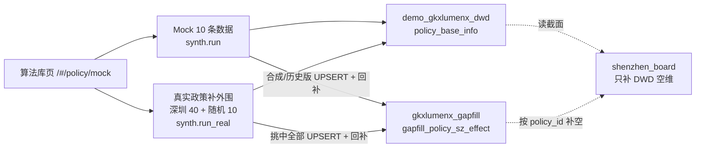

# POLICY · 算法库 Mock → gapfill（落地实效缺项）

```yaml
---
doc_id: POLICY-ETL-ALGO-MOCK-GAPFILL
element: POLICY
role: etl
status: as-built
version: "2026-11-09"
updated: 2026-11-09
task_id: POL-IMPL-EFFECT-MOCK-VIA-UI-L01
---
```

> 表结构与列约束：[`../stores/mysql/gapfill.md`](../stores/mysql/gapfill.md)。  
> 详设：[05.6.2 §3.1](../../../../agent-handoffs/产品整体定义/科技专题服务系统-完整详细设计/05.6.2-深圳政策现状分析.md)。  
> **不是** `run_all_policy` 主链步骤；是算法库页两个按钮的侧写路径。

## 总图



## 铁律

- 无表 → `CREATE TABLE IF NOT EXISTS`；有表 → UPSERT。库须已存在。
- 只写 `gapfill_`；禁止 ODS / 正式 DWD / ADS / 供应方库。
- 不得另起与两按钮无关的旁路灌数当主写入口。
- 空值不充 0；实施日 ≠ 发布日、≠ 零日期。

## 代码真源

| 仓 | 路径 |
|---|---|
| `demo-algo-ent-analysis` | `polan/mockgen/effect_gapfill.py` · `synth.py` |
| `lumen-algo-py` | `vendor/entan-py/polan/mockgen/*`（同文） |

验收 handoff：`agent-handoffs/政策模块-E7/POL-IMPL-EFFECT-MOCK-VIA-UI-L01.md`。
