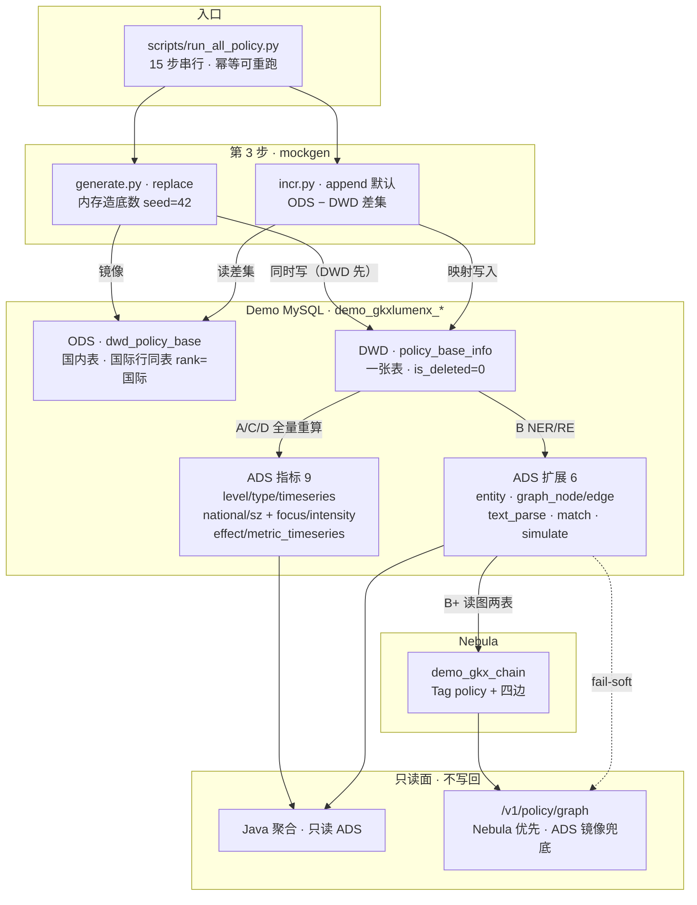
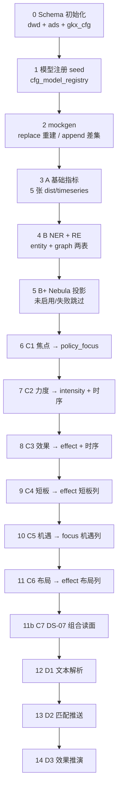
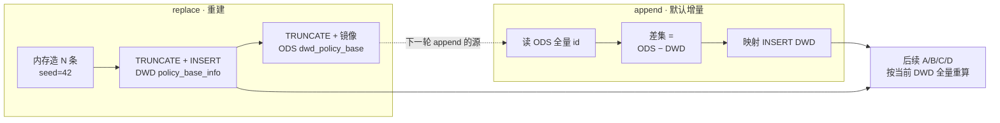
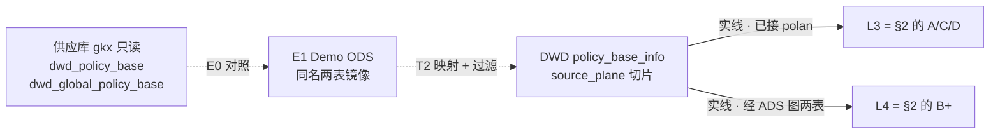

# POLICY · Demo 灌数流程（模拟 GDF）

```yaml
---
doc_id: POLICY-ETL-DEMO-MOCK
element: POLICY
role: etl
status: as-built
version: "2026-08-31"
updated: 2026-08-31
engine: multi
task_id: DATA-POLICY-D13-DS-MENU-L01
asbuilt_from: demo-algo-ent-analysis/scripts/run_all_policy.py
prior_task: DATA-POLICY-STORAGE-DEMO-FLOW-L01
---
```

> 拓扑会签真源 [`../01-data-flow.md`](../01-data-flow.md)（**approved · 不翻签**）。  
> 分管道：[`pipeline-ods-to-dwd.md`](./pipeline-ods-to-dwd.md) · [`pipeline-dwd-to-ads.md`](./pipeline-dwd-to-ads.md) · [`pipeline-to-nebula.md`](./pipeline-to-nebula.md)。  
> 列对照 [`ods-to-dwd-mapping.md`](./ods-to-dwd-mapping.md) · 贴源 DDL [`../sources/ods-ddl.md`](../sources/ods-ddl.md)。  
> **本文件画全景灌数图并对照 as-built；不灌数、不 APPLY、不改 `polan`。**

## 0. 先分两条路径

| | **现网 Demo（as-built）** | **正式 GDF（目标态 · 未施工）** |
|---|---|---|
| 入口 | `scripts/run_all_policy.py`（15 步串行） | 供应方 CDC + Mapping 作业（`OPEN-POLICY-FLOW-01`） |
| 贴源 | 内存 Mock / LLM 增量；**只写** `dwd_policy_base` | 只读 `gkx.dwd_policy_base` ∪ `gkx.dwd_global_policy_base` |
| 国际行 | **同表**：`level=NULL` · `region=国际` · `source=境外站点`（约 6%） | 第二张 ODS `dwd_global_policy_base` → 同 DWD + 平面标记 |
| 落库 | 仅 `demo_gkxlumenx_{ods,dwd,ads}` + `demo_gkx_chain` | 正式 `gkxlumenx_*` / `gkx_chain`（本管线**零写入**） |

一句话：现网「模拟 GDF」= **`run_all_policy` 一条命令走完 ODS/DWD/ADS/图**；正式厂那条 E0→E1→T2 还没接上。

---

## 1. 现网灌数总图（as-built）



要点（对照代码，不是设计愿望）：

1. **`replace` 不是「先 ODS 再映射」**。`generate.run(mode=replace)` 内存造行 → `INSERT` DWD → 再 `_write_ods` 镜像到 `dwd_policy_base`。方向与正式 T2 相反。
2. **`append` 才是 T2 语义**：读 ODS 有、DWD 无的差集，映射进 `policy_base_info`（`incr.ingest_pending`）。
3. **国际政策没有第二张 ODS**。`dwd_global_policy_base` 只存在于贴源 DDL / 映射稿；mockgen **零写入**。国际行进同一张 DWD（`level=NULL`）。
4. **SQLite 默认后端不写 ODS**（`_write_ods` 非 mysql 直接 `return 0`）。要看 ODS 层必须 `POLAN_DB_BACKEND=mysql`。
5. **ADS 15 张，不是九张**。九张指标 + 图镜像 2 + NER 1 + 文本 3。清单 [`../stores/mysql/ads.md`](../stores/mysql/ads.md)。
6. **L4 读的是 ADS 图镜像**，不是 DWD。`nebula_loader` 源表 = `policy_graph_node` / `policy_graph_edge`。
7. **没有** DWD→ES、**没有** Mock 直写 ADS。见 [`pipeline-dwd-to-es.md`](./pipeline-dwd-to-es.md) · [`pipeline-mock-to-ads.md`](./pipeline-mock-to-ads.md)。

---

## 2. `run_all_policy` 十五步时序



顺序约束（打乱会空基线）：

| 必须先 | 才能 |
|---|---|
| C1 建 `policy_focus` 基线 | C5 补机遇列 |
| C3 建 `policy_effect` 基线 | C4 补短板列 |
| C4 + C5 | C6 布局（显式依赖机遇与短板） |
| C1 + C6 / C2 + C3 | C7 引导力 / 保障力组合分 |

开关：

| 变量 | 默认 | 作用 |
|---|---|---|
| `POLAN_SEED_MODE` | `append` | `replace` = 内存重建；`append` = ODS 差集 |
| `POLAN_DB_BACKEND` | `sqlite` | `mysql` 才写 Demo ODS；启动前 `assert_demo_mysql_targets()` |
| `POLAN_NEBULA_ENABLED` | 关 | 开了才跑 B+；失败不阻断后续步 |

---

## 2.1 本过程覆盖的指标

政策域注册表共 **35** 条（`metric-query domain=政策`，2026-08-31 · `DATA-POLICY-D13-DS-MENU-L01`）。本管线按「ADS 行是否写下 `metric_id`」分成三类，**不要把模型身份叶或展示组合读面当成第二个数字**。

| 类 | 条数 | 含义 |
|---|---|---|
| **叶指标（写出）** | **22** | A/C 19 条 + D1–D3 3 条；`polan` 该步往 ADS 写入带 `metric_id` 的行（D 三表无 `metric_id` 列，靠表本身承接） |
| **模型身份（同步行）** | **9** | 算法库 SRS 叶（`BASE` / `DEEP` / `GRAPH`），标记「这一步是哪个模型」；**不另写一行 KPI** |
| **展示页组合读面** | **4** | DS-07/11 身份：读已有步，不另写 KPI、**不顶替 166–171**（2026-08-31 `human:淮政玮` 定向本管线要算） |

D4 全是 `mock`。口径与 D1–D4 以 MCP `metric-registry` 为准，本表只回答「哪一步写出」。

```mermaid
flowchart TB
  A["A 基础指标 · 7 叶"] --> A1["M_POLICY_LEVEL_DIST 级别分布"]
  A --> A2["M_POLICY_TYPE_DIST 类型分布"]
  A --> A3["M_POLICY_TIMESERIES 时序"]
  A --> A4["M_POLICY_NATIONAL_DIST 全国分布"]
  A --> A5["M_POLICY_SZ_DIST 深圳分布"]
  A --> A6["M_POLICY_TOTAL_COUNT 总数"]
  A --> A7["M_POLICY_VALIDITY_RATE 时效"]

  C1["C1 焦点 · 2 叶"] --> C1A["M_POLICY_FOCUS_INDEX"]
  C1 --> C1B["M_POLICY_RELATION_DEGREE"]

  C2["C2 力度 · 5 叶"] --> C2A["M_POLICY_INTENSITY_SCORE"]
  C2 --> C2B["M_POLICY_INTENSITY_INDEX"]
  C2 --> C2C["M_POLICY_INDUSTRY_COVERAGE"]
  C2 --> C2D["M_POLICY_SUPPORT_STRENGTH"]
  C2 --> C2E["M_POLICY_INDUSTRY_FIT"]

  C3["C3 效果 · 2 叶"] --> C3A["M_POLICY_EFFECT_SCORE"]
  C3 --> C3B["M_POLICY_IMPLEMENTATION_EFFECT"]

  C4["C4 短板"] --> C4A["M_POLICY_SHORTBOARD_COUNT"]
  C5["C5 机遇"] --> C5A["M_POLICY_OPPORTUNITY_COUNT"]
  C6["C6 布局"] --> C6A["M_POLICY_LAYOUT_REC_COUNT"]

  D1["D1 文本解析"] --> D1A["M_POLICY_TEXT_PARSE"]
  D2["D2 匹配推送"] --> D2A["M_POLICY_MATCH"]
  D3["D3 效果推演"] --> D3A["M_POLICY_SIMULATE"]
```



### 叶指标（22 · 按步）

回源各模块文头 + `metric-get`。用户举例：`M_POLICY_INDUSTRY_COVERAGE`（政策产业覆盖度）在 **C2**，`M_POLICY_NATIONAL_DIST`（全国政策分布）在 **A**——不是同一条。

| 步 | 模块 | 写出 ADS | metric_id | 中文名 | D1 |
|---|---|---|---|---|---|
| 3 A | `basic/indicators.py` | `policy_level_dist` | `M_POLICY_LEVEL_DIST` | 政策级别分布 | aligned |
| 3 A | 同上 · 汇总行 | `policy_level_dist` | `M_POLICY_TOTAL_COUNT` | 政策总数 | aligned |
| 3 A | 同上 · 汇总行 | `policy_level_dist` | `M_POLICY_VALIDITY_RATE` | 政策时效 | aligned |
| 3 A | 同上 | `policy_type_dist` | `M_POLICY_TYPE_DIST` | 政策类型分布 | draft |
| 3 A | 同上 | `policy_timeseries` | `M_POLICY_TIMESERIES` | 政策时序指标 | draft |
| 3 A | 同上 | `policy_national_dist` | `M_POLICY_NATIONAL_DIST` | 全国政策分布 | aligned |
| 3 A | 同上 | `policy_sz_dist` | `M_POLICY_SZ_DIST` | 深圳政策分布 | aligned |
| 6 C1 | `eval/focus.py` | `policy_focus` | `M_POLICY_FOCUS_INDEX` | 政策焦点指数 | aligned |
| 6 C1 | 同上（读图边） | `policy_focus` | `M_POLICY_RELATION_DEGREE` | 政策关联度 | draft |
| 7 C2 | `eval/intensity.py` | `policy_intensity` | `M_POLICY_INTENSITY_SCORE` | 政策力度评分 | aligned |
| 7 C2 | 同上 | `policy_intensity` | `M_POLICY_INTENSITY_INDEX` | 政策力度指数 | aligned |
| 7 C2 | 同上 | `policy_intensity` | `M_POLICY_INDUSTRY_COVERAGE` | 政策产业覆盖度 | draft |
| 7 C2 | 同上 + 时序 | `policy_metric_timeseries` | `M_POLICY_SUPPORT_STRENGTH` | 支持力度 | draft |
| 7 C2 | 同上 | `policy_intensity` | `M_POLICY_INDUSTRY_FIT` | 产业适配性 | aligned |
| 8 C3 | `eval/effect.py` | `policy_effect` + 时序 | `M_POLICY_EFFECT_SCORE` | 政策效果评分 | aligned |
| 8 C3 | 同上 | `policy_effect` | `M_POLICY_IMPLEMENTATION_EFFECT` | 落地实效性 | aligned |
| 9 C4 | `eval/gap.py` | `policy_effect` 短板列 | `M_POLICY_SHORTBOARD_COUNT` | 政策短板数 | draft |
| 10 C5 | `eval/opportunity.py` | `policy_focus` 机遇列 | `M_POLICY_OPPORTUNITY_COUNT` | 政策机遇数 | draft |
| 11 C6 | `eval/layout.py` | `policy_effect` 布局列 | `M_POLICY_LAYOUT_REC_COUNT` | 政策布局建议数 | draft |
| 12 D1 | `text/parse.py` | `policy_text_parse` | `M_POLICY_TEXT_PARSE` | 政策文本解析 | draft |
| 13 D2 | `text/match.py` | `policy_match` | `M_POLICY_MATCH` | 政策匹配推送 | draft |
| 14 D3 | `text/simulate.py` | `policy_simulate` | `M_POLICY_SIMULATE` | 政策效果推演 | draft |

写出降级（数在、口径未闭合）：

| metric_id | as-built 做法 | 缺口 |
|---|---|---|
| `M_POLICY_INDUSTRY_COVERAGE` | 分母 = 本批 DWD `ext5` 去重数 | 权威分母应是 `dwd.industry_chain`（`OPEN-POLICY-XDOM-01`） |
| `M_POLICY_RELATION_DEGREE` | C1 扫 ADS `policy_graph_edge` 加权度，**不读 Nebula** | 边权待 `QPOL-03`；B+ 投影与此数无直接写入关系 |
| `M_POLICY_TYPE_DIST` | 类型取 `ext1` | `QPOL-01` 临时口径 |
| `M_POLICY_SUPPORT_STRENGTH` / `M_POLICY_LAYOUT_REC_COUNT` | 规则基线加权 | `QPOL-02`；布局缺专家策略库（`OPEN-POLICY-DIM-02`） |
| `M_POLICY_NATIONAL_DIST` / `M_POLICY_SZ_DIST` | 直接 `region` / `ext2`/`ext3` 字符串聚合 | 无 `dim.region`（`OPEN-POLICY-DIM-01`） |

### 模型身份（9 · 不另写 KPI）

| 步 | metric_id | 中文名 | 对应叶指标 |
|---|---|---|---|
| 3 A | `M_POLICY_BASE_100_1` | 政策基础指标模型构建 | 上表 A 的 7 条 |
| 4 B | `M_POLICY_GRAPH_106_1` | 政策实体识别构建 | 写 `policy_entity`，无叶 KPI |
| 4 B | `M_POLICY_GRAPH_107_1` | 政策实体关系抽取 | 写图两表；关联度数字走 C1 |
| 6 C1 | `M_POLICY_DEEP_166_1` | 政策焦点识别模型 | `FOCUS_INDEX` + `RELATION_DEGREE` |
| 7 C2 | `M_POLICY_DEEP_167_1` | 政策力度评估模型 | 力度 / 覆盖 / 三维 |
| 8 C3 | `M_POLICY_DEEP_168_1` | 政策效果评估模型 | `EFFECT_SCORE` + `IMPLEMENTATION_EFFECT` |
| 9 C4 | `M_POLICY_DEEP_169_1` | 政策短板识别模型 | `SHORTBOARD_COUNT` |
| 10 C5 | `M_POLICY_DEEP_170_1` | 政策机遇识别模型 | `OPPORTUNITY_COUNT` |
| 11 C6 | `M_POLICY_DEEP_171_1` | 政策布局推荐模型 | `LAYOUT_REC_COUNT` |

### 展示页组合读面（4 · 本管线要算，不另写 KPI）

不发明第二套模型、不把 166–171 改挂到展示身份上。UI 在算法库拆菜单承接。

| metric_id | 中文名 | 读哪一步 | 读哪张表 | 禁止 |
|---|---|---|---|---|
| `M_POLICY_DS_11_POLICY_EVAL_012` | 智能摘要与结论推送 | D1 | `ads.policy_text_parse.summary` | 不顶替 106 / 166–171 |
| `M_POLICY_DS_11_POLICY_EVAL_015` | 实施路径与风险辅助 | D3 | `ads.policy_simulate` | 不顶替 171、不抢 DS-12 |
| `M_POLICY_DS_07_POLICY_GUARD_001` | 发展战略引导力评估 | C1 + C6 | `policy_focus` + `policy_effect(region_layout)` | 不顶替 166 / 171 |
| `M_POLICY_DS_07_POLICY_GUARD_008` | 政策与条件保障力综合评估 | C2 + C3 | `policy_intensity` + `policy_effect(region_effect)` | 不顶替 167 / 168 |

Schema / mockgen / B+ 投影 **不产出** 任何 `M_POLICY_*`。B+ 只把已有图镜像送进 Nebula。

---

## 3. 两种 seed 模式



| | replace | append |
|---|---|---|
| 造数 | 是（固定种子） | **否**（不内存造数） |
| ODS | 重建镜像 | 只读；LLM 攒货另走 `incr` 入 ODS |
| DWD | TRUNCATE 后整表 | 只补差集 |
| ADS | 本脚本后续步全量重算 | 同左；**incr 自己不算 ADS** |

批次：`calc_batch_id` 前缀 `mock_`（历史 `mock_20260623`）。

---

## 4. 正式 GDF 目标态（虚线 · 未接）

下面是存储树最初拆的 E0→L4。**现网没有这条作业**；接上之前继续用 §1。



| 步 | 设计意图 | 现网 |
|---|---|---|
| E0 | 只读供应库或 md-extract，估列/行/空值 | 无作业；DDL 对照靠 [`../sources/ods-ddl.md`](../sources/ods-ddl.md) |
| E1 | 两表全量/增量进 `demo_gkxlumenx_ods` | mockgen **只写国内表**；国际表未建未灌 |
| T2 | `is_deleted=0 ∧ is_history=0`；ODS `id` → DWD `policy_id`；国内/国际平面标记 | `append` 近似；`replace` 方向相反；无 `source_plane` 列（靠 `level`/`source`） |
| L3 / L4 | 算法写 ADS + 投影一张 G | **已落地**，见 §1 / §2 |

设计稿里的 OPEN（国内/国际 `id` 碰撞、`vid` 超 80）仍有效，接正式厂时再关。

---

## 5. T+1 增量

### 5.1 现网（as-built）

没有水位表、不读 `insert_remark`。增量 = **ODS `id` 差集**。

```text
ODS.dwd_policy_base.id  −  DWD.policy_base_info.policy_id
        →  只把差集映射进 DWD
        →  A/B/C/D 用「当前 DWD 全量」重算新 calc_batch_id
        →  B+ 对图两表 upsert（不清空底图）
```

失败：本批 DWD 差集不提交则不晋升 ADS；ADS 半成品不切读新批。

### 5.2 正式厂设计（未施工 · 留给 GDF）

正式厂应按供应变更码，**禁止**用每日 drop+全量冒充 T+1。

水位（两表各自一份，禁止混用）：

```text
watermark = max(上次成功批的 ODS.updated_time, created_time)
Δ = (updated_time > watermark) OR (created_time > watermark)
    且通常 昨日 00:00 ≤ ts < 今日 00:00
```

无 `updated_time` 只认 `created_time`。水位失败不推进，禁止静默全表重扫。

| 码 / 标记 | E1 Demo ODS | T2 项目 DWD |
|---|---|---|
| `insert_remark=0` 新增 | `INSERT`（`id` 已在则当 `1`） | `INSERT` / upsert `policy_id` |
| `1` 修改 | 按 `id` 整行覆盖业务列 | 按 `policy_id` 整行覆盖映射列 |
| `2` 补齐 | 只填空值 | 同：只补 DWD 空列 |
| `is_deleted=1` | 镜像删除标 | 逻辑删；不得进当日 L3 分子分母 |
| `is_history=1` | 可留 ODS | **不进**当前 DWD |
| 失效文案 | `status` 改「失效」 | DWD 同步；L3 用更新后快照 |

| 层 | T+1 | 失败 |
|---|---|---|
| E1 ODS | 增量 upsert / 补齐 / 打删除标 | 本批不进 T2 |
| T2 DWD | 按 `policy_id` 合并 Δ | 不晋升 L3 |
| L3 ADS | **整批快照重算**（15 张）。禁止对 Δ 做加减 | 新批不发布 |
| L4 图 | Δ 内 upsert `pol:{id}`；该点旧边按新抽取重挂 | fail-soft；不得标 `source=nebula` |

同一自然日顺序：供应就绪 → E1→T2 串行对账 → L3 绿切批 → 才允许 L4。

---

## 6. 谁写谁读

| 层 | 写方 | 读方 |
|---|---|---|
| ODS `dwd_policy_base` | `mockgen`（mysql 后端） | `incr` 差集；正式 T2（未接） |
| DWD `policy_base_info` | `mockgen` replace / incr append | `polan` 全部算法模块 |
| ADS 15 张 | `basic` / `graph` / `eval` / `text` | Java；查询期降级只读不回写 |
| Nebula `demo_gkx_chain` | `nebula_loader` | `/v1/policy/graph`（优先） |
| 展示原型 fixture | **不写库** | `demo-ui-science` 虚线，禁止当 ADS |

查询期 mock（`polan/metrics/metrics.py`）在 ADS 空时返回标注值，**不落库**。不要和贴源 Mock 当成同一条旁路。

---

## 7. 脚本入口

| 用途 | 路径 | 对应 |
|---|---|---|
| 政策全链路 | `demo-algo-ent-analysis/scripts/run_all_policy.py` | §2 十五步 |
| 贴源 Mock / 差集 | `polan/mockgen/{generate,incr}.py` | §3 |
| 图投影 | `polan/graph/nebula_loader.py` | 第 5 步 B+ |

MinIO 前缀建议 `policy/{task_id}/`，见 [`pipeline-to-minio.md`](./pipeline-to-minio.md)。主链不依赖 MinIO 才能绿。

---

## 8. 禁止

- 写正式 `gkxlumenx_*` / 供应库 `gkx`
- `CREATE SPACE gkx_policy`；`DROP SPACE demo_gkx_chain`；写 `gkx_chain`
- 继续用 `dwd_zck_*`；用旧 v1 37 列当贴源
- 把 `dwd_global_policy_base` 说成现网已灌（mockgen 没写它）
- 把 `replace` 说成「ODS→DWD 工厂化」（方向相反）
- 跳过 DWD、算法直读 ODS 当已工厂化
- Mock 直写 ADS；查询期降级结果回写 ADS
- 用全表 drop+重建冒充正式 T+1；L3 对 Δ 做加减冒充快照
- 本叶灌数 / 改 `polan` / 把细表标 approved
