# 管道 · → Nebula（政策投影一张 G）

```yaml
---
doc_id: POLICY-ETL-TO-NEBULA
element: POLICY
role: etl
status: as-built
version: "2026-08-31"
updated: 2026-08-31
task_id: DATA-POLICY-STORAGE-NEBULA-ETL-L01
p1_task_id: DEMO-POLICY-GRAPH-TRIPLE-UI-L01
asbuilt_from: POLICY-NEBULA-PROJECT-CHAIN-L01
amendment: "§10 起补 106/107 需规 + 边清单 + LLM 场景 + 入库过程图；§17–§20 补关系×op_id×I/O、灌数剥离、POLICY-GRAPH-TRIPLE；§1–§9 投影 as-built 不改。"
---
```

> **§1–§9 是投影 as-built**（B 叶 `done`，commit `32124a0`）。**§10–§16 是 106/107 详细设计**（需规 + 现网规则 + LLM 升级）。**§17–§20 是 DEMO-POLICY-GRAPH-TRIPLE-UI-L01 P-1 契约**（每关系独立 `op_id`、灌数剥离清单、目标态过程图）。
> 拓扑真源 [`../01-data-flow.md`](../01-data-flow.md) §3（**approved**）· 细表指针 [`../stores/nebula.md`](../stores/nebula.md)（draft）。
> 本叶只写文档：**不改代码、不 APPLY DDL、不灌数**。P-2 实现必须对照 §17 / §18，禁止继续用一个 `graph.run()` 当对外契约。

## 1. 意图

政策点与政策边**增量投影**进产业链一张 G。`chain` / `segment` / `enterprise` / `institution` 复用 CHAIN 既有顶点，政策侧不复制底图本体、不另建 space。

## 2. 入口与源

| 项 | 值 |
|---|---|
| 仓 / 模块 | `demo-algo-ent-analysis` · `polan/graph/nebula_loader.py` |
| 入口 | `run()`；`python -m polan.graph.nebula_loader` |
| 源表 | `{ads}.policy_graph_node` · `{ads}.policy_graph_edge`（Demo = `demo_gkxlumenx_ads`） |
| 目标 | Nebula space **`demo_gkx_chain`** |
| 读路径 | `polan/graph/nebula_query.py` → `/v1/policy/graph` |

源是 **ADS 镜像**，不是 DWD 直读。镜像两表同时是 Nebula 不可用时的读兜底（见 [`../stores/mysql/ads.md`](../stores/mysql/ads.md)）。

## 3. Space 与 VID 约束（代码强制）

`polan/common/nebula.py` 把一张 G 写死为常量并在 `conf()` 校验，配置成别的 space 直接抛错：

| 项 | 值 | 违反后果 |
|---|---|---|
| space | 仅 `demo_gkx_chain` | `RuntimeError: 政策投影拒绝非一张 G space` |
| vid_length | 必须 `80` | `RuntimeError` |
| 正式图库 | `gkx_chain` | 本管线零写入 |
| 废作 | `gkx_policy` | 代码中无 `CREATE SPACE` / `DROP SPACE` |

VID：政策 `pol:{policy_id}`；既有实体沿用 `chain:` / `segment:` / `ent:` / `inst:` 前缀。超 80 字符的候选 VID 丢弃不投。

## 4. Schema 增量（`ensure_schema()`）

在**已存在**的 space 内 `USE` 后补增量，只 `IF NOT EXISTS`，随后 `DESCRIBE` 轮询至就绪（超时 40s 抛错）：

```ngql
CREATE TAG  IF NOT EXISTS policy   (name string, weight double, props string)
CREATE EDGE IF NOT EXISTS support  (weight double, props string)
CREATE EDGE IF NOT EXISTS apply_to (weight double, props string)
CREATE EDGE IF NOT EXISTS regulate (weight double, props string)
CREATE EDGE IF NOT EXISTS cite     (weight double, props string)
```

> ⚠️ **与 S3 文档不一致（待裁决）**：[`../stores/nebula.md`](../stores/nebula.md) 把四类边写成 `support(weight, factor_type, src_table)` / `apply_to(weight, src_table)` / `regulate(weight, src_table)` / `cite(relation, weight)`，与上表 as-built 的统一 `(weight double, props string)` 对不上。现网以 as-built 为准；S3 细表是否跟改属结构项，按 `01-data-flow.md` `OPEN-POLICY-GRAPH-03` 升级 `human:淮政玮`，**不在本叶静默改 S3**。

## 5. 挂接解析（对不齐则不上图）

既有实体必须经 `FETCH PROP ON *` 证明顶点真实存在才挂边，解析不到就计数跳过，**不按名称猜测**：

| 源 `node_type` | 取值字段（`props`） | 目标前缀 |
|---|---|---|
| `policy` | `node_key` | `pol:` |
| `industry` | `industry_link_code` | `chain:` / `segment:` |
| `enterprise` | `org_id` → `enterprise_code` → `entity_id` | `ent:` |
| `org` / `service` | `org_id` → `institution_id` → `entity_id` | `inst:` |
| 其余（含 `tech` / `talent`） | — | 本波不上图（`OPEN-POLICY-GRAPH-01`） |

`relation_type` 不在四类边内的一律跳过计数。边两端任一顶点未解析则整条丢弃。

## 6. 写入与幂等

`INSERT VERTEX` / `INSERT EDGE` 分类型批量提交，`chunk=100`。同 VID 重跑覆盖，可重复执行；本管线不做删除，**不清空既有底图**。

## 7. fail-soft 与开关

`available()` 轻量探活（未启用或 `USE` 失败即 False）。不可用时 `run_all` 跳过投影、`/v1/policy/graph` 回退 ADS/MySQL/SQLite 镜像，并把 `source` 诚实标成实际后端——**只有真实 nGQL 成功才返回 `source=nebula`**。

| 环境变量 | 作用 | 回退键 |
|---|---|---|
| `POLAN_NEBULA_ENABLED` | 投影/读图总开关 | settings `nebula.enabled` |
| `POLAN_NEBULA_HOSTS` | 图库地址 | `GKX_NEBULA_HOSTS` |
| `POLAN_NEBULA_USER` / `_PASSWORD` | 凭据 | `GKX_NEBULA_*` |
| `POLAN_NEBULA_SPACE` | space（只接受 `demo_gkx_chain`） | `GKX_NEBULA_SPACE` |
| `POLAN_GRAPH_BACKEND` | 读路径后端 `nebula` \| `pg` | `GKX_GRAPH_BACKEND` |

`POLAN_*` 与同 Pod 的 `ENTAN_NEBULA_SPACE=demo_entan` 隔离，避免共用 `GKX_NEBULA_SPACE` 串库。

## 8. 首轮实投影基线（2026-08-21）

| 项 | 值 |
|---|---|
| space | `demo_gkx_chain` |
| policy 顶点 | `47655` |
| 政策边 | `398` |
| 跳过 | industry `850` · enterprise `20` · org `574` · service `3` · talent `5` |
| 实调 | `GET /v1/policy/graph?limit=3` → 200，`source=nebula`，`nodes=24` `edges=22` |

跳过量大的原因：ADS 镜像 `props` 里多数产业/企业/机构缺稳定 ID，符合"对不齐则不上图"。**这是缺口不是故障**，改善路径见 `OPEN-POLICY-GRAPH-01`。

## 9. 禁止

Neo4j；Java 直连 nGQL；`CREATE SPACE gkx_policy`；写 `gkx_chain`；`DROP SPACE demo_gkx_chain`；新建 `org` / `industry` / `tech` / `talent` Tag；用名称相似度伪造挂接边。

---

## 10. 需求挂接（106 识别 / 107 抽取）

两叶都在算法库 SRS **分册 05 · 产业全要素图谱**（`bid-reference/srs/05-深度挖掘算法/科技专题服务算法库/政策/图谱.md`）。招标章节 `§1.1.1.1.1.1.1.2.5` / `.2.6`。公式未签（`pending_cosign: human:唐绍祖`）。

| 项 | 政策实体识别构建 | 政策实体关系抽取 |
|---|---|---|
| metric_id | **`M_POLICY_GRAPH_106_1`** | **`M_POLICY_GRAPH_107_1`** |
| 中文名 | 政策实体识别构建 | 政策实体关系抽取 |
| SRS | 05 seq **106** · `ALGO-POLICY-GRAPH-106` | 05 seq **107** · `ALGO-POLICY-GRAPH-107` |
| algorithm_type | GRAPH | GRAPH |
| 现网算子 | `polan/graph/entity.py` NER 段 | 同文件 RE 段 |
| ADS | `policy_entity` | `policy_graph_node` + `policy_graph_edge` |
| 页消费 | 展示 DS-12（文本解析读面 mapped）；专题 E7 | 展示 DS-10 / DS-12 / DS-29；专题 E7 |

> 页面名若写成「政策实体识别 / 政策实体关系抽取」却都挂 `M_POLICY_GRAPH_107_1`，是 **ID 写串**：识别 = 106，抽取 = 107。

### 10.1 需规原文在要求什么

**106**：对接多源政策库，从文本识别实体及属性；规则（正则/关键词）+ 词典（专业词典 + 分词/词性 NER）；维护增删改；属性含**名称、级别、类型、发布地点、发布时间**；从专题库去重纠错补全后定期同步。

**107**：结合文本与**实施情况**，用 NLP + 可配置规则，把政策与**主题 / 目标 / 实施主体 / 受益对象 / 监管机构**建模成图；对接产业、技术、企业、人才、科研机构、服务机构专题库；关系类型明确为 **扶持 / 适用 / 监管**；去重纠错补全后定期同步，可跨维检索。

现网**没有**实施监测库、也没有六类专题库的稳定 ID 接口。Demo 用 DWD 结构化列 + `related_entities` JSON **抄字段**，置信度带受控抖动——这是规则基线，不是需规终态。

---

## 11. 总过程（先 ADS，再投影）

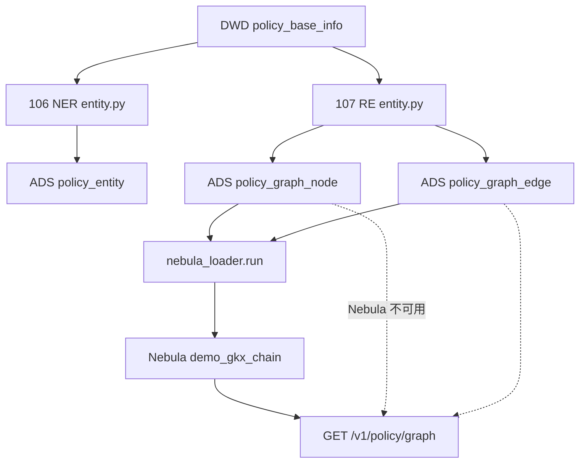

| 层 | 做什么 | 失败 |
|---|---|---|
| 106 | 每条政策抽实体行（类型/名/源字段/置信度） | 空字段不写行 |
| 107 | 政策点 + 关联点 + 四类边写入 ADS | 字面量 NULL / 空名丢弃 |
| 投影 | 只把解析到既有 VID 的点边写入一张 G | 对不齐跳过，见 §5 / §8 |

Java 不抽实体、不写 nGQL。LLM 若上，只许在 Python `entity.py`（或其后继）里，经 `/internal/*` 被 Java 调用。

> **目标态（§17–§18）**：上图仍「先 ADS 再投影」，但 NER/RE/`nebula_loader.run` **不再**挂在灌数 `run_all_policy` / `run-pipeline` 上；只由图谱菜单 A/B/C 对应 `op_id` 触发。上图过程图以 §19 `POLICY-GRAPH-TRIPLE` 为准。

---

## 12. 支持的边关系

需规 107 点名三种：**扶持、适用、监管**。现网多一种 **cite（引用谱系）**，来自 `pedigree`，需规未单列但图谱页 / 关联度在用。

方向一律 **政策 → 对象**，不建反向边。

| 边 | 中文 | 需规 | 终点类型 | DWD 源 | 规则权重 | 上图条件 |
|---|---|---|---|---|---|---|
| `support` | 扶持：资源投向谁 | 107 扶持 | industry | `policy_industry_rel`（`is_deleted=0`） | 0.8 | 解析到 `chain:` / `segment:` |
| `support` | 同上 | 107 扶持 | enterprise | `related_entities.enterprise` | 0.5–0.9（受控随机，Mock） | 解析到 `ent:` |
| `support` | 同上 | 107 扶持 | talent | `related_entities.talent` | 0.7 | **本波不上图**（无 Tag） |
| `apply_to` | 适用：效力覆盖谁 | 107 适用 | industry | 同 industry 源 | 0.6 | 同 industry |
| `apply_to` | 同上 | 107 适用 | service | `related_entities.service` | 0.5 | 解析到 `inst:` |
| `regulate` | 监管/实施：谁落地 | 107 监管 | org | `related_entities.org`（节点 `org_type=implement`） | 0.6 | 解析到 `inst:` |
| `cite` | 引用：上位政策 | 现网加性 | policy | `pedigree` 中 `上位政策:{pid}` 且 pid 在本批 | 1.0 | 两端都是 `pol:` |

要点：

1. 产业同时落 `support` + `apply_to`（既扶持又适用）。企业/人才只有 `support`。服务机构只有 `apply_to`。机关只有 `regulate`。
2. `relation_type` 不在上表四类 → 投影跳过。
3. 需规还有 **技术方向**。代码 `ENTITY_TAGS` 有 `tech`，循环**未抽**，本波不上图（`OPEN-POLICY-GRAPH-01`）。
4. 边权之和 = 政策点加权度 = `M_POLICY_RELATION_DEGREE` 输入（读 ADS 边，不读 Nebula）。

`related_entities` 里企业 / 人才 / 机关 / 服务仍由贴源写入（`org` 默认发文部门，企业/人才/服务常空）。**`industry` 键 2026-10-23 起弃用**：贴源不写，产业抽取也不更新；产业边只读 `policy_industry_rel` 的有效行。历史行里残留的产业名字符串不再作为上图来源。企业侧仍常无 `ent:` ID——§8 跳过量大是缺口不是故障。

---

## 13. 106 实体：每一类怎么入库

### 13.0 总图

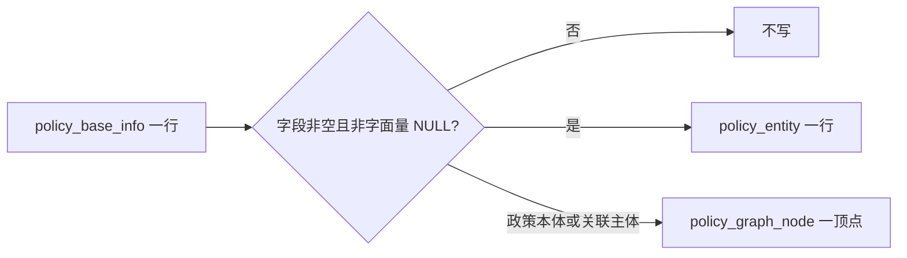

政策**属性实体**（级别/类型/地区/时间/关键词）只进 `policy_entity`，**不建图点**。图点只有：政策本体 + 六类关联主体。

### 13.1 政策本体 `policy`

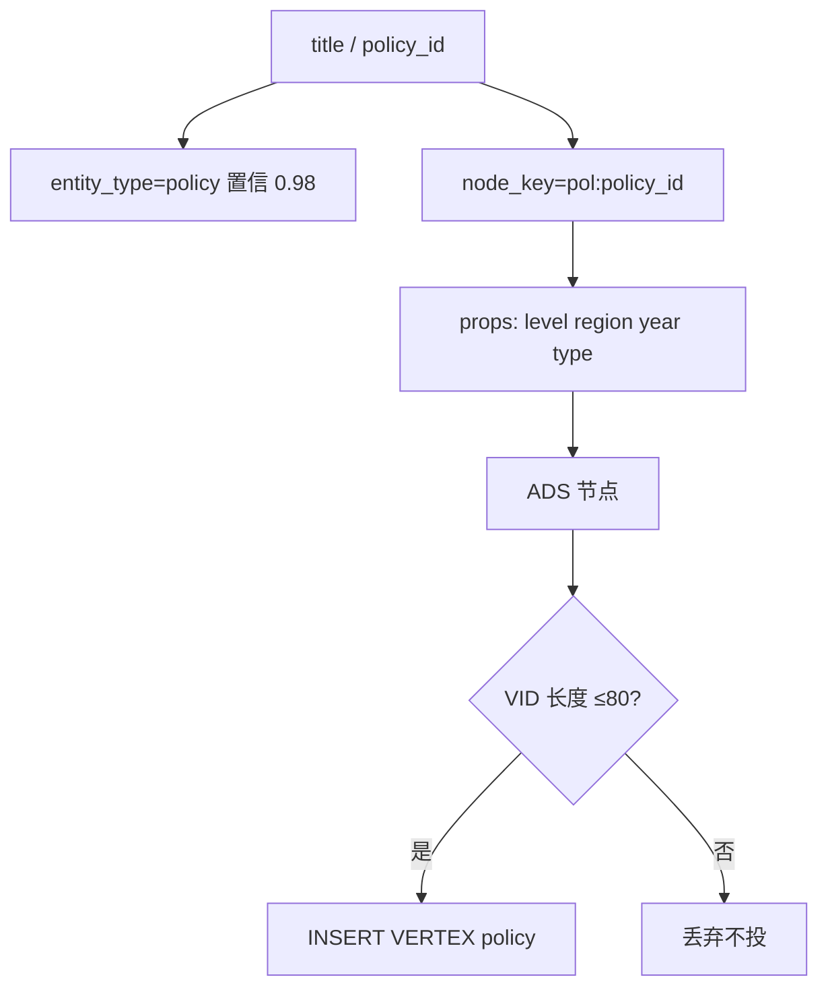

### 13.2 属性实体（只 NER，不上图）

| entity_type | 源列 | 规则置信 | LLM？ |
|---|---|---|---|
| `level` | `level` → 国家级/省级/市级/区县级/未标注 | 0.99 | 否（枚举已定） |
| `type` | `ext1`（QPOL-01） | 0.90 | **升级**：正文类型与 ext1 冲突时裁定 |
| `org` | `publish_organization` | 0.95 | **升级**：多部门联合发文拆条、别名归一 |
| `region` | `region`（省+市+区串） | 0.97 | **升级**：与 `dim.region` 对码（`OPEN-POLICY-DIM-01`） |
| `time` | `publish_year` | 0.99 | 否 |
| `keyword` | `keywords` 拆词，NULL 丢掉 | 0.88 | **升级**：源词空时从标题/keypoints 抽领域词（与单条焦点同一套，不回写源列） |

### 13.3 关联主体（NER + 图点，能否上图另说）

```mermaid
flowchart TB
  subgraph industry
    I1["policy_industry_rel is_deleted=0"] --> I2["node industry:名称"]
    I2 --> I3["NER industry 0.86"]
    I2 --> I4{"props 有 industry_link_code 且 FETCH 到 chain/segment?"}
    I4 -->|是| I5["挂 support+apply_to"]
    I4 -->|否| I6["ADS 留点，不上图"]
  end
  subgraph enterprise
    E1["related_entities.enterprise"] --> E2["node enterprise:名称"]
    E2 --> E3{"org_id / enterprise_code 对上 ent:?"}
    E3 -->|是| E4["挂 support"]
    E3 -->|否| E5["不上图"]
  end
  subgraph org
    O1["related_entities.org 或 ministry"] --> O2["node org:名称 org_type=implement"]
    O2 --> O3{"对上 inst:?"}
    O3 -->|是| O4["挂 regulate"]
    O3 -->|否| O5["不上图"]
  end
  subgraph service
    S1["related_entities.service"] --> S2["node service:名称"]
    S2 --> S3{"对上 inst:?"}
    S3 -->|是| S4["挂 apply_to"]
    S3 -->|否| S5["不上图"]
  end
  subgraph talent_tech
    T1["talent / tech"] --> T2["ADS 可建点"]
    T2 --> T3["本波不上图 OPEN-POLICY-GRAPH-01"]
  end
```

**禁止**用名称相似度在投影层伪造 `ent:` / `chain:`。要对齐，先补稳定 ID，或走下面 LLM **链指**（须淮政玮拍板，不在本叶静默改代码）。

---

## 14. 107 关系：每一组怎么入库

### 14.1 `support` 扶持

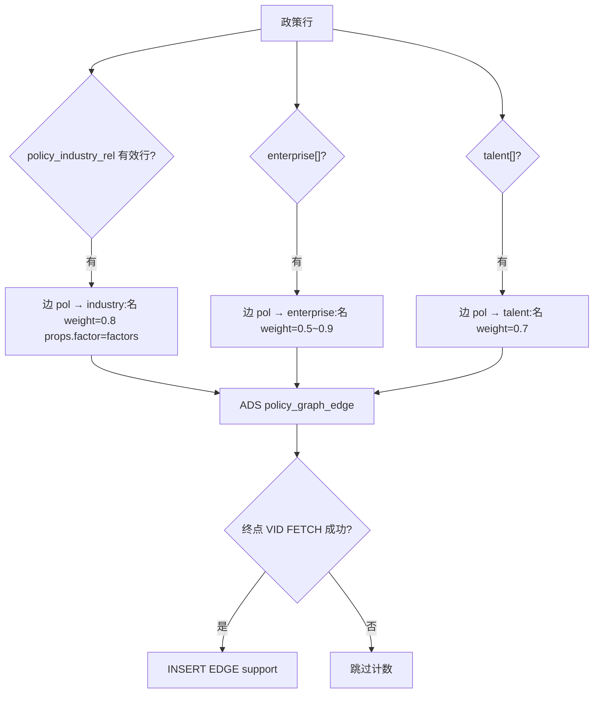

### 14.2 `apply_to` 适用

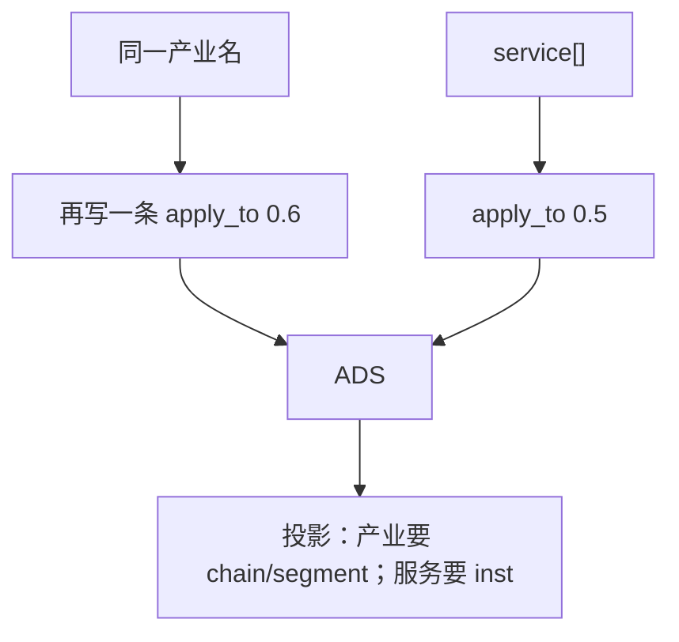

### 14.3 `regulate` 监管/实施

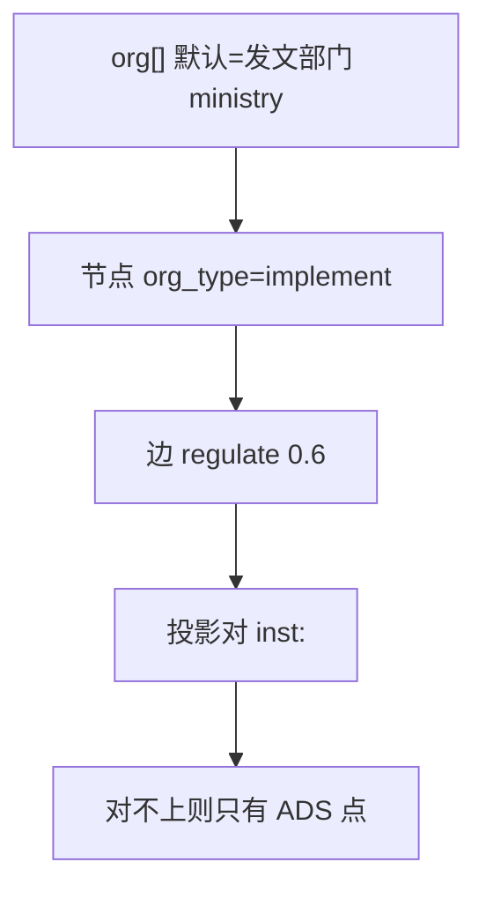

需规把「实施主体」和「监管机构」分开。现网**揉成一条** `regulate`，且源经常是发文机关不是执行机关。拆条要 LLM 或专题库角色字段，见 §15。

### 14.4 `cite` 引用

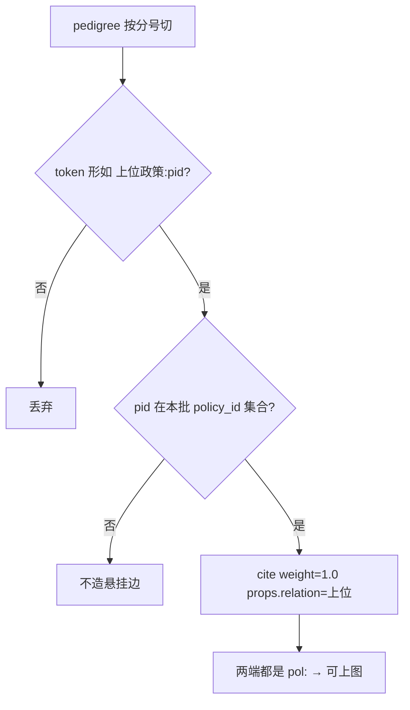

现网 ODS `quote_policy` 多数不是这个格式，故 cite 边很少。

---

## 15. 哪些场景要 LLM、推什么

现网 **106/107 全程规则，不调 LLM**。下面是对照需规「NLP」的升级清单。无 Key 必须回退规则，禁止编造 ID。

| 编号 | 触发（规则不够） | 推什么 | 写入 | 不推 |
|---|---|---|---|---|
| L1 | `keywords` 为空，且 `policy_industry_rel` 无有效链码，但 title/keypoints/abstract 有领域表述 | 抽 3–8 个领域 Tag（与单条焦点同一语义，混成一列） | NER `keyword`/`industry`；可选补关联表。不写 `related_entities.industry` | 不改源表 `keywords` |
| L2 | `enterprise`/`talent`/`service` 空，正文有「支持××企业 / 高层次人才 / 孵化器」 | 抽受益对象短语 + 槽 | NER + 对应点；无 ID 仍**不上图** | 不按店名猜 `ent:` |
| L3 | 只有 `ministry`，正文另有「由××组织实施 / ××监管」 | 裁定机关角色：发文 / 实施 / 监管 | 实施、监管可拆 `regulate` 或 props.role | 不把发文部门一律当监管 |
| L4 | 产业已有，分不清扶持还是适用 | 裁定 `support` / `apply_to` / 两条都要 | 边类型 | 不删规则已落的双轨产业边，除非模型高置信互斥 |
| L5 | `pedigree`/`quote_policy` 是自由文本（「根据国发××」） | 解析文号/标题 → 本批 `policy_id` | `cite` 仅当命中本批 | 不链库外政策成悬挂点 |
| L6 | ADS 有名称、无 `industry_link_code`/`org_id`，需规要「对接专题库」 | **链指**：名称 → 已有 `chain:`/`ent:`/`inst:` | 只写解析成功的挂接 | 相似度伪造边；新建 tech/talent Tag（未拍板） |
| L7 | 需规「结合实施情况」但执行数据空 | 单条焦点页的执行文本：兑付率/窗口不足 → 堵点，**不进图** | 焦点页 suggestions | 不用执行空文在图上造「失效边」 |

推荐默认：**L1/L3/L5 可先上**（纯文本、不碰 VID）。**L6 须淮政玮拍板**（与「对不齐不上图」铁律冲突）。**L2** 可与单条焦点共用抽词，图点仍可只停 ADS。**L4** 产业继续规则双边，LLM 仅打解释。**L7** 不进本管道。

调用形态：批处理可 `mode=rule|llm`（对齐焦点单条）；Java 只调 Python。同一 `calc_batch_id` 规则重跑应同边；LLM 批次须记 `model_version`。

---

## 16. 和投影缺口怎么对

| 现象 | 归属 | 不是 |
|---|---|---|
| 4.7 万政策点、边只有几百 | 107 源字段空 + 投影对不齐 | loader 丢边 bug |
| industry 跳过最多 | 名称在、无 `industry_link_code` | Nebula 挂了 |
| talent/tech 零上图 | `OPEN-POLICY-GRAPH-01` | 漏配 EDGE |
| 关联度读 ADS 边 | `focus.py` 设计如此 | 必须先 Nebula |
| 四边 DDL 与 S3 列不一致 | `OPEN-POLICY-GRAPH-03` | 本叶改 S3 |

公式 / 边权 / 是否拆实施与监管：仍挂唐绍祖会签 + `QPOL-02`，本设计不改 D1。

---

## 17. 关系 × op_id × I/O（P-2 契约真源）

> **禁止**「一个 `graph.run()` 包打天下」当对外契约。现网 as-built 仍是 `polan/graph/entity.py::run` 一次 TRUNCATE 后写 NER+RE+图镜像，再 `nebula_loader.run()` 投影——那是 §1–§9 现状，**不是** P-2 接口。
> 每条需规关系（或一组同构边）必须有独立 `op_id`。Java **只转发** Python `/internal/*`，不写 NLP、不直连 nGQL。
> Space 固定 **`demo_gkx_chain`**（禁止 `CREATE SPACE gkx_policy` / 第二空间）。产业 as-built 可同时落 `support` + `apply_to`。

### 17.1 档位与 op_id 清单（写入 5 + 只读 1）

| op_id | 档 | 中文 | SRS | HTTP（前端经 Java） | Python `/internal` | 写什么 | 本波 |
|---|---|---|---|---|---|---|---|
| `POLICY_NER_POLICY` | **A 实体识别** | 政策本体 NER（政策点 + 属性） | 106 `M_POLICY_GRAPH_106_1` | `POST /v1/policy/graph/ner` | `POST /internal/policy/graph/ner` | ADS `policy_entity`；政策点 `policy_graph_node`（`node_type=policy`）；Nebula `INSERT VERTEX policy` | **上图**（属性实体不上图，见 §13.2） |
| `POLICY_RE_CITE` | **B 关系边上图** | 本域↔本域：政策引用 | 107 加性（现网 `pedigree`；需规未单列） | `POST /v1/policy/graph/intra` | `POST /internal/policy/graph/intra` | ADS `policy_graph_edge` `relation_type=cite`；Nebula `INSERT EDGE cite` | **上图**（两端必须都是本批 `pol:`） |
| `POLICY_RE_SUPPORT` | **C 关联主体上图** | 本域↔他域：扶持 | 107 扶持 | `POST /v1/policy/graph/hang` | `POST /internal/policy/graph/hang` | 边 `support`；终点须 `FETCH` 到既有 VID | 产业/企业 **上图**；技术/人才 **本波不上图** |
| `POLICY_RE_APPLY_TO` | **C** | 本域↔他域：适用 | 107 适用 | 同上（`relation_whitelist` 必含 `apply_to`） | 同上 | 边 `apply_to` | 产业/服务机构 **上图**；技术 **本波不上图** |
| `POLICY_RE_REGULATE` | **C** | 本域↔他域：监管/实施 | 107 监管 | 同上（`relation_whitelist` 必含 `regulate`） | 同上 | 边 `regulate` | 科研/实施机构 **上图**（`inst:`）；实施 vs 监管现网揉成一条 |
| `POLICY_GRAPH_BROWSE` | **D 浏览** | 只读子图 | 107 可视化/跨维检索 | `GET /v1/policy/graph`（现网已有） | `GET /internal/policy/graph` 或现网查询函数 | **不写库** | 只读；`source=nebula` 仅当真实 nGQL 成功 |

C 档三个写入 `op_id` 共用 `/hang`，**请求体必须带 `op_id` 或 `relation_whitelist`**，禁止一次 hang 偷偷写四种边。可选更细路径（P-2 可并存，不得替代上表）：`POST /v1/policy/graph/ops/{op_id}` → `/internal/policy/graph/ops/{op_id}`。

A 档**只认本域自身实体**：政策点 + 属性 NER。关联主体名称可以进 `policy_entity` 备查，但 **不得**在 A 档 `FETCH` / 挂 `support|apply_to|regulate`。跨域挂接只走 C。

### 17.2 公共入参 / 出参

所有写入 `op_id`（A/B/C）共用同一套字段。缺字段按表内默认；**禁止无稳定 ID 猜 VID**。

#### 入参

| 字段 | 类型 | 必填 | 说明 |
|---|---|---|---|
| `op_id` | string | 是 | 上表五写入之一（D 不用 POST） |
| `scope` | `one` \| `batch` | 是 | `one` 必须给 `id`；`batch` 必须给过滤，禁止空过滤扫全库除非显式 `filter.all=true` |
| `id` | string | `scope=one` | 政策稳定 ID = DWD `policy_id`（不是标题） |
| `filter` | object | `scope=batch` | 允许：`policy_ids[]`、`year`、`level`、`region`。**禁止**用名称当主键 |
| `mode` | `rule` \| `llm` | 否，默认 `rule` | LLM **只**在 `mode=llm` 出现；无 Key / 调用失败必须回退规则，并在出参标明 |
| `dry_run` | bool | 否，默认 `false` | `true`：**不写** ADS、**不写** Nebula、不 `ensure_schema`、不 `INSERT`/`DELETE` |
| `relation_whitelist` | string[] | C 档是；B 档默认 `["cite"]` | 只处理列出的边类型。空数组 = 拒绝执行（不要默默当全开） |
| `dest_types` | string[] | C 档可选 | 终点白名单：`industry` / `enterprise` / `org` / `service` / `tech` / `talent`。未列入本波上图表的类型必须 `skipped.reason=not_in_wave`，**禁止静默丢行** |
| `calc_batch_id` | string | 否 | 不传则服务端生成；同批次重跑覆盖 |

#### 出参

| 字段 | 说明 |
|---|---|
| `op_id` | 回显 |
| `written_nodes[]` | `{ vid, tag, name, props }`。A 档政策点 `vid=pol:{policy_id}` `tag=policy`。C 档**不新建**他域 Tag（`chain`/`segment`/`enterprise`/`institution` 复用既有点，本数组通常为空或只含本域政策点） |
| `written_edges[]` | `{ src, rel, dst, weight, props }`。`src`/`dst` 必须是已解析 VID，禁止名称 |
| `skipped[]` | `{ src?, dst?, rel?, name?, reason, detail }`。`reason` **必须**是下列四码之一（现网内部计数映射见下） |
| `source` | `nebula` \| `ads` \| `dry_run` \| `rule_fallback`。只有真实 nGQL 写入成功才 `nebula` |
| `model_version` | NER/RE 注册版本；`mode=llm` 另记模型名 |
| `calc_batch_id` | 本批 |
| `mode_effective` | 实际生效：`rule` 或 `llm` |
| `llm_fallback` | bool。`mode=llm` 但无 Key/失败而走规则时为 `true` |
| `space` | 恒为 `demo_gkx_chain` |

`skipped[].reason` 枚举（P-2 对外只这四码）：

| 原因码 | 何时 | 现网 as-built 对照 |
|---|---|---|
| `empty_field` | 源字段空 / 字面量 `NULL` / 名称 `_alive()=false` | `entity.py` 跳过该主体；cite token 非 `上位政策:` |
| `no_stable_id` | 无 `industry_link_code` / `org_id` / `enterprise_code` / `institution_id` / `entity_id`；或 `FETCH PROP ON *` 证明顶点不存在；cite 的 pid 不在本批 | `node_unmapped:*`、`edge_missing_mapped_vertex`、cite 不造悬挂边 |
| `not_in_wave` | 终点类型本波不上图（`tech` / `talent`）；或 `relation_type` 不在四类边 | `node_type_not_in_wave:tech|talent`、`edge_type_unmapped` |
| `vid_too_long` | 候选 VID 长度 > 80 | `_vid()` 返回 `None` → `policy_vid_invalid` 等 |

幂等：同 `calc_batch_id` + 主键（节点=`vid`；边=`src+rel+dst`）可重跑覆盖。`dry_run` 出参仍给 *将要* 写的数组，但库不变。本管线不做删除；**不清空既有底图**（`chain`/`ent`/`inst` 禁止 DROP）。

### 17.3 需规最低集：边 × 终点（禁止静默删行）

对照厚包 §3 + SRS 107（扶持 / 适用 / 监管 × 产业 / 技术 / 企业 / 人才 / 科研机构 / 服务机构）+ 本域 `cite`。做不到的标「本波不上图 / 无 ID」，**禁止从本表删行**。

| 边 | 终点 | op_id | 档 | 上图？ | VID 规则 | as-built 源 | 缺口 |
|---|---|---|---|---|---|---|---|
| `support` | 产业 | `POLICY_RE_SUPPORT` | C | **上图** | `FETCH` `chain:` / `segment:`（`props.industry_link_code`） | `policy_industry_rel` 有效行；权 0.8。不读 `related_entities.industry` / `ext5` | 无链码或码对不上顶点 → `no_stable_id` |
| `support` | 技术 | `POLICY_RE_SUPPORT` | C | **本波不上图** `OPEN-POLICY-GRAPH-01` | — | `ENTITY_TAGS` 有 `tech`，循环**未抽** | 无 Tag、无稳定 ID |
| `support` | 企业 | `POLICY_RE_SUPPORT` | C | **上图** | `FETCH` `ent:`（`org_id`→`enterprise_code`→`entity_id`） | `related_entities.enterprise`；权 0.5–0.9（Mock 抖动） | 企业常空 → `empty_field`；有名无 ID → `no_stable_id` |
| `support` | 人才 | `POLICY_RE_SUPPORT` | C | **本波不上图** `OPEN-POLICY-GRAPH-01` | — | `related_entities.talent`；ADS 可建点权 0.7 | 无 talent Tag |
| `support` | 科研机构 | `POLICY_RE_SUPPORT` | C | **本波不上图**（现网不走 support 挂 org） | — | 机关走 `regulate` | 需规「扶持科研」未单独落边 |
| `support` | 服务机构 | `POLICY_RE_SUPPORT` | C | **本波不上图**（现网不走 support 挂 service） | — | 服务走 `apply_to` | 需规「扶持服务机构」未单独落边 |
| `apply_to` | 产业 | `POLICY_RE_APPLY_TO` | C | **上图** | 同产业 `chain:`/`segment:` | 与 support **同名再写一条** 权 0.6 | 产业双边是 as-built，不是 bug |
| `apply_to` | 技术 | `POLICY_RE_APPLY_TO` | C | **本波不上图** `OPEN-POLICY-GRAPH-01` | — | 未抽 | 同 tech |
| `apply_to` | 企业 | `POLICY_RE_APPLY_TO` | C | **本波不上图** | — | 企业只 `support` | 需规「适用企业」未单独落边 |
| `apply_to` | 人才 | `POLICY_RE_APPLY_TO` | C | **本波不上图** `OPEN-POLICY-GRAPH-01` | — | 未抽 | 同 talent |
| `apply_to` | 科研机构 | `POLICY_RE_APPLY_TO` | C | **本波不上图** | — | 未抽 | — |
| `apply_to` | 服务机构 | `POLICY_RE_APPLY_TO` | C | **上图** | `FETCH` `inst:` | `related_entities.service`；权 0.5 | 服务常空 |
| `regulate` | 产业 | `POLICY_RE_REGULATE` | C | **本波不上图** | — | 未抽 | — |
| `regulate` | 技术 | `POLICY_RE_REGULATE` | C | **本波不上图** `OPEN-POLICY-GRAPH-01` | — | 未抽 | — |
| `regulate` | 企业 | `POLICY_RE_REGULATE` | C | **本波不上图** | — | 未抽 | — |
| `regulate` | 人才 | `POLICY_RE_REGULATE` | C | **本波不上图** `OPEN-POLICY-GRAPH-01` | — | 未抽 | — |
| `regulate` | 科研机构（实施/监管） | `POLICY_RE_REGULATE` | C | **上图** | `FETCH` `inst:`（`org_id`→`institution_id`→`entity_id`） | `related_entities.org`，默认 `ministry`；`org_type=implement`；权 0.6 | 发文机关常被当成实施/监管；需规「实施主体 / 监管机构」现网揉成一条 `regulate`（§14.3 / §15 L3） |
| `regulate` | 服务机构 | `POLICY_RE_REGULATE` | C | **本波不上图** | — | 未抽 | — |
| `cite` | 政策 | `POLICY_RE_CITE` | B | **上图** | 两端 `pol:{policy_id}` 且 pid 在本批 | `pedigree` token `上位政策:{pid}`；权 1.0 | ODS `quote_policy` 多数非此格式 → cite 很少；库外政策 **不造悬挂点** |

方向一律 **政策 → 对象**，不建反向边。`relation_type` 不在 `support|apply_to|regulate|cite` → `not_in_wave`。

### 17.4 分 op 过程（目标态；替换「一次 graph.run」）

#### A · `POLICY_NER_POLICY`

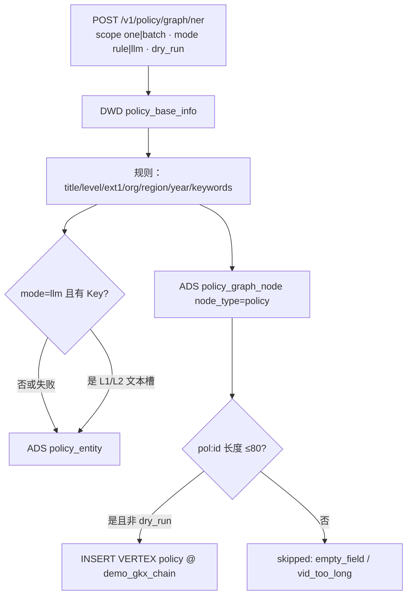

属性实体（`level`/`type`/`org`/`region`/`time`/`keyword`）只进 `policy_entity`，**不建图点**。关联主体 NER 行可写 `policy_entity`，但 A 档 **不 hang**。

#### B · `POLICY_RE_CITE`

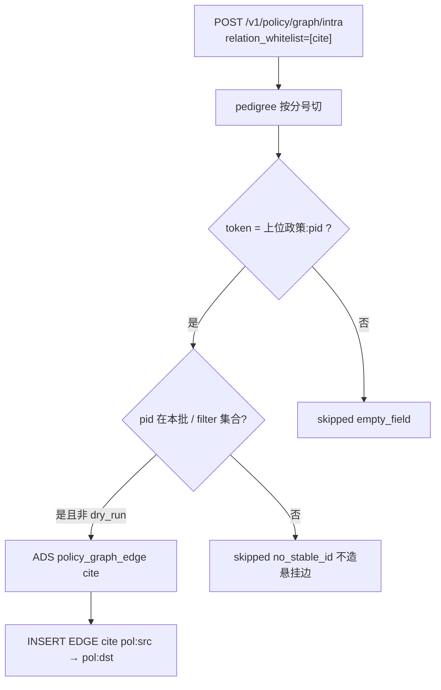

#### C · hang（`POLICY_RE_SUPPORT` / `APPLY_TO` / `REGULATE`）

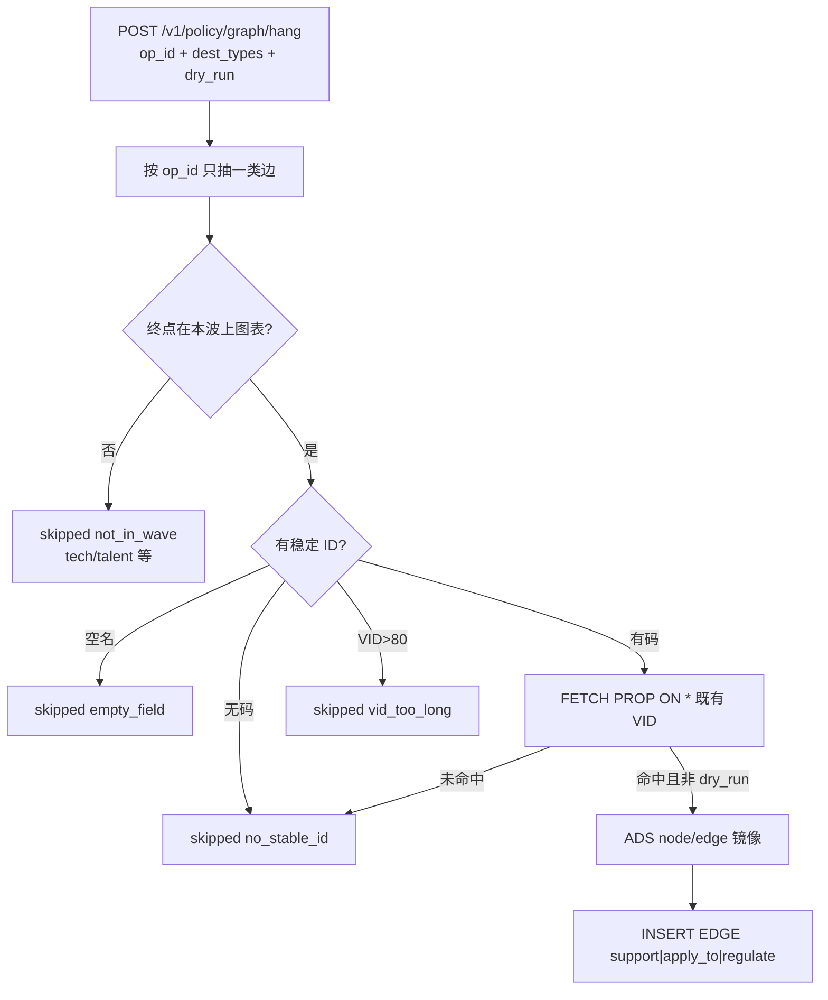

产业同时请求 `POLICY_RE_SUPPORT` 与 `POLICY_RE_APPLY_TO` 时，允许同一 `pol:`→`chain:`/`segment:` 落两条边（as-built）。P-2 **不要**为「干净」删掉其中一条，除非 `mode=llm` 且 L4 高置信互斥（须在 `props` 记裁定）。

### 17.5 LLM 与规则分界

| 规则 | 说明 |
|---|---|
| 默认 | `mode=rule`：全程 §12–§14 抄字段，不调模型 |
| 显式 LLM | 仅 `mode=llm` 可走 §15 L1/L3/L5（推荐先上）；L2 可抽短语但仍 **无 ID 不上图**；**L6 链指须淮政玮拍板**，本波默认关闭 |
| 回退 | 无 Key / 超时 / 4xx/5xx → `mode_effective=rule`，`llm_fallback=true`，`source` 不得假装 `llm` |
| Java | 禁止 NLP；只转发 |

---

## 18. 灌数剥离清单（P0 · P-2 checklist）

识别 / 关系 / 跨域挂接 / schema / nGQL 写 **不是**贴源灌数。灌数只允许：三方或 Mock → ODS → DWD（+ 可选基础指标 ADS）。**禁止** NER / RE / 建点 / 建边 / `ensure_schema` / `INSERT VERTEX|EDGE` / hang / 图投影。

**重灌后图空（或保留旧图、不再被灌数填满）是预期。** 禁止灌数静默把图填满。图只允许从「政策 → 图谱」菜单 A/B/C（及对应 `/v1/policy/graph/{ner|intra|hang}`）触发。

### 18.1 现网要摘掉的调用（文件 / 函数级）

| # | 仓 · 文件 | 符号 | 现网行为 | P-2 动作 |
|---|---|---|---|---|
| 1 | `demo-algo-ent-analysis/scripts/run_all_policy.py` | `from polan.graph import entity as graph` | 灌数编排 import NER/RE | **删除该 import** |
| 2 | 同上 | `build_steps()` 一步 `"B 政策实体识别 NER + 关系抽取 RE + 图谱", graph.run` | 灌数串行调用 `entity.py::run` | **整步删除**；图谱改由 §17 接口触发 |
| 3 | 同上 | `load_nebula_safe()` | `from polan.graph import nebula_loader` → `nebula_loader.run()` | **删除函数及 STEPS 中 `"B+ 政策图谱投影 Nebula"`** |
| 4 | `demo-algo-ent-analysis/polan/graph/entity.py` | `run()` | TRUNCATE `policy_entity` + `policy_graph_node/edge` 后全量 NER+RE | **保留文件作 A/B/C 实现核，但禁止被灌数调用**；拆成按 `op_id` 的可 `dry_run` 函数（P-2 编码） |
| 5 | `demo-algo-ent-analysis/polan/graph/nebula_loader.py` | `ensure_schema()` / `run()` / `_load_nodes` / `_load_edges` | 灌数 B+ 投影；`CREATE TAG/EDGE IF NOT EXISTS` + `INSERT VERTEX|EDGE` | **禁止**从 `run_all_policy` / `run-pipeline` 进入；仅 A/B/C 写入接口内部调用 |
| 6 | `demo-algo-ent-analysis/api/policy_routes.py` | `run_policy_pipeline()` | `for name, fn in build_steps(mode)` 会跑到 graph.run + nebula_loader | 随 `build_steps` 删除 B/B+ 后自动不再建图；**回归时 grep 本函数调用栈不得再出现 graph/nebula** |
| 7 | 同上 | `POST /internal/policy/run-pipeline` → `policy_run_pipeline()` | 基础指标页「灌数据」的后端 | **保留灌数**，但流水线不得再含图谱步 |
| 8 | `demo-algo-ent-analysis/polan/mockgen/incr.py` | `clear_policy_nebula()` | `LOOKUP ON policy … DELETE VERTEX … WITH EDGE` | **从灌数路径摘掉**（nGQL 写）。可迁到图谱菜单危险操作；reload 不得顺带删图 |
| 9 | 同上 | `reload_from_ods()` | 清 DWD 后调用 `clear_policy_nebula()` | **去掉 nebula 清理**；只留 ODS→DWD |
| 10 | `demo-algo-ent-analysis/polan/mockgen/generate.py` | 模块头 / `mode=reload` 文档与分支 | 写明「清 Nebula policy 子图」 | 文案与代码同步去掉图谱副作用 |
| 11 | `demo-ui-system-test/src/views/policy/pages/BasicPage.vue` | 主按钮「灌数据」；`onSeed('append'|'reload'|'replace')` | 调 `runPipeline` = 全流水线含 B/B+ | **P-3 去「会建图」文案与顺带调用**；P-2 先让后端零图调用，使按钮即使未改也不再建图 |
| 12 | 同上 | `seedFlow` 项 `{ label: 'B 政策图谱', hint: 'NER + RE；Nebula 未启用时跳过' }` | UI 明示灌数含图谱 | **删除该步**（P-3；P-2 checklist 须点名） |
| 13 | 同上 | `seedNotes`「重灌：…删 Nebula policy 点」；下拉「重灌（保留 ODS，只清 DWD + Nebula 政策子图）」；`ElMessageBox` reload 确认文案 | 灌数承诺清图再建 | **改成只清 DWD / 重算基础指标**；禁止提 Nebula |
| 14 | `demo-ui-system-test/src/api/policy/index.ts` | `runPipeline` → `POST /policy/internal/policy/run-pipeline` | 前端灌数入口 | 路径可留；**注释「reload=清 DWD+Nebula」必须改** |
| 15 | CLI | `python scripts/run_all_policy.py`；`python -m polan.graph.entity`；`python -m polan.graph.nebula_loader` | 运维手跑全流水线 / 单独灌图 | 全流水线摘 B/B+；后两个只允许图谱菜单/API 触发，不进灌数 runbook |

### 18.2 灌数允许留下的

| 允许 | 文件 / 符号 |
|---|---|
| Schema 初始化（dwd+ads+cfg，**不含** Nebula `CREATE TAG/EDGE`） | `polan.common.db.init_schema` |
| 模型注册 seed | `polan.models.registry.seed_registry` |
| Mock / ODS→DWD | `polan.mockgen.generate.run` · `incr.ingest_pending`（**无** `clear_policy_nebula`） |
| 三方 → Demo ODS（不算指标） | `POST /internal/policy/sync-ods` · `polan.ods_sync` |
| A 政策基础指标 5 张 | `polan.basic.indicators.run` |
| C1–C7 / D1–D3 深度与文本 | `polan.eval.*` · `polan.text.*`（读 ADS 边做关联度的 `focus.py` **可以继续读已有** `policy_graph_edge`；不得在灌数里 **写入** 图） |

### 18.3 过关自检（P-2 handoff 必附 grep）

在 `demo-algo-ent-analysis` 对下列入口跑 grep，**不得**再命中 `entity.run` / `nebula_loader` / `ensure_schema` / `INSERT VERTEX` / `INSERT EDGE` / `clear_policy_nebula` / `graph.run`：

- `scripts/run_all_policy.py`（含 `build_steps`）
- `api/policy_routes.py` 的 `run_policy_pipeline` / `policy_run_pipeline`
- `polan/mockgen/generate.py` · `polan/mockgen/incr.py` 的 `reload_from_ods`

基础指标页灌数成功后：**不**自动增加 `policy_graph_node/edge` 行、**不**自动 `INSERT` Nebula 政策点边。A/B/C 才写 ADS 图面与 Nebula。

---

## 19. 图 · POLICY-GRAPH-TRIPLE

> **diagram_id：`POLICY-GRAPH-TRIPLE`**（L1 · 图即契约）。每类实体 + 每组关系入库。改边集 / 上图范围只改本图与 §17.3，禁止 UI/apiview 另造边名。

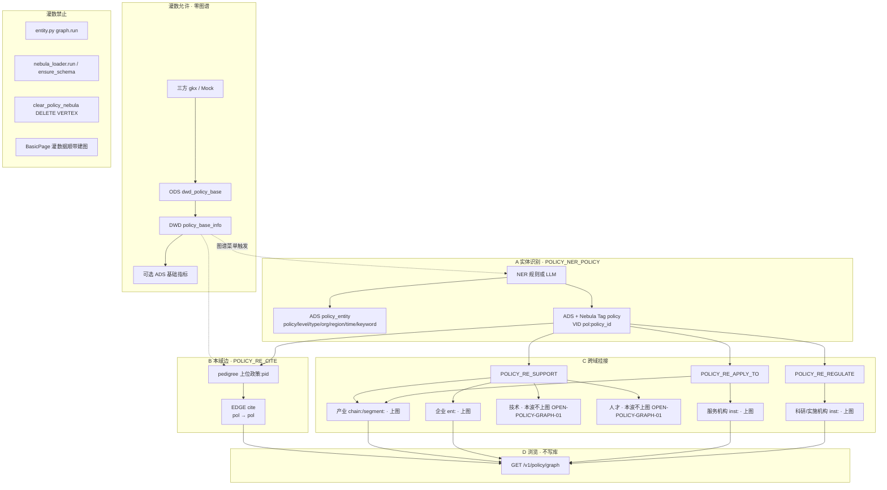

实体（Tag / 本波）：

| 实体 | Tag 或复用 | VID | 本波上图 | 谁写入 |
|---|---|---|---|---|
| 政策本体 | **新增** Tag `policy` | `pol:{policy_id}` | 是 | A |
| 产业 | 复用 CHAIN `chain` / `segment` | `chain:` / `segment:` | 是（须 FETCH） | C hang，不新建 Tag |
| 企业 | 复用 `enterprise` | `ent:` | 是（须 FETCH） | C |
| 科研/实施机构 | 复用 `institution` | `inst:` | 是（须 FETCH） | C |
| 服务机构 | 复用 `institution` | `inst:` | 是（须 FETCH） | C |
| 技术 | **无 Tag** | — | **否** `OPEN-POLICY-GRAPH-01` | skipped `not_in_wave` |
| 人才 | **无 Tag** | — | **否** `OPEN-POLICY-GRAPH-01` | skipped `not_in_wave` |
| 属性（级别/类型/地区/时间/关键词/发文机关） | 不上图 | — | 否 | 仅 A → `policy_entity` |

关系入库：

| 边 | 语义 | 典型三元组 | 写入 op |
|---|---|---|---|
| `support` | 扶持：资源投向谁 | `pol:` → `chain:`/`segment:` ；`pol:` → `ent:` | `POLICY_RE_SUPPORT` |
| `apply_to` | 适用：效力覆盖谁 | `pol:` → `chain:`/`segment:` ；`pol:` → `inst:`（服务） | `POLICY_RE_APPLY_TO` |
| `regulate` | 监管/实施：谁落地 | `pol:` → `inst:`（科研/实施） | `POLICY_RE_REGULATE` |
| `cite` | 引用谱系 | `pol:` → `pol:` | `POLICY_RE_CITE` |

---

## 20. 诚实缺口（本波）

| ID | 缺口 | 本波处理 | 不是 |
|---|---|---|---|
| `OPEN-POLICY-GRAPH-01` | 无 tech/talent Tag；无六类专题库稳定 ID 接口 | 表 §17.3 全部保留行；上图列写「本波不上图」；skipped=`not_in_wave` / `no_stable_id` | 漏配 EDGE、loader bug |
| `OPEN-POLICY-GRAPH-03` | S3 细表边 DDL 与 as-built `(weight, props)` 不一致 | 现网以 as-built 为准；不在本叶改 S3 | P-2 私自改边 schema |
| 实施 vs 监管 | 需规分开，现网一条 `regulate`，源常是发文机关 | 本波不拆边类型；L3 仅 `mode=llm` 打 `props.role` | 静默改成两条 EDGE |
| 需规「主题 / 目标」 | 107 文本里的政策主题、政策目标 | 现网无独立边；主题进属性/关键词 NER，**不上图** | 发明 `theme`/`goal` 边 |
| L6 链指 | 名称 → 已有 VID | **须淮政玮拍板**；默认关闭 | 名称相似度伪造边 |
| D12 | 本设计服务 Demo `demo-algo-ent-analysis` + `demo-ui-system-test` | lumen apiview **禁止**直连 demo 服务；正式复刻走 `lumen-algo-py` | P-1/P-2 改 lumen 前端打 demo |
| 灌数文档债 | `pipeline-demo-mock.md` §2 仍画 15 步含 B/B+ | P-2 剥代码后由 data/doc 另单改该全景图；**本文件 §18 已是剥离真源** | 本 P-1 改 mock 全景稿 |

公式 / 边权 / 是否拆实施与监管：仍挂唐绍祖会签 + `QPOL-02`，本设计不改 D1。

