# POLICY · stores 索引

```yaml
---
doc_id: POLICY-STORES-INDEX
element: POLICY
role: store-mysql
status: draft
version: "2026-11-09"
updated: 2026-11-09
s3_task: DATA-POLICY-STORAGE-S3-L01
---
```

> **S3**：项目侧细表清单。一律 **draft**。禁止仅因 S1 流图会签标 `approved`。  
> **冲突**：以本树为准。贴源结构 [`../sources/ods-ddl.md`](../sources/ods-ddl.md)。旧 v1 仅历史（含独立 `gkx_policy` DDL）。

| 子目录 | 文档 | 状态 |
|---|---|---|
| [`mysql/dwd.md`](./mysql/dwd.md) | `policy_base_info` + `policy_industry_rel` + `policy_category_rel` + `policy_support_amount` + `policy_text_parse` + `script_state` | draft |
| [`mysql/ads.md`](./mysql/ads.md) | ADS **16 张**：指标 9 + 图镜像 2 + NER 1 + 文本 3 + `policy_industry_rel` 镜像。另有 draft：`policy_accuracy_demo`，不计入 16，不是指标表 | draft |
| [`mysql/gapfill.md`](./mysql/gapfill.md) | D16 缺项：`gapfill_policy_sz_effect`（`POL-IMPL-EFFECT-MOCK-VIA-UI-L01`）+ 拆解/对比/研报八张空表（`POL-MOCK-BTN-A01`） | draft |
| [`nebula/`](./nebula.md) | hang **`demo_gkx_chain` only** | draft |
| [`elasticsearch/`](./elasticsearch.md) | 本管线不施工独立索引 | draft 指针 |
| 读侧指针（非存储） | [`../etl/pipeline-macro-effect-proxy.md`](../etl/pipeline-macro-effect-proxy.md) | 落地实效宏观代理只读 `gkx.dwd_macro_index_data` 等，算法内存合成，**本树无对应表** |
| 窗口对照 | [`../windows/display-ds10-12.md`](../windows/display-ds10-12.md) | draft |

库名：Demo `demo_gkxlumenx_dwd` / `demo_gkxlumenx_ads`。引擎：**MySQL 8 only**。禁止 `dwd.` / `ads.` PG schema 叙述当建库名。

## 算法库 ER

政策分析算法库（`polan`）的库表关系，含缺项库 `gkxlumenx_gapfill.gapfill_policy_*` 和 ADS 同步历史 `gdf_gapfill_syscnhistory`。库内**没有物理外键**。带 `policy_id`（或 `item_policy_id`）的表按该列连到 `policy_base_info`。没有这列的缺项表仍画在图里，连线标「缺项面」：一行不对应一条政策。DWD / ADS 的 CREATE 在 [`mysql/dwd.md`](./mysql/dwd.md) 与 [`mysql/ads.md`](./mysql/ads.md)。缺项建表在 `lumen-algo-py/scripts/mysql/gapfill_policy_*.sql`；`gapfill_policy_viz_*` 以现网列为准。`POL-MOCK-BTN-A01` 八张新表的可执行语句在 `demo-algo-ent-analysis/scripts/ensure_gapfill_policy_btn_tables.py`，列定义在 [`mysql/gapfill.md`](./mysql/gapfill.md)。图数据库不进本图，见 [`nebula.md`](./nebula.md)。

`policy_text_parse` 算法写 ADS。DWD 有同结构空表，不另画。`policy_industry_rel` 先写 DWD，再按 `policy_id` 把该政策的行替换进 ADS，`id` 保持一致。`policy_category_rel` 只在 DWD，不镜像到 ADS，也不改 `policy_base_info.policy_type`（文种）。`policy_support_amount` 主键就是 `policy_id`，一政策一行；算法只读。`policy_focus` 有按政策的行，也有 `policy_id` 为空的汇总行。`gapfill_policy_sz_effect`、`gapfill_policy_detail_compare`、`gapfill_policy_qry_doc` 的 `policy_id` 唯一。`gapfill_policy_sim_forecast.policy_id` 唯一且可空。

```mermaid
erDiagram
    policy_base_info ||--o{ policy_industry_rel_dwd : "policy_id"
    policy_industry_rel_dwd ||--|| policy_industry_rel_ads : "同 id 镜像"
    policy_base_info ||--o{ policy_category_rel : "policy_id"
    policy_base_info ||--o| policy_support_amount : "policy_id"
    policy_base_info ||--o{ script_state : "policy_id"
    policy_base_info ||--o{ policy_text_parse : "policy_id"
    policy_base_info ||--o{ policy_entity : "policy_id"
    policy_base_info ||--o{ policy_match : "policy_id"
    policy_base_info |o--o{ policy_focus : "policy_id 可空"
    policy_base_info ||--o| policy_graph_node : "node_key = pol:policy_id"
    policy_graph_node ||--o{ policy_graph_edge : "src_key"
    policy_graph_node ||--o{ policy_graph_edge : "dst_key"
    policy_base_info ||--o| gapfill_policy_sz_effect : "policy_id"
    policy_base_info ||--o| gapfill_policy_detail_compare : "policy_id"
    policy_base_info ||--o| gapfill_policy_qry_doc : "policy_id"
    policy_base_info |o--o| gapfill_policy_sim_forecast : "policy_id 可空"
    policy_base_info ||--o{ gapfill_policy_indicator_lib : "policy_id"
    policy_base_info ||--o{ gapfill_policy_lineage_index : "policy_id"
    policy_base_info ||--o{ gapfill_policy_qry_rank : "policy_id"
    policy_base_info ||--o{ gapfill_policy_version_diff : "policy_id"
    policy_base_info |o--o{ gapfill_policy_audience_feedback : "policy_id 可空"
    policy_base_info |o--o{ gapfill_policy_sim_result : "policy_id 可空"
    policy_base_info |o--o{ gapfill_policy_viz_events : "policy_id 可空"
    policy_base_info |o--o{ gapfill_policy_viz_clusters : "item_policy_id 可空"
    policy_base_info }o--o{ gapfill_policy_assessment_report : "缺项面"
    policy_base_info }o--o{ gapfill_policy_benchmark_report : "缺项面"
    policy_base_info }o--o{ gapfill_policy_eval_partition : "缺项面"
    policy_base_info }o--o{ gapfill_policy_eval_scheme : "缺项面"
    policy_base_info }o--o{ gapfill_policy_eval_shell : "缺项面"
    policy_base_info }o--o{ gapfill_policy_eval_template : "缺项面"
    policy_base_info }o--o{ gapfill_policy_eval_trend : "缺项面"
    policy_base_info }o--o{ gapfill_policy_impl_dept : "缺项面"
    policy_base_info }o--o{ gapfill_policy_qry_stat : "缺项面"
    policy_base_info }o--o{ gapfill_policy_sim_stakeholder : "缺项面"
    policy_base_info }o--o{ gapfill_policy_theme_dist : "缺项面"
    policy_base_info }o--o{ gapfill_policy_trend_hotspot : "缺项面"
    policy_base_info }o--o{ gapfill_policy_trend_impact : "缺项面"
    policy_base_info }o--o{ gapfill_policy_trend_report : "缺项面"
    policy_base_info }o--o{ gapfill_policy_viz_depth : "缺项面"
    policy_base_info }o--o{ gapfill_policy_viz_terms : "缺项面"
    policy_base_info ||--o{ gapfill_policy_semantic : "policy_id"
    policy_base_info ||--o{ gapfill_policy_xcmp : "policy_id_a"
    policy_base_info ||--o{ gapfill_policy_xcmp_viz : "policy_id_a"
    policy_base_info ||--o{ gapfill_policy_xcmp_summary : "policy_id_a"
    policy_base_info ||--o{ gapfill_policy_report_analysis : "policy_id"
    policy_base_info ||--o{ gapfill_policy_report_insight : "policy_id"
    policy_base_info ||--o{ gapfill_policy_report_body : "policy_id"
    policy_base_info ||--o{ gapfill_policy_report_trace : "policy_id"
    policy_base_info }o--o{ gdf_gapfill_syscnhistory : "同步历史"

    policy_base_info {
        bigint id PK
        varchar policy_id UK
        varchar source_plane UK
        text title
        varchar policy_type
    }
    policy_industry_rel_dwd {
        bigint id PK
        varchar policy_id
        varchar industry_link_code
        tinyint is_deleted
    }
    policy_industry_rel_ads {
        bigint id PK
        varchar policy_id
        varchar industry_link_code
        tinyint is_deleted
    }
    policy_category_rel {
        bigint id PK
        varchar policy_id
        varchar category
        tinyint is_deleted
    }
    policy_support_amount {
        varchar policy_id PK
        decimal amount
        varchar caliber
        varchar source_clause
    }
    script_state {
        varchar job PK
        varchar policy_id PK
        varchar status
    }
    policy_text_parse {
        bigint id PK
        longtext policy_id
        longtext structured_elements
    }
    policy_entity {
        bigint id PK
        longtext policy_id
        longtext entity_type
        longtext entity_name
    }
    policy_match {
        bigint id PK
        longtext policy_id
        longtext subject_id
        decimal match_score
    }
    policy_focus {
        bigint id PK
        longtext policy_id
        decimal focus_score
    }
    policy_graph_node {
        bigint id PK
        longtext node_key
        longtext node_type
    }
    policy_graph_edge {
        bigint id PK
        longtext src_key
        longtext dst_key
        longtext relation_type
    }
    gapfill_policy_sz_effect {
        varchar policy_id PK
        date implementation_date
        varchar support_object
        tinyint feedback_score
        varchar metric_id
        varchar gap_item
        varchar fill_method
        varchar gapfill_batch_id
        datetime generated_at
    }
    gapfill_policy_detail_compare {
        bigint id PK
        varchar policy_id UK
    }
    gapfill_policy_qry_doc {
        bigint id PK
        varchar policy_id UK
    }
    gapfill_policy_sim_forecast {
        bigint id PK
        varchar policy_id UK
    }
    gapfill_policy_indicator_lib {
        bigint id PK
        varchar policy_id
    }
    gapfill_policy_lineage_index {
        bigint id PK
        varchar policy_id
    }
    gapfill_policy_qry_rank {
        bigint id PK
        varchar policy_id
    }
    gapfill_policy_version_diff {
        bigint id PK
        varchar policy_id
    }
    gapfill_policy_audience_feedback {
        bigint id PK
        text policy_id
    }
    gapfill_policy_sim_result {
        bigint id PK
        varchar policy_id
    }
    gapfill_policy_viz_events {
        bigint id PK
        varchar policy_id
    }
    gapfill_policy_viz_clusters {
        bigint id PK
        varchar item_policy_id
    }
    gapfill_policy_assessment_report {
        bigint id PK
        varchar scope_text
    }
    gapfill_policy_benchmark_report {
        bigint id PK
        varchar benchmark_object
    }
    gapfill_policy_eval_partition {
        bigint id PK
        varchar object_name
    }
    gapfill_policy_eval_scheme {
        bigint id PK
        varchar row_kind
        varchar scheme_name
    }
    gapfill_policy_eval_shell {
        bigint id PK
        varchar entry_kind
    }
    gapfill_policy_eval_template {
        bigint id PK
        varchar template_name
    }
    gapfill_policy_eval_trend {
        bigint id PK
        varchar metric_name
    }
    gapfill_policy_impl_dept {
        bigint id PK
        varchar region_name
        varchar impl_dept
    }
    gapfill_policy_qry_stat {
        bigint id PK
        varchar metric_id
        bigint policy_count
    }
    gapfill_policy_sim_stakeholder {
        bigint id PK
        varchar actor_role
    }
    gapfill_policy_theme_dist {
        bigint id PK
        varchar theme_name
    }
    gapfill_policy_trend_hotspot {
        bigint id PK
        varchar hotspot_name
    }
    gapfill_policy_trend_impact {
        bigint id PK
        varchar impact_object
    }
    gapfill_policy_trend_report {
        bigint id PK
        varchar title
    }
    gapfill_policy_viz_depth {
        bigint id PK
        varchar stage_name
    }
    gapfill_policy_viz_terms {
        bigint id PK
        varchar text
    }
    gapfill_policy_semantic {
        bigint id PK
        varchar policy_id
        varchar facet_name
    }
    gapfill_policy_xcmp {
        bigint id PK
        varchar policy_id_a
        varchar relation_name
    }
    gapfill_policy_xcmp_viz {
        bigint id PK
        varchar chart_kind
        decimal compare_value
    }
    gapfill_policy_xcmp_summary {
        bigint id PK
        varchar summary_kind
    }
    gapfill_policy_report_analysis {
        bigint id PK
        varchar policy_id
        varchar aspect_name
    }
    gapfill_policy_report_insight {
        bigint id PK
        varchar policy_id
        varchar insight_kind
    }
    gapfill_policy_report_body {
        bigint id PK
        varchar policy_id
        varchar section_name
    }
    gapfill_policy_report_trace {
        bigint id PK
        varchar policy_id
        varchar direction_name
    }
    gdf_gapfill_syscnhistory {
        bigint id PK
        varchar trigger_kind
        varchar status
    }
```



## 表说明

图里的表，以及图下这 9 张只有汇总、没有 `policy_id` 行级关联的 ADS 表。`scope_code` 有时放区划码、有时放 `policy_id`，仍不是外键。`policy_industry_rel` 在 DWD、ADS 各一张，图上分成两个框。

| 表 | 库 | 含义 |
|---|---|---|
| `policy_base_info` | `demo_gkxlumenx_dwd` | 政策主表。国内与国际同表，业务键是 `policy_id` |
| `policy_industry_rel` | `demo_gkxlumenx_dwd` | 政策与产业的关联。抽取先写这里，逻辑删除，不改主表 |
| `policy_industry_rel` | `demo_gkxlumenx_ads` | 上一张表按政策替换过来的镜像。Java 只读这张 |
| `policy_category_rel` | `demo_gkxlumenx_dwd` | 全景「政策类别」多选。不改文种 `policy_type`。未命中词表时写成科创政策 |
| `policy_support_amount` | `demo_gkxlumenx_dwd` | 资助金额。一政策一行。算法只读，均值只取资助、奖励、补贴、补助 |
| `script_state` | `demo_gkxlumenx_dwd` | 抽取产业、条款结构化的作业状态，供增量跳过 |
| `policy_text_parse` | `demo_gkxlumenx_ads` | 文本解析：摘要、结构化要素、自动标签。算法写 ADS；DWD 有同结构空表 |
| `policy_entity` | `demo_gkxlumenx_ads` | 从政策抽出的实体，图谱构建的上游 |
| `policy_match` | `demo_gkxlumenx_ads` | 主体与政策的匹配分和理由 |
| `policy_focus` | `demo_gkxlumenx_ads` | 焦点、机遇、关联度。`policy_id` 为空的是区域或产业汇总行 |
| `policy_graph_node` | `demo_gkxlumenx_ads` | 图谱点镜像。政策点键为 `pol:{policy_id}` |
| `policy_graph_edge` | `demo_gkxlumenx_ads` | 图谱边镜像。`src_key` / `dst_key` 指向点 |
| `gapfill_policy_sz_effect` | `gkxlumenx_gapfill` | 深圳落地实效缺项：实施日、支持对象、反馈分。一政策一行。**写入口**挂算法库页两过程：「Mock 10 条数据」(`synth.run`)、「真实政策补外围：深圳 40 + 随机 10」(`synth.run_real`)；无表建表（库由 DBA 预建）、有表 UPSERT；两入口末尾回补 DWD 缺口（含存量已补外围却无 effect 的）。读侧：深圳现状板只补 DWD 空维。详设 [`05.6.2 §3.1`](../../../../agent-handoffs/产品整体定义/科技专题服务系统-完整详细设计/05.6.2-深圳政策现状分析.md) |
| `gapfill_policy_detail_compare` | `gkxlumenx_gapfill` | 申报条件与申报材料。一政策一行 |
| `gapfill_policy_qry_doc` | `gkxlumenx_gapfill` | 检索用的政策目录缺项。一政策一行 |
| `gapfill_policy_sim_forecast` | `gkxlumenx_gapfill` | 未出台仿真、新出台预测、区域空间。`policy_id` 可空且唯一 |
| `gapfill_policy_indicator_lib` | `gkxlumenx_gapfill` | 指标库缺项。维度是扶持力度、适用范围、实施时效、申请条件 |
| `gapfill_policy_lineage_index` | `gkxlumenx_gapfill` | 条款血缘。行种类是原文条款、条款结论 |
| `gapfill_policy_qry_rank` | `gkxlumenx_gapfill` | 检索名次。维是相关性、时效性、重要性。只有名次 |
| `gapfill_policy_version_diff` | `gkxlumenx_gapfill` | 同一政策两个发布日之间的新增、修改、删除 |
| `gapfill_policy_audience_feedback` | `gkxlumenx_gapfill` | 受众反馈。`policy_id` 可空 |
| `gapfill_policy_sim_result` | `gkxlumenx_gapfill` | 推演结果。行种类含多维评估、政策重点、影响范围、实施路径、解读段落。`policy_id` 可空 |
| `gapfill_policy_viz_events` | `gkxlumenx_gapfill` | 重大事件。`policy_id` 可空 |
| `gapfill_policy_viz_clusters` | `gkxlumenx_gapfill` | 主题聚类。政策键列名是 `item_policy_id`，可空 |
| `gapfill_policy_assessment_report` | `gkxlumenx_gapfill` | 评估报告正文。无 `policy_id` |
| `gapfill_policy_benchmark_report` | `gkxlumenx_gapfill` | 对标报告。对照字段是政策类型、支持力度、覆盖范围 |
| `gapfill_policy_eval_partition` | `gkxlumenx_gapfill` | 评估分区对照。对象是地区、行业、目标群体 |
| `gapfill_policy_eval_scheme` | `gkxlumenx_gapfill` | 评估方案。行种类是方案对照、参数模拟、路径与风险、互动意见 |
| `gapfill_policy_eval_shell` | `gkxlumenx_gapfill` | 解读条目与多媒体标题说明 |
| `gapfill_policy_eval_template` | `gkxlumenx_gapfill` | 报告模板选用：周期、分析维、图表类型 |
| `gapfill_policy_eval_trend` | `gkxlumenx_gapfill` | 评估趋势点。切换维是时间、区域、类别 |
| `gapfill_policy_impl_dept` | `gkxlumenx_gapfill` | 区域、实施部门、方面上的件数和清单标题 |
| `gapfill_policy_qry_stat` | `gkxlumenx_gapfill` | 检索统计缺项：级别、分省、深圳、时序、文种计数与有效率 |
| `gapfill_policy_sim_stakeholder` | `gkxlumenx_gapfill` | 利益攸关方参与意见。角色是决策者、评估者、利益攸关方 |
| `gapfill_policy_theme_dist` | `gkxlumenx_gapfill` | 主题分布条数 |
| `gapfill_policy_trend_hotspot` | `gkxlumenx_gapfill` | 动向热点 |
| `gapfill_policy_trend_impact` | `gkxlumenx_gapfill` | 动向影响：对象、方向、结论 |
| `gapfill_policy_trend_report` | `gkxlumenx_gapfill` | 动向深度分析报告正文 |
| `gapfill_policy_viz_depth` | `gkxlumenx_gapfill` | 影响深度。层是市场、企业、人才 |
| `gapfill_policy_viz_terms` | `gkxlumenx_gapfill` | 词云。词来自标题和正文 |
| `gapfill_policy_semantic` | `gkxlumenx_gapfill` | 606 语义。一政策一面一行：主旨、适用场景、约束、条款分类。`POL-MOCK-BTN-A01` 建空表 |
| `gapfill_policy_xcmp` | `gkxlumenx_gapfill` | 610 交叉对比。一对政策一种关系一行：共性、差异、互补、冲突 |
| `gapfill_policy_xcmp_viz` | `gkxlumenx_gapfill` | 611 对照数。图种是对比表、柱、雷达。不新算全景分布 |
| `gapfill_policy_xcmp_summary` | `gkxlumenx_gapfill` | 613 对比摘要与核心结论。612 用户配置不进本表 |
| `gapfill_policy_report_analysis` | `gkxlumenx_gapfill` | 614 深度分析。一面一句：实施效果、经济社会、产业影响、趋势 |
| `gapfill_policy_report_insight` | `gkxlumenx_gapfill` | 615 洞察。一种一句：观点、建议、风险、机遇 |
| `gapfill_policy_report_body` | `gkxlumenx_gapfill` | 616 模块正文，写在行里。618 只读本表，不灌文件 |
| `gapfill_policy_report_trace` | `gkxlumenx_gapfill` | 617 双向溯源。方向是结论到原文、原文到结论。不并入条款血缘表 |
| `gdf_gapfill_syscnhistory` | `demo_gkxlumenx_ads` | 来源监控的同步历史。不抓外站，不挂 `policy_id` |
| `policy_level_dist` | `demo_gkxlumenx_ads` | 层级、总数、时效。整表重算，不挂单条政策 |
| `policy_type_dist` | `demo_gkxlumenx_ads` | 文种分布 |
| `policy_timeseries` | `demo_gkxlumenx_ads` | 发布时序 |
| `policy_national_dist` | `demo_gkxlumenx_ads` | 分省分布 |
| `policy_sz_dist` | `demo_gkxlumenx_ads` | 深圳分区分布 |
| `policy_intensity` | `demo_gkxlumenx_ads` | 力度与产业覆盖。`scope_code` 是区划或政策 |
| `policy_effect` | `demo_gkxlumenx_ads` | 效果、短板、布局、落地实效 |
| `policy_metric_timeseries` | `demo_gkxlumenx_ads` | 区域、产业、指标三维时序 |
| `policy_simulate` | `demo_gkxlumenx_ads` | 效果推演的一轮基线与仿真值 |
