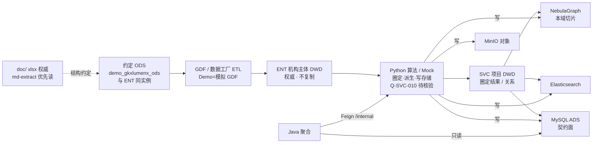
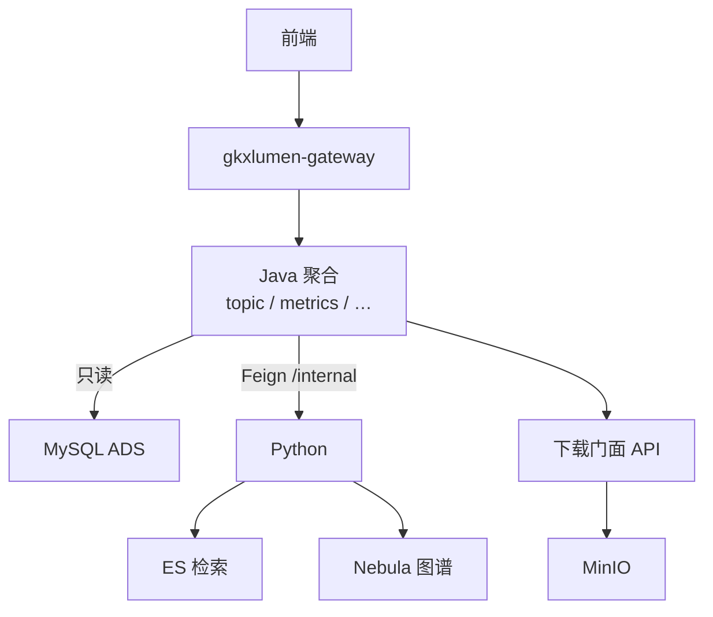
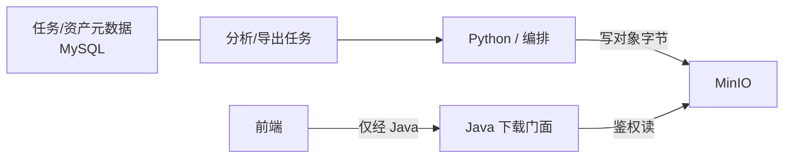
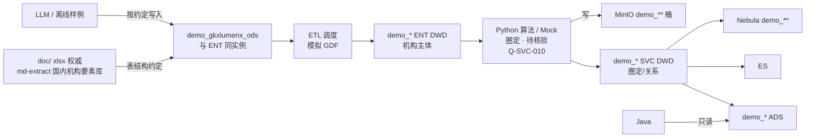

# 服务机构维 · 端到端数据流

```yaml
---
doc_id: SVC-STORAGE-FLOW
element: SVC
role: data-flow
status: approved
version: "2026-08-14"
updated: 2026-08-14
engine: multi
signoff_owner: human:侯佳伟
signoff_status: approved
signoff_by: human:侯佳伟
signoff_at: 2026-08-14
amendment_note: "S1 会签通过（human:侯佳伟 2026-08-14）：三图 + Python 批处理主链 + Demo ODS 真源 md-extract；不复制 dwd_org_base_info；Q-SVC-010 阻断不伪闭合。放行 S2。"
---
```

> **会签 Owner：`human:侯佳伟`**（2026-08-14 **approved**）。  
> 本流图会签已通过，允许启动 **S2**（sources/etl/seeds + **按在线文档**在 `demo_gkxlumenx_ods` **核对/补齐建表**）。  
> **仍禁止**：在未完成对应 `stores/*` 文档评审前，将细表标为「结构已批准 / approved」。  
> **禁止**：以 `gkx-mysql-raw` as-built、L01 现网实查替代 `doc/` 作为 ODS 建表真源。  
> **§7**：Demo「约定 ODS → ETL 模拟 GDF」口径（结构与 §1 同构）。

## 1. 批处理主链（工厂）



| 生产者 | 消费者 | 触发 | 失败语义 | 禁止事项 |
|---|---|---|---|---|
| 三方 / GDF（Demo：模拟 GDF） | ENT 机构 DWD；本域只**读键** | **批**：GDF 作业；具体 cron / DAG 名 → **OPEN-SVC-FLOW-01**（S2 填） | 本批失败则**不晋升**依赖该批的下游；保留上一成功 DWD 快照；飞书知会供应方 / GDF / 数据 Lead；不自动回滚 ADS | 业务 API / Java / 前端直读 ODS；Java 写 DWD；**SVC 复制** `dwd_org_base_info` |
| Python 圈定 ETL（读 ENT 主体键） | SVC 项目 DWD（圈定结果 / 关系） | **批**：ENT 主体门禁通过后由 **Python** 串联（GDF 编排）。Demo 临时规则须标 **待核验**（**Q-SVC-010**） | 规则未决策 → **不得**把圈定结果标 live / approved；管道失败 → 不发布半成品圈定切片 | **伪闭合**准入口径；Java 写 DWD/圈定；把临时词典写入正式 ADS 契约；替甲方拍板「谁算服务机构」 |
| DWD ETL（GDF/**Python**） | ADS / ES / Nebula | **批**：本域 DWD 门禁通过后由 GDF/**Python** 派生；或算法刷新任务触发 | 管道失败 → 该目标存储**不发布半成品**；ADS 保留上一成功契约切片；ES/Nebula 可降级，**ADS 仍为指标权威**；作业标 failed + 可重试 | Java 写 ADS；三方字段泄漏进 ADS 契约面（D7）；Neo4j；复制 CHAIN 图谱模型 |
| Python（含 Mock） | ADS / ES / Nebula / MinIO | **Demo 主路径见 §7**（含圈定）。可选旁路：直写 ADS（D7）。生产：批或任务写计算产物 | 写失败 → 任务态 `failed`；禁止静默部分成功；Java 只读既有成功数据 | 前端造假；Java/前端写 ADS；以现网 as-built 当 Demo ODS 真源 |
| Java | （读）ADS；Feign→Python | **在线** HTTP | 4xx/5xx 统一错误体；**不写回** ODS/DWD/ADS；不因读失败扫 DWD | 扫 ODS/DWD；直连 nGQL；对前端暴露 `/internal` |

**拓扑要点**

- 工厂主链：`约定 ODS → GDF → ENT 机构 DWD → **Python（圈定·派生）** → 本域 DWD → ADS`（D7）；派生：`本域 DWD → ES / Nebula`；**算法只在 Python**（D1）。
- **机构主体不在本域落第二份 ODS/DWD 主表**；本域增量 = 圈定 + 关系 + 切片。
- **Demo**：同构；调度**模拟 GDF**；ODS 按**三方在线约定**写入/核对 `demo_*`（§7）。
- Java **只读 ADS**；图谱 = **NebulaGraph**；关系库 = **仅 MySQL**（禁止 PostgreSQL 叙述）。

## 2. 在线读路径



| 生产者 | 消费者 | 触发 | 失败语义 | 禁止事项 |
|---|---|---|---|---|
| Java | 前端 | 用户操作 → HTTP | 统一错误体 + trace；不把存储异常细节泄给前端 | 前端直连 ES / MinIO / Nebula / MySQL / Python |
| Python | Java | Feign `/internal/*` | 同步失败 → Java 映射 5xx/业务码；长任务 → 任务态可查，禁止假成功 | 对前端暴露 `/internal`；Java 直连 nGQL |
| 下载门面 | 前端 | 鉴权后下载 | 对象缺失 → 业务错误；**不**下发直连凭证 | 前端持 MinIO 永久密钥；门面扫 DWD |

## 3. 对象 / 报告产物



| 生产者 | 消费者 | 触发 | 失败语义 | 禁止事项 |
|---|---|---|---|---|
| Python / 编排 | MinIO + MySQL 元数据 | 分析/导出完成时写对象；元数据同步落库 | 对象写失败 → 任务 `failed`，元数据不标可下载 | 用 MinIO 替代业务表；元数据只放对象桶 |
| Java 下载门面 | 前端 | 鉴权下载 | 鉴权失败 401/403；对象不存在 404；不回源 DWD | 前端直连 MinIO；下载 API 扫 ODS/DWD |

平台约定见 [`../platform/minio.md`](../platform/minio.md)；本域对象前缀见 [`etl/README.md`](./etl/README.md)（S2 补 `pipeline-to-minio.md`；建议 `svc/{task_id}/`）。  
现网 Endpoint / bucket / TTL → **OPEN-SVC-FLOW-02**（可复用平台 OPEN-ENT-FLOW-02）。

## 4. 架构师会签清单

- [x] 主链与在线读路径与 `architecture-baseline` 一致（D3 ADS / 调用链 / D6 Nebula / D7 工厂）  
- [x] ADS 为唯一 Java 契约面已在图中明示  
- [x] MinIO 仅为对象面、元数据在 MySQL  
- [x] 无 PostgreSQL / Neo4j  
- [x] ODS 真源 = `doc/` xlsx（优先 `md-extract/` 国内机构要素库）；Demo 落 `demo_gkxlumenx_ods` 已写死  
- [x] **不复制** `dwd_org_base_info`；机构主体权威 = ENT 已写死  
- [x] 圈定层纳入 **Q-SVC-010**（阻断级，不伪闭合）与 **Q-SVC-009**（industry 承诺 vs 文档）  
- [x] 调度与失败语义已填（具体 cron/DAG/bucket 为开放项，不阻塞拓扑会签）  
- [x] **人签**：`signoff_by=human:侯佳伟` 且 `signoff_status=approved`（2026-08-14 · **放行 S2**）

> 已由 `human:侯佳伟` 于 2026-08-14 会签：`signoff_status=approved`。

## 5. 开放项

> **Q-SVC-010 为阻断级：不阻塞本流图拓扑会签，但阻塞「圈定结果标 live / 正式契约」与功能伪闭合。**  
> 其余调度/桶名类不阻塞拓扑会签。

| ID | 项 | Owner | 关闭阶段 |
|---|---|---|---|
| OPEN-SVC-FLOW-01 | GDF ODS→DWD / DWD→ADS 具体调度（cron、DAG、门禁脚本路径） | 数据 Lead / GDF | S2+ |
| OPEN-SVC-FLOW-02 | MinIO 现网 Endpoint、默认 bucket、TTL（可复用平台 OPEN-ENT-FLOW-02） | 平台 / 架构 | `platform/minio.md` |
| OPEN-SVC-FLOW-03 | SVC 对象前缀与任务表字段对照 | data / GDF | S2（建议 `svc/{task_id}/`） |
| OPEN-SVC-FLOW-04 | ES / Nebula 同步失败告警与重试 SLA | data + 算法 | S2/S3 |
| OPEN-SVC-FLOW-05 | SVC 依赖的 ODS **在线约定**入口与 `sources/` 表级清单 | 数据 / 侯佳伟 | **S1 已钉真源**；表级清单 S2 充实；权威 xlsx + **md-extract 优先读** |
| OPEN-SVC-FLOW-06 | `demo_*` 核对/补齐（对齐 ENT `llm_ods`；**复用**已建国内机构要素库表） | 侯佳伟 / data-agent | **S2 主责**：按要素库在 `demo_gkxlumenx_ods` 核对字段；**禁止**复制主表；**禁止**写正式 `gkxlumenx_ods` |
| OPEN-SVC-FLOW-07 | seeds 覆盖矩阵（含待核验圈定样例） | Demo / 数据 | S2 |
| OPEN-SVC-FLOW-08 | **Q-SVC-009**：xlsx 承诺 `industry*` 等字段 vs live as-built 缺列。**建表仍认 md-extract**；live 缺列不得反向删文档列。供方核验：补建 or 长期以经营范围替代 | PM / 供应方 | 对账备注；不挡 S2 按文档建列 |
| OPEN-SVC-FLOW-09 | Q-SVC-001 / Q-SVC-008：边界与六类标签。Demo 临时规则可跑，**不进正式契约** | PM / 算法 | 甲方确认前 UI「待核验」 |
| OPEN-SVC-FLOW-10 | **Q-SVC-010（阻断级）**：服务机构准入无可靠主路径（industry 在 live 不存在 + `org_type` 仅工商组织形式 + 经营范围自由文本质量不足）。是否接受尽力而为 / 降级六类 / 等待供方补字段，**须甲方+供方决策**。S1 **不伪闭合** | PM / 甲方 / 供方 | 决策前圈定结果不得标 live；正式功能不得假装已准入 |
| OPEN-SVC-FLOW-11 | Q-SVCCHAIN-01～06（技术力/热度/堵点/深圳框架/招引/门户口径） | 产品 / 算法 / METRIC-OPEN | **另轨**；本流图只声明缺口，不关指标 |
| OPEN-SVC-FLOW-12 | 旧稿废弃声明（L01 分析纪要、`服务机构域数据库设计(v1).md`） | 架构 | S1 起冲突以本树为准；S4 stub |

来源登记：`客户决策清单跟踪表.md` §2.ae；E7 README 全模块开放项。L01 报告仅备忘，**不是**建表真源。

## 6. 下游放行（会签通过后生效）

| 阶段 | 结论 |
|---|---|
| **S2** `DATA-SVC-STORAGE-S2-L01` | **放行开工**：sources/etl/seeds + **必须按 md-extract「国内机构要素库」在** `demo_gkxlumenx_ods` **核对/补齐建表**（表名/字段对齐文档，含 `industry*`）。禁止只写清单不建/不对列；禁止写正式 `gkxlumenx_ods`；**禁止**再建一套 `dwd_org_base_info`（复用 ENT 同实例） |
| **S3** `stores/`* | 会签流图**不**等于细表 approved；S3 另单灌清单。Q-SVC-010 未决策前，圈定结果表标 draft + 待核验，不标 live 契约 |
| **S4** 旧路径 stub | 另单；冲突以本树为准 |
| `data-design/服务机构/*` legacy | 输入可参考；**ODS 建表真源不认** L01 实查 / v1 域设计，只认 `doc/` |

## 7. Demo / 约定 ODS 全链路

> 不改变 §1–3 拓扑；细化 Demo 如何稳定供数。细则：[`etl/pipeline-demo-mock.md`](./etl/pipeline-demo-mock.md)。



| 项 | 约定 |
|---|---|
| ODS 结构真源 | **权威** = `agent-delivery/data/third-party-source/doc/` xlsx；**优先读** = `doc/md-extract/`（`版权人才、企业机构、政策数据汇总表` · **国内机构要素库**）；日常 CSV = `doc/md-extract/_csv/版权人才、企业机构、政策数据汇总表__国内机构要素库.csv`；**不是** `gkx-mysql-raw` as-built，**不是** L01 现网 `SHOW CREATE` |
| 机构主表 | **ENT 权威**。Demo 已有国内机构要素库表则 **复用**；缺 `industry*` 等文档列则按文档 **补列**（Q-SVC-009：live 无列 ≠ 文档无列） |
| 落库实例 | `demo_gkxlumenx_ods`（账号约定同 ENT）；**禁止**默认写 `gkxlumenx_ods` |
| 调度 | Demo 灌数基于 ETL **模拟 GDF**（与正式同构） |
| 圈定 | 由 **Python** 执行（读 ENT 主体键）；Demo 临时规则允许，产出标待核验；**不**等于 Q-SVC-010 已关闭 |
| Python | 圈定 + DWD→ADS/ES/Nebula/MinIO 派生均在 Python（D1）；Java 不参与批处理写存储 |
| 旁路 | 直写 ADS 仅冒烟；**全链路验收以本图为准** |
