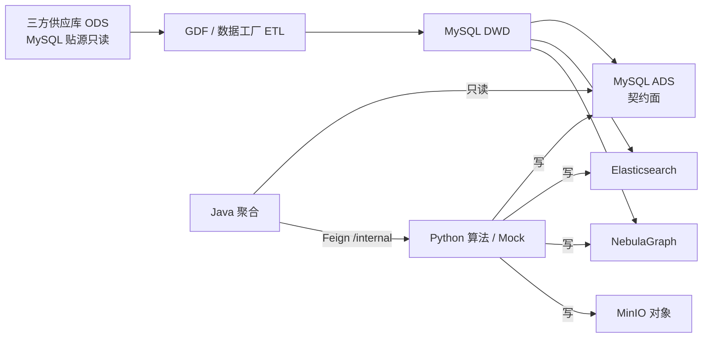
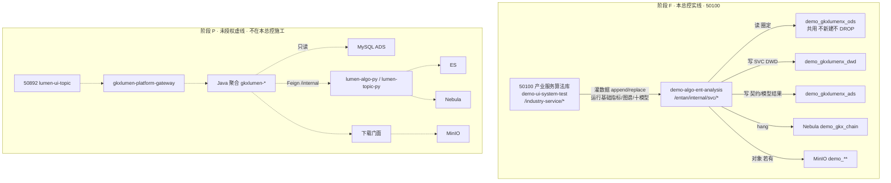
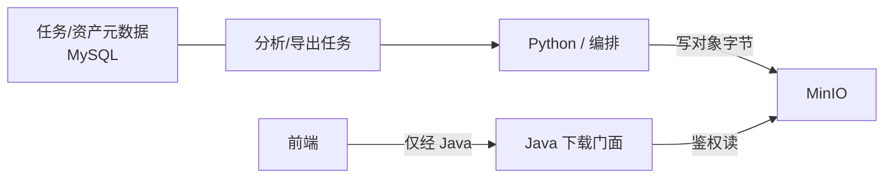
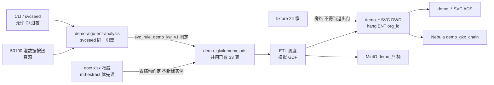

# 服务机构维 · 端到端数据流

```yaml
---
doc_id: SVC-STORAGE-FLOW
element: SVC
role: data-flow
status: approved
version: "2026-08-19"
updated: 2026-08-19
engine: multi
signoff_owner: human:淮政玮
signoff_status: approved
signoff_by: human:淮政玮
signoff_at: "2026-08-19"
amendment_note: "阶段 F 重建稿（ARCH-SVC-STORAGE-S1-L02）。旧稿 ARCH-SVC-STORAGE-FLOW-SIGNOFF-L01 已废作，不以旧 approved 当本轮会签。本单不建表、不灌数。2026-08-19 human:淮政玮 会签通过：放行 S2 拓扑；不放行细表 approved；不放行 F-SEED 灌数。"
task_id: ARCH-SVC-STORAGE-S1-L02
---
```

> **会签 Owner：`human:淮政玮`**（`signoff_status=approved` · **2026-08-19**）。  
> **监管 / 结构歧义**：`human:侯佳伟`（服务机构模块负责；不是会签人）。  
> **本单不做**：DDL、建表、灌数、改 50100 页面、改 lumen 四仓、改 CHAIN。  
> 本会签**只放行 S2 拓扑写作**。细表不得标 approved（S3 另单）。**仍禁止** F-SEED / 50100 灌数当底座退出门（须 S 契约表）。阶段 P / 50892 / lumen 四仓仍不在本总控。  
> 三图同构 ENT/CHAIN；**阶段 F 在线读写以 50100 为准**（§2 实线）。50892 / Java 只读 ADS 画为虚线，**不在本总控施工**。

## 1. 批处理主链（工厂）



| 生产者 | 消费者 | 触发 | 失败语义 | 禁止事项 |
|---|---|---|---|---|
| 三方 / GDF | MySQL DWD | **批**：GDF 作业；具体 cron / DAG 名 → **OPEN-SVC-FLOW-01**（S2 填） | 本批失败则**不晋升**依赖该批的下游；保留上一成功 DWD 快照；飞书知会供应方 / GDF / 数据 Lead；不自动回滚 ADS | 业务 API / Java / 前端直读 ODS；Java 写 DWD；**DROP** `demo_gkxlumenx_ods` 约定 33 表；新建平行 ODS 实例 |
| DWD ETL（GDF/Python） | ADS / ES / Nebula | **批**：DWD 门禁通过后串联；或算法刷新任务触发派生 | 管道失败 → 该目标存储**不发布半成品**；ADS 保留上一成功契约切片；ES/Nebula 可降级，**ADS 仍为指标权威**；作业标 failed + 可重试 | Java 写 ADS；三方字段泄漏进 ADS 契约面（D7）；Neo4j；复制 `dwd_org_base_info` 全列成 SVC 主体表；平行 `svc_org_base` |
| Python（含 Mock） | ADS / ES / Nebula / MinIO | **阶段 F Demo 主路径见 §7**（50100 灌数据 → 模拟 GDF / `svcseed`）。可选旁路：直写 ADS（D7）。生产（阶段 P，未授权）：批或任务写计算产物 | 写失败 → 任务态 `failed`；禁止静默部分成功；Java 只读既有成功数据 | 前端造假；Java/前端写 ADS；以现网 as-built 当 Demo ODS 真源；`SELECT enterprise_*` 当服务机构主路径；fixture 24 家当退出门 |
| Java | （读）ADS；Feign→Python | **在线** HTTP（**阶段 P 目标态**，本总控不施工） | 4xx/5xx 统一错误体；**不写回** ODS/DWD/ADS；不因读失败扫 DWD | 扫 ODS/DWD；直连 nGQL；对前端暴露 `/internal`；阶段 F 改 `lumen-svc-platform` |

**拓扑要点（与基线对齐 · 总控已拍板不得改口径）**

- 工厂主链：`ODS → GDF → DWD → ADS`（D7）；派生：`DWD → ES / Nebula`。
- **Demo ODS**：共用已有 `demo_gkxlumenx_ods`，**不新建 ODS、不 DROP 约定 33 表**。结构真源 = `doc/` xlsx（优先 `md-extract/`），不是 `gkx-mysql-raw` as-built。
- **圈定**：ODS → SVC DWD 经 Demo 临时规则 **`svc_rule_demo_kw_v1`**（`name_cn` + `industry_l*_name`；有则加 `business_scope`）。Q-SVC-010 🟡，不伪闭合 live。
- **主体**：机构权威在 ENT；SVC **只 hang `org_id`**（图侧 hang `node_id`，决策 #7）。禁复制 `dwd_org_base_info` 全列；禁平行 `svc_org_base`；禁 `SELECT enterprise_*` 当主路径。
- **图谱**：只 hang Demo **`demo_gkx_chain`**（决策 #7）。禁平行 `gkx_service` space；禁 Neo4j。算法设计稿里的 `gkx_service` = 历史别名，不是本轮施工目标。
- **关系库叙述 = 仅 MySQL**。禁 PostgreSQL。
- **只写 `demo_gkxlumenx_*`**。禁正式 `gkxlumenx_*`。
- **CHAIN 冻结**：`storage/CHAIN` / `gkxlumen-topic-chain` / `industry-center` **不动**。
- Java **只读 ADS** 是架构目标态（阶段 P）。**阶段 F 写库方** = `demo-algo-ent-analysis`（§2 / §7），不经 Java。

## 2. 在线读 / 写路径（阶段 F 实线 · 阶段 P 虚线）

> 同构 ENT/CHAIN 的「前端→网关→Java→ADS」图保留为 **阶段 P 虚线**。  
> **本总控（阶段 F）以 50100 产业服务算法库为准**：沿 ENT 算法台惯例直连 Python，只读写 Demo 库。这是联调台，**不是**产品调用链（D12 产品站仍禁止 lumen 调 `demo-*`）。



| 生产者 | 消费者 | 触发 | 失败语义 | 禁止事项 |
|---|---|---|---|---|
| 50100 UI | `demo-algo-ent-analysis` | 用户点「基础指标」**灌数据**（`append`/`replace`）或运行图谱/十模型 | 写失败 → 任务/接口 `failed`；禁止静默半成品冒充灌完 | 另做一套 50100 读不到的灌数路径当真源；fixture 24 家当退出门；前端内置 `svcModelCatalog` / GraphView 节点充数 |
| Python（阶段 F） | Demo DWD / ADS / `demo_gkx_chain` / MinIO | 50100 或同源 CLI/`svcseed`（同一引擎） | 圈定命中不足按规则诚实空态 + 待核验，禁止伪 live | 写正式库；写 CHAIN 表；新建 `gkx_service`；改 lumen 四仓；移植 `industry-center` |
| Java（阶段 P，虚线） | 前端 | 用户操作 → HTTP | 统一错误体 + trace | **本总控禁止施工**；前端直连 ES / MinIO / Nebula / MySQL / Python |
| Python（阶段 P，虚线） | Java | Feign `/internal/*` | 同步失败 → Java 映射 5xx | 对前端暴露 `/internal`；Java 直连 nGQL；F 内并行 `svcan` |

**阶段 F 菜单与写回（出数铁律，细表名 S3 才钉）**

| 50100 菜单 | 读 | 写 |
|---|---|---|
| 基础指标 A1–A6 + 灌数据 | ODS（圈定）/ SVC DWD | SVC DWD + 基础指标 ADS |
| 产业服务图谱 | SVC DWD / ADS | hang **`demo_gkx_chain`**（不是十模型） |
| 十模型（短板/关系/六类技术力/引入/培育） | **S 契约表** | Demo ADS 模型结果表 + 必要时图边 |

短板 **运行时**口径 = **Q-SVCCHAIN-03**（0 家=空白 / ≤1=薄弱 / 均深&lt;55=瓶颈）。**Q061**（&lt;45 / ≥70）只作对照列 + `pending_client`，F-ALGO **不得切换**。代理算法只许移植 30999 **`service-center`** 纯函数到 Python；禁 `industry-center`。

## 3. 对象 / 报告产物



| 生产者 | 消费者 | 触发 | 失败语义 | 禁止事项 |
|---|---|---|---|---|
| Python / 编排 | MinIO + MySQL 元数据 | 分析/导出完成时写对象；元数据同步落库 | 对象写失败 → 任务 `failed`，元数据不标可下载 | 用 MinIO 替代业务表；元数据只放对象桶 |
| Java 下载门面 | 前端 | 鉴权下载（阶段 P 目标态） | 鉴权失败 401/403；对象不存在 404；不回源 DWD | 前端直连 MinIO；下载 API 扫 ODS/DWD；阶段 F 为实现本图去改 lumen |

平台约定见 [`../platform/minio.md`](../platform/minio.md)。本域对象前缀 → **OPEN-SVC-FLOW-03**（S2 补 `etl/pipeline-to-minio.md`）。  
现网 Endpoint / bucket / TTL → **OPEN-SVC-FLOW-02**。

## 4. 架构师会签清单

起草完整性（architect 自检，**不等于**人签通过）：

- [x] 主链与在线读路径与 `architecture-baseline` 一致（D3 ADS / 调用链 / D6 Nebula / D7 工厂）；阶段 F 联调台直连 Python 已单独标明，不冒充产品链
- [x] ADS 为唯一 Java 契约面已在图中明示（阶段 P 虚线）
- [x] MinIO 仅为对象面、元数据在 MySQL
- [x] 无 PostgreSQL / Neo4j
- [x] ODS 共用 `demo_gkxlumenx_ods`、不 DROP 33 表、圈定 `svc_rule_demo_kw_v1`、hang ENT `org_id`、一张 `demo_gkx_chain` 已写死
- [x] 阶段 F 写库方=`demo-algo-ent-analysis`（50100）；禁止碰 lumen 四仓；短板 Q-SVCCHAIN-03 / Q061 对照已写死
- [x] 调度与失败语义已填（具体 cron/DAG/bucket 为开放项，不阻塞拓扑会签）

人签（**未勾 = 未放行下游**）：

- [x] `human:淮政玮` 会签：`signoff_status=approved`（本文件 frontmatter · 2026-08-19）

## 5. 开放项（不阻塞本流图拓扑会签；**人签后可开 S2，仍不灌数**）

| ID | 项 | Owner | 关闭阶段 |
|---|---|---|---|
| OPEN-SVC-FLOW-01 | GDF ODS→SVC DWD / DWD→ADS 具体调度（cron、DAG、门禁脚本路径） | 数据 Lead / GDF | S2+ |
| OPEN-SVC-FLOW-02 | MinIO 现网 Endpoint、默认 bucket、TTL（可复用 OPEN-ENT-FLOW-02） | 平台 / 架构 | `platform/minio.md` |
| OPEN-SVC-FLOW-03 | SVC 对象前缀与任务表字段对照（建议 `svc/{task_id}/`） | data / GDF | S2 |
| OPEN-SVC-FLOW-04 | ES / Nebula 同步失败告警与重试 SLA | data + 算法 | S2/S3 |
| OPEN-SVC-FLOW-05 | 服务机构读取的 ODS **表级清单**（从已有 33 表圈选，禁止 DROP、禁止平行 ODS） | data | S2 `sources/` |
| OPEN-SVC-FLOW-06 | ODS→SVC DWD 字段映射（禁复制 `dwd_org_base_info` 全列；hang `org_id`） | 架构 / 数据 | S2 Mapping |
| OPEN-SVC-FLOW-07 | seeds 覆盖矩阵（少量覆盖；fixture 24 家旁路不得当退出门） | Demo / 数据 | S2 |
| OPEN-SVC-FLOW-08 | Q-SVC-009 industry 字段承诺 vs 在线文档 | 数据 / 供方 | 不伪闭合；建表仍认 md-extract |
| OPEN-SVC-FLOW-10 | **Q-SVC-010** 准入无可靠主路径；Demo 临时 `svc_rule_demo_kw_v1` | 甲方+供方 | **阻断级 🟡**；不伪闭合 live |
| OPEN-SVC-FLOW-11 | 短板运行时 **Q-SVCCHAIN-03**；Q061 对照列 + `pending_client` | 算法 Lead / 甲方 | F-ALGO 不切 Q061；上线前甲方确认 |
| OPEN-SVC-FLOW-12 | SVC DWD/ADS / 十模型回写表 **细表名** | data | **S3**；本流图不钉 DDL |
| OPEN-SVC-FLOW-13 | 旧稿 `data-design/服务机构/*` 与废作 S1–S4 冲突声明 | 架构 | 冲突以本树为准；S4 加回入口 |

## 6. 下游放行（`signoff_status=approved` · 2026-08-19）

| 阶段 | 结论 |
|---|---|
| **S2** `DATA-SVC-STORAGE-S2-L02` | **放行建叶**：sources/etl/seeds 指针；细表仍 draft |
| **S3** `DATA-SVC-STORAGE-S3-L02` | 会签流图**不**等于细表 approved；S3 另单灌清单（含图谱 hang、模型回写表） |
| **S4** `DATA-SVC-STORAGE-S4-L02` | 另单；`storage/README.md` 把 SVC 标成建设完成 |
| **F-SEED** 及后续 F-ALGO / F-GATE | **仍禁止**在无 S 契约表时 50100 灌数当底座退出门（本会签只解除「无人签流图」闸） |
| 阶段 P / 50892 / lumen 四仓 | **不在本总控**；禁止本文件写「F 绿自动续 P」 |
| `storage/CHAIN` / `industry-center` | **冻结，禁止本轮改** |

## 7. Demo / 阶段 F 全链路（50100 灌数）

> 不改变 §1 工厂拓扑；细化 **阶段 F 如何稳定供数**。S2 再补 `etl/pipeline-demo-mock.md`，本单不写该文件。



| 项 | 约定 |
|---|---|
| 灌数真源 | **只认** 50100「基础指标」灌数据按钮（`append`/`replace`）。CLI/`svcseed` = 同一引擎，允许 CI/过夜，不得另做 50100 读不到的路径 |
| ODS | 共用 `demo_gkxlumenx_ods`；账号惯例 `gkxlumenx`；**禁止**默认写正式 `gkxlumenx_ods`；**禁止 DROP** 约定 33 表 |
| ODS 结构真源 | **权威** = `third-party-source/doc/` xlsx；**优先读** = `doc/md-extract/`（国内机构要素库等）；**不是** `gkx-mysql-raw` as-built |
| 圈定 | `svc_rule_demo_kw_v1`；命中过少按规则诚实空态；一律 `pending_client_confirm` + UI「待核验」（Q-SVC-010） |
| 调度 | Demo 灌数基于 ETL **模拟 GDF**（与正式同构，非另造加工拓扑） |
| 主体 hang | 只挂 ENT `org_id`；不复制机构主数据 |
| 旁路 | fixture 24 家、直写 ADS 仅冒烟；**底座退出门不认 fixture** |
| 样本量 | 少量覆盖；先全链路闭环后性能 |

## 8. 阶段 F 算法回写（F-ALGO · 本单不实施）

出数铁律：图谱及十模型每次运行 **读 S 契约表 → 算法 → 回写 Demo ADS/图**。禁止前端目录充数。

| 模型（招标 §9） | ID | Demo 运行时口径 |
|---|---|---|
| 短板 | `SVC_SERVICE_CHAIN_GAP` | **Q-SVCCHAIN-03**（0 / ≤1 / 均深&lt;55）。Q061 对照列，不切换 |
| 关系链 | `SVC_SERVICE_RELATION_CHAIN` | Q062；挂 `demo_gkx_chain` |
| 六类技术力 | `SVC_*_TECH_POWER` ×6 | Q060 五维等权 |
| 招引 / 培育 | `SVC_ATTRACTION_RECOMMEND` / `SVC_CULTIVATION_RECOMMEND` | Q063 |

未定稿则移植 `${GKX_ROOT}/repos/demo-ui-topic/src/app/pages/service-center/` 纯函数到 **Python**。禁 `industry-center`。正式实现由 **下一份 P 总控**换引擎不换表。
