# 服务机构维 · 现网加工链路与分场景流程图

```yaml
---
doc_id: SVC-ASBUILT-PROCESS-CHAIN
element: SVC
role: asbuilt-process
status: draft
version: "2026-11-02"
updated: "2026-11-02"
task_id: SYSINT-06-21-01-L02
input_handoff: agent-delivery/agent-handoffs/SYSINT-06-21-01-L01.md
signoff_status: pending
signoff_note: "新图。不写入 01-data-flow.md §1 已会签工厂拓扑。01-data-flow 的 signoff_status 仍是 approved。"
---
```

> 输入是 `SYSINT-06-21-01-L01` 的现网核对（2026-11-02）和本目录已有存储设计。本文件不建表、不灌数、不建 GDF 作业。  
> 缺口写「未闭合」。调研里没有的表不编造。未跑通不写成已跑通。  
> 指标库查询（域 `SVC` / 产业服务，2026-11-02）返回 51 条。其中 `M_SVC_BASE_101_1` 是基础指标的整体过程，不是一条指标，对照表已去掉。叶指标 50 条。D1–D4 不是 8 件套字段。

## 1. 一条加工链路

服务机构现在能对上的加工，是 **Python 在 demo 库上分三次人工触发**，再加上 **一次 ES 同步** 和 **一条内容运营接口**。GDF 作业不存在。正式库同名表是空的。

圈定从 `demo_gkxlumenx_ods.dwd_org_base_info` 读机构（`org_id` 非空且未删，2026-11-02 该表 189116 行）。规则 `svc_rule_demo_kw_v1.1`。同一作业还读 ODS 的 `dwd_org_financing_info`、`dwd_org_invest_info`，以及年报 `dwd_org_annual_financial_info` 的最新一行（只要 `org_id` / `year` / `employees_number` / `operating_revenue` 这些列存在）。年报缺行时，人数和营收只在内存里合成，**不写回 ODS**。合成占比本叶未数，未闭合。

写入只允许 `demo_` 开头的库。`assert_demo_mysql_targets` 拒绝 `gkxlumenx_ods` / `gkxlumenx_dwd` / `gkxlumenx_ads`。触发是人手调用 `POST /internal/svc/run-pipeline`（`append` 或 `replace`），或命令行 `python -m entan.svcseed`。仓库里未见定时任务。50100「灌数据」按钮在存储设计里是同一引擎的界面入口；L01 核对到的批次是接口/命令写出的记录，没有单独证明那一次点击来自 50100 页面。

这一次写入的是：

| 库.表 | 2026-11-02 行数 | 批次 |
|---|---:|---|
| `demo_gkxlumenx_dwd.svc_org_circle` | 43296 | `svc-fseed-20261020`，圈定写入 2026-10-20 11:57 |
| `demo_gkxlumenx_ads.svc_org_card` | 43296 | 卡面 `update_time` 最晚 2026-10-22 23:17 |
| `demo_gkxlumenx_dwd.svc_org_finance_event` | 15755 | 同一次圈定 |
| `demo_gkxlumenx_ads` 的 `svc_metric_fact` / `svc_metric_series` / `svc_metric_dist` / `svc_region_dist` | 同一次写入 | 分 `metric_id` 行数未单列，未闭合 |

卡面六类候选：INNOV 29321，空 9650，FINANCE 2062，CONSULT 1387，MKT 570，HR 210，IP 96。圈定池、投融资事件、图谱挂表这三张 DWD 的逐步加工见 §1.1。

十模型是 **另一次** `POST /internal/svc/run-models`，不在 `run-pipeline` 里。它读 circle / card，写 `demo_gkxlumenx_ads`：`svc_tech_power_score` 400 行（批次 `svcmodels_20261022_212916` 300 行，`aaa_fill_fill_20261022_profile` 100 行），`svc_attraction_recommend` 50，`svc_cultivation_recommend` 50，`svc_chain_gap` 6，`svc_relation_chain` 51。不是 43296 家全量。技术力行按六类 `model_id` 拆开的行数，L01 未单列，未闭合。

图谱是 **再另一次**。入口包括 `POST /internal/svc/run-graph`，以及 `POST /internal/svc/graph/{ner|intra|hang}`。空请求默认 `dry_run=true`，不落库。`run-pipeline` 不进这条。NER 写点：删掉本 space 下这些 `org_id` 的 hang 再插入，`written_edges` 为空，然后尝试向 Nebula 写 Tag。Nebula 失败时来源记成 `ads`，不报假成功。intra 才把同城同环节的机构对记成 `participates`，`mapped_from=cooperation`，写进 `svc_org_graph_hang.ext.peers`。批次号前缀 `svcgraph_` 是这组 op 共用的，不能把 peers 单独说成 NER 函数写出。

2026-11-02 hang 表 `demo_gkxlumenx_dwd.svc_org_graph_hang` 43296 行，`space_name=demo_gkx_chain`，`tag_name=institution`，VID `institution:{org_id}`，批次 `svcgraph_20261030_022647`（2026-10-30 02:27–02:52）。ext 里 33861 行有 `peers`，边名 `participates`，对端前缀 `institution:`。`belongs_to` 是 0，`service_provide` 是 0，`segment:` / `chain:` / `ent:` 是 0。图库 graphd `10.50.75.136:9669` 本机超时，Tag `institution` 在图里有没有行，**未闭合**。不能把 hang 的 43296 行写成图库已经写入。

`service_provide` 不在服务机构图谱允许边里（允许的是 `belongs_to` / `participates` / `supplies` / `depends_on`）。企业合作代码在 `partner_type=service_org` 时会写边 `service_provide`，点类型是 `service`，不是 `institution`。它先写 ADS `graph_node` / `graph_edge`，再走企业图谱装载。禁止从服务机构 `run-pipeline` 进入。现网 demo ADS `graph_edge` 的 `relation_type` 只有 `cooperate`（94827 行），没有这三条边。`demo_gkxlumenx_dwd.graph_edge` 是另一小图（event / scholar / org / domain），不是这套挂表。

检索索引不在圈定作业里。`lumen-etl-es-py` 作业名 `service_org`：先 `POST /internal/etl/indexes/svc-org` 建物理索引 `gkx_svc_org_v1` 并绑别名 `gkx_svc_org`，再 `POST /internal/etl/svc-org` 灌文档。五路连接是卡面 `svc_org_card`、圈定 `svc_org_circle`、技术力 `svc_tech_power_score`（同一 `org_id` 取当前最大批次最高分）、ODS `dwd_org_industry_tags`（`company_name = card.name_cn`）、DWD `enterprise_patent_history`（按 `org_id` 求和 `patent_valid_count`）。没有名叫 `svc_org_tech` / `svc_org_tags` / `svc_org_patent` 的表。配置默认三套库都是 `demo_gkxlumenx_*`。仓库里未见定时任务。水位在 `gkxlumenx_cfg.es_sync_watermark`，`module_name=svc_org_card`，只有一条：`last_sync_time=2026-10-20 14:23:49`，`last_sync_count=43296`。别名文档数 43296，与当天 demo 卡面行数一致。正式库卡面是 0 行，解释不了这 43296 篇。本叶没有拿到当时进程的环境变量，没有把「默认配置」写成「那次进程必然读了 demo」。卡面在 2026-10-22 还有更新，索引没有第二条水位。

内容运营不写 ADS，也不写 `svc_org_circle`。写接口在 `lumen-svc-platform` 的 `ServiceOrgService`，落到 `gkxlumenx_cms.cms_entity_overlay`，`entity_type=SVC`（2026-11-02 该类型 7 行）。`gkxlumenx_cms.cms_svc_business_domain` 已建，0 行。读视图 `gkxlumenx_cms.v_cms_svc` 43299 行：从 `demo_gkxlumenx_dwd.svc_org_circle` 左连 `demo_gkxlumenx_ads.svc_org_card`，再左连 overlay；虚拟机构走 overlay 的另一段 `UNION`。这是运营覆盖，不是圈定加工。

专题读路径在 `lumen-topic-py/gkx_svc_service/repo.py`，只读，库名必须匹配 `demo_*_ads` / `demo_*_dwd`，默认 `demo_gkxlumenx_ads`。不写 ADS。

正式库 `gkxlumenx_ads` / `gkxlumenx_dwd` 里同名服务机构表已建（约 2026-10-14），自增仍是 1，行数是 0，`update_time` 为空。`gkxlumenx_ads.graph_node` / `graph_edge`、`gkxlumenx_dwd.graph_node` / `graph_edge`、`gkxlumenx_dwd.enterprise_patent_history` 也是 0 行。`gkxlumenx_ods.dwd_org_base_info` 189116 行，与 demo ODS 行数相同；服务机构灌数不写这张表。`gkxlumenx_ods.dwd_org_industry_tags` 1000 行，不是服务机构作业写入的证据。仓内 DDL 只写 `demo_gkxlumenx_*`。谁执行了正式库建表，未闭合。

GDF 派单包里没有这条加工。GDF 不直写图库。本叶也未见 GDF 写 `demo_gkx_chain`。GDF 团队执行派单时只操作 `gkxlumenx_*`。那一步还没有作业，不能写成已跑通。企业 v4 里的 `org_type=service_org` 是企业类型枚举，不是本链路。

`gkxlumenx_ods.dwd_org_base_info` 与 demo 同为 189116 行。本叶没有逐行比对，未闭合。

### 1.1 服务机构 DWD 怎么加工出来

服务机构 DWD 是 `demo_gkxlumenx_dwd` 里的三张挂表：`svc_org_circle`（圈定池）、`svc_org_finance_event`（投融资事件）、`svc_org_graph_hang`（图谱挂表）。供方贴源表名也带 `dwd_`，物理库是 `demo_gkxlumenx_ods`。那是圈定的原料，不是这三张结果表。机构名称、地区、行业、人数、营收写在 ADS 卡面 `svc_org_card`。

`diagram_id=SVC-PROC-LOGIC-DWD-20261102`

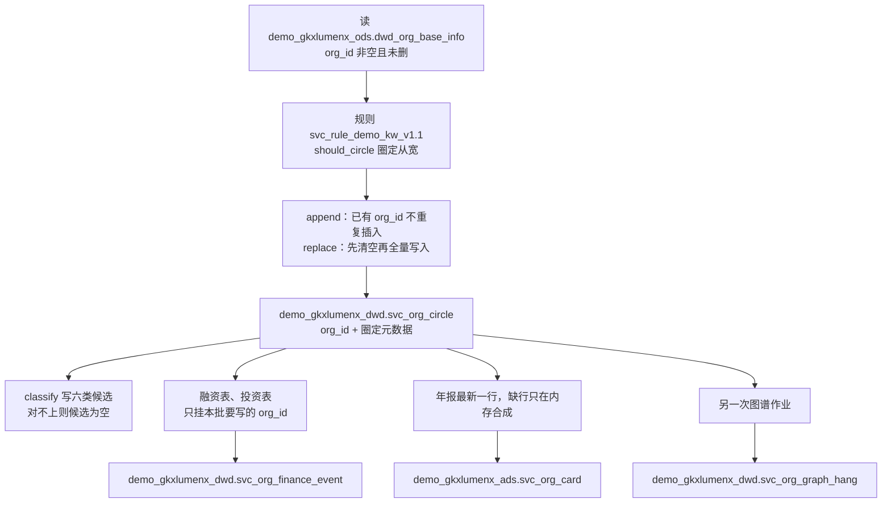

圈定池和投融资事件由同一次 `run-pipeline` / `python -m entan.svcseed` 写出。代码在 `demo-algo-ent-analysis/entan/svcseed.py`。写入前先执行仓内 `scripts/mysql/svc_ddl_demo_empty.sql`，连接目标仍须是 `demo_` 前缀。图谱挂表不在这次作业里。

**圈定池**

1. 读 `dwd_org_base_info`。条件是 `org_id` 非空；表上有 `is_deleted` 时只留 `0`。读出的列限于：`org_id`、`name_cn`、省市区、`industry`、行业四层名称和代码、`business_scope`、成立日期和成立年、`org_size`、`is_deleted`。列不存在就跳过该列。2026-11-02 这张源表 189116 行。
2. 用 `should_circle` 决定谁进池。规则号 `svc_rule_demo_kw_v1.1`，词表在同文件的 `CLASS_INDUSTRY`、`NAME_TIGHT`、`CIRCLE_WIDE_EXTRA`，说明见 `seeds/svc_rule_demo_kw_v1.md`。
   - 行业列或经营范围里有字：一级行业等于「科学研究和技术服务业」，或一级行业含「金融」，或行业/经营范围命中六类词，或命中放宽词「咨询」「广告」，这家就进池。
   - 行业和经营范围都空：只看 `name_cn` 是否命中收紧名称词。名称里单独出现「投资」或「广告」，不够进池。
   - `org_type` 不参与这一步。高校表、科研院所表也不参与；那两路只在后面给 ADS 的机构类型分布计数。
3. 命中不足 10 家时，代码改为整张源表进入，`pending_client_confirm` 仍是 1。现网圈定 43296 行，源表 189116 行，留下的结果不是整表回退。2026-10-20 当天的源表行数没有重放，当次命中率未闭合。
4. 默认 `append`：圈定池里已经有的 `org_id` 不再插一行。`replace` 先清空圈定、事件、卡面和四张基础指标表，再写入当次全部命中。批次号按运行当天生成，形如 `svc-fseed-YYYYMMDD`，现网是 `svc-fseed-20261020`。当次走的是 append 还是 replace，没有从库里的清空痕迹再判定，未闭合。
5. 圈定行只落这些列：`org_id`、`rule_version`、`hit_fields`（哪些源列碰到了词）、`service_type_candidate`、`pending_client_confirm`（固定 1）、`etl_batch_id`。
6. `service_type_candidate` 用 `classify`，比进池更紧，顺序是 FINANCE、IP、HR、MKT、CONSULT、INNOV。有行业文本时，一级行业含「金融」记 FINANCE，否则取第一组命中的词；对不上就空。一级行业是「科学研究和技术服务业」只说明可以进池，不能单凭这一句记成 INNOV。没有行业文本时，只按名称收紧词分类。卡面上的空类 9650 行，就是这次分类留下的空候选。

**投融资事件**

同一作业、同一批次，只挂本批要写入的 `org_id`。`replace` 用清空之后的全池；`append` 只用本批新插入圈定池的 `org_id`，已有事件行不在这一步删除。融资表须同时有 `org_id` 和 `funding_amount`，事件类型 `FINANCING`，日期取 `completion_date`。投资表须同时有 `org_id` 和 `investment_amount`，事件类型 `INVEST`。金额文本解析成元，解析不了就空。同一 `org_id` + `event_id` + `event_type` 在本批内只留一行。现网 15755 行。这张表不写 Nebula。

**年报不进 DWD**

`dwd_org_annual_financial_info` 只取每个 `org_id` 年份最新的一行，列限于 `org_id` / `year` / `employees_number` / `operating_revenue`。缺行时按 `org_id` 在内存里合成人数和营收，合成结果只进卡面三列。合成行数未数，未闭合。

**图谱挂表**

`svc_org_graph_hang` 由另一次 `POST /internal/svc/graph/{ner|intra|hang}` 写出，读的是已经落库的圈定池。空请求默认不落库。现网 43296 行，批次 `svcgraph_20261030_022647`。点、边和 peers 的差别见上文图谱段。

正式库 `gkxlumenx_dwd` 同名三表是 0 行。这次作业拒绝写入非 `demo_` 库。GDF 还没有对应作业。派单要走的源切换见 §1.2。

### 1.2 抽取源计划：GDF 派单读第三方 dwd 机构表

算法中台「维护管理 / 服务机构抽取」上的「开始抽取」仍调用 `POST /entan/internal/svc/run-pipeline`（追加）。它现在读 `demo_gkxlumenx_ods`，只写 `demo_gkxlumenx_*`。页面上的字段表是迁移对照，按钮没有改连接。

计划是把抽取读取从 `demo_gkxlumenx_ods.dwd_org_base_info` 换成第三方数据源里、表名以 `dwd` 开头的相关机构表。表名和字段先与现网读取列相同，只换库。代码和连接都还没改。第三方库的库名、账号，以及这四张表是否已在供应方库里，本叶没有再连库核对，未闭合。不新起库名，不新起表名。

`SYSINT-06-21-01-L03` 生成 GDF 派单包时走下面这条，不把 demo 库写成产线源，包里不出现对 `demo_gkxlumenx_*` 的操作。

`diagram_id=SVC-PROC-LOGIC-DWD-PLAN-20261102`

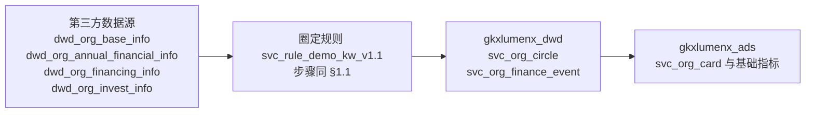

| 计划源表 | 计划抽取字段 | 落到哪里 |
|---|---|---|
| `dwd_org_base_info` | `org_id`、`is_deleted`、`name_cn`、`province`、`city`、`area`、`district`、`industry`、`industry_l1_name` 至 `industry_l4_name`、`industry_l1_code` 至 `industry_l4_code`、`business_scope`、`incorporation_date`、`incorporation_year`、`org_size` | 圈定池只留 `org_id` 与圈定元数据。名称、地区、行业、规模原文进 `gkxlumenx_ads.svc_org_card` |
| `dwd_org_annual_financial_info` | `org_id`、`year`、`employees_number`、`operating_revenue` | 每个机构取最新一年，人数和营收进卡面。缺行留空。demo 里按 `org_id` 在内存合成人数和营收的做法不带进 GDF，不回写供应方库 |
| `dwd_org_financing_info` | `org_id`、`id`、`funding_amount`、`completion_date`、`funding_round`、`investors_name` | `gkxlumenx_dwd.svc_org_finance_event`，类型 `FINANCING`。只挂本批圈定机构 |
| `dwd_org_invest_info` | `org_id`、`id`、`investment_amount`、`inv_org_id`、`inv_name`、`created_time` | 同表，类型 `INVEST` |

GDF 执行时只操作 `gkxlumenx_*`。圈定和投融资事件进 `gkxlumenx_dwd`，卡面和基础指标进 `gkxlumenx_ads`。图谱挂表、Nebula 不在这条抽取里。GDF 不直写图库。内容运营仍写 CMS 接口，不写 ADS。

## 2. 谁触发、写哪套库

| 加工 | 谁触发 | 读 | 写 | 2026-11-02 |
|---|---|---|---|---|
| 圈定、卡面、投融资事件、基础指标 | 人手 `POST /internal/svc/run-pipeline` 或 `python -m entan.svcseed`。无定时任务。顶栏切到正式库时接口拒绝 | `demo_gkxlumenx_ods` | `demo_gkxlumenx_dwd` / `demo_gkxlumenx_ads` | 已有上表行数 |
| 十模型 | 另一次 `POST /internal/svc/run-models` | demo 的 circle / card | `demo_gkxlumenx_ads` 模型表 | 抽样行数，不是全量 |
| 图谱挂表 | 另一次 `POST /internal/svc/graph/ner` 等。空请求默认不落库 | demo 的 circle / card | hang 写 `demo_gkxlumenx_dwd`；图库 space 代码固定 `demo_gkx_chain` | hang 有行；图库行数未闭合 |
| ES | 人手 `POST /internal/etl/svc-org` | 配置默认 `demo_gkxlumenx_*` | 索引别名 `gkx_svc_org`；水位在 `gkxlumenx_cfg` | 文档 43296；之后卡面更新未再记水位 |
| 内容运营 | CMS 写接口 | 视图跨库读 demo circle/card | `gkxlumenx_cms`，不写 ADS | overlay 7 行；视图 43299 行 |
| 专题查询 | 专题服务读 | 只读 `demo_gkxlumenx_ads` / `_dwd` | 不写 | 代码如此，不是产线 ADS |
| GDF | 无作业 | — | 执行时只应操作 `gkxlumenx_*`，且不直写图库 | 未跑通 |

## 3. 流程图

每张图单独看。箭头在「加工类型」里只表示分类，不表示一次作业做完所有事。数据先后看后面的加工逻辑图。这些图不放进 `01-data-flow.md` §1。

### 3.1 加工类型

`diagram_id=SVC-PROC-TYPE-20261102`

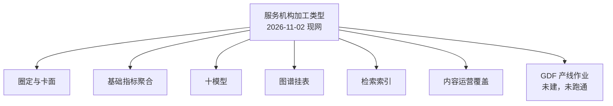

圈定和基础指标在同一次 `run-pipeline` 里。十模型、图谱、ES、内容运营都是另外的触发。GDF 还没有这条作业。

### 3.2 加工逻辑 · 圈定、卡面、事件

`diagram_id=SVC-PROC-LOGIC-SEED-20261102`

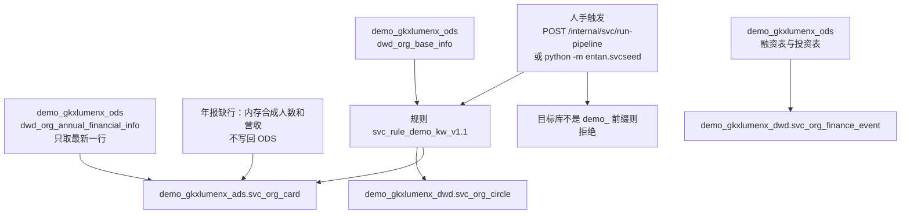

这一步不写 hang，不写 Nebula，不写十模型，不写 ES，不写 `gkxlumenx_dwd` / `gkxlumenx_ads`。

### 3.3 加工逻辑 · 十模型

`diagram_id=SVC-PROC-LOGIC-MODEL-20261102`

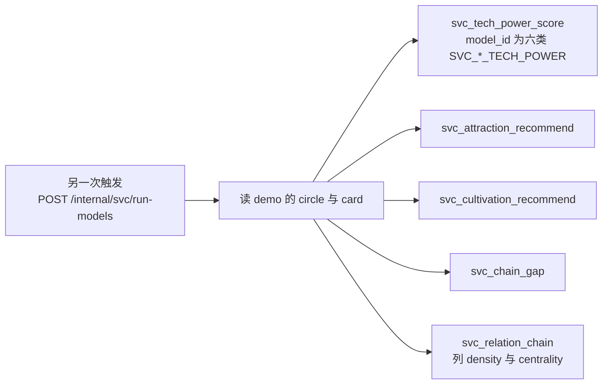

2026-11-02 行数是技术力 400、引入 50、培育 50、短板 6、关系链 51。人口是圈定 43296，模型不是全量重算。

### 3.4 加工逻辑 · 图谱三条边

`diagram_id=SVC-PROC-LOGIC-GRAPH-20261102`

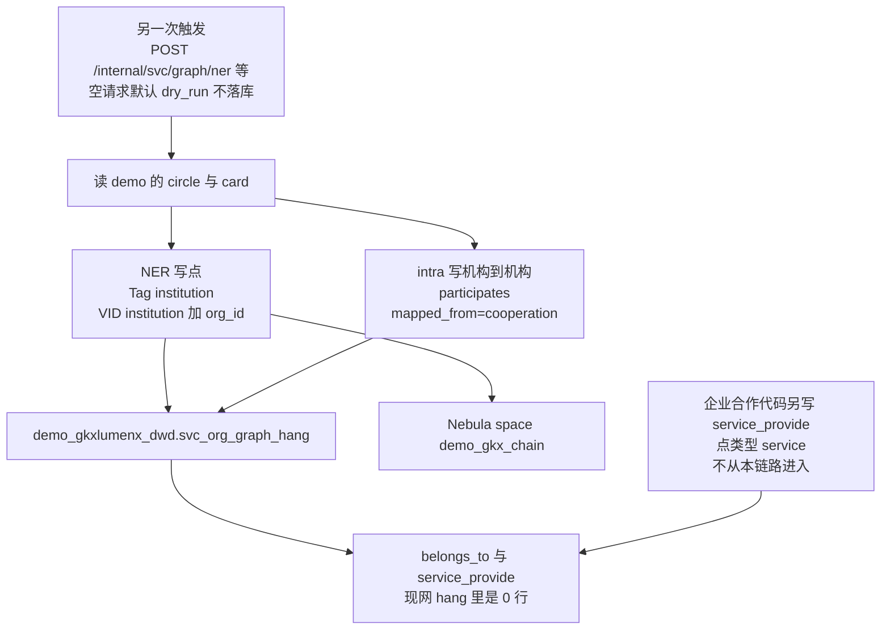

图库是否已经有点，2026-11-02 未闭合。Nebula 失败时来源记 `ads`。`belongs_to` 的目标前缀在代码里是 `segment:` / `chain:`，这次 hang 里是 0。`service_provide` 不是本链路的边。

### 3.5 加工逻辑 · 检索索引

`diagram_id=SVC-PROC-LOGIC-ES-20261102`

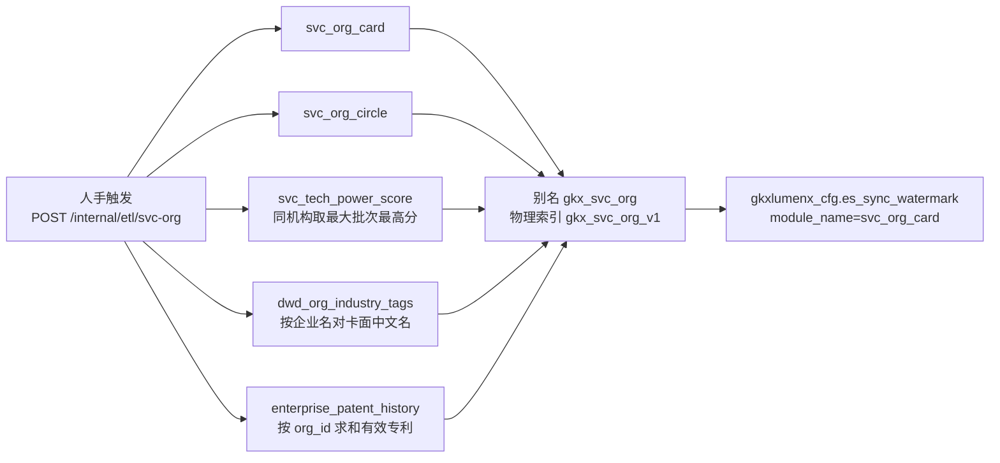

配置默认源库是 `demo_gkxlumenx_*`。正式卡面 0 行解释不了 43296 篇文档。当时进程的环境变量未见，未闭合。

### 3.6 加工逻辑 · 内容运营

`diagram_id=SVC-PROC-LOGIC-CMS-20261102`

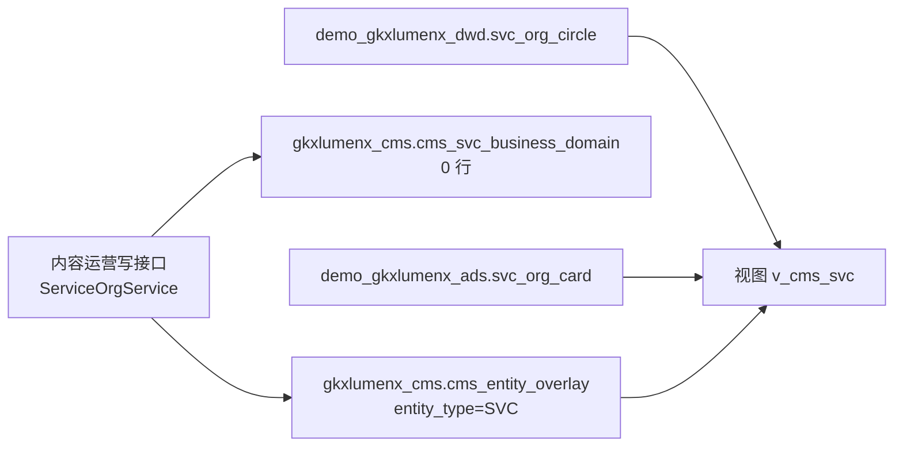

视图读 demo 圈定和卡面。写路径不写 ADS。

### 3.7 加工逻辑 · GDF 目标态

`diagram_id=SVC-PROC-LOGIC-GDF-20261102`

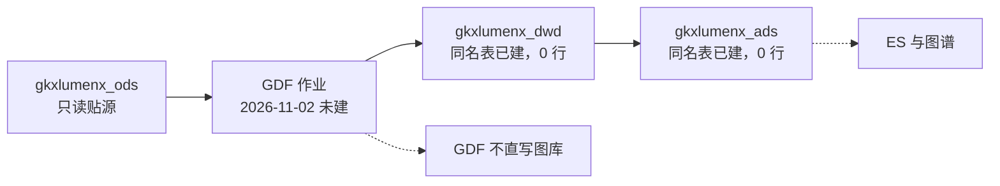

实线是 GDF 团队以后只操作 `gkxlumenx_*` 时的边界。虚线表示现在没有这条作业，ES 和图谱也不是 GDF 直接写的。demo 库上已经跑过的 Python，不能填进这张图当成产线已跑通。

### 3.8 库分隔

`diagram_id=SVC-PROC-LIB-SPLIT-20261102`

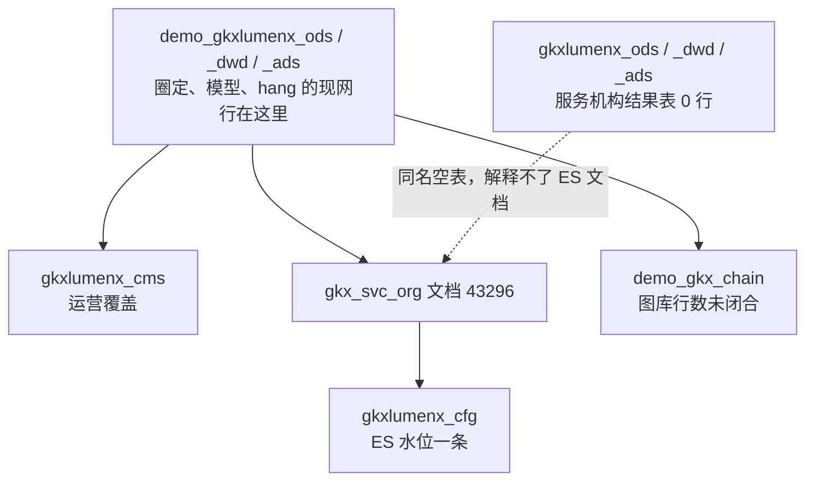

### 3.9 失败时停在哪

`diagram_id=SVC-PROC-FAIL-20261102`

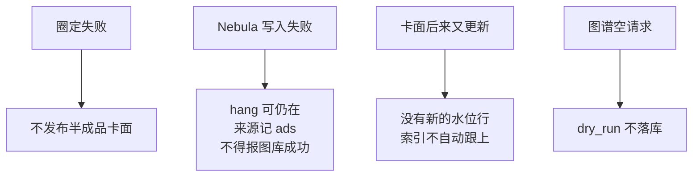

## 4. 指标计算

指标库产业服务域查询日 2026-11-02：返回 51 条，seed 与矩阵都在，D1 全部 `aligned`，D4 全部 `mock`。`M_SVC_BASE_101_1`（服务机构基础指标模型构建）是整体过程，不进入下面的指标对照。其余 50 条是叶指标。D4=`mock` 与 demo 表里已有行可以同时成立。本叶不把 demo 行数改写成 `live`。分 `metric_id` 的现网行数，除模型表的表级行数外，L01 没有逐个去数，下表「现网」列写的是代码落点和 L01 的表级事实。

### 4.1 指标计算落在哪次作业

`diagram_id=SVC-METRIC-CALC-20261102`

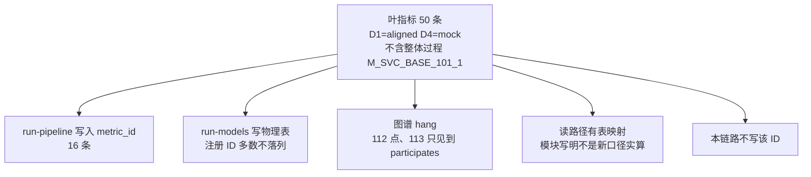

### 4.2 指标计算逻辑 · 种子批

`diagram_id=SVC-METRIC-SCENE-SEED-20261102`

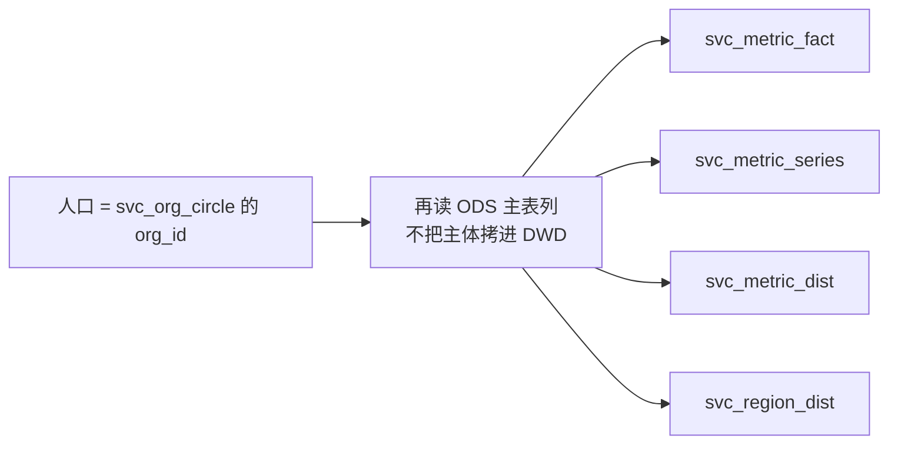

这次作业在代码里写入的 `metric_id` 是：`M_SVC_INDUSTRY_LAYOUT`、`M_SVC_ORG_CNT`（`geo_level=province`，不是国家）、`M_SVC_ORG_TOTAL`、`M_SVC_PT_GLOBAL_TOTAL`、`M_SVC_NEW_CNT`、`M_SVC_ORG_NEW_COUNT`、`M_SVC_PT_GLOBAL_TYPE_DIST`、`M_SVC_PT_REGION_ORG`、`M_SVC_PT_GLOBAL_SCALE_DIST`、`M_SVC_SZ_SCALE`、`M_SVC_PT_SZ_TOTAL`、`M_SVC_SZ_COMPARE_METRIC`、`M_SVC_PT_SZ_TYPE_DIST`、`M_SVC_SZ_DISTRICT`、`M_SVC_PT_SZ_REGION_ORG`、`M_SVC_INVEST_Y`。承载表在 2026-10-20 那次 pipeline 写入过。每个 ID 多少行，未闭合。

`M_SVC_ORG_CNT` 的中文名是「按国家计数」。ODS 无国家列，代码写的是省。这是口径降级，不是已经算出全球国家分布。

### 4.3 指标计算逻辑 · 十模型抽样

`diagram_id=SVC-METRIC-SCENE-MODEL-20261102`

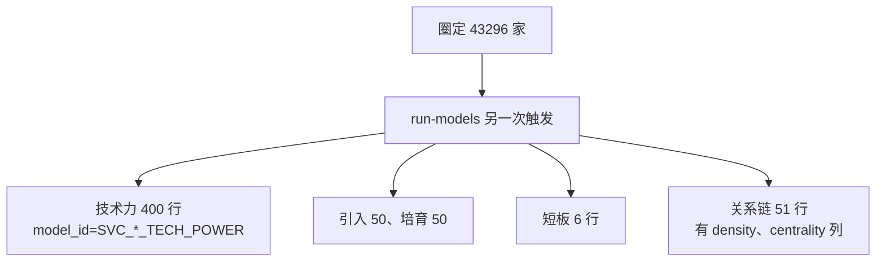

短板运行时仍是 Q-SVCCHAIN-03，不切到 Q061。关系链密度公式仍是切法 A 的 `2E/(N*(N-1))`。列表抽样不是全量，和公式冻结「列表 N=50、hang 全量」一致的是推荐表 50 行；技术力 400、关系链 51、短板 6，都不是 43296。

### 4.4 指标计算逻辑 · 正式库空表

`diagram_id=SVC-METRIC-SCENE-PROD-EMPTY-20261102`


GDF 尚未向 `gkxlumenx_*` 灌这些表。demo 有数不改变 D4。

### 4.5 指标计算逻辑 · 读路径不能当成已算

`diagram_id=SVC-METRIC-SCENE-READMAP-20261102`

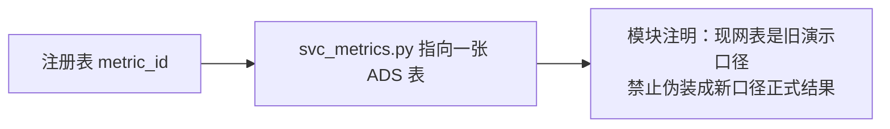

`M_SVC_DEEP_174_1` 至 `M_SVC_DEEP_179_1` 的读路径指向 `svc_metric_dist`。模型作业实际写入的是 `svc_tech_power_score`，列 `model_id` 为 `SVC_FINANCE_TECH_POWER` 等六类，不是这六个注册 ID。两套名字对不齐。

## 5. 覆盖对照

「覆盖」只表示：种子作业会写这个 `metric_id`，或模型/图谱作业写出了对应物理结果。不表示 D4 已是 live，也不表示正式库已有数。下表 50 行，已去掉整体过程 `M_SVC_BASE_101_1`。

| metric_id | 中文名 | 类型 | 对照 |
|---|---|---|---|
| M_SVC_INDUSTRY_LAYOUT | 全球服务机构产业布局 | STAT | 种子写入该 ID，落 `svc_metric_dist`。分 ID 行数未闭合 |
| M_SVC_ORG_CNT | 全球服务机构分布（按国家计数） | STAT | 种子写入该 ID，`geo_level=province`。不是国家计数 |
| M_SVC_INVEST_Y | 服务机构投融资动态 | STAT | 种子写入该 ID，落 `svc_metric_series`。事件 hang 15755 行。分 ID 行数未闭合 |
| M_SVC_NEW_CNT | 新增服务机构动态 | STAT | 种子写入该 ID |
| M_SVC_ORG_NEW_COUNT | 年度新增服务机构数 | STAT | 种子写入该 ID，与上条同一套按年计数 |
| M_SVC_SZ_SCALE | 深圳服务机构规模 | STAT | 种子写入该 ID，落 `svc_metric_fact` |
| M_SVC_SZ_DISTRICT | 深圳服务机构分布 | STAT | 种子写入该 ID，`geo_level=sz_district` |
| M_SVC_ORG_TOTAL | 入库服务机构总数 | STAT | 种子写入该 ID |
| M_SVC_PT_GLOBAL_TOTAL | 全球服务机构总数 | STAT | 种子写入该 ID |
| M_SVC_PT_GLOBAL_TYPE_DIST | 全球服务机构类型分布 | STAT | 种子写入该 ID |
| M_SVC_PT_GLOBAL_SCALE_DIST | 全球服务机构规模分布 | STAT | 种子写入该 ID |
| M_SVC_PT_REGION_ORG | 区域服务机构数 | STAT | 种子写入该 ID，省粒度 |
| M_SVC_PT_SZ_TOTAL | 深圳产业服务机构数量 | STAT | 种子写入该 ID |
| M_SVC_PT_SZ_TYPE_DIST | 深圳服务机构类型分布 | STAT | 种子写入该 ID |
| M_SVC_PT_SZ_REGION_ORG | 深圳机构区域分布 | STAT | 种子写入该 ID |
| M_SVC_SZ_COMPARE_METRIC | 城市对比指标值 | STAT | 种子写入该 ID，切片 `shenzhen_org_count` |
| M_SVC_ORG_TECH_SCORE | 服务机构影响力 | MODEL | 技术力表 400 行。注册 ID 未作为 `metric_id` 落列。读路径映射到该表，并注明不是新口径实算 |
| M_SVC_CHAIN_BOTTLENECK | 瓶颈堵点判定 | MODEL | 短板表 6 行。注册 ID 未落列 |
| M_SVC_DEEP_172_1 | 服务链短板分析模型 | MODEL | 同上，物理表 `svc_chain_gap` |
| M_SVC_DEEP_173_1 | 服务关系链模型 | MODEL | 关系链表 51 行。注册 ID 未落列 |
| M_SVC_DEEP_174_1 | 金融服务机构技术力评价模型 | MODEL | 读路径指向 `svc_metric_dist`。模型行在 `svc_tech_power_score`，`model_id=SVC_FINANCE_TECH_POWER`。未按 ID 对上 |
| M_SVC_DEEP_175_1 | 知识产权服务机构技术力评价模型 | MODEL | 同上，`model_id=SVC_IP_TECH_POWER` |
| M_SVC_DEEP_176_1 | 人力资源服务机构技术力评价模型 | MODEL | 同上，`model_id=SVC_HR_TECH_POWER` |
| M_SVC_DEEP_177_1 | 市场营销服务机构技术力评价模型 | MODEL | 同上，`model_id=SVC_MKT_TECH_POWER` |
| M_SVC_DEEP_178_1 | 咨询服务机构技术力评价模型 | MODEL | 同上，`model_id=SVC_CONSULT_TECH_POWER` |
| M_SVC_DEEP_179_1 | 科技创新服务机构技术力评价模型 | MODEL | 同上，`model_id=SVC_INNOV_TECH_POWER` |
| M_SVC_DEEP_180_1 | 服务机构引入推荐模型 | MODEL | 引入表 50 行。注册 ID 未落列 |
| M_SVC_DEEP_181_1 | 服务机构培育推荐模型 | MODEL | 培育表 50 行。注册 ID 未落列 |
| M_SVC_REC_ATTRACT_SCORE | 招引综合评分 | MODEL | 引入表有行。注册 ID 未落列 |
| M_SVC_REC_CULTIVATE_SCORE | 培育综合评分 | MODEL | 培育表有行。注册 ID 未落列 |
| M_SVC_GRAPH_112_1 | 服务机构实体识别构建 | GRAPH | hang 点 43296。图库行数未闭合。不是指标事实表里的一行 |
| M_SVC_GRAPH_113_1 | 服务机构实体关系抽取 | GRAPH | hang 里只见到机构到机构的 `participates` 33861 行。`belongs_to`、`service_provide` 为 0。七类跨域关系未抽出 |
| M_SVC_GRAPH_DENSITY | 服务网络密度 | GRAPH | 关系链表有 `density` 列，51 行。注册 ID 未落列 |
| M_SVC_RELATION_DENSITY | 服务关系链密度 | STAT | 同上列，不是另一个作业 |
| M_SVC_GRAPH_CENTRALITY | 节点度中心性 | GRAPH | 关系链表有 `centrality` 列。注册 ID 未落列 |
| M_SVC_ORG_COVERAGE_DEPTH | 服务机构产业领域覆盖评分 | MODEL | 读路径指向 `svc_metric_dist`。种子作业不写该 ID |
| M_SVC_ORG_MARKET_HEAT | 市场热度评级 | MODEL | 读路径指向 `svc_metric_series`。种子作业不写该 ID |
| M_SVC_GRAPH_INFLUENCE | 生态影响力评分 | MODEL | 读路径指向 `svc_metric_dist`。种子作业不写该 ID |
| M_SVC_SZ_TIER | 深圳梯队位置 | MODEL | 读路径指向 `svc_metric_dist`。种子作业不写该 ID |
| M_SVC_CHAIN_SEGMENT_AVG_DEPTH | 环节平均服务深度 | STAT | 本链路不写该 ID |
| M_SVC_CHAIN_SEGMENT_ORG_COUNT | 环节服务机构数 | STAT | 本链路不写该 ID |
| M_SVC_ORG_COVERAGE_BREADTH | 服务广度 | STAT | 本链路不写该 ID |
| M_SVC_ORG_SELECTED_COUNT | 当前分析机构数 | STAT | 本链路不写该 ID |
| M_SVC_PT_CHAIN_NODE_ORG | 产业链节点服务机构数 | STAT | 本链路不写该 ID。2026-10-24 产业检索里链码关联为 0，见 ETL 索引所引实查，不是本叶新测 |
| M_SVC_PT_KEYORG_SCALE | 重点机构规模档案值 | STAT | 本链路不写该 ID |
| M_SVC_PT_SZ_FIELD_DIST | 深圳机构产业领域分布 | STAT | 本链路不写该 ID |
| M_SVC_REC_CANDIDATE_CNT | 候选机构数 | STAT | 本链路不写该 ID。引入/培育表各 50 行，不能倒推成这个 ID 已落库 |
| M_SVC_RELATION_RISK | 服务关系风险 | STAT | 本链路不写该 ID |
| M_SVC_SZ_CHAIN_COMPLETENESS | 服务链完整度 | STAT | 本链路不写该 ID |
| M_SVC_TYPE_DIST_QUERY | 查询结果·服务类型分布 | STAT | 本链路不写该 ID。卡面六类候选是圈定列，不是这个查询指标 |

域外检索词「服务机构」还命中 `M_CHAIN_REG_SERVICE_ORG`（产业链，区域服务机构）。本链路不写它。同一次检索还命中若干口径文本里带相近词的域外 ID（`M_CHAIN_DEEP_126_1`、`M_CHAIN_GRAPH_103_1`、`M_INNOV_FACTOR_COUNT`、`M_INNOV_POT_OUTPUT`、`M_SYNTH_183_1`、`M_SYNTH_187_1`、`M_TECH_GRAPH_105_1`），不列入服务机构加工覆盖。

存储设计 `ads.md` 里的 A1–A6 六条，都在种子写入清单里。设计里的十模型 ID（`SVC_SERVICE_CHAIN_GAP` 等）是模型表的 `model_id` 或设计名，和注册表 `M_SVC_DEEP_*` 不是同一个字符串。

## 6. 和已会签流图不一致的地方

`01-data-flow.md` 的 `signoff_status` 保持 `approved`。§1 工厂拓扑图不改。下面这些是 2026-11-02 现网和该正文的差别，正文里的补记标了待会签：

| 已会签正文 | 现网 |
|---|---|
| §1.1 / §7 把圈定、卡面、模型、上图画成同一条灌数时序 | 三次触发：pipeline、run-models、graph。pipeline 不写 hang |
| §1 工厂图有 GDF 方框 | 这条加工没有 GDF 作业。demo 是 Python 直接写 |
| 只写 `demo_gkxlumenx_*`，禁正式库 | 代码仍拒绝写正式 DWD/ADS。正式库同名表已经建着，且是 0 行。谁建的，未闭合 |
| 阶段 F 不碰 lumen 四仓 | 设计禁令仍在。现网 `lumen-topic-py` 只读 demo，`lumen-etl-es-py` 已同步过 ES，`lumen-svc-platform` 写 CMS |
| ES 在工厂图里有框，细表写阶段 F 不建索引 | 别名 `gkx_svc_org` 已有 43296 篇。正式 ADS 解释不了 |
| 图 hang 画成已经进入 Nebula | hang 有行。图库行数未闭合 |

## 7. 未闭合

- 图库 `demo_gkx_chain` 里 Tag `institution` 的点数、边数。
- ES 那次同步的进程环境变量。不能由默认配置单独证明读的是 demo；正式卡面 0 行仍然解释不了文档数。
- 正式库空表的建表脚本。仓内 DDL 只写 demo 库名。
- 种子指标每个 `metric_id` 的行数。年报内存合成写进卡面的行数。技术力 400 行按六类 `model_id` 的分布。
- `gkxlumenx_ods.dwd_org_base_info` 与 demo 同为 189116 行，未逐行比对。
- `belongs_to`、`service_provide` 在图库里是否另有边。MySQL hang 与 demo ADS `graph_edge` 里是 0。

## 8. 交给下游，本叶不做

`SYSINT-06-21-01-L03` 才能写 GDF 派单包。父任务 `SYSINT-06-21-L01` 使用本链路，不在本叶落地作业。不代替 `SYSINT-06-15-L01`。不改企业 v4、产业链 v2、政策 v2，不改 06-19 / 06-20 派单包。
