# 管道 · → Nebula（服务机构投影一张 G）

```yaml
---
doc_id: SVC-ETL-TO-NEBULA
element: SVC
role: etl
status: draft
version: "2026-09-01"
updated: 2026-09-01
task_id: DEMO-SVC-GRAPH-TRIPLE-UI-L01
p1_task_id: DEMO-SVC-GRAPH-TRIPLE-UI-L01
asbuilt_from: "entan/svcgraph.py + entan/svcseed.py + entan/svcmodels.py + api/svc_routes.py"
amendment: "步1/4 新建：§1–§9 现网 as-built；§10–§16 与 POLICY 同构（112/113 需规 + 边清单 + LLM + 过程图）；§17–§20 每关系 op_id I/O、灌数零图谱清单、SVC-GRAPH-TRIPLE。"
---
```

> **§1–§9 是现网 as-built**（精读 `svcseed` / `svcgraph` / `svcmodels` / `svc_routes` / 50100 `BasicPage`+`GraphView`，**不改代码**）。**§10–§16 是 112/113 详细设计**。**§17–§20 是 DEMO-SVC-GRAPH-TRIPLE-UI-L01 步1 契约**（每关系独立 `op_id`、灌数剥离清单、目标态过程图）。
> 拓扑真源 [`../01-data-flow.md`](../01-data-flow.md)（**approved · 2026-08-19**，本叶**不改**会签边）· 细表 [`../stores/nebula/graph-svc.md`](../stores/nebula/graph-svc.md)（draft）。
> 本叶只写文档：**不改 demo-algo-\* / demo-ui-\* / lumen-ui-\* 代码、不 APPLY DDL、不灌数**。步2 实现必须对照 §17 / §18，禁止继续用一个 `run_graph()` / `run_models()` 包打天下当对外契约。
> 与政策叶同构：[`../../../POLICY/etl/pipeline-to-nebula.md`](../../../POLICY/etl/pipeline-to-nebula.md) §10–§20。

## 1. 意图

把圈定池里的服务机构**投影**进产业链一张 G。`chain` / `segment` / `enterprise` / `institution` / `policy` 复用既有顶点，服务侧**不另建 space**、不复制工商主体。

## 2. 入口与源

| 项 | 值 |
|---|---|
| 仓 / 模块 | `demo-algo-ent-analysis` · `entan/svcgraph.py` · `entan/svcseed.py` · `entan/svcmodels.py` |
| 灌数入口 | `run_seed(mode)`；`POST /entan/internal/svc/run-pipeline`；CLI `python -m entan.svcseed` |
| 图写入入口（现网，**不是灌数**） | `run_graph()`；`POST /entan/internal/svc/run-graph`；CLI `python -m entan.svcgraph` |
| 十模型入口（现网会顺带写边） | `run_models()`；`POST /entan/internal/svc/run-models`；CLI `python -m entan.svcmodels` |
| 读路径 | `fetch_graph()` → `GET /entan/v1/svc/graph`（现网读 **MySQL hang**，不读 Nebula） |
| 源表 | DWD `svc_org_circle` · ADS `svc_org_card` ·（边代理）DWD `svc_org_finance_event` |
| hang 表 | DWD `svc_org_graph_hang`（`space_name` 写死 `demo_gkx_chain`） |
| 目标 | Nebula space **`demo_gkx_chain`** · Tag **`institution`** |
| Demo 库 | `demo_gkxlumenx_ods` / `_dwd` / `_ads`；禁正式 `gkxlumenx_*` |

圈定规则 `svc_rule_demo_kw_v1.1`（规则 A）。Q-SVC-010 一律 `pending_client_confirm=1`。主体权威在 ENT / ODS，SVC **只 hang `org_id`**。

2026-10-24 demo 实查：按产业、产业节点能命中多少服务机构，见 [产业检索服务机构条数](../../../../../qa/test-cases/SDWJSF-KJZTFWSFK/svc-产业服务分析/产业检索服务机构条数-20261024.md)。政策、企业同口径见 [产业检索政策条数](../../../../../qa/test-cases/SDWJSF-KJZTFWSFK/policy-政策分析/产业检索政策条数-20261024.md)、[产业检索企业条数](../../../../../qa/test-cases/SDWJSF-KJZTFWSFK/enterprise-企业分析/产业检索企业条数-20261024.md)。

## 3. Space 与 VID 约束（代码强制）

`entan/svcgraph.py` 把一张 G 写死为常量并在 `assert_svc_space()` 校验：

| 项 | 值 | 违反后果 |
|---|---|---|
| space | 仅 `demo_gkx_chain` | `RuntimeError: refusing nebula space …` |
| 拒绝集合 | `gkx_service` / `gkx_chain` / `entan` / `demo_entan` / `gkx_policy` | 同上 |
| vid_length | 必须 ≤ **80** | `node_id_of()` 返回 `None`，计数 `skipped_vid` |
| 现网 VID | **`institution:{org_id}`** | as-built（`VID_PREFIX="institution:"`） |
| 目标 VID | **`inst:{org_id}`** | 与政策 C 档 `FETCH inst:` 对齐（`OPEN-SVC-GRAPH-02`） |
| 正式图库 | `gkx_chain` | 本管线零写入 |
| 废作 | `gkx_service` | 代码中无 `CREATE SPACE` / `DROP SPACE` |

现网 **不** `CREATE TAG/EDGE`：`_nebula_probe()` 只 `USE` + `SHOW TAGS`，缺 `institution` 则 `skipped`，不补 schema。

## 4. Schema 增量（现网 = 不增量）

政策叶 `ensure_schema()` 会 `CREATE TAG/EDGE IF NOT EXISTS`。服务现网**没有**对等函数：

| 层 | 现网 | 步2 |
|---|---|---|
| MySQL | `svcseed.ensure_schema()` 跑 `scripts/mysql/svc_ddl_demo_empty.sql`（含 `svc_org_graph_hang` 空表） | **灌数可留** MySQL `CREATE TABLE IF NOT EXISTS`；**禁止**顺带 nGQL |
| Nebula Tag | 复用底图 `institution`；属性 as-built：`name` / `institution_type` / `node_type` / `weight` / `props` / `role`（按 `DESCRIBE` 有则写） | A 档内部可 `INSERT VERTEX`；**禁止**从 `run-pipeline` 进入；**禁止** `CREATE SPACE` |
| Nebula Edge | 十模型尽力 `INSERT EDGE participates(chain_role, participation_depth, chain_score, props)`；缺边类型则 skipped | B/C 按 §17 只写白名单边；缺边 `skipped.reason=not_in_wave`，不私自 `CREATE EDGE`（Q062） |

> ⚠️ **不发明第二套边真源**（[`graph-svc.md`](../stores/nebula/graph-svc.md)）。需规中文关系名 ≠ 新 EDGE。Q062 未拍板前，本域新边类型一律 `not_in_wave`，禁止为「干净」另起 `serve` / `coop` / `invest`。

## 5. 挂接解析（对不齐则不上图）

现网 A 档等价物（`run_graph`）**只建本域点**，不 `FETCH` 他域。步2 C 档必须 `FETCH PROP ON *` 证明终点已在一张 G，解析不到就计数跳过，**不按名称猜测**：

| 源 / 终点 | 取值字段 | 目标前缀（目标态） | 现网 |
|---|---|---|---|
| 服务机构本体 | `org_id` | `inst:`（目标）/ as-built `institution:` | 只写 as-built 前缀 |
| 产业 | 卡面 `industry` / 稳定 `industry_link_code` | `chain:` / `segment:` | **未挂** |
| 企业 | `org_id` → `enterprise_code` → `entity_id` | `ent:` | **未挂** |
| 政府 / 科研机构 | 对端 `org_id` / `institution_id` | `inst:` | **未挂** |
| 政策 | `policy_id` | `pol:` | **未挂**（政策叶可已有 `apply_to` pol→inst） |
| 技术 / 人才 | — | — | 无 Tag（`OPEN-SVC-GRAPH-01`） |

边两端任一顶点未解析则整条丢弃。`relation_type` / `EDGE` 不在白名单 → `not_in_wave`。

## 6. 写入与幂等（as-built）

| 动作 | 现网 | 目标态 |
|---|---|---|
| hang 表 | `run_graph` **DELETE** `svc_org_graph_hang` WHERE `space_name=demo_gkx_chain` 再全量 INSERT | 按 `op_id`+`calc_batch_id`+主键覆盖；**禁止**灌数 DELETE 图 hang |
| 顶点 | `INSERT VERTEX IF NOT EXISTS institution …`，`chunk=80` | A 档写入；同 VID 重跑覆盖 |
| 边 | `run_models` → `_upsert_participates` | 只 B/C；禁止十模型顺带 nGQL |
| 删除底图 | 不做 `DROP` / 不清 `chain`/`ent`/`pol` | 保持 |

同 VID 可重复执行。本管线不做删除底图。

## 7. fail-soft 与开关

Nebula `USE` 失败或缺 Tag/Edge → `status=skipped`，**不报假成功**。现网读图走 MySQL hang：`source` 不得标 `nebula`，除非真实 nGQL 读成功（步2 D 档若改读 Nebula 须诚实）。

| 环境 / 门闩 | 作用 |
|---|---|
| `is_live("svc")` | 顶栏正式库：灌数 / 投影 / 十模型一律拒绝写入 |
| `assert_demo_mysql_targets()` | 只写 `demo_*` |
| `assert_svc_space()` | 只认 `demo_gkx_chain` |

`POLAN_*` / `ENTAN_NEBULA_SPACE=demo_entan` 与本域隔离，禁止共用错 space。

## 8. 现网基线（代码事实，非本叶实测灌数）

本叶**未连库、未投影**。下列是 as-built 行为，不是验收数字。

| 项 | 现网 |
|---|---|
| 灌数 `run_seed` | 写 circle / card / finance_event / A1–A6；**不写** `svc_org_graph_hang`；**不写** Nebula（模块头写死「不写十模型 / Nebula」） |
| 投影 `run_graph` | 按 circle 重建 hang + UPSERT 顶点；`edges=0`；会清 `ext.peers` |
| 十模型 `run_models` | 同城同环节两两连 `cooperation`→`participates`；投融资 `inv_org_id`→`investment`→`participates`；UPDATE hang.peers；尽力 INSERT EDGE |
| 读图 | `GET /v1/svc/graph` 读 hang+card，边来 `ext.peers` |
| 图例 | **只有服务机构**（`GraphView` `CATS` 仅 `service`） |
| Q062 | 待核验；不新建 `serve`/`coop`/`invest` EDGE |

### 8.1 2026-11-02 连库结果（不改上表的代码事实）

上表是代码行为。下面是 L01 在 MySQL 上看到的行，图库未连上：

| 项 | 实测 |
|---|---|
| hang | `demo_gkxlumenx_dwd.svc_org_graph_hang` 43296 行，批次 `svcgraph_20261030_022647`，space `demo_gkx_chain`，Tag `institution` |
| peers | 33861 行，`participates`，对端 `institution:`，`mapped_from=cooperation`。批次前缀 `svcgraph_` 是 `svcgraph_ops` 共用的。NER 函数本身 `written_edges` 为空；peers 与 intra 的合作对映射一致，不能单独写成 NER 写出 |
| `belongs_to` / `service_provide` | hang.ext 里是 0。`service_provide` 不在本域允许边里 |
| Nebula | 本机连 graphd 超时。行数未闭合。失败时来源可记 `ads` |
| 正式库 | `gkxlumenx_dwd.svc_org_graph_hang` 0 行 |

## 9. 禁止

Neo4j；Java 直连 nGQL；`CREATE SPACE gkx_service`；写 `gkx_chain`；`DROP SPACE demo_gkx_chain`；平行 `svc_org_base`；复制 `dwd_org_base_info` 全列；用名称相似度伪造 `ent:` / `chain:` / `pol:`；灌数路径调用 `run_graph` / `_upsert_nebula` / `_upsert_participates` / 写 `svc_org_graph_hang`；lumen Feign 打 `demo-*`（D12）。

---

## 10. 需求挂接（112 识别 / 113 抽取）

两叶都在算法库 SRS **分册 05 · 产业服务 · 图谱**（`bid-reference/srs/05-深度挖掘算法/科技专题服务算法库/产业服务/图谱.md`）。招标路径 `…/产业全要素图谱/服务机构实体识别构建` / `服务机构实体关系抽取`。excel 行 21–22。

| 项 | 服务机构实体识别构建 | 服务机构实体关系抽取 |
|---|---|---|
| metric_id | **`M_SVC_GRAPH_112_1`**（设计占位；本会话 metric-registry MCP 未挂，步2 不得因未注册改边名） | **`M_SVC_GRAPH_113_1`** |
| 中文名 | 服务机构实体识别构建 | 服务机构实体关系抽取 |
| SRS | 05 seq **112** | 05 seq **113** |
| algorithm_type | GRAPH | GRAPH |
| 现网算子 | 圈定+卡面 = `svcseed`；上图点 = `svcgraph.run_graph` | 边代理 = `svcmodels` 同城同环节 / 投融资 |
| ADS / DWD | `svc_org_card` + `svc_org_circle` | `svc_org_graph_hang.ext.peers` +（目标）Nebula 边 |
| 页消费 | 50100 `/industry-service/graph`；专题服务中心 | 同上；关系链模型读 ADS |

> 页面 `M_SVC_GRAPH_NODE_WEIGHT` 是 hang 占位权重（现网固定 1），**不是** 112/113。

### 10.1 需规原文在要求什么

**112**：对接多源服务机构库；预处理去重/补全/纠错；规则（正则/关键词）+ 词典（分词/词性 NER）提取**名称、类型、人数、规模、地理位置**；维护增删改；按名称对接库抽属性后定期同步。

**113**：对接产业 / 技术 / 企业 / 人才 / 政策 / 科研机构等专题库；抽取服务类型、内容、范围、合作伙伴、客户；关系类型点名 **服务机构-产业、服务机构-技术、服务机构-企业** 等，并覆盖**政府机构、科研机构、人才、政策**（厚包 §3 / §7.0 = **跨域七类**）；建模后入关系库并同步图谱；定期替换/增补/删除。

现网**没有**七类专题库稳定 ID 接口。Demo 用规则 A 圈定 + 卡面投影 + 十模型**同城同环节造边**——这是代理基线，不是需规终态。

---

## 11. 总过程（先 ADS/圈定，再投影）

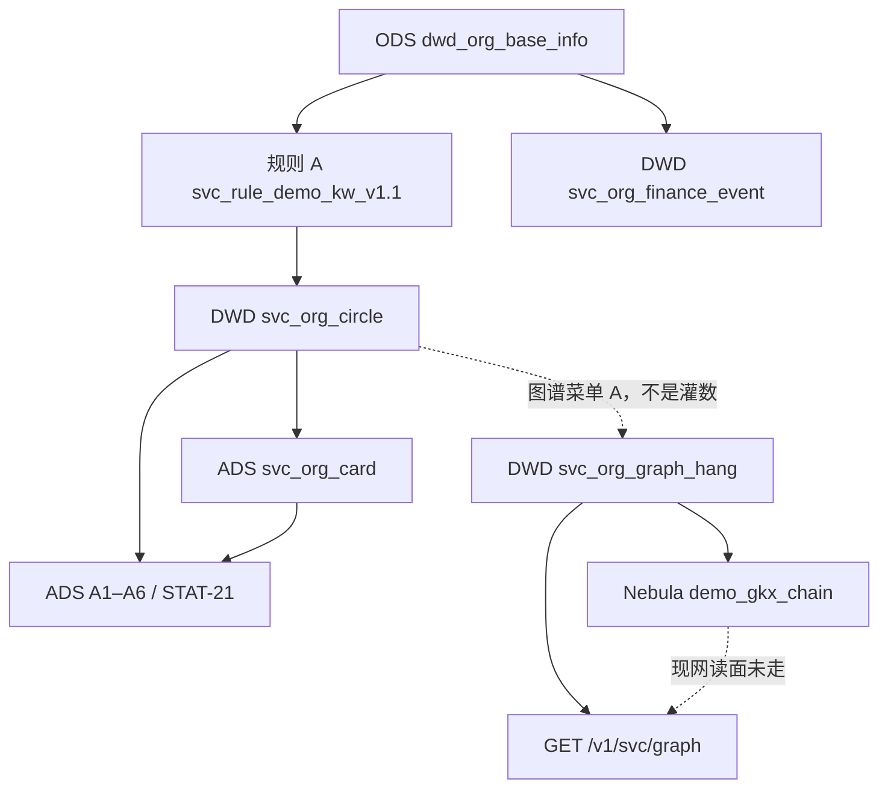

| 层 | 做什么 | 失败 |
|---|---|---|
| 112 圈定 / 属性 | 规则命中写 circle；名称/省市/人数/规模进 card | 命中过少诚实空或 fallback 全 ODS（仍待核验） |
| 112 上图点 | A 档写 hang + `INSERT VERTEX institution` | VID>80 / 缺 Tag → skipped |
| 113 边 | B/C 写 ADS 镜像 + `INSERT EDGE` | 无稳定 ID / 本波不上图 → skipped 四码 |
| 灌数 | 只 ODS→circle/card/finance/指标 | **零** hang 表、**零** nGQL |

Java 不抽实体、不写 nGQL。LLM 若上，只许在 Python，经 `/internal/*` 被 Java 调用。

> **目标态（§17–§18）**：上图仍「先圈定/卡面，再投影」，但 `run_graph` / `_upsert_participates` **不再**挂在灌数或「跑十模型」上；只由图谱菜单 A/B/C 对应 `op_id` 触发。上图过程图以 §19 `SVC-GRAPH-TRIPLE` 为准。

---

## 12. 支持的边关系

需规 113 点名跨域：**产业 / 技术 / 企业 / 政府 / 人才 / 政策 / 科研机构**（七类）。厚包 §7.0 另加本域 **服务-服务** 为 B 档。

方向一律 **服务机构 → 对象**，不建反向边（政策叶已有 `apply_to` pol→inst 时，本域 C **不**再造 inst→pol 反向，见 §17.3）。

| 边（Nebula / 目标） | 中文 | 档 | 终点 | 现网 as-built | 上图条件 |
|---|---|---|---|---|---|
| `participates` | 本域合作/参与（props.mapped_from） | **B** | 另一服务机构 `inst:` / as-built `institution:` | 十模型：同 `stage`+`city` 两两 `cooperation`；投融资对端在圈定池内则 `investment` | 两端都是本批服务 VID |
| `belongs_to` | 服务机构-产业 | **C** | `chain:` / `segment:` | **未抽**（`ALLOWED_EDGES` 有名未写） | `FETCH` 到产业 VID |
| `participates` | 服务机构-企业 | **C** | `ent:` | **未抽** | `FETCH` `ent:` |
| `participates` | 服务机构-政府 | **C** | `inst:`（政府角色） | **未抽** | `FETCH` 既有政府点 |
| `participates` | 服务机构-科研机构 | **C** | `inst:`（科研角色） | **未抽** | `FETCH` 既有科研点 |
| `participates` | 服务机构-政策（正向） | **C** | `pol:` | **未抽** | 仅当要本域显式正向且 `FETCH pol:`；默认消费政策叶已有 `apply_to`，见 §17.3 |
| — | 服务机构-技术 | **C** | — | 无 Tag | **本波不上图** `OPEN-SVC-GRAPH-01` |
| — | 服务机构-人才 | **C** | — | 无 Tag；`EDGE_MAP` 有 `talent_flow` 但 **未生成 pair** | **本波不上图** `OPEN-SVC-GRAPH-01` |

现网 `ALLOWED_EDGES` = `{belongs_to, participates, supplies, depends_on}`。`supplies` / `depends_on` **零写入**，需规未点名，**不删行也不本波启用**（`not_in_wave`）。`competition` 在 `EDGE_MAP` 但未生成 pair。

边权现网：顶点 `weight=1.0`；`participates` 的 `participation_depth=1.0`、`chain_score=0.0`。Q062 未拍，本设计不改 D1。

---

## 13. 112 实体：每一类怎么入库

### 13.0 总图

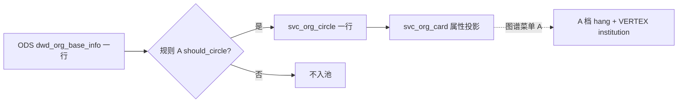

属性（类型/人数/规模/地理位置）进 **card**，不建第二套主体表。图点只有：服务机构本体。跨域主体**不在 A 档建点**。

### 13.1 服务机构本体 `institution`

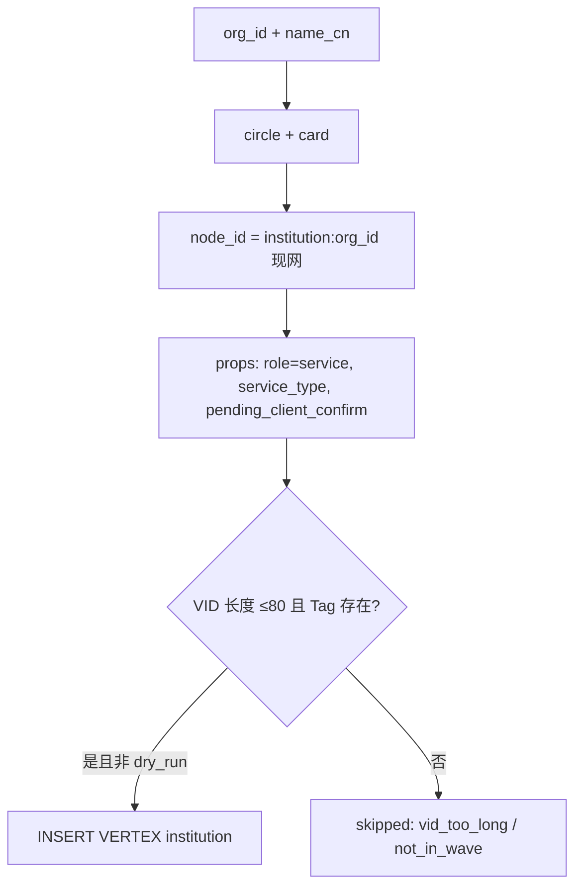

### 13.2 属性实体（112 点名，只 NER/投影，不上图）

| 属性 | 源 | 现网 | LLM？ |
|---|---|---|---|
| 名称 | ODS `name_cn` | card `name_cn` | 否 |
| 类型 | 规则 A 六类 / 需规「类型」 | `service_type_candidate`（待核验） | **升级**：名称与行业冲突时裁定 |
| 人数 | 年报 `employees_number`；缺则内存合成（不写 ODS） | card 同名列 | 否（合成已标 Demo） |
| 规模 | ODS `org_size`；**禁止当分档** | card `org_size` | 否 |
| 地理位置 | `province` / `city` / `area` | card 同名列 | **升级**：与 `dim.region` 对码 |
| 行业展示 | ODS `industry` | card `industry`（展示，不是产业 VID） | L6 链指须拍板 |

### 13.3 关联主体（113；A 档禁止 hang）

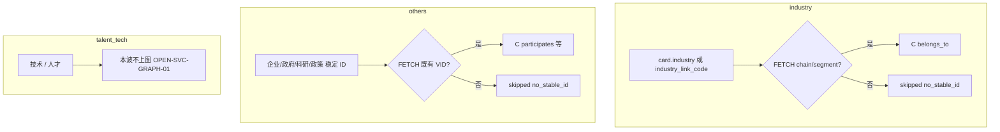

**禁止**用名称相似度在投影层伪造 `ent:` / `chain:` / `pol:`。

---

## 14. 113 关系：每一组怎么入库

### 14.1 B · 服务-服务 `participates`

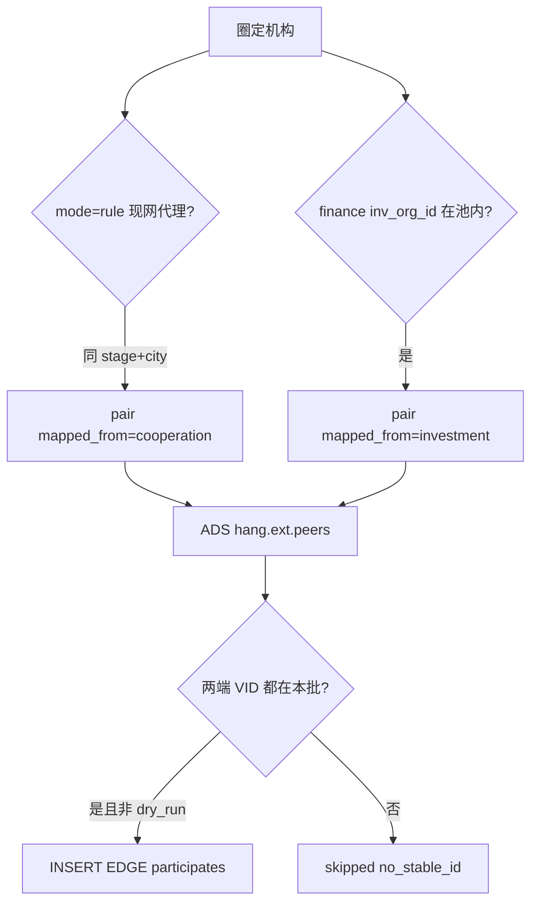

这是 **as-built 代理**（同城同环节拉链），不是专题库合同边。Q062 待核验。`talent_flow` / `competition` 映射表有、循环未抽。

### 14.2 C · 服务机构-产业 `belongs_to`

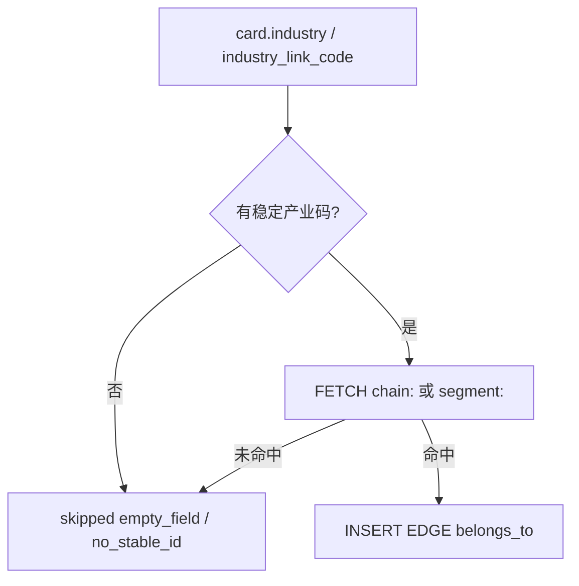

### 14.3 C · 企业 / 政府 / 科研 / 政策

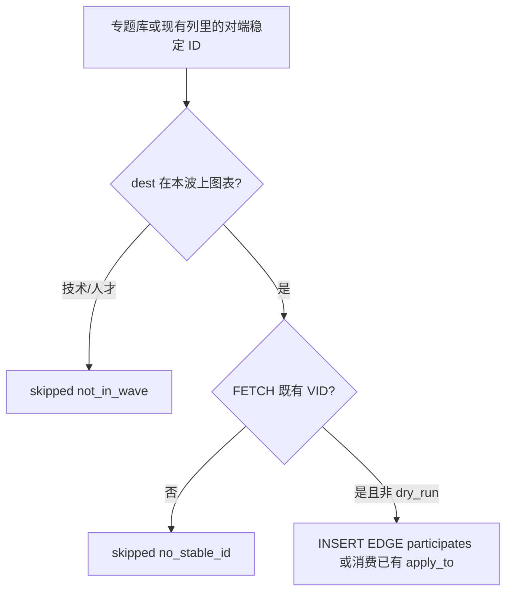

无专题库接口时，C 档诚实空：`skipped.empty_field`，禁止十模型同城拉链冒充跨域边。

### 14.4 现网十模型边（将迁出灌数/模型按钮）

`svcmodels.run_models` 在算短板/技术力/招引的**同一函数**里写 peers + nGQL。步2 必须把 **图写入** 拆到 B `op_id`；十模型只留 ADS 模型表。

---

## 15. 哪些场景要 LLM、推什么

现网 **112/113 全程规则，不调 LLM**。对照需规「词典 NER / 专题库对接」的升级清单。无 Key 必须回退规则，禁止编造 ID。

| 编号 | 触发（规则不够） | 推什么 | 写入 | 不推 |
|---|---|---|---|---|
| L1 | 名称像服务机构但规则 A 未圈中，正文/经营范围有「孵化器 / 专利代理 / …」 | 裁定是否入池 + 六类 | circle/card 候选；A 点仍要 `org_id` | 不写 ODS；不伪闭合 Q-SVC-010 |
| L2 | 卡面无人数/规模，年报空 | 从简介抽规模短语 | 仅 NER 备查，**不上图** | 不回写年报宽表 |
| L3 | 只有行业名字符串，无 `industry_link_code` | 抽产业短语 | 备查；无码仍不上图 | 名称猜 `chain:` |
| L4 | 正文有「为××企业提供 / 与××高校合作」 | 抽对端短语 + 槽 | NER；无 ID 不上图 | 店名猜 `ent:` |
| L5 | 需规「合作伙伴 / 客户」但无合同表 | 从新闻/年报抽合作句 | B 仅当两端都有 VID | 同城同环节拉链冒充合同 |
| L6 | 名称 → 已有 `chain:`/`ent:`/`pol:`/`inst:` | **链指** | 只写 FETCH 成功的 C 边 | **须淮政玮拍板**；默认关闭 |
| L7 | 政府 vs 科研 vs 服务 角色不清 | 裁定 `role` | props.role | 不新建 Tag |

推荐默认：**L1/L2 可先上**（不碰他域 VID）。**L6 须拍板**。**L5** 无合同表则 B 继续规则代理并标 `proxy`。

调用形态：`mode=rule|llm`。Java 只调 Python。同一 `calc_batch_id` 规则重跑应同边；LLM 批次记 `model_version`。

---

## 16. 和投影缺口怎么对

| 现象 | 归属 | 不是 |
|---|---|---|
| 灌数后图谱页无点 | 灌数本来就不写 hang（as-built 已如此）；须 A 档 | `run_seed` bug |
| 投影后无边 | `run_graph` 设计 `edges=0`；边在十模型 | loader 丢边 |
| 图例只有服务机构 | as-built `CATS`；C 未实现 | 漏配 EDGE |
| 读图不标 nebula | `fetch_graph` 读 MySQL | 必须先 Nebula |
| 同城同环节全是合作 | 十模型代理 | 专题库合同已到 |
| `institution:` vs `inst:` | `OPEN-SVC-GRAPH-02` | 本叶改 CHAIN 底图 VID |

公式 / 边类型：仍挂 Q062 + 唐绍祖会签，本设计不改 D1。

---

## 17. 关系 × op_id × I/O（步2 契约真源）

> **禁止**「一个 `run_graph()` / `run_models()` 包打天下」当对外契约。现网 as-built 是投影清 hang 再建点、十模型再造边——那是 §1–§9 现状，**不是**步2 接口。
> 每条需规关系（或一组同构边）必须有独立 `op_id`。Java **只转发** Python `/internal/*`，不写 NLP、不直连 nGQL。
> Space 固定 **`demo_gkx_chain`**（禁止 `CREATE SPACE gkx_service` / 第二空间）。
> 现网 API 挂在 **`/entan/**` → `demo-platform-entan-py`**（`svc_routes.py` 与政策/企业同进程）。步3 在 catch-all 前插 graph 具体路由 → `gkx-innov`；Feign 必须指 **entan-py**，禁止 innov-py。页面路由 `/industry-service/graph` ≠ 网关 Path。

### 17.1 档位与 op_id 清单（写入 8 + 只读 1）

| op_id | 档 | 中文 | SRS | HTTP（前端经 Java） | Python `/internal` | 写什么 | 本波 |
|---|---|---|---|---|---|---|---|
| `SVC_NER_ORG` | **A 实体识别** | 服务机构本体 + 属性 | 112 `M_SVC_GRAPH_112_1` | `POST /v1/svc/graph/ner` | `POST /internal/svc/graph/ner` | 刷新/确认 card 属性；`svc_org_graph_hang`；Nebula `INSERT VERTEX institution` | **上图**（属性不上图，见 §13.2） |
| `SVC_RE_SVC_SVC` | **B 关系边上图** | 本域↔本域：服务-服务 | 113 + 厚包 §7.0 | `POST /v1/svc/graph/intra` | `POST /internal/svc/graph/intra` | hang.ext.peers；Nebula `INSERT EDGE participates` | **上图**（两端必须都是本批服务 VID） |
| `SVC_RE_INDUSTRY` | **C 关联主体上图** | 本域↔产业 | 113 服务机构-产业 | `POST /v1/svc/graph/hang` | `POST /internal/svc/graph/hang` | 边 `belongs_to`；终点须 `FETCH` | **上图**（无产业码 → `no_stable_id`） |
| `SVC_RE_TECH` | **C** | 本域↔技术 | 113 服务机构-技术 | 同上（`relation_whitelist` 含 `tech`） | 同上 | — | **本波不上图** `OPEN-SVC-GRAPH-01` |
| `SVC_RE_ENTERPRISE` | **C** | 本域↔企业 | 113 服务机构-企业 | 同上 | 同上 | `participates` → `ent:` | **上图**（须 FETCH） |
| `SVC_RE_GOV` | **C** | 本域↔政府 | 113 政府机构 | 同上 | 同上 | `participates` → 既有 `inst:` | **上图**（须 FETCH；无政府点则 skipped） |
| `SVC_RE_TALENT` | **C** | 本域↔人才 | 113 人才 | 同上 | 同上 | — | **本波不上图** `OPEN-SVC-GRAPH-01` |
| `SVC_RE_POLICY` | **C** | 本域↔政策 | 113 政策 | 同上 | 同上 | 默认**不写反向边**（消费政策 `apply_to`）；仅 `dest_types` 显式要求且 FETCH 到 `pol:` 才写 `participates` | 行保留；默认 skipped `not_in_wave`（避免与政策双边冲突） |
| `SVC_RE_RESEARCH` | **C** | 本域↔科研机构 | 113 科研机构 | 同上 | 同上 | `participates` → 既有 `inst:` | **上图**（须 FETCH） |
| `SVC_GRAPH_BROWSE` | **D 浏览** | 只读子图 | 113 可视化 | `GET /v1/svc/graph`（现网已有） | `GET /internal/svc/graph` | **不写库** | 只读；`source=nebula` 仅当真实 nGQL 成功 |

C 档写入 `op_id` 共用 `/hang`，**请求体必须带 `op_id` 或 `relation_whitelist`**，禁止一次 hang 偷偷写七类。可选更细路径（步2 可并存，不得替代上表）：`POST /v1/svc/graph/ops/{op_id}` → `/internal/svc/graph/ops/{op_id}`。

A 档**只认本域自身实体**：机构点 + 属性。关联主体名称可以进 card/备查，但 **不得**在 A 档 `FETCH` / 挂跨域边。跨域只走 C。B 只连服务-服务。

现网 `POST /internal/svc/run-graph` / `run-models` **不是**上表契约；步2 须新增 ner/intra/hang，并把旧入口收成对内实现核或废弃（不得再当灌数/十模型按钮的图写入）。

### 17.2 公共入参 / 出参

所有写入 `op_id`（A/B/C）共用同一套字段。缺字段按表内默认；**禁止无稳定 ID 猜 VID**。

#### 入参

| 字段 | 类型 | 必填 | 说明 |
|---|---|---|---|
| `op_id` | string | 是 | 上表写入之一（D 不用 POST） |
| `scope` | `one` \| `batch` | 是 | `one` 必须给 `id`；`batch` 必须给过滤，禁止空过滤扫全库除非显式 `filter.all=true` |
| `id` | string | `scope=one` | 机构稳定 ID = **`org_id`**（不是名称） |
| `filter` | object | `scope=batch` | 允许：`org_ids[]`、`service_type`、`province`、`city`。**禁止**用名称当主键 |
| `mode` | `rule` \| `llm` | 否，默认 `rule` | LLM **只**在 `mode=llm`；无 Key / 失败必须回退规则，并在出参标明 |
| `dry_run` | bool | 否，默认 `false` | `true`：**不写** ADS hang、**不写** Nebula、不 `INSERT`/`DELETE` |
| `relation_whitelist` | string[] | C 档是；B 档默认 `["participates"]` | 只处理列出的边/关系。空数组 = 拒绝执行（不要默默当全开） |
| `dest_types` | string[] | C 档可选 | 终点白名单：`industry` / `tech` / `enterprise` / `gov` / `talent` / `policy` / `research`。未列入本波上图表的类型必须 `skipped.reason=not_in_wave`，**禁止静默丢行** |
| `calc_batch_id` | string | 否 | 不传则服务端生成；同批次重跑覆盖 |

#### 出参

| 字段 | 说明 |
|---|---|
| `op_id` | 回显 |
| `written_nodes[]` | `{ vid, tag, name, props }`。A 档 `tag=institution`。C 档**不新建**他域 Tag（本数组通常为空或只含本域机构点） |
| `written_edges[]` | `{ src, rel, dst, weight, props }`。`src`/`dst` 必须是已解析 VID，禁止名称 |
| `skipped[]` | `{ src?, dst?, rel?, name?, reason, detail }`。`reason` **必须**是下列四码之一 |
| `source` | `nebula` \| `ads` \| `dry_run` \| `rule_fallback`。只有真实 nGQL 写入成功才 `nebula` |
| `model_version` | NER/RE 注册版本；`mode=llm` 另记模型名 |
| `calc_batch_id` | 本批 |
| `mode_effective` | 实际生效：`rule` 或 `llm` |
| `llm_fallback` | bool。`mode=llm` 但无 Key/失败而走规则时为 `true` |
| `space` | 恒为 `demo_gkx_chain` |
| `vid_scheme` | 回显 `institution`（as-built）或 `inst`（目标）；过渡期可同时返回 `vid` + `vid_asbuilt` |

`skipped[].reason` 枚举（步2 对外只这四码）：

| 原因码 | 何时 | 现网 as-built 对照 |
|---|---|---|
| `empty_field` | 源字段空 / 无 `org_id` / 无对端 ID / 名称空 | circle 无行；finance 无 `inv_org_id` |
| `no_stable_id` | 无产业码 / 企业码 / 政策 pid；或 `FETCH PROP ON *` 顶点不存在；对端不在本批 | 现网 C 未实现；B 对端不在 hang |
| `not_in_wave` | 技术/人才本波不上图；`supplies`/`depends_on`/`competition` 未启用；政策默认不写反向 | `OPEN-SVC-GRAPH-01`；`EDGE_MAP` 未生成 pair |
| `vid_too_long` | 候选 VID 长度 > 80 | `node_id_of()` 返回 `None` → `skipped_vid` |

幂等：同 `calc_batch_id` + 主键（节点=`vid`；边=`src+rel+dst`）可重跑覆盖。`dry_run` 出参仍给 *将要* 写的数组，但库不变。本管线不做删除底图。

### 17.3 需规最低集：边 × 终点（禁止静默删行）

对照厚包 §3 + SRS 113（七类）+ B 服务-服务。做不到的标「本波不上图 / 无 ID」，**禁止从本表删行**。

| 边 / 关系 | 终点 | op_id | 档 | 上图？ | VID 规则 | as-built 源 | 缺口 |
|---|---|---|---|---|---|---|---|
| `participates`（合作） | 服务机构 | `SVC_RE_SVC_SVC` | B | **上图** | 两端 `institution:`（过渡兼认 `inst:`） | 同 stage+city 拉链；`mapped_from=cooperation` | 非合同真源；Q062 |
| `participates`（投资） | 服务机构 | `SVC_RE_SVC_SVC` | B | **上图** | 同上 | `svc_org_finance_event.ext.inv_org_id` 且对端在圈定池 | 对端常不在池 → `no_stable_id` |
| `participates`（人才流动） | 服务机构 | `SVC_RE_SVC_SVC` | B | **本波不上图** | — | `EDGE_MAP.talent_flow` **未生成 pair** | 无人才流动表 |
| `participates`（竞争） | 服务机构 | `SVC_RE_SVC_SVC` | B | **本波不上图** | — | `EDGE_MAP.competition` **未生成 pair** | 无竞争表 |
| `belongs_to` | 产业 | `SVC_RE_INDUSTRY` | C | **上图** | `FETCH` `chain:` / `segment:` | 仅有行业名字符串 | 多数 `no_stable_id` |
| — | 技术 | `SVC_RE_TECH` | C | **本波不上图** `OPEN-SVC-GRAPH-01` | — | 未抽 | 无 tech Tag |
| `participates` | 企业 | `SVC_RE_ENTERPRISE` | C | **上图** | `FETCH` `ent:` | 未抽 | 无客户企业 ID |
| `participates` | 政府 | `SVC_RE_GOV` | C | **上图** | `FETCH` `inst:` | 未抽 | 无政府专题库 ID |
| — | 人才 | `SVC_RE_TALENT` | C | **本波不上图** `OPEN-SVC-GRAPH-01` | — | 未抽 | 无 talent Tag |
| 消费 `apply_to` / 可选 `participates` | 政策 | `SVC_RE_POLICY` | C | **默认不上图（不造反向）**；显式 whitelist 才写正向 | `FETCH` `pol:` | 未抽 | 政策叶可已有 pol→inst |
| `participates` | 科研机构 | `SVC_RE_RESEARCH` | C | **上图** | `FETCH` `inst:` | 未抽 | 无科研稳定 ID |
| `supplies` | （未点名） | — | — | **本波不上图** | — | `ALLOWED_EDGES` 有名未写 | 需规未列 |
| `depends_on` | （未点名） | — | — | **本波不上图** | — | 同上 | 需规未列 |

`relation_type` / EDGE 不在 `participates|belongs_to`（本波启用集）→ `not_in_wave`。

### 17.4 分 op 过程（目标态；替换「一次 run_graph + run_models」）

#### A · `SVC_NER_ORG`

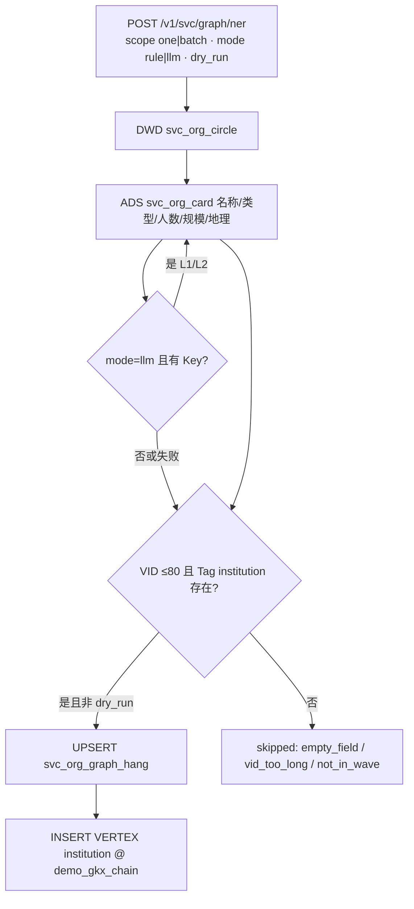

属性只进 card。A 档 **不 hang 跨域、不写 participates**。

#### B · `SVC_RE_SVC_SVC`

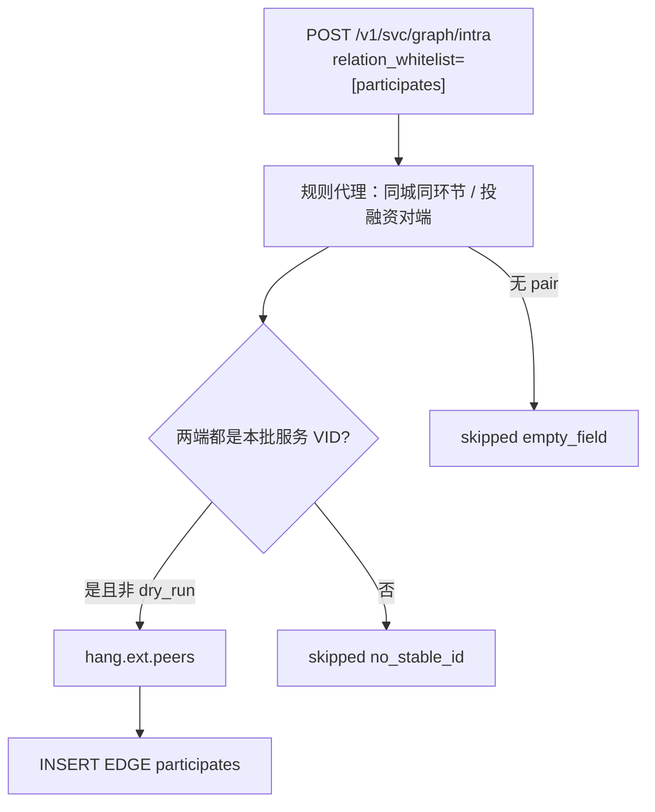

#### C · hang（七个 `SVC_RE_*`）

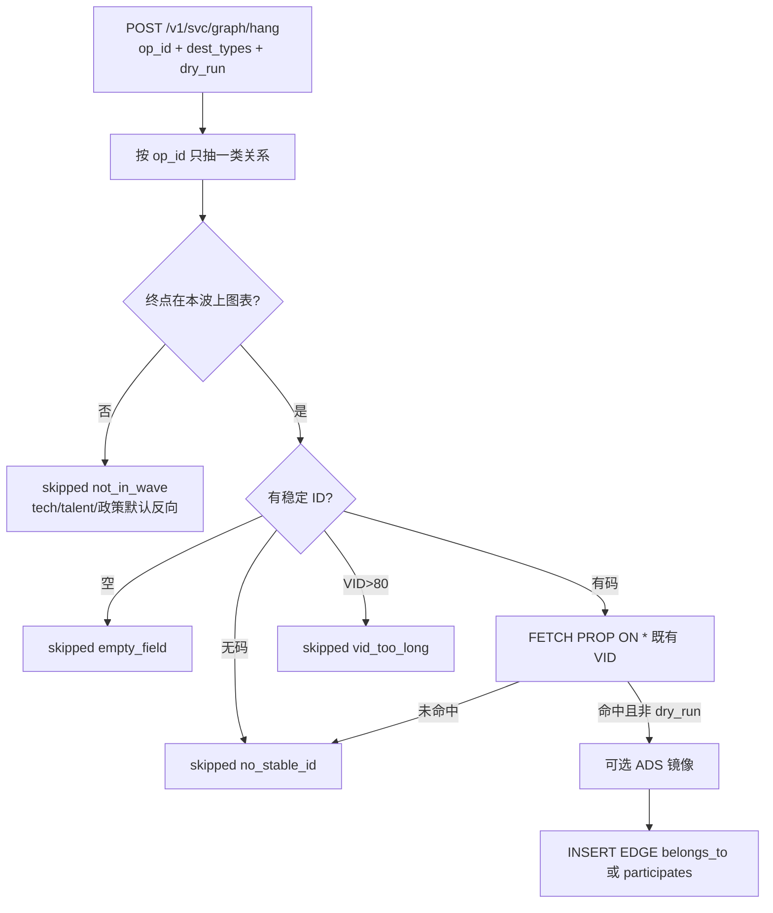

### 17.5 LLM 与规则分界

| 规则 | 说明 |
|---|---|
| 默认 | `mode=rule`：全程 §12–§14 规则/代理，不调模型 |
| 显式 LLM | 仅 `mode=llm` 可走 §15 L1/L2（推荐先上）；L4 可抽短语但仍 **无 ID 不上图**；**L6 链指须淮政玮拍板**，本波默认关闭 |
| 回退 | 无 Key / 超时 / 4xx/5xx → `mode_effective=rule`，`llm_fallback=true`，`source` 不得假装 `llm` |
| Java | 禁止 NLP；只转发 |

---

## 18. 灌数剥离清单（P0 · 步2 checklist）

识别 / 关系 / 跨域挂接 / nGQL 写 **不是**贴源灌数。灌数只允许：三方或 Mock → ODS → 圈定 DWD + 卡面 ADS + 可选基础指标 / 投融资事件表。**禁止** NER 上图 / RE / 建点 / 建边 / `INSERT VERTEX|EDGE` / 图 hang / 图投影。

**重灌后图空（或保留旧图、不再被灌数填满）是预期。** 禁止灌数静默把图填满。图只允许从「产业服务 → 图谱」菜单 A/B/C（及对应 `/v1/svc/graph/{ner|intra|hang}`）触发。

硬闸原文（厚包 §7.0）：**服务灌数禁 hang、禁写 Nebula**。此处 hang = **`svc_org_graph_hang` + Nebula 点边**。投融资表 `svc_org_finance_event` 是 A3 原料，**不是**图 hang，灌数可留。

### 18.1 现网要摘掉的调用（文件 / 函数 / 按钮级）

> 精读结论：`run_seed` **今天已经不写 Nebula、不写 graph hang**。步2 仍须把下列符号从灌数调用栈 **钉死为零**，并摘掉「会建图」文案与十模型顺带写图。对照删除以本表为准。

| # | 仓 · 文件 | 符号 | 现网行为 | 步2 动作 |
|---|---|---|---|---|
| 1 | `demo-algo-ent-analysis/entan/svcseed.py` | `run_seed()` | ODS→circle/card/finance/指标；头注释已写不写 Nebula | **保持零图写入**。grep 本函数及 callee **不得**出现 `run_graph` / `svcgraph` / `INSERT VERTEX` / `INSERT EDGE` / `svc_org_graph_hang` |
| 2 | 同上 | `ensure_schema()` | MySQL DDL（含 hang **空表** CREATE） | **允许** `CREATE TABLE IF NOT EXISTS` hang 空表；**禁止** nGQL `CREATE TAG/EDGE` |
| 3 | 同上 | `_hang_finance()` | 写 `svc_org_finance_event` | **保留**（A3，非图 hang）。注释须写明「不是 graph hang」 |
| 4 | 同上 | `_truncate_seed()` | TRUNCATE circle/card/指标/finance；**不含** hang | **保持不含** `svc_org_graph_hang`；禁止改成顺带清图 |
| 5 | `demo-algo-ent-analysis/api/svc_routes.py` | `run_svc_pipeline()` / `POST /internal/svc/run-pipeline` | 只调 `run_seed` | **保留灌数**；禁止改调 `run_graph` / `run_models` 的图写入段 |
| 6 | 同上 | `run_svc_graph()` / `POST /internal/svc/run-graph` | 调 `svcgraph.run_graph`：DELETE hang + INSERT VERTEX | **禁止被灌数调用**；收成 A 档实现核或改挂 `/graph/ner` |
| 7 | 同上 | `run_svc_models()` / `POST /internal/svc/run-models` | 十模型 ADS **且** UPDATE hang.peers + `_upsert_participates` nGQL | **ADS 模型可留**；**必须摘掉** hang.peers 与 nGQL（迁 B）。灌数不得调用本函数 |
| 8 | `demo-algo-ent-analysis/entan/svcgraph.py` | `run_graph()` / `_upsert_nebula()` / `_nebula_probe()` | 全量重建 hang + UPSERT 顶点 | **禁止**从 `run_seed` / `run-pipeline` / CI 灌数 job 进入 |
| 9 | 同上 | `main()` / `python -m entan.svcgraph` | CLI 直接投影 | 只允许图谱菜单/API；**不进灌数 runbook** |
| 10 | `demo-algo-ent-analysis/entan/svcmodels.py` | `_upsert_participates()` | `INSERT EDGE participates` | **从十模型摘掉**；只由 B `op_id` 调用 |
| 11 | 同上 | `run_models()` 内 `UPDATE svc_org_graph_hang … ext.peers` | 写图镜像 | **从十模型摘掉**；只由 B 写入 |
| 12 | 同上 | `from entan.svcgraph import SPACE, node_id_of` | 模型算密度用 node_id | 可读 hang **已有**行；灌数路径仍不得 import `run_graph` |
| 13 | `demo-ui-system-test/.../industry-service/pages/BasicPage.vue` | 主按钮「灌数据」；`onSeed('append'|'replace')` | 只调 `runSvcPipeline` | **保持只灌圈定/卡面/指标**。P-4 核文案：禁止改成「会建图」。`seedNotes` 已写「十模型 / 图谱另开」——步2 先保后端零图 |
| 14 | 同上 | `seedFlow`「圈定 hang」 | 指 circle hang `org_id`，不是图 hang | P-4 建议改文案为「圈定入池」，避免与图 hang 混名（不挡步2） |
| 15 | `demo-ui-system-test/.../industry-service/components/GraphView.vue` | 按钮「投影到图谱」`onProject` → `runSvcGraph` | 写 hang + Nebula 点 | **不是灌数按钮**；步4 收成 A 档。步2 checklist 须点名：灌数页不得调用本函数 |
| 16 | 同上 | 按钮「跑十模型」`onModels` → `runSvcModels` | 现网顺带写边 | 十模型页可留算分；**禁止**该按钮再写 Nebula/hang。B 边改图谱菜单 |
| 17 | `demo-ui-system-test/.../api/industry-service/index.ts` | `runSvcPipeline` / `runSvcGraph` / `runSvcModels` | 三套入口 | pipeline **不得**改去调 graph；注释禁止写「灌数会投影」 |
| 18 | 编排文档债（本叶不改会签流图） | [`pipeline-demo-mock.md`](./pipeline-demo-mock.md) §1「→ hang Nebula」；[`01-data-flow.md`](../01-data-flow.md) §1/§7 `DWD → NEB` 画在灌数主链 | 会签稿仍把图挂在工厂/50100 灌数 | **本文件 §18 才是剥离真源**；流图改边须另单会签，禁止本叶静默改 approved |
| 19 | CI / 脚本 | `.gitlab-ci.yml` 等（本叶检索未发现 seed+graph 串联） | — | 步2 grep CI：**不得**出现 `entan.svcgraph` / `run-graph` 跟在 seed 后 |

### 18.2 灌数允许留下的

| 允许 | 文件 / 符号 |
|---|---|
| MySQL Demo 空表（**不含** Nebula `CREATE TAG/EDGE`） | `svcseed.ensure_schema` · `scripts/mysql/svc_ddl_demo_empty.sql` |
| 规则 A 圈定 + circle/card | `svcseed.run_seed` · `classify` / `should_circle` |
| 投融资事件表（A3） | `_hang_finance` → `svc_org_finance_event` |
| A1–A6 / STAT-21 指标 | `_write_metrics` |
| 状态查询 | `GET /internal/svc/status`（可**读** hang 行数，不得在 pipeline 里**写** hang） |
| 十模型 ADS 分表 | `svc_chain_gap` 等（**无** nGQL、**无** hang.peers） |

### 18.3 过关自检（步2 handoff 必附 grep）

在 `demo-algo-ent-analysis` 对下列入口跑 grep，**不得**再命中 `run_graph` / `_upsert_nebula` / `_upsert_participates` / `INSERT VERTEX` / `INSERT EDGE` / `svc_org_graph_hang` 的 **写**（DELETE/INSERT/UPDATE peers）：

- `entan/svcseed.py` 的 `run_seed` / `_truncate_seed` / `_write_circle_card` / `_write_metrics`
- `api/svc_routes.py` 的 `run_svc_pipeline` / `svc_run_pipeline`
- 任何 `run_all_svc*` / CI seed job（若步2 新增）

基础指标页灌数成功后：**不**自动增加 `svc_org_graph_hang` 行、**不**自动 `INSERT` Nebula 机构点边。A/B/C 才写 hang 与 Nebula。

`_busy()` 把 graph/models 与 pipeline 互斥 **可以留**（防并发打库），不视为图写入。

---

## 19. 图 · SVC-GRAPH-TRIPLE

> **diagram_id：`SVC-GRAPH-TRIPLE`**（L1 · 图即契约）。每类实体 + 每组关系入库。改边集 / 上图范围只改本图与 §17.3，禁止 UI/apiview 另造边名。

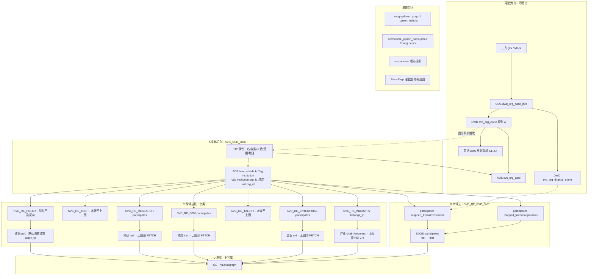

实体（Tag / 本波）：

| 实体 | Tag 或复用 | VID | 本波上图 | 谁写入 |
|---|---|---|---|---|
| 服务机构本体 | 复用 Tag `institution` | as-built `institution:{org_id}`；目标 `inst:{org_id}` | 是 | A |
| 产业 | 复用 CHAIN `chain` / `segment` | `chain:` / `segment:` | 是（须 FETCH） | C，不新建 Tag |
| 企业 | 复用 `enterprise` | `ent:` | 是（须 FETCH） | C |
| 政府 | 复用 `institution` | `inst:` | 是（须 FETCH） | C |
| 科研机构 | 复用 `institution` | `inst:` | 是（须 FETCH） | C |
| 政策 | 复用 Tag `policy` | `pol:` | 默认消费已有边 | C 不新建 Tag |
| 技术 | **无 Tag** | — | **否** `OPEN-SVC-GRAPH-01` | skipped `not_in_wave` |
| 人才 | **无 Tag** | — | **否** `OPEN-SVC-GRAPH-01` | skipped `not_in_wave` |
| 属性（类型/人数/规模/地理） | 不上图 | — | 否 | 仅 A → `svc_org_card` |

关系入库：

| 边 | 语义 | 典型三元组 | 写入 op |
|---|---|---|---|
| `participates` | 服务-服务 | `institution:` → `institution:` | `SVC_RE_SVC_SVC` |
| `belongs_to` | 服务-产业 | `institution:` → `chain:`/`segment:` | `SVC_RE_INDUSTRY` |
| `participates` | 服务-企业/政府/科研 | `institution:` → `ent:` / `inst:` | `SVC_RE_ENTERPRISE` / `GOV` / `RESEARCH` |

---

## 20. 诚实缺口（本波）

| ID | 缺口 | 本波处理 | 不是 |
|---|---|---|---|
| `OPEN-SVC-GRAPH-01` | 无 tech/talent Tag；无七类专题库稳定 ID | §17.3 全部保留行；上图列写「本波不上图」；skipped=`not_in_wave` / `no_stable_id` | 漏配 EDGE、loader bug |
| `OPEN-SVC-GRAPH-02` | as-built VID `institution:` vs 政策 FETCH `inst:` | 过渡双认；目标对齐 `inst:`；不在本叶改 CHAIN 底图 | 步2 私自改全库 VID |
| Q062 | 边类型未拍板 | 不新建 `serve`/`coop`/`invest`；B 继续 `participates`+`mapped_from` | 静默改 EDGE schema |
| Q-SVC-010 | 圈定临时规则 | 点/边 props 带待核验；不伪 live | 前端改绿 |
| 同城同环节造边 | 十模型代理 ≠ 合同 | B `mode=rule` 可沿用但须标 `proxy`；迁出十模型按钮 | 灌数填边 |
| 读图走 MySQL | `fetch_graph` 不碰 Nebula | D 可继续 hang；`source` 不得假称 nebula | 必须先投影才算故障 |
| D12 | 本设计服务 Demo `demo-algo-ent-analysis` + `demo-ui-system-test` | lumen apiview **禁止**直连 demo 服务；正式复刻走 `lumen-algo-py` | 步1/2 改 lumen 前端打 demo |
| 流图文档债 | `01-data-flow` / `pipeline-demo-mock` 仍画灌数→NEB | **本文件 §18 已是剥离真源**；改 approved 流图另单 | 本步1 改会签边 |
| registry | `DEMO-SVC-GRAPH-TRIPLE-UI-L01` 本工作区 MCP `task-get` 未命中 | handoff 记录；请 coordinator 补建单后再认领 | 本步用 YAML 手改 registry |

公式 / 边权 / 新 EDGE：仍挂 Q062 + 唐绍祖会签，本设计不改 D1。
