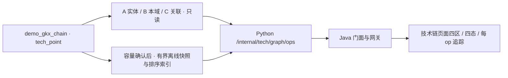

# 管道 · 技术链三元组只读消费

```yaml
doc_id: TECH-ETL-TO-NEBULA
task_id: KG-GRAPH-TRIPLE-03
status: draft
version: "2026-11-13.1"
diagram_id: TECH-GRAPH-TRIPLE
```

> 本文是步 1 契约设计，不是已部署事实。采用 SVC 文档的分 op/I-O/过程图结构；本单以新派单的只读消费范围为准，不复制旧 SVC 的写图行为、过时 Tag 或 VID 迁移目标。

## 1. 意图
覆盖专题叶子 [104, 105] 的实体、本域关系、跨域关联和浏览。只消费已验收的 demo_gkx_chain。

## 2. 入口与源
Python lumen-algo-py；Java lumen-svc-platform；UI lumen-ui-topic。本域取数真源为图库 tech_point；源侧主数据表名尚未在本步核验，不填写猜测表名，也不直连或重抽源库。

## 3. Space 与 VID
固定 space=demo_gkx_chain，主 Tag=tech_point，本域 VID=tp:<稳定 ID>。服务 institution: 与科研 inst: 严格分开；技术点本域是 tp:，不能套旧 tech_point: 前缀。关联端点 VID 必须读取现有边 src/dst，不能把主数据前缀套到 tech_* 辅助 Tag。

## 4. Schema
不增不改。上线前对照真实 DESCRIBE 和小样本；缺字段标 null，缺必需 Tag/Edge 明确 503，不自行建表。

## 5. 端点解析
详情精确 ID 获取。关系检索以本域 Tag 与精确 VID 为锚；关联端点核验其实际 Tag 和 VID，不凭名称挂接。

## 6. 写入与幂等
零写入。相同数据版本、条件、游标得到相同排序和去重结果；浏览缓存版本变化返回游标失效，不跨版本翻页。

## 7. 失败与降级
连接失败／查询失败／缺索引是不可用，不是空态。真实成功无命中才 empty；不回退 Mock、供应方表或服务机构图。

## 8. 验收基线
派单引用本域 19,430 点，是历史基线，不是本会话重测。合作／归属分母见已签收 T02/T03/T04；source 类型与跨域端点需分别核验。

## 9. 禁止
不新增边语义、不重灌、不写图、不建第二空间、不修改其他五域的文件与路由；不泄露连接串与口令。

## 10. 需求挂接
仅叶 104/105；操作标识用于接口追踪，不冒充 metric-registry 已登记指标。

## 11. 总过程
既有已验收图 → 只读查询／版本化只读索引 → Python /internal → Java 门面 → 专题 UI；SVC 的灌数→图投影链不属于本单。

## 12. 本域关系
边型 `tech_rel`；保留真实方向，out/in/both 为查询模式，不把有向边改成反向写入。weight 与 relation_confidence_score 分别返回，不假定二者等值。

## 13. 实体字段
name_zh、name_en、community_role、weighted_degree、community_id。props 保留原值；不存在的属性不按名称猜测。

## 14. 跨域关系
| op_id | 边型 | 目标 Tag | 方向／说明 |
|---|---|---|---|
| TECH_RE_PAPER | tech_has_paper | tech_paper | 从技术点出发 |
| TECH_RE_PATENT | tech_has_patent | tech_patent | 从技术点出发 |
| TECH_RE_PERSON | tech_has_person | tech_person | 从技术点出发 |
| TECH_RE_INSTITUTION | tech_has_institution | tech_institution | 从技术点出发 |

**技术点层的 tech_person/tech_institution 与主数据 person/research 是不同 Tag。** 前者的实际 VID 从边读取，禁止拼 person:/inst: 来替代。tech_has_institution 当前仅部分覆盖；A 包未交回执前页面显示“数据正在补充中”，不能把部分范围无命中说成全域无关联。

## 15. 规则与 LLM
本单只读稳定实体和已存边，不增加 NER/LLM 调用，不猜测 ID，不复制 SVC 的规则代理造边。

## 16. 独立 op 清单
| op_id | 档 | 动作 | Python 公共接口 | Python 内部接口 |
|---|---|---|---|---|
| TECH_ENTITY_SEARCH | A | 实体检索 | POST `/v1/tech/graph/ops/TECH_ENTITY_SEARCH` | POST `/internal/tech/graph/ops/TECH_ENTITY_SEARCH` |
| TECH_ENTITY_DETAIL | A | 实体详情 | POST `/v1/tech/graph/ops/TECH_ENTITY_DETAIL` | POST `/internal/tech/graph/ops/TECH_ENTITY_DETAIL` |
| TECH_RE_NEIGHBORS | B | 本域邻居 | POST `/v1/tech/graph/ops/TECH_RE_NEIGHBORS` | POST `/internal/tech/graph/ops/TECH_RE_NEIGHBORS` |
| TECH_RE_SUBGRAPH | B | 本域子图 | POST `/v1/tech/graph/ops/TECH_RE_SUBGRAPH` | POST `/internal/tech/graph/ops/TECH_RE_SUBGRAPH` |
| TECH_RE_PAPER | C | 关联paper | POST `/v1/tech/graph/ops/TECH_RE_PAPER` | POST `/internal/tech/graph/ops/TECH_RE_PAPER` |
| TECH_RE_PATENT | C | 关联patent | POST `/v1/tech/graph/ops/TECH_RE_PATENT` | POST `/internal/tech/graph/ops/TECH_RE_PATENT` |
| TECH_RE_PERSON | C | 关联person | POST `/v1/tech/graph/ops/TECH_RE_PERSON` | POST `/internal/tech/graph/ops/TECH_RE_PERSON` |
| TECH_RE_INSTITUTION | C | 关联institution | POST `/v1/tech/graph/ops/TECH_RE_INSTITUTION` | POST `/internal/tech/graph/ops/TECH_RE_INSTITUTION` |
| TECH_GRAPH_BROWSE | D | 浏览与排序 | POST `/v1/tech/graph/ops/TECH_GRAPH_BROWSE` | POST `/internal/tech/graph/ops/TECH_GRAPH_BROWSE` |

逐 op 入出参：
| op_id | 额外必需／可选入参 | 出参 |
|---|---|---|
| TECH_ENTITY_SEARCH | keyword；page_size/cursor 可选 | items/page，加 §17 公共元数据 |
| TECH_ENTITY_DETAIL | id | nodes[1]，加 §17 公共元数据 |
| TECH_RE_NEIGHBORS | id；direction/page_size/cursor 可选 | nodes/edges/page，加 §17 公共元数据 |
| TECH_RE_SUBGRAPH | id；hops/direction 可选 | nodes/edges/truncated，加 §17 公共元数据 |
| TECH_RE_PAPER | id；page_size/cursor 可选 | nodes/edges/page/coverage，加 §17 公共元数据 |
| TECH_RE_PATENT | id；page_size/cursor 可选 | nodes/edges/page/coverage，加 §17 公共元数据 |
| TECH_RE_PERSON | id；page_size/cursor 可选 | nodes/edges/page/coverage，加 §17 公共元数据 |
| TECH_RE_INSTITUTION | id；page_size/cursor 可选 | nodes/edges/page/coverage，加 §17 公共元数据 |
| TECH_GRAPH_BROWSE | sort_by/order；过滤和 page_size/cursor 可选 | items/page/snapshot，加 §17 公共元数据 |

## 17. 公共 I/O 与错误契约（步 2 真源）

每个 op 独立，不能用一个 run_graph/run_models 隐含执行全部操作。所有 HTTP 操作均 POST；为了稳定 ID、分页与显式 dry_run 使用请求体，**POST 不代表写图**。同一请求经 `/v1` 与 `/internal` 的业务结果应相同。

### 17.1 入参

| 字段 | 类型／默认 | 约束 |
|---|---|---|
| `id` | string，详情／邻居／子图／关联必填 | 仅稳定业务 ID 或本域合法 VID；不能以姓名／名称查号。裸 ID 加本域前缀，带错误前缀直接 400，禁止重复拼前缀 |
| `keyword` | string，检索必填，1–100 字符 | 显式检索；不允许空关键词退化为全库搜索；名称仅作过滤条件，不作主键 |
| `page_size` | integer，20 | 1–100；bool 不当作整数 |
| `cursor` | string／null | 服务端签发的不透明游标；绑定 op、过滤、排序、图快照版本；不可跨 op／条件复用，篡改或过期 400 |
| `hops` | integer，1 | 仅 SUBGRAPH；允许 1、2，其他值 400 |
| `direction` | `out` 默认 | 技术关系允许 out/in/both；人才／机构合作固定 both，无向语义不新增反向物理边 |
| `sort_by` | string | tech 浏览：weighted_degree（默认）／community_id／community_role／name；person、research 浏览：cooperation_degree（默认）／name；邻居／关联：weight（默认）／name |
| `order` | desc 默认 | asc/desc；同值固定 VID 升序打破平局 |
| `institution_type_id` | string／null | research 可选精确过滤；不推断“高校”等分类，不按名称猜类型 |
| `community_id` / `community_role` | string／null | 仅 tech；对已有属性精确过滤 |
| `dry_run` | bool，true | true 和 false 均只读，写入计数恒为 0；不能把 dry_run=true 伪造成真实查询成功 |
| `space` | demo_gkx_chain | 可省略；传其他空间 400，无跨空间回退 |

未知字段／非法类型 400，超限不静默放大。业务 ID 长度与最终 VID ≤80（源于现有图约束），拒绝控制字符。必须通过 SDK 参数化或安全字符串序列化构造值；Tag／Edge／排序列只取服务端白名单。

### 17.2 统一信封

HTTP 成功 `{code:0,msg:"ok",data:{...}}`；错误 HTTP 状态与 code 一致，不使用 HTTP 200 包装不可用。

| data 字段 | 语义 |
|---|---|
| `op_id` / `diagram_id` | 当前操作及本域过程图，不能沿用 SVC 标识 |
| `state` | normal / empty / not_implemented / unavailable |
| `source` / `space` | 均为 demo_gkx_chain；另用 origin=nebula 或 verified_snapshot 标记实际取数途径 |
| `read_only` / `dry_run` | true／请求回显；`written_nodes=0,written_edges=0` |
| `nodes[]` | `{vid,tag,id,name,properties,missing_fields[]}`；VID 为图主键；缺属性为 null 并列入 missing_fields，不捏造姓名／领域／权重 |
| `edges[]` | `{src,dst,edge_type,rank,weight,confidence,properties,undirected}`；端点保留真实 VID；缺 weight/confidence 返回 null，不以 0/1 顶替；技术四类关联 relation_strength 单独保留 |
| `items[]` | 检索／榜单／浏览记录；包含 node 与本 op 真实排序键；合作度为唯一合作邻居数，不是合作强度之和 |
| `page` | `{page_size,next_cursor,has_more}`；未做精确总数不返回 total=0，不把上限当总数 |
| `truncated` / `truncation_reason` | 截断必须明示；不声称被截断的结果是完整全图／完整二跳 |
| `coverage` | `{state:complete/partial/unknown,basis,as_of}`；没有 A 包回执时机构关联 coverage=partial，不按当前“无命中”推断全量空态 |
| `snapshot` | `{id,captured_at,validated_at,stale,manifest_sha256}` 或 null；缓存不可伪装实时 Nebula |
| `warnings[]` | 机器码及用户可读消息；技术机构补齐中为 DATA_INCOMPLETE；前端不暴露账号／连接串／nGQL |

DETAIL：命中 1 节点或 404；SEARCH/BROWSE：items + page；NEIGHBORS/RELATED：中心点 + 目标 nodes/edges + page；SUBGRAPH：nodes/edges + truncated。空态只用于真实成功查询无记录；中心 VID 不存在必须 404，不能伪成空邻居。

### 17.3 状态和错误码

| HTTP | state / code | 条件与 UI |
|---|---|---|
| 200 | normal | 真实有数；部分覆盖可正常展示，但必须有提示 |
| 200 | empty | 成功查询且范围内无结果；显示空态和重设条件入口 |
| 400 | PARAM_INVALID | 参数、游标、跨域 op、空间错误；提示修正条件 |
| 404 | ENTITY_NOT_FOUND / OP_NOT_FOUND | 实体不存在／未知操作；不伪装 501 |
| 501 | not_implemented | 仅有明确未实现／本期不可用裁定的操作；不能拿图库停服冒充 501 |
| 503 | unavailable | 图库连接／权限／查询失败、缺必需 schema、排序索引未就绪；显示不可用和重试 |
| 504 | unavailable | 单次查询超过服务端时间预算，说明未拿到结果；不返回上次空数组当成功 |

## 18. 查询与灌数隔离

本任务没有图写入入口，不复制 SVC 的 NER/RE 写边函数。无 CREATE/ALTER/INSERT/UPSERT/DELETE/DROP/REBUILD，不建 MySQL 表，不改 M01–M24，不触发 T02/T03/T04 导入器。dry_run=false 仍只读。Java 只转发 Python `/internal`，不直连 nGQL；前端只调 Java 网关，不直连 Python／图库。

在线：先校验精确 VID，Tag 锚定后再查该点邻接。每次最多 100 条分页、二跳最多 200 节点／500 边、单查询建议 3s、总操作 10s。BFS 逐层有界扩展，不能先展开全图再 LIMIT。关系属性读取 edge.field / properties(edge)，不得使用曾静默返回 NULL 的 edge.edge_type.field。所有“结果未完整”的情况返回 truncated；不改原图。

全域榜单／合作度：**不能在 HTTP 请求里对 252 万／344 万条 cooperate 做 GROUP BY、sum 或全空间扫描。** 在环境恢复、容量验收后，由单独只读离线作业分批获取带端点 Tag 的图快照，客户端去重累计唯一邻居并构建本地只读排序索引；按完整性 manifest 原子发布，未经完整性核验的索引不能对外充当全域榜。索引须绑定 space、图数据版本、构建时间、节点／边计数、输入 SHA256 和无向去重口径。缺索引时返回 503 RANK_INDEX_NOT_READY，不返回前 100 个节点的“伪 Top100”。不允许在开发机未确认扩容时启动全量索引构建。

缓存只存可重建派生数据，不是第二图空间；需标 verified_snapshot 及 stale。TTL 到期且无法确认图版本时不可继续宣称最新；失效策略与部署目录在步 2 实现中固定并留证。检索、浏览与榜单的分页必须在完整索引上做，不对截断候选集二次排名。

## 19. 接线与页面验收

Python `/v1/tech/graph/ops/{op_id}` 与 `/internal/tech/graph/ops/{op_id}` 成对。Java 控制器 `/v1/tech/graph/ops/{op_id}`；网关 Path 仅匹配 `/topic/v1/tech/graph/ops/**`，置 `/topic/**` catch-all 前，GlobalFilter 剥 topic 一次，送 Java gkxlumen-innov。**不匹配整个 /tech/graph/**，避免抢 M10 维护管理路由。Feign 目标必须是 lumen-algo-py 的实际部署服务；以仓内现有部署清单确认端口／服务名，不指向 demo 服务，不新发布 Nacos。

页面每域单独入口，显示实体检索／详情、本域关系、关联对象、浏览榜单四区。空态、501、不可用均需真实演练；参数变化清除旧请求状态，以请求序号或 AbortController 防旧请求覆盖新条件。切条件不自动跑全图；仅用户点击查询。使用现有 Vue3/Arco 与 review 门控组件。每 op 记录 apiview 的 request/response/elapsed/status/source/diagram_id/trace_id（服务有则透传），不把密码、请求鉴权头或内部地址写入记录。仅 API 元数据不能伪作已调用回执。

步 2 未齐不得动 Java，Java 网关未接不得做 UI 接线。前端源码发布遵循本仓 AGENTS 的人工确认门槛；本单不把“本地开发”写成“已部署”。

## 20. 当前事实、未决项与签收条件

当前只完成步 1 设计，不声称 Python／Java／UI 已实现。图库刚完成 TCP 探测：拒绝连接；TCP 可达也不等于认证／查询通过。task-registry MCP task-get 对本任务及 COVER-01 均报 Task not found，派单中的 ready 尚未落实到登记册；保留原 depends_on，不补造依赖或冒领他人的任务。

步 2 前：协调员建 COVER-01 和 TRIPLE-03 后，按实情记录本任务依赖／认领；图库恢复后取得 schema 与样本，不运行全表 sum 压测。技术关联机构完整验收等 A 包回执，恢复前可完成文档和非联调准备。

验收须逐 op 给真实网关 curl：21 个 op 清单不漏行，正常／空／非法参／不存在／不可用／边界／分页一致性均有证据。人才与科研合作必须检查入边、出边均可被发现，且跨端点 Tag 的 cooperate 不串域；company 机构端点不能混入 M02 合作与 M04 归属。不能凭通过离线用例宣称真实图库已通过。整单止于 integration，签收由负责人执行。


### 本域过程图 · TECH-GRAPH-TRIPLE



### 出处与有效性
- 本次派单：`agent-delivery/工程过程/04-系统集成/07-图数据库集成/派单-20261113-图谱100/派单-C-燕大-专题三域图谱三元组.md`。
- 同构参考：`agent-delivery/data/data-design/storage/SVC/etl/pipeline-to-nebula.md`，已读全文 §1–§20；旧写入、前缀和 demo 服务地址不继承。
- 编排基准提交：`cc3cb25d033a8a0746a4ecd0a2cbaff80e784dae`；本文件为拟实现契约，未声称已获会签或已联调。
