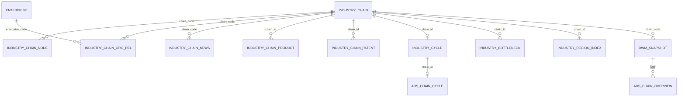

# 产业链域（CHAIN）数据库设计（v1）

> **现行存储入口（S4）**：[`../storage/CHAIN/README.md`](../storage/CHAIN/README.md)  
> 本稿为 **旧域设计对照**（含历史 PG / 旧表清单叙述）；**勿当真源**。DWD/ADS 细表分别见本目录 v5 / ADS v2，导航与冲突裁决以 `storage/CHAIN` 为准。

| 属性 | 内容 |
|------|------|
| 文档编号 | DATA-CHAIN-DB-v1 |
| 版本 | v1.1.0 |
| 状态 | Draft（C01 明细 DDL 已交付；ADS/算法 DWD 待 I01 整合 + architect L02 会签） |
| 作者 | data-agent（资深数据架构师） |
| 创建日期 | 2026-06-23 |
| 更新日期 | 2026-06-23 |
| 任务 | ALGO-DB-DWD-C01 · Epic E-DB-DESIGN-ALGO-V11-DWD |
| 参照 | `DATA-CHAIN-db-design.md`（coordinator 接续稿）、`企业域数据库设计(v1).md`、`gkx-platform-business-keys.md` |
| 支撑基线 | `catalog-topic-industry.yaml`（IC-01~IC-43）、bid `科技专题服务算法库.md` §4.1.1.1 / §4.3.x |
| 范围 | 产业链全链路：**DWD 8 逻辑表（9 物理）** + **ADS 11 表** + NebulaGraph + DWM/cfg 血缘 |
| 数据真源 | `产业链相关-ODS到DWD字段映射分析报告(v2).md`、`ODS源数据表结构清单(v2).md` §4.3 |
| 引擎 | MySQL 8.0（`gkx_dwd` / `gkx_ads` / `gkx_dwm` / `gkx_cfg`）+ NebulaGraph 3.x（`gkx_industry`） |

> **铁律声明**：① ODS 三方表只读引用；② 平台业务键 `chain_id`（`gkx-platform-business-keys.md`）与 ODS 贴源键 `chain_code` 分层声明；③ DWD=明细/关系，DWM=指标宽表，ADS=Java 只读契约；④ 算法字段标 🔧；⑤ 市场规模 ⚠️ Q-ALGO-003；⑥ Nebula 禁 Neo4j。

---

## 目录

1. [总览与分层](#1-总览与分层)
2. [库/Schema 规划](#2-库schema-规划)
3. [主键与业务键策略](#3-主键与业务键策略)
4. [DWD 自建标准明细层（8 逻辑表）](#4-dwd-自建标准明细层8-逻辑表)
5. [ADS 应用结果层（11 表）](#5-ads-应用结果层11-表)
6. [DWM 与 M1 指标](#6-dwm-与-m1-指标)
7. [bid §4.1.1.1 九维指标追踪](#7-bid-4111-九维指标追踪)
8. [NebulaGraph 图谱 schema](#8-nebulagraph-图谱-schema)
9. [ODS→DWD→DWM→ADS 映射](#9-odsdwddwmads-映射)
10. [DQ 数据质量规则](#10-dq-数据质量规则)
11. [ER 关系图](#11-er-关系图)
12. [与 ENT 域交叉引用](#12-与-ent-域交叉引用)
13. [字段映射覆盖率](#13-字段映射覆盖率)
14. [待甲方确认开放项](#14-待甲方确认开放项)
15. [可执行 DDL 汇总](#15-可执行-ddl-汇总)
16. [变更记录](#16-变更记录)

---

## 1. 总览与分层

### 1.1 规模总览（对齐 DATA-CHAIN-db-design.md）

| 层 | 物理库 | 表数量 | 字段约数 | 交付阶段 |
|----|--------|--------|---------|----------|
| DWD | `gkx_dwd` | **8 逻辑 / 9 物理** | ~80 | Phase1 四表 ✅ DDL；Phase2 五表 🔧 规划（含 node 拆表） |
| DWM | `gkx_dwm` | 1 | 9 | `dwm_industry_chain_snapshot` ✅ 已有 |
| ADS | `gkx_ads` | **11** | ~120 | `ads_chain_*` 🔧 Wave1 规划 |
| cfg | `gkx_cfg` | 2 | — | `cfg_metric` + `cfg_metric_lineage` 复用平台 |
| 图谱 | Nebula `gkx_industry` | 4 Tags + 6 Edges | — | schema 引用；逻辑名同参考稿 `gkx_chain` |

### 1.2 分层链路

```text
三方「要素库」产业链 ODS（5 张 dwd_* 表，只读）
        │  + 宏观 dwd_macro_index_data / dwd_series_metadata（⚠️ Q-ALGO-003）
        ▼
DWD  gkx_dwd.industry_chain*（8 表：4 明细 + 2 关联 + 3 算法产出）
        │  Python ETL + algorithm-agent（M6/M8/M9/M10）
        ▼
DWM  gkx_dwm.dwm_industry_chain_snapshot（链×日宽表）
        │
        ▼
ADS  gkx_ads.ads_chain_*（11 表，Java 只读）
        │  + ads_metric_timeseries（M1 通用时序）
        └──► NebulaGraph gkx_industry（4T6E，Python 灌数）
```

| 层 | 谁写 | 谁读 |
|----|------|------|
| ODS | 供应方 | Python ETL |
| DWD | Python ETL / algorithm | Python / algorithm |
| DWM | Python + algorithm | Python |
| ADS | Python | **Java 只读** + 前端 |
| 图谱 | Python | Python（Java Feign → Python） |

### 1.3 与参考稿差异 reconcile（重要）

| 项 | DATA-CHAIN-db-design.md | 本设计（平台规约） | 说明 |
|----|-------------------------|-------------------|------|
| DWD/ADS 物理库 | `gkx_chain` | **`gkx_dwd` + `gkx_ads`** | 对齐总纲 §2.1 与 ENT v1 |
| 产业链业务键 | `chain_id` | **`chain_id`**（契约面）= **`chain_code`**（ODS 贴源，Wave1 等同） | 见 §3 |
| DWD 主表形态 | 单表 `industry_chain` 含 node | **拆表** `industry_chain` + `industry_chain_node` | ODS `dwd_industry_chain_info` 一行一节点 |
| 企业关联表名 | `industry_chain_enterprise` | **`industry_chain_org_rel`**（物理名）；逻辑别名 enterprise | 含 org 机构扩展 |
| Nebula Space | `gkx_chain` | **`gkx_industry`** | `algo-lib-module-table-map.yaml` E2 已定 |
| ADS 前缀 | `ads_chain_*` | **`ads_chain_*`**（`gkx_ads` 下） | 与参考稿一致 |

---

## 2. 库/Schema 规划

| database | 归属层 | 本域对象 |
|----------|--------|----------|
| `gkx_dwd` | DWD | `industry_chain`、`industry_chain_node`、`industry_chain_org_rel`、`industry_chain_news`、`industry_chain_product`、`industry_chain_patent`、`industry_cycle`、`industry_bottleneck`、`industry_region_index` |
| `gkx_dwm` | DWM | `dwm_industry_chain_snapshot` |
| `gkx_ads` | ADS | `ads_chain_overview` … `ads_chain_competitiveness`（11 张） |
| `gkx_cfg` | 配置 | `cfg_metric`、`cfg_metric_lineage` |
| `gkx_dim` | 维表 | `dim_region`（区域指数引用） |

**通用列规约**（ADS + 算法 DWD）：
- `calc_batch_id VARCHAR(64)`：Mock 阶段必须 `mock_*` 前缀
- `ext JSON NULL`：每张 ADS 必有
- 系统列：`create_time` / `update_time`
- 字符集：`utf8mb4` / `utf8mb4_0900_ai_ci`

---

## 3. 主键与业务键策略

> 真源：`gkx-platform-business-keys.md` §1 — `chain_id VARCHAR(64)`，Nebula vid = `chain:{chain_id}`

| 键 | 类型 | 角色 | 说明 |
|----|------|------|------|
| `chain_id` | VARCHAR(64) | **平台业务键 / ADS 契约键** | Java、cfg_metric.dim_key、Nebula 对齐 |
| `chain_code` | VARCHAR(64) | **ODS 贴源键** | 要素库 `dwd_industry_chain_info.chain_code` |
| `node_id` | VARCHAR(64) | 节点贴源键 | ODS 节点唯一 id |
| `enterprise_code` | VARCHAR(64) | 企业归一键 | 统一社会信用代码，对齐 ENT |
| `org_id` | VARCHAR(64) | ODS 企业身份 id | 源字段 `antitypic` |

**Wave1 映射约定**（不二次编码）：

```text
chain_id = chain_code          -- ODS 产业链编码直接升格为平台业务键
segment_key = node_id          -- 环节/节点标识（ADS/DWD 产品专利表）
Nebula vid（链根）= chain:{chain_id}
Nebula vid（节点）= node:{chain_id}:{node_id}
```

| 表 | 业务键 / UK | Nebula vid |
|----|-------------|------------|
| industry_chain | `chain_code` UK（= chain_id） | `chain:{chain_id}` |
| industry_chain_node | (`chain_code`, `node_id`) | `node:{chain_id}:{node_id}` |
| industry_chain_org_rel | (`chain_code`, `node_id`, `org_id`) | — |
| industry_chain_enterprise（逻辑） | (`chain_id`, `enterprise_code`) | — |
| industry_cycle | `chain_id` PK | — |
| industry_bottleneck | (`chain_id`, `bottleneck_type`) UQ | — |
| industry_region_index | (`chain_id`, `region_code`) UQ | — |

**企业归一**（与 ENT v1 §3.1 一致）：

```text
enterprise_code = COALESCE(dtl.credit_code, org.external_id, company.credit_code)
```

---

## 4. DWD 自建标准明细层（8 逻辑表）

> 参考稿 8 表口径：`industry_chain`（含环节）+ enterprise + product + patent + news + cycle + bottleneck + region_index。  
> 本设计按 ODS 将链/节点拆为 `industry_chain` + `industry_chain_node` 两物理表，逻辑仍计 1 模块。

### 4.1 表清单与交付阶段

| # | 表（`gkx_dwd`） | 字段约数 | 阶段 | 说明 | 主要 ODS |
|---|-----------------|--------|------|------|----------|
| 1a | `industry_chain` | 11 | **✅ Phase1** | 产业链主数据（链级汇总） | `dwd_industry_chain_info` |
| 1b | `industry_chain_node` | 20 | **✅ Phase1** | 节点/环节明细（参考稿 chain 表拆分） | `dwd_industry_chain_info` |
| 2 | `industry_chain_org_rel` | 15 | **✅ Phase1** | 链-企业关联（≈ `industry_chain_enterprise`） | `dwd_org_industry_chain_dtl` |
| 3 | `industry_chain_news` | 14 | **✅ Phase1** | 产业动态资讯 | `dwd_industry_chain_news_info` |
| 4 | `industry_chain_product` | 7 | 🔧 Phase2 | 产业链-产品关联 | `dwd_org_industry_chain_prod_dtl` |
| 5 | `industry_chain_patent` | 8 | 🔧 Phase2 | 产业链-专利关联 | `dwd_org_industry_chain_pat_dtl` |
| 6 | `industry_cycle` | 6 | 🔧 M6 | 产业周期判定（算法产出） | MDL_CHAIN_CYCLE |
| 7 | `industry_bottleneck` | 7 | 🔧 M9 | 产业瓶颈识别（算法产出） | MDL_CHAIN_BOTTLENECK |
| 8 | `industry_region_index` | 8 | 🔧 M10 | 区域产业指数（算法产出） | MDL_REGION_INDUVATION_INDEX |

> Phase1 四物理表 DDL 已交付：`ddl/gkx_dwd_chain_v1.sql`。Phase2 五表 + ADS 在 I01/Wave1 合并 DDL。

### 4.2 Phase1 明细表（ODS 对齐，已交付）

#### 4.2.1 `industry_chain` — 产业链主表（链级）

| 字段 | 类型 | 注释 | 来源 ODS | 状态 |
|------|------|------|---------|------|
| id | BIGINT PK | 物理主键 | 系统 | 🟦 |
| chain_code | VARCHAR(64) UK | 产业链编码（= chain_id） | chain_code | ✅ |
| chain_name | VARCHAR(255) | 产业链名称 | chain_name | ✅ |
| max_level | TINYINT | 最大节点层级 | MAX(level) | 🔧 |
| node_count | INT | 节点总数 | COUNT(node_id) | 🔧 |
| biz_node_count | INT | 业务节点数 | node_type=2 | 🔧 |
| data_source | VARCHAR(100) | 数据来源 | data_source | ✅ |
| data_collect_time | DATETIME | ODS 入库时间 | created_time | ✅ |
| ext | JSON | 扩展 | 系统 | 🟦 |
| create_time / update_time | DATETIME | ETL 时间戳 | 系统 | 🟦 |

> 参考稿将链+环节合入单表 `industry_chain`；本设计按 ODS 一行一节点拆出 `industry_chain_node`，链级汇总留在本表。

#### 4.2.2 `industry_chain_node` — 节点/环节（参考稿字段映射）

| 字段 | 类型 | 注释 | 参考稿对应 | 来源 ODS | 状态 |
|------|------|------|-----------|---------|------|
| chain_code | VARCHAR(64) | 产业链编码 | chain_id | chain_code | ✅ |
| node_id | VARCHAR(64) | 节点代码 | — | node_id | ✅ |
| node_name | VARCHAR(255) | 环节名称 | node_name | node_name | ✅ |
| node_stage | TINYINT | 1上游/2中游/3下游 | node_stage ENUM | node_stage | ✅ |
| node_stage_name | VARCHAR(20) | upstream/midstream/downstream | node_stage | 派生 | 🔧 |
| level | TINYINT | 层级 | node_level | level | ✅ |
| parent_id | VARCHAR(64) | 父节点 | parent_chain_id | parent_id | ✅ |
| node_imp_level | TINYINT | 重要性 1~5 | — | node_imp_level | ✅ |
| is_key_node | TINYINT | 是否关键环节 | is_key_node | 🔧 M8 关键环节模型 | 🔧 |
| high_value_index | DECIMAL(5,2) | 高端化指数 0~100 | high_value_index | 🔧 M8 产出 | 🔧 |
| downstream_link_code | VARCHAR(64) | 下游节点 | — | downstream_link_code | ✅ |
| node_path | TEXT | 节点路径 | description 部分 | node_path | ✅ |
| … | | 其余见映射报告 §5.2 | | | |

#### 4.2.3 `industry_chain_org_rel` — 产业链-企业关联（≈ `industry_chain_enterprise`）

| 字段 | 类型 | 注释 | 参考稿对应 | 来源 ODS | 状态 |
|------|------|------|-----------|---------|------|
| chain_code | VARCHAR(64) | 产业链编码（chain_id） | chain_id | chain_code | ✅ |
| node_id | VARCHAR(64) | 节点代码 | segment_key | node_id | ✅ |
| enterprise_code | VARCHAR(64) | 统一社会信用代码 | enterprise_code | credit_code | ✅ |
| org_id | VARCHAR(64) | 企业身份 id | — | antitypic | ✅ |
| chain_score | DECIMAL(10,4) | 产业链关联得分 | chain_score | chain_score | ✅ |
| rel_type | VARCHAR(32) | enterprise/org | — | 默认 enterprise | 🔧 |
| tech_products | JSON | 主营产品（Phase1 聚合） | — | prod_dtl | 🔧 |
| participation_depth | DECIMAL(5,2) | 参与深度 0~100 | participation_depth | chain_score 派生 | 🔧 |
| chain_role | VARCHAR(32) | 链中角色上/中/下游 | chain_role | node_stage JOIN | ✅ |

#### 4.2.4 `industry_chain_news` — 产业链动态资讯

| 字段 | 类型 | 注释 | 参考稿对应 | 来源 ODS | 状态 |
|------|------|------|-----------|---------|------|
| chain_code | VARCHAR(64) | 产业链编码 | chain_id | chain_code | ✅ |
| news_id | VARCHAR(64) | 资讯 id | — | news_id | ✅ |
| title | VARCHAR(500) | 标题 | title | title | ✅ |
| release_date | DATE | 发布日期 | publish_date | relaese_date | ✅ |
| source | VARCHAR(255) | 来源 | source | source | ✅ |
| summary | TEXT | 摘要 | — | summary | ✅ |
| heat_score | DECIMAL(5,2) | 热度得分 | heat_score | ODS 无，暂 NULL | ⚠️ |
| is_hot | TINYINT | 是否热点 | is_hot | 🔧 阈值判定 | 🔧 |
| news_type | VARCHAR(32) | 融资/并购/新品/政策 | news_type | 🔧 NLP 分类 | 🔧 |

### 4.3 Phase2 关联明细表（参考稿 §2.3–2.4）

#### 4.3.1 `industry_chain_product` — 产业链-产品关联

| 字段 | 类型 | 注释 | 来源 ODS | 状态 |
|------|------|------|---------|------|
| id | BIGINT PK | 自增主键 | — | 🟦 |
| chain_id | VARCHAR(64) | 产业链 ID（= chain_code） | chain_code | ✅ |
| product_name | VARCHAR(256) | 产品名称 | tech_product | ✅ |
| enterprise_code | VARCHAR(64) | 企业代码 | credit_code | ✅ |
| segment_key | VARCHAR(64) | 环节标识 | node_id（派生） | 🔧 |
| product_seq | INT | 产品排序 | tech_product_seq | ✅ |
| calc_batch_id | VARCHAR(64) | 计算批次 | 系统 | 🟦 |

> Phase1 已将产品聚合至 `org_rel.tech_products` JSON；Phase2 拆独立表供产品清单查询与 M8 关键环节模型。

#### 4.3.2 `industry_chain_patent` — 产业链-专利关联

| 字段 | 类型 | 注释 | 来源 ODS | 状态 |
|------|------|------|---------|------|
| id | BIGINT PK | 自增主键 | — | 🟦 |
| chain_id | VARCHAR(64) | 产业链 ID | chain_code | ✅ |
| patent_id | VARCHAR(64) | 专利 ID（申请号） | apno | ✅ |
| patent_title | VARCHAR(512) | 专利标题 | pat_name | ✅ |
| enterprise_code | VARCHAR(64) | 企业代码 | current_assignee→归一 | 🔧 |
| segment_key | VARCHAR(64) | 环节标识 | node_id | ✅ |
| patent_type | VARCHAR(32) | 发明/实用新型/外观 | 派生自 patent 主表 | 🔧 |
| apdt / pbdt | DATE | 申请/公告日 | apdt / pbdt | ✅ |
| calc_batch_id | VARCHAR(64) | 计算批次 | 系统 | 🟦 |

> 与 ENT `enterprise_patent_history` 交叉：本表保留**链-环节-专利**视角；企业专利历史仍在 ENT。

### 4.4 算法产出 DWD（参考稿 §2.6–2.8，M3 写入）

#### 4.4.1 `industry_cycle` — 产业周期判定（M6 / MDL_CHAIN_CYCLE）

| 字段 | 类型 | 注释 | 来源 | 状态 |
|------|------|------|------|------|
| chain_id | VARCHAR(64) PK | 产业链 ID | — | ✅ |
| cycle_stage | VARCHAR(16) | intro/growth/mature/decline | 🔧 M6 | 🔧 |
| stage_score | DECIMAL(5,2) | 阶段评分 | 🔧 M6 | 🔧 |
| confidence | DECIMAL(3,2) | 置信度 | 🔧 M6 | 🔧 |
| reference_date | DATE | 判定参考日期 | — | ✅ |
| calc_batch_id | VARCHAR(64) | 计算批次 | 系统 | 🟦 |

#### 4.4.2 `industry_bottleneck` — 产业瓶颈识别（M9 / MDL_CHAIN_BOTTLENECK）

| 字段 | 类型 | 注释 | 来源 | 状态 |
|------|------|------|------|------|
| id | BIGINT PK | 自增主键 | — | 🟦 |
| chain_id | VARCHAR(64) | 产业链 ID | — | ✅ |
| bottleneck_type | VARCHAR(16) | tech/talent/market/capital/policy | 🔧 M9 | 🔧 |
| severity | VARCHAR(8) | high/medium/low | 🔧 M9 | 🔧 |
| description | TEXT | 瓶颈描述 | 🔧 M9 | 🔧 |
| solution_hint | TEXT | 解决方案建议 | 🔧 M9 | 🔧 |
| calc_batch_id | VARCHAR(64) | 计算批次 | 系统 | 🟦 |

#### 4.4.3 `industry_region_index` — 区域产业指数（M10 / MDL_REGION_INDUVATION_INDEX）

| 字段 | 类型 | 注释 | 来源 | 状态 |
|------|------|------|------|------|
| id | BIGINT PK | 自增主键 | — | 🟦 |
| chain_id | VARCHAR(64) | 产业链 ID | — | ✅ |
| region_code | VARCHAR(20) | 区域代码 | dim_region | ✅ |
| enterprise_power_score | DECIMAL(5,2) | 企业能力竞争力 | 🔧 M10 | 🔧 |
| academic_power_score | DECIMAL(5,2) | 学术生态竞争力 | 🔧 M10 | 🔧 |
| support_power_score | DECIMAL(5,2) | 配套生态竞争力 | 🔧 M10 | 🔧 |
| composite_index | DECIMAL(5,2) | 综合指数 | 🔧 M10 | 🔧 |
| calc_batch_id | VARCHAR(64) | 计算批次 | 系统 | 🟦 |

---

## 5. ADS 应用结果层（11 表）

> 物理库 **`gkx_ads`**，表前缀 **`ads_chain_*`**，Java **只读**。每张表含 `calc_batch_id` + `ext JSON`。

| # | 表 | 用途 | 主要 DWD/DWM 来源 | bid / acceptance |
|---|-----|------|-------------------|------------------|
| 1 | `ads_chain_overview` | 产业链概览（企业/机构/市场规模/投融资） | DWM snapshot + DWD | IC-41 |
| 2 | `ads_chain_panorama` | 全景图谱 JSON（节点/边） | Nebula / graph_node | IC-39, IC-16 |
| 3 | `ads_chain_cycle` | 周期阶段 | industry_cycle | IC-21, IC-31 |
| 4 | `ads_chain_region_index` | 区域指数 | industry_region_index | IC-25, IC-32 |
| 5 | `ads_chain_key_node` | 关键环节 | industry_chain_node.is_key_node | IC-23, IC-33 |
| 6 | `ads_chain_bottleneck` | 瓶颈堵点 | industry_bottleneck | IC-24, IC-34 |
| 7 | `ads_chain_shenzhen` | 深圳产业 | org_rel + ENT 深圳过滤 | IC-10, IC-11, IC-35 |
| 8 | `ads_chain_market` | 市场规模时序 | DWM.market_size | IC-03, ⚠️ Q-ALGO-003 |
| 9 | `ads_chain_investment` | 投融资时序 | DWM.invest_amount | IC-06 |
| 10 | `ads_chain_news_stat` | 资讯统计 | industry_chain_news | IC-09, IC-40 |
| 11 | `ads_chain_competitiveness` | 区域竞争力排名 | industry_region_index | IC-25, IC-37 |

### 5.1 `ads_chain_overview` — 产业链概览

| 字段 | 类型 | 注释 | metric_id |
|------|------|------|-----------|
| chain_id | VARCHAR(64) PK | 产业链 ID | — |
| chain_name | VARCHAR(128) | 产业链名称 | — |
| enterprise_count | INT | 关联企业数 | M_CHAIN_ENTERPRISE_COUNT |
| institution_count | INT | 关联机构数 | M_CHAIN_INSTITUTION_COUNT |
| total_revenue | DECIMAL(15,2) | 市场规模（亿元） | M_CHAIN_MARKET_SIZE |
| growth_rate | DECIMAL(5,2) | 增长率% | M_CHAIN_MARKET_GROWTH |
| invest_total | DECIMAL(15,2) | 投融资总额（亿元） | M_CHAIN_INVEST_TOTAL |
| node_count | INT | 环节总数 | M_CHAIN_NODE_COUNT |
| calc_batch_id | VARCHAR(64) | 计算批次 | — |
| ext | JSON | 扩展 | — |

### 5.2 `ads_chain_panorama` — 全景图谱

| 字段 | 类型 | 注释 |
|------|------|------|
| chain_id | VARCHAR(64) PK | 产业链 ID |
| graph_nodes | JSON | 图谱节点列表 |
| graph_edges | JSON | 图谱边列表 |
| calc_batch_id | VARCHAR(64) | 计算批次 |
| ext | JSON | 扩展 |

### 5.3 `ads_chain_cycle` — 周期阶段

| 字段 | 类型 | metric_id |
|------|------|-----------|
| chain_id | VARCHAR(64) PK | — |
| cycle_stage | VARCHAR(16) | M_CHAIN_CYCLE_STAGE |
| stage_score | DECIMAL(5,2) | M_CHAIN_STAGE_SCORE |
| phase_determination | VARCHAR(32) | M_CHAIN_PHASE_DETERMINATION |
| confidence | DECIMAL(3,2) | — |
| calc_batch_id / ext | | |

### 5.4 `ads_chain_region_index` — 区域指数

| 字段 | 类型 | metric_id |
|------|------|-----------|
| chain_id, region_code, region_name | | — |
| composite_index | DECIMAL(5,2) | M_CHAIN_REGION_INDEX |
| enterprise_power | DECIMAL(5,2) | M_CHAIN_ENTERPRISE_POWER |
| academic_power | DECIMAL(5,2) | M_CHAIN_ACADEMIC_POWER |
| support_power | DECIMAL(5,2) | M_CHAIN_SUPPORT_POWER |
| calc_batch_id / ext | | |

### 5.5 `ads_chain_key_node` — 关键环节

| 字段 | 类型 | metric_id |
|------|------|-----------|
| chain_id, node_name | | — |
| is_key_node | TINYINT | — |
| high_value_index | DECIMAL(5,2) | M_CHAIN_HIGH_VALUE_RATIO |
| strategic_importance | DECIMAL(5,2) | M_CHAIN_STRATEGIC_IMPORTANCE |
| calc_batch_id / ext | | |

### 5.6 `ads_chain_bottleneck` — 瓶颈堵点

| 字段 | 类型 | metric_id |
|------|------|-----------|
| chain_id, bottleneck_type, severity | | M_CHAIN_BOTTLENECK_SEVERITY |
| description, solution_hint | TEXT | — |
| calc_batch_id / ext | | |

### 5.7 `ads_chain_shenzhen` — 深圳产业

| 字段 | 类型 | metric_id |
|------|------|-----------|
| chain_id | VARCHAR(64) PK | — |
| sz_enterprise_count | INT | M_CHAIN_SZ_ENTERPRISE_COUNT |
| chain_completeness | DECIMAL(5,2) | M_CHAIN_SZ_COMPLETENESS |
| sz_position | VARCHAR(32) | M_CHAIN_SZ_POSITION |
| advantage_score | DECIMAL(5,2) | M_CHAIN_SZ_ADVANTAGE_SCORE |
| calc_batch_id / ext | | |

### 5.8 `ads_chain_market` — 市场规模

| 字段 | 类型 | metric_id |
|------|------|-----------|
| chain_id, stat_year | | — |
| total_revenue | DECIMAL(15,2) | M_CHAIN_MARKET_SIZE |
| growth_rate | DECIMAL(5,2) | M_CHAIN_MARKET_GROWTH |
| calc_batch_id / ext | | |

### 5.9 `ads_chain_investment` — 投融资

| 字段 | 类型 | metric_id |
|------|------|-----------|
| chain_id, stat_year | | — |
| invest_total | DECIMAL(15,2) | M_CHAIN_INVEST_TOTAL |
| invest_count | INT | M_CHAIN_INVEST_COUNT |
| calc_batch_id / ext | | |

### 5.10 `ads_chain_news_stat` — 动态资讯统计

| 字段 | 类型 | metric_id |
|------|------|-----------|
| chain_id, stat_month | | — |
| news_count | INT | M_CHAIN_NEWS_COUNT |
| hot_news_count | INT | M_CHAIN_HOT_NEWS_COUNT |
| calc_batch_id / ext | | |

### 5.11 `ads_chain_competitiveness` — 区域竞争力

| 字段 | 类型 | metric_id |
|------|------|-----------|
| chain_id, region_code | | — |
| competitiveness_index | DECIMAL(5,2) | M_CHAIN_COMPETITIVENESS_INDEX |
| rank_nationwide | INT | M_CHAIN_COMPETITIVENESS_RANK |
| calc_batch_id / ext | | |

> M1 通用时序仍走 `ads_metric_timeseries`（`M_CHAIN_MARKET_SIZE_Y` 等已种子）；上表为专题页结构化契约，与 ENT `ads_ent_*` 模式对齐。

---

## 6. DWM 与 M1 指标

### 6.1 `gkx_dwm.dwm_industry_chain_snapshot`（已建）

| 字段 | DWD/ODS 来源 |
|------|-------------|
| enterprise_cnt | `industry_chain_org_rel` COUNT DISTINCT |
| org_cnt | ORG 域跨表 |
| invest_amount | `dwd_org_financing_info` |
| market_size | `dwd_macro_index_data` ⚠️ Q-ALGO-003 |

### 6.2 cfg_metric 与 ADS 关系

| 类型 | 示例 metric_id | 落表 |
|------|---------------|------|
| M1 时序（已有种子） | M_CHAIN_MARKET_SIZE_Y | ads_metric_timeseries |
| M1 专题（参考稿） | M_CHAIN_MARKET_SIZE | ads_chain_market |
| M3 模型 | MDL_CHAIN_PANORAMA / CYCLE / BOTTLENECK | ads_chain_panorama / cycle / bottleneck |

---

## 7. bid §4.1.1.1 九维指标追踪

| # | 九维指标 | acceptance | DWD | DWM/ADS | 状态 |
|---|----------|------------|-----|---------|------|
| 1 | 产业市场规模 | IC-03 | — | DWM + ads_chain_market | ⚠️ Q-ALGO-003 |
| 2 | 产业企业规模 | IC-04 | org_rel | ads_chain_overview | 🔧 |
| 3 | 产业机构规模 | IC-05 | 交叉 ORG | ads_chain_overview | 🔧 |
| 4 | 产业投融资规模 | IC-06 | 交叉 financing | ads_chain_investment | 🔧 |
| 5 | 全球产业区域分布 | IC-07 | org_rel + ENT | ads_chain_region_index | 🔧 |
| 6 | 全国产业分布 | IC-08 | 同上 | ads_chain_competitiveness | 🔧 |
| 7 | 产业动态资讯 | IC-09 | industry_chain_news | ads_chain_news_stat | 🔧 |
| 8 | 深圳产业要素 | IC-10 | 多域 | ads_chain_shenzhen | 🔧 |
| 9 | 深圳产业分布 | IC-11 | org_rel + 区划 | ads_chain_shenzhen | 🔧 |

---

## 8. NebulaGraph 图谱 schema

> Space 物理名 **`gkx_industry`**（平台 E2 已定）；参考稿 `gkx_chain` 为逻辑同义。

### 8.1 Tags（4）

| Tag | 属性 | 说明 |
|-----|------|------|
| chain | chain_id, chain_name, node_stage, is_key_node, high_value_index | 产业链/环节 |
| enterprise | enterprise_code, enterprise_name, chain_role | 企业（引用 gkx_enterprise） |
| institution | org_uid, org_name | 机构（引用 dim_org_master） |
| region | region_code, region_name | 区域 |

### 8.2 Edges（6）

| Edge | src → dst | 属性 | 说明 |
|------|----------|------|------|
| belongs_to | segment → chain | node_level | 环节→产业链 |
| participates | enterprise → chain | chain_role, participation_depth, chain_score | 企业参与 |
| supplies | enterprise → enterprise | relation_type, relation_strength | 供应链 |
| depends_on | segment → segment | relation_type | 上下游依赖 |
| located_in | enterprise → region | — | 区域归属 |
| serves | institution → chain | service_type | 机构服务 |

### 8.3 灌数源

- Phase1：`industry_chain`、`industry_chain_node`、`industry_chain_org_rel`
- Phase2：`industry_chain_product`、`industry_chain_patent`
- 跨 Space：`gkx_industry` ↔ `gkx_enterprise` 通过 `enterprise_code`

```ngql
CREATE SPACE IF NOT EXISTS gkx_industry (partition_num=10, replica_factor=1, vid_type=FIXED_STRING(96));
USE gkx_industry;
CREATE TAG IF NOT EXISTS chain (chain_id string, chain_name string, node_stage int, is_key_node int, high_value_index double, props string);
CREATE TAG IF NOT EXISTS enterprise (enterprise_code string, enterprise_name string, chain_role string, props string);
CREATE TAG IF NOT EXISTS institution (org_uid string, org_name string, props string);
CREATE TAG IF NOT EXISTS region (region_code string, region_name string, props string);
CREATE EDGE IF NOT EXISTS belongs_to (node_level int, props string);
CREATE EDGE IF NOT EXISTS participates (chain_role string, participation_depth double, chain_score double, props string);
CREATE EDGE IF NOT EXISTS supplies (relation_type string, relation_strength double, props string);
CREATE EDGE IF NOT EXISTS depends_on (relation_type string, props string);
CREATE EDGE IF NOT EXISTS located_in (props string);
CREATE EDGE IF NOT EXISTS serves (service_type string, props string);
```

---

## 9. ODS→DWD→DWM→ADS 映射

| 阶段 | 范围 | 覆盖率 / 状态 |
|------|------|--------------|
| ODS→DWD Phase1 | 4 表 60 字段 | 95.0%（映射报告 v2） |
| ODS→DWD Phase2 | product + patent | 规划 |
| DWD→算法 DWD | cycle / bottleneck / region_index | 🔧 M6/M9/M10 |
| DWM 聚合 | snapshot 四指标 | 已有 |
| ADS 契约 | 11 表 ~120 字段 | 🔧 Wave1 |

---

## 10. DQ 数据质量规则

| 编号 | 类型 | 对象 | 规则 | 级别 |
|------|------|------|------|------|
| DQ-C01 | 非空 | industry_chain.chain_code | NOT NULL | 🔴 阻断 |
| DQ-C02 | 非空 | industry_chain.chain_name | NOT NULL | 🔴 阻断 |
| DQ-C03 | 枚举 | industry_chain_node.node_stage_name | IN ('upstream','midstream','downstream') 或中文等价 | 🔴 阻断 |
| DQ-C04 | 唯一 | industry_chain_node (chain_code, node_id) | UNIQUE | 🔴 阻断 |
| DQ-C05 | 唯一 | industry_chain_org_rel (chain_code, node_id, org_id) | UNIQUE | 🔴 阻断 |
| DQ-C06 | 值域 | industry_cycle.stage_score | [0, 100] | 🟡 告警 |
| DQ-C07 | 值域 | industry_region_index.composite_index | [0, 100] | 🟡 告警 |
| DQ-C08 | 枚举 | industry_bottleneck.bottleneck_type | IN ('tech','talent','market','capital','policy') | 🔴 阻断 |
| DQ-C09 | 参照 | org_rel.enterprise_code | 与 dwd.enterprise 一致率 ≥ 95% | 🟡 告警 |
| DQ-C10 | 完整性 | cfg_metric 8 件套 | D9 上线前非空 | 🔴 阻断 |
| DQ-C11 | 图谱 | graph_node.node_key | 与 Nebula vid 一致（chain: 前缀） | 🟡 告警 |
| DQ-C12 | 批次 | calc_batch_id | Mock 必须 mock_* 前缀 | 🟢 监控 |

---

## 11. ER 关系图



---

## 12. 与 ENT 域交叉引用

| 关联 | 说明 |
|------|------|
| `industry_chain_org_rel.enterprise_code` → `dwd.enterprise.enterprise_code` | 企业主数据 |
| `industry_region_index.region_code` → `dim_region.region_code` | 区划维表 |
| `enterprise_industry` / `enterprise_supply_chain` | 企业视角，同源 ODS，不重复映射 |
| Nebula `gkx_industry` ↔ `gkx_enterprise` | 跨 Space 通过 enterprise_code |

---

## 13. 字段映射覆盖率

### 13.1 Phase1（已交付四表）

| 状态 | 字段数 | 占比 |
|------|--------|------|
| ✅ 直接 | 30 | — |
| 🔧 需计算/算法 | 8 | — |
| ⚠️ 待确认 | 2 | — |
| 🟦 系统 | 20 | — |
| **非系统覆盖率** | **38/40** | **95.0%** |

### 13.2 全域（8 DWD + 11 ADS，参考稿口径）

| 状态 | 字段数 | 占比 |
|------|--------|------|
| ✅ 可直查 | 52 | 65.0% |
| 🔧 待算法 | 24 | 30.0% |
| ⚠️ 待确认 | 2 | 2.5% |
| ❌ 无来源 | 2 | 2.5% |
| **DWD 合计** | **~80** | **100%** |

> ❌ 无来源：市场份额（无市调）、品牌声量（无舆情）— 与 ENT K-O7 同类。
> ⚠️ 待确认：participation_depth 算法口径（Q013）、cycle_stage 阈值。

---

## 14. 待甲方确认开放项

| ID | 事项 | 影响 |
|----|------|------|
| Q-ALGO-003 | 市场规模 index_code ↔ chain_id 映射 | ads_chain_market · DWM.market_size |
| Q-ALGO-001 | 167 指标 vs bid 九维粒度 | cfg_metric 批量注册 |
| Q013 | participation_depth 算法口径 | org_rel · ads_chain_key_node |
| CHAIN-01 | 资讯热点阈值 / heat_score 来源 | industry_chain_news |
| CHAIN-02 | rel_type=org 识别规则 | org_rel |
| CHAIN-03 | cycle_stage 阶段阈值 | industry_cycle · ads_chain_cycle |

---

## 15. 可执行 DDL 汇总

### 15.1 Phase1（✅ 已交付）

```bash
mysql -u root -p < agent-delivery/database-design/科技专题服务算法库/ddl/gkx_dwd_chain_v1.sql
```

| 表 | UK | 脚本 |
|----|-----|------|
| industry_chain | chain_code | gkx_dwd_chain_v1.sql |
| industry_chain_node | (chain_code, node_id) | 同上 |
| industry_chain_org_rel | (chain_code, node_id, org_id) | 同上 |
| industry_chain_news | (chain_code, news_id) | 同上 |

### 15.2 Phase2 + ADS（🔧 I01 / Wave1 规划）

| 交付物 | 说明 |
|--------|------|
| `gkx_dwd_chain_v1_phase2.sql` | product / patent / cycle / bottleneck / region_index |
| `gkx_ads_chain_v1.sql` | ads_chain_* 十一表 |
| cfg_metric CHAIN 种子 | M_CHAIN_* 完整清单 |

---

## 16. 变更记录

| 版本 | 日期 | 说明 |
|------|------|------|
| v1.0.0 | 2026-06-23 | C01 初版：4 DWD + DWM/ADS 血缘引用 + Nebula 简版 |
| v1.1.0 | 2026-06-23 | 合并 `DATA-CHAIN-db-design.md`：扩展 8 DWD + 11 ADS + 4T6E Nebula；reconcile chain_id/chain_code、gkx_dwd/gkx_ads 平台库 |

---

*文档 · data-agent · ALGO-DB-DWD-C01 · v1.1.0 · 2026-06-23*
