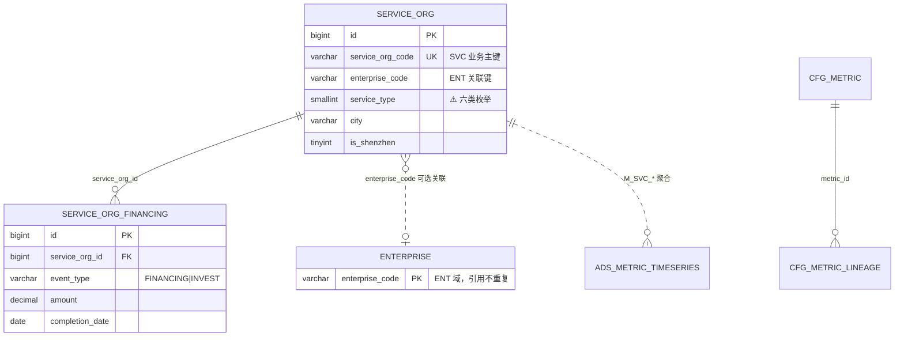

# 服务机构域（SVC/E6）数据库设计（v1）

> **现行存储入口（S4）**：[`../storage/SVC/README.md`](../storage/SVC/README.md) · stores [`../storage/SVC/stores/mysql/dwd-svc.md`](../storage/SVC/stores/mysql/dwd-svc.md)  
> **冲突裁决**：以 **`storage/SVC`** 叙述为准。本文保留为历史对照，**勿作 ODS / stores 建表真源**；勿用本文 `gkx_dwd` / 旧准入假设覆盖现行口径。  
> **S4**：`DATA-SVC-STORAGE-S4-L02`（2026-08-19 · 入口闭环；不删正文）。旧本地 stub `S4-L01` 废作对照。

| 属性 | 内容 |
|------|------|
| 文档编号 | DATA-SVC-DB-v1 |
| 版本 | v1.0.0 |
| 状态 | Draft（待 ALGO-DB-DWD-I01 整合 + architect-agent 会签） |
| 作者 | data-agent（资深数据工程师 + 数据架构师） |
| 创建日期 | 2026-06-23 |
| 任务 ID | ALGO-DB-DWD-S01 · Epic E-DB-DESIGN-ALGO-V11-DWD |
| 范围 | 服务机构要素 DWD 自建明细 + ADS 血缘引用 + cfg_metric 示例 |
| 数据真源 | `服务机构相关-ODS到DWD字段映射分析报告(v2).md`、`要素库建表语句.sql`（ODS 只读引用） |
| 引擎 | MySQL 8.0（utf8mb4，DWD/cfg/ADS） |
| 关联 | `数据库设计.md`（总纲）、`data-lineage-policy.md`（D9）、`data/企业域数据库设计(v1).md`（ENT 交叉引用） |

> **铁律声明**：① ODS 无独立服务机构 Sheet，从机构表筛选归一；② 物理库 `gkx_dwd`；业务键 `service_org_code`；③ **禁止**复制 ENT 全量工商到 SVC 域；④ **Q-ALGO-006 已确认**：无 ODS 服务类型直字段，按 **行业+经营范围** 打六类标签；⑤ Java 只读 ADS，DWD 仅 Python/algorithm 读写；⑥ **禁止**再使用 `dwd_service_org_snapshot` 作为明细表名。

---

## 目录

1. [设计原则与分层](#1-设计原则与分层)
2. [库/Schema 规划与命名](#2-库schema-规划与命名)
3. [实体归一与主键策略](#3-实体归一与主键策略)
4. [DWD 自建标准明细层](#4-dwd-自建标准明细层)
5. [ADS 应用结果层（引用，不重复设计）](#5-ads-应用结果层引用不重复设计)
6. [cfg_metric 指标注册与血缘](#6-cfg_metric-指标注册与血缘)
7. [NebulaGraph 图谱（引用）](#7-nebulagraph-图谱引用)
8. [ODS→DWD→ADS 三段映射](#8-odsdwdads-三段映射)
9. [DQ 数据质量规则](#9-dq-数据质量规则)
10. [ER 关系图](#10-er-关系图)
11. [Mock 数据规模建议](#11-mock-数据规模建议)
12. [待甲方确认开放项](#12-待甲方确认开放项)
13. [可执行 DDL 汇总](#13-可执行-ddl-汇总)

---

## 1. 设计原则与分层

### 1.1 分层链路

```text
三方「要素库」ODS（dwd_org_reg_info / tag / financing / invest，只读）
        │  Python ETL：服务机构识别规则 R1~R5 + 六类分类
        ▼
DWD 自建标准明细  gkx_dwd.service_org + service_org_financing
        │  M1 聚合 + M3 六类技术力/服务链模型
        ▼
ADS 应用结果  gkx_ads.ads_metric_timeseries / ads_model_score
        │
        ├──► MySQL（RDBMS：DWD/ADS/cfg）
        └──► NebulaGraph space=gkx_service（服务关系链，M2 引用）
```

| 层 | 物理位置 | 谁写 | 谁读 | 本设计交付 |
|----|---------|------|------|-----------|
| ODS | 三方要素库 `dwd_org_*` | 供应方 | Python ETL | 引用，不建 |
| DWD | `gkx_dwd.service_org*` | Python ETL | Python / algorithm | ✅ 2 张表 DDL |
| DWM | `gkx_dwm.*` | Python | Python | 🟦 预留（按 service_type×region 预聚合） |
| ADS | `gkx_ads.ads_metric_timeseries` 等 | Python | **Java 只读** | 引用已有 DDL，只写血缘 |
| cfg | `gkx_cfg.cfg_metric*` | data + algorithm | 全域 | 血缘示例 |
| 图谱 | NebulaGraph `gkx_service` | Python 灌数 | Python | schema 引用，本任务不重复 DDL |

### 1.2 映射状态图例

| 图例 | 含义 |
|------|------|
| ✅ | 直接映射 |
| 🔧 | 需计算/算法/规则判定 |
| ⚠️ | 待甲方确认 |
| ❌ | 无来源 |
| 🟦 | 系统/预留 |

---

## 2. 库/Schema 规划与命名

| database | 归属层 | 写 | 读 | 内容 |
|----------|--------|----|----|------|
| `gkx_dwd` | DWD | Python | Python/algorithm | `service_org`、`service_org_financing` |
| `gkx_ads` | ADS | Python | **Java 只读** | `ads_metric_timeseries`、`ads_model_score` |
| `gkx_cfg` | 配置 | data/运维 | 全域 | `cfg_metric` / `cfg_metric_lineage` |

**通用列规约**：
- 主键 `id BIGINT AUTO_INCREMENT`；业务键 `service_org_code VARCHAR(64)`。
- 系统列：`create_time` / `update_time`；扩展列：`ext JSON NULL`。
- 字符集：`ENGINE=InnoDB DEFAULT CHARSET=utf8mb4 COLLATE=utf8mb4_0900_ai_ci`。

**命名统一（Epic 强制）**：

| 旧占位名 | 正式 DWD 物理表名 |
|---------|------------------|
| `dwd_service_org_snapshot` | **`gkx_dwd.service_org`**（+ `service_org_financing`） |

---

## 3. 实体归一与主键策略

### 3.1 服务机构 vs 一般企业

| 维度 | ENT 域 `enterprise` | SVC 域 `service_org` |
|------|---------------------|----------------------|
| 范围 | 全量企业/机构工商主数据 | **六类服务机构子集** |
| 准入 | 双源 merge 全量 | R1~R5；**行业+经营范围** 命中六类服务关键词/行业码 |
| 字段 | 66 字段全量工商 | **38 字段**服务分析必要子集 |
| 分类 | 企业类型/资质标签 | **`service_type` 六类枚举**（DWD 衍生：industry_class + main_activities 打标签） |

### 3.2 主键策略

| 键 | 类型 | 角色 | 说明 |
|----|------|------|------|
| `id` | BIGINT AUTO_INCREMENT | 物理主键/外键 | `service_org_financing.service_org_id` 引用 |
| `service_org_code` | VARCHAR(64) | **SVC 业务归一主键** | = `external_id`；缺失时用 `svc:{org_id}` |
| `org_id` | VARCHAR(64) | ODS 关联键 | 对齐 `dwd_org_reg_info.org_id` |
| `enterprise_code` | VARCHAR(64) | ENT 交叉关联键 | = `external_id`，可 JOIN `gkx_dwd.enterprise` |

- NebulaGraph `vid = svc:{service_org_code}`（与 RDBMS 对齐）。
- **不**在 SVC 域重复存储 ENT 专利/财务/供应链等字段；需要时 ADS 层 JOIN 或 algorithm 聚合。

### 3.3 服务机构识别（ETL 准入）

详见映射报告 §2.2。核心：从 `dwd_org_reg_info` 出发，LEFT JOIN tag/product，应用 R1~R5 规则，写入 `classification_rule_version`。

---

## 4. DWD 自建标准明细层

### 4.1 表清单

| # | 表（逻辑名） | 字段数 | 说明 | 主要 ODS 来源 | 映射覆盖率 |
|---|-------------|--------|------|---------------|-----------|
| 1 | `dwd.service_org` | 38 | 服务机构主表 | `dwd_org_reg_info`、`dwd_org_tag_info`、`dwd_org_org_product_info` | 86.7% |
| 2 | `dwd.service_org_financing` | 16 | 服务链投融资明细 | `dwd_org_financing_info`、`dwd_org_invest_info` | 91.7% |

### 4.2 dwd.service_org（服务机构主表）

> 完整逐字段映射见 `服务机构相关-ODS到DWD字段映射分析报告(v2).md` §5.1。

**六类 service_type 枚举（✅ Q-ALGO-006 已确认）**：

> ODS **无**服务类型直字段。`service_type` 由 ETL/algorithm 依据 `industry_class`（行业）与 `main_activities`（经营范围）规则打标签，归入下表六类。

| 值 | 常量 | 中文 |
|----|------|------|
| 1 | FINANCE | 金融服务 |
| 2 | IP | 知识产权服务 |
| 3 | HR | 人力资源服务 |
| 4 | MKT | 市场营销服务 |
| 5 | CONSULT | 咨询服务 |
| 6 | INNOV | 科技创新服务 |

### 4.3 dwd.service_org_financing（服务链投融资明细）

> 完整映射见映射报告 §5.2。`event_type`：FINANCING（被投融资）/ INVEST（对外投资）。

---

## 5. ADS 应用结果层（引用，不重复设计）

| ADS 表 | 用途 | SVC 域血缘 |
|--------|------|-----------|
| `gkx_ads.ads_metric_timeseries` | M1 基础指标时序 | M_SVC_ORG_CNT、M_SVC_INVEST_Y |
| `gkx_ads.ads_model_score` | M3 深度模型评分 | 六类 tech_score、服务链短板/关系链 |
| `gkx_ads.graph_node` / `graph_edge` | 图谱 PG 镜像 | 服务关系链（Nebula gkx_service） |

Java **只读**上述 ADS 表；禁止直连 `gkx_dwd.service_org`。

---

## 6. cfg_metric 指标注册与血缘

### 6.1 M1 指标八件套（示例）

#### M_SVC_ORG_CNT — 服务机构数量

| 字段 | 值 |
|------|-----|
| metric_id | M_SVC_ORG_CNT |
| metric_name_zh | 服务机构数量 |
| definition | 满足服务机构识别规则且在营的服务机构去重数量；可按 service_type、region、incorporation_year 切片 |
| formula | COUNT(DISTINCT service_org_code) WHERE is_deleted=0 |
| source_tables | `["gkx_dwd.service_org"]` |
| source_systems | `["ods.dwd_org_reg_info","ods.dwd_org_tag_info","ods.dwd_org_org_product_info"]` |
| update_freq | monthly |
| version | v1.0.0 |

#### M_SVC_INVEST_Y — 服务机构年度投融资总额

| 字段 | 值 |
|------|-----|
| metric_id | M_SVC_INVEST_Y |
| metric_name_zh | 服务机构年度投融资总额 |
| definition | 服务机构在指定自然年的投融资事件金额合计（元）；含被投融资与对外投资 |
| formula | SUM(amount) WHERE YEAR(completion_date)=:year AND event_type IN ('FINANCING','INVEST') |
| source_tables | `["gkx_dwd.service_org_financing","gkx_dwd.service_org"]` |
| source_systems | `["ods.dwd_org_financing_info","ods.dwd_org_invest_info"]` |
| update_freq | monthly |
| version | v1.0.0 |

> 完整 `cfg_metric_lineage` INSERT 见 `ddl/gkx_dwd_svc_v1.sql` 末尾。

---

## 7. NebulaGraph 图谱（引用）

| 项 | 值 |
|----|-----|
| Space | `gkx_service`（map.yaml E6） |
| vid | `svc:{service_org_code}` |
| 灌数源 | `gkx_dwd.service_org` + 服务关系（invest/financing 对手方、合作网络） |
| Java | **禁直连 nGQL** |

本任务主交付 MySQL DWD；图谱 schema 由 I01/M2 任务引用。

---

## 8. ODS→DWD→ADS 三段映射

### 8.1 ODS 源表概况

| ODS 表 | 中文名 | 角色 |
|--------|--------|------|
| `dwd_org_reg_info` | 机构基本信息 | **主源** |
| `dwd_org_tag_info` | 机构标签 | **分类主源** |
| `dwd_org_org_product_info` | 经营信息 | **分类辅源** |
| `dwd_org_financing_info` | 融资事件 | 投融资明细 |
| `dwd_org_invest_info` | 投资事件 | 投融资明细 |

### 8.2 DWD→ADS→指标 映射矩阵

| 指标/页面 | ADS 表 | DWD 来源字段 | ODS 真源 | 状态 |
|-----------|--------|-------------|---------|------|
| M_SVC_ORG_CNT | ads_metric_timeseries | service_org_code | dwd_org_reg_info.external_id + 识别规则 | 🔧⚠️ |
| M_SVC_ORG_CNT（深圳） | ads_metric_timeseries | is_shenzhen, city | dwd_org_reg_info.city | 🔧 |
| M_SVC_ORG_CNT（按类） | ads_metric_timeseries | service_type | industry_class + main_activities 打标签 | 🔧 |
| M_SVC_INVEST_Y | ads_metric_timeseries | amount, completion_date | dwd_org_financing_info / dwd_org_invest_info | 🔧 |
| 六类技术力 | ads_model_score | tech_score | 多表 + 模型 | 🔧 M3 |
| 服务链短板 | ads_model_score | 多字段 | service_org + 经营/质量数据 | 🔧 M3 |

### 8.3 整体覆盖率

| 维度 | ✅直接 | 🔧需计算 | ⚠️待确认 | ❌无来源 | 🟦系统/预留 | 覆盖率* |
|------|--------|---------|---------|---------|------------|--------|
| service_org（38 字段） | 14 | 12 | 4 | 0 | 8 | **86.7%** |
| service_org_financing（16 字段） | 9 | 2 | 1 | 0 | 4 | **91.7%** |
| **合计** | **23** | **14** | **5** | **0** | **12** | **88.1%** |

---

## 9. DQ 数据质量规则

| # | 规则类型 | 对象 | 规则 | 阻断级别 |
|---|---------|------|------|---------|
| DQ-SVC-01 | 唯一性 | service_org.service_org_code | UNIQUE 非重复（单类型场景） | 🔴 阻断 |
| DQ-SVC-02 | 非空 | service_org_code, name_cn | NOT NULL | 🔴 阻断 |
| DQ-SVC-03 | 值域 | service_type | ∈ {1,2,3,4,5,6,NULL}（✅ Q-ALGO-006 六类已确认；NULL=未打标签） | 🟡 告警 |
| DQ-SVC-04 | 值域 | is_deleted | ∈ {0,1} | 🟡 告警 |
| DQ-SVC-05 | 参照 | service_org_financing.service_org_id | 必须存在于 service_org.id | 🟡 告警 |
| DQ-SVC-06 | 值域 | event_type | ∈ {FINANCING, INVEST} | 🟡 告警 |
| DQ-SVC-07 | 完整度 | external_id 缺失率 | >30% 告警（影响 enterprise_code 关联） | 🟢 监控 |
| DQ-SVC-08 | 一致性 | enterprise_code | 非空时应与 ENT.enterprise_code 可 JOIN | 🟢 监控 |
| DQ-SVC-09 | Mock 标识 | ADS calc_batch_id | Mock 阶段前缀 `mock_` | 🟡 告警 |
| DQ-SVC-10 | 准入 | 识别规则 | 未命中 R1~R5 不得写入 service_org | 🔴 阻断 |

---

## 10. ER 关系图



---

## 11. Mock 数据规模建议

| 表 | 建议规模 | 分布要点 |
|----|---------|---------|
| gkx_dwd.service_org | ≥ 300 行 | 六类 service_type 各 ≥ 30；深圳 is_shenzhen=1 占 ≥ 40% |
| gkx_dwd.service_org_financing | ≥ 200 行 | FINANCING:INVEST ≈ 6:4；近 3 年均匀 |
| gkx_ads.ads_metric_timeseries | ≥ 24 行 | M_SVC_ORG_CNT × service_type × 近 2 年 |

> Mock 写入 ADS，`calc_batch_id=mock_20260623_svc`；DWD Mock 供 algorithm 联调。

---

## 12. 待甲方确认开放项

| 编号 | 事项 | 状态 | 影响字段/metric | 已确认/临时默认 |
|------|------|------|----------------|----------------|
| **Q-ALGO-006** | **六类服务类型枚举与打标签口径** | **✅ 已确认** | service_type、M_SVC_ORG_CNT 分组 | 无 ODS 直字段；**industry_class + main_activities** 打标签；枚举见 §4.2 |
| Q-SVC-001 | 服务机构 vs 一般企业边界 | ⚠️ | ETL 准入 R1~R5 | 命中任一规则即纳入 |
| Q-SVC-002 | M_SVC_ORG_CNT 计数口径 | 按 org 还是 org×type | DISTINCT service_org_code |
| Q-SVC-003 | 投融资领域分类 | industry_domain | 暂 NULL |
| Q-SVC-004 | district 抽取 | 深圳各区分布 | 地址规则 + dim_region |

---

## 13. 可执行 DDL 汇总

> 完整可执行 SQL 见：`database-design/科技专题服务算法库/ddl/gkx_dwd_svc_v1.sql`

```sql
-- 逻辑库 gkx_dwd · 服务机构域 v1
-- 详见 gkx_dwd_svc_v1.sql（含 cfg_metric_lineage 示例）
```

---

*文档版本 v1.0.0 · data-agent · ALGO-DB-DWD-S01 · 2026-06-23*
