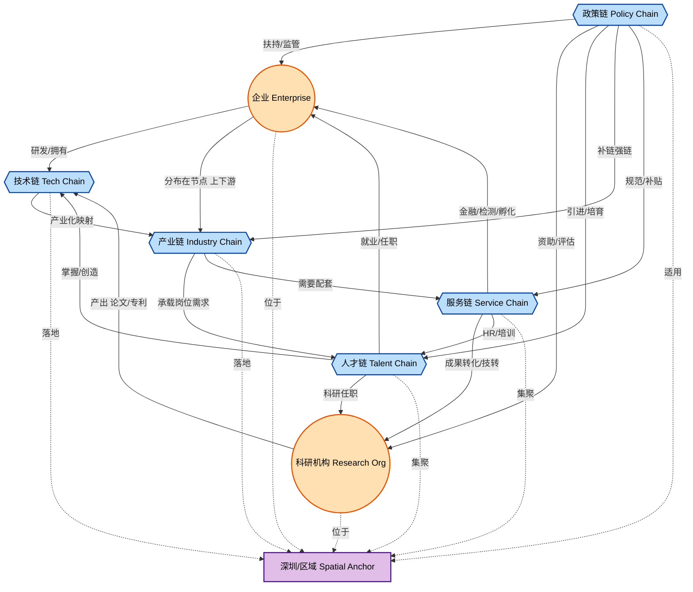
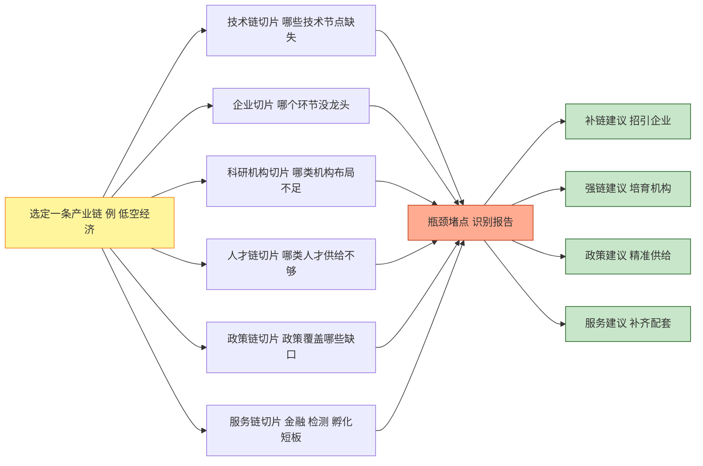
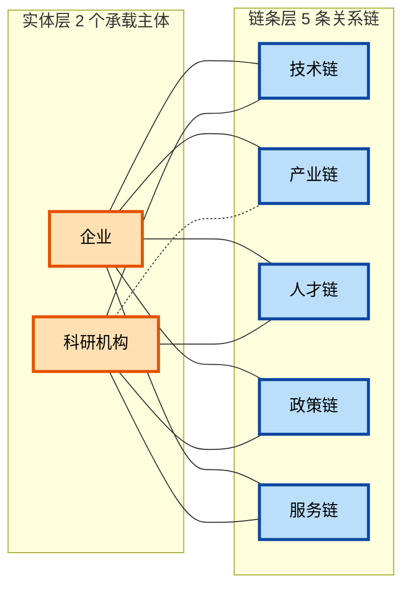

# 5 链分析与 7 要素关系网络

> 适用范围：科技专题服务系统 / 科技信息展示系统  
> 关联文档：
> - `1-招投标需求/五、实施方案-智能服务集群-ZP-2025-11-18.docx`
> - `8-预算和财务/三方报价/合同合规需求分析报告-7要素分析功能相关报价-成本控制.xlsx`
> - `2-概要设计/2-1需求分析/正式文件/doc1_专题服务.txt`
> - `2-概要设计/2-2概要设计/科技专题服务算法库-概要设计说明书.md`

---

## 0. TL;DR（一句话）

> **"5 链"是 7 要素里属于"链条"的那 5 个；"7 要素"在 5 链之上再加了"企业"和"科研机构"两个独立主体维度。**  
> 业务层面讲 5 链（讲故事、画战略），工程和报价层面用 7 要素（落 WBS、算成本、做算法）。

---

## 1. 概念定义

### 1.1 五链（5 Chains）

来源：`doc1_专题服务.txt` 第 279 行，系统总纲原文。

> "通过打通**技术链、产业链、人才链、政策链与服务链**五大维度，系统帮助用户精准识别产业瓶颈、研判技术趋势、评估机构与人才价值、优化政策供给、匹配服务机构……"

| 链条 | 核心问题 | 招标书主要分析能力 |
|---|---|---|
| **技术链** | 技术从哪来、走到哪一步、卡在哪 | 技术链全景图谱、新技术热点发现、技术产业化潜力识别、技术阶段研判、深圳技术发展分析、技术转化瓶颈堵点识别 |
| **产业链** | 产业结构是否完整、竞争力如何 | 产业链全景图谱、产业周期分析、区域产业指数、产业关键环节识别、产业瓶颈堵点识别、深圳产业对比、区域产业竞争力 |
| **人才链** | 人才供给-集聚-流动是否匹配产业 | 重点人才区域/机构分布、人才供给情况、关系链分析、学术力/产业力评估、引进与培育推荐 |
| **政策链** | 政策供给是否精准、有没有漏点 | 政策时序分析、区域政策对比、深圳政策现状、政策效果评估 |
| **服务链**（产业服务链） | 中介、检测、孵化、金融等配套是否齐全 | 服务机构领域/趋势分析、服务机构技术力评估、服务链短板分析、服务链图谱、引入/培育推荐 |

### 1.2 七要素（7 Elements）

来源：`合同合规需求分析报告-7要素分析功能相关报价-成本控制.xlsx` 中两个 sheet（`智能服务集群`、`深度挖掘算法`）严格按 1~7 编号组织的模块。

| 编号 | 名称 | 视角 | 在 5 链中的位置 |
|:---:|---|:---:|:---:|
| **1** | 企业 | 实体 | （主体，不在 5 链内） |
| **2** | 产业链 9 | 链条 | ✅ 产业链 |
| **3** | 科研机构 | 实体 | （主体，不在 5 链内） |
| **4** | 技术链 9 | 链条 | ✅ 技术链 |
| **5** | 人才       z | 链条 | ✅ 人才链 |
| **6** | 服务机构（产业服务链） 9 | 链条 | ✅ 服务链 |
| **7** | 政策 | 链条 | ✅ 政策链 |

### 1.3 换算公式

$$
\boxed{\;\text{7 要素} \;=\; \underbrace{\text{技术链}+\text{产业链}+\text{人才链}+\text{政策链}+\text{服务链}}_{\text{5 链}} \;+\; \underbrace{\text{企业}+\text{科研机构}}_{\text{2 个承载主体}}\;}
$$

---

## 2. 整体关系网络图（2 主体 + 5 链 + 1 区域）

从 5 链视角，**7 要素不是平铺的清单，而是 "2 主体 + 5 链 + 1 区域" 的多重图**：

- **2 主体**（企业、科研机构）是节点（"谁"）；
- **5 链**（技术/产业/人才/政策/服务）是节点间的连接边（"怎么连"）；
- 所有连接都在**"深圳/区域"**这个空间载体内闭合。

---

## 3. 按 5 链拆解的「链条—主体」关系矩阵

每条链都是一种**关系类型**，连接不同的实体/属性。

| 链条 | 连接的主体 / 客体 | 关系类型（边语义） | 在算法库中的体现 |
|---|---|---|---|
| **技术链** | 科研机构 ⟶ 技术 ⟶ 企业 | 产出 → 映射 → 应用（"实验室到产线"） | 技术实体识别、技术阶段研判、技术产业化潜力、技术转化瓶颈 |
| **产业链** | 企业（上游 ⟶ 中游 ⟶ 下游） | 上下游 / 供应关系 | 产业链全景图谱、产业关键环节、产业瓶颈堵点、企业供应链 |
| **人才链** | 人才 ⟶ 企业 / 科研机构 / 技术 | 任职、师承、流动 | 人才学术力、人才产业力、关系链分析、供需分析 |
| **政策链** | 政策 ⟶ 企业 / 科研机构 / 人才 / 产业 / 服务机构 | 扶持、监管、导向、补贴 | 政策对企业/人才/产业/服务的精准匹配与效果评估 |
| **服务链** | 服务机构 ⟶ 企业 / 科研机构 / 产业 | 配套服务、技术转移、金融支撑 | 服务链短板分析、服务机构技术力、服务链图谱 |

---

## 4. 典型业务链路：以「产业瓶颈识别」反推关系

招标书要求做 **产业瓶颈堵点识别**，算法明确从 **技术、人才、市场、资金、政策** 五维诊断——这恰好是"5 链"在某条产业链上的一次切片：

> "**5 链分析**"作为方法论 = 在某条**产业链**上，把其余 4 链 + 2 主体作为多维诊断切片。

---

## 5. 对偶视角：「实体—链条」二部图

把 7 要素**分层重排**：上排是 2 个实体，下排是 5 链；中间的边表示"哪个实体被哪条链穿过"。

**观察**：

- **企业**是"5 链交汇点"（5/5 全连），所以"企业分析"是项目里算法最重、报价最高的板块。
- **科研机构**主要是"创新源头"，与产业链是**间接关系**（通过技术成果转化），所以与产业链画虚线。

---

## 6. 邻接矩阵：7 要素两两关系强度

强度依据 = 算法库里两两要素之间的**关系抽取模型 + 深度分析模型**数量。

> 图例：● 强 / ◐ 中 / ○ 弱 / — 无

| | 企业 | 产业链 | 科研机构 | 技术链 | 人才 | 政策 | 服务机构 |
|---|:---:|:---:|:---:|:---:|:---:|:---:|:---:|
| **企业**     | —  | ●  | ◐  | ●  | ●  | ●  | ●  |
| **产业链**   | ●  | —  | ◐  | ●  | ●  | ●  | ●  |
| **科研机构** | ◐  | ◐  | —  | ●  | ●  | ◐  | ◐  |
| **技术链**   | ●  | ●  | ●  | —  | ●  | ◐  | ○  |
| **人才**     | ●  | ●  | ●  | ●  | —  | ◐  | ○  |
| **政策**     | ●  | ●  | ◐  | ◐  | ◐  | —  | ◐  |
| **服务机构** | ●  | ●  | ◐  | ○  | ○  | ◐  | —  |

### 关键边解读（对应算法库模块）

| 边 | 强度 | 在算法库中的承载 |
|---|:---:|---|
| 企业 — 产业链 | ● | 企业供应链关系分析 / 产业链关键环节识别 |
| 企业 — 技术链 | ● | 企业技术力评估 / 技术产业化潜力识别 |
| 企业 — 人才 | ● | 企业-人才合作图谱 / 人才产业力评估 |
| 企业 — 政策 | ● | 招引企业推荐 / 培育企业推荐 / 政策匹配 |
| 企业 — 服务机构 | ● | 服务机构产业领域分析 / 服务链短板分析 |
| 科研机构 — 技术链 | ● | 科研合作关系链 / 技术实体关系抽取 |
| 科研机构 — 人才 | ● | 科研人才学术力 / 高校新培育人才 |
| 技术链 — 人才 | ● | 人才掌握技术映射 / 学术-产业双轨评估 |
| 政策 — 全部 | ◐~● | 政策实体关系抽取（→ 主题/目标/受益对象/监管机构/产业/技术/企业/人才/科研机构/服务机构） |

> 来源：`合同合规需求分析报告-7要素分析功能相关报价-成本控制.xlsx` 中 `深度挖掘算法` sheet 第 46–60 行的 **7 类实体识别 + 7 类关系抽取 + 产业全要素图谱 API**，正是这张邻接矩阵的工程实现。

---

## 7. 统一抽象：7 要素 = 一张「产业创新知识图谱」

> **5 链 = 边类型；7 要素 = 节点类型（2 实体 + 5 链上的"链节点"）；二者共同构成一张以"产业链"为骨架、以"政策链"为环境、以"服务链"为生态、以"人才/技术链"为驱动力、以"企业/科研机构"为承载主体的——区域科技创新知识图谱。**

### 形式化定义

$$
G_{\text{科创}} = (V, E)
$$

$$
V = \underbrace{\{\text{企业}, \text{科研机构}\}}_{\text{实体节点}} \cup \underbrace{\{\text{技术}, \text{产业环节}, \text{人才}, \text{政策}, \text{服务机构}\}}_{\text{链上节点}}
$$

$$
E = \bigcup_{c \in \text{5 链}} R_c \quad,\quad R_c \subseteq V \times V
$$

| 边集合 $R_c$ | 语义 |
|---|---|
| $R_{\text{技术链}}$ | 研发、产出、掌握、应用 |
| $R_{\text{产业链}}$ | 上下游、供给、依赖 |
| $R_{\text{人才链}}$ | 任职、师承、流动、合作 |
| $R_{\text{政策链}}$ | 扶持、监管、导向、补贴 |
| $R_{\text{服务链}}$ | 服务、技转、孵化、配套 |

> 这张图谱就是"7 要素分析"在算法层的本体（Ontology），所有"专题分析、推荐、瓶颈识别、报告生成"都是在这张图上做的**子图查询**和**子图打分**。

---

## 8. 常见混淆辨析

为避免混淆，本项目里还有几个不同的"5"和"7"，**不是**这里说的概念：

| 名称 | 含义 | 出处 |
|---|---|---|
| **本文 5 链** | 技术 / 产业 / 人才 / 政策 / 服务 | `doc1_专题服务.txt` |
| 算法五维（瓶颈识别） | 技术 / 人才 / 市场需求 / 资金 / 政策 | `产业瓶颈堵点识别模型` |
| **本文 7 要素** | 企业 / 产业链 / 科研机构 / 技术链 / 人才 / 服务机构 / 政策 | 本 xlsx |
| 智能服务集群 7 个系统 | 智慧服务门户 / 信息展示 / 资源服务 / 智库 / 决策支持 / 专题服务 / 信息交流 | 招投标实施方案 |
| 展示系统 7 大模块 | 科技发展态势 / 政策跟踪 / 人才态势 / 数据资源 / 知识图谱 / 成果展示 / 服务全景 | 展示系统 WBS |
| 展示系统 7 个角色 | 产品需求 / UI 设计 / 前端 / 后端 / 数据接口 / 测试 / PM | `generate_display_system_wbs.py` |

---

## 9. 在本项目中的落点

| 文档/场景 | 用哪个口径 | 备注 |
|---|---|---|
| 招标书系统总纲（业务叙事） | **5 链** | "打通技术链、产业链、人才链、政策链与服务链五大维度" |
| 战略分析功能清单（招标 4.2.2.1~4.2.2.7） | **7 要素** | 企业 / 产业链 / 科研机构 / 技术链 / 人才 / 政策 / 产业服务链 + 综合智能分析 |
| 算法库（基础指标 + 实体识别 + 深度模型） | **7 要素** | xlsx 里 1~7 编号严格对齐 |
| MVP 范围（智树 vs 智谱分工） | **7 要素** | **智谱负责：技术链、人才；智树负责其余 5 块** |
|                                          |            |                                                              |

|      |      |      |      |
|---|---|---|---|
|      |      |      |      |
