# 后台整体实现架构讨论 · 全栈场景与数据流时序图汇编

> **来源**：2026-07-27 会话讨论（4 轮）+ 2026-08-01 会话续写（第 5 轮：数据处理架构）
> **参与方**：用户 + AI assistant
> **依据**：`architecture-baseline.md`（方案 A 共享聚合核心）· `scope-baseline.yaml`（58 功能点 ±10%）· `数据库设计.md` · `graph-engine.md` · `observability.md` · `cicd-pipeline.md` · `repo-registry.yaml` · `task-registry.yaml` · `bid-reference/智能服务集群-完整.md`（425K 字）· `bid-reference/科技专题服务算法库.md`（105K 字）· `data/GDF/`（通用数据工厂派单包）· `designs/亿集知识图谱/亿级知识图谱引擎平台 概要设计.md`
> **导出时间**：2026-08-01（第 5 轮增量）· 首版 2026-07-27 19:42 UTC+8

---

## 目录

1. [第一轮：后台整体实现架构讨论提纲](#第一轮后台整体实现架构讨论提纲)
2. [第二轮：向量数据库需求分析](#第二轮向量数据库需求分析)
3. [第三轮：四大技术栈应用场景全景图](#第三轮四大技术栈应用场景全景图)
4. [第四轮：典型场景数据流时序图 + 服务调用链全集](#第四轮典型场景数据流时序图--服务调用链全集)
5. [第五轮：数据处理架构 · GDF 与亿集知识图谱关系](#第五轮数据处理架构--gdf-与亿集知识图谱关系)
6. [附录：速查总表与关键模式总结](#附录速查总表与关键模式总结)

---

# 第一轮：后台整体实现架构讨论提纲

> 基于架构基线、范围基线、仓库映射、数据设计、CI/CD、可观测性和当前任务进度梳理。任务统计：done 85 / blocked 26 / in_progress 11 / review 15 / ready 8。

## 一、总体目标拓扑（方案 A 共享聚合核心）

**核心命题**：科技信息展示系统 + 科技专题服务系统共享同一套 Java 聚合核心（`gkxlumen-topic` + `gkxlumen-metrics`），不各造一套算法调用。

讨论点：
1. 调用链铁律复核：`前端 → 网关 → Java 聚合（只读 ADS + Feign /internal/*）→ Python 算法库`，三层是否仍有越层风险？
2. `gkxlumen-innov`（M1 创新监测展示域）与 `gkxlumen-topic`（七要素专题聚合）的长期关系——何时并入、是否保留独立快路径？
3. `gkxlumen-display` 薄 BFF（Wave4 建）是否仍需要，还是直接由 `topic` + `metrics` 拼装？
4. 两个前端（`lumen-ui-science-pc` 展示 34 页 + `lumen-ui-topic` 专题服务）共享聚合核心的实际边界与冲突点。

## 二、服务清单与边界（5+1 服务）

| 服务 | 语言 | 路由 | 状态 |
|---|---|---|---|
| `gkxlumen-gateway` | Java | 全部对外路由 | 待建（demo 有 gkx-gateway） |
| `gkxlumen-topic` | Java | `/topic/v1/{element}/*` | 待建（七要素聚合核心） |
| `gkxlumen-metrics` | Java | `/metrics/v1/*` | 待建（指标注册中心） |
| `gkxlumen-innov` | Java | `/innov/v1/*` | demo 已有，待移植 |
| `gkxlumen-display` | Java | `/display/v1/*` | Wave4 待建 |
| Python 算法库 | Python | 仅 `/internal/*` | innov-algo / ent-analysis / topic-py |

讨论点：
1. Java 服务的模块拆分粒度：是 PigX 多模块单体（`lumen-svc-platform` / `demo-svc-platform` 现状）还是独立微服务？
2. 网关统一鉴权/SSO/权限的落地方案（D6 横切统一）——目前鉴权细节是否已定？
3. Python 算法库的"统一出口"（指标注册 `cfg_metric` + 模型注册 `cfg_model_registry`）如何强制落地——绕过注册中心的检测机制？
4. 各服务的禁止项红线复核：Java 禁算法/NLP/图谱/写 ADS；Python 禁对前端暴露 REST。

## 三、数据架构与契约面（D3 + D7）

**铁律**：Java 业务 API 仅读 `*_ads`（+ `app_user` 读写）；禁止扫 ODS/DWD、禁止 Java 写 ADS。

### 3.1 三引擎分工
| 引擎 | 产品 | 读写方 |
|---|---|---|
| RDBMS | MySQL 8.0 | Python 写 ADS/DWD；Java 只读 ADS |
| Graph | NebulaGraph 3.x | Python 灌数/查询；Java 禁直连 nGQL |
| Search | Elasticsearch 8.x | Python 写；Java 只读或经 Python 代理 |

### 3.2 Schema 划分（10 库）
- 创新监测：`innov_dim` / `innov_dwd` / `innov_dwm` / `innov_ads` / `innov_cfg`
- 七要素平台：`gkx_dim` / `gkx_dwd` / `gkx_dwm` / `ads` / `gkx_cfg`
- 用户中心：`app_user`（Java 维护）

讨论点：
1. **D7 数据契约先行 + Mock 先行**：三方原始数据源表结构未定期间，Python 写 Mock 至 ADS——当前 Mock 覆盖率？三方源就绪时间表？
2. 数据工厂 `ODS → DWD → ADS` 转换链路归属与 SLA——`lumen-etl-es-py`（DWD→ES）已起，全链路谁负责？
3. 七要素与存储映射（E1 企业 `entan`/`ads.ent_*` … E7 政策 `gkx_policy`/`ads.policy_*`）——各要素 ADS 表落地进度？
4. ADS 结构变更会签机制（Python + Java 双方 handoff）是否落地？
5. `cfg_metric` 指标注册表 + `cfg_model_registry` 模型注册表的物理落地与 Java catalog API 对接。

## 四、算法库架构（Python 侧）

**定位**：全部算法（ETL / NLP / 图谱 / 模型推理 / 指标计算）只在 Python，仅暴露 `/internal/*`。

讨论点：
1. 算法仓划分：`demo-algo-science`（innov P1–P9）/ `demo-algo-ent-analysis`（企业图谱）/ `demo-svc-topic-py`（专题服务，部分未实现）/ `lumen-etl-es-py`（DWD→ES）——是否需要新建正式 `lumen-algo-*` 仓？
2. 七类基础指标 + 产业全要素图谱 + 七要素深度分析模型（共 15 个算法单元）的实现路径与替代策略。
3. 算法能力注册强约束：新算法必须注册 `cfg_metric` / `cfg_model_registry`，如何 CI 扫描兜底？
4. Python 服务的 `/internal/*` 接口契约标准化。

## 五、图谱引擎（NebulaGraph）

**铁律**：统一 NebulaGraph（`10.50.75.136:9669`），禁止 Neo4j。

讨论点：
1. Space 规划：`entan`（demo 已有）/ `gkx_policy`（Wave1 待建）/ `gkx_innov`（networkx 待迁）/ `gkx_topic`（二期）。
2. Java 经 Feign 调 Python `/internal/graph/*`，响应必带 `source: nebula|pg|error`。
3. PG 兜底机制（Nebula 不可用时读 PG 镜像 1 跳子图）。
4. `demo-algo-science` P5 networkx → NebulaGraph 迁移排期。

## 六、可观测性（OTel 全栈）

讨论点：
1. Java：OTel JavaAgent + 网关回传 traceparent——`lumen-svc-platform` 移植进度（E-INNOV-M1-L02b 待做）。
2. Python：`opentelemetry-instrument`——`demo-algo-science` 仍裸 uvicorn，待对齐。
3. 前端：`observability.ts` + axios 拦截器——`lumen-ui-science-pc` 已具备，topic/mobile 待补。
4. 基础设施：OTel Collector → Tempo/Prometheus/Loki → Grafana。
5. 跨服务 trace 连续性验收（Java → Python 跨服务 span 串联）。

## 七、CI/CD 与部署

讨论点：
1. 各仓 CI/CD 现状缺口：`lumen-svc-platform` 全量 CI 待建——最大缺口；`demo-svc-topic-py` 的 ai/analytics/graph 服务未实现。
2. 分支策略：业务子仓 `feat/* → MR/merge → dev → CI/CD → K8s dev`；`main` 仅稳定快照。
3. 部署方式：前端 NodePort（pc 30891 / topic 30892 / admin 30893）；Java helm gkx-platform；Python helm 热更新。
4. **Pipeline Waiver**（2026-06-20 PM 决策）：当前略过等待 Pipeline/K8s——何时取消恢复全闭环？

## 八、仓库结构与迁移（RFC-002）

讨论点：
1. 路径真源：`GKX_ROOT=F:/gkx-lumen`，老根 `E:/gkx_src` deprecating——M5 strict 验收时间表？
2. demo ↔ lumen 镜像关系：demo2 原型仓只读参考，禁止 merge；`frontend-agent` 工程化复刻模式。
3. GitLab group `gkx-lumen`（id 336）项目管理与权限。

## 九、前端架构边界（D8 + D10，与后台对接面）

讨论点：
1. 前端只调 Java REST（经网关），禁直连 Python/DB/Nebula——如何 CI 扫描兜底？
2. 网关路由划分：`/display/**` / `/topic/**` / `/innov/**` / `/metrics/**`。
3. 数据血缘（D9）：界面每个统计指标旁 ⓘ 触发 MetricSpecCard，需 Java `/metrics/v1/catalog` 提供元数据"8 件套"。
4. Mock 数据标识：Wave 0 阶段 Mock 数据需 🧪 MockBadge——Java 如何透传 Mock 标记？

## 十、架构合规与治理

讨论点：
1. 10 项锁定决策（D1–D10）复核——是否有需修订项？
2. 机器可读依赖规则的 CI 校验。
3. ±10% 范围浮动铁律：当前 58 功能点基线。
4. 架构师评审机制：Epic 首任务开工前设计评审 + 里程碑签收合规评审。

## 十一、当前进度与风险

### 11.1 任务进度（task-registry 统计）
| 状态 | 数量 |
|---|---|
| done | 85 |
| blocked | 26 |
| backlog | 16 |
| review | 15 |
| in_progress | 11 |
| claimed | 9 |
| ready | 8 |
| pending | 2 |
| superseded | 1 |

### 11.2 Epic 分布（Top）
- `E-ENT-SCRUM-PDR` 86（企业域 PDR 主战场）
- `E-ENT-PROTOTYPE` 16 / `E-CHAIN-PROTOTYPE` 13 / `E-POLICY-PROTOTYPE` 10（要素原型）
- `E-INNOV-M1` 11（创新监测移植）
- `E-ENT-REALDATA` 10（企业真实数据）
- `E-PLATFORM-P0` 9（平台脚手架）

### 11.3 关键风险
1. `lumen-svc-platform` 全量 CI 待建——后台 Java 交付链路最大缺口。
2. 三方数据源未就绪——Mock 先行能撑多久？数据工厂转换链路谁负责？
3. `demo-svc-topic-py` 的 ai/analytics/graph 服务未实现——专题服务后端能力空缺。
4. 26 个 blocked 任务——阻塞原因分类与解除路径。
5. D10 交互规范上线前需 PM+架构师补签——是否影响后台 API 契约稳定性？

## 建议讨论顺序

1. **一、总体拓扑** → 确认方案 A 边界与 innov/topic/display 关系
2. **三、数据架构** → ADS 契约面 + Mock 策略 + 数据工厂（后台根基）
3. **二、服务边界** → Java 模块拆分 + 网关鉴权 + Python 出口
4. **四、算法库** + **五、图谱** → Python 侧能力与 Nebula 落地
5. **六、可观测性** + **七、CI/CD** → 横切与交付闭环（含 waiver 取消时机）
6. **十一、风险** → blocked 任务与缺口优先级

---

# 第二轮：向量数据库需求分析

## 结论速览

| 维度 | 现状 | 判断 |
|---|---|---|
| **招标需求** | 招标文件多处出现"智能问答/知识库/语义检索/自然语言转化" | ✅ 业务需求已埋种子 |
| **架构基线** | `architecture-baseline.md` 当前未列入向量库；三引擎仅 MySQL/Nebula/ES | ⚠️ 架构有缺口 |
| **PigX 基座能力** | `lumen-svc-platform` 根 pom 已引入 `langchain4j 1.12.1`；PigX 原版有 `pigx-knowledge` 模块（支持 PGVector/Qdrant/Milvus/Chroma） | ✅ 技术栈已就绪 |
| **当前实现** | demo 仓与 lumen 仓均无 `knowledge`/向量模块落地；Python 算法仓无 embedding 代码 | ❌ 尚未落地 |
| **是否要用** | **建议用，但需走架构变更流程（architect + PM 评审）** | 🟡 待决策 |

## 一、招标需求里的"向量库信号"

### 1. 科技信息展示系统（72 处命中）
- **知识图谱构建**：从文本数据集自动识别实体、抽取属性、关系，构建知识网络——涉及实体消歧、合并，典型需要 embedding 做语义相似度匹配。
- **智能问答/自然语言交互**：AI 助手基于科技文献、专家、专利等数据库，融合多模态信息，"通过模型对底层数据库进行分布式查询，按用户意图调用并分析获取相关信息"——这是典型 NL2SQL + RAG 场景。
- **语义检索/精准推荐**：用户日常行为分析，主动推荐感兴趣的信息。

### 2. 科技专题服务算法库（21 处命中）
- **产业全要素图谱**：涉及实体融合、冲突识别、知识网络扩展——实体对齐常用 embedding 相似度。
- **深度分析模型**：多源异构数据采集后，进行字段映射、实体识别——语义匹配环节。

### 3. 科技服务群集-总体（153 处命中）
- **知识库协同**：知识库创建、协同编辑、文档编辑存档。
- **AI 助手**：自然语言问答，将自然语言转化为结构化查询指令。
- **人才画像/团队推荐**：基于研究内容、学术影响力的智能标签与推荐算法——embedding 语义相似度。

> 这些需求当前在 `scope-baseline.yaml` 的 58 功能点里**未单列为独立功能点**，而是作为算法能力的实现细节隐藏在 E1–E7 要素和图谱/指标里。但一旦要做"智能问答"或"语义检索"，向量库几乎是必选项。

## 二、架构基线的现状与缺口

### 当前三引擎分工（`数据库设计.md §1.1`）

| 引擎 | 产品 | 职责 |
|---|---|---|
| RDBMS | MySQL 8.0 | 维表/DWD/DWM/ADS/配置/用户态 |
| Graph | NebulaGraph 3.x | 实体关系网络、多跳子图、图算法 |
| Search | Elasticsearch 8.x | 事件/全文检索、快速筛选聚合 |

**缺口**：没有向量检索引擎。ES 8.x 虽然支持 `dense_vector` 字段类型 + kNN 搜索，但当前架构里 ES 定位是"全文检索/聚合"，未规划向量字段。

### 架构铁律的约束

`architecture-baseline.md` §2 D3 契约面 = ADS，Java 只读 ADS。如果引入向量库：
- **向量库归 Python 算法层写**（embedding 计算、灌数），与 Nebula/ES 同级。
- **Java 聚合层只读或经 Python 代理**（与 ES 当前模式一致："Java 只读或通过 Python 代理"）。
- 不得破坏"算法写、API 读"铁律。

## 三、PigX 基座已自带向量能力

`lumen-svc-platform`（基于 PigX 5.11.0 fork）的技术栈：
- **LangChain4j 1.6.0 / Spring AI 1.0.2**（根 pom 实际是 `langchain4j 1.12.1`）
- **数据库**：PostgreSQL with **pgvector** extension（PigX boot 模式默认）
- **支持向量库**：Qdrant / Milvus / Chroma / Neo4j / PGVector（工厂模式 `EmbeddingStoreFactory`）

PigX 原版有完整的 `pigx-knowledge` 模块（AI 知识库/RAG/文档解析），但当前 `lumen-svc-platform` **未移植该模块**。

> 也就是说：**技术栈的票已经买好，但还没上车。** 如果要启用向量库，最小代价路径是从 PigX 原版移植 `pigx-knowledge` 模块。

## 四、可能用到的场景（按优先级）

| 优先级 | 场景 | 需求来源 | 向量库用途 | 替代方案 |
|---|---|---|---|---|
| P1 | **智能问答 / AI 助手** | 招标总体 §3 | 文档 chunk embedding + RAG 检索 | 无（纯关键词检索体验差） |
| P1 | **语义检索**（文献/专利/专家） | 展示系统 | query embedding → kNN 召回 | ES BM25（语义能力弱） |
| P2 | **实体对齐/消歧** | 图谱构建 | 实体 embedding 相似度匹配 | 规则匹配 + 人工标注 |
| P2 | **人才/团队推荐** | E5 人才、团队推荐 | 画像 embedding 相似度 | 协同过滤 + 规则 |
| P3 | **政策/资讯智能推送** | E7 政策、用户行为 | 内容 embedding 匹配用户兴趣 | 标签匹配 |

## 五、如果要引入，该怎么走（建议路径）

### 5.1 架构变更流程（铁律要求）

根据 `00-team-constitution.mdc §6`，引入向量库属于"突破架构基线"，必须：
1. 暂停执行
2. 明确说明突破点：`数据库设计.md §1.1` 三引擎 → 四引擎
3. 要求 PM + 架构师签字批准
4. 在 handoff 中记录批准证据
5. 更新 `architecture-baseline.md`（新增 D11 或扩展 D3/D6）+ `数据库设计.md §1.1`

### 5.2 技术选型建议（供架构师评审）

| 候选 | 优势 | 劣势 | 适配度 |
|---|---|---|---|
| **PGVector** | PigX 基座原生支持；复用现有 PG 实例；运维简单 | 大规模（千万级向量）性能一般 | ⭐⭐⭐⭐ demo/中等规模首选 |
| **ES dense_vector** | 复用现有 ES 8.x；统一检索栈 | kNN 性能不如专用库 | ⭐⭐⭐ 若向量量小可复用 |
| **Milvus** | PigX 已支持；专业向量库；大规模友好 | 多一套运维 | ⭐⭐⭐ 大规模/生产首选 |
| **Qdrant** | PigX 已支持；Rust 性能好 | 新依赖 | ⭐⭐ |

**建议**：demo 阶段用 **PGVector**（零新依赖，PigX boot 模式自带），生产规模化时评估迁 **Milvus**。

### 5.3 落地位置（符合方案 A 调用链）

```
前端 → 网关 → Java 聚合（gkxlumen-topic / gkxlumen-knowledge）
                ↓ Feign /internal/*
            Python 算法库（embedding 计算 + 灌数）
                ↓ 写
            向量库（PGVector / Milvus）
```

- **Python 侧**：新增 embedding 服务（sentence-transformers / OpenAI / 智谱），写向量库。
- **Java 侧**：可选移植 `gkxlumen-knowledge`（从 PigX `pigx-knowledge`），或经 Python `/internal/vector/*` 代理检索。

## 六、建议讨论点

1. **业务优先级**：智能问答 / 语义检索 是否在本期 58 功能点的 ±10% 范围内？还是作为二期增强？
2. **架构变更**：是否走 D11 决策（向量库作为第四引擎）？还是先在 ES 上试 `dense_vector` 不改架构？
3. **模块归属**：向量检索能力放 Python `/internal/vector/*`（Java 代理）还是移植 `gkxlumen-knowledge`（Java 直读）？
4. **Embedding 模型选型**：智谱 / OpenAI / 本地 sentence-transformers？涉及成本与合规。
5. **与图谱的关系**：NebulaGraph 做关系网络，向量库做语义相似度——两者是互补还是重叠？

### 补充确认：Python 算法仓当前无向量能力

后台搜索结果（扫了 4 个 Python 仓的全部 `.py` / `requirements.txt` / `pyproject.toml`）：

| 仓 | 结果 | 说明 |
|---|---|---|
| `demo-algo-science` | 命中均为 celery 标准库误报 | 无真实 embedding/vector 代码 |
| `demo-algo-ent-analysis` | 同上误报 | 无真实 embedding/vector 代码 |
| `demo-svc-topic-py` | 无命中 | — |
| `lumen-etl-es-py` | 无命中 | — |

**进一步印证**：向量库目前是"需求侧有信号、供给侧全空白"的状态——如果要启动，需要从零搭建 Python embedding 服务 + 决定向量库选型 + 走架构变更（D11）。

---

# 第三轮：四大技术栈应用场景全景图

> **技术栈**：ES（Elasticsearch 检索/聚合）· 图技术（NebulaGraph 关系网络/图算法）· RAG（向量检索 + 大模型生成）· 算法（指标计算/深度模型/预测仿真/推荐匹配）
>
> **招标依据**：`智能服务集群-完整.md`（425K 字）+ `科技专题服务算法库.md`（105K 字），关键词命中：知识图谱 156、语义 107、检索 367、推荐 524、画像 152、预测 184、预警 170、相似 53、匹配 171、聚类 104、向量 17、实体 296、关系 430、路径 248、社区 33。

## 一、技术栈能力定位（先对齐边界）

| 技术栈 | 核心能力 | 招标原文信号 | 当前架构归属 |
|---|---|---|---|
| **ES** | 全文检索、结构化筛选、聚合分析、日志/事件检索 | "全文检索""分布式检索""关键词搜索""词位扩展" | ✅ 已纳入（Python 写 / Java 读或代理） |
| **图技术（NebulaGraph）** | 实体关系网络、多跳子图、路径搜索、中心度、社区发现、图算法运行时 | "路径搜索展示、中心性计算展示、社群发现展示""知识图谱""产业全要素图谱" | ✅ 已纳入（Python 灌数/查询，Java 禁直连） |
| **RAG（向量+LLM）** | 语义检索、意图理解、NL2SQL/NL2Graph、知识摘要生成、问答 | "融合语义检索与大模型解析""自然语言转化为结构化查询指令""智能问答式查询" | ❌ 未纳入架构（PigX 基座已备 langchain4j） |
| **算法（Python）** | 指标计算、深度分析模型、预测仿真、推荐匹配、NLP 实体识别、赋分评级 | "基础指标体系""深度分析模型""预测仿真""推荐匹配""NER""赋分""指数" | ✅ 已纳入（Python 算法库，写 ADS/Nebula/ES） |

## 二、独立场景（单技术栈）

### 2.1 ES 独立场景

| # | 场景 | 招标依据 | 实现要点 |
|---|---|---|---|
| ES-1 | **全文检索门户** | "全文检索""基础服务" | ES `match`/`bool` 查询论文/专利/政策/资讯 |
| ES-2 | **多维条件筛选 + 聚合** | "分类聚合、分布可视化" | ES `aggs` 按时间/地区/领域/机构分桶统计 |
| ES-3 | **关键词搜索 + 词位扩展** | "词位扩展技术抽取初始查询概念" | ES `match_phrase` + 同义词词典扩展 |
| ES-4 | **政策全文检索** | `idx_policy`（已规划） | ES 倒排索引政策全文，高亮关键词 |
| ES-5 | **日志/事件检索** | `idx_innov_event`（已规划） | 创新事件检索 + 时序聚合 |
| ES-6 | **用户行为分析** | "用户日常行为分析" | ES 聚合用户搜索/浏览/点击行为 |

### 2.2 图技术独立场景

| # | 场景 | 招标依据 | 实现要点 |
|---|---|---|---|
| G-1 | **产业全要素图谱可视化** | "产业全要素图谱""知识网络" | NebulaGraph 多跳子图 `GET SUBGRAPH`，前端 G6 渲染 |
| G-2 | **关键节点识别（中心度）** | "中心度、影响力""特征向量中心性" | NebulaGraph 图算法 `degree`/`betweenness`/`eigenvector` |
| G-3 | **路径搜索（上下游追溯）** | "路径搜索展示""关键路径" | `FIND SHORTEST PATH` / `FIND ALL PATH` |
| G-4 | **社区发现（产业集群/合作网络）** | "社群发现展示""科技社会网络" | 社区发现算法识别产业集群/学者合作圈 |
| G-5 | **技术点图谱 + 关联实体排名** | "技术点图谱""关联实体排名" | NebulaGraph + 按度中心性排序 |
| G-6 | **专家-成果关联图谱** | "专家与各类科创成果智能关联" | 专家节点 → 论文/专利/项目边，多跳查询 |
| G-7 | **产业链上下游布局** | "产业链上下游布局" | 产业链节点拓扑，层级展开 |

### 2.3 RAG 独立场景

| # | 场景 | 招标依据 | 实现要点 |
|---|---|---|---|
| R-1 | **智能问答（自然语言提问）** | "自然语言查询""智能问答式查询" | query embedding → 向量检索 → LLM 生成结构化答案 |
| R-2 | **AI 搜索（语义检索 + 大模型解析）** | "AI 搜索：融合语义检索与大模型解析" | 向量召回 + BM25 混合检索 + LLM 提炼关键信息 |
| R-3 | **报告语义检索** | "嵌入向量空间模型""报告间语义相似度" | 报告标题/摘要/关键词 embedding，余弦相似度排序 |
| R-4 | **智能阅读辅助** | "智能阅读" | 文档 chunk embedding，按段落问答 |
| R-5 | **智能问数（NL2SQL）** | "智能问数：自然语言查询、数据看板" | LLM 意图识别 → 字段映射 → 生成 SQL → 返回可视化 |
| R-6 | **政策智能解读** | "政策效果评估" | 政策文本 RAG，LLM 结构化抽取要点 |

### 2.4 算法独立场景

| # | 场景 | 招标依据 | 实现要点 |
|---|---|---|---|
| A-1 | **七要素基础指标计算** | "七类基础指标"（58 功能点中的 7） | Python ETL 算指标写 ADS，Java 只读 |
| A-2 | **企业竞争力评估模型** | "竞争力判断""优势评分" | 规则/ML 赋分，写 `ads.ent_*` |
| A-3 | **技术前沿热点识别** | "技术前沿热点识别模型" | 时序 + 聚类识别新兴技术方向 |
| A-4 | **政策效果评估模型** | "政策效果评估模型" | 指标体系 + 因果推断 |
| A-5 | **预测仿真（趋势研判）** | "预测仿真""动态预测结果" | 时序预测模型（ARIMA/Prophet/LSTM） |
| A-6 | **风险预警** | "风险预警""使用预警" | 阈值 + 异常检测 |
| A-7 | **NER 实体识别 + 关系抽取** | "NER""实体识别构建、关系抽取" | NLP 模型抽实体关系写 Nebula |
| A-8 | **区域产业指数计算** | "区域产业指数" | 加权聚合 + 标准化 |
| A-9 | **技术产业化潜力评估** | "技术产业化潜力评估" | 多因子模型 |

## 三、交叉场景（多技术栈协同）⭐

### 3.1 ES × 图技术

| # | 场景 | 协同方式 | 招标依据 |
|---|---|---|---|
| EG-1 | **图谱节点详情检索** | 图谱点击节点 → ES 检索该节点相关论文/专利/政策全文 | "知识图谱整合论文及相关学术资源" |
| EG-2 | **产业链节点下钻** | 图谱产业链节点 → ES 聚合该产业的企业数量/专利数/人才数 | "产业链上下游布局" |
| EG-3 | **关系网络 + 事件流** | Nebula 查关系拓扑 → ES 按时间线查关联事件 | "科技网络呈现" |
| EG-4 | **图算法结果回写 ES** | 社区发现/中心度结果写 ES，支持按"影响力排名"筛选 | "中心性计算展示""社群发现展示" |

### 3.2 ES × RAG

| # | 场景 | 协同方式 | 招标依据 |
|---|---|---|---|
| ER-1 | **混合检索（BM25 + 向量）** | ES 关键词召回 + 向量语义召回，RRF 融合排序 | "关键词搜索""语义检索"双通道 |
| ER-2 | **AI 搜索全链路** | ES 结构化筛选 → 向量语义召回 → LLM 提炼摘要 | "AI 搜索：融合语义检索与大模型解析" |
| ER-3 | **同义词扩展 + 语义补全** | ES 同义词词典 + 向量近义词召回 | "同义词扩展、模糊匹配及语义补全" |
| ER-4 | **政策检索 + 智能解读** | ES 全文检索政策 → RAG 对命中政策做结构化解读 | "政策全文检索""政策效果评估" |

### 3.3 图技术 × RAG

| # | 场景 | 协同方式 | 招标依据 |
|---|---|---|---|
| GR-1 | **NL2Graph（自然语言查图谱）** | LLM 解析意图 → 生成 nGQL → Nebula 查询 → LLM 组织答案 | "自然语言转化为结构化查询指令" |
| GR-2 | **图谱增强 RAG（GraphRAG）** | 向量召回文档 → 图谱扩展关联实体/关系 → LLM 综合生成 | "知识图谱与自动语义挖掘" |
| GR-3 | **专家智能问答** | "查某专家研究方向"→ 图谱查专家节点+关联成果 → RAG 生成画像摘要 | "专家与各类科创成果智能关联" |
| GR-4 | **产业链智能问答** | "深圳新能源产业链短板"→ 图谱查产业链子图 → LLM 分析瓶颈 | "瓶颈识别""路径优化" |

### 3.4 图技术 × 算法

| # | 场景 | 协同方式 | 招标依据 |
|---|---|---|---|
| GA-1 | **图算法驱动的指标计算** | Nebula 跑 PageRank/中心度 → 结果写 ADS 作为"影响力指标" | "网络密度、中心度等网络指标" |
| GA-2 | **产业集群识别** | 社区发现算法 → 聚类结果写 ADS 作为"产业集群标签" | "产业集群""社群发现" |
| GA-3 | **推荐匹配（图路径 + 评分）** | 图谱查候选集 → 算法评分排序 → 推荐结果 | "推荐匹配""协同潜力识别" |
| GA-4 | **瓶颈识别（图路径 + 指标）** | 图谱查产业链路径 → 算法计算各环节指标 → 识别短板 | "瓶颈识别""补链强链" |
| GA-5 | **合作网络分析** | 图谱构建合作网络 → 图算法 + 统计模型 → 输出核心团队/桥接节点 | "科技社会网络""超网络" |

### 3.5 ES × 算法

| # | 场景 | 协同方式 | 招标依据 |
|---|---|---|---|
| EA-1 | **聚类结果写 ES 支持筛选** | 算法做 K-means/主题聚类 → 标签写 ES → 前端按"主题"筛选 | "自动聚类及主题推荐" |
| EA-2 | **推荐结果写 ES 支持检索** | 推荐算法产出"相似企业/相似人才" → 写 ES → 搜索时附带推荐 | "智能推荐相似信息" |
| EA-3 | **指标计算 + ES 聚合校验** | 算法算指标写 ADS → ES 做独立聚合交叉验证 | "量化评估""数据校验" |

### 3.6 RAG × 算法

| # | 场景 | 协同方式 | 招标依据 |
|---|---|---|---|
| RA-1 | **智能问数（NL2SQL + 指标计算）** | LLM 生成 SQL → 触发算法计算 → 返回指标 + 可视化 | "智能问数：自然语言查询、数据看板" |
| RA-2 | **预测结果自然语言解读** | 算法产出预测数值 → LLM 生成趋势解读报告 | "动态预测结果""综合预测报告" |
| RA-3 | **评估报告自动生成** | 算法算评分/指数 → RAG 模板 + LLM 生成分析报告 | "一键生成可定制化数据报告" |

### 3.7 ES × 图 × 算法（三栈）

| # | 场景 | 协同方式 | 招标依据 |
|---|---|---|---|
| EGA-1 | **产业全景一张图** | ES 聚合产业基础数据 → 图谱展示产业链拓扑 → 算法标注优势/短板节点 | "产业全景""产业链全景" |
| EGA-2 | **科技决策分析看板** | ES 多维统计 → 图谱关系网络 → 算法预测/预警叠加 | "科技决策分析成果""多图层展示" |

### 3.8 图 × RAG × 算法（三栈）

| # | 场景 | 协同方式 | 招标依据 |
|---|---|---|---|
| GRA-1 | **战略咨询智能支持** | 图谱查产业格局 → 算法评估竞争力/瓶颈 → RAG 生成战略建议报告 | "战略咨询智能支持" |
| GRA-2 | **人才智慧服务（画像+推荐+问答）** | 图谱查人才网络 → 算法画像评分 → RAG 生成人才报告 + 智能问答 | "科技人才智慧服务""人才画像" |
| GRA-3 | **基础研究智能决策** | 图谱查技术演进路径 → 算法预测前沿 → RAG 生成决策建议 | "基础研究智能决策" |

### 3.9 全栈交叉（ES × 图 × RAG × 算法）⭐

| # | 场景 | 协同方式 | 招标依据 |
|---|---|---|---|
| ALL-1 | **AI 搜索全链路旗舰场景** | ES 关键词召回 + 向量语义召回 → 图谱扩展关联实体 → 算法重排评分 → LLM 生成结构化知识摘要 | "AI 搜索：融合语义检索与大模型解析" |
| ALL-2 | **智能科研全链条** | ES 检索文献 → 图谱构建知识网络 → 算法识别前沿/热点 → RAG 辅助阅读与问答 | "智能科研：知识管理、协作与文献处理" |
| ALL-3 | **科技专题战略分析** | ES 查专题数据 → 图谱展示七要素关系 → 算法深度分析/预测 → RAG 生成专题研究报告 | "科技专题战略分析（七要素专题）" |
| ALL-4 | **产业链深度分析 + 智能问答** | ES 聚合产业数据 → 图谱查产业链拓扑 → 算法识别瓶颈/优势 → RAG 支持自然语言问答 | "产业链深度分析模型""瓶颈识别" |

## 四、场景 × 技术栈覆盖矩阵

> ✅ = 主驱动，🔵 = 辅助参与，空白 = 不涉及

| 场景大类 | ES | 图 | RAG | 算法 | 优先级 |
|---|---|---|---|---|---|
| 全文检索/筛选 | ✅ | | | | P0 |
| 图谱可视化/关系查询 | | ✅ | | | P0 |
| 指标计算/赋分评级 | | | | ✅ | P0 |
| 实体识别/关系抽取（NLP） | | 🔵 | | ✅ | P0 |
| 产业/技术链分析 | 🔵 | ✅ | | ✅ | P1 |
| 推荐/匹配（人才/团队/企业） | 🔵 | ✅ | | ✅ | P1 |
| 预测仿真/预警 | 🔵 | 🔵 | | ✅ | P1 |
| 智能问答/NL2SQL | 🔵 | 🔵 | ✅ | 🔵 | P1-P2 |
| 语义检索/报告检索 | ✅ | | ✅ | | P2 |
| AI 搜索全链路 | ✅ | ✅ | ✅ | ✅ | P2（旗舰） |
| 战略咨询/智能决策 | 🔵 | ✅ | ✅ | ✅ | P2-P3 |
| 自动报告生成 | 🔵 | 🔵 | ✅ | ✅ | P2-P3 |

## 五、建议讨论焦点

1. **P0 已落地**：ES 检索 + NebulaGraph 图谱 + Python 指标算法——这三栈是当前架构基线已覆盖的。
2. **P1 关键交叉**：`图 × 算法`（GA-1~GA-5）是算法库的核心交付，但 `demo-svc-topic-py` 的 graph/analytics 服务未实现——最大工程缺口。
3. **P2 RAG 引入决策**：需走 D11 架构变更。智能问答/NL2SQL 是本期 58 功能点内还是二期？招标原文"智能问数""AI 搜索"已明确要求。
4. **全栈旗舰场景**：建议拆解为"分阶段交付"：先跑通 `ES + 图 + 算法` 三栈，RAG 作为增强层叠加。
5. **数据流方向对齐**：所有交叉场景都必须遵守"Python 写 / Java 读"铁律。

---

# 第四轮：典型场景数据流时序图 + 服务调用链全集

> **服务缩写**：FE=前端 · GW=`gkxlumen-gateway` · TOPIC=`gkxlumen-topic` · METRICS=`gkxlumen-metrics` · INNOV=`gkxlumen-innov` · DISP=`gkxlumen-display` · PY-ALGO=Python 算法库 · NEB=NebulaGraph · ES=Elasticsearch · VEC=向量库(PGVector/Milvus) · LLM=大模型 · ADS=MySQL ADS
>
> **铁律**：所有图遵守 `前端 → 网关 → Java 聚合（只读 ADS + Feign /internal/*）→ Python 算法库 → 存储`；Java 不写算法/不直连 nGQL；Python 不对前端暴露 REST。

## 第一组：独立场景（单技术栈）

### 场景 ES-1：全文检索门户

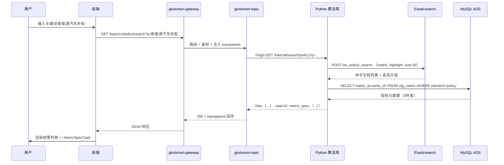

**服务调用链**：`FE → GW(StripPrefix) → TOPIC(/topic/v1/policy/search) → Feign → PY(/internal/search/policy) → ES(idx_policy _search) + ADS(cfg_metric 只读)`

**数据流**：`ES 倒排索引命中 → Python 封装 + 附带指标元数据 → Java 透传 → 前端渲染`

---

### 场景 G-1：产业全要素图谱可视化

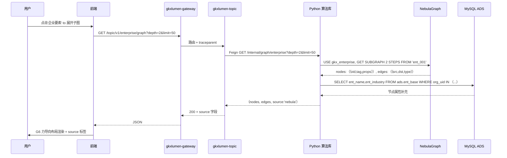

**服务调用链**：`FE → GW → TOPIC(/topic/v1/enterprise/graph) → Feign → PY(/internal/graph/enterprise) → NEB(GET SUBGRAPH) + ADS(ads.ent_base 属性补充)`

**关键契约**：响应必带 `source: "nebula" | "pg" | "error"`（`graph-engine.md §2`）

---

### 场景 A-1：七要素基础指标计算（ETL 批处理）

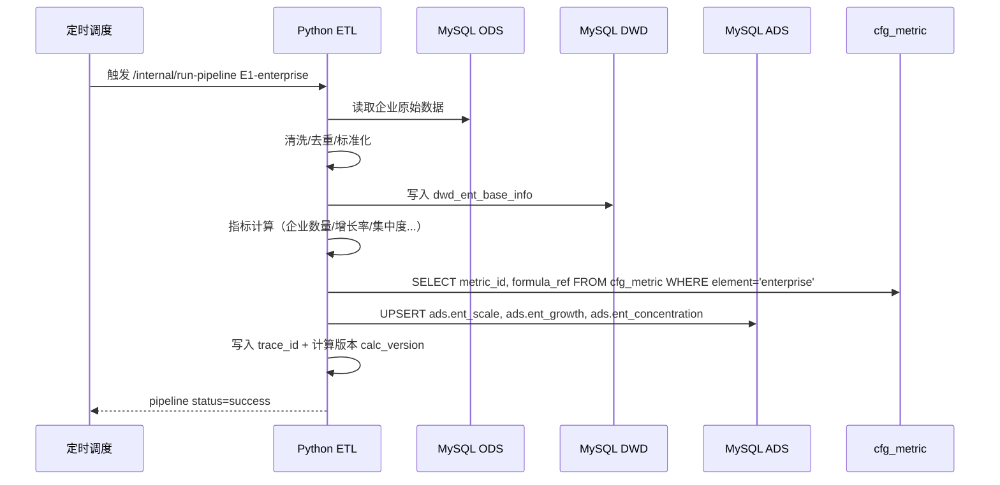

**服务调用链**（无前端参与，纯批处理）：`CRON → PY(/internal/run-pipeline) → ODS(读) → DWD(写) → ADS(写) + CFG(读指标定义)`

**铁律**：Java 不参与此流程；ADS 由 Python 独占写

---

## 第二组：双栈交叉场景

### 场景 EG-1：图谱节点详情检索（ES × 图）

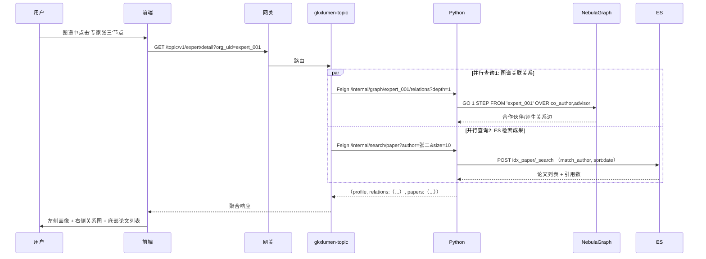

**服务调用链**：`FE → GW → TOPIC ├→ Feign → PY(/internal/graph/.../relations) → NEB └→ Feign → PY(/internal/search/paper) → ES → TOPIC 聚合两路结果 → FE`

---

### 场景 ER-1：混合检索 BM25 + 向量（ES × RAG）

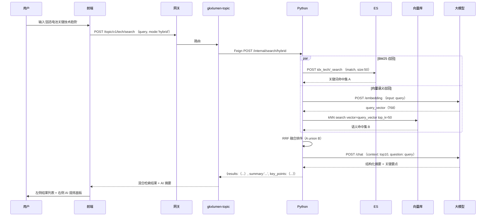

**服务调用链**：`FE → GW → TOPIC → Feign → PY(/internal/search/hybrid) ├→ ES(BM25 召回) ├→ LLM(embedding) → VEC(kNN 召回) └→ LLM(chat 生成摘要) → PY RRF 融合 → TOPIC → FE`

---

### 场景 GR-1：NL2Graph 自然语言查图谱（图 × RAG）⭐

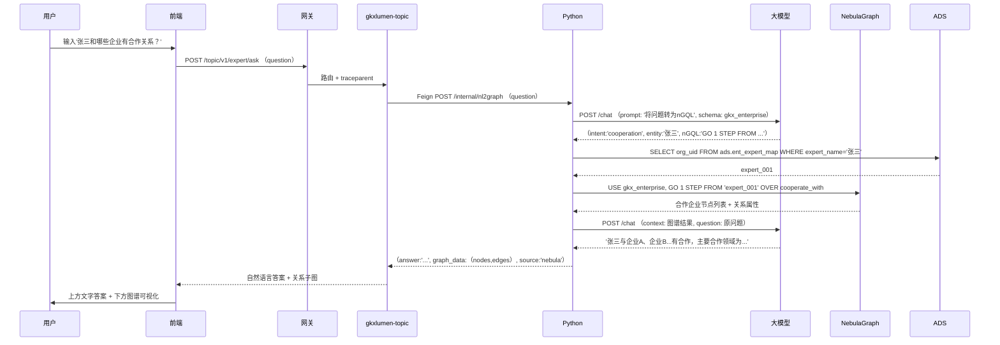

**服务调用链**：`FE → GW → TOPIC(/topic/v1/expert/ask) → Feign → PY(/internal/nl2graph) → LLM(意图识别 + nGQL 生成) → ADS(实体名→vid 映射) → NEB(执行 nGQL 查询) → LLM(结果组织为自然语言) → TOPIC → FE`

**关键点**：LLM 生成 nGQL 需在 Python 侧做语法校验 + 注入防护（禁止 DDL/DROP）

---

### 场景 GR-2：GraphRAG 图谱增强检索（图 × RAG）⭐

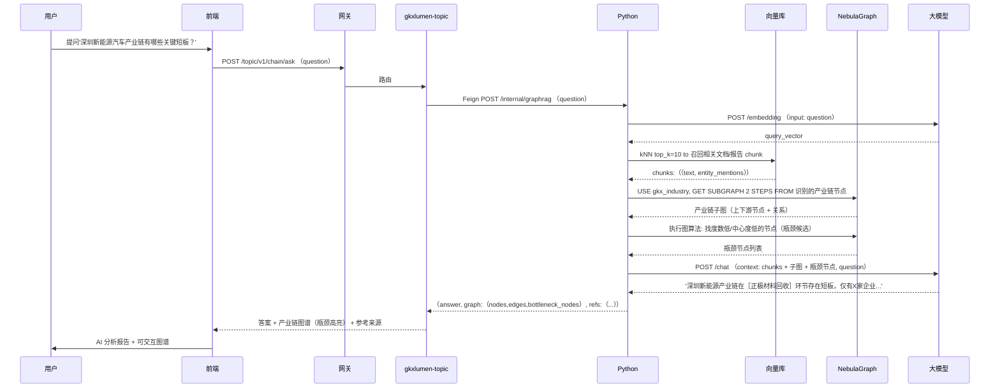

**服务调用链**：`FE → GW → TOPIC → Feign → PY(/internal/graphrag) → LLM(embedding) → VEC(向量召回文档) → NEB(子图扩展 + 图算法识别瓶颈) → LLM(综合生成分析) → TOPIC → FE`

---

### 场景 GA-1：图算法驱动的指标计算（图 × 算法）

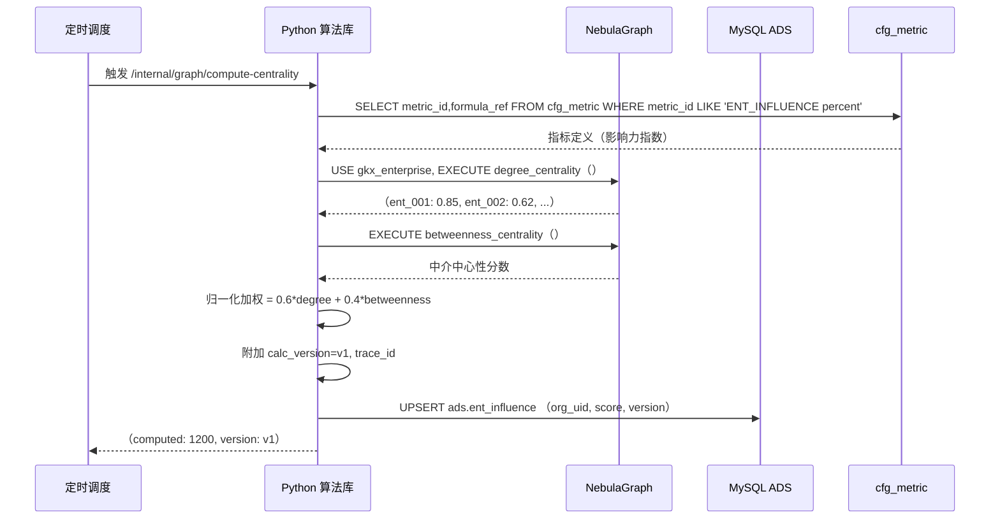

**服务调用链**（批处理，无前端）：`CRON → PY(/internal/graph/compute-centrality) → CFG(读指标定义) → NEB(图算法) → PY(加权计算) → ADS(写指标)`

**数据流**：`NebulaGraph 图算法 → Python 后处理 → ADS 物化 → Java 只读查询`

---

### 场景 GA-3：推荐匹配——人才引进推荐（图 × 算法）

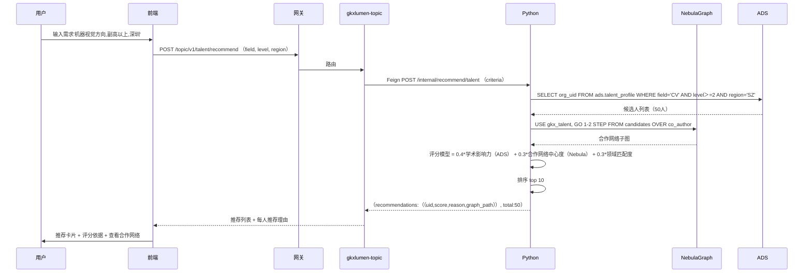

**服务调用链**：`FE → GW → TOPIC(/topic/v1/talent/recommend) → Feign → PY(/internal/recommend/talent) → ADS(候选人初筛) → NEB(合作网络扩展) → PY(评分模型排序) → TOPIC → FE`

---

### 场景 RA-1：智能问数 NL2SQL（RAG × 算法）

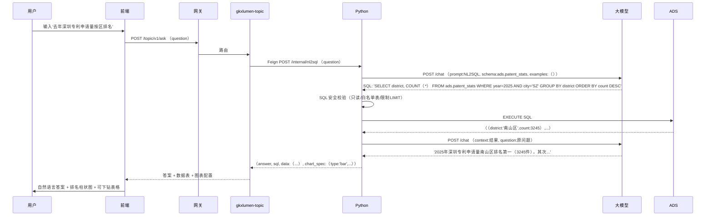

**服务调用链**：`FE → GW → TOPIC(/topic/v1/ask) → Feign → PY(/internal/nl2sql) → LLM(生成SQL) → PY(SQL安全校验) → ADS(执行只读查询) → LLM(结果解读) → TOPIC → FE`

**安全铁律**：SQL 只允许 SELECT + 白名单 ADS 表 + 强制 LIMIT + 只读账号

---

## 第三组：三栈交叉场景

### 场景 EGA-1：产业全景一张图（ES × 图 × 算法）

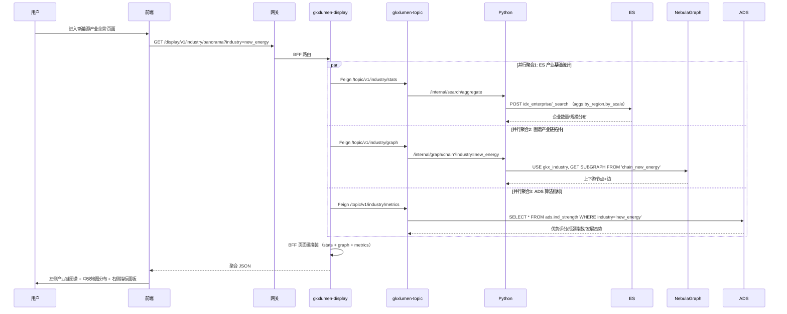

**服务调用链**：`FE → GW → DISP(/display/v1/industry/panorama) ├→ TOPIC → PY → ES(聚合统计) ├→ TOPIC → PY → NEB(产业链子图) └→ TOPIC → ADS(算法指标只读) → DISP 聚合 → FE`

**关键点**：BFF 模式典型场景——`gkxlumen-display` 做页面级拼装，复用 `/topic` + `/metrics`，不新增 Python 直连

---

### 场景 GRA-2：人才智慧服务全链路（图 × RAG × 算法）⭐

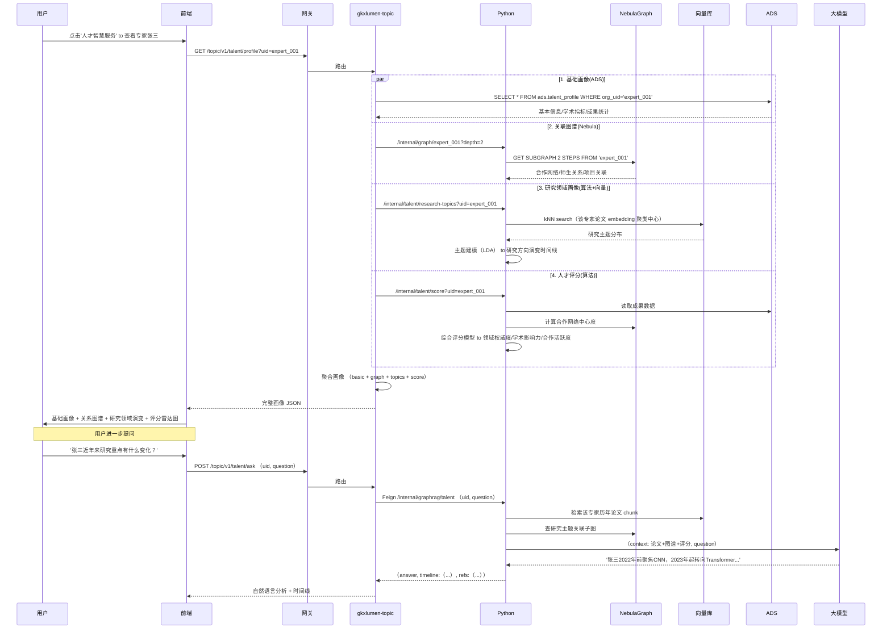

**服务调用链**（两阶段：画像加载 + 智能问答）：

阶段1 画像加载: `FE → GW → TOPIC ├→ ADS(基础画像) ├→ Feign→PY→NEB(关系图谱) ├→ Feign→PY→VEC+PY(研究领域) └→ Feign→PY→ADS+NEB+PY(评分模型) → TOPIC 聚合 → FE`

阶段2 智能问答: `FE → GW → TOPIC → Feign→PY(/internal/graphrag/talent) → VEC(论文检索) → NEB(主题子图) → LLM(综合生成) → TOPIC → FE`

---

## 第四组：全栈旗舰场景

### 场景 ALL-1：AI 搜索全链路（ES × 图 × RAG × 算法）⭐⭐⭐

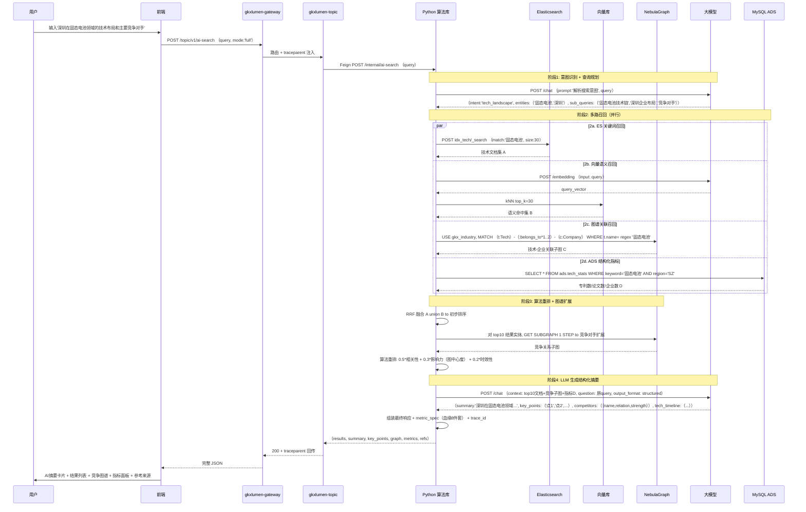

**完整服务调用链**：

```
FE → GW → TOPIC(/topic/v1/ai-search)
  → Feign → PY(/internal/ai-search)
    │
    ├─ 阶段1: LLM(意图识别 + 查询分解)
    │
    ├─ 阶段2(并行):
    │   ├─ ES(BM25 关键词召回)
    │   ├─ LLM(embedding) → VEC(向量语义召回)
    │   ├─ NEB(图谱关联召回)
    │   └─ ADS(结构化指标)
    │
    ├─ 阶段3: NEB(竞争对手子图扩展) + PY(RRF融合 + 算法重排)
    │
    └─ 阶段4: LLM(结构化摘要生成)
    │
  → PY 组装(附 metric_spec 血缘) → TOPIC → GW → FE
```

**数据流总结**：`用户自然语言 → LLM 意图分解 → [ES + 向量库 + Nebula + ADS] 四路并行召回 → 图谱扩展 + 算法重排 → LLM 综合生成 → 结构化知识摘要 + 可视化数据`

---

### 场景 ALL-3：科技专题战略分析（七要素综合）⭐⭐

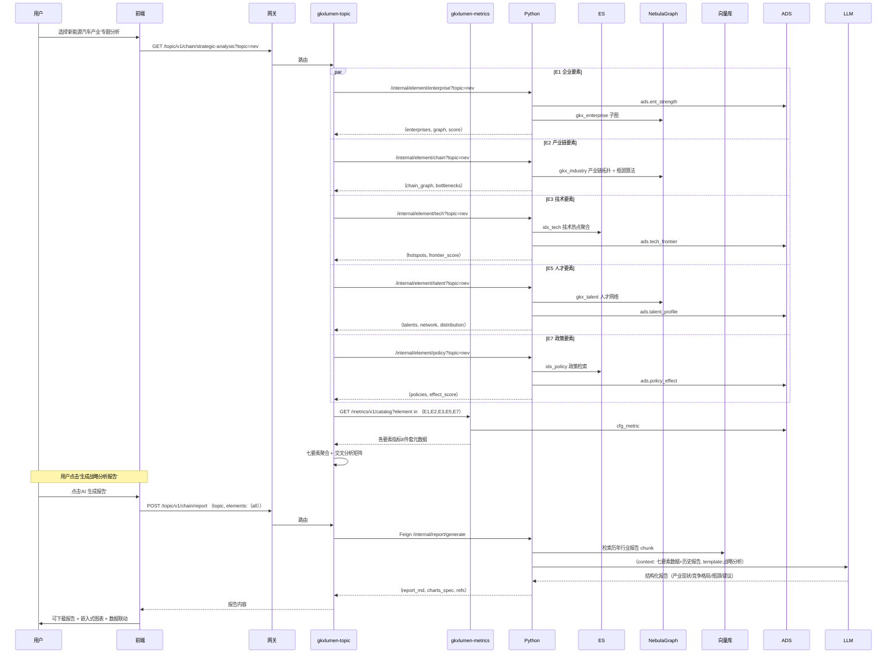

**服务调用链**：

```
FE → GW → TOPIC(/topic/v1/chain/strategic-analysis)
  ├─ 并行 → PY(/internal/element/{element}) × 5要素
  │   每路: ES/NEB/ADS 组合查询 + 算法计算
  ├─ → METRICS(/metrics/v1/catalog) 指标血缘
  └─ → TOPIC 聚合

报告生成:
FE → GW → TOPIC(/topic/v1/chain/report)
  → Feign → PY(/internal/report/generate)
    → VEC(历史报告检索) → LLM(报告生成)
  → TOPIC → FE
```

---

### 场景 ALL-4：产业链深度分析 + 智能问答（全栈闭环）⭐⭐

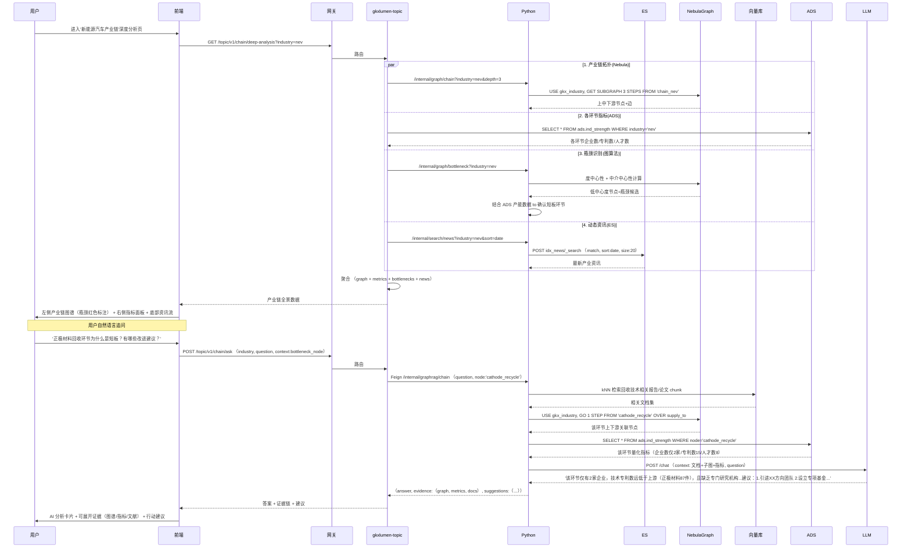

**服务调用链**（两阶段：分析加载 + 闭环问答）：

```
阶段1 分析加载:
FE → GW → TOPIC(/topic/v1/chain/deep-analysis)
  ├→ Feign→PY→NEB(产业链拓扑)
  ├→ ADS(各环节指标)
  ├→ Feign→PY→NEB+ADS(瓶颈识别算法)
  └→ Feign→PY→ES(动态资讯)
  → TOPIC 聚合 → FE

阶段2 闭环问答:
FE → GW → TOPIC(/topic/v1/chain/ask)
  → Feign → PY(/internal/graphrag/chain)
    → VEC(文档召回) → NEB(子图扩展) → ADS(指标佐证) → LLM(综合生成)
  → TOPIC → FE
```

**全栈协同要点**：ES 提供资讯动态 → Nebula 提供拓扑与瓶颈 → 算法做指标与识别 → RAG 补全语义与建议 → LLM 组织自然语言输出，四栈形成"看全局—识瓶颈—问原因—得建议"闭环

---

# 第五轮：数据处理架构 · GDF 与亿集知识图谱关系

> **本轮目标**：理清 **GDF（通用数据工厂）** 与 **亿集 / 亿级科技知识图谱引擎** 的职责边界与衔接面，形成可落地的数据处理过程架构图。  
> **依据增量**：`data/GDF/派单包/企业/GDF-ENT-WORKPACK-v1/` · `designs/亿集知识图谱/亿级知识图谱引擎平台 概要设计.md` · 招标「亿级科技知识图谱」能力表述 · `数据库设计.md §12` · `graph-engine.md`  
> **讨论日期**：2026-08-01  
> **续议（同日）**：是否按行业最佳实践由 **GDF 统一编排**（调亿集 API 做 Schema/建图任务 + 内嵌脚本 + 飞书可观测）——结论见 §2.4，**推荐采纳**。

## 结论速览

| 命题 | 结论（含 2026-08-01 续议修订） |
|---|---|
| GDF 与亿集是什么关系？ | **编排面 vs 能力面**：GDF = 端到端数据产线编排 + 表 ETL + 统一监控告警；亿集 = 图谱能力运行时（Schema/建图/融合/查图 API） |
| 要不要在 GDF 统一管理？ | **要（推荐）**：行业最佳实践是「一个编排平面管全链路依赖与可观测」；GDF **通过亿集公布 API** 管理 Schema CRUD、触发建图任务，**不在 GDF 内重做融合引擎** |
| GDF 做到哪一层？ | ① 表：`gkx`→ODS→DWD；② 编排：触发 ADS/ES/建图下游；③ 观测：DAG 状态、失败重跑、飞书告警。**禁止**绕过亿集直写图存储 |
| 亿集做到哪一层？ | 公布并实现建图/Schema/任务/查图 API；托管实体·关系·推理脚本执行与融合算法；按单位隔离图谱空间 |
| 脚本放哪？ | GDF 内嵌 Java/Python = **胶水/适配/DQ/API 调用**；亿集侧脚本 = **实体识别/事实边/推理边/属性更新**（平台规范要求上传执行） |
| 应用侧读谁？ | **表格**：Java 只读 ADS；**关系**：Java→Python→亿集查图 API（存储细节对应用屏蔽，见 Q5） |
| 一句话 | **GDF 统一编排与观测；亿集专注图谱能力；Python/Java 负责在线服务消费** |

---

## 一、两套「工厂」各自是什么

### 1.1 GDF = 通用数据工厂（表 ETL + **端到端编排平面**）

| 维度 | 定义 |
|---|---|
| 组织 | 数据中台产线团队（人类作业；**不使用 Cursor**） |
| 双角色 | **① 表工厂**：贴源镜像 + Mapping；**② 编排平面**：DAG 调度、下游触发、统一监控与飞书告警 |
| 产物形态 | ODS/DWD 表 + **可观测的产线运行态**（批次、依赖、告警） |
| 当前落地 | 企业维 `GDF-ENT-WORKPACK-v1.3`：Wave A/B 已派单；**编排接通亿集 API** 为本轮续议推荐增量 |
| 明确做 | 调亿集 API：Schema 新建/更新/删除；触发实体识别、事实关系、推理关系、属性更新等任务；内嵌 Java/Python 胶水脚本；产线级可观测 |
| 明确不做 | 改展示前端/Java 业务 API；写三方源库；**绕过亿集直写图存储**；在 GDF 内重实现实体融合/图算法；用假值填 Mapping ❌ 缺口；读供应方内部 `ods_*` |

分层口径（必须先对齐命名，见 `01-命名与分层词典.md`）：

```text
承诺文档 doc/*.xlsx
    ↓ 表名真源
供应方库 gkx.<承诺英文表名>          ← 只读
    ↓ Wave A 贴源镜像（同名同结构）
gkxlumenx_ods.<同名>                 ← 项目 ODS
    ↓ Wave B Mapping / ETL
gkxlumenx_dwd.enterprise_* / …       ← 项目自建 DWD（标准明细）
    ↓ GDF DAG 编排（推荐）
    ├─► 触发 ADS/ES 作业（本项目 Python 执行）
    └─► 调亿集 API：Schema / 建图任务 / 状态回写
```

### 1.2 亿集 = 亿级科技知识图谱引擎（建图 / 用图平台）

来源：`designs/亿集知识图谱/亿级知识图谱引擎平台 概要设计.md` + 招标「亿级科技知识图谱」模块。

| 维度 | 定义 |
|---|---|
| 平台职责 | **建立图谱** + **使用图谱**；全流程自动化（接入→清洗→校验→实体识别→实体融合→关系处理→入库） |
| 脚本模型 | 实体 / 关系 / 推理 **三类独立 Python 脚本**（规避依赖顺序；平台算法解依赖） |
| 关系类型 | **事实关系**（结构化库直取）vs **推理关系**（非结构化文本算法提炼） |
| 用图能力 | 关键词/子图/过滤查询；大规模结果指针化隔离存储；相似专家网络、社群发现等图算法；**禁 NL2SQL 直查图库** |
| 权限隔离 | Schema 全员可见；**按单位隔离图谱运行空间**；内置实体 schema 固定、业务可自定义图谱 |
| 与招标对齐 | 知识图谱展示内容由「亿级科技知识图谱」模块提供；建模工程师备源+定 Schema，业务侧挖矿/分析后发布 |

### 1.3 对比一览（防混用）

| | **GDF（编排 + 表 ETL）** | **亿集知识图谱（能力面）** | **本项目 Python 算法库**（对照） |
|---|---|---|---|
| 主产出 | ODS/DWD + DAG 运行态/告警 | Schema / 实体边 / 融合结果 / 查图 API | ADS 指标、ES 索引、在线 `/internal/*` |
| 输入 | 三方承诺表 | 标准明细表 + 文本等（由 GDF 保证就绪后再触发） | DWD / ADS / 配置表；亦可被 GDF 触发 |
| 作业形态 | 产线 DAG + 内嵌 Java/Python 胶水 + **调亿集 API** | 平台内执行实体/关系/推理脚本 + 工作流引擎 | 批处理写 ADS/ES；在线查图代理 |
| 是否面向前端 | ❌ | 间接（查图/发布 API；展示 UI 另议 Q7） | ❌（仅 Java Feign） |
| 当前证据 | `GDF-ENT-WORKPACK-v1` | 概要设计纪要 + 招标能力 | `demo-algo-*` / `lumen-etl-es-py` |

---

## 二、关系命题：编排统一 · 能力分离

### 2.1 推荐边界（续议修订 · 行业最佳实践）

> **对标**：DataWorks / DolphinScheduler / Airflow / ADF 一类中台 —— **编排平面统一管依赖与观测**；Spark/Flink/图谱引擎等作为 **被调度的能力平面**。  
> **本项目映射**：GDF = 编排平面；亿集 = 图谱能力平面；本项目 Python = ADS/ES/在线查询能力（可被 GDF 触发，服务时仍只被 Java Feign）。

```text
┌──────────────────────────────────────────────────────────────────────────┐
│                    GDF 统一编排平面（Control / Orchestration）             │
│  · DAG：WaveA → WaveB → DQ门禁 → 分支触发下游                             │
│  · 内嵌 Java/Python：胶水、适配、DQ、API Client                           │
│  · 统一监控：批次/耗时/失败重跑 · 飞书告警 · 血缘批次号                    │
│                                                                          │
│   gkx ──A──► ODS ──B──► DWD ──┬──► trigger ADS/ES 作业                   │
│                               └──► call 亿集 API（Schema / 建图任务）      │
└───────────────────────────────┬──────────────────────────────────────────┘
                                │ 仅 API / 作业触发，不直写图存储
        ┌───────────────────────┼───────────────────────┐
        ▼                       ▼                       ▼
┌───────────────┐     ┌─────────────────┐     ┌─────────────────┐
│ Python ADS/ES │     │ 亿集能力平面     │     │ （可选）其他作业 │
│ DWD→ADS / ES  │     │ Schema 执行      │     │ 外部质检/归档   │
│               │     │ 实体/事实/推理   │     └─────────────────┘
└───────┬───────┘     │ 属性更新任务     │
        │             │ 融合 · 入库      │
        ▼             └────────┬────────┘
   MySQL ADS                   │ 查图/发布 API
   ES 索引                     ▼
                    ┌────────────────────┐
                    │ 在线服务消费平面    │
                    │ FE→GW→Java→ADS     │
                    │      └Feign→Python │
                    │           └查图API │
                    └────────────────────┘
```

**关键切分（修订后）**：

1. **GDF 统一管理「何时跑、跑成功没有、失败告谁」**，含对亿集任务的触发与状态汇聚。  
2. **亿集仍独占「图怎么建、怎么融、怎么存、怎么查」**——Schema 语义与融合算法不迁出平台。  
3. **GDF 调 API ≠ GDF 实现图谱**：允许 Schema CRUD / 任务触发 / 轮询状态；禁止 GDF 直连图库写节点边。  
4. **应用消费双通道不变**：统计走 ADS；关系走查图 API（经 Python）。

### 2.2 反模式（禁止）

| 反模式 | 为何错 |
|---|---|
| GDF **绕过亿集 API** 直写 Nebula/图库 | 丢掉平台融合、校验、隔离与审计；双写漂移 |
| 在 GDF 内 **重做** 实体融合 / 图算法，亿集只当冷存储 | 违背招标「亿级知识图谱引擎」能力边界；双栈维护 |
| 亿集脚本 **直连供应方 `gkx`** 绕过 ODS/DWD | 失去贴源验收与字段承诺；三方变更直击建图 |
| 前端 / Java 业务服务直连亿集管理 API 或 GDF 库 | 违反调用链与 D3；管理面与服务面混用 |
| 把「供应方 dwd_*」当成「项目 DWD」 | 命名混用；产线配错源/目标 |
| 用亿集替代 ADS 做指标物化 | 血缘 8 件套与契约面失真 |
| Schema 变更只在亿集 UI 手点、**不进 GDF DAG 版本** | 无统一变更记录与回滚；不可观测 |

### 2.3 与前四轮的衔接

- 第一轮「数据工厂 ODS→DWD→ADS」：GDF **执行** ODS→DWD，并 **编排触发** DWD→ADS / 建图；ADS 计算仍建议本项目 Python 执行（可被 GDF 调起）。  
- 第三/四轮图谱场景：在线查询仍「Python → 查图 API」；本轮补齐 **离线建图由 GDF DAG 驱动**。  
- 可观测性：`observability.md` 覆盖 **在线** OTel；GDF 飞书告警覆盖 **离线产线**——两套互补，批次号建议打通。  
- `graph-engine.md` Nebula：服务侧运行时候选；与亿集物理库关系见 Q5。

### 2.4 续议议题：是否在 GDF 统一管理？（本轮答案：**是，按编排面统一**）

#### 行业最佳实践怎么拆

| 平面 | 职责 | 本项目落点 |
|---|---|---|
| **编排 / 控制平面** | DAG、依赖、调度、重试、SLA、统一告警、变更审计 | **GDF** |
| **表数据平面** | 抽取、映射、入仓 | **GDF Wave A/B** |
| **图谱能力平面** | Schema、抽取脚本执行、融合、图存储、查图 | **亿集**（被 GDF 调用） |
| **指标 / 检索平面** | ADS 物化、ES 索引 | **本项目 Python**（被 GDF 触发） |
| **在线服务平面** | REST、鉴权、聚合 | **Java + Python /internal**（不经 GDF） |

这与「湖仓中台调外部特征平台 / 向量平台 / 图平台 API」的主流做法一致：**统一编排，专业执行**。

#### GDF 对亿集 API 的推荐能力清单

| API 类别 | 典型动作 | GDF 节点用法 |
|---|---|---|
| Schema 管理 | 新建 / 更新 / 删除 Schema（及版本） | 变更窗口人工审批后由 DAG 执行；失败飞书告警 |
| 任务触发 | 实体识别、事实关系、推理关系、属性更新 | DWD/DQ 通过后按依赖触发；可并行的边任务扇出 |
| 任务观测 | 查询运行状态 / 日志指针 / 影响行数 | 汇入 GDF 批次视图；超时重试或告警 |
| （可选）发布 | 图谱版本发布 / 回滚标记 | 与 ADS 批次对齐后再「可服务」 |

> 亿集概要设计已写明：建图/查图走标准化接口；Schema 变更与挖掘通过 API；工作流可界定数据范围——与「GDF 调 API」完全同向。

#### GDF 内嵌 Java / Python 脚本放什么

| 适合放 GDF | 不适合放 GDF（应留在亿集或本项目算法仓） |
|---|---|
| 调亿集 / ADS / ES 的 API Client | 实体融合、社群发现等图谱核心算法 |
| DQ：主键空值率、增量水位、对账抽样 | 在线 `/internal/graph` 查询服务 |
| 批次号写入、飞书告警组装 | 面向前端的业务聚合 |
| 轻量字段适配（若 Mapping 未覆盖的胶水） | 大规模 NLP 推理（应作亿集推理任务或算法仓作业） |

#### 统一可观测性（离线产线）

```text
GDF DAG Run
  ├── 节点状态：成功 / 失败 / 重试中
  ├── 指标：时长、影响行数、API 返回码
  ├── 关联：batch_id ↔ ODS/DWD/ADS/图谱任务 ID
  └── 告警：飞书（失败、SLA 超时、Schema 变更）
         ↑
    与在线 OTel（Java/Python trace）用 batch_id / graph_job_id 弱关联即可
```

**结论**：需要在 GDF 统一管理——统一的是 **编排、依赖、监控、告警**；不是把亿集能力搬进 GDF。

## 三、端到端数据处理过程架构图

### 3.1 总览（分层泳道 · 含 GDF 编排）

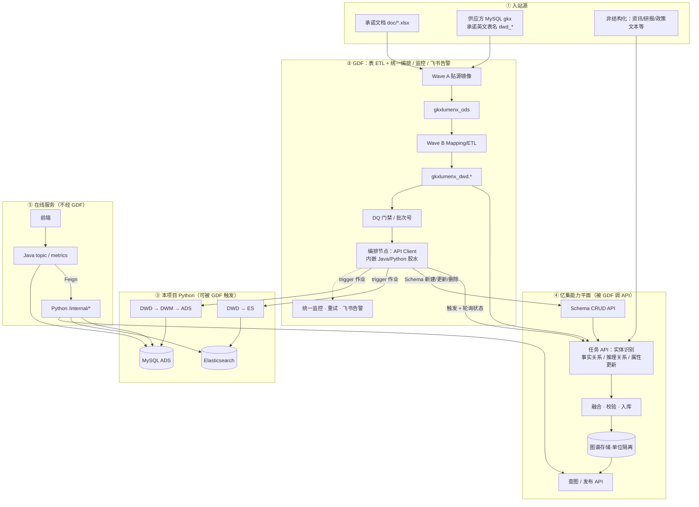

### 3.2 GDF 内部过程（表工厂）


### 3.3 亿集建图过程（图工厂 · 由 GDF 触发）

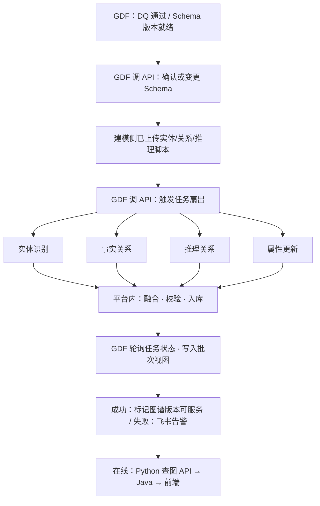

### 3.4 运行时读路径（与写路径解耦）

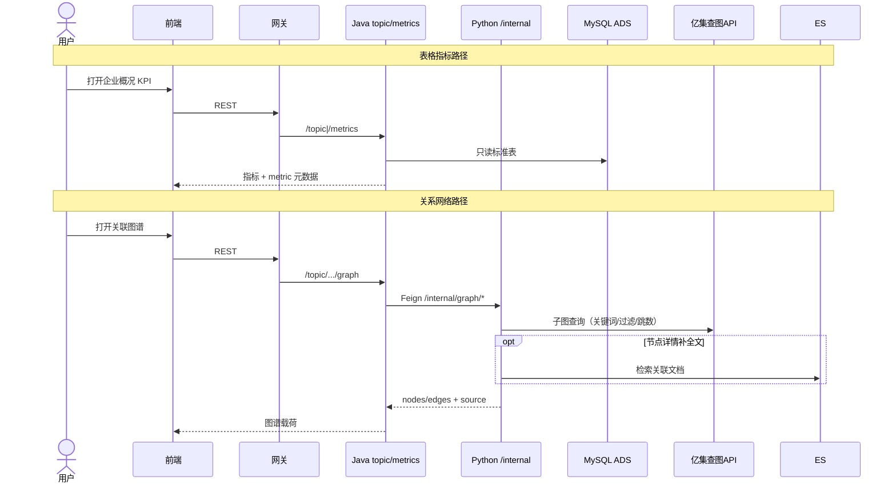

### 3.5 GDF 统一编排 DAG（推荐骨架）

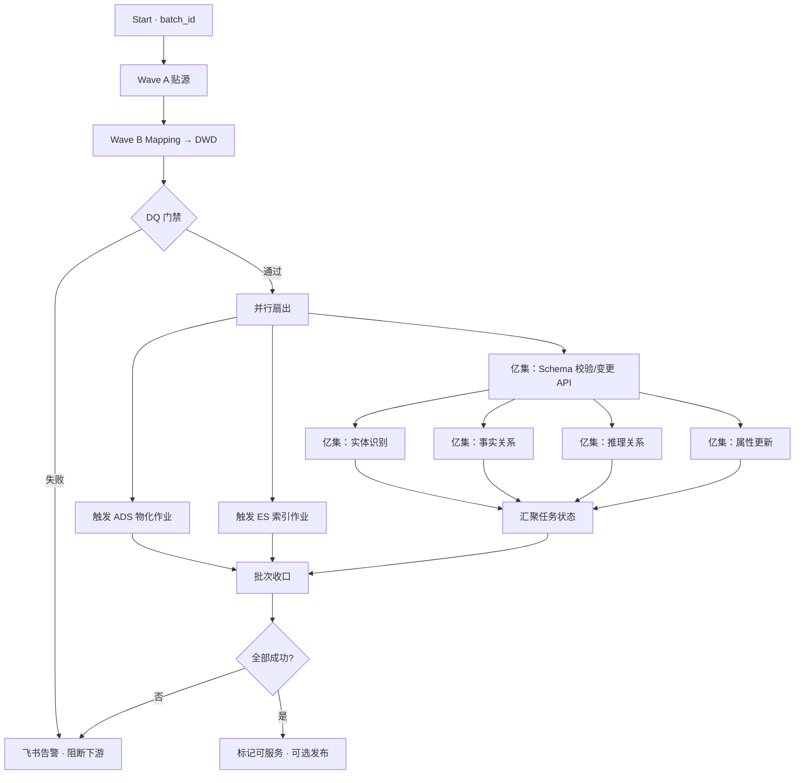

---

## 四、数据对象交接面（契约）

| 交接面 | 上游 | 下游 | 契约要点 | Owner |
|---|---|---|---|---|
| **F1 承诺→贴源** | 供应方 `gkx` | GDF Wave A | 承诺英文表名；只读；`is_deleted=0` | GDF + 数据 Lead |
| **F2 贴源→标准明细** | `gkxlumenx_ods` | GDF Wave B → `gkxlumenx_dwd` | Mapping v3 字段级；缺口登记 | GDF + 数据 Lead |
| **F3 标准明细→ADS** | 项目 DWD | Python 指标/聚合（**GDF 触发**） | ADS DDL 冻结；Mock→真实；`batch_id` | GDF 编排 + algorithm |
| **F4 标准明细→ES** | 项目 DWD | `lumen-etl-es-py`（**GDF 触发**） | 索引 mapping；增量 SLA | GDF 编排 + etl-es |
| **F5 Schema 管控** | 建模设计稿 | GDF → 亿集 Schema API | 版本号、审批、可回滚；禁仅 UI 手改无记录 | GDF + 图谱建模 |
| **F6 建图任务触发** | GDF DQ 通过 | 亿集任务 API | 实体/事实/推理/属性；任务 ID↔`batch_id` | GDF + 亿集 |
| **F7 文本→推理边** | 资讯/政策等语料 | 亿集推理任务（GDF 可触发） | 语料批次；可追溯证据 | 图谱建模 + algorithm |
| **F8 图谱→应用** | 亿集查图 API | Python `/internal/graph/*` → Java | 响应带 `source`；禁前端直连管理 API | api + algorithm |
| **F9 ADS→应用** | ADS | Java 只读 | D3/D9；禁扫 ODS/DWD | api |
| **F10 产线可观测** | GDF DAG | 飞书 / 批次视图 | 失败、超时、Schema 变更告警 | GDF |

**主键对齐建议（企业维示例）**：Wave A 原样保留供应方键；Wave B 产出项目侧归一键；亿集实体主键 **必须映射到项目归一键**，避免图上出现「同企多 VID」。

---

## 五、职责 RACI（数据处理段 · 续议修订）

| 活动 | GDF | 亿集平台/建模 | 本项目 Python | Java | 前端 |
|---|---|---|---|---|---|
| 三方表贴源镜像 | **R** | C | C | — | — |
| ODS→DWD Mapping | **R** | C（告知所需字段） | C | — | — |
| 端到端 DAG / 飞书告警 | **R** | C | C | I | — |
| Schema CRUD（经 API） | **R**（编排执行） | **R**（语义设计/审核） | C | — | — |
| 建图任务触发与状态汇聚 | **R** | **R**（平台执行） | C | — | — |
| 实体/关系/推理脚本内容 | I | **R** | C | — | — |
| DWD→ADS 指标物化 | **R**（触发） | I | **R**（执行） | C（契约评审） | — |
| 图查询 API 封装（在线） | — | C | **R** | **R**（Feign 聚合） | C |
| 页面指标 / 图谱展示 | — | I | I / **R**（载荷） | **R** | **R** |

> R=执行 · C=协商 · I=知情 · —=不参与  
> Schema 行「双 R」含义：建模对**正确性**负责，GDF 对**变更进入产线与可观测**负责。

---

## 六、分阶段落地建议

| 阶段 | 数据处理重点 | 退出条件 |
|---|---|---|
| **P0** | GDF 企业维 Wave A/B；产线调度 + 失败飞书告警可用 | DWD 可对账；告警演练通过 |
| **P1** | GDF 触发 ADS/ES 作业；`batch_id` 贯通 | ADS 关键 KPI 与 DWD 对齐 |
| **P2** | GDF↔亿集：**任务触发 + 状态回写 API** 打通（先事实关系） | DAG 上可看到建图节点成败 |
| **P3** | Schema CRUD 进 GDF 变更窗；推理关系 + 属性更新入 DAG | Schema 变更可审计/回滚 |
| **P4** | 图谱版本「可服务」门禁与在线查图对齐；图算法指标回写 ADS | GA-* 可演示且带血缘 |

---

## 七、开放项（需人拍板）

| ID | 问题 | 影响 | 建议默认（续议后） |
|---|---|---|---|
| **Q1** | 亿集建图输入是否强制项目 DWD/ADS，禁直连 `gkx`？ | 验收与变更隔离 | **强制走 DWD**（不变） |
| **Q2** | ADS 物化：GDF 只触发，还是脚本也下沉 GDF？ | 算法仓边界 | **GDF 触发 + Python 仓执行**（推荐） |
| **Q3** | 事实边读 DWD 还是 ADS？ | 新鲜度 vs 稳定 | **事实边读 DWD；展示属性可补 ADS** |
| **Q4** | 推理语料是否经 GDF/ODS？ | 文本链路成本 | **可旁路入仓**，须登记批次；**触发仍走 GDF DAG** |
| **Q5** | 亿集物理库 vs Nebula | 客户端与运维 | **待确认**；应用只经查图 API |
| **Q6** | 单位隔离空间 ↔ 租户模型 | 安全 | 对齐网关租户后再开空间 |
| **Q7** | 展示嵌亿集 UI vs 自绘 G6 | UX | Demo 自绘+API；正式产品确认 |
| **Q8** | Schema 删除是否允许自动进 DAG，还是必须双人审批？ | 误删风险 | **删除/破坏性变更必须人工门禁** |
| **Q9** | 亿集管理 API 凭证挂在 GDF 哪类账号？与在线查图凭证是否分离？ | 权限面 | **管理凭证 ≠ 查询凭证**（强制分离） |
| **Q10** | GDF 飞书告警与 OTel/Grafana 是否要统一值班入口？ | 运维体验 | **离线飞书 + 在线 Grafana**，批次号互链 |

---

## 八、本轮讨论焦点（建议议程）

1. **确认续议结论**：GDF = 统一编排/观测平面；亿集 = 图谱能力平面（§2.4）。  
2. 向亿集要 **API 清单与 SLA**（Schema CRUD、四类任务触发、状态查询）。  
3. 拍板 **Q8/Q9**（破坏性变更门禁、凭证分离）。  
4. 企业维试点：在现有 Wave A/B DAG 后挂「事实关系」一个建图节点做烟测。  
5. 通过后写入 `数据库设计.md §12` 增补「编排面 / 能力面」。

> **已派单（2026-08-01）**：上述 2+4 落地任务 → **`GDF-YIJI-FACTREL-SMOKE-L01`**，负责人 `human:郭万迎`，协同 `human:辜少彬`；派单说明见 `agent-handoffs/企业战略分析-ENT/GDF-YIJI-FACTREL-SMOKE-L01.md`。

---

## 九、本轮产物清单

| 产物 | 说明 |
|---|---|
| 本轮正文 | `houtai-arch-discussion.md` 第五轮（含统一编排续议） |
| 关系结论 | **GDF 统一编排+表 ETL+监控告警**；亿集执行图谱能力；Python 执行 ADS/ES/在线查图代理 |
| 架构图 | §3.1 总览 · §3.2 表工厂 · §3.3 图工厂（GDF 触发）· §3.4 在线读路径 · **§3.5 DAG 骨架** |
| 待决 | Q1–Q10（续议新增 Q8–Q10） |

---

# 附录：速查总表与关键模式总结

## 场景 × 服务调用链 速查总表

| 场景 | 技术栈 | 调用链（缩写） | Java 是否直连存储 |
|---|---|---|---|
| ES-1 全文检索 | ES | FE→GW→TOPIC→PY→ES+ADS | ❌ 只读 ADS 经 PY 代理 ES |
| G-1 图谱可视化 | 图 | FE→GW→TOPIC→PY→NEB+ADS | ❌ |
| A-1 指标计算 | 算法 | CRON→PY→ODS/DWD/ADS+CFG | Java 不参与 |
| EG-1 节点详情 | ES+图 | FE→GW→TOPIC→(PY→NEB ∥ PY→ES) | ❌ |
| ER-1 混合检索 | ES+RAG | FE→GW→TOPIC→PY→(ES ∥ LLM→VEC)+LLM | ❌ |
| GR-1 NL2Graph | 图+RAG | FE→GW→TOPIC→PY→LLM→ADS→NEB→LLM | ❌ |
| GR-2 GraphRAG | 图+RAG | FE→GW→TOPIC→PY→LLM→VEC→NEB→LLM | ❌ |
| GA-1 图算法指标 | 图+算法 | CRON→PY→CFG→NEB→PY→ADS | Java 不参与 |
| GA-3 人才推荐 | 图+算法 | FE→GW→TOPIC→PY→ADS→NEB→PY | ❌ Java 只读 ADS |
| RA-1 NL2SQL | RAG+算法 | FE→GW→TOPIC→PY→LLM→ADS→LLM | ❌ ADS 只读 |
| EGA-1 产业全景 | ES+图+算法 | FE→GW→DISP→(TOPIC→PY→ES ∥ TOPIC→PY→NEB ∥ TOPIC→ADS) | ❌ 只读 ADS |
| GRA-2 人才画像 | 图+RAG+算法 | FE→GW→TOPIC→(ADS ∥ PY→NEB ∥ PY→VEC+PY ∥ PY→ADS+NEB)+PY→LLM | ❌ |
| ALL-1 AI搜索 | 全栈 | FE→GW→TOPIC→PY→LLM→(ES ∥ VEC ∥ NEB ∥ ADS)→PY重排→LLM | ❌ |
| ALL-3 专题战略 | 全栈 | FE→GW→TOPIC→(PY×5要素 ∥ METRICS→ADS)+PY→VEC→LLM | ❌ |
| ALL-4 链+问答 | 全栈 | FE→GW→TOPIC→(PY→NEB ∥ ADS ∥ PY→NEB+ADS ∥ PY→ES)+PY→VEC→NEB→ADS→LLM | ❌ |

---

## 关键模式总结

### 共性铁律（所有场景）

1. **Java（TOPIC/METRICS/DISP）永不直连** Nebula/ES/向量库/LLM——一律 Feign 调 Python `/internal/*`
2. Java 唯一直读的存储是 **MySQL ADS + app_user**（D3 契约面）
3. 所有跨服务调用经网关，**traceparent 全链路透传**
4. **LLM 调用一律在 Python 侧**，Java 不直接调 LLM
5. **向量库写入由 Python 独占**，Java 经 Python 代理检索

### 四种调用模式

| 模式 | 典型场景 | 特点 |
|---|---|---|
| **直通型** | ES-1, G-1 | Java 透传 Python 结果，无聚合 |
| **并行聚合型** | EG-1, EGA-1, GRA-2, ALL-3 | Java/TOPIC 并行 Feign 多路，聚合后返回 |
| **管道型** | GR-1, RA-1, ER-1 | Python 内部多步串联（LLM→存储→LLM），Java 等单次返回 |
| **全栈闭环型** | ALL-1, ALL-4 | 意图分解→多路召回→算法重排→LLM 生成，四阶段管道 |

### 架构缺口提示

当前 `gkxlumen-topic` 和 Python 算法库的 `/internal/*` 接口大多尚未实现。以上时序图中的接口路径是建议契约，落地时需 architect 评审确认后写入 `architecture-baseline.md` 服务清单。

### 数据处理缺口提示（第五轮）

- GDF 企业维 Wave A/B 已派单；**统一编排接通亿集 API**（Schema/任务/状态）尚待厂商接口清单与烟测。
- 管理面凭证与在线查图凭证须分离（Q9）；破坏性 Schema 变更须人工门禁（Q8）。
- 亿集物理存储与 Nebula 基线（Q5）未拍板前，应用侧继续 **只经 Python 查图**。

### 分阶段交付建议

1. **Wave 0-1（P0 三栈）**：ES 检索 + NebulaGraph 图谱 + Python 指标算法——当前架构基线已覆盖
2. **Wave 2（P1 交叉）**：图 × 算法（GA-1~GA-5）——算法库核心交付，需补 `demo-svc-topic-py` graph/analytics 服务
3. **Wave 3（P2 RAG 引入）**：向量库 D11 架构变更 + LLM 接入 + RAG 场景——需 PM + 架构师签字
4. **Wave 4（P2 旗舰）**：全栈场景 ALL-1~ALL-4——在 Wave 2/3 基础上叠加，BFF 层 `gkxlumen-display` 建成
5. **数据编排轨（第五轮续议）**：GDF 统一 DAG（表 ETL + 触发 ADS/ES + 调亿集建图 API + 飞书告警）——见 §2.4 / §3.5

---

## 文件清单与引用

| 文档 | 路径 | 用途 |
|---|---|---|
| 架构基线 | `agent-delivery/architecture-baseline.md` | 方案 A + D1-D10 决策 |
| 范围基线 | `agent-delivery/scope-baseline.yaml` | 58 功能点 ±10% |
| 数据库设计 | `agent-delivery/数据库设计.md` | 三引擎分工 + ADS 契约面 |
| 图谱引擎 | `agent-delivery/graph-engine.md` | NebulaGraph 规范 |
| 可观测性 | `agent-delivery/observability.md` | OTel 全栈（在线） |
| CI/CD | `agent-delivery/cicd-pipeline.md` | 发布闭环 |
| 仓库注册表 | `agent-delivery/repo-registry.yaml` | demo↔lumen 映射 |
| 任务注册表 | `agent-delivery/task-registry.yaml` | 进度跟踪 |
| 招标总体 | `agent-delivery/bid-reference/智能服务集群-完整.md` | 需求真源 |
| 算法库 | `agent-delivery/bid-reference/科技专题服务算法库.md` | 算法需求 |
| GDF 企业派单包 | `agent-delivery/data/GDF/派单包/企业/GDF-ENT-WORKPACK-v1/` | 表工厂 Wave A/B |
| 亿集概要设计 | `agent-delivery/designs/亿集知识图谱/亿级知识图谱引擎平台 概要设计.md` | 图工厂建图/用图 |
| 团队公约 | `.cursor/rules/00-team-constitution.mdc` | 铁律与必读 |

---

> **本文档维护**：architect-agent；变更走 `architecture-baseline.md §8` 变更记录 + PM 知情。
> 
> **下次讨论建议**：
> 1. 与亿集对齐管理 API 清单，企业维 DAG 挂载「事实关系」烟测；
> 2. 拍板 Q8/Q9 后，将「编排面 / 能力面」写入 `数据库设计.md §12`；
> 3. 或展开某场景 Python `/internal/*` OpenAPI + Java Feign 骨架。

---

*导出于 2026-08-01 · 会话累计 5 轮（含统一编排续议）· 涵盖架构提纲 / 向量库 / 场景全景 / 时序图 / GDF 编排面↔亿集能力面*
