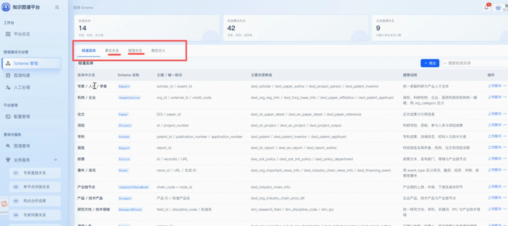

亿级知识图谱 概要设计

**知识****图谱相关会议纪要**

本次会议围绕知识图谱搭建、脚本开发、流程规范、功能使用、权限管理、技术细节及项目推进工作展开全面讨论，明确了图谱构建与使用的核心流程、技术标准、功能特性及后续工作安排，具体内容总结如下：

**一、图谱整体架构与核心流程**

知识图谱整体工作分为**建立图谱**和**使用图谱**两大核心板块，全流程由平台自动化落地。建图环节主要包含创建实体、明确数据来源、开发并上传实体抽取脚本；用图环节以图谱数据查询、分析为核心。完整图谱处理流程涵盖数据接入、数据清洗、数据校验、实体识别、实体融合、关系处理、最终入库，全程自动化执行，无需人工全程干预。

**二、实体搭建与脚本开发规范**

**1. 实体基础配置要求**

搭建实体需完成两项基础配置，一是设置实体主键，二是明确实体的数据来源并做好说明，配置完成后必须上传对应的实体抽取脚本，作为数据落地的核心依据。

**2. 脚本开发标准与用途**

平台将提供专属规范文档，包含API、SDK使用指南，明确数据库读取、数据处理算子的使用规则，统一脚本开发标准。当前仅支持**Python脚本**，脚本核心用途为数据取回、数据清洗、数据映射，实现业务数据与图谱节点属性的匹配。同时平台配套提供脚本编写模板与详细指导文档，降低开发门槛。

**3. 脚本拆分设计逻辑**

实体、关系、推理对应独立脚本，拆分设计主要为规避业务顺序问题，防止出现关系依赖的实体未完成抽取、创建的情况。相较于人工统筹处理，平台可通过算法自动解决脚本依赖问题，开发更简单、适配性更强，同时便于SDK的灵活调用。

**三、建图工作流与动态更新机制**

**1. 任务管理规则**

平台将每条实体的建图工作流定义为独立任务，系统默认自动更新，大幅减少人工维护成本。用户可自主自定义任务更新策略，灵活设置更新频率、具体执行时间，适配不同业务数据更新需求。

**2. 图谱动态更新方式**

图谱支持两类动态更新模式，分别是定时更新和事件触发更新。其中事件触发更新适用于关键数据变更场景，可即时更新图谱数据，目前该功能为手动触发，可根据业务需求迭代实现自动化触发。

**3. Schema变更与图谱更新**

Schema变更、基于Schema挖掘新实体与关系为两个独立操作，均通过API实现，灵活性极高。用户创建Schema后会生成专属ID，可凭借该ID调用对应API完成实体写入操作，同时工作流API可精准界定需新增的数据范围。

**四、查图功能与查询机制**

**1. 基础查询能力**

查图功能核心用于检索业务关注数据，支持通过实体名称、关键词进行页面查询，同时可依托子图范围、各类过滤条件实现精细化筛选，适配多维度业务查询场景。

**2. 大规模结果处理规则**

针对大规模查询结果，平台采用分层存储与返回机制：小型查询结果直接返回原始数据；大型结果不直接输出全量数据，仅返回指针标识，完整数据存储于独立隔离的图数据库空间，便于统一管理、调取与查询。所有查询结果均以子图形式呈现，隔离存储更安全、易维护。

**3. 接口访问与安全规范**

平台所有建图、查图功能均通过标准化接口对外提供服务，为规避安全风险，不支持**NL2SQL**直接查询。系统通过关键词、查询范围、实体及关系范围等参数严格限制查询权限，同时支持相似专家网络、社群发现等专属图谱查询算法。

**五、实体与Schema权限、隔离规则**

**1. 实体类型限制与自定义**

Scikim管理体系内存在部分内置实体，为适配多业务通用需求，此类实体的schema固定不可修改。同时平台支持用户自定义业务专属图谱，可自主新增实体、补充实体属性，不受内置实体约束，适配个性化业务场景。

**2. Schema可见性与图谱隔离**

所有Schema（含系统内置、用户自定义）全员可见，保证标准统一透明。为杜绝不同业务数据混杂，平台按单位实现图谱数据隔离，各单位拥有独立的图谱运行空间，保障业务数据独立性。

**六、数据关系与代码编写规则**

**1. 两类数据关系区分**

图谱数据关系分为事实关系和推理关系。事实关系可直接从数据库结构化数据中直接获取；推理关系需依托非结构化数据，通过算法推理提炼生成，典型场景为从资讯文本中提取企业相关关联信息。

**2. 代码编写与图谱核心动作**

图谱构建包含**实体识别、关系识别、关系推理**三大核心动作，各动作均匹配独立脚本。代码编写虽分为实体、关系两类，但开发时无需显式区分，两类代码可统一适配三大核心构建动作，简化开发流程。业务区分的核心目的是通过梳理间接关系，规范业务数据组织逻辑。

 

**七、数据源适配规则**

平台数据源具备高灵活性，脚本中可适配各类数据源，无强制限制。当前平台默认采用统一数据源，后续可拓展用户自定义数据源能力，同时需重点把控自定义数据源的安全性、数据格式一致性，规避数据风险。