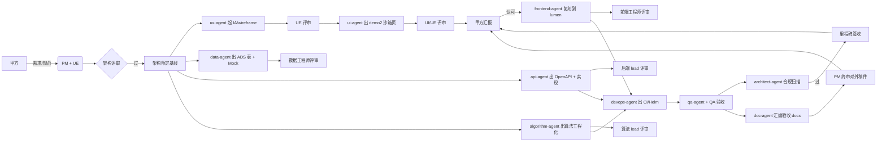

# 团队协作公约（人机协作 Playbook）

> **读者**：全体团队成员（架构师 / PM / UI/UE / 前端 / 后端 / 算法 / 数据 / DevOps / QA / 集成 / 文档）  
> **作用**：把"团队 + AI Agent"组合成可扩展的产能系统；规定每个团队的人机分工、Cursor team 配置、协作节奏与红线纪律。  
> **关联**：`智能体编排与派单手册.md`（操作手册）· `architecture-baseline.md`（架构基线）· `orchestration-maturity-and-roadmap.md`（编排成熟度）· `team-onboarding.md`（新人 1 天上手）· `.cursor/rules/`（团队共享 rules）  
> **维护**：PM + 各团队 lead  
> **日期**：2026-06-17

---

## 0. 一句话心智

> **人做决策、评审、创意、客户沟通；AI 做执行、起草、标准化、并行重复劳动；人与人、人与 AI、AI 与 AI 都靠"DoD + Handoff + Evidence"标准化接口。**

衡量一个团队是否真正用好 AI，只看一条：
**(团队人数 + AI agent) 能否等价于原来 3 倍人力的产能。**

---

## 1. 三层协作架构

```
战略层：架构委员会（架构师团队 + 各 lead + PM）
   ↓ 决策 / 评审 / 范围守门
编排层：coordinator-agent + PM + architect-agent
   ↓ 派单 / 验收 / 跨团队接口
执行层：各团队 = 人 + AI agent 双轨
   ├─ 1 名 lead 定标 + 评审
   ├─ N 名工程师做评审 + 复杂模块
   └─ 每人带 ≤4 个 agent 并行（编排手册 §14）
```

**关键点**：每个团队的工作范式都同构 —— lead 定接口/契约/标准，工程师评审 + 攻坚，agent 出量。

---

## 2. 各团队职责矩阵（人 / AI 分工 + 接口产物）

| # | 团队 | 推荐编制 | 人做什么（高价值） | AI agent 做什么（量产） | 关键接口产物 |
|---|------|---------|-----------|---------------|-------------|
| 1 | **架构师** | 2–3 | 维护 baseline / 决策 D1–D7 / Epic 开工 + 里程碑评审 | `architect-agent` 批量合规扫描、跨仓一致性检查 | `architecture-baseline.md` + Epic 评审 handoff |
| 2 | **PM / 协调** | 1–2 | 与甲方对接、范围 ±10% 守门、`coordinator` 监管人、风险升级 | `coordinator-agent` 自动派单、`scope-baseline` 自动校验 | `task-registry.yaml` 维护 + 周报 |
| 2.5 | **产品** | 1 | 产品定位、PRD/用户故事、功能优先级（按用户价值）、**业务口径主动梳理 + 统一临时默认值**、验收口径定义 | `product-agent` 起草 PRD、汇总业务口径歧义点、生成优先级矩阵草稿 | PRD + 业务口径台账 + `客户决策清单跟踪表` 待办输入 |
| 3 | **UI / UE** | 3 | **与甲方沟通**、创意视觉、设计评审、品牌一致性、Figma 一次性导出 | `ux-agent` 起草 IA/wireframe；`ui-agent` 出 demo2 沙箱页 | `docs/ia/sandbox/*/` md + 演示链接 |
| 4 | **前端工程** | 3–5 | tech lead 定组件库 / observability.ts；高级开发解决复杂交互、性能、可访问性 | `frontend-agent` 批量出页面 + 复刻 demo2 → lumen | `gkx_lumen_fronted_*` PR + Storybook |
| 5 | **后端 Java** | 4–6 | tech lead 定 OpenAPI 契约 / 性能 / 事务边界 / 安全 | `api-agent` 并行实现 controller/service/repository | `gkx_lumen_backend` PR + OpenAPI |
| 6 | **算法 Python** | 3–5 | 算法 lead 选型 / 模型评估 / 注册中心标准 / 数据科学家偏研究 | `algorithm-agent` 并行做 ETL / 模型工程化 / 评估脚本 | `innov-algo-demo` / `ent-analysis-demo` PR + handoff |
| 7 | **数据工程** | 2–3 | 标准表 DDL 定稿 / 数据契约决策 / 三方源对接 / 数据治理 | `data-agent` 出 schema / Mock 生成器 / 映射登记表 | `数据库设计.md §12` + `data-source-mapping-registry.yaml` |
| 8 | **DevOps / SRE** | 2–3 | 平台规划 / 生产部署 / 故障响应 / 安全合规 | `devops-agent` 模板化 CI / Helm / OTel / 自助平台 | `.gitlab-ci.yml` + Helm chart + OTel 注入 |
| 9 | **QA** | 2–3 | 测试策略 / 探索式测试 / 性能基线 / 用户验收 | `qa-agent` 批量写 case / 回归 / Tempo + Loki + Prom 三联查 | `验收文档/` + 视觉回归基线 |
| 10 | **集成** | 1–2 | 网关路由设计 / 三方对接策略 / 跨系统时序 | `integration-agent` 跑契约测试 / Mock 适配 | 网关路由配置 + 契约测试报告 |
| 11 | **文档** | 1–2 | **编写**：验收报告 / 周报月报 / 里程碑汇报 / 甲方答疑材料定调；术语口径与甲方对齐；模板演进  ·  **验收**：与 qa 联动汇编验收 docx；与 architect 联动里程碑材料；与 PM 联动对外稿件终审 | `doc-agent` 按 officecli MCP 汇编 handoff + 实测；维护 templates / formal-docs-registry | `验收文档/*.docx` + `templates/` + `formal-docs-registry.yaml` + 周/月报 |

**总编制约 26–37 人**，搭配 30–50 个 agent 并行会话池。

> **文档组特别说明**：文档组同时承担 **编写**（对内/对外稿件起草）+ **验收**（与 qa 协作汇编、与 architect 协作里程碑材料、与 PM 协作甲方答疑）两类工作；所有 `.docx` 操作走 officecli MCP，不手编 XML。详见 `.cursor/rules/doc.mdc` 与 `officecli-doc-workflow.md`。

---

## 3. 跨团队协作流（一条完整需求链）



**关键接口**：
- **PM → 架构师**：需求范围 + 验收标准 → 架构基线 + Epic 拆分
- **架构师 → 各团队**：架构基线 + 铁律 → 各团队按角色派单
- **UE → UI → 前端工程**：IA/wireframe → demo2 沙箱页 → lumen 工程化
- **qa → doc → PM**：测试结果 + 三联查证据 → 验收 docx → PM 终审 → 对外
- **数据 / 算法 / 后端**：标准表 → 算法工程化 → API 契约（数据先行）
- **QA → 架构师**：测试报告 → 架构合规复核 → 里程碑签收

---

## 4. Cursor Team 配置（投入产出最高的 6 项）

### 4.1 共享 `.cursor/rules/` —— 团队"AI 公约"
- 每个角色一份 `.mdc` rule 文件（已生成 13 份角色 mdc，位于 `${GKX_ROOT}/gkx-orchestration/.cursor/rules/`）
- 每份 rule 内嵌：**身份 + 铁律 + 必读文件指针 + 禁止事项**
- 通过 git 版本管理，全团队同步
- 任何人开 agent 会话，AI 第一天就懂团队规矩

### 4.2 启用 Cursor Background Agents（云端）
- 长任务（算法跑全量数据、QA 批量回归、文档汇总）放云上
- 节省本地资源，团队总并行度提升 2–3 倍
- ⚠️ **敏感操作（生产部署、删数据、生产数据查询）保留本地审**

### 4.3 启用 BugBot for PR Review
- 所有 lumen 仓 PR 强制 BugBot 通过
- **三层质量门**：BugBot（机审）→ `architect-agent` 评审（架构）→ tech lead 评审（业务）
- 配合 `qa-agent` 自动回归测试

### 4.4 共享 MCP 池
| MCP | 给谁用 | 用途 |
|-----|-------|------|
| GitLab MCP | coordinator / architect / qa | 自动查 PR 状态、CI 结果、合并请求 |
| 数据库 MCP（MySQL/Nebula） | data / algorithm / qa | agent 直查 ADS / 图谱、验证 Mock 真实性 |
| K8s MCP | devops / qa | 看 pod / 日志 / rollout 状态 |
| Slack MCP | coordinator / PM | 自动周报、签收通知 |
| officecli MCP | doc / qa | 验收文档自动化 |

### 4.5 Worktree + 多 agent 面板（Cursor v3 最多 8 路）
- **每人本地并发上限 4**（人脑监管极限，编排手册 §14）
- **Convoy 分组**：触碰同一文件集的任务给同一个 agent 串行（避免合并冲突）
- 长任务上云 Background Agents，短任务本地

### 4.6 团队仪表盘（Cursor for Teams Analytics）
- 看每团队的 AI 使用率 / token 成本 / 拒绝率
- 月度找出"AI 用得溜的人 vs 不溜的人"，沉淀 SOP

---

## 5. 协作节奏（建议时间表）

| 节奏 | 频率 | 时长 | 内容 | 主持人 |
|------|------|------|------|--------|
| **每日 AI 站会**（按团队） | 每天 9:30 | 15 分钟 | 昨天 AI 跑了什么 / 今天派什么 / 开放项谁负责 | 团队 lead |
| **每日跨团队同步**（仅 lead） | 每天 10:00 | 15 分钟 | 跨团队接口、阻塞、风险 | PM |
| **每周架构对齐**（架构师 + 各 lead） | 周一下午 | 1 小时 | task-registry 推进、架构合规、跨团队接口 | 架构师 lead |
| **每周成本回顾**（PM） | 周五 | 30 分钟 | token 成本、Epic 超预算情况、是否拆得对 | PM |
| **双周客户演示**（PM + UI/UE） | 隔周五 | 2 小时 | 用 demo2 沙箱新增页给甲方汇报 | PM |
| **里程碑 retro** | 每里程碑结束 | 1 天 | 沉淀 prompt / rules / playbook 迭代 | 全员 |

---

## 6. 人机协作的 7 条铁律（写进合同+全员承诺）

| # | 铁律 | 违反后果 |
|---|------|---------|
| 1 | **决策不外包给 AI**：架构选型、技术选型、与甲方承诺，永远是人拍板 | 任何 AI 输出的"决策建议"无效 |
| 2 | **AI 不接触客户**：所有甲方沟通经 PM/UE/架构师，AI 产物**必经人评审**才能展示 | 未经评审的 AI 输出禁止外发 |
| 3 | **每个 commit 标注作者**：`[agent:ui-agent]` 或 `[human:zhangsan]`，便于事后审计 | CI 检查未标注 commit 拒绝合并 |
| 4 | **失败可逆**：所有 AI 任务必须在 worktree / sandbox / 新分支跑，失败可一行回退 | 直接在 main 上跑 AI = 高优工单立即停 |
| 5 | **每月 1 天"AI off"**：强制工程师手写 1 天代码，防止丧失独立思考 | 每月最后一个周三全员 AI off |
| 6 | **本地并发 ≤4**：超过则上云 Background Agents | 监管不过来的并发 = 隐患 |
| 7 | **每周成本告警**：单 Epic 超预算 2 倍立即停 + PM 评审 | 防止失控烧钱 |

---

## 7. 反模式与对策（已知坑，定期复盘）

| 反模式 | 危害 | 对策 |
|--------|------|------|
| "AI 出活，工程师只 review" | 3 个月后没人能独立思考 | 月度 AI off 日 + 定期重写关键模块 |
| "lead 不亲自跑 agent" | 派单不准、评审不到位 | 团队 lead 每周必须亲跑 ≥3 个任务 |
| "AI 用得溜 vs 不溜的人产能差 5x" | 团队张力 | 把成功 prompt 沉淀为 `.cursor/rules` SOP；新人 onboarding 强制学 |
| "不同人产出风格各异" | 代码混乱 | 共享 rules + 严格 lint + 组件库强制复用 |
| "AI 跑出的代码没人懂" | 不可维护 | DoD 必须含"代码可解释性" + tech lead 评审 |
| "成本失控" | 超预算 | 每周成本回顾 + token 告警 |
| "并发太多管不过来" | 评审瓶颈 | 本地并发 ≤4 + 上 Background Agents |
| "AI 写出违反铁律的代码"（如 Java 调 NLP） | 架构腐化 | `architect-agent` 合规扫描 + BugBot 拦截 + tech lead 否决 |
| "Figma 与代码两套真源"（设计师改 Figma 不同步代码） | 漂移 | 一次性导出 design-tokens 后弃用 Figma，新设计直接代码维护 |
| "agent 跑歪没人察觉，token 烧光才停" | 浪费 | 任务下发即设 hard timeout + 早期产出 checkpoint |

---

## 8. 落地路径（按当前阶段，4 阶段）

| 阶段 | 周期 | 动作 | 产出 | 状态 |
|------|------|------|------|------|
| **A 启动** | 本周 3 天 | 每团队选 1 名"AI 推进者" + 跑通各自首个完整任务 | 各团队首个 handoff | UI/UE DS-15 已跑通 |
| **B 沉淀** | 2–3 周 | 把成功经验沉淀为 `.cursor/rules/` + skills；起 `team-collaboration-playbook.md` | 共享 rules + 团队公约 | **本文档完成即 done** |
| **C 规模化** | 4–6 周 | 上 Background Agents + BugBot + 共享 MCP；启用 worktree 并行（Phase 2） | 编排成熟度 Phase 1+2 完成 | 待启动 |
| **D 自治化** | 持续 | 自动 coordinator 循环 + 每周 retro 优化 | 编排成熟度 Phase 3 | 待启动 |

---

## 9. 新人 1 天上手（详见 `team-onboarding.md`）

- **0.5h**：读本文档 + 编排手册 + bid-reference
- **1h**：装 Cursor + 拉 repo + 验证 `.cursor/rules/` 命中
- **2h**：跟 lead 跑 1 个完整任务（看派单 → 看 agent 产出 → 看评审）
- **2h**：自己跑 1 个简单任务（沙箱 / Mock）
- **2h**：评审一个别人的 agent PR（学会"看 AI 产物"的眼光）
- **0.5h**：1 v 1 review + 加入团队站会日历

---

## 10. 与现有编排基线的关系

| 文档 | 关系 |
|------|------|
| `项目工程化交付模式.md` | **总控铁律**（Coordinator 首条 Prompt）→ 本文档是其"团队侧"展开 |
| `智能体编排与派单手册.md` | **操作手册**（Coordinator 怎么用 agent）→ 本文档是其"团队侧"补充 |
| `architecture-baseline.md` | **架构铁律**（D1–D8）→ 本文档要求每团队遵守 |
| **`Design.md`** | **前端权威 UI 规范（D8 决策，2026-06-18 升级为 Figma 风格稿落地版）**→ UI / UX / Frontend 必读；§4 色彩 token / §4.3 业务要素 10 类配色 / §7 通用组件 / §8 地图分析工作区 / §14 验收（8 检查 + 6 验收）的真源；主色固定 `#165DFF`，禁引 `antd` |
| `角色AI协作对比手册.md` | **12 角色 × 8 维度对比**（AI 之前 vs AI 之后）→ 新人 D1 必读 |
| `orchestration-maturity-and-roadmap.md` | **编排成熟度路线图**→ 本文档第 8 节落地路径对齐 |
| `.cursor/rules/` | **团队共享 AI 规约**（13 份角色 mdc + 2 份 00 全局）→ 本文档第 4.1 配套 |
| `team-onboarding.md` | **新人 1 天上手指引**→ 本文档第 9 节配套 |

---

## 附录 A：团队规模与 agent 容量建议（参考）

| 团队规模 | 推荐本地并发 | 推荐云端 Background | 备注 |
|---------|------------|-------------------|------|
| 1 人 | 2–3 | 1–2 | 单兵作战 |
| 3–5 人 | 每人 3 + 团队池 2 | 3–5 | **本项目当前阶段** |
| 10+ 人 | 每人 4 + 团队池 5 | 10+ | 上 Cursor Teams 仪表盘 |
| 30+ 人 | 每人 4 + 团队池 10 | 20+ | 配专职 AI 平台工程师 |

---

## 附录 B：决策不外包给 AI 的反例库（持续补充）

| 错误案例 | 为何不能让 AI 决定 |
|---------|----------------|
| 选 Vue 还是 React | 影响 5 年技术栈，团队招聘 |
| 接口 v1 还是 v2 | 影响甲方对接、向后兼容承诺 |
| 是否上 Kubernetes | 影响运维成本、团队技能 |
| 算法选 BERT 还是 LLM | 影响推理成本、效果上限 |
| 数据加密策略 | 影响合规、密钥管理 |
| 与甲方扯皮谁负责 | 商务责任不可让渡 |

> AI 可以**建议**、可以**列出 trade-off**、可以**生成对比表**，但**拍板永远是人**。

---

**本文档维护**：每次里程碑 retro 时修订。重大变更必须 PM 签字。
