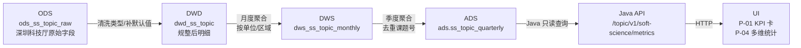

# 数据说明卡 / 评审现场对照表 · 模板

> **用途**：评审现场（团队内 / 甲方）呈交"指标-数据源-加工过程"对照表，与 UI 的 MetricSpecCard 内容一一对应
> **生成方**：`doc-agent`（officecli MCP）；自动从 `cfg_metric` + handoffs 汇编
> **使用方**：PM / UE lead / 数据 lead / 文档 lead / 评审现场所有人
> **关联规约**：`agent-delivery/data-lineage-policy.md`
> **模板版本**：v1.0.0 (2026-06-17)

---

## 文件命名建议

```
验收文档/数据血缘-评审材料-{Epic-or-DS-id}-{YYYYMMDD}.{md|docx}
```

例：`验收文档/数据血缘-评审材料-DS-25-20260617.md`

---

## 1. 评审现场单页对照表（每个指标 1 行）

> 评审现场最重要的产出。PM 打印在 A3 纸上带在手上，甲方质询时一指即答。

| # | metric_id | 业务名 | 口径定义（摘要） | 数据源 | 加工链路（摘要） | 更新频率 | 版本 | Mock? | 出现位置 |
|---|-----------|--------|------------------|--------|-----------------|---------|------|-------|---------|
| 1 | `M_SS_TOPIC_NEW_COUNT_Q` | 本季度软科学课题新增数 | 立项日期在本季度内 + 课题类型=软科学 + 去重课题号 | 深圳科技厅项目库 / Mock @ batch=mock_20260617 | ODS→DWD（类型清洗）→DWS（季度聚合）→ADS（ads.ss_topic_quarterly） | 日 | 1.0.0 | 🧪 | DS-25 P-01/P-02/P-04 |
| 2 | `M_SS_UNIT_CONTRIBUTION_RATE` | 软科学课题单位贡献率 | 单位课题数 ÷ 全市课题数 ×100% | 同上 | 同上 + 单位维度聚合 | 月 | 1.0.0 | 🧪 | DS-25 P-04 |
| ... | | | | | | | | | |

**列说明**：
- `口径定义（摘要）`：50 字以内，含统计窗口 + 对象范围 + 去重 + 特殊情况
- `数据源`：源系统 + Mock 标识（如有）
- `加工链路（摘要）`：ODS→DWD→DWS→ADS 一行表达
- `Mock?`：🧪 = Mock；✅ = 真实
- `出现位置`：UI 中哪个页面哪个区块

---

## 2. 单指标完整说明卡（每个指标 1 节，与 UI MetricSpecCard 内容一致）

> 模板，针对每个 metric_id 复制一份并填充。doc-agent 自动汇编。

### 2.1 [METRIC_NAME_ZH]（[METRIC_ID]）

| 字段 | 内容 |
|------|------|
| **业务名** | [中文名] |
| **metric_id** | `M_XXX_XXX_X` |
| **业务口径定义** | [≥50 字。必含：统计窗口/对象范围/去重逻辑/特殊情况] |
| **计算公式** | ```sql<br/>SELECT COUNT(DISTINCT topic_id) FROM ads.ss_topic_quarterly<br/>WHERE quarter = :current_quarter AND topic_type='soft_science';<br/>``` |
| **数据源表** | `ads.ss_topic_quarterly` ← `dws.ss_topic_monthly` ← `dwd.ss_topic` ← `ods.ss_topic_raw` |
| **数据来源系统** | 深圳市科技厅项目库（Wave 1 接入） / Mock @ batch=mock_20260617_seed42（当前） |
| **更新频率** | daily |
| **版本** | 1.0.0 |
| **业务/数据负责人** | 数据 lead: [姓名] / 业务接口人: [姓名] |
| **维护 agent** | data-agent |
| **是否 Mock** | 🧪 Mock；预计 2026-10-01 切真实 |
| **数据质量规则** | non_null_rate >= 99% / topic_id 唯一 / quarter 值域 in [2020Q1, 2027Q4] |
| **治理标签** | 公开（无脱敏要求） |
| **bid 章节** | §1.1.1.1.4.6.1.1 / §1.1.1.1.4.6.1.4 |
| **acceptance** | DS-25 |
| **UI 出现位置** | DS-25 P-01 KPI 卡 / P-04 多维统计页 |
| **数据加工链路图** | （doc-agent 渲染 mermaid 或导出图片） |
| **历史变更** | v1.0.0 2026-06-17 创建（PM 据甲方评审建立） |

#### 2.1.1 数据加工链路图（mermaid）



#### 2.1.2 关键算法 / 公式

```python
# 来自 demo-algo-science/pipelines/ss_topic_pipeline.py:128
def calc_quarterly_new_count(df: pd.DataFrame, quarter: str) -> int:
    """
    本季度软科学课题新增数：
    - 立项日期落在 quarter 内
    - 课题类型 = soft_science
    - 按 topic_id 去重
    """
    mask = (
        (df['approval_date'].between(*quarter_to_range(quarter)))
        & (df['topic_type'] == 'soft_science')
    )
    return df.loc[mask, 'topic_id'].nunique()
```

---

## 3. 评审现场速查页（A4 单页打印）

> 极简版，PM 桌面摊开，1 秒定位答案。

### 软科学成果展示 DS-25 · 关键指标速查

```
┌─────────────────────────────────────────────────────────────────┐
│ 本季度课题新增数            M_SS_TOPIC_NEW_COUNT_Q             │
│ 数据源: 深圳科技厅 / Mock                  更新: 日 / 版本 1.0.0│
│ 口径: 立项在本季度+软科学类型+去重 topic_id                     │
│ 加工: ODS→DWD(清洗)→DWS(月聚合)→ADS(季聚合)                     │
├─────────────────────────────────────────────────────────────────┤
│ 单位贡献率                  M_SS_UNIT_CONTRIBUTION_RATE         │
│ ...                                                             │
└─────────────────────────────────────────────────────────────────┘
```

---

## 4. Mock vs 真实数据差异说明（Wave 0 阶段附录）

> Wave 0 评审专用。当指标全部为 Mock 时，PM 用这份解释"我们怎么保证 Mock → 真实零代码改动"。

### 4.1 当前 Mock 数据描述

| metric_id | Mock 生成规则 | 量级 | 分布 | 空值率 | 切真实预计时间 |
|-----------|--------------|------|------|--------|--------------|
| `M_SS_TOPIC_NEW_COUNT_Q` | Python `np.random.poisson(λ=15)` per quarter | 10–25 | 泊松 | 0% | 2026-10-01 |
| `M_SS_UNIT_CONTRIBUTION_RATE` | Dirichlet 分布生成 100 个单位的贡献率 | 0–8% | 长尾 | 0% | 2026-10-01 |
| ... | | | | | |

> 生成器源码：`demo-algo-science/pipelines/mock_generators/ss_topic_mock.py`（固定 seed=42 可重现）

### 4.2 真实数据接入后切换机制

1. data-agent 在 `cfg_degrade_switch` 关闭 `ss_topic_mock_mode`
2. ADS 表 `calc_batch_id` 前缀从 `mock_` 切换为业务批次号
3. UI **代码零改动**：`MockBadge` 自动消失，`MetricSpecCard` 自动展示真实 source_systems
4. qa-agent 跑 4 段链路核验，confirm 数据合理性
5. 文档 doc-agent 更新评审材料

---

## 5. 评审用 docx 章节模板（doc-agent 用 officecli 生成）

| 章节 | 内容 | 字数 |
|------|------|------|
| 1. 背景 | 项目所处 wave + 本次评审范围 | 200 |
| 2. 数据治理总图 | mermaid → 截图 | 1 张图 |
| 3. 单页对照表 | §1 表（全 metric） | 1 张表 |
| 4. 单指标完整卡 | §2 模板 × N | N 节 |
| 5. Mock 数据说明 | §4 | 500 |
| 6. 真实数据接入计划 | 时间表 + 责任人 | 300 |
| 7. 评审记录 | 评审现场甲方意见 + 团队答复 + 待跟进 | 现场填 |

> 实际生成参考：`agent-delivery/officecli-doc-workflow.md`

---

## 6. 文档质量自检（doc-agent / PM）

- [ ] 每个 metric 都有完整 8 件套
- [ ] 加工链路图能渲染（mermaid 语法正确 / 图片清晰）
- [ ] Mock vs 真实数据差异清楚（特别是 Wave 0）
- [ ] 单页对照表能打印 A3（横向布局，10 个指标 / 张）
- [ ] 评审现场速查页能打印 A4（单页，5 个指标 / 张）
- [ ] 与 cfg_metric 库内容**逐条比对**确认一致
- [ ] handoff 中引用本评审材料路径

---

## 7. retro 反馈区（评审后回填）

| 类别 | 内容 |
|------|------|
| 甲方追问最多的 3 个指标 | |
| 现场无法立即答的问题 | |
| 评审材料需要补充的章节 | |
| 给本模板的改进建议 | |
| 给 cfg_metric schema 的改进建议 | |
| 给 MetricSpecCard 组件的改进建议 | |

---

**模板由 doc-agent 自动汇编时填充，评审后由 PM 把 §7 回填到 retro。**
