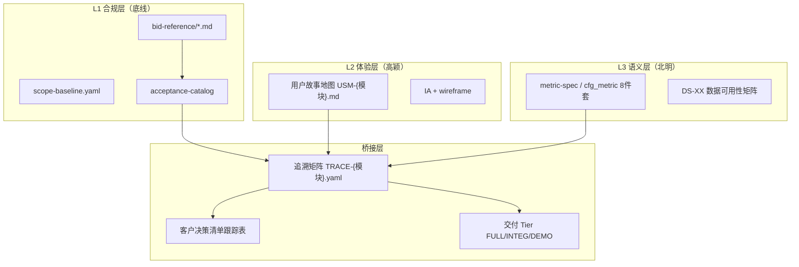
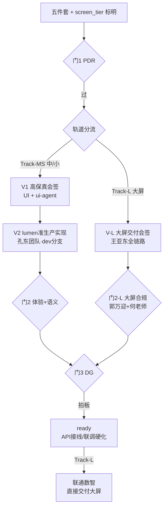

# 产品定义评审规程（PDR / 会签 / DG 三门）

> **读者**：高颖（UE/UI·中/小）、郭万迎（PM）、何老师（北明）、辜少彬（GDF）、**王亚东**（联通数智·大屏）、淮政玮、徐滕强 / 李伟、coordinator-agent  
> **作用**：在无专职产品经理的前提下，把「合规交付底线（bid-reference）」与「真实用户体验（用户故事地图）」对齐；规定产品功能定义完成后的评审与拍板流程。  
> **维护**：PM（郭万迎）owner；UE lead（高颖）共创  
> **版本**：v2.1 · 2026-07-12  
> **变更**：v2.1 采纳 DECIDE-FE-V2-LUMEN-DIRECT — Track-MS V2 直落 `lumen-ui-topic`，取消 demo→lumen 复刻链  
> **关联**：
> - `team-roster.yaml`（认领真名花名册）
> - `team-members.md`（成员简介与分工建议）
> - `scope-baseline.yaml`（58 项 ±10% 铁律）
> - `bid-reference/*.md`（范围真源）
> - `acceptance-compliance-policy.md`（FULL / INTEG / DEMO 三级口径）
> - `客户决策清单跟踪表.md`（业务口径待办）
> - `data-lineage-policy.md`（指标 8 件套 · D9）
> - `team-collaboration-playbook.md`（团队协作公约）
> - `agent-handoffs/产品整体定义/产品职责覆盖差距分析.md`（背景：分布式产品台）

---

## 0. 一句话

> **bid-reference 管「有没有」；用户故事地图管「好不好用」；追溯矩阵把两层绑在一起；三门评审把「梳理、会签、拍板」分开。**

---

## 1. 背景与适用边界

### 1.1 要解决什么问题

| 矛盾 | 表现 | 本规程对策 |
|------|------|------------|
| 合规坐标 ≠ 体验坐标 | 按 bid MD 还原页面，用户旅程断裂 | 允许 IA 重组，禁止静默删叶子 |
| 无专职产品经理 | PRD、口径、优先级无人统一 | 分布式产品台 + 固定工件链 |
| 指标与界面两张皮 | wireframe 字段与 cfg_metric 不一致 | 北明在门 1 前介入语义卡 |
| 拍板责任不清 | 争议时各 agent 各自臆测 | 三门分级：梳理 → 会签 → 决策 |

### 1.2 适用与不适用

| 适用 | 不适用 |
|------|--------|
| 展示系统 DS-01~30、专题七要素 E1~E7、算法库叶子 | 纯 DevOps / 平台编排 Epic（走 architect 评审） |
| 新模块开工前的产品定义 | 已 `done` 且仅 bugfix 的 leaf |
| IA 重组、Tab 合并、Tier 降级、Wave 后置 | 架构铁律变更（走 `architecture-baseline.md` §8） |

### 1.3 与现有角色的关系（真人版分工）

本项目**不设专职产品经理**；产品职责由下列核心干系人分担（虚拟产品台）：

| 角色 | 真人 | 产品职责 | Agent 辅助 |
|------|------|----------|------------|
| **体验 Owner** | 高颖 | 用户故事地图、IA、wireframe、demo 沙箱（**中/小屏**） | `ux-agent` / `ui-agent` |
| **大屏交付 Owner** | **王亚东**（联通数智） | 展示系统**大屏** UE→UI→前端→接口全链路 | — |
| **语义 Owner** | 北明团队 · **何老师** | 指标定义、算法口径、国标/世标引用、数据裁剪 | `algorithm-agent` / `data-agent` |
| **合规 Owner** | 郭万迎 | 范围 ±10%、追溯矩阵审核、评审主持、甲方推进 | `coordinator-agent` / `product-agent`（起草） |
| **架构 Owner** | 徐滕强、李伟 | 架构基线合规、要素标准表契约、调用链/仓边界审查 | `architect-agent` |
| **数据平台 Owner** | **辜少彬**（GDF） | 贴源、Mapping、调度编排、监控告警；K8s 微服务任务调度 | — |
| **决策 Owner** | 淮政玮 | 范围取舍、临时默认值、体验重组偏离的最终拍板 | — |

### 1.4 核心干系人花名册（评审必达）

> 全员简介见 `team-members.md`；认领真名见 `team-roster.yaml`。

#### 决策与产品台

| 角色 | 真名 | 三门中的出席 |
|------|------|--------------|
| 项目负责人 | 淮政玮 | 门 3 拍板 · 门 2 重大模块可选 |
| 合规 Owner | 郭万迎 | 门 1 主持 · 门 2 必到 · 门 3 汇报 |
| 体验 Owner | 高颖 | 门 1 必到 · 门 2 主持 · 门 3 必到 |
| 语义 Owner | **何老师**（北明团队） | 门 1 必到 · 门 2 必到 · 门 3 必到 |
| 数据平台 Owner | **辜少彬**（GDF） | 门 1 涉贴源/Mapping/调度时必到 · 门 3 涉数据 Tier 时可选 |

#### 架构与工程 Lead

| 角色 | 真名 | 三门 / 评审 |
|------|------|-------------|
| 架构师 | **徐滕强**、**李伟**（≥1 人到场） | 门 1 必到 · 门 3 涉铁律时必到 |
| 前端 Lead | **孔东** | 门 2 签可实现性（SIG-09） |
| 企业维度前端专项 | **曹丽影** | 高筛组件封装、企业搜索与筛选实现 |
| 后端 Lead | **侯佳伟** | 门 2 可选 · OpenAPI/Epic 评审 |
| 算法 Lead | **唐绍祖** | 指标/算法语义核对 · 与北明分工衔接 |

#### 执行团队（派单与监管）

| 团队 | 成员 | Lead |
|------|------|------|
| 前端 | 孔东（Lead）、曹丽影（企业维度组件）、兼职前端 1/2（真名待补） | 孔东 |
| 后端 Java | 侯佳伟（Lead）、黄敬洲、刘浩森、郭建成 | 侯佳伟 |
| 算法 Python | 唐绍祖 | 唐绍祖 |
| 数据平台 GDF | **辜少彬** | 辜少彬 |
| UI | 许丹丹、望淋莉（兼职） | 高颖 |
| 展示大屏 | **王亚东**（联通数智，约 5 人） | 王亚东 |

### 1.5 展示系统三屏与双轨视觉交付

`bid-reference` 要求科技信息展示系统具备 **大 / 中 / 小** 三种展示形态。评审与视觉交付按**双轨**执行，不可混用规范：

| 轨道 | 屏幕 | 视觉真源 | 负责团队 | 视觉交付路径 |
|------|------|----------|----------|--------------|
| **Track-L** | **大屏** | 联通数智大屏规范（蓝色背景传统展示大屏） | 王亚东（联通数智） | UE→高保真→实现→接口 → **V-L 大屏交付会签** |
| **Track-MS** | **中屏 + 小屏** | `Design.md` 浅蓝白 + Arco（D8） | 高颖 + 许丹丹/望淋莉 + 孔东团队 | wireframe→**V1**→**V2 lumen 准生产**→ 门 2 |

**分工铁律**：

1. **大屏不由现有团队做 UI 实现**；现有团队负责中/小屏及专题系统。
2. **大屏不适用 `Design.md` §14 浅蓝白检查**；适用联通数智大屏规范 + 独立附录对照。
3. **两轨共享**：`TRACE` 合规、metric_id（D9）、Java API 契约（侯佳伟）、数据贴源（GDF）。
4. **Track-MS 工程交付**在 `lumen-ui-topic`（`dev` 分支）按生产标准直接开发，**不经** demo→agent 复刻链；`demo-ui-topic` 仅保留为高颖线框/V1 参照沙箱（React）。
5. **大屏**由联通数智直接交付至约定仓/环境，不经上述 lumen 专题链。

> 详见 `team-members.md` §2.6。

> **架构师轮值**：门 1 PDR 由徐滕强、李伟轮流主审；涉跨仓/权限/算法边界时**至少 1 人到场**；Epic 开工或铁律争议时**建议双人**。缺席可用 `architect-agent` 书面报告替代，纪要须标「代理评审」。
>
> **企业维度试点专班**（当前重点）：徐滕强（架构+数据契约）+ 高颖（体验）+ **何老师**（北明·指标语义）+ **辜少彬**（GDF·贴源/调度）+ **孔东**（前端 Lead）+ **曹丽影**（企业高筛/搜索）+ **侯佳伟**（后端 Lead）+ 唐绍祖（算法）。

> **铁律不变**（团队公约 §3.8）：业务口径**最终**仍须甲方书面/纪要确认；淮政玮拍板的是**团队内部交付方案**，不是替代甲方。

---

## 2. 双层产品模型



### 2.1 三层各自管什么

| 层 | 回答的问题 | 变更纪律 |
|----|------------|----------|
| L1 合规层 | 验收时功能点有没有？ | 叶子不可静默删除；超 ±10% 须 PM + 淮政玮 |
| L2 体验层 | 用户能否顺畅完成任务？ | 导航/旅程可重组；须在 TRACE 中更新 route |
| L3 语义层 | 数字算不算对、依据什么？ | 每个统计字段必有 metric_id；无源标 DEMO/❌ |

### 2.2 四种典型情形的统一处理

| 情形 | 处理 | 过哪道门 | ±10% 影响 |
|------|------|----------|-----------|
| **A. 导航重组**（功能还在，入口变了） | 改 IA，更新 TRACE `route` | 门 2 会签 | 无 |
| **B. Tab/面板合并**（多子功能合一页） | wireframe 合并，TRACE 多对一 | 门 1 PDR | 无（同一叶子内） |
| **C. 数据不足降级** | tier → DEMO + MockBadge | 门 3 DG | 无（有入口即合规） |
| **D. 用户旅程证明低价值** | 后置 Wave + DEMO，**不删除** | 门 3 DG | 若真删叶子 → PM 登记 change_log |

---

## 3. 产品定义包（五件套）

每个模块（DS-xx / Ex / Algo 要素）在**进入门 1 之前**须齐备下列工件：

| # | 工件 | 路径约定 | Owner | 必填 |
|---|------|----------|-------|------|
| 1 | 用户故事地图 | `agent-handoffs/产品整体定义/USM-{模块}.md` | 高颖 | ✅ |
| 2 | 追溯矩阵 | `agent-handoffs/产品整体定义/TRACE-{模块}.yaml` | 高颖起草 · 郭万迎审核 | ✅ |
| 3 | IA + wireframe | `agent-handoffs/产品整体定义/{模块}/` 或 demo 仓 `docs/ia/` | 高颖 | ✅ |
| 4 | 指标语义卡 | `agent-handoffs/产品整体定义/metric-spec-{要素}.yaml` 或 `cfg_metric` 种子 | 北明 | ✅（有统计数字时） |
| 5 | 开放项同步 | `客户决策清单跟踪表.md` 新增/更新 Q0xx | 郭万迎 | ✅（有 🟡 项时） |

### 3.1 用户故事地图最低要求（USM）

每份 USM 至少包含：

```markdown
## 模块：{DS-xx / Ex}
## 目标用户角色（≥2）
## 用户故事（As / Want / So that）
## 场景 walkthrough（主路径 + 异常路径）
## 验收场景（可测试、用户语言，非仅「页面存在」）
## 与 bid-reference 差异说明（如有 IA 重组）
```

### 3.2 追溯矩阵最低要求（TRACE）

```yaml
# TRACE-{模块}.yaml
module: DS-25-软科学成果展示          # 或 E1-企业 / ALGO-ENT-指标
version: "1.0"
updated: "2026-07-11"
owner_experience: human:高颖
owner_semantic: human:何老师
owner_compliance: human:郭万迎

stories:
  - id: US-DS25-01
    title: 查看软科学成果区域分布
    role: 政策研究人员
    acceptance:
      - 3 步内看到省级分布地图
      - 地图 KPI 均可点开 metric_id 说明卡
    compliance_refs:
      - leaf_id: DS-25
        md_ref: "1.1.1.1.4.x.y"
        catalog_ref: acceptance-catalog/catalog-display-7modules.yaml#DS-25
        route: /achievements/soft-science/distribution
        screen_tier: medium              # large | medium | small
        delivery_track: Track-MS         # Track-MS | Track-L
        tier: FULL
        wave: 0
      - leaf_id: DS-25-large             # 同模块大屏子入口（如有）
        route: /display-large/soft-science/overview
        screen_tier: large
        delivery_track: Track-L
        delivery_owner: human:王亚东
        tier: FULL
    metrics:
      - M_SS_REGION_COUNT
    open_questions: [Q001, Q003]      # 客户决策清单 ID

coverage_summary:
  leaves_required: 1                  # 本模块应覆盖的 bid 叶子数
  leaves_mapped: 1
  metrics_required: 5
  metrics_mapped: 4
  gaps:                             # 未映射项显性列出
    - metric: M_SS_XXX
      reason: 无 ODS 源，建议 DEMO
      proposed_tier: DEMO
```

### 3.3 指标语义卡最低要求（北明）

对照 `data-lineage-policy.md` 与 `templates/metric-spec-card-template.md`，每条指标至少：

- `metric_id` / 中文名 / 口径定义 / 公式
- 国标或世标引用（如有）
- 本项目数据裁剪说明（源表 / 源系统 / 更新频率）
- `mapping_status`：✅ 有源 / 🟡 临时默认 / ❌ 无源

wireframe 字段表**第 6 列**必须为 `metric_id`（D9 铁律）。

---

## 4. 评审流程总览（产品三门 + 视觉双轨）



| 阶段 | 名称 | Track-MS（中/小屏） | Track-L（大屏） |
|------|------|---------------------|-----------------|
| 门 1 | PDR | 高颖提交 wireframe | 王亚东提交大屏 UE；郭万迎审 TRACE |
| 视觉 | V1 / V-L | **V1** 高保真冻结 | **V-L** 合并 UE/UI/实现/接口会签 |
| 视觉 | V2 | **V2** lumen 准生产实现会签（`lumen-ui-topic`） | （含在 V-L） |
| 门 2 | 体验+语义 | 高颖主持 walkthrough | 郭万迎+何老师合规核对 |
| 门 3 | DG | 淮政玮拍板 | 同上 |
| 工程 | 交付 | **孔东团队在 lumen 直接开发** + 后台联调 | 联通数智直接交付，**不走 lumen 专题链** |

---

## 5. 门 1：产品定义评审（PDR）

### 5.1 参会与输入

| 项 | 内容 |
|----|------|
| **必到** | 郭万迎（主持）、高颖、**何老师**（北明）、**徐滕强 / 李伟（至少 1 人）** |
| **涉数据加工时必到** | **辜少彬**（GDF）——模块含贴源、Mapping、ADS 落库、调度编排时 |
| **缺席替代** | `architect-agent` 书面合规报告（纪要须标「代理评审」） |
| **涉大屏模块时必到** | **王亚东**（联通数智）——提交大屏 UE/wireframe，核对 API 需求 |
| **可选** | coordinator-agent、孔东（中/小屏可实现性预审） |
| **输入** | 五件套初稿 + `architecture-baseline.md` 相关章节 |
| **时长** | 45–60 分钟 / 模块 |
| **产出** | `PM-PDR-{模块}-评审纪要.md` |

### 5.2 过关标准（14 条检查清单）

评审人逐项打勾；**全部 ✅ 或已登记 🟡 开放项** 方可过门。无数据依赖的模块 PDR-13 标 N/A。

| # | 检查项 | 责任人核对 | ☐ |
|---|--------|------------|---|
| PDR-01 | 本模块所有 bid 叶子已在 TRACE `compliance_refs` 映射 | 郭万迎 | |
| PDR-02 | 无静默删除/没有遗漏（每个叶子有 route 或已登记 REMOVED + PM 批准） | 郭万迎 | |
| PDR-03 | `coverage_summary.leaves_mapped == leaves_required` | 郭万迎 | |
| PDR-04 | 活跃 scope_units 仍在 52~64（±10%）内 | 郭万迎 | |
| PDR-05 | 每个统计字段有 metric_id；wireframe 字段表第 6 列已填 | 何老师 | |
| PDR-06 | 指标语义卡含口径 + 数据裁剪；无源项标 ❌ 或 DEMO | 何老师 | |
| PDR-07 | 开放项已同步 `客户决策清单跟踪表`（🟡 及以上） | 郭万迎 | |
| PDR-08 | DEMO/INTEG 项已标 `tier` + 登记 `demo-fallback-registry`（如需） | 郭万迎 | |
| PDR-09 | USM 含主路径 walkthrough + 验收场景（非仅「有页面」） | 高颖 | |
| PDR-10 | IA 重组已在 USM「差异说明」中记录 | 高颖 | |
| PDR-11 | 与 `architecture-baseline.md` 无冲突（调用链/仓边界） | 徐滕强 / 李伟 | |
| PDR-12 | 权限/降级态已识别（如有 L0–L4 差异）（公众访客/注册用户/专业用户/内部/管理运营 ） | 高颖 + 徐滕强 / 李伟 | |
| PDR-13 | 涉数据模块：贴源/Mapping/调度路径已对齐 GDF；要素表与 metric_id 可落地 | 辜少彬 + 徐滕强 | |
| PDR-14 | TRACE 已标明 `screen_tiers`（large / medium / small）及对应轨道负责人 | 郭万迎 | |

### 5.3 结论与后续

| 结论 | 含义 | 后续 |
|------|------|------|
| ✅ **通过** | 14 条满足（或 PDR-13 标 N/A） | Track-MS → V1；Track-L → V-L；并行 GDF/北明 |
| ⚠️ **有条件通过** | 有 🟡 项但不阻塞开工 | 附条件清单 + deadline；可进沙箱，门 2 前须闭合 |
| ❌ **不通过** | 缺 TRACE / 漏叶子 / 语义未对齐 | 退回补件；**不得**将 task 标 `ready` |

### 5.4 纪要模板

见本文 **附录 A**：`PM-PDR-{模块}-评审纪要.md`。

---

## 5.5 视觉交付双轨说明

| 轨道 | 何时走 | 高保真谁做 | UX 沙箱 / 参照 | lumen 谁交付 |
|------|--------|------------|----------------|--------------|
| **Track-MS** | DS 模块需**中屏和/或小屏** | 许丹丹/望淋莉 + `ui-agent`（`demo-ui-topic` 仅 V1 参照） | 高颖线框迭代保留于 demo 沙箱 | **孔东团队**在 `lumen-ui-topic` **`dev` 分支**按生产标准开发（复用 `lumen-ui-science-pc` 框架） |
| **Track-L** | DS 模块需**大屏** | 王亚东团队 | 王亚东团队（大屏环境直出） | 王亚东团队直交，**不经 lumen 专题仓** |

**单模块同时有大+中/小**：TRACE 拆为 `compliance_refs` 多条，分别标 `screen_tier`；两轨**并行**评审，门 3 汇总拍板。

**高保真冻结纪律**（两轨通用）：签字版高保真版本号 `HIFI-{模块}-{tier}-vX.Y`；签字后改动须升版本并重走视觉门。

---

## 5.6 视觉门 V1 · 高保真会签（Track-MS 专用）

### 5.6.1 参会与输入

| 项 | 内容 |
|----|------|
| **时机** | 门 1 PDR 通过后；demo 大规模开发前 |
| **主持** | 高颖 |
| **必到** | 许丹丹 / 望淋莉（至少 1 人）、郭万迎、何老师（metric 字段核对） |
| **输入** | 门 1 wireframe + `UI-HIFI-{模块}-说明.md` + 高保真参照（Figma 链接或 demo 高保真静态页） |
| **产出** | `UI-HIFI-{模块}-会签单.md`；冻结版本号 `HIFI-{模块}-medium-v1.0`（小屏同理标 `small`） |

### 5.6.2 过关标准（8 条）

| # | 检查项 | 核对人 | ☐ |
|---|--------|--------|---|
| H-01 | 与 wireframe 结构一致；字段表第 6 列 metric_id 齐全 | 何老师 | |
| H-02 | `Design.md` §4–§7 色彩/字体/圆角/控件高合规 | 许丹丹/望淋莉 | |
| H-03 | 主路径与异常态（空/加载/无权限）在稿面已体现 | 高颖 | |
| H-04 | 与中屏/小屏差异已说明（裁剪规则，非简单缩放） | 高颖 | |
| H-05 | 版本号已冻结；变更须走变更单 | 郭万迎 | |
| H-06 | 不涉及大屏蓝色风格（大屏走 Track-L） | 高颖 | |
| H-07 | Mock/无源指标在稿面有标注位 | 何老师 | |
| H-08 | 高颖签字批准进入 V2 | 高颖 | |

---

## 5.7 视觉门 V2 · lumen 准生产实现会签（Track-MS 专用）

> **决策真源**：`decisions/DECIDE-FE-V2-LUMEN-DIRECT-2026-07-12.md`  
> V2 在 **`lumen-ui-topic` `dev` 分支**按生产交付标准实现（Vue 3 + `@arco-design/web-vue`），**不在** `demo-ui-topic`（React）做第二遍工程；demo 沙箱保留为高颖线框/V1 参照。

### 5.7.1 参会与输入

| 项 | 内容 |
|----|------|
| **时机** | V1 通过后；**门 2 之前** |
| **主持** | 孔东 |
| **必到** | 高颖（UX 对照）、孔东、涉模块工程师（如曹丽影） |
| **输入** | V1 会签单 + **lumen dev 演示 URL**（K8s dev 或本地）+ **lumen commit SHA** + `FE-LUMEN-V2-ALIGN-{模块}-对照表.md` |
| **产出** | `FE-LUMEN-V2-ALIGN-{模块}-会签单.md`（文件名可沿用历史 `FE-DEMO-ALIGN-*` 别名，内容须按本节） |

### 5.7.2 过关标准（11 条）

| # | 检查项 | 核对人 | ☐ |
|---|--------|--------|---|
| D-01 | lumen 页面布局与 V1 高保真一致 | 高颖 | |
| D-02 | `Design.md` §14 8 项视觉检查通过（Vue/Arco 栈） | 许丹丹/望淋莉 | |
| D-03 | KPI 与 TRACE `metrics` 一致；ⓘ/🧪/⚠️ 齐全 | 何老师 | |
| D-04 | 主路径 walkthrough 可逐步演示（录屏） | 高颖 | |
| D-05 | 小屏裁剪态已测（如模块含 small） | 孔东 | |
| D-06 | 企业高筛/搜索等与 V1 一致（涉及时） | 曹丽影 | |
| D-07 | `pnpm run build` 通过（`lumen-ui-topic`） | 孔东 | |
| D-08 | 与 V1 差异已登记变更单（如有） | 郭万迎 | |
| D-09 | 无 AntD / 非权威组件混搭；栈 = Vue + `@arco-design/web-vue` | 孔东 | |
| D-10 | **内部评审模式**可开关；与生产灰度隔离 | 孔东 | |
| D-11 | 孔东确认**可进入门 2**（无复刻派单） | 孔东 | |

> **门 2 前置条件（Track-MS）**：V2 ✅。未过 V2，不得门 2。门 3 后工程 leaf 为 **API 接线/联调**，非 demo→lumen 复刻。

---

## 5.8 视觉门 V-L · 大屏交付会签（Track-L 专用）

### 5.8.1 参会与输入

| 项 | 内容 |
|----|------|
| **时机** | 王亚东团队完成大屏 UE/UI/前端/接口联调后 |
| **主持** | 王亚东 |
| **必到** | 郭万迎（合规）、何老师（指标）、侯佳伟（API 契约）、徐滕强（架构，可选） |
| **输入** | 大屏演示环境 URL + commit/部署版本 + 大屏 UE 说明 + API 清单 |
| **产出** | `VL-DISPLAY-LARGE-{模块}-交付会签单.md` |

### 5.8.2 过关标准（10 条）

| # | 检查项 | 核对人 | ☐ |
|---|--------|--------|---|
| L-01 | bid 大屏相关叶子已在 TRACE 映射，`screen_tier: large` | 郭万迎 | |
| L-02 | 大屏蓝色展示风格符合联通数智规范（非 Design.md 浅蓝白） | 王亚东 | |
| L-03 | 指标字段有 metric_id；与何老师语义卡一致 | 何老师 | |
| L-04 | 后台接口符合 Java 聚合/OpenAPI 契约（侯佳伟确认） | 侯佳伟 | |
| L-05 | 不越层：无前端直连 Python/图谱 | 徐滕强 | |
| L-06 | 大屏导航/轮播/全屏等 bid 要求能力可演示 | 王亚东 | |
| L-07 | 与中屏同源数据口径一致（同一 metric_id 数值逻辑） | 何老师 | |
| L-08 | 异常态：无数据/接口失败有降级展示 | 王亚东 | |
| L-09 | 部署环境与访问 URL 已登记 | 郭万迎 | |
| L-10 | 王亚东签字交付；**不触发 frontend-agent 复刻** | 王亚东 | |

> **门 2-L（大屏）**：V-L ✅ 后，由郭万迎 + 何老师做合规 walkthrough，等效门 2，高颖可选列席（核对与中屏 IA 不冲突）。

---

## 6. 门 2：体验 + 语义会签

### 6.1 参会与输入

| 项 | 内容 |
|----|------|
| **必到** | 高颖（主持）、郭万迎、**何老师**（北明）、**孔东**（前端 Lead · 可实现性签字） |
| **前置（Track-MS）** | **V2 ✅**；`FE-LUMEN-V2-ALIGN-{模块}-会签单.md`（或等价 `FE-DEMO-ALIGN-*`） |
| **前置（Track-L）** | **V-L ✅**；`VL-DISPLAY-LARGE-{模块}-交付会签单.md`（郭万迎代主持合规段） |
| **可选** | QA（验收场景预审）、淮政玮（重大模块）、王亚东（含大屏模块时） |
| **输入** | demo 演示链接（中/小）或大屏 URL + 视觉门签字单 + 门 1 纪要 + TRACE |
| **时长** | 30–45 分钟 |
| **产出** | `PM-会签-{模块}-签字单.md` + 演示截图/录屏链接 |

### 6.2 过关标准（10 条）

| # | 检查项 | ☐ |
|---|--------|---|
| SIG-01 | 用户故事主路径可在 demo2 **逐步 walkthrough**（有录屏或截图） | |
| SIG-02 | 异常态覆盖：空数据 / 加载 / 无权限 / 无源指标（❌） | |
| SIG-03 | wireframe 每个 KPI 与 TRACE `metrics` 一致 | |
| SIG-04 | MetricSpecCard（ⓘ）可触发；Mock 数据有 🧪 标识（D9） | |
| SIG-05 | 待确认项有 ⚠️ PendingBadge + `客户决策清单` Q 编号 | |
| SIG-06 | `Design.md` §14 检查清单通过（**仅 Track-MS**；大屏走 V-L L-02） | |
| SIG-07 | `UX-UE 通用交互组件规范.md` §19 设计走查通过 | |
| SIG-08 | 导航重组后无 duplicate 入口（同功能两个 route） | |
| SIG-09 | **孔东**确认可实现且无架构越层 | |
| SIG-10 | 范围卫生：本模块无静默 ±10% 变更 | |

### 6.3 结论

| 结论 | 后续 |
|------|------|
| ✅ 会签通过 | 提交门 3；可准备甲方演示 |
| ⚠️ 保留通过 | 列软项（如 L1 段落 mask 留下一切片）；门 3 须注明 |
| ❌ 不通过 | 退回 lumen/大屏修改；**不得**标工程 leaf `ready` |

### 6.4 签字单模板

见本文 **附录 B**：`PM-会签-{模块}-签字单.md`。

---

## 7. 门 3：项目负责人决策门（DG）

### 7.1 何时召开

满足**任一**即召开：

1. 门 1 + 门 2 已通过（含 V2 或 V-L），模块即将批量派单（`task-registry` 标 `ready`）
2. 存在 🔴 阻塞项（范围/口径争议无法团队内闭合）
3. 模块含 **tier 降级**（FULL → DEMO）或 **Wave 后置**
4. IA 重组导致与 bid MD **字面偏离较大**（功能仍在，但呈现方式差异显著）

### 7.2 参会与输入

| 项 | 内容 |
|----|------|
| **必到** | 淮政玮（拍板）、郭万迎（汇报）、高颖、**何老师**（北明） |
| **涉铁律/±10% 时必到** | **徐滕强 / 李伟（至少 1 人）** |
| **输入** | 门 1 纪要 + 门 2 签字单 + TRACE 终稿 + 开放项摘要（≤1 页） |
| **时长** | 20–30 分钟（淮政玮仅判三类事） |
| **产出** | `DG-{模块}-拍板纪要.md` |

### 7.3 淮政玮只需拍三类板

| 类型 | 示例 | 不须拍 |
|------|------|--------|
| **范围取舍** | 某叶子 DEMO 化 / Wave 2 后置 / 是否接受 ±10% 内合并 | 组件选型、Mock 技术方案 |
| **临时默认值** | Q0xx 🟡 项团队默认是否继续执行 | 字段命名、CSS 细节 |
| **体验偏离** | 企业全景归门户、概览删 tab 等 IA 重组 | 单页布局微调 |

### 7.4 拍板结论与解锁

| 结论 | 动作 |
|------|------|
| ✅ **批准** | 郭万迎更新 `task-registry` 相关 leaf → `ready`；开放项标 🟡 并附 deadline |
| ⚠️ **批准附条件** | 条件写入 DG 纪要；满足后 coordinator 派单 |
| ❌ **搁置** | 标 🔴；升级甲方或收窄范围；**不得**派单 |
| 🔄 **退回** | 指明回门 1 或门 2；附修改要求 |

### 7.5 拍板纪要模板

见本文 **附录 C**：`DG-{模块}-拍板纪要.md`。

---

## 8. 决策权限矩阵（谁签什么）

| 决策类型 | 门 1 PDR | 门 2 会签 | 门 3 DG | 甲方 |
|----------|----------|----------|---------|------|
| IA / 导航重组 | 高颖提案 · 郭万迎确认覆盖 | 高颖主持 · **孔东**可实现 | 重大偏离 → 淮政玮 | 演示后确认（🟡→🟢） |
| 指标口径临时默认 | 何老师提案 | 何老师确认与 UI 一致 | 淮政玮批 🟡 默认 | 最终书面确认 |
| 数据贴源 / Mapping / 调度方案 | 徐滕强 + 辜少彬提案 | GDF 确认可调度 | 淮政玮拍板 | 验收前知会 |
| Tier DEMO 降级 | 郭万迎登记 | 高颖确认 UX 可接受 | **淮政玮** | 验收前知会 |
| 删除 bid 叶子 | — | — | **淮政玮 + 郭万迎** change_log | 须书面 |
| 突破 architecture 铁律 | **徐滕强 / 李伟** 否决 | — | 徐滕强 + 李伟 + 郭万迎 三签 | — |
| 超 ±10% 范围变更 | — | — | **淮政玮** | 须书面 |

---

## 9. 与 task-registry 的衔接

### 9.1 状态推进规则

```text
backlog → ready   须满足：门 3 DG ✅ 批准（或模块政策豁免见 §9.2）
ready → claimed   须满足：工程师认领 + supervised_by 真名
```

在 `task-registry.yaml` 对应 leaf 的 `notes` 或 handoff 引用中登记：

```yaml
product_gates:
  pdr: agent-handoffs/产品整体定义/PM-PDR-{模块}-评审纪要.md
  signoff: agent-handoffs/产品整体定义/PM-会签-{模块}-签字单.md
  dg: agent-handoffs/产品整体定义/DG-{模块}-拍板纪要.md
  trace: agent-handoffs/产品整体定义/TRACE-{模块}.yaml
visual_gates:
  track: Track-MS | Track-L | both
  v1_hifi: agent-handoffs/产品整体定义/UI-HIFI-{模块}-会签单.md      # Track-MS
  v2_lumen_align: agent-handoffs/产品整体定义/FE-LUMEN-V2-ALIGN-{模块}-会签单.md
  lumen_commit_sha: "{sha}"                                           # lumen-ui-topic dev
  lumen_dev_url: "{k8s_dev_url}"                                      # 内部评审演示
  internal_review_mode: true                                          # 须可开关
  vl_large: agent-handoffs/产品整体定义/VL-DISPLAY-LARGE-{模块}-交付会签单.md  # Track-L
  hifi_version: HIFI-{模块}-medium-v1.0
lumen_delivery:
  repo: lumen-ui-topic
  branch: dev
  framework_fork_from: lumen-ui-science-pc
  supervised_by: human:孔东
  replicate_from_demo: false    # DECIDE-FE-V2-LUMEN-DIRECT
```

### 9.2 政策豁免（须 PM 书面登记）

| 情形 | 可跳过 | 不可跳过 |
|------|--------|----------|
| 纯 bugfix / 样式微调 | 门 1–3 | — |
| 已有 DG 的模块内增量 Tab | 门 3 | 门 2 增量核对 |
| 平台横切（权限 D6） | 门 1 可用专项 PDR 替代 | TRACE 覆盖 |

---

## 10. 节奏建议（嵌入双周 Scrum）

| 时点 | 活动 | 产出 |
|------|------|------|
| Sprint N-1 周三 | 高颖完成下一批 USM + TRACE 初稿 | 五件套 1–2 |
| Sprint N-1 周五 | 北明完成 metric-spec 草案 | 五件套 4 |
| Sprint N 周一 | **门 1 PDR** | 评审纪要 |
| Sprint N 第 1 周 | Track-MS：**V1** 高保真；Track-L：王亚东大屏开发 | 视觉门签字单 |
| Sprint N 第 2 周前半 | Track-MS：**V2** lumen 准生产实现（孔东团队 · `dev`） | FE-LUMEN-V2-ALIGN 会签单 |
| Sprint N 第 2 周周三 | **门 2 会签**（须 V2 或 V-L 已过） | PM-会签签字单 |
| Sprint N 第 2 周周五 | **门 3 DG** | 拍板 → `ready` |
| Sprint N+1 | Track-MS：API 接线 / 联调 / 权限硬化（lumen 同仓迭代） | handoff + PR |
| 持续 | 郭万迎维护客户决策清单 | Q0xx 更新 |

---

## 11. 反模式（评审时直接否决）

| 反模式 | 危害 | 规程对策 |
|--------|------|----------|
| 跳过 TRACE 直接画 UI | 合规遗漏 | 门 1 不过 |
| wireframe 无 metric_id | D9 违约、验收漂移 | PDR-05 否决 |
| 用「用户不需要」删菜单 | ±10% / 验收风险 | 只能 DEMO/后置，门 3 拍板 |
| 北明会后补口径 | 算法/UI 返工 | 门 1 前须齐备语义卡 |
| 淮政玮参日常细节 | 决策疲劳 | DG 只判三类事 |
| Agent 产出直接派单 | 无人监管 | `supervised_by` 必填 |
| 未过 V2 即标 ready | lumen 页面与 V1 漂移 | V2 会签单为门 2 硬前置 |
| 在 demo React 仓做 V2 生产实现 | 技术栈重复、无法对接真实 API | V2 须在 `lumen-ui-topic` |
| 大屏走 Design.md 浅蓝白 | 风格冲突 | 大屏走 V-L + 联通数智规范 |
| 大屏与中屏各改各的 metric 口径 | 验收不一致 | 何老师跨轨核对 L-07 |

---

## 12. 附录 A — PDR 评审纪要模板

```markdown
# PM-PDR-{模块}-评审纪要

> **模块**：{DS-xx / Ex / Algo}
> **日期**：YYYY-MM-DD
> **主持**：郭万迎
> **参会**：高颖、何老师（北明）、徐滕强 / 李伟（到场：{姓名}）
> **输入**：USM / TRACE / wireframe / metric-spec 链接
> **结论**：✅ 通过 / ⚠️ 有条件通过 / ❌ 不通过

## 1. 一页摘要

| 项 | 值 |
|----|-----|
| bid 叶子应覆盖 | N |
| 已映射 | N |
| 指标应覆盖 | N |
| 已映射 | N |
| 开放项 🟡 | N（Qxxx, Qyyy） |
| DEMO 项 | N |
| IA 重组 | 有/无（简述） |
| screen_tiers | large / medium / small（及轨道） |

## 2. PDR 检查清单（§5.2，14 条）

| # | 项 | 结果 | 备注 |
|---|-----|------|------|
| PDR-01 | … | ✅/❌ | |
| … | | | |

## 3. 问题清单与责任人

| # | 问题 | 严重度 | 责任人 | Deadline |
|---|------|--------|--------|----------|
| 1 | | 🔴/🟡 | | |

## 4. 条件通过附加项（如有）

- [ ] …

## 5. 签字

| 角色 | 姓名 | 签字 | 日期 |
|------|------|------|------|
| 合规 Owner | 郭万迎 | | |
| 体验 Owner | 高颖 | | |
| 语义 Owner | 何老师（北明） | | |
| 架构师 | 徐滕强 / 李伟（到场者签） | | |
```

---

## 13. 附录 B — 会签签字单模板

```markdown
# PM-会签-{模块}-签字单

> **模块**：{DS-xx / Ex}
> **日期**：YYYY-MM-DD
> **主持**：高颖
> **demo 链接**：{URL}（Track-MS）
> **V2 会签单**：FE-DEMO-ALIGN-{模块}-会签单.md
> **V-L 会签单**（含大屏时）：VL-DISPLAY-LARGE-{模块}-交付会签单.md
> **录屏/截图**：{链接}
> **门 1 纪要**：PM-PDR-{模块}-评审纪要.md
> **结论**：✅ 通过 / ⚠️ 保留通过 / ❌ 不通过

## 1. 检查清单（§6.2）

| # | 项 | ☐ |
|---|-----|---|
| SIG-01 | 主路径 walkthrough | |
| … | | |

## 2. 软项保留（不阻塞，须门 3 注明）

| # | 项 | 计划闭合 |
|---|-----|----------|
| 1 | | Sprint N / Wave X |

## 3. 签字

| 角色 | 姓名 | 签字 | 日期 |
|------|------|------|------|
| 体验 Owner | 高颖 | | |
| 合规 Owner | 郭万迎 | | |
| 语义 Owner | 何老师（北明） | | |
| 前端 Lead | 孔东 | | |
```

---

## 14. 附录 C — DG 拍板纪要模板

```markdown
# DG-{模块}-拍板纪要

> **模块**：{DS-xx / Ex}
> **日期**：YYYY-MM-DD
> **汇报**：郭万迎
> **决策人**：淮政玮
> **输入**：PDR 纪要 + 会签签字单 + TRACE 终稿
> **结论**：✅ 批准 / ⚠️ 批准附条件 / ❌ 搁置 / 🔄 退回

## 1. 决策摘要（淮政玮 30 秒项）

| # | 决策事项 | 决定 | 类型 |
|---|----------|------|------|
| D1 | 例：M_XXX 无源 → DEMO | 批准 DEMO + UI 标 ❌ | 范围取舍 |
| D2 | 例：Q011 创新型企业口径 | 批准临时默认，🟡 至 MM-DD | 临时默认 |
| D3 | 例：概览删 structure tab | 批准 IA 重组 | 体验偏离 |

## 2. 开放项状态更新

| Q ID | 标题 | 新状态 | Deadline |
|------|------|--------|----------|
| Q011 | … | 🟡 | |

## 3. task-registry 解锁

| task-id | 原状态 | 新状态 | 备注 |
|---------|--------|--------|------|
| E-xxx-L01 | backlog | ready | DG 批准 YYYY-MM-DD |

## 4. 附条件（如有）

- [ ] …

## 5. 签字

| 角色 | 姓名 | 签字 | 日期 |
|------|------|------|------|
| 决策 Owner | 淮政玮 | | |
| 合规 Owner | 郭万迎 | | |
```

---

## 15. 附录 D — V1 高保真会签单模板（Track-MS）

```markdown
# UI-HIFI-{模块}-会签单

> **模块**：{DS-xx}
> **屏幕**：medium / small
> **轨道**：Track-MS
> **高保真版本**：HIFI-{模块}-medium-v1.0
> **参照**：{Figma URL 或 demo 静态页路径}
> **主持**：高颖
> **结论**：✅ 冻结 / ❌ 退回

## 检查清单（§5.6.2）

| # | 项 | ☐ |
|---|-----|---|
| H-01 | … | |

## 签字

| 角色 | 姓名 | 日期 |
|------|------|------|
| 体验 Owner | 高颖 | |
| UI | 许丹丹 / 望淋莉 | |
| 语义 | 何老师 | |
```

---

## 16. 附录 E — V2 lumen 准生产实现会签单模板（Track-MS）

```markdown
# FE-LUMEN-V2-ALIGN-{模块}-会签单

> **模块**：{DS-xx}
> **仓**：lumen-ui-topic @ dev
> **lumen dev URL**：{K8s dev 或本地 URL}
> **commit SHA**：{sha}
> **内部评审模式**：on / off 已验证
> **高保真版本**：HIFI-{模块}-medium-v1.0
> **主持**：孔东
> **结论**：✅ 可进门2 / ❌ 继续迭代

## 检查清单（§5.7.2 D-01~D-11）

| # | 项 | ☐ |
|---|-----|---|

## 签字

| 角色 | 姓名 | 日期 |
|------|------|------|
| 前端 Lead | 孔东 | |
| 体验 Owner | 高颖 | |
| 组件（涉及时） | 曹丽影 | |
```

---

## 17. 附录 F — V-L 大屏交付会签单模板（Track-L）

```markdown
# VL-DISPLAY-LARGE-{模块}-交付会签单

> **模块**：{DS-xx}
> **屏幕**：large
> **轨道**：Track-L
> **团队**：联通数智
> **演示 URL**：{URL}
> **部署版本**：{tag/commit}
> **主持**：王亚东
> **结论**：✅ 交付 / ❌ 退回

## 检查清单（§5.8.2）

| # | 项 | ☐ |
|---|-----|---|

## 签字

| 角色 | 姓名 | 日期 |
|------|------|------|
| 大屏 Owner | 王亚东 | |
| 合规 | 郭万迎 | |
| 语义 | 何老师 | |
| API | 侯佳伟 | |
```

---

## 18. 版本记录

| 版本 | 日期 | 变更 | 作者 |
|------|------|------|------|
| v1.0 | 2026-07-11 | 初版：三门评审 + 分布式产品台 + 附录模板 | 团队 AI 教练 |
| v1.1–v1.7 | 2026-07-11 | 花名册、GDF、视觉门铺垫、角色更正 | 团队 AI 教练 |
| **v2.0** | 2026-07-11 | **三屏双轨**：联通数智大屏（王亚东）+ V1/V2/V-L 视觉门 + PDR-14 + lumen 复刻仅 Track-MS | 团队 AI 教练 |
| **v2.1** | 2026-07-12 | **DECIDE-FE-V2-LUMEN-DIRECT**：V2 直落 `lumen-ui-topic` dev；取消 demo→lumen 复刻；保留 demo 为 UX 沙箱 | coordinator |

---

## 19. 下一步（建议接续）

| 序号 | 工件 | 说明 |
|------|------|------|
| 1 | `templates/traceability-matrix-template.yaml` | TRACE 空白模板（含 screen_tier） |
| 2 | 联通数智大屏视觉规范摘要 | 王亚东团队提供，挂 handoff |
| 3 | `TRACE-ENT.yaml` 试点 | 企业模块首版（中屏 Track-MS） |
