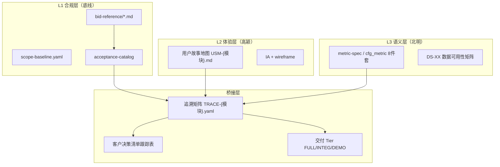
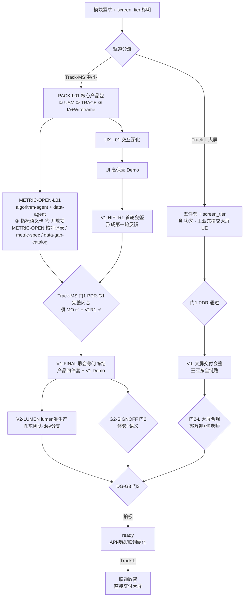

# 产品定义评审规程（PDR / 会签 / DG 三门）

> **读者**：高颖（UE/UI·中/小）、郭万迎（PM）、何老师（北明）、辜少彬（GDF）、**王亚东**（联通数智·大屏）、淮政玮、徐滕强 / 李伟、coordinator-agent  
> **作用**：在无专职产品经理的前提下，把「合规交付底线（bid-reference）」与「真实用户体验（用户故事地图）」对齐；规定产品功能定义完成后的评审与拍板流程。  
> **维护**：PM（郭万迎）owner；UE lead（高颖）共创  
> **版本**：v2.4 · 2026-07-20\
> **变更**：v2.4 Track-MS **V2 lumen 准生产 ∥ 门2 体验+语义** 并行（联合修订冻结后双轨启动；门3 须双轨均 ✅）\
> **上一版**：v2.3 · 2026-07-20 — 语义 Owner 临时代行（唐绍祖代何老师）\
> **关联**：
> - `team-roster.yaml`（认领真名花名册）
> - `team-members.md`（成员简介与分工建议）
> - `scope-baseline.yaml`（58 项 ±10% 铁律）
> - `bid-reference/*.md`（范围真源）
> - `acceptance-compliance-policy.md`（FULL / INTEG / DEMO 三级口径）
> - `客户决策清单跟踪表.md`（业务口径待办）
> - `data-lineage-policy.md`（指标 8 件套 · D9）
> - `team-collaboration-playbook.md`（团队协作公约）
> - `agent-handoffs/产品整体定义/产品职责覆盖差距分析.md`（背景：分布式产品台）

---

## 0. 一句话

> **bid-reference 管「有没有」；用户故事地图管「好不好用」；追溯矩阵把两层绑在一起；三门评审把「梳理、会签、拍板」分开。**

---

## 1. 背景与适用边界

### 1.1 要解决什么问题

| 矛盾 | 表现 | 本规程对策 |
|------|------|------------|
| 合规坐标 ≠ 体验坐标 | 按 bid MD 还原页面，用户旅程断裂 | 允许 IA 重组，禁止静默删叶子 |
| 无专职产品经理 | PRD、口径、优先级无人统一 | 分布式产品台 + 固定工件链 |
| 指标与界面两张皮 | wireframe 字段与 cfg_metric 不一致 | 北明核对适用性：适用则完成，不适用则 N/A 有据；Track-MS 门 1 完整闭合、Track-L 门 1 通过前落实 |
| 拍板责任不清 | 争议时各 agent 各自臆测 | 三门分级：梳理 → 会签 → 决策 |

### 1.2 适用与不适用

| 适用 | 不适用 |
|------|--------|
| 展示系统 DS-01~30、专题七要素 E1~E7、算法库叶子 | 纯 DevOps / 平台编排 Epic（走 architect 评审） |
| 新模块开工前的产品定义 | 已 `done` 且仅 bugfix 的 leaf |
| IA 重组、Tab 合并、Tier 降级、Wave 后置 | 架构铁律变更（走 `architecture-baseline.md` §8） |

### 1.3 与现有角色的关系（真人版分工）

本项目**不设专职产品经理**；产品职责由下列核心干系人分担（虚拟产品台）：

| 角色 | 真人 | 产品职责 | Agent 辅助 |
|------|------|----------|------------|
| **体验 Owner** | 高颖 | 用户故事地图、IA、wireframe、demo 沙箱（**中/小屏**） | `ux-agent` / `ui-agent` |
| **大屏交付 Owner** | **王亚东**（联通数智） | 展示系统**大屏** UE→UI→前端→接口全链路 | — |
| **语义 Owner** | 北明团队 · **何老师**（2026-07-20 起 metric 会签临时代行：**唐绍祖**，视同何老师本人，见 §1.4.1） | 指标定义、算法口径、国标/世标引用、数据裁剪 | `algorithm-agent` / `data-agent` |
| **合规 Owner** | 郭万迎 | 范围 ±10%、追溯矩阵审核、评审主持、甲方推进 | `coordinator-agent` / `product-agent`（起草） |
| **架构 Owner** | 徐滕强、李伟 | 架构基线合规、要素标准表契约、调用链/仓边界审查 | `architect-agent` |
| **数据平台 Owner** | **辜少彬**（GDF） | 贴源、Mapping、调度编排、监控告警；K8s 微服务任务调度 | — |
| **决策 Owner** | 淮政玮 | 范围取舍、临时默认值、体验重组偏离的最终拍板 | — |

### 1.4 核心干系人花名册（评审必达）

> 全员简介见 `team-members.md`；认领真名见 `team-roster.yaml`。

#### 决策与产品台

| 角色 | 真名 | 三门中的出席 |
|------|------|--------------|
| 项目负责人 | 淮政玮 | 门 3 拍板 · 门 2 重大模块可选 |
| 合规 Owner | 郭万迎 | 门 1 主持 · 门 2 必到 · 门 3 汇报 |
| 体验 Owner | 高颖 | 门 1 必到 · 门 2 主持 · 门 3 必到 |
| 语义 Owner | **何老师**（北明团队） | 门 1 必到 · 门 2 必到 · 门 3 必到 |
| 语义 Owner 临时代行 | **唐绍祖** | 2026-07-20 起 PM 授权：**代替何老师**出席并完成 metric 语义会签（§1.4.1） |
| 数据平台 Owner | **辜少彬**（GDF） | 门 1 涉贴源/Mapping/调度时必到 · 门 3 涉数据 Tier 时可选 |

#### 1.4.1 语义 Owner 临时代行（2026-07-20 · PM 授权）

> **决策**：项目负责人确认 — **唐绍祖暂时等同于何老师**，在下列范围内可**代替何老师会签**；不扩大至甲方业务口径拍板（仍走 `客户决策清单跟踪表.md`）。

| 项 | 规定 |
|----|------|
| **授权范围** | metric 语义卡、`METRIC-OPEN-{模块}` 核对、PDR **PDR-05 / PDR-06**、V1 会签 **H-01**（wireframe 第 6 列 metric_id）、TRACE `owner_semantic` 相关 open item 闭合 |
| **效力** | 唐绍祖签字、registry `supervised_by` / 纪要「语义 Owner」栏位、handoff 验收 — **与何老师本人等效** |
| **登记方式** | TRACE 可写 `owner_semantic: human:唐绍祖`；若仍写 `human:何老师` 且由唐绍祖会签，纪要/handoff 须注明「唐绍祖代签 · §1.4.1 临时代行」 |
| **不含** | 甲方 🟡 业务定义升 🟢、范围 ±10% 取舍、架构铁律变更 |
| **撤销** | 何老师恢复参会并书面确认，或 PM 撤销临时代行后，**新**签字须何老师本人 |
| **通读规则** | 本规程凡检查清单/会签单责任人栏为「何老师」且涉及 **metric 语义、metric_id、指标口径、权重算法定义** 者，临时代行期间 **唐绍祖签字等效** |

#### 架构与工程 Lead

| 角色 | 真名 | 三门 / 评审 |
|------|------|-------------|
| 架构师 | **徐滕强**、**李伟**（≥1 人到场） | 门 1 必到 · 门 3 涉铁律时必到 |
| 前端 Lead | **孔东** | 门 2 签可实现性（SIG-09） |
| 企业维度前端专项 | **曹丽影** | 高筛组件封装、企业搜索与筛选实现 |
| 后端 Lead | **侯佳伟** | 门 2 可选 · OpenAPI/Epic 评审 |
| 算法 Lead | **唐绍祖** | 指标/算法语义核对 · **语义 Owner 临时代行（§1.4.1）** · 与北明分工衔接 |

#### 执行团队（派单与监管）

| 团队 | 成员 | Lead |
|------|------|------|
| 前端 | 孔东（Lead）、曹丽影（企业维度组件）、兼职前端 1/2（真名待补） | 孔东 |
| 后端 Java | 侯佳伟（Lead）、黄敬洲、刘浩森、郭建成 | 侯佳伟 |
| 算法 Python | 唐绍祖 | 唐绍祖 |
| 数据平台 GDF | **辜少彬** | 辜少彬 |
| UI | 许丹丹、望淋莉（兼职） | 高颖 |
| 展示大屏 | **王亚东**（联通数智，约 5 人） | 王亚东 |

### 1.5 展示系统三屏与双轨视觉交付

`bid-reference` 要求科技信息展示系统具备 **大 / 中 / 小** 三种展示形态。评审与视觉交付按**双轨**执行，不可混用规范：

| 轨道 | 屏幕 | 视觉真源 | 负责团队 | 视觉交付路径 |
|------|------|----------|----------|--------------|
| **Track-L** | **大屏** | 联通数智大屏规范（蓝色背景传统展示大屏） | 王亚东（联通数智） | UE→高保真→实现→接口 → **V-L 大屏交付会签** |
| **Track-MS** | **中屏 + 小屏** | `Design.md` 浅蓝白 + Arco（D8） | 高颖 + 许丹丹/望淋莉 + 孔东团队 | 核心产品包→UX/UI→**V1 首轮会签**→门 1 闭合→**联合修订冻结**→**V2 ∥ 门2**→门 3 |

**分工铁律**：

1. **大屏不由现有团队做 UI 实现**；现有团队负责中/小屏及专题系统。
2. **大屏不适用 `Design.md` §14 浅蓝白检查**；适用联通数智大屏规范 + 独立附录对照。
3. **两轨共享**：`TRACE` 合规、metric_id（D9）、Java API 契约（侯佳伟）、数据贴源（GDF）。
4. **Track-MS 工程交付**在 `lumen-ui-topic`（`dev` 分支）按生产标准直接开发，**不经** demo→agent 复刻链；`demo-ui-topic` 仅保留为高颖线框/V1 参照沙箱（React）。
5. **大屏**由联通数智直接交付至约定仓/环境，不经上述 lumen 专题链。

> 详见 `team-members.md` §2.6。

> **架构师轮值**：门 1 PDR 由徐滕强、李伟轮流主审；涉跨仓/权限/算法边界时**至少 1 人到场**；Epic 开工或铁律争议时**建议双人**。缺席可用 `architect-agent` 书面报告替代，纪要须标「代理评审」。
>
> **企业维度试点专班**（当前重点）：徐滕强（架构+数据契约）+ 高颖（体验）+ **何老师**（北明·指标语义）+ **辜少彬**（GDF·贴源/调度）+ **孔东**（前端 Lead）+ **曹丽影**（企业高筛/搜索）+ **侯佳伟**（后端 Lead）+ 唐绍祖（算法）。

> **铁律不变**（团队公约 §3.8）：业务口径**最终**仍须甲方书面/纪要确认；淮政玮拍板的是**团队内部交付方案**，不是替代甲方。

---

## 2. 双层产品模型



### 2.1 三层各自管什么

| 层 | 回答的问题 | 变更纪律 |
|----|------------|----------|
| L1 合规层 | 验收时功能点有没有？ | 叶子不可静默删除；超 ±10% 须 PM + 淮政玮 |
| L2 体验层 | 用户能否顺畅完成任务？ | 导航/旅程可重组；须在 TRACE 中更新 route |
| L3 语义层 | 数字算不算对、依据什么？ | 每个统计字段必有 metric_id；无源标 DEMO/❌ |

### 2.2 四种典型情形的统一处理

| 情形 | 处理 | 过哪道门 | ±10% 影响 |
|------|------|----------|-----------|
| **A. 导航重组**（功能还在，入口变了） | 改 IA，更新 TRACE `route` | 门 2 会签 | 无 |
| **B. Tab/面板合并**（多子功能合一页） | wireframe 合并，TRACE 多对一 | 门 1 PDR | 无（同一叶子内） |
| **C. 数据不足降级** | tier → DEMO + MockBadge | 门 3 DG | 无（有入口即合规） |
| **D. 用户旅程证明低价值** | 后置 Wave + DEMO，**不删除** | 门 3 DG | 若真删叶子 → PM 登记 change_log |

---

## 3. 产品定义包（五件套 · 分阶段形成）

Track-MS（中/小屏）的五件套按两段形成，**不是等待全部齐备后才启动 UX/UI**；Track-L（大屏）维持原规程，五件套与 `screen_tier` 齐备后进入门 1：

1. **核心产品包先行**：先完成用户故事地图、追溯矩阵、IA、wireframe（IA + wireframe 在五件套中合并计为第 3 项，但应形成四份可独立审阅的核心文档）。核心产品包完成后，Track-MS 可依次启动 UX 交互深化与 UI 高保真 Demo。
2. **语义与开放项并行核对**：从源需求判断指标语义卡、开放项是否适用。适用项必须完成；不适用项必须明确标 `N/A` 并记录源需求依据。该核对可与 Track-MS 的 UX/UI 及 V1 高保真首轮会签并行，**不阻塞 V1 首轮会签**；但必须在 Track-MS 门 1 PDR 完整闭合前完成。

| # | 工件 | 路径约定 | Owner | 必填 |
|---|------|----------|-------|------|
| 1 | 用户故事地图 | `agent-handoffs/产品整体定义/USM-{模块}.md` | 高颖 | ✅ |
| 2 | 追溯矩阵 | `agent-handoffs/产品整体定义/TRACE-{模块}.yaml` | 高颖起草 · 郭万迎审核 | ✅ |
| 3 | IA + wireframe | `agent-handoffs/产品整体定义/{模块}/` 或 demo 仓 `docs/ia/` | 高颖 | ✅ |
| 4 | 指标语义卡 | `agent-handoffs/产品整体定义/metric-spec-{要素}.yaml` 或 `cfg_metric` 种子 | 北明（**何老师**；临时代行 **唐绍祖** · §1.4.1） | 条件必填：有统计数字时完成；否则 `N/A` + 依据 |
| 5 | 开放项同步 | `客户决策清单跟踪表.md` 新增/更新 Q0xx | 郭万迎 | 条件必填：有 🟡 项时同步；否则 `N/A` + 依据 |

> 指标语义卡与开放项的适用性统一记录在 `agent-handoffs/产品整体定义/METRIC-OPEN-{模块}-核对记录.md`；不得用口头「无指标/无开放项」代替 `N/A` 依据。
>
> **含评估/排名/综合得分等算法产出时**，第 4 项须含 **algorithm 定义卡**（模型 ID、维度、权重、公式；路径见 §3.2），**不得**仅用 wireframe 占位 metric_id 代替；**贴源分析**（ODS→DWD 字段存在性）为 METRIC-OPEN 硬交付，不得省略。

### 3.0 阶段状态与硬前置

| 状态 | 判定 | 可解锁 | 不代表 |
|------|------|--------|--------|
| **核心产品包完成** | USM、TRACE、IA、wireframe 四份核心文档可评审 | Track-MS UX 交互深化 | 五件套已全部闭合 |
| **五件套补齐（Track-MS）** | 第 1–3 项完成；第 4–5 项适用则完成、不适用则 `N/A` 且依据已记录 | 门 1 PDR 完整闭合的产品输入条件 | V1 已最终冻结 |
| **V1 首轮会签完成** | 高保真 Demo 已完成第一轮体验/视觉/语义评审并形成反馈单 | 门 1 PDR 完整闭合 | 高保真最终冻结、可直接进 V2 |
| **联合修订冻结** | 门 1 与 V1 首轮反馈已回写产品四件套及 V1 Demo，版本一致并签字 | **V2 lumen 准生产** 与 **门 2 体验+语义会签**（**并行**，见 §4 流程图） | 门 3 已通过 |
| **V2 ∥ 门2 双轨完成** | V2 会签 ✅ 且 门 2 会签 ✅ | 门 3 DG | — |

### 3.1 用户故事地图最低要求（USM）

每份 USM 至少包含：

```markdown
## 模块：{DS-xx / Ex}
## 目标用户角色（≥2）
## 用户故事（As / Want / So that）
## 场景 walkthrough（主路径 + 异常路径）
## 验收场景（可测试、用户语言，非仅「页面存在」）
## 与 bid-reference 差异说明（如有 IA 重组）
```

### 3.2 METRIC-OPEN 执行模型（v2.5）

Track-MS 模块在 `{MODULE}-PACK-L01` 完成后登记 **`{MODULE}-METRIC-OPEN-L01`**，由 **algorithm-agent** 与 **data-agent** 联合交付（`task-registry.yaml` 主 agent 通常为 algorithm-agent，`collaborators` 含 data-agent；语义会签 **唐绍祖** · §1.4.1）。

| 分工 | 交付内容 | 典型证据 |
|------|----------|----------|
| **algorithm-agent** | 指标/评估 **公式、权重、模型 ID**；与现有算法仓或 `entanHelp` 对照 | `metric-spec-{要素}.yaml` 或 `{模块}/metric-spec-{模块}-algorithm.yaml`；核对记录 § 算法摘要 |
| **data-agent** | **ODS→DWD→ADS** 血缘、字段存在性、`mapping_status`（✅/🟡/❌）、`pending_ref` | `cfg_metric-*-seed.yaml` 更新；`{模块}/data-gap-catalog.yaml`（见 `data-lineage-policy.md` §2、§5.1.4） |
| **联合** | 适用性结论、开放项闭合、PDR-05/06 自检 | `METRIC-OPEN-{模块}-核对记录.md`；`客户决策清单跟踪表.md#Q0xx` |

**边界**：

- 本 leaf **只做定义与血缘真源**，**不重写**算法实现代码（工程对齐走独立 leaf，如 `ENT-EVAL-ALGO-METRIC-ALIGN-L01`）。
- **不阻塞** V1 首轮会签（§3 第 2 段）；**阻塞** 门 1 PDR 完整闭合（§9.1.1）。
- 存在 🟡/❌ 贴源缺口时，`data-gap-catalog.yaml` 为 demo/lumen 挂 **⚠️ PendingBadge** 的唯一文案真源；UI 落地可在 V1-HIFI 或 FE leaf，**catalog 必须先于 UI 改动**。

### 3.3 追溯矩阵最低要求（TRACE）

```yaml
# TRACE-{模块}.yaml
module: DS-25-软科学成果展示          # 或 E1-企业 / ALGO-ENT-指标
version: "1.0"
updated: "2026-07-11"
owner_experience: human:高颖
owner_semantic: human:何老师
owner_compliance: human:郭万迎

stories:
  - id: US-DS25-01
    title: 查看软科学成果区域分布
    role: 政策研究人员
    acceptance:
      - 3 步内看到省级分布地图
      - 地图 KPI 均可点开 metric_id 说明卡
    compliance_refs:
      - leaf_id: DS-25
        md_ref: "1.1.1.1.4.x.y"
        catalog_ref: acceptance-catalog/catalog-display-7modules.yaml#DS-25
        route: /achievements/soft-science/distribution
        screen_tier: medium              # large | medium | small
        delivery_track: Track-MS         # Track-MS | Track-L
        tier: FULL
        wave: 0
      - leaf_id: DS-25-large             # 同模块大屏子入口（如有）
        route: /display-large/soft-science/overview
        screen_tier: large
        delivery_track: Track-L
        delivery_owner: human:王亚东
        tier: FULL
    metrics:
      - M_SS_REGION_COUNT
    open_questions: [Q001, Q003]      # 客户决策清单 ID

coverage_summary:
  leaves_required: 1                  # 本模块应覆盖的 bid 叶子数
  leaves_mapped: 1
  metrics_required: 5
  metrics_mapped: 4
  gaps:                             # 未映射项显性列出
    - metric: M_SS_XXX
      reason: 无 ODS 源，建议 DEMO
      proposed_tier: DEMO
```

### 3.4 指标语义卡最低要求（北明）

对照 `data-lineage-policy.md` 与 `templates/metric-spec-card-template.md`，每条指标至少：

- `metric_id` / 中文名 / 口径定义 / 公式
- 国标或世标引用（如有）
- 本项目数据裁剪说明（源表 / 源系统 / 更新频率）
- `mapping_status`：✅ 有源 / 🟡 临时默认 / ❌ 无源

wireframe 字段表**第 6 列**必须为 `metric_id`（D9 铁律）。

---

## 4. 评审流程总览（产品三门 + 视觉双轨）



| 阶段 | 名称 | Track-MS（中/小屏） | Track-L（大屏） |
|------|------|---------------------|-----------------|
| 产品 | 核心产品包 | **PACK-L01**：USM、TRACE、IA、wireframe 完成 → 解锁 UX | **五件套 + screen_tier 齐备**；王亚东提交大屏 UE，郭万迎审 TRACE |
| 并行 | **METRIC-OPEN-L01** | **PACK 完成后启动**；algorithm-agent（公式/权重/算法定义卡）+ data-agent（ODS→DWD 血缘、`data-gap-catalog`）联合交付五件套 **④ 指标语义卡、⑤ 开放项**；**不阻塞** UX/UI/V1 首轮；**阻塞** 门 1 PDR 完整闭合 | ④⑤ 并入五件套，门 1 前一次性齐备或 `N/A` 有据 |
| 体验/视觉 | UX → UI Demo | UX-L01 → UI 高保真 Demo | 王亚东团队 UE/UI/实现/接口全链路 |
| 视觉 | V1 首轮 / V-L | **V1-HIFI-R1 首轮会签**形成反馈，尚未最终冻结 | **V-L** 合并 UE/UI/实现/接口会签 |
| 门 1 | PDR-G1 | **METRIC-OPEN-L01 ✅ + V1-HIFI-R1 ✅** 后五件套补齐 → **完整闭合** | 五件套 + screen_tier → 门 1 **通过** → V-L |
| 冻结 | 联合修订冻结 | **V1-FINAL**：吸收 V1 首轮与门 1 反馈，联合修订产品四件套 + V1 Demo 并冻结 | 不适用；以 V-L 交付会签版本为准 |
| 视觉/工程 | V2 | 冻结后 **V2-LUMEN** lumen 准生产实现会签（`lumen-ui-topic`）；**与门 2 并行** | （含在 V-L） |
| 门 2 | 体验+语义 | 冻结后 **G2-SIGNOFF 与 V2 并行**；高颖主持 walkthrough（演示以冻结 **demo-ui-topic** 为主，lumen V2 可选） | 郭万迎+何老师合规核对 |
| 汇合 | 门 3 前置 | **V2 ✅ 且 门 2 ✅** 后方可召开 **DG-G3** | Track-L：V-L + 门 2-L |
| 门 3 | DG | 淮政玮拍板 | 同上 |
| 工程 | 交付 | **孔东团队在 lumen 直接开发** + 后台联调 | 联通数智直接交付，**不走 lumen 专题链** |

---

## 5. 门 1：产品定义评审（PDR）

### 5.1 参会与输入

| 项 | 内容 |
|----|------|
| **必到** | 郭万迎（主持）、高颖、**何老师**（北明）、**徐滕强 / 李伟（至少 1 人）** |
| **涉数据加工时必到** | **辜少彬**（GDF）——模块含贴源、Mapping、ADS 落库、调度编排时 |
| **缺席替代** | `architect-agent` 书面合规报告（纪要须标「代理评审」） |
| **涉大屏模块时必到** | **王亚东**（联通数智）——提交大屏 UE/wireframe，核对 API 需求 |
| **可选** | coordinator-agent、孔东（中/小屏可实现性预审） |
| **时机（Track-MS）** | 核心产品包、UX 深化、UI 高保真 Demo 已完成，且 V1 高保真已基本完成第一轮评审；门 1 不再作为 V1 启动前置 |
| **时机（Track-L）** | 五件套 + `screen_tier` 齐备后、V-L 前；维持原规程 |
| **输入（Track-MS）** | 五件套（第 4–5 项适用则完成；不适用则 `N/A` + 源需求依据）+ V1 首轮会签单/第一轮反馈 + `architecture-baseline.md` 相关章节 |
| **输入（Track-L）** | 五件套初稿 + `screen_tier` + `architecture-baseline.md` 相关章节；条件必填项适用则完成，不适用则 `N/A` + 依据 |
| **时长** | 45–60 分钟 / 模块 |
| **产出** | `PM-PDR-{模块}-评审纪要.md`；Track-MS 另须明确回写产品四件套与 V1 Demo 的反馈 |

### 5.2 过关标准（Track-MS 15 条；Track-L 原 14 条）

评审人逐项打勾。Track-MS 以**完整闭合**为结论；Track-L 沿用**通过**为结论。条件必填项适用时必须完成，不适用时必须标 `N/A` 并在 `METRIC-OPEN-{模块}-核对记录.md` 或 PDR 纪要中记录依据。Track-MS 缺 V1 首轮会签输入，或第 4–5 项既未完成也无 `N/A` 依据时，不得宣告完整闭合。

| # | 检查项 | 责任人核对 | ☐ |
|---|--------|------------|---|
| PDR-01 | 本模块所有 bid 叶子已在 TRACE `compliance_refs` 映射 | 郭万迎 | |
| PDR-02 | 无静默删除/没有遗漏（每个叶子有 route 或已登记 REMOVED + PM 批准） | 郭万迎 | |
| PDR-03 | `coverage_summary.leaves_mapped == leaves_required` | 郭万迎 | |
| PDR-04 | 活跃 scope_units 仍在 52~64（±10%）内 | 郭万迎 | |
| PDR-05 | 有统计字段：每个字段有 metric_id，wireframe 第 6 列已填；无统计字段：`N/A` + 依据 | 何老师 / **唐绍祖**（§1.4.1） | |
| PDR-06 | 适用：指标语义卡含口径 + 数据裁剪，无源项标 ❌ 或 DEMO；不适用：`N/A` + 依据 | 何老师 / **唐绍祖**（§1.4.1） | |
| PDR-07 | 有开放项：已同步 `客户决策清单跟踪表`；无 🟡 项：`N/A` + 依据 | 郭万迎 | |
| PDR-08 | DEMO/INTEG 项已标 `tier` + 登记 `demo-fallback-registry`（如需） | 郭万迎 | |
| PDR-09 | USM 含主路径 walkthrough + 验收场景（非仅「有页面」） | 高颖 | |
| PDR-10 | IA 重组已在 USM「差异说明」中记录 | 高颖 | |
| PDR-11 | 与 `architecture-baseline.md` 无冲突（调用链/仓边界） | 徐滕强 / 李伟 | |
| PDR-12 | 权限/降级态已识别（如有 L0–L4 差异）（公众访客/注册用户/专业用户/内部/管理运营 ） | 高颖 + 徐滕强 / 李伟 | |
| PDR-13 | 涉数据模块：贴源/Mapping/调度路径已对齐 GDF；不涉数据加工：`N/A` + 依据 | 辜少彬 + 徐滕强 | |
| PDR-14 | TRACE 已标明 `screen_tiers`（large / medium / small）及对应轨道负责人 | 郭万迎 | |
| PDR-15 | **仅 Track-MS**：V1 高保真首轮会签已基本完成第一轮评审，反馈已列入 PDR 联合修订清单 | 高颖 + 郭万迎 | |

### 5.3 结论与后续

| 结论 | 含义 | 后续 |
|------|------|------|
| Track-MS ✅ **完整闭合** | 15 条满足；条件必填项适用则完成、不适用则 `N/A` + 依据 | 产品四件套 + V1 Demo 联合修订冻结 |
| Track-MS ⚠️ **有条件闭合** | 五件套与 V1 首轮输入已满足，仅有非阻断 🟡 反馈 | 附条件清单 + deadline；条件须在联合修订冻结单中落位，未冻结不得进 V2 |
| Track-MS ❌ **不闭合** | 缺 TRACE / 漏叶子 / 语义未对齐 / V1 首轮尚未基本完成 / 条件项无完成或 N/A 证据 | 退回对应产品、UX 或 UI 环节；不得进入联合修订冻结 |
| Track-L ✅ **通过** | 原 PDR-01~PDR-14 适用检查满足；不执行 PDR-15 | 进入 V-L；不增加联合修订冻结环节 |
| Track-L ⚠️ **有条件通过** | 有已登记的非阻断 🟡 项 | 附条件清单 + deadline；按原规程进入 V-L |
| Track-L ❌ **不通过** | 缺 TRACE / 漏叶子 / 适用语义未对齐 | 退回补件；不得进入 V-L 或将工程 task 标 `ready` |

### 5.4 纪要模板

见本文 **附录 A**：`PM-PDR-{模块}-评审纪要.md`。

---

## 5.5 视觉交付双轨说明

| 轨道 | 何时走 | 高保真谁做 | UX 沙箱 / 参照 | lumen 谁交付 |
|------|--------|------------|----------------|--------------|
| **Track-MS** | DS 模块需**中屏和/或小屏** | 许丹丹/望淋莉 + `ui-agent`（`demo-ui-topic` 仅 V1 参照） | 高颖线框迭代保留于 demo 沙箱 | **孔东团队**在 `lumen-ui-topic` **`dev` 分支**按生产标准开发（复用 `lumen-ui-science-pc` 框架） |
| **Track-L** | DS 模块需**大屏** | 王亚东团队 | 王亚东团队（大屏环境直出） | 王亚东团队直交，**不经 lumen 专题仓** |

**单模块同时有大+中/小**：TRACE 拆为 `compliance_refs` 多条，分别标 `screen_tier`；两轨**并行**评审，门 3 汇总拍板。

**Track-MS 冻结纪律**：V1 首轮会签只形成评审基线与反馈，不等于最终冻结。门 1 完整闭合后，产品四件套与 V1 Demo 必须按同一反馈清单联合修订并签署 `UI-HIFI-{模块}-联合修订冻结单.md`；冻结版本号为 `HIFI-{模块}-{tier}-vX.Y`，签字后改动须升版本并重走相应评审。

**Track-L 冻结纪律**：仍以 V-L 交付会签版本为准，不适用 Track-MS 的「V1 首轮 → 门 1 → 联合修订冻结」链。

---

## 5.6 视觉门 V1 · 高保真首轮会签与联合修订冻结（Track-MS 专用）

### 5.6.1 参会与输入

| 项 | 内容 |
|----|------|
| **时机** | 核心产品包完成后，先完成 UX 交互深化，再完成 UI 高保真 Demo；在门 1 PDR 完整闭合前进行第一轮会签 |
| **主持** | 高颖 |
| **必到** | 许丹丹 / 望淋莉（至少 1 人）、郭万迎、何老师（metric 字段核对） |
| **输入** | 核心产品包 + UX 交互深化产物 + `UI-HIFI-{模块}-说明.md` + 高保真 Demo（Figma 链接或 demo 高保真静态页） |
| **产出** | `UI-HIFI-{模块}-会签单.md`（首轮评审结论与反馈清单）；作为门 1 输入，**此时不宣告最终冻结** |

### 5.6.2 过关标准（8 条）

| # | 检查项 | 核对人 | ☐ |
|---|--------|--------|---|
| H-01 | 与 wireframe 结构一致；已识别字段填写 metric_id，待核对项已关联并行语义任务 | 何老师 | |
| H-02 | `Design.md` §4–§7 色彩/字体/圆角/控件高合规 | 许丹丹/望淋莉 | |
| H-03 | 主路径与异常态（空/加载/无权限）在稿面已体现 | 高颖 | |
| H-04 | 与中屏/小屏差异已说明（裁剪规则，非简单缩放） | 高颖 | |
| H-05 | 首轮评审基线版本号已记录；反馈项可追溯到产品四件套或 V1 Demo | 郭万迎 | |
| H-06 | 不涉及大屏蓝色风格（大屏走 Track-L） | 高颖 | |
| H-07 | Mock/无源/待核对指标在稿面预留标注位；最终状态在门 1 前补齐 | 何老师 | |
| H-08 | 高颖确认第一轮评审基本完成，可作为门 1 PDR 输入 | 高颖 | |

**「首轮评审基本完成」判定规则**：

| 结论 | 可执行判定 | 后续 |
|------|------------|------|
| ✅ **基本完成** | H-01~H-08 全部已评审并登记，均为 ✅；无阻断问题 | 进入 Track-MS 门 1 |
| ⚠️ **带非阻断反馈基本完成** | H-01~H-08 全部已评审并登记；无阻断问题；每条 🟡 均有责任人、deadline、回写工件与门 1 闭合责任 | 可带入门 1，纳入联合修订清单 |
| ❌ **未完成** | 任一 H 项未评审/未登记，或存在阻断问题 | 退回 UX/UI；不得作为门 1 完整闭合输入 |

**阻断问题**至少包括：核心产品包或 UX 规格缺失；主路径无法演示；关键页面结构、权限或异常态尚无可评审方案；范围/架构冲突导致高保真方案无法成立。视觉润色、非关键文案或已明确承载位置的细节优化可判非阻断。

H-01/H-07 的语义项只有在同时满足以下条件时才可标 🟡：已关联 `{MODULE}-METRIC-OPEN-L01` 及其证据路径；已登记责任人和 deadline；明确由何老师/郭万迎在门 1 PDR-05~PDR-07 负责闭合。缺任一条件即为阻断，不得判「基本完成」。不适用时标 `N/A` 并记录源需求依据。

### 5.6.3 门 1 后联合修订冻结

Track-MS 门 1 完整闭合后，不得直接进入 V2。须由产品、UX、UI 共用一份反馈清单完成联合修订：

| # | 冻结检查项 | 核对人 | ☐ |
|---|------------|--------|---|
| F-01 | V1 首轮反馈与门 1 反馈已合并去重，逐项标明承载工件与处理结论 | 郭万迎 | |
| F-02 | USM、TRACE、IA、wireframe 已同步修订，四份核心文档版本一致 | 高颖 + 郭万迎 | |
| F-03 | V1 Demo 已按修订后的产品四件套更新，无结构、字段、状态语义漂移 | 高颖 + UI | |
| F-04 | 指标语义卡与开放项适用则引用一致，不适用则 N/A 依据仍有效；新增变化已回写对应真源 | 何老师 + 郭万迎 | |
| F-05 | 产品四件套版本、V1 Demo 版本、会签证据已登记 | 郭万迎 | |
| F-06 | `UI-HIFI-{模块}-联合修订冻结单.md` 已签署，批准进入 **V2 ∥ 门 2** 双轨 | 高颖 + 郭万迎 | |

**退回闭环**：首轮会签发现交互问题，退回 UX/UI；门 1 发现范围、追溯或语义问题，退回对应产品工件。修订后须重新核对受影响的 H/PDR 条目；只有 F-01~F-06 全部满足，才形成 **V2 与门 2** 的共同硬前置。

---

## 5.7 视觉门 V2 · lumen 准生产实现会签（Track-MS 专用）

> **决策真源**：`decisions/DECIDE-FE-V2-LUMEN-DIRECT-2026-07-12.md`  
> V2 在 **`lumen-ui-topic` `dev` 分支**按生产交付标准实现（Vue 3 + `@arco-design/web-vue`），**不在** `demo-ui-topic`（React）做第二遍工程；demo 沙箱保留为高颖线框/V1 参照。

### 5.7.1 参会与输入

| 项 | 内容 |
|----|------|
| **时机** | Track-MS 产品四件套 + V1 Demo **联合修订冻结后**；**与门 2 并行**，不互为启动前置 |
| **主持** | 孔东 |
| **必到** | 高颖（UX 对照）、孔东、涉模块工程师（如曹丽影） |
| **输入** | V1 首轮会签单 + **联合修订冻结单** + 冻结后的产品四件套/V1 Demo + **lumen dev 演示 URL**（K8s dev 或本地）+ **lumen commit SHA** + `FE-LUMEN-V2-ALIGN-{模块}-对照表.md` |
| **产出** | `FE-LUMEN-V2-ALIGN-{模块}-会签单.md`（文件名可沿用历史 `FE-DEMO-ALIGN-*` 别名，内容须按本节） |

### 5.7.2 过关标准（11 条）

| # | 检查项 | 核对人 | ☐ |
|---|--------|--------|---|
| D-01 | lumen 页面布局与联合修订冻结后的 V1 高保真一致 | 高颖 | |
| D-02 | `Design.md` §14 8 项视觉检查通过（Vue/Arco 栈） | 许丹丹/望淋莉 | |
| D-03 | KPI 与冻结版 TRACE `metrics` 一致；ⓘ/🧪/⚠️ 齐全 | 何老师 | |
| D-04 | 主路径 walkthrough 可逐步演示（录屏） | 高颖 | |
| D-05 | 小屏裁剪态已测（如模块含 small） | 孔东 | |
| D-06 | 企业高筛/搜索等与冻结版 V1 一致（涉及时） | 曹丽影 | |
| D-07 | `pnpm run build` 通过（`lumen-ui-topic`） | 孔东 | |
| D-08 | 与联合修订冻结版的差异已登记变更单（如有） | 郭万迎 | |
| D-09 | 无 AntD / 非权威组件混搭；栈 = Vue + `@arco-design/web-vue` | 孔东 | |
| D-10 | **内部评审模式**可开关；与生产灰度隔离 | 孔东 | |
| D-11 | 孔东确认 **V2 会签通过**（工程实现达标；与门 2 并行，不以门 2 完成为前置） | 孔东 | |

> **Track-MS 并行纪律（v2.4）**：
> - **联合修订冻结 ✅** 后，**V2** 与 **门 2** **同时可启动**，互不阻塞。
> - **门 2** walkthrough 以 **冻结 demo-ui-topic Demo** 为主；lumen V2 URL 若已就绪可作为补充对照，**非门 2 启动条件**。
> - **门 3 DG** 硬前置：**联合修订冻结 ✅ + V2 ✅ + 门 2 ✅**（双轨均完成）。
> - 未冻结不得启动 V2 或门 2；未过 V2 **或** 门 2 不得召开门 3。门 3 后工程 leaf 为 **API 接线/联调**，非 demo→lumen 复刻。

---

## 5.8 视觉门 V-L · 大屏交付会签（Track-L 专用）

### 5.8.1 参会与输入

| 项 | 内容 |
|----|------|
| **时机** | 王亚东团队完成大屏 UE/UI/前端/接口联调后 |
| **主持** | 王亚东 |
| **必到** | 郭万迎（合规）、何老师（指标）、侯佳伟（API 契约）、徐滕强（架构，可选） |
| **输入** | 大屏演示环境 URL + commit/部署版本 + 大屏 UE 说明 + API 清单 |
| **产出** | `VL-DISPLAY-LARGE-{模块}-交付会签单.md` |

### 5.8.2 过关标准（10 条）

| # | 检查项 | 核对人 | ☐ |
|---|--------|--------|---|
| L-01 | bid 大屏相关叶子已在 TRACE 映射，`screen_tier: large` | 郭万迎 | |
| L-02 | 大屏蓝色展示风格符合联通数智规范（非 Design.md 浅蓝白） | 王亚东 | |
| L-03 | 指标字段有 metric_id；与何老师语义卡一致 | 何老师 | |
| L-04 | 后台接口符合 Java 聚合/OpenAPI 契约（侯佳伟确认） | 侯佳伟 | |
| L-05 | 不越层：无前端直连 Python/图谱 | 徐滕强 | |
| L-06 | 大屏导航/轮播/全屏等 bid 要求能力可演示 | 王亚东 | |
| L-07 | 与中屏同源数据口径一致（同一 metric_id 数值逻辑） | 何老师 | |
| L-08 | 异常态：无数据/接口失败有降级展示 | 王亚东 | |
| L-09 | 部署环境与访问 URL 已登记 | 郭万迎 | |
| L-10 | 王亚东签字交付；**不触发 frontend-agent 复刻** | 王亚东 | |

> **门 2-L（大屏）**：V-L ✅ 后，由郭万迎 + 何老师做合规 walkthrough，等效门 2，高颖可选列席（核对与中屏 IA 不冲突）。

---

## 6. 门 2：体验 + 语义会签

### 6.1 参会与输入

| 项 | 内容 |
|----|------|
| **必到** | 高颖（主持）、郭万迎、**何老师**（北明）、**孔东**（前端 Lead · 可实现性签字） |
| **前置（Track-MS）** | **联合修订冻结 ✅**（`UI-HIFI-{模块}-联合修订冻结单.md` + 冻结 Demo URL）；**不要求 V2 已完成** |
| **前置（Track-MS）· 门 3 汇合** | 召开门 3 前须 **V2 ✅**（`FE-LUMEN-V2-ALIGN-{模块}-会签单.md`）**且** 本门 **门 2 ✅** |
| **前置（Track-L）** | **V-L ✅**；`VL-DISPLAY-LARGE-{模块}-交付会签单.md`（郭万迎代主持合规段） |
| **可选** | QA（验收场景预审）、淮政玮（重大模块）、王亚东（含大屏模块时） |
| **输入** | **冻结 demo-ui-topic Demo URL**（门 2 主演示）或已就绪的 lumen V2 URL（补充对照）+ 联合修订冻结单 + 门 1 纪要 + TRACE 终稿；Track-L 仍用大屏 URL |
| **时长** | 30–45 分钟 |
| **产出** | `PM-会签-{模块}-签字单.md` + 演示截图/录屏链接 |

### 6.2 过关标准（10 条）

| # | 检查项 | ☐ |
|---|--------|---|
| SIG-01 | 用户故事主路径可在 **联合修订冻结 demo-ui-topic Demo** 或（若 V2 已就绪）**lumen V2** 或 Track-L 大屏环境中**逐步 walkthrough**（有录屏或截图） | |
| SIG-02 | 异常态覆盖：空数据 / 加载 / 无权限 / 无源指标（❌） | |
| SIG-03 | wireframe 每个 KPI 与 TRACE `metrics` 一致 | |
| SIG-04 | MetricSpecCard（ⓘ）可触发；Mock 数据有 🧪 标识（D9） | |
| SIG-05 | 待确认项有 ⚠️ PendingBadge + `客户决策清单` Q 编号 | |
| SIG-06 | `Design.md` §14 检查清单通过（**仅 Track-MS**；大屏走 V-L L-02） | |
| SIG-07 | `UX-UE 通用交互组件规范.md` §19 设计走查通过 | |
| SIG-08 | 导航重组后无 duplicate 入口（同功能两个 route） | |
| SIG-09 | **孔东**确认可实现且无架构越层 | |
| SIG-10 | 范围卫生：本模块无静默 ±10% 变更 | |

### 6.3 结论

| 结论 | 后续 |
|------|------|
| ✅ 会签通过 | 提交门 3；可准备甲方演示 |
| ⚠️ 保留通过 | 列软项（如 L1 段落 mask 留下一切片）；门 3 须注明 |
| ❌ 不通过 | 退回冻结 Demo / lumen / 大屏修改；**不得**标工程 leaf `ready`；**不得**单独因 V2 未完成而否定门 2 结论（门 3 仍须双轨齐） |

### 6.4 签字单模板

见本文 **附录 B**：`PM-会签-{模块}-签字单.md`。

---

## 7. 门 3：项目负责人决策门（DG）

### 7.1 何时召开

满足**任一**即召开：

1. 门 1 + **门 2** + **V2** 均已通过（Track-MS：**联合修订冻结**后双轨并行，**门 3 前双轨均 ✅**；Track-L 含 V-L + 门 2-L），模块即将批量派单（`task-registry` 标 `ready`）
2. 存在 🔴 阻塞项（范围/口径争议无法团队内闭合）
3. 模块含 **tier 降级**（FULL → DEMO）或 **Wave 后置**
4. IA 重组导致与 bid MD **字面偏离较大**（功能仍在，但呈现方式差异显著）

### 7.2 参会与输入

| 项 | 内容 |
|----|------|
| **必到** | 淮政玮（拍板）、郭万迎（汇报）、高颖、**何老师**（北明） |
| **涉铁律/±10% 时必到** | **徐滕强 / 李伟（至少 1 人）** |
| **输入** | 门 1 纪要 + **门 2 签字单** + **V2 会签单**（Track-MS 双轨缺一不可）+ TRACE 终稿 + 开放项摘要（≤1 页） |
| **时长** | 20–30 分钟（淮政玮仅判三类事） |
| **产出** | `DG-{模块}-拍板纪要.md` |

### 7.3 淮政玮只需拍三类板

| 类型 | 示例 | 不须拍 |
|------|------|--------|
| **范围取舍** | 某叶子 DEMO 化 / Wave 2 后置 / 是否接受 ±10% 内合并 | 组件选型、Mock 技术方案 |
| **临时默认值** | Q0xx 🟡 项团队默认是否继续执行 | 字段命名、CSS 细节 |
| **体验偏离** | 企业全景归门户、概览删 tab 等 IA 重组 | 单页布局微调 |

### 7.4 拍板结论与解锁

| 结论 | 动作 |
|------|------|
| ✅ **批准** | 郭万迎更新 `task-registry` 相关 leaf → `ready`；开放项标 🟡 并附 deadline |
| ⚠️ **批准附条件** | 条件写入 DG 纪要；满足后 coordinator 派单 |
| ❌ **搁置** | 标 🔴；升级甲方或收窄范围；**不得**派单 |
| 🔄 **退回** | 指明回门 1、Track-MS 联合修订冻结/V2、Track-L V-L 或门 2；附修改要求 |

### 7.5 拍板纪要模板

见本文 **附录 C**：`DG-{模块}-拍板纪要.md`。

---

## 8. 决策权限矩阵（谁签什么）

| 决策类型 | 门 1 PDR | 门 2 会签 | 门 3 DG | 甲方 |
|----------|----------|----------|---------|------|
| IA / 导航重组 | 高颖提案 · 郭万迎确认覆盖 | 高颖主持 · **孔东**可实现 | 重大偏离 → 淮政玮 | 演示后确认（🟡→🟢） |
| Track-MS V1 反馈闭合与最终冻结 | 门 1 形成联合修订清单；高颖 + 郭万迎签冻结 | **门 2**：核对冻结 Demo 体验+语义；**V2**（并行）：核对 lumen 与冻结基线一致 | 重大偏离或未闭合时退回 | — |
| 指标口径临时默认 | 何老师提案 | 何老师确认与 UI 一致 | 淮政玮批 🟡 默认 | 最终书面确认 |
| 数据贴源 / Mapping / 调度方案 | 徐滕强 + 辜少彬提案 | GDF 确认可调度 | 淮政玮拍板 | 验收前知会 |
| Tier DEMO 降级 | 郭万迎登记 | 高颖确认 UX 可接受 | **淮政玮** | 验收前知会 |
| 删除 bid 叶子 | — | — | **淮政玮 + 郭万迎** change_log | 须书面 |
| 突破 architecture 铁律 | **徐滕强 / 李伟** 否决 | — | 徐滕强 + 李伟 + 郭万迎 三签 | — |
| 超 ±10% 范围变更 | — | — | **淮政玮** | 须书面 |

---

## 9. 与 task-registry 的衔接

### 9.1 状态推进规则

```text
评审前产品/UX/UI leaf：backlog → ready 须满足各自直接依赖完成
V2 与后续工程 leaf：backlog → ready 须满足本节对应视觉/产品门禁
门 3 后批量工程 leaf：backlog → ready 须满足门 3 DG ✅ 批准（或模块政策豁免见 §9.2）
任一 ready → claimed：须满足执行者认领 + supervised_by 真名
```

#### 9.1.1 Track-MS 任务依赖模板（避免循环）

下表 Evidence 文件路径除仓/URL 外，均相对于 `agent-handoffs/产品整体定义/`：

| 任务 leaf | 直接依赖 | `done` 的含义 | Evidence / 证据路径 |
|-----------|----------|----------------|---------------------|
| `{MODULE}-PACK-L01` 核心产品包 | 源需求可用 | USM、TRACE、IA、wireframe 四份核心文档完成 | `USM-{模块}.md`<br>`TRACE-{模块}.yaml`<br>`{模块}/IA-{模块}.md`<br>`{模块}/WIREFRAME-{模块}.md` |
| `{MODULE}-METRIC-OPEN-L01` 语义与开放项 | `{MODULE}-PACK-L01` | algorithm-agent + data-agent 联合：适用项完成（含算法定义卡与贴源矩阵）；不适用项 `N/A` + 依据。可与 UX/UI/V1 并行 | `METRIC-OPEN-{模块}-核对记录.md`；适用时附 `metric-spec-{要素}.yaml` 或 `{模块}/metric-spec-{模块}-algorithm.yaml`、`cfg_metric-*-seed.yaml` 更新、`{模块}/data-gap-catalog.yaml`（有 🟡/❌ 时必填）、`客户决策清单跟踪表.md#Q0xx` |
| `{MODULE}-UX-L01` UX 交互深化 | `{MODULE}-PACK-L01` | 主/异常路径、页面状态、反馈规则与交互规格完成 | `{模块}/UX-SPEC-{模块}.md` |
| `{MODULE}-V1-HIFI-R1` UI Demo + 首轮会签 | `{MODULE}-UX-L01` | H-01~H-08 均已评审登记；无阻断问题；形成首轮会签单，**非最终冻结** | `UI-HIFI-{模块}-说明.md` + `UI-HIFI-{模块}-会签单.md` + Figma/demo URL |
| `{MODULE}-PDR-G1` 门 1 完整闭合 | `{MODULE}-METRIC-OPEN-L01` + `{MODULE}-V1-HIFI-R1` | 五件套适用项完成或 N/A 有据，V1 首轮基本完成，PDR 结论及联合修订清单形成 | `PM-PDR-{模块}-评审纪要.md` |
| `{MODULE}-V1-FINAL` 联合修订冻结 | `{MODULE}-PDR-G1` | 产品四件套与 V1 Demo 已吸收首轮/PDR反馈并联合冻结 | `UI-HIFI-{模块}-联合修订冻结单.md` + 冻结 Demo URL |
| `{MODULE}-G2-SIGNOFF` 门 2 体验+语义 | `{MODULE}-V1-FINAL` | 与 V2 **并行**；walkthrough 以冻结 Demo 为主；形成 PM-会签签字单 | `PM-会签-{模块}-签字单.md` |
| `{MODULE}-V2-LUMEN` lumen 准生产 | `{MODULE}-V1-FINAL` | 与门 2 **并行**；冻结基线已在 `lumen-ui-topic` 实现并通过 V2 会签 | `FE-LUMEN-V2-ALIGN-{模块}-会签单.md` + lumen URL + commit SHA |
| `{MODULE}-DG-G3` 门 3 拍板 | `{MODULE}-V1-FINAL` + `{MODULE}-G2-SIGNOFF` + `{MODULE}-V2-LUMEN` | 双轨均 ✅；淮政玮 DG 批准 | `DG-{模块}-拍板纪要.md` |

不得让 `{MODULE}-V1-HIFI-R1` 依赖 `{MODULE}-PDR-G1`，也不得让 V2 只依赖「V1 首轮通过」；前者会颠倒真实流程，后者会绕过联合修订冻结。**不得**让 `{MODULE}-G2-SIGNOFF` 依赖 `{MODULE}-V2-LUMEN`，或让 V2 依赖门 2（v2.4 并行铁律）。Track-L 使用独立任务链，不复制本表。

在 `task-registry.yaml` 对应 leaf 的 `notes` 或 handoff 引用中登记：

```yaml
product_gates:
  usm: agent-handoffs/产品整体定义/USM-{模块}.md
  pdr: agent-handoffs/产品整体定义/PM-PDR-{模块}-评审纪要.md
  signoff: agent-handoffs/产品整体定义/PM-会签-{模块}-签字单.md
  dg: agent-handoffs/产品整体定义/DG-{模块}-拍板纪要.md
  trace: agent-handoffs/产品整体定义/TRACE-{模块}.yaml
  ia: agent-handoffs/产品整体定义/{模块}/IA-{模块}.md
  wireframe: agent-handoffs/产品整体定义/{模块}/WIREFRAME-{模块}.md
  ux_spec: agent-handoffs/产品整体定义/{模块}/UX-SPEC-{模块}.md
  metric_open_check: agent-handoffs/产品整体定义/METRIC-OPEN-{模块}-核对记录.md
  metric_spec: "agent-handoffs/产品整体定义/metric-spec-{要素}.yaml | {模块}/metric-spec-{模块}-algorithm.yaml | N/A（见 metric_open_check）"
  data_gap_catalog: "agent-handoffs/产品整体定义/{模块}/data-gap-catalog.yaml | N/A（无 🟡/❌ 贴源缺口）"
  open_items: "客户决策清单跟踪表.md#Q0xx | N/A（见 metric_open_check）"
visual_gates:
  track: Track-MS | Track-L | both
  v1_hifi_round1: agent-handoffs/产品整体定义/UI-HIFI-{模块}-会签单.md  # Track-MS 首轮会签，非最终冻结
  v1_joint_freeze: agent-handoffs/产品整体定义/UI-HIFI-{模块}-联合修订冻结单.md
  v2_lumen_align: agent-handoffs/产品整体定义/FE-LUMEN-V2-ALIGN-{模块}-会签单.md
  lumen_commit_sha: "{sha}"                                           # lumen-ui-topic dev
  lumen_dev_url: "{k8s_dev_url}"                                      # 内部评审演示
  internal_review_mode: true                                          # 须可开关
  vl_large: agent-handoffs/产品整体定义/VL-DISPLAY-LARGE-{模块}-交付会签单.md  # Track-L
  hifi_round1_version: HIFI-{模块}-medium-r1
  hifi_frozen_version: HIFI-{模块}-medium-v1.0
lumen_delivery:
  repo: lumen-ui-topic
  branch: dev
  framework_fork_from: lumen-ui-science-pc
  supervised_by: human:孔东
  replicate_from_demo: false    # DECIDE-FE-V2-LUMEN-DIRECT
```

### 9.2 政策豁免（须 PM 书面登记）

| 情形 | 可跳过 | 不可跳过 |
|------|--------|----------|
| 纯 bugfix / 样式微调 | 门 1–3 | — |
| 已有 DG 的模块内增量 Tab | 门 3 | 门 2 增量核对 |
| 平台横切（权限 D6） | 门 1 可用专项 PDR 替代 | TRACE 覆盖 |

---

## 10. 节奏建议（嵌入双周 Scrum）

| 时点 | 活动 | 产出 |
|------|------|------|
| Sprint N-1 周三 | 高颖完成 USM、TRACE、IA、wireframe 核心产品包 | 四份核心文档；解锁 UX |
| Sprint N-1 周三起 | Track-MS：UX 交互深化 → UI 高保真 Demo；Track-L：王亚东按独立计划推进大屏 | UX 规格 + 高保真 Demo / 大屏版本 |
| Sprint N-1 周五前 | 北明/郭万迎核对 metric-spec 与开放项适用性（与 UX/UI 并行） | 适用项完成；不适用项 N/A + 依据 |
| Sprint N 第 1 周前半 | Track-MS：**V1 高保真首轮会签** | 首轮会签单 + 反馈清单 |
| Sprint N 第 1 周后半 | Track-MS：**门 1 PDR 完整闭合**；Track-L：五件套齐备后按原规程**门 1 通过** | Track-MS：PDR 纪要 + 联合修订清单；Track-L：PDR 纪要 |
| Sprint N 第 1 周末 | Track-MS：产品四件套 + V1 Demo 联合修订冻结 | 联合修订冻结单 |
| Sprint N 第 2 周前半 | Track-MS：**V2 lumen 准生产**（孔东 · `dev`）**∥ 门 2 会签**（高颖 · 冻结 Demo） | FE-LUMEN-V2-ALIGN 会签单 + PM-会签签字单（并行） |
| Sprint N 第 2 周周三 | **门 3 DG**（须 V2 + 门 2 均 ✅） | 拍板 → `ready` |
| Sprint N 第 2 周后半 | Track-MS：API 接线 / 联调 / 权限硬化（lumen 同仓迭代） | handoff + PR |
| 持续 | 郭万迎维护客户决策清单 | Q0xx 更新 |

---

## 11. 反模式（评审时直接否决）

| 反模式 | 危害 | 规程对策 |
|--------|------|----------|
| 跳过核心产品包直接画 UI | 合规遗漏、交互无依据 | UX/UI 启动条件不满足 |
| 把门 1 当作 V1 启动前置 | 与 Track-MS 真实评审节奏相反，无法用高保真验证产品定义 | 先完成 UX/UI 与 V1 首轮会签，再完整闭合门 1 |
| 把 V1 首轮会签写成最终冻结 | 门 1 反馈无法回写，V2 基线漂移 | 首轮会签与联合修订冻结使用两份状态/证据 |
| wireframe 无 metric_id | D9 违约、验收漂移 | 可继续 V1 首轮体验评审，但门 1 PDR-05 不得闭合 |
| 用「用户不需要」删菜单 | ±10% / 验收风险 | 只能 DEMO/后置，门 3 拍板 |
| 指标语义卡、开放项未完成且无 N/A 依据就过门 1 | 算法/UI 返工、PDR 输入不完整 | Track-MS 可与 UX/UI/V1 首轮并行；两轨过门前均须适用项完成、不适用项 N/A 有据 |
| 淮政玮参日常细节 | 决策疲劳 | DG 只判三类事 |
| Agent 产出直接派单 | 无人监管 | `supervised_by` 必填 |
| 未联合修订冻结就启动 V2 或门 2 | 基线漂移 | 联合修订冻结单是 V2 与门 2 的共同硬前置 |
| 门 2 等待 V2 完成才启动 | 延误体验+语义评审，与 v2.4 并行铁律冲突 | 冻结 Demo 即可门 2；V2 并行推进 |
| 未过 V2 **且** 未过门 2 即召开门 3 | lumen 或体验语义未闭合 | 门 3 须 **V2 ✅ + 门 2 ✅** 双轨汇合 |
| 仅过门 2 未过 V2 即标 ready | lumen 页面与冻结版 V1 漂移 | V2 会签单为门 3 硬前置之一 |
| 在 demo React 仓做 V2 生产实现 | 技术栈重复、无法对接真实 API | V2 须在 `lumen-ui-topic` |
| 大屏走 Design.md 浅蓝白 | 风格冲突 | 大屏走 V-L + 联通数智规范 |
| 大屏与中屏各改各的 metric 口径 | 验收不一致 | 何老师跨轨核对 L-07 |

---

## 12. 附录 A — PDR 评审纪要模板

```markdown
# PM-PDR-{模块}-评审纪要

> **模块**：{DS-xx / Ex / Algo}
> **日期**：YYYY-MM-DD
> **主持**：郭万迎
> **参会**：高颖、何老师（北明）、徐滕强 / 李伟（到场：{姓名}）
> **轨道**：Track-MS / Track-L
> **输入**：五件套（条件必填项完成或 N/A 有据）/ screen_tier / architecture-baseline / V1 首轮会签单（仅 Track-MS）
> **结论（Track-MS）**：✅ 完整闭合 / ⚠️ 有条件闭合 / ❌ 不闭合
> **结论（Track-L）**：✅ 通过 / ⚠️ 有条件通过 / ❌ 不通过

## 1. 一页摘要

| 项 | 值 |
|----|-----|
| bid 叶子应覆盖 | N |
| 已映射 | N |
| 指标应覆盖 | N |
| 已映射 | N |
| 指标语义卡适用性 | 适用（链接）/ N/A（依据） |
| 开放项 🟡 | N（Qxxx, Qyyy） |
| 开放项同步适用性 | 适用（链接）/ N/A（依据） |
| DEMO 项 | N |
| IA 重组 | 有/无（简述） |
| screen_tiers | large / medium / small（及轨道） |

## 2. PDR 检查清单（§5.2：Track-MS 15 条；Track-L PDR-01~PDR-14）

| # | 项 | 结果 | 证据 / N/A 依据 |
|---|-----|------|-----------------|
| PDR-01 | … | ✅/🟡/❌/N/A | |
| … | | | |

## 3. Track-MS 联合修订清单（Track-L 标 N/A）

| # | 来源 | 反馈 | 承载工件（USM/TRACE/IA/wireframe/V1 Demo） | 责任人 | 状态 |
|---|------|------|-------------------------------------------|--------|------|
| 1 | V1 首轮 / PDR | | | | 待修订/已闭合 |

## 4. 问题清单与责任人

| # | 问题 | 严重度 | 责任人 | Deadline |
|---|------|--------|--------|----------|
| 1 | | 🔴/🟡 | | |

## 5. 条件闭合附加项（如有）

- [ ] …

## 6. 签字

| 角色 | 姓名 | 签字 | 日期 |
|------|------|------|------|
| 合规 Owner | 郭万迎 | | |
| 体验 Owner | 高颖 | | |
| 语义 Owner | 何老师（北明） | | |
| 架构师 | 徐滕强 / 李伟（到场者签） | | |
```

---

## 13. 附录 B — 会签签字单模板

```markdown
# PM-会签-{模块}-签字单

> **模块**：{DS-xx / Ex}
> **日期**：YYYY-MM-DD
> **主持**：高颖
> **lumen V2 链接**：{URL}（Track-MS）
> **V1 联合修订冻结单**：UI-HIFI-{模块}-联合修订冻结单.md（Track-MS）
> **V2 会签单**：FE-LUMEN-V2-ALIGN-{模块}-会签单.md
> **V-L 会签单**（含大屏时）：VL-DISPLAY-LARGE-{模块}-交付会签单.md
> **录屏/截图**：{链接}
> **门 1 纪要**：PM-PDR-{模块}-评审纪要.md
> **结论**：✅ 通过 / ⚠️ 保留通过 / ❌ 不通过

## 1. 检查清单（§6.2）

| # | 项 | ☐ |
|---|-----|---|
| SIG-01 | 主路径 walkthrough | |
| … | | |

## 2. 软项保留（不阻塞，须门 3 注明）

| # | 项 | 计划闭合 |
|---|-----|----------|
| 1 | | Sprint N / Wave X |

## 3. 签字

| 角色 | 姓名 | 签字 | 日期 |
|------|------|------|------|
| 体验 Owner | 高颖 | | |
| 合规 Owner | 郭万迎 | | |
| 语义 Owner | 何老师（北明） | | |
| 前端 Lead | 孔东 | | |
```

---

## 14. 附录 C — DG 拍板纪要模板

```markdown
# DG-{模块}-拍板纪要

> **模块**：{DS-xx / Ex}
> **日期**：YYYY-MM-DD
> **汇报**：郭万迎
> **决策人**：淮政玮
> **输入**：PDR 纪要 + 会签签字单 + TRACE 终稿
> **结论**：✅ 批准 / ⚠️ 批准附条件 / ❌ 搁置 / 🔄 退回

## 1. 决策摘要（淮政玮 30 秒项）

| # | 决策事项 | 决定 | 类型 |
|---|----------|------|------|
| D1 | 例：M_XXX 无源 → DEMO | 批准 DEMO + UI 标 ❌ | 范围取舍 |
| D2 | 例：Q011 创新型企业口径 | 批准临时默认，🟡 至 MM-DD | 临时默认 |
| D3 | 例：概览删 structure tab | 批准 IA 重组 | 体验偏离 |

## 2. 开放项状态更新

| Q ID | 标题 | 新状态 | Deadline |
|------|------|--------|----------|
| Q011 | … | 🟡 | |

## 3. task-registry 解锁

| task-id | 原状态 | 新状态 | 备注 |
|---------|--------|--------|------|
| E-xxx-L01 | backlog | ready | DG 批准 YYYY-MM-DD |

## 4. 附条件（如有）

- [ ] …

## 5. 签字

| 角色 | 姓名 | 签字 | 日期 |
|------|------|------|------|
| 决策 Owner | 淮政玮 | | |
| 合规 Owner | 郭万迎 | | |
```

---

## 15. 附录 D — V1 高保真会签单模板（Track-MS）

```markdown
# UI-HIFI-{模块}-会签单

> **模块**：{DS-xx}
> **屏幕**：medium / small
> **轨道**：Track-MS
> **首轮基线版本**：HIFI-{模块}-medium-r1
> **参照**：{Figma URL 或 demo 静态页路径}
> **并行语义任务**：{MODULE}-METRIC-OPEN-L01
> **并行语义证据**：METRIC-OPEN-{模块}-核对记录.md
> **主持**：高颖
> **结论**：✅ 首轮评审基本完成，可进门1 / ⚠️ 带反馈进门1 / ❌ 退回 UX/UI

## 检查清单（§5.6.2）

| # | 项 | 结果 | 证据 / 备注 |
|---|-----|------|-------------|
| H-01 | 结构及 metric_id / 并行语义任务关联 | ✅/🟡/❌/N/A | |
| H-02 | Design.md 视觉合规 | ✅/🟡/❌ | |
| H-03 | 主路径与异常态 | ✅/🟡/❌ | |
| H-04 | 中/小屏裁剪规则 | ✅/🟡/❌/N/A | |
| H-05 | 首轮基线与反馈可追溯 | ✅/🟡/❌ | |
| H-06 | 与 Track-L 风格分轨 | ✅/❌ | |
| H-07 | Mock/无源/待核对标注位 | ✅/🟡/❌/N/A | |
| H-08 | 体验 Owner 判定 | ✅/❌ | |

## 首轮反馈清单

| # | 反馈 | 阻断性 | 回写对象 | 责任人 | Deadline | 门 1 闭合责任 | 状态 |
|---|------|--------|----------|--------|----------|---------------|------|
| 1 | | 是/否 | USM/TRACE/IA/wireframe/V1 Demo | | | 高颖/何老师/郭万迎 | 待处理 |

## 结论判定

- [ ] H-01~H-08 已全部评审并登记。
- [ ] 无阻断问题；如有阻断问题，本单结论只能为 ❌。
- [ ] 每条非阻断 🟡 已登记责任人、deadline、回写工件与门 1 闭合责任。
- [ ] H-01/H-07 标 🟡 时，已填写并行语义任务和证据；标 N/A 时已填写源需求依据。

## 签字

| 角色 | 姓名 | 日期 |
|------|------|------|
| 体验 Owner | 高颖 | |
| UI | 许丹丹 / 望淋莉 | |
| 语义 | 何老师 | |
```

### 联合修订冻结单

```markdown
# UI-HIFI-{模块}-联合修订冻结单

> **模块**：{DS-xx}
> **屏幕**：medium / small
> **轨道**：Track-MS
> **V1 首轮会签单**：UI-HIFI-{模块}-会签单.md
> **门 1 纪要**：PM-PDR-{模块}-评审纪要.md
> **冻结高保真版本**：HIFI-{模块}-medium-v1.0
> **产品四件套版本**：USM {ver} / TRACE {ver} / IA {ver} / wireframe {ver}
> **主持**：高颖
> **结论**：✅ 联合修订冻结，可进 V2 / ❌ 继续修订

## 冻结检查清单（§5.6.3 F-01~F-06）

| # | 项 | ☐ |
|---|-----|---|
| F-01 | … | |

## 反馈闭合记录

| # | 来源 | 反馈 | 产品工件处理 | V1 Demo 处理 | 证据 |
|---|------|------|--------------|--------------|------|
| 1 | V1 首轮 / PDR | | | | |

## 签字

| 角色 | 姓名 | 日期 |
|------|------|------|
| 体验 Owner | 高颖 | |
| 合规 Owner | 郭万迎 | |
| UI | 许丹丹 / 望淋莉 | |
| 语义（涉及时） | 何老师 | |
```

---

## 16. 附录 E — V2 lumen 准生产实现会签单模板（Track-MS）

```markdown
# FE-LUMEN-V2-ALIGN-{模块}-会签单

> **模块**：{DS-xx}
> **仓**：lumen-ui-topic @ dev
> **lumen dev URL**：{K8s dev 或本地 URL}
> **commit SHA**：{sha}
> **内部评审模式**：on / off 已验证
> **联合修订冻结单**：UI-HIFI-{模块}-联合修订冻结单.md
> **高保真版本**：HIFI-{模块}-medium-v1.0
> **主持**：孔东
> **结论**：✅ V2 会签通过 / ❌ 继续迭代

## 检查清单（§5.7.2 D-01~D-11）

| # | 项 | ☐ |
|---|-----|---|

## 签字

| 角色 | 姓名 | 日期 |
|------|------|------|
| 前端 Lead | 孔东 | |
| 体验 Owner | 高颖 | |
| 组件（涉及时） | 曹丽影 | |
```

---

## 17. 附录 F — V-L 大屏交付会签单模板（Track-L）

```markdown
# VL-DISPLAY-LARGE-{模块}-交付会签单

> **模块**：{DS-xx}
> **屏幕**：large
> **轨道**：Track-L
> **团队**：联通数智
> **演示 URL**：{URL}
> **部署版本**：{tag/commit}
> **主持**：王亚东
> **结论**：✅ 交付 / ❌ 退回

## 检查清单（§5.8.2）

| # | 项 | ☐ |
|---|-----|---|

## 签字

| 角色 | 姓名 | 日期 |
|------|------|------|
| 大屏 Owner | 王亚东 | |
| 合规 | 郭万迎 | |
| 语义 | 何老师 | |
| API | 侯佳伟 | |
```

---

## 18. 版本记录

| 版本 | 日期 | 变更 | 作者 |
|------|------|------|------|
| v1.0 | 2026-07-11 | 初版：三门评审 + 分布式产品台 + 附录模板 | 团队 AI 教练 |
| v1.1–v1.7 | 2026-07-11 | 花名册、GDF、视觉门铺垫、角色更正 | 团队 AI 教练 |
| **v2.0** | 2026-07-11 | **三屏双轨**：联通数智大屏（王亚东）+ V1/V2/V-L 视觉门 + PDR-14 + lumen 复刻仅 Track-MS | 团队 AI 教练 |
| **v2.1** | 2026-07-12 | **DECIDE-FE-V2-LUMEN-DIRECT**：V2 直落 `lumen-ui-topic` dev；取消 demo→lumen 复刻；保留 demo 为 UX 沙箱 | coordinator |
| **v2.2** | 2026-07-16 | **Track-MS 真实流程校准**：五件套分阶段形成；UX/UI 与语义开放项并行；V1 首轮在门 1 闭合前；门 1 后联合修订冻结再进 V2；Track-L 保持独立 | coordinator-agent |
| **v2.3** | 2026-07-20 | **语义 Owner 临时代行**：唐绍祖可代替何老师会签 metric 语义（§1.4.1；PM 授权） | human:淮政玮 |
| **v2.4** | 2026-07-20 | **Track-MS V2 ∥ 门2 并行**：联合修订冻结后双轨启动；门3 须 V2+门2 均 ✅ | human:淮政玮 |
| **v2.5** | 2026-07-20 | **METRIC-OPEN 双 Agent 执行模型**：§3.2 algorithm+data 分工、`data-gap-catalog` 证据路径、PendingBadge 文案真源（D9 见 `data-lineage-policy.md`） | human:淮政玮 |
| **v2.5.1** | 2026-07-20 | **§4 流程总览**：Mermaid 与对照表显式标注 `METRIC-OPEN-L01` / `PACK-L01` / `PDR-G1` 任务 leaf 与双轨汇合条件 | human:淮政玮 |

---

## 19. 下一步（建议接续）

| 序号 | 工件 | 说明 |
|------|------|------|
| 1 | `templates/traceability-matrix-template.yaml` | TRACE 空白模板（含 screen_tier） |
| 2 | 联通数智大屏视觉规范摘要 | 王亚东团队提供，挂 handoff |
| 3 | `TRACE-ENT.yaml` 试点 | 企业模块首版（中屏 Track-MS） |
