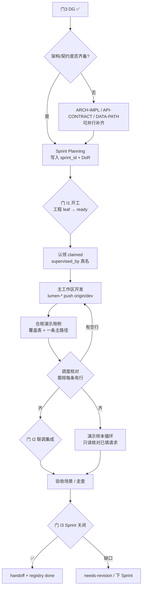
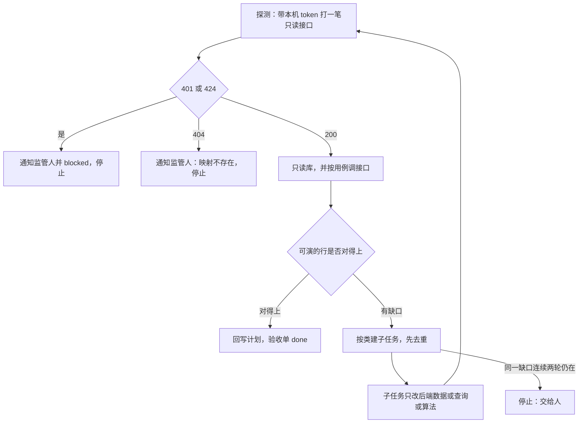

# 产品实现规程（DG 后 · Sprint 工程交付）

> **读者**：孔东 / 曹丽影（前端）、侯佳伟（后端）、唐绍祖（算法）、辜少彬 / 胡森泉（GDF）、徐滕强 / 李伟（架构）、高颖（体验对照）、郭万迎（合规/PM）、淮政玮（里程碑）、coordinator-agent
> **作用**：在**产品定义三门（PDR / 会签 / DG）已通过**之后，规定模块进入正式工程实现阶段的拆单、认领、联调、验收与关闭流程；与双周 Scrum 容器对齐。
> **维护**：PM（郭万迎）owner；架构（徐滕强 / 李伟）+ 前端 Lead（孔东）共创
> **版本**：v1.0.14 · 2026-11-10（§4.2.0 完善功能先判断是需求、问题还是监管人方案）

> **上游规程**：[`产品定义评审规程.md`](产品定义评审规程.md)（门 1–3；Track-MS V2 ∥ 门 2；门 3 DG 解锁工程）
> **关联**：
>
> - `scrum-sprint.yaml`（双周 Sprint 容器、WIP、DoR）
> - `task-claiming-guide.md`（认领 / 状态机 / `supervised_by`）
> - `长任务执行规约.md`（过夜连跑：总控一次授权、联调闸门、**段 E 已发布冒烟**；仍走本规程状态机）
> - `task-registry.yaml`（工程 leaf 队列；`delivery_phase: implementation`）
> - `feishu/feishu-bitable.yaml`（飞书「交付阶段」列；视图「实现看板」）
> - `team-collaboration-playbook.md`（团队公约）
> - `.cursor/rules/00-team-constitution.mdc` §4.2（**长期默认**：lumen-* `dev` 直推；不强制 feature / worktree）
> - `decisions/DECIDE-FE-V2-LUMEN-DIRECT-2026-07-12.md`（V2 直落 lumen；门 3 后无 demo→lumen 复刻）
> - `architecture-baseline.md` / `data-lineage-policy.md` / `Design.md` / UX-UE 交互规范 / [`diagram-as-contract.md`](diagram-as-contract.md)（图即契约；门 I1-11 / I2-11）
> - `sprints/ent-scrum-pdr-backlog.md`（企业维度 PDR→工程衔接样例）

---

## 0. 一句话

> **定义评审管「做什么、长什么样」。本规程管模块怎么做完：先按 §4.1 做 SDD，实现可调后按 §6.4 写合规演示用例，覆盖核对通过后按 §6.5 跑演示样本循环。门 3 DG ✅ 之后才批量标工程 leaf `ready`；实现默认主工作区 + lumen `dev` 直推。**

### 0.1 名词（与图即契约 §0 同构）

本规程「模块」= **能开 DG 的验收父节点**（如 `E-31 企业发展`），不是 `E-32` 级 bid 叶子，也不是 registry 一张工程 leaf。图检查粒度：

| 本规程用语 | 对齐 | 图 |
|---|---|---|
| `{模块}` / `DG-{模块}` / 门 I1 纪要 | 产品包父节点 | L1 在定义包；**I1-11 的 L2 认存储域**（ENT/CHAIN/SVC），多模块共用一张流图 |
| bid 叶子 | TRACE `leaves` | **禁止**为每个叶子新建 `01-data-flow` |
| 工程 leaf | `task-registry` 一条 | **I2-11** 的 L4 可按本叶或模块联调单 |

真源：[`diagram-as-contract.md`](diagram-as-contract.md) §0。I2-07 的 L0–L4 = TRACE 权限档，不是图分层。

---

## 1. 背景与适用边界

### 1.1 要解决什么问题

| 矛盾 | 表现 | 本规程对策 |
|------|------|------------|
| 定义通过 ≠ 工程就绪 | DG 后无统一拆单与依赖模板 | 固定工程 leaf 链 + DoR / DoD |
| V2 与「正式开发」混淆 | 把准生产会签当成联调完成 | 明确：V2 属定义轨；本规程管 **API/联调/硬化** |
| Scrum 与 PDR 两套话术 | Planning 不知哪些可进 Sprint | 以 `scrum-sprint.yaml` + 本规程 §5 开工门为准 |
| 多仓并行易乱 | feature/worktree 默认强制，摩擦大 | 对齐公约：默认主仓 `dev`；冲突再隔离 |

### 1.2 适用与不适用

| 适用 | 不适用 |
|------|--------|
| 门 3 DG ✅（或 §9.2 政策豁免）后的 Track-MS / 专题工程交付 | 产品五件套、V1、联合修订冻结、门 1/2、V2 会签本身（仍走**定义评审规程**） |
| API 接线、前后端联调、权限/可观测硬化、数据工厂映射、算法工程对齐 | Track-L 大屏联通数智直交（本规程仅要求共享 API/metric 契约） |
| 已有 DG 模块内的增量工程（豁免范围内仍须门 2 增量核对） | 纯 DevOps / 编排 Epic（走 architect + ORCH 任务） |
| Sprint 内 committed / stretch 工程 leaf | 未过门 3 却把工程 leaf 标 `ready`（违规） |

### 1.3 阶段分界（硬边界）

```text
【定义阶段 · 产品定义评审规程】
  PACK → METRIC-OPEN ∥ UX → V1-R1 → 门1 → 联合修订冻结
       → V2 lumen 准生产 ∥ 门2 → 门3 DG
                │
                ▼  DG ✅
【实现阶段 · 本规程】
  架构/契约确认（若未并行完成）→ Sprint 拆单 → 认领执行
       → 模块可调后写合规演示用例 → 调度核对需规覆盖
       → 联调集成 ∥ 演示样本循环 → Sprint 验收关闭 → handoff done
```

| 阶段 | 典型仓 | 是否本规程范围 |
|------|--------|----------------|
| V1 / 冻结 Demo | `demo-ui-topic`（参照） | ❌ 定义规程 |
| V2 准生产会签 | `lumen-ui-topic` `dev` | ❌ 定义规程（产出作实现基线） |
| **API 接线 / 联调 / 硬化** | `lumen-ui-topic` + `lumen-svc-platform` + algo / GDF | ✅ **本规程** |

---

## 2. 与产品定义评审规程的衔接

### 2.1 解锁条件（进入实现阶段）

须**同时**满足（Track-MS）：

1. `DG-{模块}-拍板纪要.md` 结论为 ✅ 批准或 ⚠️ 批准附条件（附条件须已满足或列入本 Sprint 明确 deadline）
2. `FE-LUMEN-V2-ALIGN-{模块}-会签单.md` ✅（V2 基线）
3. `PM-会签-{模块}-签字单.md` ✅（门 2）
4. TRACE / 冻结产品包路径已写入工程 leaf 的 `product_gates` / `visual_gates`（见定义规程 §9.1）

Track-L：V-L + 门 2-L + 门 3 ✅ 后，共享契约侧工程（Java/ADS/metric）可按本规程派单；大屏 UI 仍由王亚东直交。

### 2.2 实现阶段**不得**重开的定义决策

| 事项 | 处理 |
|------|------|
| IA / 主路径大改 | 退回定义规程：联合修订升版或重开受影响门 |
| 新增/删除 bid 叶子 | 须 PM change_log + 必要时门 3 |
| metric 口径变更 | 语义 Owner 会签；🟡→🟢 仍须甲方 |
| 突破架构铁律 | architect 否决或三签（定义规程 §8） |

实现阶段允许：字段接线、空态/异常态硬化、性能与权限修补、Mock→真实 API 切换、缺陷修复。

### 2.3 输入真源（实现对照）

| 输入 | 用途 |
|------|------|
| 联合修订冻结单 + 冻结 Demo URL | 体验/视觉对照（非复制 React 代码） |
| V2 会签单 + lumen commit SHA / URL | 页面骨架与组件真源 |
| TRACE + wireframe（含 metric_id） | 验收与血缘 |
| OpenAPI / ARCH-IMPL / data-gap-catalog | 接口与数据路径 |
| [`diagram-as-contract.md`](diagram-as-contract.md)（L2/L3/L4 图） | 人看图对齐：存储流图 / 模块实现架构 / 联调时序；图文冲突以图为准 |
| `metrics/registry/metric-readiness-matrix-{模块}.yaml` | 指标四维就绪度对照（D9 v1.3 §2.3；FE 只读消费，禁止页面自填状态） |
| **附录 D（D9 角标防漏扫描）** | 前端页面 KPI/统计数字挂角标的强制扫描方法（专题/展示系统各模块通用） |
| **附录 E（分析任务发起扫描）** | 异步分析工作区：切条件不自动起任务；条件栏「开始分析」；同用户同条件单飞；当天已成功直接打开结果 |
| DG 纪要开放项 / Q0xx | 🟡 角标与待确认项不得静默消失 |

### 2.4 门1 故事拆单草案 vs 本规程开工

| 时点 | 允许 | 禁止 |
|------|------|------|
| **门 1 PDR 完整闭合后** | 写入 `user-story-library.yaml`；生成 `story-impl-proposals.yaml`（实现 leaf **backlog 草案** + Theme） | 把草案标 `ready`、派开发认领开工、跳过门 3 |
| **门 3 DG ✅ + 门 I1** | 已入库 implementation leaf 经 confirm → `ready`；Sprint committed | 用未审 proposals 直接改飞书正式 Task |

命令：`node scripts/pdr-gate1-story-pipeline.mjs --module {模块}`；详规见定义规程 §5.3.1 与 `task-creation-guide.md` §16。

---

## 3. 实现阶段角色与责任

| 角色 | 真人 | 实现职责 | Agent 辅助 |
|------|------|----------|------------|
| **实现协调** | 郭万迎 + coordinator | Sprint 排期、拆单入 registry、看板同步、handoff 验收 | `coordinator-agent` |
| **架构把关** | 徐滕强 / 李伟 | 实现架构 / 调用链 / Convoy；铁律抽检 | `architect-agent` |
| **前端实现** | 孔东（Lead）、曹丽影（企业高筛等） | lumen 页面接线、状态硬化、内部评审模式 | `frontend-agent` |
| **后端实现** | 侯佳伟（Lead）+ Java 组 | Java REST 门面、鉴权、只读 ADS、转发 `/internal/*` | `api-agent` |
| **算法实现** | 唐绍祖 | Python `/internal/*`、指标/模型工程对齐 | `algorithm-agent` |
| **数据实现** | 辜少彬（GDF 产线）· 胡森泉（GDF Skill / 自动化） | 贴源、Mapping、调度、ADS 就绪；CDC 预填可复用 | `data-agent`（契约监管：徐滕强） |
| **体验对照** | 高颖 | 联调走查、与冻结 Demo 偏差登记 | `ux-agent`（按需） |
| **语义对照** | 王惠 / 唐绍祖（临时代行见定义规程 §1.4.1） | 指标卡与联调结果核对 | — |
| **模块开发负责人** | 该模块对应 Lead 指定的开发人 | 模块可调后主笔《合规演示用例》：界面步骤与填好的请求、期望输出写在同一份 | 对应执行 agent 起草，负责人收口 |
| **QA** | （按 Sprint 指定） | 验收场景、回归；覆盖核对通过后按合规演示用例做演示样本循环 | `qa-agent` |
| **文档** | 该模块监管人 | 详细设计文档以图为主、带变更记录；Storage 设计与改动一致；给人看的简报。规定见 §4.3 | `doc-agent` |

**铁律**：Agent 执行必须有 `supervised_by: human:{真名}`；业务口径不由实现方替甲方拍板。

---

## 4. 实现流程总览



| 阶段       | 名称          | 要点                                                               |
| -------- | ----------- | ---------------------------------------------------------------- |
| **SDD**  | 详设与二级四单     | 顺序见 §4.1。该二级四单会签通过后，实现 leaf 才可标 `ready`                          |
| **门 I1** | 实现开工        | DoR + DG 证据齐 → `ready` → Planning 写入 `sprint_id`                 |
| 执行       | 认领与开发       | 默认 `${GKX_ROOT}/repos/{repo}`；lumen-* `dev` **直推**；冲突时再 worktree |
| 开发完成后    | 合规演示用例      | 模块可调、库内已有数据后，开发负责人按现有数据写覆盖表和一条主路径                                |
| 覆盖核对     | 调度          | 需规每条有行才允许建演示样本循环；空行退回补用例，不派数据单或算法单                               |
| **门 I2** | 联调集成        | 前端→Java→Python 调用链通；人走用例里的主路径                                    |
| 循环       | 演示样本满足      | 步骤在 §6.5。只读核对已填好的请求                                              |
| **门 I3** | Sprint 验收关闭 | DoD + handoff；coordinator 签收 → `done`                            |

图上的「架构/契约」指 §4.1 第 4 步已经会签。嵌入双周 Scrum 的仪式见 §10（源自 `scrum-sprint.yaml` + `task-claiming-guide.md`）。

### 4.1 SDD 开发过程

一个功能模块从需规走到可编码，按下面的顺序。展示系统与专题系统同一套。门 1 到门 3 仍以《产品定义评审规程》为准。本节不重开门 1。

```text
存量调研
  → 系统详细设计（调用链与边界、指标与 501、契约输入清单，再合成说明书）
  → 按需规二级拆四单：先 ARCH，再 API / 指标 / 数据
  → 架构、算法、数据、产品四角色会签
  → 实现 leaf（Java、数据、算法、前端）
  → 接口可调且库内已有数据 → §6.4 合规演示用例 → §6.5 演示样本循环
```

| 步 | 产出 | 谁 | 依赖 |
|---|---|---|---|
| 1 存量调研 | 现有页面、接口、表、缺口 | 模块负责人 | 无。详设开工前，调研结论须已落盘 |
| 2 系统详设 | 三分册 + 合成说明书，路径 `agent-handoffs/{模块}/sdd/` | 架构牵头；算法、数据、接口按分册 | 调研已落盘。三分册可并行。会签未完成可以起草，不标 done |
| 3 二级四单 | 每个需规二级四份：`*-ARCH`、`*-API`、`*-METRIC`、`*-DATA`，落在 `sdd/l2/` | ARCH：`arch-agent`。API：`api-agent`。指标：`algorithm-agent`。数据：`data-agent` | 系统说明书已落盘后才起草。API、指标、数据硬依赖本二级 ARCH |
| 4 会签 | 架构、算法、数据、产品四角色同意。签收由监管人执行 | 四角色 + 监管人 | 未会签不得把该二级标 done，也不得把该二级的实现 leaf 标 `ready` |
| 5 实现 | Java 门面、数据或灌数、算法、前端接线。拆单见 §8 | 对应 Lead | 该二级四单已会签。调用链：前端只调 Java，算法只在 Python `/internal/*` |
| 6 用例与循环 | §6.4、§6.5 | 开发负责人写用例；调度核对；`qa-agent` 跑循环 | 该模块接口可调，且库内已有数据 |

会签未完成，不挡下一份设计稿的起草。挡两件事：该单签收，以及按该二级派实现。

第 2 步到第 5 步每步收口后，`doc-agent` 同步文档与 Storage，并给监管人一份简报，见 §4.3。

推行 FDE 的模块，上表「谁」列的各 agent 身份由同一位监管人调度，各开会话执行，会签由不同身份的 agent 互审对抗、监管人收口，做法见 §4.2.4。

### 4.2 功能设计完善修改

已经按 §4.1 落过说明书、或页面已经按旧设计做出来之后，若要改「这一叶在界面上必须看见什么」，先走本节。这是**产品设计上的修改**，包含前端 UI 调整（控件、区块、选择方式、空态、本批结果怎么摆）。不是实现偏差，也不先改代码。

产品负责人收口这一改；体验对照 UI 是否仍符合 `Design.md` 与交互规范。

#### 4.2.0 先判断这句话是哪一种

收到「完善功能」后，`product-agent` 先判断监管人这句话是哪一种，再决定走不走本节。不把原话直接写进说明书。

| 种类 | 怎么听出来 | 下一步 |
|---|---|---|
| 需求 | 说的是要达成的结果、用户要完成的事，没有指定具体控件或实现 | `product-agent` 按需规拆成用户故事和功能点，再出 §4.2.5 的执行计划 |
| 问题 | 现页做错了、报错，或和已经定稿的设计不符 | 走缺陷修复（`bugfix`），不改产品定义。核对后其实是设计没写到的，改判为需求 |
| 监管人自己给的方案 | 指定了控件、按钮、数据源或操作步骤 | `product-agent` 做用户故事完整性审核。说得通就收进设计；有瑕疵就给出专业意见和选项，监管人选了才写进说明书、才出执行计划 |

用户故事完整性看四件事：谁在什么情况下要完成什么；做完能看见什么；没做、做失败、做一半、改了条件再做，各自是什么；需规里这一叶的每个分句是否都还有着落。方案若让两个状态说成同一句，或让某个分句在界面上没有着落，就是瑕疵。

瑕疵意见用决策卡（§4.2.5）：一句背景，2–4 个选项，推荐放第一。监管人没选之前，不改说明书，不往下派架构和实现。

#### 4.2.1 先分档

本节不绕过定义规程的冻结纪律：高保真冻结签字后的改动须升版本并重走相应评审（定义规程 §5.5「Track-MS 冻结纪律」），IA 或主路径大改退回定义规程（本规程 §2.2）。按改动大小分三档，就高不就低：

| 档 | 判定 | 流程 |
|---|---|---|
| 轻 | 同一区块内文案或控件替换；主路径、数据源、读口不变 | 说明书 → 该二级四单 → 产品 + 架构两签，算法、数据知会 |
| 中 | 新增交互、选择方式或区块；或数据源、读口条件变化 | 轻档全部 + 高保真升版本 + 体验 Owner 书面复核 + 数据、架构确认读法；仍是四角色会签 |
| 重 | IA 或主路径大改；增删需规叶子 | 退回定义规程，按 §2.2 联合修订升版或重开受影响门；增删叶子另走 change_log，必要时门 3 |

需规句子没变时，轻档、中档都不重开门 1。

#### 4.2.2 顺序

```text
功能设计完善修改（产品设计：改哪一叶、哪几个功能点、界面改成什么样、UI 调整清单）
  → 定档（轻 / 中 / 重）；重档退回定义规程，下面不走
  → 回写系统说明书该叶的功能设计，并附影响清单
  → 冲突的二级四单改到与新设计一致（先 ARCH，再 API / 指标 / 数据）
  → 按档会签（中档另附高保真升版与体验复核）
  → 才派实现：前端按新 UI 接线，Java / 数据只改读口条件
  → 已有合规演示用例的，改该叶对应功能点的行，再重跑 §6.5
```

#### 4.2.3 规定

| 项 | 规定 |
|---|---|
| 功能点编号 | 每个需规叶子按分句拆功能点，编号 `{序号}-{n}`（如 602-1）。说明书该叶按功能点写设计，每点写「界面上必须看见什么」。会签时连同这一列一起签 |
| 唯一真源 | 功能设计以模块说明书为唯一真源，写版本或日期。二级四单、长任务总控、派单只引用说明书，不另写一套口径 |
| 影响清单 | 每次改说明书该叶，附「需同步」清单：哪份二级四单、总控、派单、合规演示用例、前端 leaf。旧口径处标「已被说明书 {日期} 取代」。清单未清零，不得派实现 |
| 前端 UI | 写在说明书同一叶，不另开只给开发看的稿。中档以上附线框和状态清单：空态、未选、停用、失败、未命中 |
| 触发实现 | 说明书、四单一致且按档会签之后，实现 leaf 才能按新 UI 标 `ready`。未会签不得先改前端 |
| 与旧原型 | 和已冻结 Demo / V2 的差别写入 I2-10 |
| 验收 | §6.4 覆盖表按功能点核对：每个功能点至少落在一行的期望输出里。只写「页面有数」不算覆盖 |

#### 4.2.4 FDE 方式

本规程推行 FDE（Forward Deployed Engineer）：一个功能模块由**同一位监管人**端到端负责，由他**指挥调度**各身份的 agent 完成产品设计、设计稿、实现与验收。FDE 不是一个人包办，也不是一个 agent 包办；是一个人对结果负责、多个 agent 身份分工执行。FDE 是做事方式，不是新岗位。功能设计完善修改默认按本节走。

**一位监管人**：`supervised_by` 始终是同一位真名。他决定开哪个身份的会话、给什么输入、何时进入下一波次，并在检查点收口。他不替代各身份写稿，也不替各身份会签。

**多身份、分会话**：每个身份在自己的会话里执行，只产出本身份的产物。同一会话不得同时扮演起草方与审查方。commit 标本身份 `[agent:<role>]`，handoff 记录每个会话的身份与产物。

| 身份 | 负责 |
|---|---|
| `product-agent` | 功能点、界面上必须看见什么、状态清单、影响清单；回写说明书 |
| `ux-agent` / `ui-agent` | 线框、交互状态、高保真升版 |
| `arch-agent` | 定档、调用链与读法方案；ARCH 稿 |
| `api-agent` | API 稿；Java 门面实现 |
| `algorithm-agent` | 指标稿；涉及算法时 Python 实现 |
| `data-agent` | 数据稿；读面、表或灌数 |
| `frontend-agent` | 前端实现 |
| `qa-agent` | 合规演示用例核对与 §6.5 循环（独立会话，不参与起草） |
| `doc-agent` | 说明书的图与变更记录、Storage 一致性、给监管人的简报（§4.3）；会签时审一致性，不改各身份结论 |

**建单**：可以建一张总单，编号 `{二级前缀}-FDE-L{nn}`（如 `POL-L2-PC1-CLEAN-FDE-L01`），各身份写在 `collaborators`；也可以按身份拆子单。两种方式的 `supervised_by` 都是同一位监管人。已有的二级四单与旧实现单不重开，由对应身份在本单内改写，并在 handoff 回链。

**单内波次**：

| 波次 | 执行身份（各自会话） | 会签与检查点 |
|---|---|---|
| A 产品设计 | `product-agent` 起草；`ux-agent` / `ui-agent` 出线框与状态 | 中档以上：体验 Owner 书面复核 |
| B 定档与架构 | `arch-agent` 定档并写读法方案 | `data-agent`、`api-agent` 对方案提异议；读法涉及团队铁律时，人类架构师裁定 |
| C 设计稿 | `arch-agent` 先写 ARCH；`api-agent`、`algorithm-agent`、`data-agent` 再写各自稿 | **多身份会签**（见下）；监管人收口签收 |
| D 实现 | `data-agent` → `api-agent` → `frontend-agent`（按依赖、按仓顺序） | 各仓既有提交闸门照旧（前端自检全绿后人工确认再推） |
| E 验收 | `product-agent` 或实现身份写合规演示用例 | 调度核对覆盖；`qa-agent` 独立跑 §6.5；淮政玮签收 |

每个波次收口时，`doc-agent` 开自己的会话做 §4.3 的三件事：更新说明书的图和变更记录，核对 Storage，写一份简报给监管人。简报没交，该波次不算收口。

**多身份会签（对抗与讨论）**：

1. 起草身份交稿后，由**其他身份各开会话审稿**：轻档至少 `product-agent` + `arch-agent`；中档 `arch-agent`、`algorithm-agent`、`data-agent`、`product-agent` 四身份。
2. 审稿身份必须站在本身份立场找问题，不得只写「同意」。至少逐条对照：功能点有没有落到稿里，铁律有没有破，数据能不能读到，界面上必须看见的东西接口给不给得出。
3. 起草身份逐条回应：采纳并改稿，或给出理由驳回。来回记录在会签单里（`sdd/l2/会签/`），写清每条异议的结论。
4. 身份之间仍有分歧的，升级给监管人拍板，并把拍板理由写进会签单。涉及团队铁律、范围或甲方口径的，监管人也不能拍，转对应的人。
5. 各身份结论齐、分歧已闭合，监管人签收会签单，才进入下一波次。

**必须人出手的**：监管人收口与拍板；体验 Owner 复核；人类架构师对铁律的裁定；范围 ±10% 与删叶子；甲方业务口径；淮政玮签收。agent 会签不替代这些。

**与故事齐步的关系**：一个故事只挂这一张 FDE 总单时，「全部关联任务齐步」即本单到 `integration`；拆了子单的，按子单齐步。

**何时不用 FDE**：重档（退回定义规程）；同一模块多位监管人并行改同仓、有冲突风险；监管人明确要求分单分人。

602 的「选择政策」是中档实例：新增多选选择方式，数据源从 DWD 主表改为 ODS 贴源。按 FDE 由一位监管人建 `POL-L2-PC1-CLEAN-FDE-L01`，调度各身份会话推进；波次 B 的读法方案未经多身份对抗并由人类架构师裁定之前，不进 D。

入口技能：`.cursor/skills/gkx-fde-design-change/`（含审稿硬清单）。

#### 4.2.5 执行计划、停机与决策卡

监管人说清「改哪一叶、改成什么样、为什么」之后，先按 §4.2.0 判断种类。判成问题的，不进本节。判成监管人方案且有瑕疵的，先出选择卡，选完才往下。然后给出一份**按当前状况写的执行计划**，等人确认，才建单、才开第一个身份会话。确认前只读：不改说明书、不改四单、不改代码。

计划不按空白模板照抄。先看这一叶的说明书、二级四单、会签记录和实现做到哪，再写。一屏以内，固定六块：

| 块 | 写什么 |
|---|---|
| 现在到哪 | 说明书、四单、实现、用例各一句。没有的写「还没有」 |
| 这次改什么 | 意图三项，原话收束，不扩 |
| 建议档位 | 轻 / 中 / 重，一句理由。判成重档就不再往下排实现 |
| 将要跑的波次 | 只列这次真要跑的，每波一行：谁做、产出什么。已做完的写「跳过」和原因 |
| 预计会停下来问的 | 现在就能看见的铁律、新表、口径，每条一句。看不清写「跑起来才知道」，不编 |
| 请确认 | 两个选项：「按此计划开始」「先改计划」（自填改哪一段） |

用选择题呈给监管人（Cursor 下用 `AskQuestion`）。选「按此计划开始」才跑。选「先改计划」只改计划，不开工。监管人说停，计划作废。

确认后按计划跑，波次内部不逐步问人。计划要变时（升档、跳过的波次要补跑）再出一版，确认后再续。只在下列停机条件命中时停：

| 停机条件 | 交给谁 |
|---|---|
| 意图三项缺任一项 | 监管人补充 |
| 判为重档 | 监管人确认退回定义规程 |
| 触碰团队铁律（调用链、只读 ADS、D12、D18 等） | 人类架构师裁定，监管人确认 |
| 业务口径歧义 | 登记客户决策清单，监管人选团队临时默认 |
| 新建正式库表、改主键、新同步 | 数据平台 Owner / 架构，监管人确认 |
| 多身份会签分歧未闭合 | 监管人拍板 |
| 前端推送 | 监管人确认（前端推送闸门） |
| 单任务成本 > $10，或同一缺口循环 3 轮未闭合 | 监管人 |

**决策卡**：命中停机时，当前波次停下，不在聊天里写长篇讨论，而是给监管人一张可选的卡：

1. 背景一句：卡在哪条规则、哪个功能点。
2. 选项 2–4 个，每个写：做法、影响到哪几层、代价、风险。
3. 推荐项放第一位并标「（推荐）」，写一句推荐理由。
4. 用选择题呈现（Cursor 下用 `AskQuestion`），监管人可选「其他」自填。

监管人选完，把选项与理由写进该波次会签单或总控，链路自动续跑。没有命中停机条件，不出卡、不回问。人类签字项（体验复核、铁律裁定、签收、甲方口径）即使已有推荐，也必须由对应的人在卡上选定，agent 不代选。

### 4.3 文档同步与沟通（doc-agent）

§4.1 与 §4.2 每一步收口后，`doc-agent` 开自己的会话，做前三件事；整次功能完善走完后再做第四件。它整理和核对文档，不替各身份改结论，也不新建表、不定口径。发现不一致，退回对应身份改，并写进简报。

**一、详细设计文档：以图为主，带变更记录**

| 项 | 规定 |
|---|---|
| 范围 | 模块 `sdd/` 下的系统说明书、三分册、二级四单 |
| 以图为主 | 能画的都画，文字只写图表达不了的约束。调用链用时序图；数据从哪来到哪去用流图；表关系用 ER 图；状态用状态图；界面区块用线框或区块图。用 Mermaid 写在文档里，图与 `diagram-as-contract.md` 的层级对齐 |
| 图文一致 | 图和正文、表格说的必须是同一件事。改了正文没改图，或改了图没改正文，都算没改完 |
| 变更记录 | 每份文档文末一张变更记录表：日期、任务、改了什么、为什么、影响到哪。写给人看，一行一句白话，不贴代码和 DDL |
| 取代标注 | 旧口径处标「已被说明书 {日期} 取代」，与 §4.2.3 影响清单一致 |

**二、Storage 设计与改动一致**

凡涉及表、列、主键、同步、读面的改动，`doc-agent` 核对 `data/data-design/storage/{域}/` 与改动是否一致：

| 时点 | 核对 |
|---|---|
| 设计稿会签前（波次 C） | 二级 DATA 稿里出现的每张表、每列，在 `stores/*.md` 有登记（新表标 draft）；`01-data-flow.md` 流图画到了；`etl/` 有对应管道条目 |
| 实现落库后（波次 D 之后） | 只读核对线上库表、列与 `stores/*.md` 一致，draft 改为 as-built；差异写进域 `CHANGELOG.md` 并退回 `data-agent` |
| 每次 | 说明书、二级 DATA 稿、Storage 三处表名列名一致；说明书只引用 Storage，不另抄一份 DDL；域 `CHANGELOG.md` 记一行 |

Storage 的表结构由 `data-agent` 设计，新建正式库表仍按 §4.2.5 停机。`doc-agent` 只负责文档一致。

**三、给人看的简报**

专业文档之外，`doc-agent` 每次收口再写一份简报给监管人。专业文档给各身份和后续开发读；简报给人快速看懂、做决定。

| 项 | 规定 |
|---|---|
| 位置 | 模块 `sdd/简报/{YYYY-MM-DD}-{主题}.md`，聊天里同时贴要点 |
| 篇幅 | 一屏读完。最多一张图 |
| 内容 | 改了什么；为什么；现在走到哪一步；需要你决定什么（有决策卡时指向它）；风险与未闭合项 |
| 写法 | 白话，完整句子。不贴代码、DDL、内部编号堆砌；必须引用的文件给路径 |

**四、完工汇报（一次功能完善走完后）**

各身份会话的原始输出往往很长，不直接转给监管人。`doc-agent` 向每个参与过的身份索要回执，再汇成一份完工汇报。

索要时只给这一个格式，每个身份回 5 行以内，超出的退回重写：

```text
身份：
做了什么：一句
产物：文件路径（最多 3 个）
没闭合的：一句，没有写「无」
要人决定的：一句，没有写「无」
```

汇报放 `sdd/简报/{YYYY-MM-DD}-{叶}-完工汇报.md`，结构固定：

1. 结论一句：这次功能完善是否走完、能不能签收。
2. 一张表，一个身份一行：身份｜做了什么｜产物｜没闭合的。
3. 需要你决定的：逐条列，没有就写「无」。

整份一屏读完。各身份原文留在会签单和 handoff 里，汇报只给路径，不转抄。回执没收齐不出汇报，在汇报里写明缺谁。

---

## 5. 门 I1：实现开工门（Sprint Ready）

### 5.1 参会与输入

| 项 | 内容 |
|----|------|
| **时机** | 双周 **Sprint Planning**（周一，约 90min）或 DG 后特开「实现开工」15min |
| **必到** | 郭万迎（主持）、本 Sprint 相关 Lead（孔东 / 侯佳伟 / 唐绍祖 / 辜少彬 按需）、架构 ≥1 |
| **输入** | DG 纪要、V2/门 2 证据链接、拟拆工程 leaf 草案、`scrum-sprint.yaml` 当前 Sprint |
| **产出** | 工程 leaf 写入 `task-registry`；`sprint_id`；Convoy 分组；WIP 确认 |

### 5.2 过关标准（I1-01～I1-11）

| # | 检查项 | 责任人 | ☐ |
|---|--------|--------|---|
| I1-01 | 门 3 DG ✅（或定义规程 §9.2 豁免已书面登记） | 郭万迎 | |
| I1-02 | V2 + 门 2 证据路径已挂到工程 Epic/leaf | coordinator | |
| I1-03 | 每个工程 leaf 有清晰 DoD（可测试） | 对应 Lead | |
| I1-04 | `depends_on` 无环；Convoy 串行已标注 | 架构 + coordinator | |
| I1-05 | `agent` + 建议 `supervised_by` 真名已指定 | 郭万迎 | |
| I1-06 | `estimated_tokens` / `effort_points` / `difficulty` 已估 | coordinator | |
| I1-07 | OpenAPI 或接口清单齐备，或本 Sprint 内有契约 leaf | 侯佳伟 | |
| I1-08 | 数据路径：ADS/Mock/贴源状态明确（FULL/INTEG/DEMO）；有 readiness-matrix 的模块对照其 D3 源映射 / D4 接入列（D9 v1.3 §2.3） | 辜少彬 / 徐滕强 | |
| I1-09 | 无静默扩 scope（±10%）；新叶子须 PM 登记 | 郭万迎 | |
| I1-10 | 已写入 `scrum-sprint.yaml` committed 或 stretch | Sprint Owner | |
| I1-11 | **图即契约 L2/L3**：本**模块**（验收父节点）落到的 **存储域** 流图已架构师会签（`storage/{ENT\|CHAIN\|SVC}/01-data-flow.md`；企业发展认 `ENT-STORAGE-FLOW`，不另画 E-31/E-32 流图）。本 Sprint 若含 ARCH-IMPL，则 L3 按**模块/要素域**落盘，不对齐 bid 叶子。缺域级流图 → 本 Sprint 必须有**域级**补图 leaf，否则相关工程 leaf **不得** `ready`。纯文案/纯角标/不碰拓扑的 leaf 可 **N/A**（须写理由）。L1 在定义包/IA，不在本项。真源 [`diagram-as-contract.md`](diagram-as-contract.md) §0 | 徐滕强 / 李伟 | |

> **I1-11 与 I1-08**：I1-08 查数据是否就绪（ADS/Mock/贴源）；I1-11 查人是否对着该模块所属 **域** 的已签流图开工（不是对着叶子各画一张）。两行都过才算数据侧开工齐。

### 5.3 结论

| 结论 | 动作 |
|------|------|
| ✅ 开工 | 工程 leaf → `ready`；允许认领 |
| ⚠️ 有条件开工 | 条件列入 Sprint 笔记 + deadline；未满足前相关 leaf 保持 `backlog` |
| ❌ 不开工 | 退回补契约/补 DG 条件；**禁止**先开发后补单 |

---

## 6. 门 I2：联调集成门

### 6.1 何时召开

- 模块主路径「前端 → Java →（Python）→ 数据」首次打通时；或
- Sprint Review 前必须完成的联调检查点；或
- 跨仓 Convoy 全部 `review` 前由 Lead 召集快检（15–30min）

### 6.2 过关标准（I2-01～I2-13）

| #     | 检查项                                                                                                                                                                                                                                                                                                  | 责任人                        | ☐   |
| ----- | ---------------------------------------------------------------------------------------------------------------------------------------------------------------------------------------------------------------------------------------------------------------------------------------------------- | -------------------------- | --- |
| I2-01 | 调用链符合铁律：前端只调 Java；算法只在 Python `/internal/*`；**D12** lumen 前端调用链不打 demo 服务                                                                                                                                                                                                                            | 架构抽检                       |     |
| I2-02 | 主路径 walkthrough 可在 lumen **dev** URL 逐步演示                                                                                                                                                                                                                                                            | 孔东 + 高颖                    |     |
| I2-03 | 异常/空/加载态按 UX 规范可见                                                                                                                                                                                                                                                                                    | 孔东                         |     |
| I2-04 | 有统计数字：MetricSpecCard / ⓘ + metric_id；Mock 有 🧪；就绪度角标齐（D2 缺陷有 SchemaGapBadge、D4 接入中有 IngestingBadge，按 D9 v1.3 §2.3.3）；**须附附录 D 防漏扫描证据**（P0/P1 零遗漏，或白名单+原因）                                                                                                                                            | 唐绍祖 + 前端                   |     |
| I2-05 | 🟡 待甲方项 UI 角标仍在，未假装已确认                                                                                                                                                                                                                                                                               | 郭万迎                        |     |
| I2-06 | 内部评审模式可开关，关闭后无评审层泄漏                                                                                                                                                                                                                                                                                  | 孔东                         |     |
| I2-07 | 鉴权/数据权限与 TRACE 角色一致（L0–L4 适用处）                                                                                                                                                                                                                                                                       | 侯佳伟 + 架构                   |     |
| I2-08 | 可观测性埋点未删（前端 observability / Java Agent / Python instrument）                                                                                                                                                                                                                                          | 对应 Lead                    |     |
| I2-09 | CI 绿或已登记 waiver（附理由）                                                                                                                                                                                                                                                                                 | 对应 Lead                    |     |
| I2-10 | 与冻结 Demo / V2 基线的**有意偏差**已书面列出                                                                                                                                                                                                                                                                       | 高颖 + 孔东                    |     |
| I2-11 | **图即契约 L4**：本**工程 leaf**（或本模块联调单，模块=验收父节点）有 `sequenceDiagram`（`{TASK}-SEQ` 或模块联调图），边与 I2-01 调用链一致，且能对上 walkthrough 与一条 dev `traceId`。同主路径多叶可共用一张，**不要**按存储域或按 bid 叶子各画一张时序。无跨层调用的纯文档 / 纯 chart leaf 可 **N/A**（须写理由）。缺图或缺 trace 对照 → 不得标联调通过。真源 [`diagram-as-contract.md`](diagram-as-contract.md) §0 | 孔东 + 侯佳伟；架构抽检              |     |
| I2-12 | **分析任务发起**：凡异步分析工作区，切条件（产业/对象/指标等）**不得**自动 `create` 任务；条件栏须有明确「开始分析」主按钮；同一用户 + 同一条件指纹仅允许一条 `queued`/`running`；当天已 `succeeded` 则「开始分析」直接打开结果；**须另提供「重新分析」**，显式点击才允许同日再 `create`（仍受单飞约束）。口径见客户决策清单 **Q-ANALYSIS-01**（🟡 监管人已锁临时基线；上线前补甲方书面）。**须附附录 E 扫描证据**（P0 零遗漏，或白名单+原因）。纯同步查询/列表筛选可 **N/A**。       | 监管人                        |     |
| I2-13 | **合规演示用例**：见 §6.4。模块接口可调且库内已有数据后，开发负责人提交 `{模块}-合规演示用例.md`。需规每条一行。调度核对无空行后，才允许建该模块的演示样本循环。纯文档 / 无界面无接口的 leaf 可 **N/A**（须写理由）                                                                                                                                                                          | 模块开发负责人主笔；coordinator 核对覆盖 |     |

> **I2-11 与 I2-01 / I2-02**：I2-01 查铁律有没有破；I2-02 查人能不能点出来；I2-11 查是否有一张与 trace 同构的时序图。三行分开勾。I2-07 的 L0–L4 是 **TRACE 权限档**，不是图分层。
> **I2-12**：有异步分析 Job / 过程壳的工作区必过；从任务浮层或分析记录打开已有任务算复用，不算新发起。扫描方法见附录 E。「当天」窗口与「重新分析」真源 **Q-ANALYSIS-01**。
> **I2-13**：有界面、有接口的功能模块必过。用例写法见 §6.4，循环步骤见 §6.5。没有合规演示用例，或需规仍有空行，不得开该模块的演示样本循环。

长任务 **段 E**（`长任务执行规约.md` §11）是 I2-02 的无人值守缩小版：只跑总控金路径、只认 K8s 已发布前端；**期望未发生必红**；红了先失败分类，由 coordinator 派修（分诊助手无提交权）。C1 后点名 CI deploy 绿即 E0、自动复测（Python api+worker；Java topic-chain + async-service，§11.5.2）。E 冒烟通过 **不替代** 本表孔东+高颖走查，也不等于 I3。

### 6.3 结论

| 结论 | 动作 |
|------|------|
| ✅ 联调通过 | 可进门 I3 / Sprint Review 演示 |
| ⚠️ 保留通过 | 软项列入下 Sprint；不得阻塞已批准演示范围外的关闭 |
| ❌ 不通过 | 相关 leaf → `needs-revision` 或 `blocked`；不得标 `done` |

### 6.4 合规演示用例（开发完成之后、演示样本循环之前）

模块接口已经能调、库里已经有数据之后，由该模块开发负责人写一份《合规演示用例》。这份文档说明：基于现在已有的数据，选哪些输入，才能把需规里能演的功能走完。没有这份文档，不建、不跑该模块的演示样本循环。

需规 / USM 仍回答「必须演示什么」，写在门 1。合规演示用例回答「当前数据下怎么演」。循环只反复核对这份用例里已经写明的请求是否还能得到期望输出。调度不替开发编输入，循环也不编预期。

落盘路径：

`agent-delivery/工程过程/04-系统集成/{系统目录}/合规演示用例/{模块}-合规演示用例.md`

展示系统用 `05-展示系统集成`，专题系统用 `03-专题系统集成`。历史集成测试记录（含当时的实测、401、404）保持原文件，不改写成这份用例。

文档只有两块。

**覆盖表。** 需规每一条一行：

| 需规位置 | 界面 | 输入或选择 | 触发 | 接口地址 | 按界面值填好的请求 | 期望输出 | 数据情况 |
|---|---|---|---|---|---|---|---|
| 章节 / 叶子 | 哪一屏 | 用户填或选的值 | 点什么才发出 | 方法 + 路径 | 参数值与界面输入同一值 | 应出现的字段和结果 | `可演`，或 `覆盖不到` 并写缺哪类数据 |

参数值来自该行的界面输入。现有数据演不到的需求，这一行写 `覆盖不到`，不编一条假结果。

**一条主路径。** 在 `可演` 的行里选一组输入，按操作顺序串成一次演示。这组输入用现在的数据，把撑得住的需规走全。条件不另做排列组合。

调度只核三件事：

| 看到的情况 | 动作 |
|---|---|
| 没有这份文档 | 循环验收单不建、不跑 |
| 需规有条目没有落到任一行；或说明书已有功能点编号（§4.2.3），某功能点没有写进任一行的期望输出 | 退回开发补用例。不派数据单，不派算法单 |
| 行上写了 `覆盖不到` | 允许演示样本循环按数据、查询或算法分类建子任务 |

循环执行只打后端：只读库，并调用覆盖表里已经填好的请求。界面步骤留在用例里，用来说明参数从哪来。循环怎么跑见 §6.5。

模块可调后即可写这份用例，不等同一故事下的其他 leaf 全部齐步。故事级集成测试仍等故事齐步，走查时走这条主路径。`覆盖不到` 的行不计入已演示。

### 6.5 演示样本循环（LOOP）

覆盖核对通过之后才跑本节。展示系统各功能模块共用。专题系统须当次口令点名后才用。一轮只读验收，有缺口就建子任务去补，补完再验收，直到该模块《合规演示用例》里可演的样本对得上。

第一个实例是科技政策跟踪的效果预估。该模块的库表、探测地址、已有查询单写在它自己的编排计划里，不写进本节。跑别的模块时换用例和库表，步骤仍是下面这几步。

技能入口只负责认出「按 LOOP 跑」。步骤以本节为准：`.cursor/skills/gkx-demo-sample-loop/`。监管人要做的事见 §6.5.7。

#### 6.5.1 先决条件

该模块已有 §6.4 的《合规演示用例》，覆盖表里需规每一条都有一行。

- 没有这份文档，或仍有需规空行：不编预期，不建验收单，不派数据单或算法单。退回补用例。
- 行上写了 `覆盖不到`：这一行没有期望输出，不拿来判通过。它作为数据缺口进入 §6.5.4 的分类。`可演` 的行对不上期望输出时，同样分类。

范围再加三条：验收单不替代该模块原来的测试任务，也不把那张测试任务标完成。不改已经写下的实测。不把 401、404 改写成通过。

#### 6.5.2 一张验收单

每个模块一轮一张验收单，建议 ID `{模块}-DEMO-ACCEPT-LOOP`。各模块计划里旧的「不签 `done`」以本节为准。

| 项 | 定法 |
|---|---|
| 类型 | `tech_task` |
| 执行 | `qa-agent` |
| 协作 | `data-agent`、`algorithm-agent`；查询类缺口再加 `api-agent` |
| 状态 | 未收尾时留 `ready`。token 失效或映射不存在为 `blocked` |
| 完成 | 样本满足，本轮子任务都已签收或本轮没有子任务，并且 LOOP 计划状态行已回写：验收单改为 `done`，操作人 `human:淮政玮` |
| 完成信号 | handoff 里新增一节「运行 YYYY-MM-DD」 |
| 禁止 | 样本未满足，或状态行还没回写，或子任务还没签收时，把验收单改成 `done` |

已 `done` 的验收单不再改回 `ready`。下一轮另建一张。

仓库登记走 MCP `task-registry`。不读、不手改 `task-registry.yaml`。本循环里新建或改状态的任务，写完留在本地注册表，不必立刻 `git fetch`、pull 或 push。等人说推的时候，再只提交并推送 `agent-delivery/task-registry.yaml`。

认领时 `supervised_by` 填当次开会话的真人。建单本身不认领。

#### 6.5.3 纯后端，token 熔断

不打开页面，不走 Vite，不带 Mock token。一轮只有两段后端调用：

1. 只读该模块线上实际读取的库，核对演示样本在不在。
2. 带已登录 token 调该模块的接口，核对过滤结果是不是该行的期望输出。

token 放在本机、仓库以外的文件。展示系统建议 `%USERPROFILE%\.gkx\display-loop-token`，请求头另加 `systemCode: display`。专题系统被点名时用 `%USERPROFILE%\.gkx\topic-loop-token`，请求头另加 `systemCode: topic`。文件内容只有 access_token 一行。由一次线上登录得到，循环只读它，写进 `Authorization: Bearer <token>`。token 不进 git，不进 handoff，不打印。不保存密码，不自动重新登录。

每轮先打一笔只读探测。探测返回 HTTP 401、424，或正文是「访问令牌不存在」「用户凭证已过期」「token expired」：

- 停止本轮，不建子任务，不把验收单拨回 `ready`。
- 验收单改为 `blocked`，note 只写「token 失效，已通知 human:淮政玮」。
- 在当前会话通知 human:淮政玮。人重新登录并换掉本机 token 文件之前，不再开下一轮。

探测返回 404：同样停止并通知，原因写「接口映射不存在」。这不是补数缺口。探测返回 200 之后，才进入样本对照。

#### 6.5.4 一轮四步



**验收。** 库连接用该模块设计或灌数脚本的现行环境。只 `SELECT`。不执行 `--apply`。不写 ODS、DWD、ADS，也不写缺项库。口令与 token 都不写入 git 或 handoff。

对照物是《合规演示用例》里数据情况为 `可演` 的行：填好的请求、期望输出。用例没写期望的行，不另造预期。`覆盖不到` 的行不拿来判通过。

通过：接口 HTTP 成功，返回与该行期望输出一致，并且该行约定的过滤能拣到该结果。

**分类。** 一条缺口只归一类。

| 类 | 看到的情况 | 子任务 | 执行人 |
|---|---|---|---|
| DATA | 缺行、空列、库内字符串和期望输出不一致；或该行是 `覆盖不到` | 数据补充 | `data-agent` |
| QUERY | 行在，过滤或等值拣不中 | 查询修改 | `api-agent` |
| ALGO | 行在且键一致，算出来的值对不上期望输出 | 算法修改 | `algorithm-agent` |
| ENV | 探测 401、424 或 404 | 不建单，通知后停止 | — |

期望输出的原文在库里对不上时，归 DATA。`覆盖不到` 归 DATA。过滤拣不中归 QUERY。只有值是算出来的，才归 ALGO。ENV 不派生另三类，也不再开一轮。

**建子任务。** 口令「按 LOOP 跑」授权本轮：有缺口就建 `ready` 子任务，不认领，不在验收当轮改库或改代码。没有这句口令，只写报告。

每轮最多三张：DATA、QUERY、ALGO 各一张。同类缺口写进同一张 DoD。

去重：先 `task-query`。已有未完成单覆盖同一缺口键，把本轮挂到那张单，不新建。

建议 ID：`{模块}-DEMO-FIX-R{n}-DATA`、`-QUERY`、`-ALGO`。`n` 是本轮日期 `YYYYMMDD`。

子任务 DoD 至少写清：缺口键、表或代码位置、现值和用例预期、允许改的仓、禁止改的过滤或指标、handoff 路径。数据单只在执行轮、且环境里已有库口令时才 `--apply`。口令仍不进 git。

同仓同时只派一张在做的编码子任务。数据单和查询单通常不同仓，可以并排处于 `ready`。子任务不改前端。

**再验收。** 本轮子任务的 handoff 都落盘并签收后，样本仍对不上：验收单留 `ready`，再派下一轮。样本已经满足：先回写计划状态行，再把验收单改为 `done`。

同一缺口键、同一类、同一预期，连续两轮仍在：停止建单，在 handoff 写明交给当次监管人。

#### 6.5.5 报告

handoff 路径：`agent-delivery/agent-handoffs/{模块目录}/{验收单ID}.md`。只追加，不覆盖上一轮。

每一轮用这一节：

```markdown
## 运行 YYYY-MM-DD

- 用例：`{合规演示用例相对路径}`
- 库：只读。写库名和表名，不写口令
- 样本满足：是 / 否
- 停止：通过 / token 失效 / 映射不存在 / 重复缺口 / 继续

### 缺口

| 缺口键 | 类 | 现况 | 预期 | 建议 | 挂到任务 |
|---|---|---|---|---|---|
| `{表}.{业务键}.{列}` | DATA |  |  |  |  |
```

缺口键在两轮之间保持同一写法，用来判断是不是旧缺口。

一轮结束前，改该模块编排计划开头的「状态」行。计划在 `agent-delivery/工程过程/04-系统集成/{系统目录}/编排计划/{模块}-LOOP计划.md`。handoff 只追加。状态行改写成这一轮的结果，不把上一轮整段留在计划里。

状态行写这些：日期、样本满足与否、停止原因、读过或新签发的任务号、本轮建了或签收了哪些子任务、验收单是 `ready`、`blocked` 还是 `done`。不写口令，不写 token。不改探测地址、通过线、派单表和覆盖不到的排除项。

通过、token 失效、映射不存在、重复缺口、子任务签收，都要回写。没回写状态行，这一轮不算收尾，验收单也不改 `done`。状态行写完，并且样本满足、子任务都已签收或本轮没有子任务，再把验收单改为 `done`。

#### 6.5.6 始终不做

- 讨论流程时建单、改库、改代码
- 用例没写的预期，用库里的现况填成「应出现」
- 为了让样本通过去改期望输出
- 在 note 里写「联调通过」「会签通过」「集成测试通过」
- 新增 `metric_id`，或把设计里仍是 mock 的 D4 改绿
- 把演示样本循环扩到专题系统，除非当次口令点了名
- 打开前端页面，或把 Mock token 带给线上网关
- token 失效后自动重新登录、重试或再开一轮

#### 6.5.7 监管人操作

监管人是该模块 LOOP 计划上写的人，缺省 `human:淮政玮`。下面每一步都要监管人自己做。没说出口或没换上文件，代理不停在下一步。

| 步 | 监管人做什么 | 没做时 |
|---|---|---|
| 1. 放令牌 | 线上登录一次。把 access_token 单独一行写进本机 token 文件：展示系统 `%USERPROFILE%\.gkx\display-loop-token`，专题系统 `%USERPROFILE%\.gkx\topic-loop-token`。不进 git，不贴进聊天 | 探测若 401、424 或令牌失效文案，验收单 `blocked`，不再开一轮 |
| 2. 开工 | 点名模块，说「按 LOOP 跑」或「执行这个 loop」 | 只解释流程，不建验收单，不探测 |
| 3. 补签发 | 验收轮默认不签发、不带 `force`。某一可演行没有可复用的成功任务时，要补发就明确说「签发」 | 不 `POST` 创建分析任务 |
| 4. 派子任务 | 缺口单已是 `ready` 之后，说「可以派了」 | 子任务停在 `ready`，不认领，不改库，不改代码 |
| 5. 签收子任务 | 子任务 handoff 已落盘并到 `ready_to_sign` 后，说「检查并签收」 | 验收单不能改为 `done` |
| 6. 收尾 | 看 LOOP 计划开头的状态行和 handoff。样本满足、子任务都已签收或本轮没有子任务、状态行已回写，再说「签收」或确认收尾完成 | 验收单留 `ready` 或 `blocked` |
| 7. 推注册表 | 要让别人看见登记时，说「推」 | 注册表改动留在本地，不 `fetch`、不 `pull`、不 `push` |
| 8. 换失效令牌 | 被通知令牌失效后，重新登录，覆盖本机 token 文件，再说一次「按 LOOP 跑」 | 代理不自动登录，也不再开一轮 |
| 9. 接重复缺口 | 同一缺口键连续两轮仍在时，人决定停、改口径，或另开带标签的缺项。代理不再建第三张单 | 循环停在交给监管人 |

第 6 步确认之后，代理把验收单改为 `done`，操作人写 `human:淮政玮`。已 `done` 的验收单不改回 `ready`。下一轮从第 2 步再来，另建一张验收单。

---

## 7. 门 I3：Sprint 验收关闭门

### 7.1 参会与输入

| 项 | 内容 |
|----|------|
| **时机** | Sprint Review（双周，与客户演示节奏对齐时见 `scrum-sprint.yaml`） |
| **必到** | Sprint Owner、郭万迎、相关 Lead；重大模块可邀高颖 / 架构 |
| **输入** | 各 leaf handoff、I2 结论、演示 URL、开放项更新 |
| **产出** | leaf → `done` 或明确结转；Sprint burndown / Retro 输入 |

### 7.2 DoD（工程 leaf 通用 + coordinator 7 项）

每个工程 leaf handoff **至少**含：

1. 范围与实现（对照 TRACE / USM 验收场景）
2. 偏离说明（相对冻结 Demo / V2；有则 as-built）
3. 产物：commit SHA、MR/直推记录、CI 链接、dev URL
4. 验收证据：主路径截图或录屏；I2 清单勾选
5. 架构合规自检（公约 §2 逐条 ✅/❌）
6. 后续阻塞 / 下 Sprint 建议
7. **cost 四字段**回填（`budget-estimate.md`）
8. **含统计数字的前端 leaf**：附录 D 防漏扫描结果（P0/P1 清单勾选或契约测试通过记录；例外须白名单+原因）
9. **跨层联调 leaf**：I2-11 的 `diagram_id` + 时序图路径 + `traceId`（或书面 N/A 理由）
10. **含异步分析工作区的前端 leaf**：附录 E 扫描结果（P0 零遗漏或白名单+原因；纯查询页写 N/A）
11. **有界面、有接口的功能模块**：`{模块}-合规演示用例.md` 路径；覆盖表无空行。纯文档 leaf 写 N/A

任一缺失 → `needs-revision`，不得 `done`。

### 7.3 结论

| 结论 | 动作 |
|------|------|
| ✅ 关闭 | coordinator 更新 `done`；看板同步 |
| ⚠️ 部分关闭 | 完成项 `done`；缺口新开 leaf 或 stretch 结转 |
| ❌ 未交付 | 根因进 Retro；评估是否拆分或升级阻塞 |

---

## 8. 工程拆单模板（门 3 后）

> 命名建议：`{MODULE}-IMPL-*` 或沿用既有 `ENT-JAVA-*` / `*-API-*` 等。实现 leaf 的前置是 §4.1 第 4 步会签。关键是依赖指向已会签的二级四单。

### 8.1 推荐依赖链（Track-MS）

```text
{MODULE}-DG-G3 ✅
    ├─► {MODULE}-ARCH-IMPL（若未在定义期并行完成）
    ├─► {MODULE}-API-CONTRACT / Java 门面 leafs
    ├─► {MODULE}-DATA-PATH / Mapping leafs（按需）
    ├─► {MODULE}-ALGO-ALIGN（按需）
    ├─► {MODULE}-FE-WIRE（API 接线 / 状态硬化）
    ├─► {MODULE}-FE-PERM / OBS（权限与可观测硬化，可与 WIRE 合并）
    ├─► {MODULE}-合规演示用例（模块可调后，开发负责人主笔；见 §6.4）
    ├─► {MODULE}-DEMO-ACCEPT-LOOP（覆盖核对通过后才建；常驻，不签 done）
    └─► {MODULE}-QA-ACCEPT（验收场景回归）
```

| leaf 类型 | 仓（默认）                                                  | 分支策略         | Agent             |
| ------- | ------------------------------------------------------ | ------------ | ----------------- |
| Java 门面 | `lumen-svc-platform` / `demo-svc-platform`（按 registry） | `dev` **直推** | `api-agent`       |
| 前端接线    | `lumen-ui-topic`（专题）/ `lumen-ui-science-pc`（展示）        | `dev` **直推** | `frontend-agent`  |
| 算法      | `demo-algo-*` 或正式 algo 仓                               | `dev` **直推** | `algorithm-agent` |
| 数据      | GDF / 编排脚本 + ADS 说明                                    | 按任务          | `data-agent`      |
| QA      | 报告落 `agent-handoffs/`                                  | —            | `qa-agent`        |

### 8.2 Convoy（防冲突）

- 同仓同目录密集改动 → **串行**（`per_convoy_serial: 1`）
- 默认**不**为每个 leaf 建 worktree；仅同仓多 agent 并行或监管人要求时启用（公约 §3.4 / §4.2）
- 派单可选字段 `worktree_branch`；无冲突勿填

### 8.3 明确取消的步骤

| 取消 | 理由 |
|------|------|
| demo → lumen **复刻**派单 | `DECIDE-FE-V2-LUMEN-DIRECT` |
| 默认强制 feature 分支 + PR（lumen-*） | 公约长期默认 `dev` 直推 |
| 未 DG 先标工程 `ready` | 定义规程 §7 / §11 |

---

## 9. Git / 仓策略（实现期摘要）

真源：`.cursor/rules/00-team-constitution.mdc` §4.2。

| 仓              | 默认动作                              |
| -------------- | --------------------------------- |
| **全部 lumen-*** | 主工作区作业；push `origin/dev`；禁 `main` |
| **全部 demo-***  | 主工作区作业；push `origin/dev`；禁 `main` |
| 冲突例外           | 监管人指定临时 feature / worktree        |

通用：commit 含 `[agent:role]` / `[human:名]`；禁 force push；push reject → rebase 再推。

---

## 10. 与 Scrum / 看板衔接

机器真源：`scrum-sprint.yaml`；认领真源：`task-claiming-guide.md`。

### 10.1 仪式（实现期焦点）

| 仪式 | 实现期动作 |
|------|------------|
| **Planning** | 投影门 I1 清单；只把 DG ✅ 模块的工程 leaf 写入 committed；填 `sprint_id`；工程 leaf 标 `delivery_phase: implementation`（飞书「实现看板」） |
| **Daily** | 三问：昨日完成 / 今日认领 / 阻塞（契约·数据·权限·CI）；跑 `sync-task-ready-status` + 看板同步 |
| **Review** | 按门 I2/I3 演示 lumen `dev`；走合规演示用例的主路径；对照冻结 Demo 差异表 |
| **Retro** | 联调返工、拆单过粗/过细、看板漂移；改进写回本规程或 rules |

### 10.2 WIP

- 每人监管 Agent ≤ **4**
- 同 Convoy 同时 `in_progress` ≤ **1**
- `review` 队列 > 8 → coordinator 告警

### 10.3 状态机（实现 leaf）

```text
backlog →（I1 ✅）ready → claimed → in_progress → review →（I3 ✅）done
                 ↘ blocked / needs-revision
```

状态变更优先走 `scripts/update-task-status.ps1`（或 `.sh`），避免只改 YAML 不同步飞书。

### 10.4 Sprint 笔记建议字段

在 `scrum-sprint.yaml` 的 `notes` 或 `sprints/{sprint}.md` 中记录：

- 本 Sprint 覆盖模块与 DG 链接
- Convoy 列表
- 联调环境 URL
- 结转项与原因

企业维度历史样例：`sprints/ent-scrum-pdr-backlog.md`（PDR→V2→**ready→API/联调**）。

---

## 11. 节奏建议（双周，接定义规程 §10）

| 时点 | 活动 | 产出 |
|------|------|------|
| Sprint N 门 3 当日/次日 | 门 I1 拆单 | 工程 leaf `ready` + `sprint_id` |
| Sprint N+1 第 1 周 | API / 数据 / 算法并行（Convoy 内串行） | 契约与后端可调 |
| Sprint N+1 第 1 周末 | 前端接线启动；模块可调后写合规演示用例 | lumen 主路径可点；覆盖表 + 一条主路径 |
| 用例提交后 | 调度核对需规覆盖 | 无空行后才建演示样本循环 |
| Sprint N+1 第 2 周初 | **门 I2 联调** | 人走用例主路径；循环只读核对已填请求 |
| Sprint N+1 Review | **门 I3 关闭** | handoff `done` |
| 持续 | Q0xx / 🟡 角标维护 | 客户决策清单 |

定义期节奏仍以**产品定义评审规程 §10**为准；本表仅覆盖 **DG 之后**。

---

## 12. 反模式（实现期直接否决）

| 反模式 | 危害 | 对策 |
|--------|------|------|
| 未过门 3 标工程 `ready` | 基线未批就返工 | I1-01 硬挡 |
| 无已签 L2 流图（又无补图 leaf）就标工程 `ready` | 各人脑内拓扑不同仍开工 | **I1-11** |
| 按 bid 叶子 / DS 单页各画一张 ODS→ADS | 与 ENT/CHAIN/SVC 域级真源分叉 | **I1-11** + [`diagram-as-contract.md`](diagram-as-contract.md) §0 |
| 联调无 L4 时序图 / 对不上 `traceId` | 人看走查、AI 看日志对不齐 | **I2-11** |
| 把 V2 会签当成联调完成 | 无真实 API/权限硬化 | 强制 I2 |
| 再走 demo→lumen 复刻 | 双栈浪费 | DECIDE 取消复刻 |
| 前端直调 Python / Java 写算法 | 破架构铁律 | I2-01 + architect |
| 去掉 MockBadge / 待确认角标充正式数 | 验收造假 | I2-04/05 |
| 页面有 KPI/统计数字但未挂 ⓘ／红问号（含本地 `KpiCard`/`ScoreSummary`/`Metric` 未接线） | 评审无法追溯口径与就绪度；模块间覆盖不均 | **附录 D** + I2-04 |
| 矩阵已有条目、FE readiness 镜像遗漏 / metricId 错挂 | 红问号该出不出或挂错指标 | 附录 D §D.3 / §D.4 |
| 切产业/筛选项自动 `create` 分析任务 | 误跑、队列占满、无法确认条件再分析 | **I2-12** + 附录 E |
| 同用户同条件并行多条 running；当天已成功却无「重新分析」仍误建；或有成功结果却无「重新分析」入口 | 重复计算、结果分叉、或源数据更新后无法重跑 | **I2-12** |
| 无 `supervised_by` 开干 | 无人监管 | 认领门禁 |
| 默认同仓多 agent 互踩 | 冲突失控 | Convoy 或临时 worktree |
| Sprint 内 silent 加活 | 目标漂移 | 须 PM 写入 backlog/swap |
| handoff 无 cost / 无 URL | 无法签收 | I3 DoD |
| 没有合规演示用例就开演示样本循环 | 循环自己编预期 | **I2-13** + §6.4：先有用例，调度核对无空行 |
| 需规空行未补就派数据单或算法单 | 把「还没写怎么演」当成「数据不够」 | 空行退回补用例 |
| 现有数据演不到的需求写成一条假结果 | 验收看起来过、现场演不出 | 该行写 `覆盖不到`，并写缺哪类数据 |

---

## 13. 附录 A — 实现开工纪要模板

```markdown
# IMPL-I1-{模块}-开工纪要

> **模块**：{MODULE}
> **日期**：YYYY-MM-DD
> **Sprint**：{sprint_id}
> **主持**：郭万迎
> **参会**：…
> **结论**：✅ 开工 / ⚠️ 有条件 / ❌ 不开工

## 1. 上游证据
| 项 | 链接 |
|----|------|
| DG | |
| V2 会签 | |
| 门 2 签字 | |
| TRACE / 冻结单 | |

## 2. I1 清单
| # | 结果 | 备注 |
|---|------|------|
| I1-01…I1-11 | ✅/⚠️/❌ / N/A | I1-11 填 diagram_id 或 N/A 理由 |

## 3. 本 Sprint 工程 leaf
| task-id | 仓 | Convoy | supervised_by 建议 |
|---------|-----|--------|-------------------|
| | | | |

## 4. 条件与 deadline（若有）
```

---

## 14. 附录 B — 联调检查单模板

```markdown
# IMPL-I2-{模块}-联调单

> **模块**：{MODULE}
> **日期**：YYYY-MM-DD
> **环境 URL**：
> **结论**：✅ / ⚠️ / ❌

## I2 清单
| # | 结果 | 证据 |
|---|------|------|
| I2-01…I2-12 | | I2-11：diagram_id=`{TASK}-SEQ`；traceId=；或 N/A 理由。I2-12：附录 E 或 N/A |
| I2-04 | | 附录 D 扫描：P0 __ / P1 __ ；契约测试/白名单链接 |
| I2-12 | | 附录 E 扫描：P0 __ / P1 __ ；白名单或 N/A 理由 |

## D9 角标防漏（附录 D 摘要）
| 步 | 结果 | 备注 |
|----|------|------|
| D.1 页面清单 | | |
| D.2 本地 KPI 组件 | | |
| D.3 镜像 vs 矩阵 | | |
| D.4 错挂/别名 | | |
| D.5 契约防漏 | | |

## 与冻结 Demo / V2 偏差表
| 项 | 有意/缺陷 | 处理 |
|----|-----------|------|
```

---

## 15. 附录 C — 工程 handoff 最小骨架

```markdown
# {task-id}-handoff

> **supervised_by**：human:{真名}
> **仓 / 分支**：lumen-* / dev（或注明例外）
> **commit**：{sha}
> **dev URL**：
> **上游**：DG / V2 / I2 链接

## 范围与实现
## 偏离说明
## 验收证据
## 架构合规自检
## 图即契约（跨层联调必填）
- diagram_id / 图路径 / traceId；或 N/A 理由
## D9 角标防漏（前端 leaf 必填）
- 附录 D 扫描摘要 / 契约测试结果 / 白名单例外
## 分析任务发起（异步分析工作区必填）
- 附录 E 扫描摘要 / 白名单例外 / N/A 理由
## 开放项
## cost
- actual_tokens / model_used / actual_cost / cost_warn
```

---

## 16. 附录 D — D9 角标防漏扫描规程（前端强制）

> **目的**：避免「重点企业概览类」整页统计数字未挂 ⓘ／红问号的遗漏，在**专题服务**（`demo-ui-topic` / `lumen-ui-topic`）与**展示系统**（`demo-ui-science` / `lumen-ui-science-pc` / `lumen-ui-science-mobile`）各模块前端交付时统一执行。
> **模型真源**：`data-lineage-policy.md` §2.3（本附录只规定**扫描与补挂方法**，不重定义四维枚举）。
> **适用任务**：凡触及统计数字 / KPI / 图表旁指标的前端 leaf；I2-04 与前端 DoD 强制引用本附录。
> **样板经验**：`ENT-MOD-ENT-READINESS-UI-L02`（企业维度全域补挂，含 KEYPANO / STAR / 评估结果 / 深圳现状等）。

### D.0 何谓「必须挂角标」的统计点位

| 必须挂 | 可不挂（须在 handoff 说明） |
|--------|---------------------------|
| KPI 卡、ScoreSummary、本地 `Metric`/`KpiCard` 展示的业务统计值 | 纯交互计数（对比篮「已选 N」、分页「共 N 条」） |
| 表格列头承载的指标值（平均技术力、密度、完整度等） | 纯导航/筛选控件旁的辅助数字且无 metric_id |
| 章节标题旁的「共 N 家 / 覆盖 N 个」等业务汇总 | 明显临时占位且标注「非指标」的 UI 文案 |
| 图表系列对应的正式指标（标题或图例旁至少一处 ⓘ） | 装饰性百分比动画且不参与口径验收 |

挂接组件（按仓栈选用，语义一致）：

| 场景 | 推荐 |
|------|------|
| 标准 KPI 卡 | `MetricCard`（内含 ⓘ + 结构/⚠️/🧪/⟳） |
| 已有本地卡片/标签数字 | 数字旁嵌 `ReviewMetricBadges` 或 `MetricSpecCard` |
| 仅标题已有 ⓘ、数字本体未挂 | **数字旁补一套**（避免「标题有、值旁无」） |
| D1 missing / 未入指标库 | 红问号入口（`IconQuestionCircle`）；有 readiness 镜像时弹层仍可展示四维区块 |

### D.1 步骤一：页面覆盖清单（有无角标组件）

在模块页面根目录（如 `pages/enterprise/**`、`pages/development/**`，展示系统对应业务目录）执行：

1. **列出已 import** `MetricCard` / `MetricSpecCard` / `ReviewMetricBadges`（或 lumen 等价组件）的页面文件。
2. **列出未 import 任一角标组件**的页面文件 → 进入可疑集。
3. 对可疑集人工过一眼：若存在业务统计数字 → **P0**（整页或主 KPI 区零角标）。

> 工具示例（demo-ui-topic，可按仓改路径）：
> `rg -l "ReviewMetricBadges|MetricSpecCard|MetricCard" src/app/pages/<模块>`
> 再对同目录全部 `*.tsx`/`*.vue` 做差集。

### D.2 步骤二：本地 KPI 组件未接线（有壳无 metricId）

重点搜页面内私有包装组件（名称不限）：`KpiCard` / `ScoreSummary` / `Metric` / `KeyMetric` / `Stat` / `Indicator` 等。

| 检查 | 不合格表现 | 整改 |
|------|------------|------|
| props 是否含 `metricId` | 只有 `label/value` | 扩展 `metricId?`，旁挂 `ReviewMetricBadges` |
| 调用点是否传 ID | 组件支持了但调用未传 | 按 TRACE / readiness-matrix 补 ID |
| 标题 ⓘ vs 数字旁 | 仅 Section 标题有 `MetricSpecCard`，KPI 格无 | 数字旁补挂（可只保留数字旁一套以免重复） |

→ 命中主 KPI 且未接线 = **P0**；次要数字 = **P1**。

### D.3 步骤三：readiness 镜像 vs 矩阵真源

1. 打开 `agent-delivery/metrics/registry/metric-readiness-matrix-{模块}.yaml`（或 ENT 全域矩阵中本模块段）。
2. 对照 FE 只读镜像（demo：`readinessSeed.ts`；lumen：集中镜像模块或 `/metrics/v1/catalog`）。
3. **矩阵有、镜像无** → 先补镜像，再挂页面（禁止页面手写状态）。
4. **页面引用了 metric_id、镜像/矩阵皆无** → 登记补矩阵任务（data/口径侧）或临时 D1 missing + 治理引用；**禁止静默省略角标**。

### D.4 步骤四：错挂 / 历史 ID / 别名

1. 扫描页面 `metricId=` / `metric-id` / `metric_id` 字面量。
2. 与矩阵正名比对：错挂（如「重点企业数」挂成「企业总数」）→ **P1 必修**。
3. 历史同义 ID：优先**按正式 ID 正名更新页面**；过渡期可用别名表，但须有契约测试防回退（参见企业维度正名收口）。
4. 维度/代理指标（无独立 metric_id）：须显式 `metricRelation` 说明，避免「标题与 ⓘ 卡片对不上」。

### D.5 步骤五：契约防漏（推荐固化到 CI）

每个前端仓应对本维度建立（或扩展）契约测试，至少包含：

1. readiness 镜像条目数 / 枚举与矩阵弱一致；
2. **递归扫描**模块页面目录中全部 `metricId` 引用，须 `getMetricReadiness`（可选别名）命中；例外走白名单并写原因；
3. 组件契约：角标自带评审门控；禁 emoji 表状态；D2 仅 `partial/missing` 挂结构缺陷角标等（对齐 policy §2.3.3）。

参考实现：`demo-ui-topic/tests/enterprise-eval-readiness.test.mjs`（含 KEYPANO/STAR/OVERVIEW 段与页面扫描）。

### D.6 优先级与施工顺序

| 优先级 | 定义 | 门禁 |
|--------|------|------|
| **P0** | 主路径整页或主 KPI 区零角标；本地 KPI 组件未接线 | **I2-04 不过** |
| **P1** | 部分 KPI 漏挂；metricId 错挂；矩阵有/镜像无 | I2 前清完或书面结转+deadline |
| **P2** | 行内 Tag「N 家」、tooltip、次要摘要 | 可下 Sprint；handoff 登记 |

推荐顺序：P0 页面补挂 → 镜像缺口 → 错挂修正 → P1 → 契约防漏固化 → P2。

### D.7 模块切换检查表（专题 / 展示系统复用）

新模块或展示系统页交付前，前端 Lead / frontend-agent 自检：

- [ ] D.1 页面差集已出，P0 为零
- [ ] D.2 无「有壳无 metricId」的主 KPI
- [ ] D.3 本模块矩阵段与 FE 镜像对齐
- [ ] D.4 无错挂；历史 ID 已正名或别名可测
- [ ] D.5 契约测试绿（或本 Sprint 内有加测 leaf）
- [ ] 评审模式关闭后零泄漏（I2-06）
- [ ] handoff 附扫描摘要（附录 C 字段）

### D.8 反例（已踩坑，禁止重犯）

| 反例 | 根因 | 正确做法 |
|------|------|----------|
| 重点企业概览整页无 ⓘ | 页面未挂角标 + KEYPANO 镜像遗漏 | D.1+D.3 双检 |
| 评估结果大号得分无 ⓘ | 本地 `ScoreSummary` 无 metricId | D.2 |
| 深圳介绍「重点企业数」挂 `TOTAL_COUNT` | 错挂宽口径 ID | D.4 |
| 未登记指标无红问号 | 回落组件渲染中性 ⓘ | D1 missing 必须红问号（policy §2.3.3） |
| 只扫 `pages/enterprise` 漏掉 `pages/development` | 扫描根目录不全 | 按路由真实挂载目录全扫 |

---

## 17. 附录 E — 分析任务发起扫描规程（前端强制）

> **目的**：避免「换产业 / 改筛选立刻起分析 Job」和「同条件重复跑」。
> **适用仓**：专题 `demo-ui-topic` / `lumen-ui-topic`；展示系统若有同类异步分析 Job 同样适用。
> **适用任务**：凡含分析工作区、过程壳、`submitSystemAnalysisTask` / `analysisTask` / 等价任务提交的前端 leaf；**I2-12** 与前端 DoD 强制引用。
> **不适用（须在 handoff 写 N/A）**：纯同步查询/列表筛选、对比篮加入、从任务浮层或分析记录打开已有任务。

### E.0 四条原则

| # | 原则 | 不合格表现 |
|---|------|------------|
| E0-1 | **切条件不自动起任务** | `useEffect` / 选择器 `onChange` 在产业、对象、指标、页签条件变化时直接 `create` / `submit*Task` |
| E0-2 | **条件栏有「开始分析」** | 分析 Tab 条件条没有明确主按钮；或只有内部子步骤按钮、用户无法在确认条件后发起 |
| E0-3 | **同用户同条件只允许一条在跑** | 同一 `userId` + 同一条件指纹（须含产业/对象等分析输入）已有 `queued`/`running` 时仍新建；再点「开始分析」应打开进行中任务，不 `create` |
| E0-4 | **当天已跑过直接打开结果**；另提供「重新分析」（口径 **Q-ANALYSIS-01**） | 「开始分析」在当天已 `succeeded` 时仍 `create`（应为打开结果）；当天成功却无「重新分析」入口；点「重新分析」时同指纹仍有 `queued`/`running` 却并行新建 |

从系统任务浮层 / 分析记录深链进入（URL 已带 `task_id` / `analysis_view`）须复用该任务视图，**不得**因默认条件再自动建一条。

### E.1 步骤一：列出异步分析工作区

1. 按路由 / `workspace` / 分析 Tab 列出本模块分析页（专题示例：服务机构分析、服务链生态、招引培育、企业/产业/政策战略分析工作区等）。
2. 排除纯 Hub / 查询 / 详情。
3. 每一页进入 E.2–E.5。漏扫分析页 = **P0**。

工具示例：

```text
rg -n "submitSystemAnalysisTask|ensureAnalysis|startAnalysis|analysis_view|AnalysisProcessingShell" src --glob "*.{tsx,ts,vue}"
```

### E.2 步骤二：条件栏 CTA

| 检查 | 不合格 | 整改 |
|------|--------|------|
| 分析 Tab 条件条有「开始分析」主按钮 | 无按钮、文案含糊（仅「查询/刷新」）、或按钮不在条件栏 | 条件栏加明确「开始分析」 |
| 当天同指纹已成功时另有「重新分析」 | 只有「开始分析」、无法强制重跑；或把「开始分析」直接改成新建 | 打开已有结果；显式「重新分析」才 `create` |
| 条件未就绪时按钮禁用 | 无 L0 / 必选对象为空仍可点并建任务 | 禁用 + 空态说明须先确认条件 |
| 空态文案 | 暗示「改条件会自动载入/自动分析」 | 改为先确认条件再点「开始分析」 |

缺「开始分析」= **P0**。当天已成功却缺「重新分析」= **P0**（见 E.5）。

### E.3 步骤三：禁止自动发起

扫描分析页 `useEffect` / watch：依赖指纹、产业、`fieldId`、对象列表、tab 时是否调用 `ensureAnalysis` / `startAnalysis` / `submit*Task` 且 **未**要求用户点击。

- 允许：URL 已是过程/结果态时 **复用** 进行中或当天结果（`restore_*`），不得 `create`；仅用户点击「重新分析」才允许同日再 `create`。
- 禁止：首次进页因默认产业自动 `create`；切产业后自动 `create`。

命中自动 `create` = **P0**。

### E.4 步骤四：进行中唯一

| 检查 | 不合格 |
|------|--------|
| 提交前按 `userId` + `taskType` + **fingerprint** 查 `queued`/`running` | 只按 `taskType` 复用、换产业被拽回旧任务，或完全不查导致并行多条 |
| 再点「开始分析」 | 仍 `create` 第二条 |

同指纹并行多条 running = **P0**。指纹未含产业/对象等分析输入 = **P0**（条件变了却被当成同一条）。

### E.5 步骤五：当天成功复用 +「重新分析」

| 检查 | 不合格 |
|------|--------|
| 提交前查当天 `succeeded`（完成日 = `Asia/Shanghai` 自然日，仅成功；失败/撤回不占配额） | 只认「曾经成功过」导致永久不能再跑；失败也当成已跑过；或完全不查导致当日误建 |
| 命中当天成功且未点「重新分析」 | 新建任务而不是打开结果 |
| 命中当天成功 | 条件栏没有「重新分析」；或「开始分析」被直接改成强制新建 |
| 点「重新分析」 | 同指纹已有 `queued`/`running` 仍并行 `create` |
| 隔日成功 | 被当天配额挡住不能新建 |

未经「重新分析」当日误建、或当天成功却无该入口 = **P0**。把历史成功当成永久锁死 = **P1**（须改为按自然日）。

### E.6 优先级与门禁

| 优先级 | 定义 | 门禁 |
|--------|------|------|
| **P0** | 无「开始分析」；切条件自动 `create`；同指纹多条 running；当天成功未点「重新分析」仍新建；当天成功无「重新分析」入口；指纹不含产业等条件 | **I2-12 不过** |
| **P1** | 按钮不在条件栏；永久锁死隔日重跑；文案仍写「自动载入」 | 本 Sprint 修或白名单+原因 |

白名单须写：页面、原因、补齐 leaf。禁止用「Demo 方便」豁免自动起任务。

### E.7 交付自检（handoff 可粘贴）

- [ ] E.1 分析页清单完整
- [ ] E.2 条件栏「开始分析」
- [ ] E.3 切条件无自动 `create`
- [ ] E.4 同用户同指纹仅一条在跑
- [ ] E.5 当天成功打开结果；有「重新分析」；隔日可新建
- [ ] 深链/任务浮层复用，不误建

---

## 18. 版本记录

| 版本 | 日期 | 说明 |
|------|------|------|
| v1.0 | 2026-07-21 | 首版：对齐产品定义评审规程；嵌入 scrum-sprint；Git 长期默认 `dev` 直推 + 非强制 worktree |
| v1.0.1 | 2026-08-01 | 引用 D9 v1.3 四维就绪度：§2.3 输入真源加 readiness-matrix 行；I1-08 / I2-04 补就绪度对照（模型本体见 `data-lineage-policy.md` §2.3，本规程不重复定义） |
| v1.0.2 | 2026-08-01 | **附录 D：D9 角标防漏扫描规程**（步骤 D.1–D.8）；I2-04 / DoD / 反模式 / 联调单模板强制引用；适用于专题与展示系统各模块前端 |
| v1.0.3 | 2026-08-19 | 图即契约对照：§2.3 输入真源；曾挂在 I1-08 / I2-01（已拆出） |
| v1.0.4 | 2026-08-19 | **硬闸**：I1-11（L2/L3 流图/实现图）；I2-11（L4 时序 + trace）。I1-08 / I2-01 恢复原语义。附录 A/B/C、§7.2、§12 同步 |
| v1.0.5 | 2026-08-19 | **粒度**：§0.1 名词；I1-11 L2=存储域共用；禁止按叶子补流图；I2-11 按工程 leaf / 模块联调单 |
| v1.0.6 | 2026-08-20 | **I2-12 + 附录 E**：切条件不自动起分析任务；条件栏「开始分析」；同用户同条件单飞；当天已成功直接打开结果（隔日可新建） |
| v1.0.7 | 2026-08-20 | I2-12 / 附录 E0-4「当天」实现条件登记客户决策清单（随后改编号为 **Q-ANALYSIS-01**，避免与展示指标 Q069 冲突） |
| v1.0.8 | 2026-08-20 | **Q-ANALYSIS-01** 监管人锁定：`Asia/Shanghai` 自然日；失败/撤回不占配额；次日可新建；当天成功默认打开结果，另提供「重新分析」可强制重跑 |
| v1.0.9 | 2026-11-07 | **§6.4 + I2-13**：模块可调后由开发负责人写合规演示用例（覆盖表 + 一条主路径）。调度核对需规每条有行之后，才开演示样本循环。演不到的行写 `覆盖不到`，不编结果 |
| v1.0.10 | 2026-11-07 | **三步收入本规程**：§4.1 SDD（调研 → 系统详设 → 二级四单 → 四角色会签 → 实现）；§6.4 合规演示用例；§6.5 演示样本循环。技能只保留入口 |
| v1.0.11 | 2026-11-10 | **§4.2 功能设计完善修改**：界面上必须看见什么要改时，先做产品设计（含前端 UI 调整），再回写说明书与二级四单、会签，然后才派实现。同日补：轻 / 中 / 重分档（接定义规程冻结纪律与 §2.2）；需规功能点编号；说明书唯一真源 + 影响清单；§6.4 按功能点核覆盖；§4.2.4 FDE 方式（同一监管人指挥调度多身份 agent，分会话执行；多身份会签须对抗讨论、分歧升级监管人；人类签字项不被替代），§4.1 同步；§4.2.5 自动运行、停机条件与决策卡（选项 + 推荐，供监管人选）；入口技能 `gkx-fde-design-change` |
| v1.0.12 | 2026-11-10 | **§4.3 文档同步与沟通（doc-agent）**：每步收口后更新详细设计文档（以图为主、文末变更记录）、核对 Storage 与改动一致（会签前 draft 登记，落库后对线上改 as-built）、写一屏简报给监管人；走完后向各身份索要 5 行回执，汇成完工汇报。§3 角色表、§4.1、§4.2.4 身份表与波次同步 |
| v1.0.13 | 2026-11-10 | **§4.2.5 开工前先出执行计划**：收到功能完善指令后，按当前状况写一屏计划（现在到哪、这次改什么、档位、将要跑的波次、预计会问的点），监管人确认后才建单、才开跑。计划要变时再确认一次 |
| v1.0.14 | 2026-11-10 | **§4.2.0 先判断这句话是哪一种**：需求由产品拆用户故事；问题走缺陷修复；监管人自己给的方案先做用户故事完整性审核，有瑕疵先出选择卡，选完才写进说明书 |
