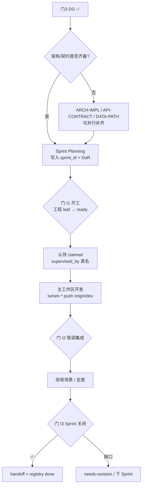

# 产品实现规程（DG 后 · Sprint 工程交付）

> **读者**：孔东 / 曹丽影（前端）、侯佳伟（后端）、唐绍祖（算法）、辜少彬 / 胡森泉（GDF）、徐滕强 / 李伟（架构）、高颖（体验对照）、郭万迎（合规/PM）、淮政玮（里程碑）、coordinator-agent  
> **作用**：在**产品定义三门（PDR / 会签 / DG）已通过**之后，规定模块进入正式工程实现阶段的拆单、认领、联调、验收与关闭流程；与双周 Scrum 容器对齐。  
> **维护**：PM（郭万迎）owner；架构（徐滕强 / 李伟）+ 前端 Lead（孔东）共创  
> **版本**：v1.0.5 · 2026-08-19（I1-11 粒度：L2=存储域；模块=验收父节点）  

> **上游规程**：[`产品定义评审规程.md`](产品定义评审规程.md)（门 1–3；Track-MS V2 ∥ 门 2；门 3 DG 解锁工程）  
> **关联**：
> - `scrum-sprint.yaml`（双周 Sprint 容器、WIP、DoR）
> - `task-claiming-guide.md`（认领 / 状态机 / `supervised_by`）
> - `长任务执行规约.md`（过夜连跑：总控一次授权、联调闸门、**段 E 已发布冒烟**；仍走本规程状态机）
> - `task-registry.yaml`（工程 leaf 队列；`delivery_phase: implementation`）
> - `feishu/feishu-bitable.yaml`（飞书「交付阶段」列；视图「实现看板」）
> - `team-collaboration-playbook.md`（团队公约）
> - `.cursor/rules/00-team-constitution.mdc` §4.2（**长期默认**：lumen-* `dev` 直推；不强制 feature / worktree）
> - `decisions/DECIDE-FE-V2-LUMEN-DIRECT-2026-07-12.md`（V2 直落 lumen；门 3 后无 demo→lumen 复刻）
> - `architecture-baseline.md` / `data-lineage-policy.md` / `Design.md` / UX-UE 交互规范 / [`diagram-as-contract.md`](diagram-as-contract.md)（图即契约；门 I1-11 / I2-11）
> - `sprints/ent-scrum-pdr-backlog.md`（企业维度 PDR→工程衔接样例）

---

## 0. 一句话

> **定义评审管「做什么、长什么样」；本规程管「怎么按 Sprint 做完、联调通、可验收关闭」。门 3 DG ✅ 之后才批量标工程 leaf `ready`；实现默认主工作区 + lumen `dev` 直推。**

### 0.1 名词（与图即契约 §0 同构）

本规程「模块」= **能开 DG 的验收父节点**（如 `E-31 企业发展`），不是 `E-32` 级 bid 叶子，也不是 registry 一张工程 leaf。图检查粒度：

| 本规程用语 | 对齐 | 图 |
|---|---|---|
| `{模块}` / `DG-{模块}` / 门 I1 纪要 | 产品包父节点 | L1 在定义包；**I1-11 的 L2 认存储域**（ENT/CHAIN/SVC），多模块共用一张流图 |
| bid 叶子 | TRACE `leaves` | **禁止**为每个叶子新建 `01-data-flow` |
| 工程 leaf | `task-registry` 一条 | **I2-11** 的 L4 可按本叶或模块联调单 |

真源：[`diagram-as-contract.md`](diagram-as-contract.md) §0。I2-07 的 L0–L4 = TRACE 权限档，不是图分层。

---

## 1. 背景与适用边界

### 1.1 要解决什么问题

| 矛盾 | 表现 | 本规程对策 |
|------|------|------------|
| 定义通过 ≠ 工程就绪 | DG 后无统一拆单与依赖模板 | 固定工程 leaf 链 + DoR / DoD |
| V2 与「正式开发」混淆 | 把准生产会签当成联调完成 | 明确：V2 属定义轨；本规程管 **API/联调/硬化** |
| Scrum 与 PDR 两套话术 | Planning 不知哪些可进 Sprint | 以 `scrum-sprint.yaml` + 本规程 §5 开工门为准 |
| 多仓并行易乱 | feature/worktree 默认强制，摩擦大 | 对齐公约：默认主仓 `dev`；冲突再隔离 |

### 1.2 适用与不适用

| 适用 | 不适用 |
|------|--------|
| 门 3 DG ✅（或 §9.2 政策豁免）后的 Track-MS / 专题工程交付 | 产品五件套、V1、联合修订冻结、门 1/2、V2 会签本身（仍走**定义评审规程**） |
| API 接线、前后端联调、权限/可观测硬化、数据工厂映射、算法工程对齐 | Track-L 大屏联通数智直交（本规程仅要求共享 API/metric 契约） |
| 已有 DG 模块内的增量工程（豁免范围内仍须门 2 增量核对） | 纯 DevOps / 编排 Epic（走 architect + ORCH 任务） |
| Sprint 内 committed / stretch 工程 leaf | 未过门 3 却把工程 leaf 标 `ready`（违规） |

### 1.3 阶段分界（硬边界）

```text
【定义阶段 · 产品定义评审规程】
  PACK → METRIC-OPEN ∥ UX → V1-R1 → 门1 → 联合修订冻结
       → V2 lumen 准生产 ∥ 门2 → 门3 DG
                │
                ▼  DG ✅
【实现阶段 · 本规程】
  架构/契约确认（若未并行完成）→ Sprint 拆单 → 认领执行
       → 联调集成 → Sprint 验收关闭 → handoff done
```

| 阶段 | 典型仓 | 是否本规程范围 |
|------|--------|----------------|
| V1 / 冻结 Demo | `demo-ui-topic`（参照） | ❌ 定义规程 |
| V2 准生产会签 | `lumen-ui-topic` `dev` | ❌ 定义规程（产出作实现基线） |
| **API 接线 / 联调 / 硬化** | `lumen-ui-topic` + `lumen-svc-platform` + algo / GDF | ✅ **本规程** |

---

## 2. 与产品定义评审规程的衔接

### 2.1 解锁条件（进入实现阶段）

须**同时**满足（Track-MS）：

1. `DG-{模块}-拍板纪要.md` 结论为 ✅ 批准或 ⚠️ 批准附条件（附条件须已满足或列入本 Sprint 明确 deadline）
2. `FE-LUMEN-V2-ALIGN-{模块}-会签单.md` ✅（V2 基线）
3. `PM-会签-{模块}-签字单.md` ✅（门 2）
4. TRACE / 冻结产品包路径已写入工程 leaf 的 `product_gates` / `visual_gates`（见定义规程 §9.1）

Track-L：V-L + 门 2-L + 门 3 ✅ 后，共享契约侧工程（Java/ADS/metric）可按本规程派单；大屏 UI 仍由王亚东直交。

### 2.2 实现阶段**不得**重开的定义决策

| 事项 | 处理 |
|------|------|
| IA / 主路径大改 | 退回定义规程：联合修订升版或重开受影响门 |
| 新增/删除 bid 叶子 | 须 PM change_log + 必要时门 3 |
| metric 口径变更 | 语义 Owner 会签；🟡→🟢 仍须甲方 |
| 突破架构铁律 | architect 否决或三签（定义规程 §8） |

实现阶段允许：字段接线、空态/异常态硬化、性能与权限修补、Mock→真实 API 切换、缺陷修复。

### 2.3 输入真源（实现对照）

| 输入 | 用途 |
|------|------|
| 联合修订冻结单 + 冻结 Demo URL | 体验/视觉对照（非复制 React 代码） |
| V2 会签单 + lumen commit SHA / URL | 页面骨架与组件真源 |
| TRACE + wireframe（含 metric_id） | 验收与血缘 |
| OpenAPI / ARCH-IMPL / data-gap-catalog | 接口与数据路径 |
| [`diagram-as-contract.md`](diagram-as-contract.md)（L2/L3/L4 图） | 人看图对齐：存储流图 / 模块实现架构 / 联调时序；图文冲突以图为准 |
| `metrics/metric-readiness-matrix-{模块}.yaml` | 指标四维就绪度对照（D9 v1.3 §2.3；FE 只读消费，禁止页面自填状态） |
| **附录 D（D9 角标防漏扫描）** | 前端页面 KPI/统计数字挂角标的强制扫描方法（专题/展示系统各模块通用） |
| DG 纪要开放项 / Q0xx | 🟡 角标与待确认项不得静默消失 |

### 2.4 门1 故事拆单草案 vs 本规程开工

| 时点 | 允许 | 禁止 |
|------|------|------|
| **门 1 PDR 完整闭合后** | 写入 `user-story-library.yaml`；生成 `story-impl-proposals.yaml`（实现 leaf **backlog 草案** + Theme） | 把草案标 `ready`、派开发认领开工、跳过门 3 |
| **门 3 DG ✅ + 门 I1** | 已入库 implementation leaf 经 confirm → `ready`；Sprint committed | 用未审 proposals 直接改飞书正式 Task |

命令：`node scripts/pdr-gate1-story-pipeline.mjs --module {模块}`；详规见定义规程 §5.3.1 与 `task-creation-guide.md` §16。

---

## 3. 实现阶段角色与责任

| 角色 | 真人 | 实现职责 | Agent 辅助 |
|------|------|----------|------------|
| **实现协调** | 郭万迎 + coordinator | Sprint 排期、拆单入 registry、看板同步、handoff 验收 | `coordinator-agent` |
| **架构把关** | 徐滕强 / 李伟 | 实现架构 / 调用链 / Convoy；铁律抽检 | `architect-agent` |
| **前端实现** | 孔东（Lead）、曹丽影（企业高筛等） | lumen 页面接线、状态硬化、内部评审模式 | `frontend-agent` |
| **后端实现** | 侯佳伟（Lead）+ Java 组 | Java REST 门面、鉴权、只读 ADS、转发 `/internal/*` | `api-agent` |
| **算法实现** | 唐绍祖 | Python `/internal/*`、指标/模型工程对齐 | `algorithm-agent` |
| **数据实现** | 辜少彬（GDF 产线）· 胡森泉（GDF Skill / 自动化） | 贴源、Mapping、调度、ADS 就绪；CDC 预填可复用 | `data-agent`（契约监管：徐滕强） |
| **体验对照** | 高颖 | 联调走查、与冻结 Demo 偏差登记 | `ux-agent`（按需） |
| **语义对照** | 王惠 / 唐绍祖（临时代行见定义规程 §1.4.1） | 指标卡与联调结果核对 | — |
| **QA** | （按 Sprint 指定） | 验收场景、回归、演示脚本 | `qa-agent` |

**铁律**：Agent 执行必须有 `supervised_by: human:{真名}`；业务口径不由实现方替甲方拍板。

---

## 4. 实现流程总览



| 阶段 | 名称 | 要点 |
|------|------|------|
| 前置 | 架构/契约 | 若 Sprint 内已并行完成 ARCH/API/DATA，可跳过补齐 |
| **门 I1** | 实现开工 | DoR + DG 证据齐 → `ready` → Planning 写入 `sprint_id` |
| 执行 | 认领与开发 | 默认 `${GKX_ROOT}/repos/{repo}`；lumen-* **`dev` 直推**；冲突时再 worktree |
| **门 I2** | 联调集成 | 前端→Java→Python 调用链通；Mock/真实切换可演示 |
| **门 I3** | Sprint 验收关闭 | DoD + handoff 7 项；coordinator 签收 → `done` |

嵌入双周 Scrum 的仪式见 §10（源自 `scrum-sprint.yaml` + `task-claiming-guide.md`）。

---

## 5. 门 I1：实现开工门（Sprint Ready）

### 5.1 参会与输入

| 项 | 内容 |
|----|------|
| **时机** | 双周 **Sprint Planning**（周一，约 90min）或 DG 后特开「实现开工」15min |
| **必到** | 郭万迎（主持）、本 Sprint 相关 Lead（孔东 / 侯佳伟 / 唐绍祖 / 辜少彬 按需）、架构 ≥1 |
| **输入** | DG 纪要、V2/门 2 证据链接、拟拆工程 leaf 草案、`scrum-sprint.yaml` 当前 Sprint |
| **产出** | 工程 leaf 写入 `task-registry`；`sprint_id`；Convoy 分组；WIP 确认 |

### 5.2 过关标准（I1-01～I1-11）

| # | 检查项 | 责任人 | ☐ |
|---|--------|--------|---|
| I1-01 | 门 3 DG ✅（或定义规程 §9.2 豁免已书面登记） | 郭万迎 | |
| I1-02 | V2 + 门 2 证据路径已挂到工程 Epic/leaf | coordinator | |
| I1-03 | 每个工程 leaf 有清晰 DoD（可测试） | 对应 Lead | |
| I1-04 | `depends_on` 无环；Convoy 串行已标注 | 架构 + coordinator | |
| I1-05 | `agent` + 建议 `supervised_by` 真名已指定 | 郭万迎 | |
| I1-06 | `estimated_tokens` / `effort_points` / `difficulty` 已估 | coordinator | |
| I1-07 | OpenAPI 或接口清单齐备，或本 Sprint 内有契约 leaf | 侯佳伟 | |
| I1-08 | 数据路径：ADS/Mock/贴源状态明确（FULL/INTEG/DEMO）；有 readiness-matrix 的模块对照其 D3 源映射 / D4 接入列（D9 v1.3 §2.3） | 辜少彬 / 徐滕强 | |
| I1-09 | 无静默扩 scope（±10%）；新叶子须 PM 登记 | 郭万迎 | |
| I1-10 | 已写入 `scrum-sprint.yaml` committed 或 stretch | Sprint Owner | |
| I1-11 | **图即契约 L2/L3**：本**模块**（验收父节点）落到的 **存储域** 流图已架构师会签（`storage/{ENT\|CHAIN\|SVC}/01-data-flow.md`；企业发展认 `ENT-STORAGE-FLOW`，不另画 E-31/E-32 流图）。本 Sprint 若含 ARCH-IMPL，则 L3 按**模块/要素域**落盘，不对齐 bid 叶子。缺域级流图 → 本 Sprint 必须有**域级**补图 leaf，否则相关工程 leaf **不得** `ready`。纯文案/纯角标/不碰拓扑的 leaf 可 **N/A**（须写理由）。L1 在定义包/IA，不在本项。真源 [`diagram-as-contract.md`](diagram-as-contract.md) §0 | 徐滕强 / 李伟 | |

> **I1-11 与 I1-08**：I1-08 查数据是否就绪（ADS/Mock/贴源）；I1-11 查人是否对着该模块所属 **域** 的已签流图开工（不是对着叶子各画一张）。两行都过才算数据侧开工齐。

### 5.3 结论

| 结论 | 动作 |
|------|------|
| ✅ 开工 | 工程 leaf → `ready`；允许认领 |
| ⚠️ 有条件开工 | 条件列入 Sprint 笔记 + deadline；未满足前相关 leaf 保持 `backlog` |
| ❌ 不开工 | 退回补契约/补 DG 条件；**禁止**先开发后补单 |

---

## 6. 门 I2：联调集成门

### 6.1 何时召开

- 模块主路径「前端 → Java →（Python）→ 数据」首次打通时；或
- Sprint Review 前必须完成的联调检查点；或
- 跨仓 Convoy 全部 `review` 前由 Lead 召集快检（15–30min）

### 6.2 过关标准（I2-01～I2-11）

| # | 检查项 | 责任人 | ☐ |
|---|--------|--------|---|
| I2-01 | 调用链符合铁律：前端只调 Java；算法只在 Python `/internal/*`；**D12** lumen 前端调用链不打 demo 服务 | 架构抽检 | |
| I2-02 | 主路径 walkthrough 可在 lumen **dev** URL 逐步演示 | 孔东 + 高颖 | |
| I2-03 | 异常/空/加载态按 UX 规范可见 | 孔东 | |
| I2-04 | 有统计数字：MetricSpecCard / ⓘ + metric_id；Mock 有 🧪；就绪度角标齐（D2 缺陷有 SchemaGapBadge、D4 接入中有 IngestingBadge，按 D9 v1.3 §2.3.3）；**须附附录 D 防漏扫描证据**（P0/P1 零遗漏，或白名单+原因） | 唐绍祖 + 前端 | |
| I2-05 | 🟡 待甲方项 UI 角标仍在，未假装已确认 | 郭万迎 | |
| I2-06 | 内部评审模式可开关，关闭后无评审层泄漏 | 孔东 | |
| I2-07 | 鉴权/数据权限与 TRACE 角色一致（L0–L4 适用处） | 侯佳伟 + 架构 | |
| I2-08 | 可观测性埋点未删（前端 observability / Java Agent / Python instrument） | 对应 Lead | |
| I2-09 | CI 绿或已登记 waiver（附理由） | 对应 Lead | |
| I2-10 | 与冻结 Demo / V2 基线的**有意偏差**已书面列出 | 高颖 + 孔东 | |
| I2-11 | **图即契约 L4**：本**工程 leaf**（或本模块联调单，模块=验收父节点）有 `sequenceDiagram`（`{TASK}-SEQ` 或模块联调图），边与 I2-01 调用链一致，且能对上 walkthrough 与一条 dev `traceId`。同主路径多叶可共用一张，**不要**按存储域或按 bid 叶子各画一张时序。无跨层调用的纯文档 / 纯 chart leaf 可 **N/A**（须写理由）。缺图或缺 trace 对照 → 不得标联调通过。真源 [`diagram-as-contract.md`](diagram-as-contract.md) §0 | 孔东 + 侯佳伟；架构抽检 | |

> **I2-11 与 I2-01 / I2-02**：I2-01 查铁律有没有破；I2-02 查人能不能点出来；I2-11 查是否有一张与 trace 同构的时序图。三行分开勾。I2-07 的 L0–L4 是 **TRACE 权限档**，不是图分层。

长任务 **段 E**（`长任务执行规约.md` §11）是 I2-02 的无人值守缩小版：只跑总控金路径、只认 K8s 已发布前端；**期望未发生必红**；红了先失败分类，由 coordinator 派修（分诊助手无提交权）。C1 后点名 CI deploy 绿即 E0、自动复测（Python api+worker；Java topic-chain + async-service，§11.5.2）。E 冒烟通过 **不替代** 本表孔东+高颖走查，也不等于 I3。

### 6.3 结论

| 结论 | 动作 |
|------|------|
| ✅ 联调通过 | 可进门 I3 / Sprint Review 演示 |
| ⚠️ 保留通过 | 软项列入下 Sprint；不得阻塞已批准演示范围外的关闭 |
| ❌ 不通过 | 相关 leaf → `needs-revision` 或 `blocked`；不得标 `done` |

---

## 7. 门 I3：Sprint 验收关闭门

### 7.1 参会与输入

| 项 | 内容 |
|----|------|
| **时机** | Sprint Review（双周，与客户演示节奏对齐时见 `scrum-sprint.yaml`） |
| **必到** | Sprint Owner、郭万迎、相关 Lead；重大模块可邀高颖 / 架构 |
| **输入** | 各 leaf handoff、I2 结论、演示 URL、开放项更新 |
| **产出** | leaf → `done` 或明确结转；Sprint burndown / Retro 输入 |

### 7.2 DoD（工程 leaf 通用 + coordinator 7 项）

每个工程 leaf handoff **至少**含：

1. 范围与实现（对照 TRACE / USM 验收场景）
2. 偏离说明（相对冻结 Demo / V2；有则 as-built）
3. 产物：commit SHA、MR/直推记录、CI 链接、dev URL
4. 验收证据：主路径截图或录屏；I2 清单勾选
5. 架构合规自检（公约 §2 逐条 ✅/❌）
6. 后续阻塞 / 下 Sprint 建议
7. **cost 四字段**回填（`budget-estimate.md`）
8. **含统计数字的前端 leaf**：附录 D 防漏扫描结果（P0/P1 清单勾选或契约测试通过记录；例外须白名单+原因）
9. **跨层联调 leaf**：I2-11 的 `diagram_id` + 时序图路径 + `traceId`（或书面 N/A 理由）

任一缺失 → `needs-revision`，不得 `done`。

### 7.3 结论

| 结论 | 动作 |
|------|------|
| ✅ 关闭 | coordinator 更新 `done`；看板同步 |
| ⚠️ 部分关闭 | 完成项 `done`；缺口新开 leaf 或 stretch 结转 |
| ❌ 未交付 | 根因进 Retro；评估是否拆分或升级阻塞 |

---

## 8. 工程拆单模板（门 3 后）

> 命名建议：`{MODULE}-IMPL-*` 或沿用既有 `ENT-JAVA-*` / `*-API-*` 等；关键是依赖指向 DG / V2 / 契约。

### 8.1 推荐依赖链（Track-MS）

```text
{MODULE}-DG-G3 ✅
    ├─► {MODULE}-ARCH-IMPL（若未在定义期并行完成）
    ├─► {MODULE}-API-CONTRACT / Java 门面 leafs
    ├─► {MODULE}-DATA-PATH / Mapping leafs（按需）
    ├─► {MODULE}-ALGO-ALIGN（按需）
    ├─► {MODULE}-FE-WIRE（API 接线 / 状态硬化）
    ├─► {MODULE}-FE-PERM / OBS（权限与可观测硬化，可与 WIRE 合并）
    └─► {MODULE}-QA-ACCEPT（验收场景回归）
```

| leaf 类型 | 仓（默认） | 分支策略 | Agent |
|-----------|------------|----------|-------|
| Java 门面 | `lumen-svc-platform` / `demo-svc-platform`（按 registry） | **`dev` 直推** | `api-agent` |
| 前端接线 | `lumen-ui-topic`（专题）/ `lumen-ui-science-pc`（展示） | **`dev` 直推** | `frontend-agent` |
| 算法 | `demo-algo-*` 或正式 algo 仓 | **`dev` 直推** | `algorithm-agent` |
| 数据 | GDF / 编排脚本 + ADS 说明 | 按任务 | `data-agent` |
| QA | 报告落 `agent-handoffs/` | — | `qa-agent` |

### 8.2 Convoy（防冲突）

- 同仓同目录密集改动 → **串行**（`per_convoy_serial: 1`）
- 默认**不**为每个 leaf 建 worktree；仅同仓多 agent 并行或监管人要求时启用（公约 §3.4 / §4.2）
- 派单可选字段 `worktree_branch`；无冲突勿填

### 8.3 明确取消的步骤

| 取消 | 理由 |
|------|------|
| demo → lumen **复刻**派单 | `DECIDE-FE-V2-LUMEN-DIRECT` |
| 默认强制 feature 分支 + PR（lumen-*） | 公约长期默认 `dev` 直推 |
| 未 DG 先标工程 `ready` | 定义规程 §7 / §11 |

---

## 9. Git / 仓策略（实现期摘要）

真源：`.cursor/rules/00-team-constitution.mdc` §4.2。

| 仓 | 默认动作 |
|----|----------|
| **全部 lumen-*** | 主工作区作业；push **`origin/dev`**；禁 `main` |
| **全部 demo-*** | 主工作区作业；push **`origin/dev`**；禁 `main` |
| 冲突例外 | 监管人指定临时 feature / worktree |

通用：commit 含 `[agent:role]` / `[human:名]`；禁 force push；push reject → rebase 再推。

---

## 10. 与 Scrum / 看板衔接

机器真源：`scrum-sprint.yaml`；认领真源：`task-claiming-guide.md`。

### 10.1 仪式（实现期焦点）

| 仪式 | 实现期动作 |
|------|------------|
| **Planning** | 投影门 I1 清单；只把 DG ✅ 模块的工程 leaf 写入 committed；填 `sprint_id`；工程 leaf 标 `delivery_phase: implementation`（飞书「实现看板」） |
| **Daily** | 三问：昨日完成 / 今日认领 / 阻塞（契约·数据·权限·CI）；跑 `sync-task-ready-status` + 看板同步 |
| **Review** | 按门 I2/I3 演示 lumen `dev`；对照冻结 Demo 差异表 |
| **Retro** | 联调返工、拆单过粗/过细、看板漂移；改进写回本规程或 rules |

### 10.2 WIP

- 每人监管 Agent ≤ **4**
- 同 Convoy 同时 `in_progress` ≤ **1**
- `review` 队列 > 8 → coordinator 告警

### 10.3 状态机（实现 leaf）

```text
backlog →（I1 ✅）ready → claimed → in_progress → review →（I3 ✅）done
                 ↘ blocked / needs-revision
```

状态变更优先走 `scripts/update-task-status.ps1`（或 `.sh`），避免只改 YAML 不同步飞书。

### 10.4 Sprint 笔记建议字段

在 `scrum-sprint.yaml` 的 `notes` 或 `sprints/{sprint}.md` 中记录：

- 本 Sprint 覆盖模块与 DG 链接
- Convoy 列表
- 联调环境 URL
- 结转项与原因

企业维度历史样例：`sprints/ent-scrum-pdr-backlog.md`（PDR→V2→**ready→API/联调**）。

---

## 11. 节奏建议（双周，接定义规程 §10）

| 时点 | 活动 | 产出 |
|------|------|------|
| Sprint N 门 3 当日/次日 | 门 I1 拆单 | 工程 leaf `ready` + `sprint_id` |
| Sprint N+1 第 1 周 | API / 数据 / 算法并行（Convoy 内串行） | 契约与后端可调 |
| Sprint N+1 第 1 周末 | 前端接线启动 | lumen 主路径可点 |
| Sprint N+1 第 2 周初 | **门 I2 联调** | 演示脚本 |
| Sprint N+1 Review | **门 I3 关闭** | handoff `done` |
| 持续 | Q0xx / 🟡 角标维护 | 客户决策清单 |

定义期节奏仍以**产品定义评审规程 §10**为准；本表仅覆盖 **DG 之后**。

---

## 12. 反模式（实现期直接否决）

| 反模式 | 危害 | 对策 |
|--------|------|------|
| 未过门 3 标工程 `ready` | 基线未批就返工 | I1-01 硬挡 |
| 无已签 L2 流图（又无补图 leaf）就标工程 `ready` | 各人脑内拓扑不同仍开工 | **I1-11** |
| 按 bid 叶子 / DS 单页各画一张 ODS→ADS | 与 ENT/CHAIN/SVC 域级真源分叉 | **I1-11** + [`diagram-as-contract.md`](diagram-as-contract.md) §0 |
| 联调无 L4 时序图 / 对不上 `traceId` | 人看走查、AI 看日志对不齐 | **I2-11** |
| 把 V2 会签当成联调完成 | 无真实 API/权限硬化 | 强制 I2 |
| 再走 demo→lumen 复刻 | 双栈浪费 | DECIDE 取消复刻 |
| 前端直调 Python / Java 写算法 | 破架构铁律 | I2-01 + architect |
| 去掉 MockBadge / 待确认角标充正式数 | 验收造假 | I2-04/05 |
| 页面有 KPI/统计数字但未挂 ⓘ／红问号（含本地 `KpiCard`/`ScoreSummary`/`Metric` 未接线） | 评审无法追溯口径与就绪度；模块间覆盖不均 | **附录 D** + I2-04 |
| 矩阵已有条目、FE readiness 镜像遗漏 / metricId 错挂 | 红问号该出不出或挂错指标 | 附录 D §D.3 / §D.4 |
| 无 `supervised_by` 开干 | 无人监管 | 认领门禁 |
| 默认同仓多 agent 互踩 | 冲突失控 | Convoy 或临时 worktree |
| Sprint 内 silent 加活 | 目标漂移 | 须 PM 写入 backlog/swap |
| handoff 无 cost / 无 URL | 无法签收 | I3 DoD |

---

## 13. 附录 A — 实现开工纪要模板

```markdown
# IMPL-I1-{模块}-开工纪要

> **模块**：{MODULE}
> **日期**：YYYY-MM-DD
> **Sprint**：{sprint_id}
> **主持**：郭万迎
> **参会**：…
> **结论**：✅ 开工 / ⚠️ 有条件 / ❌ 不开工

## 1. 上游证据
| 项 | 链接 |
|----|------|
| DG | |
| V2 会签 | |
| 门 2 签字 | |
| TRACE / 冻结单 | |

## 2. I1 清单
| # | 结果 | 备注 |
|---|------|------|
| I1-01…I1-11 | ✅/⚠️/❌ / N/A | I1-11 填 diagram_id 或 N/A 理由 |

## 3. 本 Sprint 工程 leaf
| task-id | 仓 | Convoy | supervised_by 建议 |
|---------|-----|--------|-------------------|
| | | | |

## 4. 条件与 deadline（若有）
```

---

## 14. 附录 B — 联调检查单模板

```markdown
# IMPL-I2-{模块}-联调单

> **模块**：{MODULE}
> **日期**：YYYY-MM-DD
> **环境 URL**：
> **结论**：✅ / ⚠️ / ❌

## I2 清单
| # | 结果 | 证据 |
|---|------|------|
| I2-01…I2-11 | | I2-11：diagram_id=`{TASK}-SEQ`；traceId=；或 N/A 理由 |
| I2-04 | | 附录 D 扫描：P0 __ / P1 __ ；契约测试/白名单链接 |

## D9 角标防漏（附录 D 摘要）
| 步 | 结果 | 备注 |
|----|------|------|
| D.1 页面清单 | | |
| D.2 本地 KPI 组件 | | |
| D.3 镜像 vs 矩阵 | | |
| D.4 错挂/别名 | | |
| D.5 契约防漏 | | |

## 与冻结 Demo / V2 偏差表
| 项 | 有意/缺陷 | 处理 |
|----|-----------|------|
```

---

## 15. 附录 C — 工程 handoff 最小骨架

```markdown
# {task-id}-handoff

> **supervised_by**：human:{真名}
> **仓 / 分支**：lumen-* / dev（或注明例外）
> **commit**：{sha}
> **dev URL**：
> **上游**：DG / V2 / I2 链接

## 范围与实现
## 偏离说明
## 验收证据
## 架构合规自检
## 图即契约（跨层联调必填）
- diagram_id / 图路径 / traceId；或 N/A 理由
## D9 角标防漏（前端 leaf 必填）
- 附录 D 扫描摘要 / 契约测试结果 / 白名单例外
## 开放项
## cost
- actual_tokens / model_used / actual_cost / cost_warn
```

---

## 16. 附录 D — D9 角标防漏扫描规程（前端强制）

> **目的**：避免「重点企业概览类」整页统计数字未挂 ⓘ／红问号的遗漏，在**专题服务**（`demo-ui-topic` / `lumen-ui-topic`）与**展示系统**（`demo-ui-science` / `lumen-ui-science-pc` / `lumen-ui-science-mobile`）各模块前端交付时统一执行。  
> **模型真源**：`data-lineage-policy.md` §2.3（本附录只规定**扫描与补挂方法**，不重定义四维枚举）。  
> **适用任务**：凡触及统计数字 / KPI / 图表旁指标的前端 leaf；I2-04 与前端 DoD 强制引用本附录。  
> **样板经验**：`ENT-MOD-ENT-READINESS-UI-L02`（企业维度全域补挂，含 KEYPANO / STAR / 评估结果 / 深圳现状等）。

### D.0 何谓「必须挂角标」的统计点位

| 必须挂 | 可不挂（须在 handoff 说明） |
|--------|---------------------------|
| KPI 卡、ScoreSummary、本地 `Metric`/`KpiCard` 展示的业务统计值 | 纯交互计数（对比篮「已选 N」、分页「共 N 条」） |
| 表格列头承载的指标值（平均技术力、密度、完整度等） | 纯导航/筛选控件旁的辅助数字且无 metric_id |
| 章节标题旁的「共 N 家 / 覆盖 N 个」等业务汇总 | 明显临时占位且标注「非指标」的 UI 文案 |
| 图表系列对应的正式指标（标题或图例旁至少一处 ⓘ） | 装饰性百分比动画且不参与口径验收 |

挂接组件（按仓栈选用，语义一致）：

| 场景 | 推荐 |
|------|------|
| 标准 KPI 卡 | `MetricCard`（内含 ⓘ + 结构/⚠️/🧪/⟳） |
| 已有本地卡片/标签数字 | 数字旁嵌 `ReviewMetricBadges` 或 `MetricSpecCard` |
| 仅标题已有 ⓘ、数字本体未挂 | **数字旁补一套**（避免「标题有、值旁无」） |
| D1 missing / 未入指标库 | 红问号入口（`IconQuestionCircle`）；有 readiness 镜像时弹层仍可展示四维区块 |

### D.1 步骤一：页面覆盖清单（有无角标组件）

在模块页面根目录（如 `pages/enterprise/**`、`pages/development/**`，展示系统对应业务目录）执行：

1. **列出已 import** `MetricCard` / `MetricSpecCard` / `ReviewMetricBadges`（或 lumen 等价组件）的页面文件。  
2. **列出未 import 任一角标组件**的页面文件 → 进入可疑集。  
3. 对可疑集人工过一眼：若存在业务统计数字 → **P0**（整页或主 KPI 区零角标）。

> 工具示例（demo-ui-topic，可按仓改路径）：  
> `rg -l "ReviewMetricBadges|MetricSpecCard|MetricCard" src/app/pages/<模块>`  
> 再对同目录全部 `*.tsx`/`*.vue` 做差集。

### D.2 步骤二：本地 KPI 组件未接线（有壳无 metricId）

重点搜页面内私有包装组件（名称不限）：`KpiCard` / `ScoreSummary` / `Metric` / `KeyMetric` / `Stat` / `Indicator` 等。

| 检查 | 不合格表现 | 整改 |
|------|------------|------|
| props 是否含 `metricId` | 只有 `label/value` | 扩展 `metricId?`，旁挂 `ReviewMetricBadges` |
| 调用点是否传 ID | 组件支持了但调用未传 | 按 TRACE / readiness-matrix 补 ID |
| 标题 ⓘ vs 数字旁 | 仅 Section 标题有 `MetricSpecCard`，KPI 格无 | 数字旁补挂（可只保留数字旁一套以免重复） |

→ 命中主 KPI 且未接线 = **P0**；次要数字 = **P1**。

### D.3 步骤三：readiness 镜像 vs 矩阵真源

1. 打开 `agent-delivery/metrics/metric-readiness-matrix-{模块}.yaml`（或 ENT 全域矩阵中本模块段）。  
2. 对照 FE 只读镜像（demo：`readinessSeed.ts`；lumen：集中镜像模块或 `/metrics/v1/catalog`）。  
3. **矩阵有、镜像无** → 先补镜像，再挂页面（禁止页面手写状态）。  
4. **页面引用了 metric_id、镜像/矩阵皆无** → 登记补矩阵任务（data/口径侧）或临时 D1 missing + 治理引用；**禁止静默省略角标**。

### D.4 步骤四：错挂 / 历史 ID / 别名

1. 扫描页面 `metricId=` / `metric-id` / `metric_id` 字面量。  
2. 与矩阵正名比对：错挂（如「重点企业数」挂成「企业总数」）→ **P1 必修**。  
3. 历史同义 ID：优先**按正式 ID 正名更新页面**；过渡期可用别名表，但须有契约测试防回退（参见企业维度正名收口）。  
4. 维度/代理指标（无独立 metric_id）：须显式 `metricRelation` 说明，避免「标题与 ⓘ 卡片对不上」。

### D.5 步骤五：契约防漏（推荐固化到 CI）

每个前端仓应对本维度建立（或扩展）契约测试，至少包含：

1. readiness 镜像条目数 / 枚举与矩阵弱一致；  
2. **递归扫描**模块页面目录中全部 `metricId` 引用，须 `getMetricReadiness`（可选别名）命中；例外走白名单并写原因；  
3. 组件契约：角标自带评审门控；禁 emoji 表状态；D2 仅 `partial/missing` 挂结构缺陷角标等（对齐 policy §2.3.3）。

参考实现：`demo-ui-topic/tests/enterprise-eval-readiness.test.mjs`（含 KEYPANO/STAR/OVERVIEW 段与页面扫描）。

### D.6 优先级与施工顺序

| 优先级 | 定义 | 门禁 |
|--------|------|------|
| **P0** | 主路径整页或主 KPI 区零角标；本地 KPI 组件未接线 | **I2-04 不过** |
| **P1** | 部分 KPI 漏挂；metricId 错挂；矩阵有/镜像无 | I2 前清完或书面结转+deadline |
| **P2** | 行内 Tag「N 家」、tooltip、次要摘要 | 可下 Sprint；handoff 登记 |

推荐顺序：P0 页面补挂 → 镜像缺口 → 错挂修正 → P1 → 契约防漏固化 → P2。

### D.7 模块切换检查表（专题 / 展示系统复用）

新模块或展示系统页交付前，前端 Lead / frontend-agent 自检：

- [ ] D.1 页面差集已出，P0 为零  
- [ ] D.2 无「有壳无 metricId」的主 KPI  
- [ ] D.3 本模块矩阵段与 FE 镜像对齐  
- [ ] D.4 无错挂；历史 ID 已正名或别名可测  
- [ ] D.5 契约测试绿（或本 Sprint 内有加测 leaf）  
- [ ] 评审模式关闭后零泄漏（I2-06）  
- [ ] handoff 附扫描摘要（附录 C 字段）

### D.8 反例（已踩坑，禁止重犯）

| 反例 | 根因 | 正确做法 |
|------|------|----------|
| 重点企业概览整页无 ⓘ | 页面未挂角标 + KEYPANO 镜像遗漏 | D.1+D.3 双检 |
| 评估结果大号得分无 ⓘ | 本地 `ScoreSummary` 无 metricId | D.2 |
| 深圳介绍「重点企业数」挂 `TOTAL_COUNT` | 错挂宽口径 ID | D.4 |
| 未登记指标无红问号 | 回落组件渲染中性 ⓘ | D1 missing 必须红问号（policy §2.3.3） |
| 只扫 `pages/enterprise` 漏掉 `pages/development` | 扫描根目录不全 | 按路由真实挂载目录全扫 |

---

## 17. 版本记录

| 版本 | 日期 | 说明 |
|------|------|------|
| v1.0 | 2026-07-21 | 首版：对齐产品定义评审规程；嵌入 scrum-sprint；Git 长期默认 `dev` 直推 + 非强制 worktree |
| v1.0.1 | 2026-08-01 | 引用 D9 v1.3 四维就绪度：§2.3 输入真源加 readiness-matrix 行；I1-08 / I2-04 补就绪度对照（模型本体见 `data-lineage-policy.md` §2.3，本规程不重复定义） |
| v1.0.2 | 2026-08-01 | **附录 D：D9 角标防漏扫描规程**（步骤 D.1–D.8）；I2-04 / DoD / 反模式 / 联调单模板强制引用；适用于专题与展示系统各模块前端 |
| v1.0.3 | 2026-08-19 | 图即契约对照：§2.3 输入真源；曾挂在 I1-08 / I2-01（已拆出） |
| v1.0.4 | 2026-08-19 | **硬闸**：I1-11（L2/L3 流图/实现图）；I2-11（L4 时序 + trace）。I1-08 / I2-01 恢复原语义。附录 A/B/C、§7.2、§12 同步 |
| v1.0.5 | 2026-08-19 | **粒度**：§0.1 名词；I1-11 L2=存储域共用；禁止按叶子补流图；I2-11 按工程 leaf / 模块联调单 |
