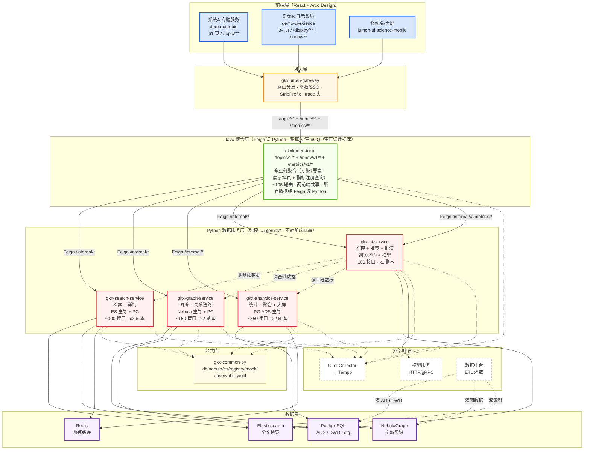
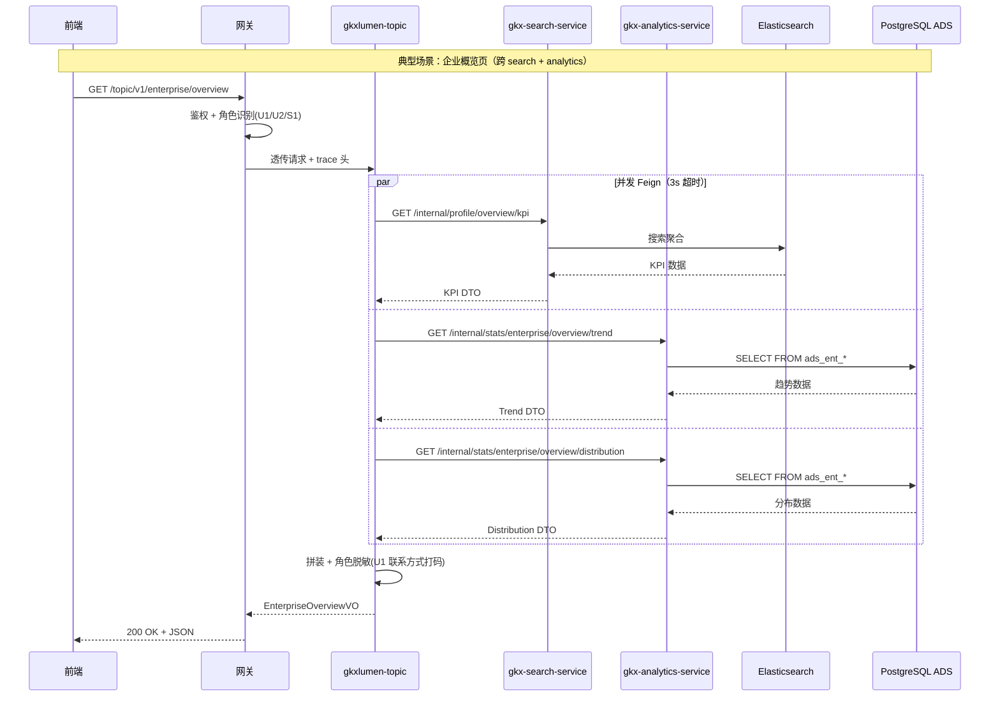
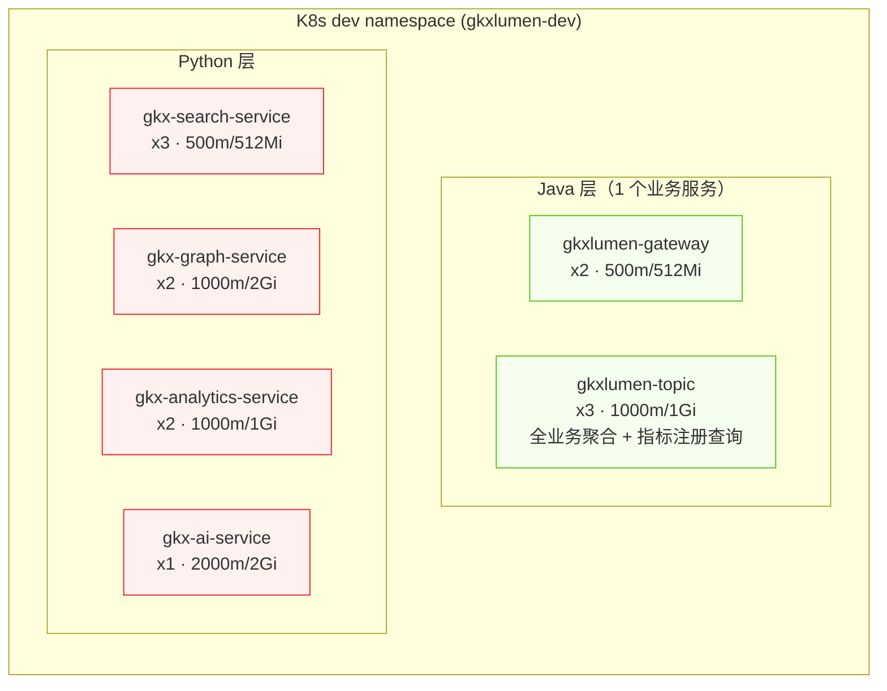

# 数据侧 Python 微服务架构预设计（全业务域）

> 版本：v1.3-draft | 日期：2026-07-01 | 作者：[human:xutengqiang]
> 范围：两个业务系统全部业务域的底层数据支撑服务（Python，纯读）+ Java 聚合层设计（1 业务服务）
> 输入原型：
>
> - 系统A 科技专题服务系统：[https://skxdemo.unicomcn.tech:30999/enterprise/overview](https://skxdemo.unicomcn.tech:30999/enterprise/overview)
> - 系统B 科技发展态势（展示系统）：[https://skxrules.unicomcn.tech:30999/](https://skxrules.unicomcn.tech:30999/)
> 变更：v0.x 按"企业域"单业务域设计；v1.0 扩展为全业务域，划分逻辑从"按业务域"改为"按数据源特性+查询模式（能力）"；v1.1 新增 Java 聚合层设计 + mermaid 架构图；v1.2 Java 侧精简为 2 个业务服务；v1.3 Java 侧进一步精简为 1 个业务服务（topic 全包），所有数据含指标元数据均经 Python，Java 不直读任何数据库表

---

## 0. 范围与边界

### 0.1 我负责什么

**两个业务系统的全部底层数据支撑服务**：从 ES / Nebula / PG(ADS) 读取数据，加工成接口响应，供 Java 聚合层 Feign 调用。

覆盖的业务域：

- 企业（检索/画像/分析/引育）
- 产业链（全景/环节/瓶颈/检索）
- 技术链（图谱/热点/转化/阶段）
- 政策（检索/分析/对比/推演）
- 人才（分布/评价/关系链/引育）
- 科研机构（概况/合作/引育）
- 科技成果（软科学/创新生态/时空演进/仪器/载体）
- 科技服务（生态服务/智库/交流/竞赛/传播）
- 全域态势（大屏/创新监测/评估/指数/规划）
- 数据资源（视窗/知识图谱展示）

### 0.2 我不负责什么


| 不负责                         | 归属              |
| --------------------------- | --------------- |
| ODS→DWD→ADS 灌数 / ETL / 数据工厂 | 数据中台 / 离线任务     |
| `/v1/`** 对前端直接暴露            | Java 聚合层        |
| 用户业务（收藏/关注/导出/浏览日志/订阅）      | Java 应用层        |
| GDF 任务调度（`/gdf/*`）          | 数据中台调度系统        |
| 算法研发（NLP/图谱抽取/模型训练）         | algorithm-agent |
| 图谱构建/灌数/增量增删                | 数据中台            |


### 0.3 调用链定位

```
前端 → 网关 → Java 聚合层(只读ADS + Feign) → 【Python 数据服务 /internal/*】→ ES/Nebula/PG
                    ↑                                    ↑
                 对前端契约                          我负责的范围
```

---

## 1. 划分逻辑：为什么按"能力"而不是按"业务域"

### 1.1 平台性质判断

这两个系统本质是**数据分析展示平台**，不是业务交易系统：

- 没有 CRUD 写操作（数据都是 ETL 灌好的 ADS）
- 没有跨域事务（都是只读查询）
- 没有业务流程编排（页面之间是独立的分析视图）
- 核心动作是：从不同数据源（ES/Nebula/PG）按不同方式（检索/遍历/聚合）取数据

### 1.2 两种划分方式对比


| 维度     | 按业务域分                   | 按能力（数据源+查询模式）分       |
| ------ | ----------------------- | -------------------- |
| 边界依据   | 业务归属                    | 技术栈 + 资源特征           |
| 跨服务调用  | 企业详情页要调 5+ 个域服务         | 详情在 search 内闭环       |
| 技术栈统一性 | 一个服务内混 ES+Nebula+PG     | 一个服务一个主导数据源          |
| 资源争抢   | ES 检索和 Nebula 遍历混在一个进程  | 隔离                   |
| 扩缩容    | 按业务域扩缩，粒度粗              | 按能力扩缩，精确             |
| 代码复用   | 企业检索(ES)和政策检索(ES)散在两个服务 | 同一服务内复用 ES 客户端/分页/过滤 |


### 1.3 结论

在"纯读型分析平台"里，**数据源特性 + 查询模式才是天然的服务边界**。

- ES 检索（企业/政策/成果/人才/机构…）→ 同一套 ES 客户端、分页过滤逻辑、索引设计模式 → 一个服务
- Nebula 图遍历（企业关系/产业链/技术链/知识图谱…）→ 同一套 nGQL 客户端、图算法库 → 一个服务
- PG ADS 聚合（统计/排名/分布/大屏…）→ 同一套 SQL 聚合模式 → 一个服务
- 模型推理（推荐/推演/智能分析）→ 资源特征完全不同（GPU/长耗时）→ 独立服务

---

## 2. 架构总览

```
┌──────────────────────────────────────────────────────────────────┐
│                         前端 (React)                              │
│  系统A demo-ui-topic (专题服务) / 系统B demo-ui-science (展示)    │
│  95+ 页面，1000+ 接口                                             │
└──────────────────────────┬───────────────────────────────────────┘
                           │ 只调网关
                           ▼
┌──────────────────────────────────────────────────────────────────┐
│              网关 (gkxlumen-gateway)                              │
└──────────────────────────┬───────────────────────────────────────┘
                           │
                           ▼
┌──────────────────────────────────────────────────────────────────┐
│            Java 聚合层 (gkxlumen-topic)                           │
│            Feign 调 Python /internal/*                            │
│            禁算法 / 禁 nGQL / 禁直读数据库                          │
└───┬───────────────┬──────────────────┬──────────────┬────────────┘
    │ Feign         │ Feign            │ Feign        │ Feign
    ▼               ▼                  ▼              ▼
┌────────────────┐ ┌────────────────┐ ┌────────────┐ ┌──────────┐
│ gkx-search-    │ │ gkx-graph-     │ │ gkx-       │ │ gkx-ai-  │
│ service        │ │ service        │ │ analytics- │ │ service  │
│                │ │                │ │ service    │ │          │
│ 检索+详情      │ │ 图谱/关系/链路  │ │ 统计/聚合  │ │ 推理/推荐│
│ ES主导+PG补充  │ │ Nebula主导+PG  │ │ PG ADS主导 │ │ 模型+编排│
│                │ │                │ │            │ │          │
│ ~300接口       │ │ ~150接口       │ │ ~350接口   │ │ ~100接口 │
│ x3副本         │ │ x2副本         │ │ x2副本     │ │ x1副本   │
└───┬────────────┘ └───┬────────────┘ └───┬────────┘ └───┬──────┘
    │                  │                  │              │
    └──────────────────┼──────────────────┘              │
                       │ 共享引用                         │ 调用①②③
                       ▼                                  │
          ┌──────────────────────────┐                    │
          │  gkx-common-py（公共库）  │◄───────────────────┘
          │  db / nebula / es /      │
          │  registry / mock /       │
          │  observability / util     │
          └──────────────────────────┘
                       │
        ┌──────────────┼──────────────┐
        ▼              ▼              ▼
   ┌─────────┐  ┌───────────┐  ┌──────────┐
   │ PG/MySQL │  │NebulaGraph│  │   ES     │
   │ ADS/DWD  │  │ 全域图谱  │  │ 全文搜索 │
   └─────────┘  └───────────┘  └──────────┘
```

---

## 3. 服务拆分总览


| #   | 服务名                       | 划分依据（能力）                   | 主导数据源       | 接口数      | 部署副本    |
| --- | ------------------------- | -------------------------- | ----------- | -------- | ------- |
| 1   | **gkx-search-service**    | 检索 + 详情（按条件找实体 / 按ID取实体画像） | ES + PG     | ~300     | x3      |
| 2   | **gkx-graph-service**     | 图谱遍历 + 关系/链路分析             | Nebula + PG | ~150     | x2      |
| 3   | **gkx-analytics-service** | 统计聚合 + 排名 + 分布 + 大屏        | PG ADS      | ~350     | x2      |
| 4   | **gkx-ai-service**        | 模型推理 + 推荐 + 效果推演           | 调①②③ + 模型   | ~100     | x1      |
| —   | **gkx-common-py**         | 公共依赖库（非服务）                 | —           | —        | submode |
|     | **合计**                    |                            |             | **~900** |         |


### 拆分依据详述


| 维度          | 依据                                                      |
| ----------- | ------------------------------------------------------- |
| **数据源隔离**   | ES(CPU+IO) / Nebula(内存+图遍历) / PG(大查询) 资源模型完全不同，隔离避免互相拖累 |
| **查询模式一致**  | 同一服务内查询模式统一（search=检索+取详情，graph=遍历+路径，analytics=聚合+排名）  |
| **代码复用最大化** | 企业检索和政策检索共用 ES 客户端/分页/过滤；企业关系图和产业链图共用 nGQL 客户端/图算法      |
| **故障隔离**    | 图谱服务挂了不影响检索；统计服务慢了不影响图谱遍历                               |
| **独立扩缩**    | search 高并发可单独加副本；ai 低频 1 副本够                            |
| **演进路径**    | 模块边界 = 未来服务边界，出现瓶颈可按业务域继续拆                              |


---

## 4. 两个系统完整菜单 → 服务映射

### 4.1 系统A：科技专题服务系统（skxdemo）— 61 页


| 一级菜单    | 页面数 | 子页面                                      | 主导服务      | 辅助服务              |
| ------- | --- | ---------------------------------------- | --------- | ----------------- |
| 技术链分析   | 6   | 全景图谱/热点发现/产业化潜力/阶段研判/深圳技术/转化瓶颈           | graph     | analytics         |
| 门户-企业发展 | 5   | 概况/检索/全景图/明星/深圳                          | search    | analytics         |
| 企业分析    | 9   | 概览/类型分析/领域分布/能力评估/深圳现状/供应链/发展支持/引育决策/竞争力 | analytics | search, graph, ai |
| 门户-产业服务 | 5   | 产业全景/产业链全景/资讯/概况/检索                      | search    | analytics         |
| 产业链     | 9   | 概述/全景图谱/周期阶段/深圳对比/总体概览/区域指数/关键环节/瓶颈堵点/检索 | graph     | analytics, search |
| 科研机构    | 6   | 概况/全景分析/深圳现状/合作关系/发展支持/引育决策              | analytics | search, graph, ai |
| 人才分析    | 5   | 空间布局/综合评价/关系链/供需配置/引育决策                  | analytics | search, graph, ai |
| 门户-政策扶持 | 7   | 概况/检索/地图/产业覆盖/力度排名/最新动态/深圳对比             | search    | analytics         |
| 政策分析    | 3   | 时序/区域对比/深圳现状                             | analytics | —                 |
| 产业服务链分析 | 3   | 全维度/综合研判/引培决策                            | analytics | ai                |
| 综合智能分析  | 3   | 创新活力/创新要素/创新协同                           | ai        | analytics, graph  |


### 4.2 系统B：科技发展态势（skxrules）— 34 页 + 多Tab


| 一级菜单   | 页面数    | 子页面                                          | 主导服务      | 辅助服务              |
| ------ | ------ | -------------------------------------------- | --------- | ----------------- |
| 科技发展态势 | 9      | 全域态势/技术全景/技术跟踪/全球创新/湾区创新/深圳创新/创新评估/科技指数/发展规划 | analytics | graph, search     |
| 科技政策跟踪 | 3×5Tab | 政策全景/分析评价/效果推演                               | search    | analytics, ai     |
| 科技人才态势 | 4×多Tab | 全球领域/关注地区/重点画像/引进推荐                          | analytics | search, graph, ai |
| 科技数据资源 | 4      | 总体/接入/主题/应用视窗                                | analytics | —                 |
| 科技知识图谱 | 4      | 分析/指标/算法/服务展示                                | graph     | analytics         |
| 科技成果展示 | 5      | 软科学/创新生态/时空演进/仪器共享/载体孵化                      | analytics | search            |
| 科技服务全景 | 5      | 创新生态服务/智库/交流/竞赛/传播                           | analytics | search            |


### 4.3 接口量估算依据


| 服务        | 覆盖页面                | 每页接口均值 | 估算接口     |
| --------- | ------------------- | ------ | -------- |
| search    | ~25 页（各域检索+详情页）     | 12     | ~300     |
| graph     | ~15 页（图谱/链路/关系页）    | 10     | ~150     |
| analytics | ~45 页（统计/排名/分布/大屏页） | 8      | ~350     |
| ai        | ~10 页（推荐/推演/智能分析页）  | 10     | ~100     |
| **合计**    | **~95 页**           |        | **~900** |


> 每页接口均值依据：一个分析页通常含 KPI 卡片(3-5) + 图表(4-6) + 列表(1-2) + 筛选项(1-2) ≈ 10-15 接口；检索页较少 6-8；大屏页较多 15-20。

---

## 5. 服务一：gkx-search-service（检索 + 详情）

### 5.1 定位

所有业务域的"检索"和"详情"场景。ES 主导全文检索 + PG 补充结构化详情。高频、低延迟。

### 5.2 内部模块划分

```
gkx-search-service/
├── app/
│   ├── modules/
│   │   ├── enterprise/     # 企业检索 + 企业详情/画像
│   │   ├── policy/         # 政策检索 + 政策详情
│   │   ├── talent/         # 人才检索 + 人才详情
│   │   ├── research/       # 科研机构检索 + 机构详情
│   │   ├── achievement/    # 成果检索 + 成果详情
│   │   ├── industry/       # 产业链检索 + 产业详情
│   │   ├── tech/           # 技术检索 + 技术详情
│   │   └── service/        # 科技服务检索 + 服务机构详情
│   └── ...
```

### 5.3 覆盖页面


| 系统  | 菜单      | 页面                  | 模块                         |
| --- | ------- | ------------------- | -------------------------- |
| A   | 门户-企业发展 | 企业检索/全景图/明星/深圳      | enterprise                 |
| A   | 门户-产业服务 | 产业全景/产业链全景/资讯/概况/检索 | industry                   |
| A   | 门户-政策扶持 | 政策检索/概况/地图/最新动态     | policy                     |
| A   | 产业链     | 产业链检索               | industry                   |
| B   | 科技政策跟踪  | 科创政策全景（多维检索Tab）     | policy                     |
| B   | 科技人才态势  | 重点科技人才画像            | talent                     |
| B   | 科技成果展示  | 各成果页的检索/详情          | achievement                |
| B   | 科技服务全景  | 各服务页的检索/详情          | service                    |
| B   | 科技发展态势  | 全域态势的要素检索           | enterprise/talent/research |


### 5.4 API 清单（~300，按模块）

#### enterprise 模块（~80）


| 端点                                          | 方法   | 功能                        |
| ------------------------------------------- | ---- | ------------------------- |
| `/internal/search/enterprises`              | POST | 企业复合检索（关键词+筛选+排序+分页）      |
| `/internal/search/enterprises/suggest`      | GET  | 输入联想补全                    |
| `/internal/search/enterprises/aggregations` | GET  | facets 聚合（行业/类型/区域/年份）    |
| `/internal/search/enterprises/by-codes`     | POST | 按统一社会信用代码批量查              |
| `/internal/search/enterprises/hot`          | GET  | 热门搜索词                     |
| `/internal/search/meta/filters`             | GET  | 筛选项字典                     |
| `/internal/profile/{code}`                  | GET  | 企业全景画像                    |
| `/internal/profile/{code}/finance`          | GET  | 财务历史                      |
| `/internal/profile/{code}/patent`           | GET  | 专利历史                      |
| `/internal/profile/{code}/news`             | GET  | 企业资讯                      |
| `/internal/profile/{code}/tags`             | GET  | 业务标签                      |
| `/internal/profile/{code}/report`           | GET  | AI 评估报告                   |
| `/internal/profile/tech-power/{code}`       | GET  | 技术力分解                     |
| `/internal/profile/biz-power/{code}`        | GET  | 商业力分解                     |
| `/internal/profile/{code}/competitiveness`  | GET  | 竞争力得分                     |
| ...                                         |      | （画像抽屉各 tab、评估报告各维度，~65 个） |


#### policy 模块（~50）


| 端点                                       | 方法   | 功能                     |
| ---------------------------------------- | ---- | ---------------------- |
| `/internal/search/policies`              | POST | 政策复合检索                 |
| `/internal/search/policies/suggest`      | GET  | 政策联想                   |
| `/internal/search/policies/aggregations` | GET  | 政策 facets              |
| `/internal/policy/{id}`                  | GET  | 政策详情                   |
| `/internal/policy/{id}/fulltext`         | GET  | 政策全文                   |
| `/internal/policy/{id}/related`          | GET  | 相关政策                   |
| `/internal/policy/map`                   | GET  | 政策地图（地域分布）             |
| `/internal/policy/latest`                | GET  | 最新政策动态                 |
| `/internal/policy/by-region`             | GET  | 按地区筛选                  |
| `/internal/policy/by-industry`           | GET  | 按行业筛选                  |
| ...                                      |      | （政策比对/力度排名/产业覆盖，~40 个） |


#### talent 模块（~40）


| 端点                                   | 方法   | 功能      |
| ------------------------------------ | ---- | ------- |
| `/internal/search/talents`           | POST | 人才检索    |
| `/internal/talent/{id}`              | GET  | 人才画像    |
| `/internal/talent/{id}/achievements` | GET  | 人才成果    |
| `/internal/talent/{id}/career`       | GET  | 履历      |
| ...                                  |      | （~36 个） |


#### research 模块（~35）


| 端点                                        | 方法   | 功能      |
| ----------------------------------------- | ---- | ------- |
| `/internal/search/institutions`           | POST | 科研机构检索  |
| `/internal/institution/{id}`              | GET  | 机构详情    |
| `/internal/institution/{id}/achievements` | GET  | 机构成果    |
| ...                                       |      | （~32 个） |


#### achievement 模块（~40）


| 端点                              | 方法   | 功能      |
| ------------------------------- | ---- | ------- |
| `/internal/search/achievements` | POST | 成果检索    |
| `/internal/achievement/{id}`    | GET  | 成果详情    |
| ...                             |      | （~38 个） |


#### industry / tech / service 模块（~55）


| 端点                              | 方法   | 功能      |
| ------------------------------- | ---- | ------- |
| `/internal/search/industries`   | POST | 产业链检索   |
| `/internal/search/technologies` | POST | 技术检索    |
| `/internal/search/services`     | POST | 科技服务检索  |
| `/internal/industry/{id}`       | GET  | 产业详情    |
| `/internal/tech/{id}`           | GET  | 技术详情    |
| ...                             |      | （~50 个） |


### 5.5 数据源


| 源      | 用途      | 索引/表                                                                                                                   |
| ------ | ------- | ---------------------------------------------------------------------------------------------------------------------- |
| ES     | 全文检索主源  | `idx_enterprise` / `idx_policy` / `idx_talent` / `idx_institution` / `idx_achievement` / `idx_industry`                |
| PG ADS | 画像/详情补充 | `ads_ent_panorama` / `ads_policy_detail` / `ads_talent_profile` / `ads_institution_profile` / `ads_achievement_detail` |
| PG DWD | 明细查询    | `enterprise_*` / `policy_*` / `talent_*`                                                                               |


---

## 6. 服务二：gkx-graph-service（图谱 + 关系/链路分析）

### 6.1 定位

所有需要图遍历、关系分析、链路识别的场景。Nebula 主导 + PG 属性补充。内存密集、图遍历计算重。

### 6.2 内部模块划分

```
gkx-graph-service/
├── app/
│   ├── modules/
│   │   ├── enterprise/     # 企业关系图（投资/母子/合作/供应链）
│   │   ├── industry/       # 产业链图谱（环节/上下游/缺口）
│   │   ├── tech/           # 技术链图谱（技术演进/关联/转化路径）
│   │   ├── talent/         # 人才关系链（师承/合作/流动）
│   │   ├── research/       # 科研合作关系链
│   │   ├── knowledge/      # 科技知识图谱（展示系统）
│   │   └── innovation/     # 创新协同网络
│   └── ...
```

### 6.3 覆盖页面


| 系统  | 菜单     | 页面              | 模块         |
| --- | ------ | --------------- | ---------- |
| A   | 技术链分析  | 全景图谱/产业化潜力/转化瓶颈 | tech       |
| A   | 产业链    | 全景图谱/关键环节/瓶颈堵点  | industry   |
| A   | 企业分析   | 供应链协同分析         | enterprise |
| A   | 科研机构   | 科研合作关系链条分析      | research   |
| A   | 人才分析   | 重点人才关系链         | talent     |
| A   | 综合智能分析 | 创新协同分析          | innovation |
| B   | 科技发展态势 | 技术全景/技术跟踪       | tech       |
| B   | 科技知识图谱 | 分析展示            | knowledge  |
| B   | 科技发展态势 | 全域态势的要素关系网络     | knowledge  |


### 6.4 API 清单（~150，按模块）

#### enterprise 关系图（~30）


| 端点                                                    | 方法  | 功能      |
| ----------------------------------------------------- | --- | ------- |
| `/internal/graph/enterprise/{code}/subgraph`          | GET | 企业关系子图  |
| `/internal/graph/enterprise/{code}/neighbors`         | GET | N 跳邻居   |
| `/internal/graph/enterprise/path`                     | GET | 两企业最短路径 |
| `/internal/graph/enterprise/supply-chain/{code}`      | GET | 供应链子图   |
| `/internal/graph/enterprise/cooperation/{code}`       | GET | 合作关系子图  |
| `/internal/graph/enterprise/invest/{code}`            | GET | 投资关系子图  |
| `/internal/graph/enterprise/parent-subsidiary/{code}` | GET | 母子关系子图  |
| `/internal/graph/enterprise/community`                | GET | 社区发现    |
| `/internal/graph/enterprise/centrality`               | GET | 节点中心性   |
| `/internal/graph/enterprise/compare`                  | GET | 多企业图谱对比 |
| ...                                                   |     | （~20 个） |


#### industry 产业链图（~30）


| 端点                                         | 方法  | 功能       |
| ------------------------------------------ | --- | -------- |
| `/internal/graph/industry/{id}/subgraph`   | GET | 产业链子图    |
| `/internal/graph/industry/{id}/nodes`      | GET | 产业链节点列表  |
| `/internal/graph/industry/{id}/upstream`   | GET | 上游环节     |
| `/internal/graph/industry/{id}/downstream` | GET | 下游环节     |
| `/internal/graph/industry/{id}/gap`        | GET | 产业链缺口/瓶颈 |
| `/internal/graph/industry/{id}/key-node`   | GET | 关键环节识别   |
| `/internal/graph/industry/path`            | GET | 环节间路径    |
| ...                                        |     | （~23 个）  |


#### tech 技术链图（~25）


| 端点                                    | 方法  | 功能      |
| ------------------------------------- | --- | ------- |
| `/internal/graph/tech/panorama`       | GET | 技术链全景图谱 |
| `/internal/graph/tech/{id}/evolution` | GET | 技术演进路径  |
| `/internal/graph/tech/{id}/related`   | GET | 关联技术    |
| `/internal/graph/tech/transfer-path`  | GET | 技术转化路径  |
| `/internal/graph/tech/hotspot`        | GET | 技术热点聚类  |
| ...                                   |     | （~20 个） |


#### talent 人才关系链（~20）


| 端点                                       | 方法  | 功能      |
| ---------------------------------------- | --- | ------- |
| `/internal/graph/talent/{id}/subgraph`   | GET | 人才关系子图  |
| `/internal/graph/talent/{id}/co-authors` | GET | 合作者网络   |
| `/internal/graph/talent/{id}/mentorship` | GET | 师承关系    |
| `/internal/graph/talent/{id}/flow`       | GET | 人才流动路径  |
| ...                                      |     | （~16 个） |


#### research 科研合作链（~15）


| 端点                                          | 方法  | 功能      |
| ------------------------------------------- | --- | ------- |
| `/internal/graph/research/{id}/cooperation` | GET | 科研合作子图  |
| `/internal/graph/research/{id}/partners`    | GET | 合作伙伴    |
| ...                                         |     | （~13 个） |


#### knowledge 知识图谱（~20）


| 端点                                            | 方法  | 功能      |
| --------------------------------------------- | --- | ------- |
| `/internal/graph/knowledge/panorama`          | GET | 知识图谱全景  |
| `/internal/graph/knowledge/{entity}/subgraph` | GET | 实体子图    |
| `/internal/graph/knowledge/path`              | GET | 实体间路径   |
| `/internal/graph/knowledge/cluster`           | GET | 聚类分析    |
| `/internal/graph/knowledge/stats`             | GET | 图谱统计    |
| ...                                           |     | （~15 个） |


#### innovation 协同网络（~10）


| 端点                                   | 方法  | 功能     |
| ------------------------------------ | --- | ------ |
| `/internal/graph/innovation/network` | GET | 创新协同网络 |
| `/internal/graph/innovation/density` | GET | 协同密度   |
| ...                                  |     | （~8 个） |


### 6.5 数据源


| 源      | 用途                   | space/表                                                                             |
| ------ | -------------------- | ----------------------------------------------------------------------------------- |
| Nebula | 图查询主源                | `gkx_enterprise`（企业关系）/ `gkx_industry`（产业链）/ `gkx_tech`（技术链）/ `gkx_knowledge`（知识图谱） |
| PG     | 属性补充 + Nebula 不可用时兜底 | `enterprise_relations` / `industry_chain_nodes` / `tech_chain_nodes`                |


> 图谱**构建/灌数/增量增删**（`POST /nodes`、`DELETE /nodes/{id}`、`/graph-init`）不属于本服务，归数据中台。

---

## 7. 服务三：gkx-analytics-service（统计分析 + 聚合 + 大屏）

### 7.1 定位

所有统计、排名、分布、趋势、比对、大屏聚合场景。PG ADS 主导。大查询、聚合计算重、可缓存。

### 7.2 内部模块划分

```
gkx-analytics-service/
├── app/
│   ├── modules/
│   │   ├── enterprise/     # 企业分析（类型/领域/现状/竞争力/发展支持）
│   │   ├── industry/       # 产业链分析（概述/周期/区域指数/深圳对比）
│   │   ├── policy/         # 政策分析（时序/区域对比/深圳现状）
│   │   ├── talent/         # 人才分析（空间布局/综合评价/供需配置）
│   │   ├── research/       # 科研机构分析（概况/全景/现状/发展支持）
│   │   ├── service/        # 产业服务链分析（全维度/综合研判）
│   │   ├── achievement/    # 成果分析（软科学/创新生态/时空/仪器/载体）
│   │   ├── innovation/     # 创新评估（活力/要素）
│   │   ├── panorama/       # 全域态势大屏（系统B首页9页）
│   │   ├── monitoring/     # 创新监测（全球/湾区/深圳）
│   │   ├── data-resource/  # 数据资源视窗（总体/接入/主题/应用）
│   │   └── tech-service/   # 科技服务全景统计
│   └── ...
```

### 7.3 覆盖页面


| 系统  | 菜单      | 页面                            | 模块                  |
| --- | ------- | ----------------------------- | ------------------- |
| A   | 企业分析    | 概览/类型/领域/深圳现状/发展支持/竞争力        | enterprise          |
| A   | 产业链     | 概述/周期阶段/深圳对比/总体概览/区域指数        | industry            |
| A   | 政策分析    | 时序/区域对比/深圳现状                  | policy              |
| A   | 人才分析    | 空间布局/综合评价/供需配置                | talent              |
| A   | 科研机构    | 概况/全景分析/深圳现状/发展支持             | research            |
| A   | 产业服务链分析 | 全维度/综合研判                      | service             |
| A   | 综合智能分析  | 创新活力/创新要素                     | innovation          |
| B   | 科技发展态势  | 全域态势/技术全景/全球创新/湾区/深圳/评估/指数/规划 | panorama/monitoring |
| B   | 科技数据资源  | 总体/接入/主题/应用视窗                 | data-resource       |
| B   | 科技成果展示  | 软科学/创新生态/时空演进/仪器共享/载体孵化       | achievement         |
| B   | 科技服务全景  | 创新生态服务/智库/交流/竞赛/传播            | tech-service        |
| B   | 科技知识图谱  | 指标展示                          | data-resource       |
| B   | 科技人才态势  | 全球领域/关注地区                     | talent              |


### 7.4 API 清单（~350，按模块举例）

#### enterprise 分析（~60）


| 端点                                                      | 方法  | 功能                     |
| ------------------------------------------------------- | --- | ---------------------- |
| `/internal/stats/enterprise/overview/kpi`               | GET | 概览 KPI 卡片              |
| `/internal/stats/enterprise/overview/trend`             | GET | 历年新增趋势                 |
| `/internal/stats/enterprise/overview/distribution`      | GET | 全国分布                   |
| `/internal/stats/enterprise/type-distribution`          | GET | 类型分布                   |
| `/internal/stats/enterprise/type-distribution/ratio`    | GET | 类型占比+环比                |
| `/internal/stats/enterprise/type-distribution/regional` | GET | 区域类型分布                 |
| `/internal/stats/enterprise/domain-coverage`            | GET | 领域覆盖广度/深度              |
| `/internal/stats/enterprise/sz-status/overview`         | GET | 深圳企业总览                 |
| `/internal/stats/enterprise/sz-status/city-compare`     | GET | 城市对标                   |
| `/internal/stats/enterprise/sz-status/chain-position`   | GET | 产业链位置                  |
| `/internal/stats/enterprise/competitiveness/rank`       | GET | 竞争力排行                  |
| `/internal/stats/enterprise/competitiveness/score`      | GET | 得分分布                   |
| `/internal/stats/enterprise/pain-points/overview`       | GET | 痛点总览                   |
| `/internal/stats/enterprise/pain-points/dimensions`     | GET | 四维诊断                   |
| ...                                                     |     | （每页含明细/对比/趋势子接口，~47 个） |


#### industry 分析（~50）


| 端点                                          | 方法  | 功能       |
| ------------------------------------------- | --- | -------- |
| `/internal/stats/industry/overview`         | GET | 产业分析概述   |
| `/internal/stats/industry/panorama`         | GET | 产业链全景统计  |
| `/internal/stats/industry/cycle`            | GET | 产业周期与阶段  |
| `/internal/stats/industry/sz-compare`       | GET | 深圳产业对比   |
| `/internal/stats/industry/general-overview` | GET | 产业总体概览   |
| `/internal/stats/industry/regional-index`   | GET | 区域产业指数评价 |
| ...                                         |     | （~44 个）  |


#### policy 分析（~40）


| 端点                                        | 方法  | 功能      |
| ----------------------------------------- | --- | ------- |
| `/internal/stats/policy/timeline`         | GET | 政策时序分析  |
| `/internal/stats/policy/regional-compare` | GET | 区域政策对比  |
| `/internal/stats/policy/sz-status`        | GET | 深圳政策现状  |
| `/internal/stats/policy/coverage`         | GET | 政策产业覆盖  |
| `/internal/stats/policy/strength-rank`    | GET | 政策力度排名  |
| ...                                       |     | （~35 个） |


#### talent 分析（~35）


| 端点                                         | 方法  | 功能       |
| ------------------------------------------ | --- | -------- |
| `/internal/stats/talent/spatial-layout`    | GET | 重点人才空间布局 |
| `/internal/stats/talent/evaluation`        | GET | 人才综合评价   |
| `/internal/stats/talent/supply-demand`     | GET | 人才供需配置   |
| `/internal/stats/talent/global-overview`   | GET | 全球领域人才态势 |
| `/internal/stats/talent/regional-overview` | GET | 关注地区人才态势 |
| ...                                        |     | （~30 个）  |


#### research 分析（~30）


| 端点                                   | 方法  | 功能      |
| ------------------------------------ | --- | ------- |
| `/internal/stats/research/overview`  | GET | 科研机构概况  |
| `/internal/stats/research/panorama`  | GET | 全景分析    |
| `/internal/stats/research/sz-status` | GET | 深圳现状    |
| `/internal/stats/research/support`   | GET | 发展支持    |
| ...                                  |     | （~26 个） |


#### panorama 全域态势大屏（~50）


| 端点                                           | 方法  | 功能                    |
| -------------------------------------------- | --- | --------------------- |
| `/internal/stats/panorama/global`            | GET | 科技全域态势                |
| `/internal/stats/panorama/tech-fullview`     | GET | 科学技术全景                |
| `/internal/stats/panorama/tech-tracking`     | GET | 技术发展跟踪                |
| `/internal/stats/panorama/global-innovation` | GET | 全球创新监测                |
| `/internal/stats/panorama/bay-innovation`    | GET | 湾区创新监测                |
| `/internal/stats/panorama/sz-innovation`     | GET | 深圳创新监测                |
| `/internal/stats/panorama/evaluation`        | GET | 科技创新评估                |
| `/internal/stats/panorama/index`             | GET | 科技指数                  |
| `/internal/stats/panorama/planning`          | GET | 科技发展规划                |
| ...                                          |     | （每个大屏页 5-8 个接口，~41 个） |


#### achievement 分析（~40）


| 端点                                           | 方法  | 功能       |
| -------------------------------------------- | --- | -------- |
| `/internal/stats/achievement/soft-science`   | GET | 软科学成果统计  |
| `/internal/stats/achievement/innovation-eco` | GET | 创新生态展示统计 |
| `/internal/stats/achievement/spatiotemporal` | GET | 时空演进统计   |
| `/internal/stats/achievement/instrument`     | GET | 大型仪器共享统计 |
| `/internal/stats/achievement/incubator`      | GET | 创新载体孵化统计 |
| ...                                          |     | （~35 个）  |


#### data-resource 视窗（~25）


| 端点                                                  | 方法  | 功能       |
| --------------------------------------------------- | --- | -------- |
| `/internal/stats/data-resource/overview`            | GET | 总体视窗     |
| `/internal/stats/data-resource/access`              | GET | 接入视窗     |
| `/internal/stats/data-resource/topic`               | GET | 主题视窗     |
| `/internal/stats/data-resource/application`         | GET | 应用视窗     |
| `/internal/stats/data-resource/knowledge-indicator` | GET | 知识图谱指标展示 |
| ...                                                 |     | （~20 个）  |


#### innovation + service + monitoring + tech-service（~70）


| 端点                                             | 方法  | 功能         |
| ---------------------------------------------- | --- | ---------- |
| `/internal/stats/innovation/vitality`          | GET | 创新活力分析     |
| `/internal/stats/innovation/elements`          | GET | 创新要素分析     |
| `/internal/stats/service-chain/full-dimension` | GET | 服务链全维度分析   |
| `/internal/stats/service-chain/judgment`       | GET | 服务机构综合研判   |
| `/internal/stats/tech-service/eco`             | GET | 科技创新生态服务统计 |
| `/internal/stats/tech-service/think-tank`      | GET | 智库服务统计     |
| `/internal/stats/tech-service/exchange`        | GET | 科技交流统计     |
| `/internal/stats/tech-service/competition`     | GET | 科技竞赛统计     |
| `/internal/stats/tech-service/communication`   | GET | 科技传播统计     |
| ...                                            |     | （~61 个）    |


### 7.5 数据源


| 源      | 用途   | 表                                                                                                                                                    |
| ------ | ---- | ---------------------------------------------------------------------------------------------------------------------------------------------------- |
| PG ADS | 统计主源 | `ads_ent_*` / `ads_industry_*` / `ads_policy_*` / `ads_talent_*` / `ads_research_*` / `ads_achievement_*` / `ads_panorama_*` / `ads_data_resource_*` |
| Redis  | 缓存热点 | 排行榜/Trend/KPI（TTL 5-15min）                                                                                                                           |


---

## 8. 服务四：gkx-ai-service（模型推理 + 推荐 + 推演）

### 8.1 定位

需要模型推理或推荐算法的场景。调用 search/graph/analytics 的接口获取数据，再叠加模型计算。GPU/计算密集、延迟高、可异步。

### 8.2 内部模块划分

```
gkx-ai-service/
├── app/
│   ├── modules/
│   │   ├── recommend/      # 引育推荐（企业/人才/科研/服务机构）
│   │   ├── simulation/     # 效果推演（政策效果推演）
│   │   ├── intelligence/   # 综合智能分析（创新协同/交叉分析）
│   │   └── registry/       # 模型/指标注册中心
│   └── ...
```

### 8.3 覆盖页面


| 系统  | 菜单      | 页面       | 模块           |
| --- | ------- | -------- | ------------ |
| A   | 企业分析    | 企业引育决策   | recommend    |
| A   | 科研机构    | 科研机构引育决策 | recommend    |
| A   | 人才分析    | 人才引育决策   | recommend    |
| A   | 产业服务链分析 | 引培服务机构决策 | recommend    |
| A   | 综合智能分析  | 创新协同分析   | intelligence |
| B   | 科技政策跟踪  | 政策效果推演   | simulation   |
| B   | 科技人才态势  | 人才引进推荐评估 | recommend    |
| B   | 科技知识图谱  | 算法展示     | registry     |


### 8.4 API 清单（~100）

#### recommend 引育推荐（~50）


| 端点                                              | 方法   | 功能       |
| ----------------------------------------------- | ---- | -------- |
| `/internal/ai/recommend/enterprise/attraction`  | POST | 企业招引推荐   |
| `/internal/ai/recommend/enterprise/cultivation` | POST | 企业培育推荐   |
| `/internal/ai/recommend/enterprise/potential`   | GET  | 成长潜力评估   |
| `/internal/ai/recommend/enterprise/match`       | GET  | 产业匹配度    |
| `/internal/ai/recommend/talent/introduction`    | POST | 人才引进推荐   |
| `/internal/ai/recommend/talent/evaluation`      | GET  | 引进推荐评估   |
| `/internal/ai/recommend/research/introduction`  | POST | 科研机构引育推荐 |
| `/internal/ai/recommend/service/cultivation`    | POST | 服务机构引培推荐 |
| ...                                             |      | （~42 个）  |


#### simulation 效果推演（~20）


| 端点                                       | 方法   | 功能      |
| ---------------------------------------- | ---- | ------- |
| `/internal/ai/simulation/policy-effect`  | POST | 政策效果推演  |
| `/internal/ai/simulation/policy-compare` | POST | 多政策效果对比 |
| `/internal/ai/simulation/scenario`       | GET  | 推演场景列表  |
| ...                                      |      | （~17 个） |


#### intelligence 综合智能分析（~15）


| 端点                                             | 方法   | 功能      |
| ---------------------------------------------- | ---- | ------- |
| `/internal/ai/intelligence/cross-analysis`     | POST | 多要素交叉分析 |
| `/internal/ai/intelligence/innovation-synergy` | GET  | 创新协同分析  |
| `/internal/ai/intelligence/scene`              | GET  | 分析场景列表  |
| ...                                            |      | （~12 个） |


#### registry 模型/指标注册（~15）


| 端点                                  | 方法   | 功能          |
| ----------------------------------- | ---- | ----------- |
| `/internal/ai/models/registry`      | GET  | 模型注册列表      |
| `/internal/ai/models/{id}`          | GET  | 单模型详情       |
| `/internal/ai/models/{id}/invoke`   | POST | 单模型调用       |
| `/internal/ai/metrics/catalog`      | GET  | 指标注册列表      |
| `/internal/ai/metrics/{id}`         | GET  | 单指标 8 件套元数据 |
| `/internal/ai/metrics/lineage/{id}` | GET  | 指标血缘链       |
| ...                                 |      | （~9 个）      |


### 8.5 数据源


| 源                        | 用途                                                         |
| ------------------------ | ---------------------------------------------------------- |
| 调 search/graph/analytics | 获取基础数据                                                     |
| PG cfg                   | `cfg_model_registry` / `cfg_metric` / `cfg_metric_lineage` |
| 模型服务                     | 外部模型推理（HTTP/gRPC）                                          |


---

## 9. 公共库：gkx-common-py

### 9.1 定位

被 4 个服务共享的底层依赖，以 pip 包形式引用（开发期 `pip install -e .`，Wave 1 后可发布内部 PyPI）。

### 9.2 目录结构

```
gkx-common-py/
├── gkx_common/
│   ├── db/
│   │   └── postgres.py        # PG 连接池（asyncpg）
│   ├── nebula/
│   │   └── client.py          # NebulaGraph 客户端 + 可用性探测 + PG 兜底
│   ├── es/
│   │   └── client.py          # Elasticsearch 客户端
│   ├── config/
│   │   └── settings.py        # 统一配置（环境变量 → YAML）
│   ├── registry/
│   │   ├── metric.py          # cfg_metric / cfg_metric_lineage 读写
│   │   └── model.py           # cfg_model_registry 读写
│   ├── mock/
│   │   └── generator.py       # Mock 数据生成（Faker + 业务规则 + 固定种子）
│   ├── observability/
│   │   └── tracing.py         # OpenTelemetry instrument（OTLP → Tempo）
│   └── util/
│       ├── formula.py         # 指标计算公共函数（归一化/加权/环比）
│       └── degrade.py         # 降级开关（cfg_degrade_switch）
├── pyproject.toml
└── README.md
```

### 9.3 设计原则

- **无状态**：不含业务逻辑，只提供客户端/工具函数
- **配置驱动**：连接信息从环境变量读取，不硬编码
- **可独立测试**：每个模块有单元测试
- **版本管理**：语义化版本，4 个服务可锁定不同版本（过渡期）

---

## 10. 基础设施依赖


| 组件             | 连接信息                                | 用途              | 谁用               |
| -------------- | ----------------------------------- | --------------- | ---------------- |
| PostgreSQL     | `117.50.223.145:5432/demo_gdf_data` | ADS/DWD/cfg 只读  | 全部服务             |
| NebulaGraph    | `192.168.88.43:9669`                | 全域图谱查询          | graph            |
| Elasticsearch  | 待 devops 确认                         | 全文检索            | search           |
| Redis          | 待确认                                 | 缓存热点（排行/趋势/KPI） | search、analytics |
| OTLP Collector | `:4318`                             | 链路追踪 → Tempo    | 全部服务             |
| 模型服务           | 待确认                                 | AI 模型推理         | ai               |


---

## 11. 部署拓扑

```
K8s dev namespace (gkxlumen-dev)
├── gkx-search-service             (Deployment x3, CPU:500m,  Mem:512Mi)  ← 高频低延迟
├── gkx-graph-service              (Deployment x2, CPU:1000m, Mem:2Gi)    ← 内存密集图遍历
├── gkx-analytics-service          (Deployment x2, CPU:1000m, Mem:1Gi)    ← 聚合计算
├── gkx-ai-service                 (Deployment x1, CPU:2000m, Mem:2Gi)    ← 模型推理
├── gkxlumen-topic                 (Deployment x3, CPU:1000m, Mem:1Gi)    ← Java 聚合层
└── gkxlumen-gateway               (已有，路由 /topic/** + /innov/** + /metrics/** 到 topic)
```

### Dockerfile 统一模板

```dockerfile
FROM htmitech/python-algo-base:latest
WORKDIR /app
COPY gkx-common-py /app/gkx-common-py
COPY gkx-search-service /app/gkx-search-service
RUN pip install -e /app/gkx-common-py && pip install -r /app/gkx-search-service/requirements.txt
CMD ["uvicorn", "gkx_search_service.api.main:app", "--host", "0.0.0.0", "--port", "8000", "--workers", "4"]
```

---

## 12. 数据流示例

### 12.1 企业概览页（跨 search + analytics）

```
用户打开 /enterprise/overview
  → 前端调 Java /topic/v1/ent/overview
    → Java 并发 Feign：
        ① GET /internal/profile/overview/kpi              ← search (ES+PG)
        ② GET /internal/stats/enterprise/overview/trend   ← analytics (PG)
        ③ GET /internal/stats/enterprise/overview/distribution ← analytics (PG)
        ④ GET /internal/profile/top-n?limit=5             ← search (ES)
    → Java 拼装返回前端
```

### 12.2 产业链全景图谱页（跨 graph + analytics + search）

```
用户打开 /industry/panorama
  → 前端调 Java
    → Java 并发 Feign：
        ① GET /internal/graph/industry/{id}/subgraph      ← graph (Nebula)
        ② GET /internal/stats/industry/panorama           ← analytics (PG)
        ③ GET /internal/search/industries?filter=...      ← search (ES)
    → Java 拼装返回前端
```

### 12.3 政策效果推演页（跨 search + analytics + ai）

```
用户选择政策 + 推演场景
  → 前端调 Java
    → Java Feign：
        ① GET /internal/policy/{id}                       ← search (ES)
        ② GET /internal/stats/policy/timeline             ← analytics (PG)
        ③ POST /internal/ai/simulation/policy-effect      ← ai (模型推理)
              └─ ai 内部调 ①② 获取基础数据 + 模型计算
    → Java 拼装返回前端
```

### 12.4 企业引育决策页（跨 search + graph + analytics + ai）

```
用户打开 /enterprise/recommend
  → 前端调 Java
    → Java Feign：
        ① POST /internal/ai/recommend/enterprise/attraction  ← ai
              ├─ 调 search 获取企业列表
              ├─ 调 graph 获取产业链位置
              ├─ 调 analytics 获取产业匹配度统计
              └─ 模型计算推荐排序
    → Java 返回前端
```

### 12.5 全域态势大屏（analytics 为主）

```
用户打开展示系统首页
  → 前端调 Java
    → Java 并发 Feign（5-8 个接口）：
        ① GET /internal/stats/panorama/global             ← analytics (PG)
        ② GET /internal/stats/panorama/tech-fullview      ← analytics (PG)
        ③ GET /internal/graph/knowledge/panorama          ← graph (Nebula)
        ④ GET /internal/search/enterprises?topN=10        ← search (ES)
    → Java 拼装返回前端
```

---

## 13. 与现有 demo 代码的映射


| demo 仓 (monolith)                                                  | 正式服务          | 正式模块            |
| ------------------------------------------------------------------ | ------------- | --------------- |
| `/v1/enterprises` `/v1/meta/filters`                               | search        | enterprise      |
| `/v1/enterprises/{id}/report` `/v1/tech-power/*` `/v1/biz-power/*` | search        | enterprise      |
| `/v1/type-distribution` `/v1/domain-distribution` `/v1/news*`      | analytics     | enterprise      |
| `/v1/graph*`（查询部分）                                                 | graph         | enterprise      |
| `/internal/graph/subgraph`                                         | graph         | enterprise      |
| `/internal/models/registry*`                                       | ai            | registry        |
| `/gdf/*` `/internal/run-pipeline` `/internal/status`               | ❌ 不迁移         | 归数据中台           |
| `/v1/graph/nodes` POST/DELETE `/internal/graph-init`               | ❌ 不迁移         | 归数据中台           |
| `entan/eval/*.py`                                                  | search        | enterprise/eval |
| `entan/basic/indicators.py`                                        | analytics     | enterprise      |
| `entan/graph/nebula_query.py`                                      | graph         | enterprise      |
| `entan/graph/nebula_loader.py` `incremental.py` `entity.py`        | ❌ 不迁移         | 归数据中台           |
| `entan/models/registry.py`                                         | gkx-common-py | registry        |
| `entan/mockgen/generate.py`                                        | gkx-common-py | mock            |
| `entan/common/db.py` `nebula.py`                                   | gkx-common-py | db / nebula     |


---

## 14. 演进路径

```
Phase 1 (现在 → Wave 1 切真实数据)
  4 服务 + 1 公共库
  全 Mock，验证接口契约
  按模块组织代码（enterprise/policy/talent/... 在各服务内分模块）

Phase 2 (Wave 1 上线后，有真实瓶颈证据)
  按需拆：
  - search QPS 远高于 policy/talent 检索 → 拆出各业务域独立 search
  - graph 某个图空间查询慢 → 拆出 industry-graph / enterprise-graph
  - analytics 某域统计重 → 拆出 enterprise-analytics / panorama-analytics
  - LLM 问答上线 → ai 独立扩容

Phase 3 (成熟期)
  按流量画像细拆，最多 8-10 服务（回到按业务域分）
```

> Phase 1 按能力分（4 服务）是为了快速落地 + 代码复用最大化；
> Phase 3 按业务域分（8+ 服务）是流量上来后的自然演进。
> 两条路线不矛盾，因为 Phase 1 的模块边界 = Phase 3 的服务边界。

---

## 15. 待决策项


| #   | 决策项             | 选项                                         | 建议                                                                      |
| --- | --------------- | ------------------------------------------ | ----------------------------------------------------------------------- |
|     |                 |                                            |                                                                         |
| D2  | Redis 缓存策略      | 热点排行/趋势缓存 TTL？                             | 建议排行 15min、趋势 5min、KPI 10min                                            |
|     |                 |                                            |                                                                         |
| D4  | 服务间通信           | ai 调 search/graph/analytics 用 HTTP 还是 gRPC | 建议 HTTP（简单），高并发再 gRPC                                                   |
| D5  | 图谱构建归属          | 确认 `nebula_loader` / `incremental` 归数据中台   | 需与数据中台团队对齐                                                              |
|     |                 |                                            |                                                                         |
| D7  | 接口版本            | `/internal/v1/*` 还是 `/internal/*`          | 这里都是web，可以不加版本控制                                                        |
| D8  | ES 索引设计         | 多业务域统一索引 or 每域独立索引                         | 建议每域独立索引（`idx_enterprise` / `idx_policy` / ...）                         |
| D9  | Nebula space 划分 | 统一 space or 按域分 space                      | 建议按域分（`gkx_enterprise` / `gkx_industry` / `gkx_tech` / `gkx_knowledge`） |
|     |                 |                                            |                                                                         |


---

## 16. Java 聚合层微服务设计

> 架构基线 D1 决策：统一 `gkxlumen-topic` 提供全业务聚合（专题七要素 + 展示域 + 指标注册查询），两个前端共享。
> 架构基线 D3 决策：Java 业务 API **仅**读 `*_ads`（+ `app_user` 读写）；禁止扫 ODS/DWD、禁止 Java 写 ADS。
> 架构基线铁律：Java 不写算法、不直连 nGQL、只读 ADS；Python 经 `/internal/*` 被 Feign 调用。
> v1.3 变更：Java 侧精简为 1 个业务服务（`gkxlumen-topic` 全包），原 `gkxlumen-innov` / `gkxlumen-display` / `gkxlumen-metrics` 均已合并进 topic，所有数据含指标元数据均经 Python，Java 不直读任何数据库表。

### 16.1 为什么 Python 上面还要 Java 层

| 原因 | 说明 |
|------|------|
| **前端不直连 Python** | 架构铁律：前端 → 网关 → Java → Python，Python `/internal/*` 不对外暴露 |
| **页面级聚合** | 一个页面要并发调 3-5 个 Python `/internal/*` 接口拼装，Java 用 CompletableFuture 并发 + 超时降级 |
| **用户业务** | 收藏/关注/导出/浏览日志/订阅/权限，这些是 Java 应用层职责，Python 不碰 |
| **统一出口** | 所有数据（含指标元数据/口径/血缘）都经 Python `/internal/*` 出来，Java 不直读任何数据库表 |
| **鉴权/SSO 统一** | 网关统一鉴权，Java 服务做角色级数据权限过滤（如 U1 脱敏），Python 无感知 |

### 16.2 Java 服务拆分

网关和用户服务（UPMS）是基础设施，不计入业务服务。Java 侧只需要 **1 个业务服务**：

| # | 服务名 | 路由前缀 | 职责 | 何时建 |
|---|--------|---------|------|--------|
| — | **gkxlumen-gateway** | 全部对外路由 | 路由分发、StripPrefix、trace 头回传、统一鉴权/SSO（基础设施，非业务服务） | M0 已有 |
| — | **gkxlumen-upms** | `/admin/*` | 用户/角色/权限/租户管理（基础设施，非业务服务） | M0 已有 |
| 1 | **gkxlumen-topic** | `/topic/v1/*` + `/innov/v1/*` + `/metrics/v1/*` | **全部业务**：七要素专题聚合 + 展示域聚合 + 指标注册查询，内部按模块分 controller，所有数据经 Feign 调 Python | M0 |

> **为什么 Java 侧只需要 1 个业务服务？**
>
> 1. **聚合逻辑统一**：所有业务域的本质都是"并发 Feign 调 Python + 拼装 + 角色脱敏"，没有资源隔离需求（不像 Python 层 ES/Nebula/PG 资源模型不同必须拆）
> 2. **所有数据走 Python**：包括指标元数据（口径/血缘/模型注册），Java 不直读任何表（不读 ADS、不读 cfg），全部经 Feign 调 Python `/internal/*`
> 3. **内部按模块分**：专题7要素 + 展示域 + 指标注册，各一个 controller 包，互不干扰
> 4. **演进路径**：如果未来 topic 负载过高，再按业务域拆分；Phase 1 一个服务快速落地

### 16.3 gkxlumen-topic 详细设计（唯一业务服务）

**定位**：两个前端共享的全业务聚合层。专题7要素 + 展示域 + 指标注册查询都在这里，内部按模块分 controller，**所有数据经 Feign 调 Python**，Java 不直读任何表。

**模块划分**：

```
gkxlumen-topic/
├── controller/
│   ├── enterprise/                    # === 系统A 专题：企业 ===
│   │   ├── EntSearchController.java       # /topic/v1/enterprise/search
│   │   ├── EntProfileController.java      # /topic/v1/enterprise/profile/*
│   │   ├── EntAnalysisController.java     # /topic/v1/enterprise/analysis/*
│   │   └── EntRecommendController.java    # /topic/v1/enterprise/recommend/*
│   ├── industry/                      # === 系统A 专题：产业链 ===
│   │   ├── IndustrySearchController.java
│   │   ├── IndustryGraphController.java
│   │   └── IndustryAnalysisController.java
│   ├── tech/                          # === 系统A 专题：技术链 ===
│   ├── policy/                        # === 系统A 专题：政策 ===
│   ├── talent/                        # === 系统A 专题：人才 ===
│   ├── research/                      # === 系统A 专题：科研机构 ===
│   ├── achievement/                   # === 系统A 专题：科技成果 ===
│   ├── service/                       # === 系统A 专题：科技服务 ===
│   ├── innov/                         # === 系统B 展示：创新监测 ===
│   │   ├── PanoramaController.java        # /innov/v1/panorama/*
│   │   ├── MonitoringController.java      # /innov/v1/monitoring/*
│   │   ├── DataResourceController.java    # /innov/v1/data-resource/*
│   │   └── KnowledgeController.java       # /innov/v1/knowledge/*
│   ├── metric/                        # === 指标注册查询 ===
│   │   └── MetricController.java          # /metrics/v1/* → Feign 调 ai-service registry
│   └── user/                          # === 用户业务 ===
│       ├── FavoriteController.java        # 收藏/关注
│       ├── ExportController.java          # 导出
│       └── ViewLogController.java         # 浏览日志
├── service/
│   ├── EnterpriseAggService.java      # 企业页面级聚合（并发 Feign）
│   ├── IndustryAggService.java
│   ├── InnovAggService.java           # 展示域聚合
│   ├── ...（每域一个 AggService）
│   └── UserBizService.java            # 收藏/关注/导出/浏览日志
├── feign/
│   ├── SearchFeignClient.java         # → gkx-search-service
│   ├── GraphFeignClient.java          # → gkx-graph-service
│   ├── AnalyticsFeignClient.java      # → gkx-analytics-service
│   └── AiFeignClient.java             # → gkx-ai-service（含 registry 指标/模型查询）
├── config/
│   ├── FeignConfig.java               # 超时/重试/降级
│   └── DataPermissionConfig.java      # U1/U2/S1/S2 角色数据权限
└── filter/
    └── TraceHeaderFilter.java         # 透传 trace 头到 Python
```

**路由设计**：

| 路由前缀 | 覆盖范围 | 调用的 Python 服务 | 路由数 |
|---------|---------|-------------------|--------|
| `/topic/v1/enterprise/*` | 系统A 企业检索/画像/分析/引育 | search + analytics + graph + ai | ~30 |
| `/topic/v1/industry/*` | 系统A 产业链 | search + graph + analytics | ~20 |
| `/topic/v1/tech/*` | 系统A 技术链 | graph + analytics | ~15 |
| `/topic/v1/policy/*` | 系统A 政策 | search + analytics + ai | ~15 |
| `/topic/v1/talent/*` | 系统A 人才 | analytics + graph + ai | ~12 |
| `/topic/v1/research/*` | 系统A 科研机构 | analytics + search + ai | ~10 |
| `/topic/v1/achievement/*` | 系统A 科技成果 | analytics + search | ~10 |
| `/topic/v1/service/*` | 系统A 科技服务 | analytics + search | ~8 |
| `/innov/v1/panorama/*` | 系统B 全域态势9页 | analytics + graph + search | ~30 |
| `/innov/v1/monitoring/*` | 系统B 创新监测 | analytics | ~15 |
| `/innov/v1/data-resource/*` | 系统B 数据资源4页 | analytics | ~10 |
| `/innov/v1/knowledge/*` | 系统B 知识图谱4页 | graph + analytics | ~10 |
| `/metrics/v1/*` | 指标注册/血缘/模型注册 | ai（registry 模块） | ~10 |
| **合计** | **两系统 95 页 + 指标注册** | | **~195** |

**指标注册查询路由**（Feign 调 Python ai-service）：

| 路由 | Feign 调用 | 说明 |
|------|-----------|------|
| `GET /metrics/v1/catalog` | ai `/internal/ai/metrics/catalog` | 指标列表（按域/按页） |
| `GET /metrics/v1/{metric_id}` | ai `/internal/ai/metrics/{id}` | 单指标 8 件套元数据 |
| `GET /metrics/v1/{metric_id}/lineage` | ai `/internal/ai/metrics/lineage/{id}` | 指标血缘链 |
| `GET /metrics/v1/models` | ai `/internal/ai/models/registry` | 模型注册列表 |
| `GET /metrics/v1/models/{id}` | ai `/internal/ai/models/{id}` | 单模型详情 |

> 指标元数据也存在 PG 的 cfg 表里，但 **Java 不直读 cfg 表**，经 Feign 调 Python ai-service 的 registry 模块查询。保持"所有数据走 Python"的架构铁律一致性。

**Java 聚合模式**：

```java
// 企业概览页：并发调 4 个 Python 接口，3 秒超时，部分失败降级
@GET /topic/v1/enterprise/overview
public EnterpriseOverviewVO overview(@QueryParam("region") String region) {
    CompletableFuture<KpiDTO> kpiFuture = searchFeign.getOverviewKpi(region);
    CompletableFuture<TrendDTO> trendFuture = analyticsFeign.getOverviewTrend(region);
    CompletableFuture<DistributionDTO> distFuture = analyticsFeign.getOverviewDistribution(region);
    CompletableFuture<TopNDTO> topFuture = searchFeign.getTopN(5);

    CompletableFuture.allOf(kpiFuture, trendFuture, distFuture, topFuture)
        .get(3, TimeUnit.SECONDS);  // 3 秒超时

    return EnterpriseOverviewVO.builder()
        .kpi(kpiFuture.getNow(FALLBACK_KPI))
        .trend(trendFuture.getNow(FALLBACK_TREND))
        .distribution(distFuture.getNow(FALLBACK_DIST))
        .topN(topFuture.getNow(FALLBACK_TOPN))
        .build();
}
```

### 16.4 Java 侧不做的事（铁律约束）

| 禁止项 | 归属 |
|--------|------|
| NLP / 图谱算法 / 模型推理 | Python（ai-service / algorithm-agent） |
| 直连 Nebula 执行 nGQL | Python（graph-service） |
| **直读任何数据库表**（ADS/ODS/DWD/cfg） | Python（所有数据经 `/internal/*` 出来） |
| 写 ADS / ODS / DWD | 数据中台 / Python ETL |
| 前端直连 Python `/internal/*` | 网关拦截，路由层隔离 |
| 造 Mock 数据 | Python Mock 生成器（D7） |

### 16.5 Feign 调用配置

```yaml
# gkxlumen-topic → Python 服务 Feign 配置
feign:
  client:
    config:
      search-feign:
        connect-timeout: 1000    # 1s 连接
        read-timeout: 3000       # 3s 读取（ES 检索要求低延迟）
        retryer: 1               # 失败重试 1 次
      graph-feign:
        connect-timeout: 2000    # 2s 连接
        read-timeout: 10000      # 10s 读取（图遍历可能慢）
        retryer: 0               # 不重试（幂等性不确定）
      analytics-feign:
        connect-timeout: 2000
        read-timeout: 8000       # 8s 读取（大查询聚合）
        retryer: 1
      ai-feign:
        connect-timeout: 5000
        read-timeout: 30000      # 30s 读取（模型推理慢）
        retryer: 0               # 不重试（推理非幂等）
```

### 16.6 数据权限（角色级脱敏）

Java 层根据网关传来的角色标识做数据权限过滤：

| 角色 | 企业联系方式 | 财务数据 | 竞争力评分 | 导出 |
|------|------------|---------|-----------|------|
| U1（普通用户） | 脱敏（138****1234） | 仅展示营收/利润 | 仅展示排名 | ❌ |
| U2（高级用户） | 完整 | 完整 | 完整 | ✅ |
| S1（管理员） | 完整 | 完整 | 完整 | ✅ |
| S2（超管） | 完整 | 完整 | 完整 | ✅ + 批量 |

> Python 返回完整数据，Java 层按角色过滤后返回前端。Python 无需感知角色。

---

## 17. 全栈服务架构 Mermaid 图



### 17.1 调用链路一览



### 17.2 服务部署全景



---

*本文档为预设计 v1.3，Java 侧精简为 1 个业务服务（gkxlumen-topic 全包），所有数据含指标元数据均经 Python `/internal/*`，Java 不直读任何数据库表。待 PM + 架构师评审后定稿。*