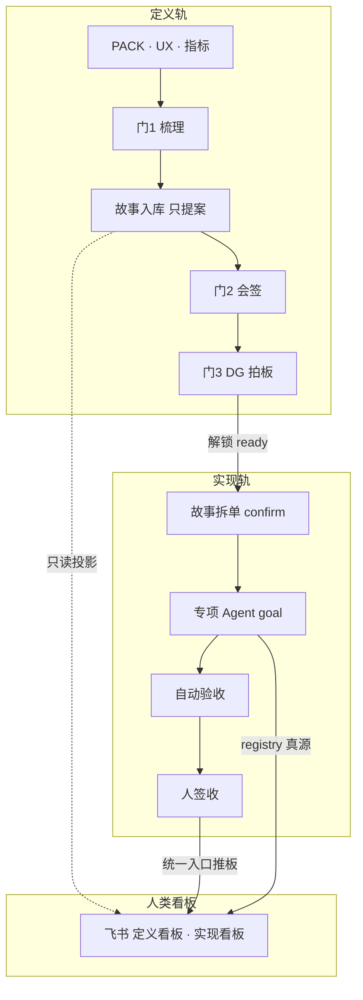

# 向他人介绍 GKX 编排智能体

> **读者**：要对外/对内介绍本项目多智能体编排的人（PM、coordinator、架构师、合作方对接）  
> **场合**：5 分钟电梯、15–18 分钟技术交流、1 小时内部宣讲的「编排篇」  
> **日期**：2026-08-18  
> **配套**：
> - 一页纸：`编排智能体一页纸.md`
> - 讲稿：`2026-08-18_编排智能体介绍_讲稿.md`
> - PPT：`2026-08-18_编排智能体介绍.pptx`
> - 内部 1 小时 vibe coding 宣讲（另一场）：`2026-06-18_逐字稿.md` + `2026-06-18_团队AI协作宣讲.pptx`
> **真源**：`智能体编排与派单手册.md` · `产品定义评审规程.md` · `产品实现规程.md` · `feishu/README.md` · `长任务执行规约.md` · `.cursor/rules/00-team-constitution.mdc`

---

## 0. 怎么用这份稿

对外介绍时，不要从「我们有很多 Cursor Agent」讲起。先讲一句：

> **这不是个人 vibe coding，而是一套把招标范围变成可派单、可验收、可过夜连跑的工程化编排系统。**

按听众裁剪，不要一套稿打天下：

| 听众 | 用哪一节 | 时长 | 不讲什么 |
|------|----------|------|----------|
| 电梯 / 走廊 | §1 | 30 秒 | MCP、状态机、ponytail |
| 领导 / 合作方 / 其他项目 | §1 + §2（必含 §2.3 双轨 + §2.4 飞书） | 5 分钟 | 脚本参数、Webhook 运维 |
| 技术同行 | §1–§4 | 15–18 分钟 | 国科信业务口径细节 |
| 新人 onboarding | §2 心智 + §3.2 自己那一角 + 认领 | 20 分钟 | Graph Engineering 全表 |
| Coordinator 操作员 | 手册 §6 / §9 / §十六 + 长任务规约 | 操作课 | 宣讲里的 vibe coding 故事 |
| 内部 1 小时全员 | 沿用 2026-06-18 逐字稿 | 60 分钟 | 用本文件当「编排篇」补丁 |

---

## 1. 三十秒电梯稿

国科信「科技信息展示 + 科技专题服务」是 **58 项功能点**、多仓、多人并行的交付。我们用 **1 个 Coordinator + 十余类专项 Agent**，按任务注册表派活：人拍板范围和架构，AI 按角色写代码、写契约、写验收。交付分 **定义轨 / 实现轨**：三门评审过完才解锁工程。人看 **飞书看板**，机器认 registry。每张单都有 DoD、handoff、CI/K8s 证据。Coordinator 不写代码，只派单、收单、推进状态。

衡量标准只有一条：**(团队人数 + Agent) 能否等价于原来约 3 倍人力。**

---

## 2. 五分钟版（给领导 / 合作方 / 其他项目）

### 2.1 解决什么问题

个人用 AI 很快，但团队会塌在三件事上：产物不可复用、作者不可审计、并行不可扩展。10 个人各开 10 个 AI，不等于 100 倍产能，只会互相改同一文件、风格漂移、甲方问「这段谁写的」答不上来。

### 2.2 我们怎么做

三层：

| 层 | 谁 | 干什么 |
|---|---|---|
| 战略 | 架构委员会 + PM | 范围 ±10%、架构铁律、甲方承诺 |
| 编排 | **coordinator-agent** + 架构师 | 读队列、派 `/goal`、收 handoff、改状态 |
| 执行 | 各团队 **人 + 专项 Agent** | lead 定标评审，Agent 出量 |

心智一句话（写在团队公约里）：

> **人做决策、评审、创意、客户沟通；AI 做执行、起草、标准化、并行重复劳动。接口只有三件套：DoD + Handoff + Evidence。**

对标业界：Anthropic 的 Orchestrator-Worker（编排者不干活、工人干净上下文）+ GitHub Spec Kit 的规范驱动（规范是可执行资产，不是一次性文档）。

### 2.3 定义轨与实现轨（必讲）

不要把「AI 已经在写代码」理解成「产品已经定完」。本项目是 **两条轨道、三道门**：

```text
【定义轨 · 产品定义评审规程】
  PACK / 指标 / UX  → 门1 梳理 → 用户故事入库（只提案）
  → 联合冻结 → V2 准生产会签 ∥ 门2 会签 → 门3 DG 拍板
                                              │
                                              ▼  门 3 ✅ 才解锁
【实现轨 · 产品实现规程】
  故事拆单 → confirm 标 ready → 认领联调 → CI/K8s → 人签收
  跨仓闭环 / 过夜：长任务总控一次授权（仍一叶一单，见下）
```

| 轨 | 管什么 | 结束标志 | 典型产物 |
|----|--------|----------|----------|
| **定义轨** | 做什么、长什么样、口径与范围 | 门 3 DG ✅ | USM / TRACE / V1·V2 会签 / 拍板纪要 |
| **实现轨** | 怎么按 Sprint 做完、联调通、可关闭 | leaf `done`（负责人签收） | PR、Pipeline、K8s、handoff |

三条硬边界（介绍时直接说）：

1. **门 3 之前**，工程叶 **不得**标 `ready` 开工。  
2. **门 1 之后**只允许故事入库 + 拆单**提案**（`backlog`），禁止把提案直接标 ready。  
3. **V2 准生产会签仍属定义轨**，不是联调完成。故事「已完成」≠ 单张任务 `done`：关联实现叶全部测通，故事才算已完成。

飞书用「交付阶段」列拆成 **定义看板 / 实现看板** 两个视图，站会不要混着拖。

#### 实现轨的两种节奏：短任务 vs 长任务

长任务是实现轨的连夜节奏，不是第三条轨道。只免除 **逐叶聊天确认**，不免除 registry ID、认领、handoff、CI/K8s。禁止「开一个超长会话按感觉改代码」。

**何时开长任务**（三条同时满足，否则走日常短任务）：

1. 跨仓闭环（灌数 → 算法 → Java → 前端），或同仓连续 ≥3 叶、预计过夜。  
2. 监管人在 **长任务总控** 写明「不必再问」。  
3. 已拍板项能写进总控（仓、分支、库、调用链、废作清单），执行时不必现场选型。

**不是长任务**：把十几张单合成一个 registry ID；无总控的「连夜私干」。

**长任务之后还要迭代，不要默认再开一条整管线。** 三者互斥，同一轮只走一条：

| 情况 | 走哪 | 不要做什么 |
|------|------|------------|
| 金路径红了，契约 / 结构没变 | 段 E **缺陷包** → 失败分类 → `bugfix` 一叶 | 不要新开长任务或变更总控 |
| 基线已立，还要动契约、结构或调用边界 | **变更总控**（兼容扩展 / 破坏性结构 / 架构边界） | 不要用变更总控去修缺陷 |
| 整条授权作废、方向换了 | **废止**旧总控，另开 **新长任务总控** | 不要在旧授权上继续连夜派 |

签收可以积压，不挡下一叶。日常短任务 **不**自动享受这条联调闸门。操作真源：`长任务执行规约.md`；变更分类：`templates/change-playbook.md`。

### 2.4 飞书同步看板（必讲）

人不能让全员去读 YAML。做法是：

> **任务真源仍是 git 里的 `task-registry`（经 MCP）。飞书多维表格是人类看板投影。**

| 谁 | 看什么 |
|----|--------|
| Agent / coordinator | registry + git |
| PM / lead / 站会 | 飞书「GKX 智树任务看板」 |

日常要记住四件事：

1. **一张表、分视图**：列「交付阶段」= 定义 / 实现 / 横切；视图「定义看板」「实现看板」「模块总览」。  
2. **改状态走统一入口**（`update-task-status`）：写 registry 并推板。禁止只手改 YAML 结束会话。主动推板秒级可见，投影机 ≤1 小时兜底。  
3. **派单要人在飞书点头**：coordinator-loop 提出待派 → 飞书「派单门控」改成 **已确认** → 任务才可派。Loop **不会**自动打开 Cursor Agent。  
4. **故事进度禁止手拖**：飞书「用户故事库」是只读投影；「实现状态」由关联任务滚动。要改进度，只推进任务状态。

拖看板列 **不能**代替 git 真源。建单、解锁仍以 registry / MCP / 确认队列为准。

### 2.5 工作怎么转起来

```
招标范围 MD（bid-reference）
    → 58 点基线（scope-baseline，±10%）
    → 定义三门（门 3 才解锁工程）
    → 任务注册表（task-registry，经 MCP，禁止手改 YAML）
    → Coordinator 派给专项 Agent（新会话 /goal）
    → 写代码 / 出设计 / 跑 CI
    → handoff 证据 + 自动验收
    → 人签收 → 飞书看板可见
```

专项 Agent 按职责切开，不让一个「全能助手」改三仓。定义轨和实现轨的人/Agent 也不同：

- **定义轨**：product / ux / ui（沙箱或 V2 会签）/ architect（评审）
- **实现轨**：frontend / api / algorithm / data / devops / integration
- **收口轨**：qa / doc

上面还有 **7 个子协调域**（平台、数据算法、血缘、指标、交互、质量、文档），用来分担横切风险，不是再加一层「老板 Agent」。

```text
coordinator（编排者 · 不写代码 · 派单无并发上限）
├── platform-subcoord      平台基建：devops / api / integration
├── data-algo-subcoord     数据算法：data / algorithm —— 产数据
├── lineage-subcoord       数据血缘 —— 诊断/治理，前置闸门
├── metric-subcoord        指标定义 —— 定口径；横切消费 lineage
├── ui-subcoord            交互交付：ux / ui / frontend
├── assurance-subcoord     质量保障：qa
└── doc-subcoord           文档编写：doc —— Epic 末尾 fan-in
```

### 2.6 人机边界（必讲）

否则听者会以为 AI 在替项目经理拍板。

- 架构选型、技术选型、对甲方承诺：**永远人拍板**
- AI **不接触客户**；产物必须人审才能外发
- 每个 commit 标 `[agent:角色]` 或 `[human:真名]`
- 业务口径有歧义：登记决策清单，不替甲方定「软科学」这类定义

---

## 3. 十五分钟版（给技术同行）

在五分钟版上加下面几块，听众才能「抄得走」。双轨与飞书已在 §2.3 / §2.4，这里补操作层。

### 3.1 真源分层

| 问什么 | 看哪 |
|---|---|
| 做什么 | `bid-reference/*.md`（不读招标 PDF） |
| 做多少 | `scope-baseline.yaml`（58 点，允许 52–64） |
| 定义过没过 | `产品定义评审规程.md`（门 1 / 门 2 / 门 3） |
| 怎么做（架构） | `architecture-baseline.md`（D1–D12） |
| 工程能不能开工 | 门 3 DG ✅ + `产品实现规程.md` |
| 谁做哪张单 | `task-registry`（MCP：query / claim / status） |
| 人怎么盯进度 | 飞书看板（`feishu/`）；真源仍是 registry |
| 代码在哪 | `repo-registry.yaml`（`demo-*` 原型，`lumen-*` 正式） |

### 3.2 角色不是「提示词分类」，是仓和禁区

- coordinator / architect：**不写业务代码**
- ui-agent：只进 demo 沙箱，禁止改 lumen
- frontend-agent：把已评审页复刻进 lumen，禁止另起一套 UI
- algorithm 只在 Python；Java 禁止 NLP / 图谱 / 模型
- 调用链：前端 → Java REST → Python `/internal/*`，禁止越层

派 coding 单必须带 `强度：ponytail …`，防止「为简洁」裁掉指标 ⓘ、可观测、交互规范。

| Agent | 职责 | 典型仓库 |
|-------|------|----------|
| coordinator-agent | 读队列、派单、验收 handoff、更新 status | — |
| architect-agent | Epic 开工评审 + 里程碑架构合规；不写代码 | — |
| ux-agent | IA / 用户旅程 / 低保真线框 | demo 仓 docs/ia |
| ui-agent | 可演示沙箱页；禁止改 lumen | `demo-ui-science` 等 |
| frontend-agent | 把已评审页工程化复刻到正式前端 | `lumen-ui-*` |
| api-agent | Java 业务 REST、OpenAPI、只读 ADS | `lumen-svc-platform` |
| algorithm-agent | Python：ETL、NLP、图谱、模型、指标 | `lumen-algo-py` / demo-algo-* |
| data-agent | ODS/DWD/ADS、DDL、映射 | 设计文档 + Python |
| devops-agent | CI、Helm、OTel、K8s 发布 | 各仓 `.gitlab-ci.yml` |
| integration-agent | 网关、三方、部署联调 | `lumen-svc-platform` |
| qa-agent | MD 对照验收、Tempo/Loki 三联查 | — |
| doc-agent | 验收材料汇编 | `验收文档/` |

### 3.3 一张单的生命周期

```
backlog → ready → claimed → in_progress
        → integration / pending_test → testing
        → ready_to_sign → done
```

- 认领必填 `claimed_by` + `supervised_by=human:真名`
- 同仓并行先做 Convoy（碰同一文件就串行）
- 自动验收 AV-0 / AV-1 检查 handoff / DoD / cost；签收仍是人（项目负责人）
- 状态变更走 `update-task-status` 推飞书；禁止只改 YAML 结束会话
- 实现叶须带 `delivery_phase: implementation`，飞书进「实现看板」
- 跨仓闭环走长任务时：总控一次授权、联调闸门解锁（不等签收 `done`）；迭代分类见 §2.3

### 3.4 质量门是三层

机审（CI / BugBot）→ 架构合规（architect）→ 业务评审（lead / QA）→ 对外稿件 PM 终审。

开发 Agent 交的不是「一段能跑的代码」，而是 handoff：PR、Pipeline、K8s URL、偏离说明、架构自检、token 成本。

### 3.5 工具形态

- 共享 `.cursor/rules/*.mdc`：开会话第一天就懂铁律
- MCP `task-registry`：任务真源，禁止直接读写 YAML
- `coordinator-loop`：建议可派单，**不自动打开 Cursor Agent**；飞书「派单门控=已确认」后才可派
- 本机会话上限 ≠ 派单上限；超了上云 Background Agents

---

## 4. 现场一张图

讲这张图时强调三句：

1. **Coordinator 是 Mayor，不是全栈工程师。**
2. **定义轨过三门，实现轨才开工。**
3. **人看飞书看板，真源在 registry，证据在 handoff。**



---

## 5. 容易被问到的三句答法

**「没过评审，代码不是已经在写了吗？」**  
那是定义轨的 V1/V2 或提案，不是实现轨开工。门 3 之前工程叶不得标 ready。V2 会签仍属定义轨。

**「和 ChatGPT 写代码有什么不同？」**  
ChatGPT 是会话；我们是队列。谁做、做到什么算完、碰谁的文件、成本多少，都在机器可读的注册表和规则里。人用飞书看同一张板。

**「AI 会不会把架构做乱？」**  
铁律写进每次派单和 `.mdc`。算法只在 Python、禁止越层、demo 不 merge 进 lumen。违规在派单、合并、里程碑三道门拦。

**「能不能完全无人值守？」**  
跨仓闭环、总控写了「不必再问」，才开长任务。可以连夜派叶，但建单、认领、handoff、发布门仍在。飞书派单门控仍要人点确认。无人值守 ≠ 无单无证。

**「长任务跑完还要改怎么办？」**  
先分类，不要默认再开一条整管线。结构没变、金路径红了 → 缺陷包 + bugfix 叶。要动契约/结构/调用边界 → 变更总控。整条授权作废 → 废止旧总控，另开新长任务。禁止无 ID 热修。

---

## 6. 架构铁律（派单必带，介绍时可点到为止）

| # | 铁律 |
|---|------|
| 1 | 算法只在 Python；Java 禁止 NLP / 图谱 / 模型 |
| 2 | 调用链：前端 → Java REST → Python `/internal/*` |
| 3 | 图谱：NebulaGraph，禁止 Neo4j |
| 4 | 可观测：Java Agent + Python instrument + 前端 `observability.ts` |
| 5 | CI/CD：push → Pipeline 绿 → K8s dev rollout |
| 6 | demo 原型与 lumen 正式隔离；禁止 merge demo→lumen |
| 7 | 共享聚合核心：前端只调 Java；Java 不写算法、不直连 nGQL、只读 ADS |
| D8–D12 | 前端 Design / 指标 8 件套 / 交互规范 / demo↔lumen 调用隔离 |

完整条文：`architecture-baseline.md` + `00-team-constitution.mdc`。

---

## 7. 原文索引（收藏夹）

| 用途 | 路径 |
|------|------|
| 操作手册 | `agent-delivery/智能体编排与派单手册.md` |
| 定义三门 | `agent-delivery/产品定义评审规程.md` |
| 实现开工 | `agent-delivery/产品实现规程.md` |
| 飞书看板 | `agent-delivery/feishu/README.md` |
| 人机公约 | `agent-delivery/team-collaboration-playbook.md` |
| 角色对照 | `agent-delivery/角色AI协作对比手册.md` |
| 长任务 | `agent-delivery/长任务执行规约.md` |
| 范围基线 | `agent-delivery/scope-baseline.yaml` |
| 架构基线 | `agent-delivery/architecture-baseline.md` |
| 新人上手 | `agent-delivery/team-onboarding.md` |
| 成熟度对标 | `agent-delivery/orchestration-maturity-and-roadmap.md` |
| 角色 rules | `.cursor/rules/*.mdc` |

所有文档在 `gkx-orchestration` 仓 git 同步，全员可读。
