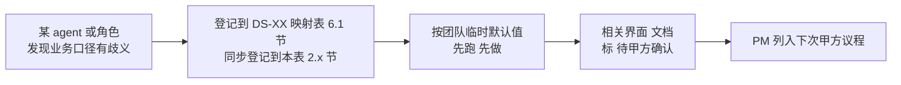

# 客户决策清单跟踪表

> **作用**：把所有 DS / 试点 / 评审 过程中产生的"**需要甲方拍板**"业务口径决策**集中跟踪**，避免散落在各 `DS-XX-data-availability-matrix.md` 或 handoff 里被遗忘 / 重复问 / 互相矛盾。
> **维护者**：PM（owner） + coordinator-agent（自动汇总）
> **更新频率**：每次试点 / 评审 / 甲方接触后立刻回填
> **关联**：
> - 团队公约 §3.1（决策不外包给 AI，业务承诺只能甲方拍板）
> - `data-lineage-policy.md`（每个未确认项关联 metric_id）
> - 各 `data/DS-{XX}-data-availability-matrix.md` §6.1（决策项来源）
> - `task-registry.yaml`（决策影响的任务进度）

---

## 1. 总览看板（在最上面，方便扫一眼知道节奏）

| 状态 | 数量 | 说明 |
|------|------|------|
| 🔴 高优先级 / 阻塞中 | _自动汇总_ | 阻塞当前 DS-XX 上线或评审 |
| 🟡 中优先级 / 临时默认 | _自动汇总_ | 已用临时默认值跑通，但要在某 deadline 前确认 |
| 🟢 已确认 | _自动汇总_ | 甲方书面/纪要确认，已落 cfg_metric / DDL |
| ⚪ 已撤销 / 合并 | _自动汇总_ | 项目变更后该决策项不再需要 |

**当前未确认总数**：`_PM 每周回填_`
**最早 deadline**：`_PM 每周回填_`
**下次甲方接触日期**：`_PM 维护_`

---

## 2. 决策项注册表

> 字段说明：
> - **ID**：`Q{编号}` （按时间顺序递增）
> - **来源**：哪份文档 / 哪次试点 / 哪次评审产生
> - **影响 DS / metric_id**：决策影响的功能点 / 指标
> - **团队临时默认**：试点期间先按这个跑（不阻塞）
> - **状态**：🔴 阻塞 / 🟡 临时默认 / 🟢 已确认 / ⚪ 撤销
> - **Deadline**：必须在此前确认（否则视为认可临时默认）
> - **甲方决策**：甲方书面/纪要确认的内容（含决策时间 / 决策人 / 证据链接）
> - **落地**：决策后的 cfg_metric bump / DDL / 代码 PR 链接

### 2.1 来自 DS-25 软科学成果展示试点（2026-06-17 启动）

| ID | 标题 | 来源 | 影响 DS / metric_id | 团队临时默认 | 状态 | Deadline | 甲方决策 | 落地 |
|----|------|------|---------------------|------------|------|---------|---------|------|
| Q001 | "软科学"如何精确过滤 `dwd_zh_project.discipline` 字段？ | `data/DS-25-data-availability-matrix.md` §6.1 第 1 项 | DS-25 全部 / 所有 `M_SS_*` metric | `discipline LIKE '软科学%' OR '管理学%' OR '公共管理%' OR '应用经济%' OR '社会学%'` | 🟡 | _PM 待填_ | _待甲方_ | _待 data-agent_ |
| Q002 | 是否在自建 DWD 层做"软科学子集表" `dwd.dwd_ss_topic` | `data/DS-25-data-availability-matrix.md` §6.1 第 2 项 | DS-25 性能 / data-agent 工作量 | ✅ 做 | 🟡 | _PM 待填_ | _待甲方_ | — |
| Q003 | 市/区级地图下钻数据精度从哪来（ODS 只到省级） | `data/DS-25-data-availability-matrix.md` §6.1 第 3 项 | DS-25 §1 分布地图 | 关联 `dwd_org_reg_info.address` 解析；甲方接受省级最差 | 🟡 | _PM 待填_ | _待甲方_ | — |
| Q004 | "难题攻关历程时间轴"业务语义？ | `data/DS-25-data-availability-matrix.md` §6.1 第 4 项 | DS-25 §3 详情案例 / `M_SS_TIMELINE_*` | 立项→中期→结题，基于 `approval_time + research_period` 派生 | 🟡 | _PM 待填_ | _待甲方_ | — |
| Q005 | 互动传播功能（§5 评论/点赞/收藏/分享）Wave 0 是否实现 | `data/DS-25-data-availability-matrix.md` §6.1 第 5 项 | DS-25 §5 / 范围 ±10% | 占位 + 标"Wave 2 后纳入" | 🟡 | _PM 待填_ | _待甲方_ | — |
| Q006 | 国外软科学课题 `dwd_en_project` 是否纳入 DS-25 | `data/DS-25-data-availability-matrix.md` §6.1 第 6 项 | DS-25 范围 ±10% | 默认不纳入（DS-25 = 国内） | 🟡 | _PM 待填_ | _待甲方_ | — |
| Q007 | 项目"结题判定"逻辑 | `data/DS-25-data-availability-matrix.md` §6.1 第 7 项 | DS-25 §7 进展跟踪 / `M_SS_PROJECT_PROGRESS_PCT` | `final_report_abstract IS NOT NULL` 视为已结题 | 🟡 | _PM 待填_ | _待甲方_ | — |

### 2.2 来自 DS-XX 其他试点（占位，未来填充）

| ID | 标题 | 来源 | 影响 DS / metric_id | 团队临时默认 | 状态 | Deadline | 甲方决策 | 落地 |
|----|------|------|---------------------|------------|------|---------|---------|------|
| Q008 | — | — | — | — | — | — | — | — |

### 2.3 来自架构 / 平台决策

| ID | 标题 | 来源 | 影响 | 团队临时默认 | 状态 | Deadline | 甲方决策 | 落地 |
|----|------|------|------|------------|------|---------|---------|------|
| Q009 | 企业域 metric_id 要素代号用 `ENT` 还是 `E1`？ | `topic_demo/docs/ia/enterprise/`（UX-ENT 试点，开放项 K-O1） | 全部 `M_ENT_*`(49 条) | 按派单先用 `M_ENT_*` | 🟢 | 2026-06-18 | **已会签：方案 B**（2026-06-18，人类架构师/PM 经决策门确认）—— 保留 `M_ENT_*`，修订 policy §3.2 注册全 7 要素助记表(E1=ENT/E2=CHAIN/E3=ORG/E4=TECH/E5=TALENT/E6=SVC/E7=POLICY)，`E1~E7` 保留为废弃别名。依据 `ARCH-ENT-milestone-review.md` | ✅ policy §3.2 已 bump v1.1.0 + changelog；49 条种子 `M_ENT_*` 无需改名；algorithm/api 可按此命名落地 |

### 2.4 来自企业分析战略分析 IA 试点（2026-06-18，UX-ENT）

| ID | 标题 | 来源 | 影响 DS / metric_id | 团队临时默认 | 状态 | Deadline | 甲方决策 | 落地 |
|----|------|------|---------------------|------------|------|---------|---------|------|
| Q010 | 企业类型（外企/高企/小微/上市）精确判定规则？ | `ENT-wireframe.md` P1（K-O2） | E-21 / `M_ENT_TYPE_COUNT`/`M_ENT_TYPE_RATIO` | is_foreign/is_high_tech/is_sme/is_listed 按映射报告规则判定 | 🟡 | _PM 待填_ | _待甲方_ | _待 algorithm-agent_ |
| Q011 | "创新型企业"口径（=高企∪专精特新∪瞪羚∪独角兽？） | `ENT-wireframe.md` P0（K-O3） | E-20 / `M_ENT_INNOVATIVE_COUNT` | 取上述并集 | 🟡 | _PM 待填_ | _待甲方_ | — |
| Q012 | 行政区划下钻精度（到市 / 到区县） | `ENT-wireframe.md` P1（K-O4） | E-21 地图下钻 | 到市级（参考 DS-25 Q003） | 🟡 | _PM 待填_ | _待甲方_ | — |
| Q013 | 领域"覆盖广度/深度"计算口径（领域全集/权重） | `ENT-wireframe.md` P2（K-O5） | E-22 / `M_ENT_DOMAIN_COVERAGE_*` | chain_score+产品/专利贡献加权 | 🟡 | _PM 待填_ | _待算法 lead+甲方_ | — |
| Q014 | 技术力/商业力/竞争力指标库构成与默认权重 | `ENT-wireframe.md` P3/P10（K-O6） | E-23/E-24/E-30 / `M_ENT_TECH_POWER_SCORE` 等 | 沿用现有原型默认权重（专利25%等） | 🟡 | _PM 待填_ | _待甲方_ | _待 algorithm-agent_ |
| Q015 | 招引/培育推荐指数阈值与权重 | `ENT-wireframe.md` P6（K-O9） | E-26/E-27 / `M_ENT_ATTRACTION_INDEX`/`M_ENT_CULTIVATION_INDEX` | 产业相关度+政策匹配+生态连接度等权 | 🟡 | _PM 待填_ | _待甲方_ | — |
| Q016 | 多城市对标默认城市集合 | `ENT-wireframe.md` P5（K-O8） | E-25 / `M_ENT_CITY_*` | 北京/上海/苏州/广州 | 🟡 | _PM 待填_ | _待甲方_ | — |
| Q017 | 供应链核心供应商阈值 + 断链风险评级规则 | `ENT-wireframe.md` P8（K-O10） | E-28 / `M_ENT_SUPPLY_CHAIN_RISK`/`M_ENT_CORE_SUPPLIER_COUNT` | chain_score 阈值+中心性算法 | 🟡 | _PM 待填_ | _待算法 lead+甲方_ | — |
| Q018 | 痛难点诊断维度与阈值（依赖专家知识库） | `ENT-wireframe.md` P9（K-O11） | E-29 / `M_ENT_PAINPOINT_*` | 技术/市场/融资/管理四维 | 🟡 | _PM 待填_ | _待甲方_ | — |
| Q019 | `M_ENT_MARKET_SHARE` 市场份额无数据源，采购 / 降级 / 下架？ | `cfg_metric-ENT-seed.yaml`(no_source) + QA-ENT 核验（K-O7） | E-24 商业力 / `M_ENT_MARKET_SHARE` | 暂置空 + 不实现，UI 标 ❌ 无来源 | 🟡 | _PM 待填_ | _待甲方/采购决策（市调数据采购 or 永久下架）_ | _algorithm-agent 已标 no_source 不实现_ |

### 2.5 来自全系统角色权限体系设计（2026-06-22，product-agent）

> 来源：`agent-handoffs/产品整体定义/全系统角色权限体系设计.md` §13（配套 `权限点清单-菜单与按钮.md`）。权限为横切能力（D6），不计入 58 功能点 ±10%；确认前 Wave 0 按临时默认运行，相关界面加 ⚠️"权限口径待甲方确认"。

| ID | 标题 | 来源 | 影响 | 团队临时默认 | 状态 | Deadline | 甲方决策 | 落地 |
|----|------|------|------|------------|------|---------|---------|------|
| Q020 | 用户级别档数与命名（本稿 L0–L4 五档） | `全系统角色权限体系设计.md` §15 R-01 | 全系统鉴权模型 | L0 访客/L1 注册/L2 专业/L3 内部/L4 管理 五档 | 🟡 | _PM 待填_ | _待甲方_ | _待 architect 评审_ |
| Q021 | 各级别准入条件（注册 / 实名认证 / 内部审批） | §15 R-02 | SSO 接入 / 注册流程 | L1 注册即得、L2 实名认证、L3 内部审批 | 🟡 | _PM 待填_ | _待甲方_ | — |
| Q022 | 数据密级分层（公开/内部/敏感/涉密 4 级）及各级别可见映射 | §15 R-03 / §9.1 | 全系统数据列级权限 | §9.1 四级映射 | 🟡 | _PM 待填_ | _待甲方_ | _待 data/api-agent_ |
| Q023 | 敏感字段清单（联系方式/法人/财务/名单/尽调…） | §15 R-04 / §9.2 | 企业/人才/政策脱敏 | §9.2 样板清单 | 🟡 | _PM 待填_ | _待甲方_ | — |
| Q024 | 数据范围过滤维度（是否按区域 / 单位限定可见数据） | §15 R-05 / §9.3 | 行级数据权限 | 按所属区域 + 单位过滤 | 🟡 | _PM 待填_ | _待甲方_ | — |
| Q025 | 导出配额与水印策略（L1/L2 配额数） | §15 R-06 | 导出功能 | L1 低配额、L2 中配额、L3 不限 + 水印 | 🟡 | _PM 待填_ | _待甲方_ | — |
| Q026 | 生态企业用户能否升级到 L2 分析（认证后） | §15 R-07 | 企业主题分析级开通 | 认证后可 L2 | 🟡 | _PM 待填_ | _待甲方_ | — |
| Q027 | 接待大屏是否完全无登录（L0 公开） | §15 R-08 | 接待场景/大屏 | 是，L0 公开 | 🟡 | _PM 待填_ | _待甲方_ | — |
| Q028 | 讲解员/设备运维是团队角色 vs 甲方现场人员 | §15 R-09 | L4 子角色归属 | 甲方现场 + 我方支持 | 🟡 | _PM 待填_ | _待甲方_ | — |
| Q029 | 展示/专题后台用户与权限管理是否同一套（SSO 统一） | §15 R-10 | 统一权限服务边界（D6） | 同一套 SSO + 统一权限服务 | 🟡 | _PM 待填_ | _待甲方/架构师_ | _待 architect_ |
| Q030 | 展示系统 30 个二级页面（DS-01~30）各自的「最低用户级别 + 屏幕类型(大/中/小)呈现」口径 | `权限点清单-菜单与按钮.md` §2.1/§2.5 | 展示系统全部二级页面菜单与屏幕适配 | 见 §2.1 表（团队默认：态势/全景/监测/成果/政策全景/人才态势=L0；评估/规划/政策分析/数据视窗/图谱指标算法=L1；推演/推荐/图服务=L2；大屏纯展示无个人定义、中屏最全无酷炫、小屏裁剪） | 🟡 | _PM 待填_ | _待甲方/架构师_ | _待 architect 评审_ |

---

## 3. 工作流（如何使用本表）

### 3.1 决策项**新增**（任何角色发现业务口径需甲方拍板时）

**规则**：
- **谁发现谁登记**（不要寄望别人代登）
- 用 markdown 表格新增一行，状态默认 🟡
- 临时默认值不能为空（否则阻塞 = 🔴）
- handoff 末尾"开放项"必须引用本表 ID（如 `Q001`）

### 3.2 决策项**确认**（甲方接触后）

**关键节点**：
- **甲方书面确认**：邮件 / 微信文本截图 / 会议纪要 PDF — 三选一存档，链接放"甲方决策"列
- **口语确认不算数**：除非有录音 + PM 文字回放，否则视为 🟡
- **决策导致返工时**：决策栏写"原临时默认 → 新决策 → 返工任务 T-XXX"

### 3.3 决策项**撤销/合并**

- 项目变更导致该决策项不再需要 → 状态 ⚪，决策栏写撤销原因 + 时间
- 两个决策项重复 → 合并到较早的 ID，新 ID 状态 ⚪

---

## 4. PM 周度维护清单

每周一上午 5 min：

- [ ] 扫一眼本表 §1 总览看板
- [ ] 🔴 阻塞项每个走一遍，决定是否升级（升级给甲方项目经理 / 升级到下次决策会）
- [ ] 🟡 已超 Deadline 的 → 邮件甲方"如未在 {T+3 工作日} 回复，视为认可临时默认"
- [ ] 下次甲方接触日期 → 把所有 🟡 列入议程
- [ ] 已确认的 🟢 → 检查 data-agent / ui-agent 是否落地（cfg_metric 更新 / ⚠️ 角标移除）

---

## 5. 升级机制

| 情况 | 谁升级 | 升级给谁 | 触发时长 |
|------|--------|---------|---------|
| 🟡 已超 Deadline | PM | 甲方对接人 + 抄送项目经理 | 立即 |
| 🟡 跨 2 个 Deadline 仍未确认 | PM | 甲方项目经理（升一级） | 立即 |
| 🟡 跨 3 个 Deadline | PM + 公司领导 | 甲方分管领导 | 立即 |
| 甲方多个对接人意见冲突 | PM | 升到甲方项目经理 | 立即 |
| 团队认为甲方决策超 ±10% 范围 | PM + 架构师 | 公司商务 + 甲方项目经理 | 立即 |

---

## 6. 与其他文档的关系

| 本表 | 关联文档 | 关系 |
|------|---------|------|
| 决策项注册（§2） | 各 `data/DS-{XX}-data-availability-matrix.md` §6.1 | 本表是"全局汇总"，DS-XX 表是"局部详情"；新增决策先在 DS-XX 表登记，同步抄到本表 |
| 落地栏 | `cfg_metric` 表 / DDL 文件 | 决策确认后 data-agent 更新 cfg_metric，本表落地栏链接 PR |
| 落地栏 | `task-registry.yaml` | 大决策导致的返工任务在 task-registry 注册，本表引用 task ID |
| ⚠️ 角标 | UI 代码 / wireframe | ui-agent / ux-agent 看本表状态，决定是否标 ⚠️ |
| 评审 / 验收 | `acceptance-compliance-policy.md` | 验收时所有 🟡 项必须有 PM 升级证据，所有 🟢 项必须有落地链接 |

---

## 7. 历史归档（已撤销 / 合并）

> 此处保留所有 ⚪ 状态的决策项历史，方便 retro 复盘"哪些口径反复变更"。

_暂无_

---

**本表由 PM owner；任何 agent 发现新决策项时主动 append；coordinator-agent 在每次试点结束时校验 task-registry 与本表的状态一致性。**
