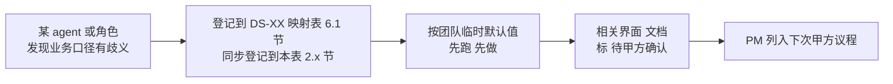

# 客户决策清单跟踪表

> **作用**：把所有 DS / 试点 / 评审 过程中产生的"**需要甲方拍板**"业务口径决策**集中跟踪**，避免散落在各 `DS-XX-data-availability-matrix.md` 或 handoff 里被遗忘 / 重复问 / 互相矛盾。
> **维护者**：PM（owner） + coordinator-agent（自动汇总）
> **更新频率**：每次试点 / 评审 / 甲方接触后立刻回填
> **关联**：
> - 团队公约 §3.1（决策不外包给 AI，业务承诺只能甲方拍板）
> - `data-lineage-policy.md`（每个未确认项关联 metric_id）
> - 各 `data/DS-{XX}-data-availability-matrix.md` §6.1（决策项来源）
> - `task-registry.yaml`（决策影响的任务进度）
> - **飞书投影**：Bitable「甲方决策清单」表（只读看板；本表更新后跑 `node scripts/sync-feishu-decision-board.mjs` 刷新，见 `feishu-decision-board.yaml`）

---

## 1. 总览看板（在最上面，方便扫一眼知道节奏）

| 状态 | 数量 | 说明 |
|------|------|------|
| 🔴 高优先级 / 阻塞中 | _自动汇总_ | 阻塞当前 DS-XX 上线或评审 |
| 🟡 中优先级 / 临时默认 | _自动汇总_ | 已用临时默认值跑通，但要在某 deadline 前确认 |
| 🟢 已确认 | _自动汇总_ | 甲方书面/纪要确认，已落 cfg_metric / DDL |
| ⚪ 已撤销 / 合并 | _自动汇总_ | 项目变更后该决策项不再需要 |

**当前未确认总数**：`_PM 每周回填_`
**最早 deadline**：`_PM 每周回填_`
**下次甲方接触日期**：`_PM 维护_`

---

## 2. 决策项注册表

> 字段说明：
> - **ID**：`Q{编号}` （按时间顺序递增）
> - **来源**：哪份文档 / 哪次试点 / 哪次评审产生
> - **影响 DS / metric_id**：决策影响的功能点 / 指标
> - **团队临时默认**：试点期间先按这个跑（不阻塞）
> - **状态**：🔴 阻塞 / 🟡 临时默认 / 🟢 已确认 / ⚪ 撤销
> - **Deadline**：必须在此前确认（否则视为认可临时默认）
> - **甲方决策**：甲方书面/纪要确认的内容（含决策时间 / 决策人 / 证据链接）
> - **落地**：决策后的 cfg_metric bump / DDL / 代码 PR 链接

### 2.1 来自 DS-25 软科学成果展示试点（2026-06-17 启动）

| ID | 标题 | 来源 | 影响 DS / metric_id | 团队临时默认 | 状态 | Deadline | 甲方决策 | 落地 |
|----|------|------|---------------------|------------|------|---------|---------|------|
| Q001 | "软科学"如何精确过滤 `dwd_zh_project.discipline` 字段？ | `data/DS-25-data-availability-matrix.md` §6.1 第 1 项 | DS-25 全部 / 所有 `M_SS_*` metric | `discipline LIKE '软科学%' OR '管理学%' OR '公共管理%' OR '应用经济%' OR '社会学%'` | 🟡 | _PM 待填_ | _待甲方_ | _待 data-agent_ |
| Q002 | 是否在自建 DWD 层做"软科学子集表" `dwd.dwd_ss_topic` | `data/DS-25-data-availability-matrix.md` §6.1 第 2 项 | DS-25 性能 / data-agent 工作量 | ✅ 做 | 🟡 | _PM 待填_ | _待甲方_ | — |
| Q003 | 市/区级地图下钻数据精度从哪来（ODS 只到省级） | `data/DS-25-data-availability-matrix.md` §6.1 第 3 项 | DS-25 §1 分布地图 | 关联 `dwd_org_reg_info.address` 解析；甲方接受省级最差 | 🟡 | _PM 待填_ | _待甲方_ | — |
| Q004 | "难题攻关历程时间轴"业务语义？ | `data/DS-25-data-availability-matrix.md` §6.1 第 4 项 | DS-25 §3 详情案例 / `M_SS_TIMELINE_*` | 立项→中期→结题，基于 `approval_time + research_period` 派生 | 🟡 | _PM 待填_ | _待甲方_ | — |
| Q005 | 互动传播功能（§5 评论/点赞/收藏/分享）Wave 0 是否实现 | `data/DS-25-data-availability-matrix.md` §6.1 第 5 项 | DS-25 §5 / 范围 ±10% | 占位 + 标"Wave 2 后纳入" | 🟡 | _PM 待填_ | _待甲方_ | — |
| Q006 | 国外软科学课题 `dwd_en_project` 是否纳入 DS-25 | `data/DS-25-data-availability-matrix.md` §6.1 第 6 项 | DS-25 范围 ±10% | 默认不纳入（DS-25 = 国内） | 🟡 | _PM 待填_ | _待甲方_ | — |
| Q007 | 项目"结题判定"逻辑 | `data/DS-25-data-availability-matrix.md` §6.1 第 7 项 | DS-25 §7 进展跟踪 / `M_SS_PROJECT_PROGRESS_PCT` | `final_report_abstract IS NOT NULL` 视为已结题 | 🟡 | _PM 待填_ | _待甲方_ | — |

### 2.2 来自 DS-XX 其他试点（占位，未来填充）

| ID | 标题 | 来源 | 影响 DS / metric_id | 团队临时默认 | 状态 | Deadline | 甲方决策 | 落地 |
|----|------|------|---------------------|------------|------|---------|---------|------|
| Q008 | — | — | — | — | — | — | — | — |

### 2.3 来自架构 / 平台决策

| ID | 标题 | 来源 | 影响 | 团队临时默认 | 状态 | Deadline | 甲方决策 | 落地 |
|----|------|------|------|------------|------|---------|---------|------|
| Q009 | 企业域 metric_id 要素代号用 `ENT` 还是 `E1`？ | `demo-ui-topic/docs/ia/enterprise/`（UX-ENT 试点，开放项 K-O1） | 全部 `M_ENT_*`(49 条) | 按派单先用 `M_ENT_*` | 🟢 | 2026-06-18 | **已会签：方案 B**（2026-06-18，人类架构师/PM 经决策门确认）—— 保留 `M_ENT_*`，修订 policy §3.2 注册全 7 要素助记表(E1=ENT/E2=CHAIN/E3=ORG/E4=TECH/E5=TALENT/E6=SVC/E7=POLICY)，`E1~E7` 保留为废弃别名。依据 `ARCH-ENT-milestone-review.md` | ✅ policy §3.2 已 bump v1.1.0 + changelog；49 条种子 `M_ENT_*` 无需改名；algorithm/api 可按此命名落地 |

### 2.4 来自企业分析战略分析 IA 试点（2026-06-18，UX-ENT）

| ID | 标题 | 来源 | 影响 DS / metric_id | 团队临时默认 | 状态 | Deadline | 甲方决策 | 落地 |
|----|------|------|---------------------|------------|------|---------|---------|------|
| Q010 | 企业类型（外企/高企/小微/上市）精确判定规则？ | `ENT-wireframe.md` P1（K-O2） | E-21 / `M_ENT_TYPE_COUNT`/`M_ENT_TYPE_RATIO` | is_foreign/is_high_tech/is_sme/is_listed 按映射报告规则判定 | 🟡 | _PM 待填_ | _待甲方_ | _待 algorithm-agent_ |
| Q011 | "创新型企业"口径（=高企∪专精特新∪瞪羚∪独角兽？） | `ENT-wireframe.md` P0（K-O3） | E-20 / `M_ENT_INNOVATIVE_COUNT` | 取上述并集 | 🟡 | _PM 待填_ | _待甲方_ | — |
| Q012 | 行政区划下钻精度（到市 / 到区县） | `ENT-wireframe.md` P1（K-O4） | E-21 地图下钻 | 到市级（参考 DS-25 Q003） | 🟡 | _PM 待填_ | _待甲方_ | — |
| Q013 | 领域"覆盖广度/深度"计算口径（领域全集/权重） | `ENT-wireframe.md` P2（K-O5） | E-22 / `M_ENT_DOMAIN_COVERAGE_*` | chain_score+产品/专利贡献加权 | 🟡 | _PM 待填_ | _待算法 lead+甲方_ | — |
| Q014 | 技术力/商业力/竞争力指标库构成与默认权重 | `ENT-wireframe.md` P3/P10（K-O6） | E-23/E-24/E-30 / `M_ENT_TECH_POWER_SCORE` 等 | 沿用现有原型默认权重（专利25%等） | 🟡 | _PM 待填_ | _待甲方_ | _待 algorithm-agent_ |
| Q015 | 招引/培育推荐指数阈值与权重 | `ENT-wireframe.md` P6（K-O9） | E-26/E-27 / `M_ENT_ATTRACTION_INDEX`/`M_ENT_CULTIVATION_INDEX` | 产业相关度+政策匹配+生态连接度等权 | 🟡 | _PM 待填_ | _待甲方_ | — |
| Q016 | 多城市对标默认城市集合 | `ENT-wireframe.md` P5（K-O8） | E-25 / `M_ENT_CITY_*` | 北京/上海/苏州/广州 | 🟡 | _PM 待填_ | _待甲方_ | — |
| Q017 | 供应链核心供应商阈值 + 断链风险评级规则 | `ENT-wireframe.md` P8（K-O10） | E-28 / `M_ENT_SUPPLY_CHAIN_RISK`/`M_ENT_CORE_SUPPLIER_COUNT` | chain_score 阈值+中心性算法 | 🟡 | _PM 待填_ | _待算法 lead+甲方_ | — |
| Q018 | 痛难点诊断维度与阈值（依赖专家知识库） | `ENT-wireframe.md` P9（K-O11） | E-29 / `M_ENT_PAINPOINT_*` | 技术/市场/融资/管理四维 | 🟡 | _PM 待填_ | _待甲方_ | — |
| Q019 | `M_ENT_MARKET_SHARE` 市场份额无数据源，采购 / 降级 / 下架？ | `cfg_metric-ENT-seed.yaml`(no_source) + QA-ENT 核验（K-O7） | E-24 商业力 / `M_ENT_MARKET_SHARE` | 暂置空 + 不实现，UI 标 ❌ 无来源 | 🟡 | _PM 待填_ | _待甲方/采购决策（市调数据采购 or 永久下架）_ | **FE L03a 已落（2026-06-22）**：`metricSeed.ts` 加 `M_ENT_MARKET_SHARE` 占位项 `mapping_status='❌'`；`PendingBadge` 自动渲染 ⚠️ + Tooltip"该指标暂无数据源（Q019），Wave 0 暂置空"。algorithm-agent 已标 no_source 不实现 |

### 2.5 来自全系统角色权限体系设计（2026-06-22，product-agent）

> 来源：`agent-handoffs/产品整体定义/全系统角色权限体系设计.md` §13（配套 `权限点清单-菜单与按钮.md`）。权限为横切能力（D6），不计入 58 功能点 ±10%；确认前 Wave 0 按临时默认运行，相关界面加 ⚠️"权限口径待甲方确认"。

| ID | 标题 | 来源 | 影响 | 团队临时默认 | 状态 | Deadline | 甲方决策 | 落地 |
|----|------|------|------|------------|------|---------|---------|------|
| Q020 | 用户级别档数与命名（本稿 L0–L4 五档） | `全系统角色权限体系设计.md` §15 R-01 | 全系统鉴权模型 | L0 访客/L1 注册/L2 专业/L3 内部/L4 管理 五档 | 🟡 | _PM 待填_ | _待甲方_ | _待 architect 评审_ |
| Q021 | 各级别准入条件（注册 / 实名认证 / 内部审批） | §15 R-02 | SSO 接入 / 注册流程 | L1 注册即得、L2 实名认证、L3 内部审批 | 🟡 | _PM 待填_ | _待甲方_ | — |
| Q022 | 数据密级分层（公开/内部/敏感/涉密 4 级）及各级别可见映射 | §15 R-03 / §9.1 | 全系统数据列级权限 | §9.1 四级映射 | 🟡 | _PM 待填_ | _待甲方_ | _待 data/api-agent_ |
| Q023 | 敏感字段清单（联系方式/法人/财务/名单/尽调…） | §15 R-04 / §9.2 | 企业/人才/政策脱敏 | §9.2 样板清单 | 🟡 | _PM 待填_ | _待甲方_ | — |
| Q024 | 数据范围过滤维度（是否按区域 / 单位限定可见数据） | §15 R-05 / §9.3 | 行级数据权限 | 按所属区域 + 单位过滤 | 🟡 | _PM 待填_ | _待甲方_ | — |
| Q025 | 导出配额与水印策略（L1/L2 配额数） | §15 R-06 | 导出功能 | L1 低配额、L2 中配额、L3 不限 + 水印 | 🟡 | _PM 待填_ | _待甲方_ | — |
| Q026 | 生态企业用户能否升级到 L2 分析（认证后） | §15 R-07 | 企业主题分析级开通 | 认证后可 L2 | 🟡 | _PM 待填_ | _待甲方_ | — |
| Q027 | 接待大屏是否完全无登录（L0 公开） | §15 R-08 | 接待场景/大屏 | 是，L0 公开 | 🟡 | _PM 待填_ | _待甲方_ | — |
| Q028 | 讲解员/设备运维是团队角色 vs 甲方现场人员 | §15 R-09 | L4 子角色归属 | 甲方现场 + 我方支持 | 🟡 | _PM 待填_ | _待甲方_ | — |
| Q029 | 展示/专题后台用户与权限管理是否同一套（SSO 统一） | §15 R-10 | 统一权限服务边界（D6） | 同一套 SSO + 统一权限服务 | 🟡 | _PM 待填_ | _待甲方/架构师_ | _待 architect_ |
| Q030 | 展示系统 30 个二级页面（DS-01~30）各自的「最低用户级别 + 屏幕类型(大/中/小)呈现」口径 | `权限点清单-菜单与按钮.md` §2.1/§2.5 | 展示系统全部二级页面菜单与屏幕适配 | 见 §2.1 表（团队默认：态势/全景/监测/成果/政策全景/人才态势=L0；评估/规划/政策分析/数据视窗/图谱指标算法=L1；推演/推荐/图服务=L2；大屏纯展示无个人定义、中屏最全无酷炫、小屏裁剪） | 🟡 | _PM 待填_ | _待甲方/架构师_ | _待 architect 评审_ |
| Q031 | 企业分析概览 E-20 在 L1「仅结论条」的精确范围（哪些 KPI/趋势/TopN/下钻对 L1 隐藏 vs 显示） | `UX-权限交互规范-企业维度.md` §1.7/§6（E-PERM-L01） | E-20 `menu:ent:dash` L1 降级呈现 | L1 = 结论条 + 企业检索入口；KPI×5/趋势/全国分布/TopN 下钻等按降级态处理（菜单可进、内容受限） | 🟡 | **L03b 启动前** | _待产品/甲方_ | **FE L03a 部分落（2026-06-22，commit a85dd57）**：`EnterpriseOverview.tsx` 标题旁已挂 `<PendingBadge pendingRef="Q031" hint="概览页内容范围与命名 待甲方确认（D-3 去重后）" />`；UX §8.2 段落级 mask（L1 仅 JudgmentStrip + 检索入口的灰显态）**留 L03b**（需先确认本项口径再实施）。`PM-决策-E-PERM-L03a-签字单.md` D8 |
| Q032 | 企业 E-21/E-22 去重后 IA 与命名统一（移除概览"结构洞察"tab 是否需业务确认；"痛难点诊断↔企业发展支持"命名统一；"企业全景"归门户 E-33） | `UX-权限交互规范-企业维度.md` §1（D-3 去重，E-PERM-L01） | 企业分析层 IA / 验收目录命名 | 采方案 B（独立页 `menu:ent:type`/`domain` 权威）；概览页移除"结构洞察"tab；命名统一为"痛难点诊断" | 🟡 | **下次甲方接触** | _待产品/甲方_ | **FE L03a 已落（2026-06-22，commit a85dd57）**：① `EnterpriseOverview.tsx` 删除 `structure` 主 tab + `analysis-tabs` 整组（企业全景/类型概览/领域概览）；② 独立页 `/enterprise/{type,domain}-distribution` 为唯一权威；③ 老链接 `/enterprise/analysis` + 3 子路径加 301 重定向；④ E-33 企业全景归门户 `/development/key-enterprises`（不在分析层重复）；⑤ 当前命名沿用"企业发展支持"（pain-points 路由保留旧 path），待甲方确认是否切回"痛难点诊断"。**待 PM 在评审会向甲方确认本方案** |

### 2.6 来自企业维度 2026-07-12 PDR 评审会

> **来源**：`企业维度20260712会议纪要.md`（2026-07-12）· 同步至 `PM-PDR-ENT-{SEARCH,COMPARE,PROFILE}-评审纪要.md` §3.2/§3.3 Δ 表  
> **姓名对照**：C宝吖～ = 高颖；知行一 = 唐绍祖（算法）；丽影 = 曹丽影  
> **维护**：2026-07-13 coordinator 依据详录登记

**PDR Δ 表 ↔ 清单 ID 速查**

| PDR 纪要 | Δ ID | 清单 ID |
|----------|------|---------|
| SEARCH | Δ-1 ~ Δ-4 | Q033 ~ Q036 |
| SEARCH / COMPARE | — | Q037 |
| SEARCH / PROFILE | Δ-3 / Δ-P1 | Q035 |
| PROFILE | Δ-P3 ~ Δ-P5 | Q038 ~ Q041、Q045 |
| OVERVIEW（非 Trio，同期会议） | — | Q042 ~ Q044 |
| 产业服务机构（非 Trio） | — | Q046 |

| ID | 标题 | 来源 | 影响 DS / REQ / 模块 | 团队临时默认 | 状态 | Deadline | PDR Δ | 落地 |
|----|------|------|----------------------|------------|------|----------|-------|------|
| Q033 | 智能搜索不做大模型 NL，仅关键词 + 多字段匹配 | 企业维度 2026-07-12 会议纪要 · 智能搜索条款 | SEARCH / E-20~E-22 | 多字段匹配检索，不走 NL 解析 | 🟢 | — | SEARCH Δ-1 | 待回写 Decision 055 + ENT-search-design |
| Q034 | 查企业/智能搜索结果统一横向长卡片（类列表），取消卡片/表格双视图切换 | 同上 · 结果列表展示 | SEARCH / E-20 | 类企查查单行/长卡片列表 | 🟡 | V1 会签前 | SEARCH Δ-2 | 高颖修订 wireframe/USM；曹丽影 UI |
| Q035 | 企业导出：≤1000 条异步下载 + 个人中心记录；单企业 Excel→PDF + 水印（平台名+用户名）；批量打包 PDF | 同上 · 导出限制 | SEARCH + PROFILE / 导出 | 按会议规格实现；关联权限 Q025 | 🟡 | 查询联调前 | SEARCH Δ-3 · PROFILE Δ-P1 | 徐滕强 + 前端；郭万迎裁定 vs Decision 072 |
| Q036 | 高级筛选本期不做条件重复组合（AND/OR 嵌套），简化版实现 | 同上 · 高级筛选 | SEARCH | 简单条件叠加；企查版后续评估 | 🟢 | 高筛开发前 | SEARCH Δ-4 | 高颖 + 曹丽影 + 徐滕强定规则 |
| Q037 | 空态推荐默认展示重点/明星企业列表 ≤30 条，不按用户行为个性化 | 同上 · 推荐企业空态 | SEARCH + COMPARE | 固定重点/明星列表 ≤30 | 🟡 | 对比栏/推荐开发前 | COMPARE Δ-C3 | 高颖原型 + 徐滕强接口 |
| Q038 | 重点企业识别阈值：先用专利数；技术交易额等暂无数据搁置 | 同上 · 重点企业阈值 | KEYENT / 重点企业 | 专利数阈值初版 | 🟡 | 算法 demo 更新前 | PROFILE Δ-P4 | 唐绍祖 |
| Q039 | 重点企业在内部评审模式加「?」溯源说明（计算口径文案） | 同上 · 重点企业溯源 | KEYENT + PROFILE 提示 | 问号浮层 + 算法说明一致 | 🟡 | demo 更新时 | PROFILE Δ-P4 | 高颖文案 + 唐绍祖算法说明 |
| Q040 | 企业上下游生态图谱：先用图数据库 demo（实体+关系 API）占坑，后续灌招投标/产业链数据 | 同上 · 生态图谱 | PROFILE 关联页签 / E-28 | 图库 demo API 占坑 | 🟡 | 图谱模块开发前 | PROFILE Δ-P3 | 徐滕强 + **唐绍祖**（算法） |
| Q041 | 明星企业：固定明星企业表；基础指标我方出数；视频/团队/介绍 CMS 人工维护；团队成员画像字段、排序、人物照片与外部人物主页的发布/授权口径待闭合 | 同上 · 明星企业；`agent-handoffs/产品整体定义/E-31-企业发展/E-34-明星企业介绍/USM-ENT-STAR.md` | KEYENT / E-34 | 内部评审显示字段、来源、发布与授权状态；非评审演示仅使用匿名 DEMO 成员及具备演示授权的中性人物素材；正式态只展示 CMS 已发布且照片/外链授权有效的内容 | 🟡 | 门户 CMS 对接后、E-34 正式实现前 | PROFILE Δ-P5 / ENT-MOD-STAR-PACK-L01 | 高颖 + CMS 运营（外部）确认；郭万迎闭环。**DATA-ENT-CMS-VS-APP-PARTITION-L01（2026-07-16）**：产品/团队/媒体/历程/口碑已分区为 CMS（见 `CMS-read-contract-E31.md` §3.3–3.5）；基础量化指标属 APP（`ADS-facts-contract-E31.md` §3.2）；照片/外链须 `publish_status=published` ∧ 授权=authorized |
| Q042 | 地图缩放展示粒度：全球→国家→区→深圳明细；深圳级先热力再放大显名称 | 同上 · 地图缩放 | OVERVIEW / E-21 | 研发拿到真实数据后商定细则 | 🟡 | 真实数据到位后 | —（OVERVIEW 待 PDR） | 徐滕强 + 前端 + 研发 |
| Q043 | 企业总览删除「上期对比」类说明，不再自行扩展 | 同上 · 企业总览 | OVERVIEW / E-20 | 删除该类说明区块 | 🟢 | 近期原型修订 | — | 高颖 |
| Q044 | 企业分布情况仅保留地图+列表+区域切换，不搬展示系统多余条件；默认最新数据 | 同上 · 企业分布 | OVERVIEW / E-21 | 地图+列表+区域切换 | 🟢 | UI 出稿同步 | — | 高颖 + 曹丽影 |
| Q045 | 竞争力/重点企业等算法描述与 demo、前端内部评审「?」说明保持一致 | 同上 · 算法一致性 | 全 ENT 指标展示 | 算法变更时同步改前端问号文案 | 🟡 | 每次算法迭代 | PROFILE M7 | 唐绍祖 + 高颖 |
| Q046 | 产业服务机构概况模块参照企业查询设计，调度智能体跑 UI/需求结构 | 同上 · 产业服务机构 | E6 产业服务链 | 企业模块定版后 AI 推导一版 | 🟡 | 企业模块定版后 | —（非 Trio） | 高颖 + 侯佳伟 |
| Q047 | E-33 重点企业规模/领域统计的正式 metric_id、ADS 来源、地域聚合、多标签计数及论文/专利关键词到产业链的映射口径 | `bid-reference/智慧服务门户系统-要素相关.md` E-33；`agent-handoffs/产品整体定义/E-31-企业发展/E-33-重点企业概览/USM-ENT-KEYPANO.md` | E-33 重点企业概览 | 资质荣誉复用系统通用枚举并允许多标签重复计数；地域按国家/省/市；关键词映射与三项统计在正式口径确认前标 `DEMO`，不生成虚构排名 | 🟡 | E-33 门1 PDR 前 | ENT-MOD-KEYPANO-PACK-L01 | 何老师 + 唐绍祖 + 徐滕强确认；郭万迎闭环。**PARTITION-L01**：三项统计 **纯 APP**；建议 metric `M_ENT_KEY_QUAL_SCALE` / `M_ENT_KEY_DOMAIN_COUNT` / `M_ENT_KEY_DOMAIN_EVIDENCE`（见 `ADS-facts-contract-E31.md` §3.1）；**禁止**手填进 CMS；关键词映射 🔧 算法写 ADS |
| Q048 | E-34 明星企业候选名单、发布准入、`sort_order`、入选标准、标准版本更新与基础量化指标 metric_id / 数据来源 | `bid-reference/智慧服务门户系统-要素相关.md` E-34；`agent-handoffs/产品整体定义/E-31-企业发展/E-34-明星企业介绍/USM-ENT-STAR.md` | E-34 明星企业介绍 | 当前未来产业配置 `0..N` 家固定 DEMO 名单；名单条目与基础介绍发布后进入前台，按 `sort_order` 默认第一家；1 家直接展示，2 家及以上提供可搜索选择器；首屏展示入选理由，标准未定稿时标“待配置”；专利数、研发投入占比、人才比例在正式口径确认前标 `DEMO`，不展示权重、阈值或排名 | 🟡 | E-34 门1 PDR 前 | ENT-MOD-STAR-PACK-L01 | 何老师 + 唐绍祖 + CMS 运营确认；郭万迎闭环。**PARTITION-L01**：名单/`sort_order`/标准正文 → **CMS**；专利数/`M_ENT_STAR_RD_RATIO`/人才比 → **APP**（`ADS-facts-contract-E31.md` §3.2）；「共 N 家」= 对 CMS 已发布名单的 APP `COUNT`，非算法 TopN |
| Q049 | E-35 深圳企业统计的正式 metric_id / ADS、趋势可比性、规模分级、八大未来产业及产业链领域映射、深圳本地企业 CMS 接口 | `bid-reference/智慧服务门户系统-要素相关.md` E-35；`agent-handoffs/产品整体定义/E-31-企业发展/E-35-深圳企业介绍/USM-ENT-SHENZHEN.md` | E-35 深圳企业介绍 | 固定深圳市；原型使用可替换的八产业 DEMO 数据结构；规模暂按大/中/小/微展示并标待确认；趋势少于两个连续可比点时隐藏；本地企业定位/优势只展示 CMS 已发布内容 | 🟡 | E-35 门1 PDR 前 | ENT-MOD-SHENZHEN-PACK-L01 | 何老师 + 徐滕强 + 唐绍祖 + CMS 运营确认；郭万迎闭环。**PARTITION-L01**：数量对比/趋势/规模/领域计数 → **APP**；定位/优势/专家分析 → **CMS** `sz_enterprise_intro`；`future_industry_code` 字典与 E-32/E-34 **APP 同源**；DEMO 内「规上/大中小微」与「大中小微」枚举须在闭合前统一 |
| Q050 | 久新 CMS 已发布只读 API 与应用侧消费契约对齐：字段名、错误码、幂等键、`enterprise_code` join、禁止下发权重/阈值 | `DATA-ENT-CMS-VS-APP-PARTITION-L01`；`CMS-read-contract-E31.md` | E-33/E-34/E-35 × 久新对接 | 以 `CMS-read-contract-E31.md` 为消费契约真源；久新可内部实现任意，但发布面须覆盖信封字段 + content_type；应用侧不读久新内部库表 | 🟡 | 久新联调启动前 | DATA-ENT-CMS-VS-APP-PARTITION-L01 | 徐滕强（聚合）+ 侯佳伟（Java Facade）+ 久新接口负责人签字；郭万迎闭环 |
| Q-ENT-ROLE-ALIGN-01 | 企业分析产品角色口径：废止「科研人员」正式角色；统一为源需求「政府、园区、投资机构」；门户公开浏览保留「访客」（接待场景） | `§1.1.1.2.4.2.3 企业分析`；展示系统总论接待场景；`USM-E-31` v0.6 + E-33/34/35 | E-31~E-35 / 企业分析 | **本轮决策（对齐源需求，非甲方拍板）**：业务故事只使用政府/园区/投资机构；E-34/E-35 公开介绍可使用访客；原「科研人员」故事改挂投资机构或政府 | ⚪ | 2026-08-03 | ENT-MOD-OVERVIEW-PDR-G1 | 郭万迎监管；高颖体验共签；product-agent 已改 USM |
| Q-OPS-01 | 非 E-37 的维护管理能力（`LF-ENT-OPS-A2~A5` / `B1~B4` / `C1~C6`）是否增补 acceptance-catalog 正式叶子编号 | `ENT-MOD-OPS-PACK-L01`；`TRACE-ENTOPS-维护管理.yaml` v0.2；`企业维护管理-能力全清单.md` v0.2 | ENT-OPS 维护管理（全量 15 项） | TRACE 用 `E-37` + `LF-ENT-OPS-*` + bid/深化规格章节追溯；不静默删除任何一级能力（含分析配置六分区） | 🟡 | 维护管理门1 PDR 前 | ENT-MOD-OPS-PACK-L01 | 郭万迎闭环；何老师/徐滕强会签编目 |
| Q-OPS-02 | 企业主体写侧归属：久新 CMS 独占 vs 本系统「维护管理」可写运营层（关联 Q050） | 同上；`CMS-read-contract-E31.md` | ENT-OPS · 企业主体（A2） | 临时默认：本菜单提供可写运营层 UI；ODS 工商只读+纠错；正式以久新契约为准 | 🟡 | 久新联调 / UX-L01 前 | ENT-MOD-OPS-UX-L01 | 淮政玮拍板路径；郭万迎推进；徐滕强+久新接口负责人 |
| Q-OPS-03 | 分析配置 C1–C6 是否计入招标验收叶子，以及源需求服务岗位正式名称（深化规格仅写 OPS/SYS 实现映射） | `企业完整深化规格.md#维护管理`；`TRACE-ENTOPS-维护管理.yaml` | ENT-OPS · 分析配置 | 临时默认：菜单六分区必保留（占位）；产品角色标「待业务确认」，不得把 OPS/SYS 倒灌为源需求岗位 | 🟡 | 维护管理门1 PDR 前 | ENT-MOD-OPS-PACK-L01 | 郭万迎闭环；何老师会签；淮政玮路径确认 |
| Q-OPS-04 | A5「企业发展可视化配置」与 catalog E-36 的验收边界（配置写侧 vs 前台可视化消费） | §1.1.1.2.4.5.4.3；`catalog-topic-enterprise.yaml#E-36` | ENT-OPS · A5 / E-36 | 临时默认：A5=维护管理内配置写侧；前台只读消费已发布配置结果；不把分析页塞进维护菜单 | 🟡 | UX-L01 / 门1 PDR 前 | ENT-MOD-OPS-UX-L01 | 高颖体验边界；郭万迎合规闭环 |

### 2.x 来自科技资讯实体抽取预研（E-TECH-NEWS-ENTITY-PDR · 2026-07-27）

| ID | 标题 | 来源 | 影响 DS / metric_id | 团队临时默认 | 状态 | Deadline | 甲方决策 | 落地 |
|----|------|------|---------------------|------------|------|---------|---------|------|
| Q051 | 「产业」实体边界：赛道名 / 产业链节点 / 统计口径产业目录，三者如何取舍？ | `designs/tech-news-entity-extraction/PDR.md` §3 | 科技资讯实体抽取 / entity-v0.1 | 临时按常见赛道关键词表（新能源汽车/半导体/人工智能等）启发式抽取，UI 标⚠️待甲方确认 | 🟡 | Wave1 LLM 实跑前 | _待甲方_ | PDR-L01 mock；schema-v0.1 |
| Q052 | 「事件类型」枚举是否采纳临时 7 类（product_release/tech_breakthrough/delivery/certification/collaboration/policy_publish/other）？ | 同上 §4 | 科创事件结构化 | 按临时 7 类跑通沙箱；未命中归 other | 🟡 | schema 升 v1.0 前 | _待甲方_ | PDR-L01 mock；prompt-entity-v0.1 |

### 2.y 来自产业链数据源分析（CHAIN-INST-DATA-ANALYSIS-L01 · 2026-07-29）

> **来源**：`agent-delivery/data/data-design/产业链/产业链-ODS到DWD字段映射分析报告(v3).md` + `国内机构库-ODS到DWD字段映射分析报告.md`
> **登记人**：[human:李伟]（架构师）
> **背景**：分析 `gkxlumenx_ods`（`111.198.38.90:34306`）产业链 + 机构库 ODS 源表后发现的 3 项需甲方/数据供应方拍板的阻塞项；当前产业链 DWD 有效覆盖率仅 48%，机构库仅 1 张表有数据。

| ID | 标题 | 来源 | 影响 DS / metric_id | 团队临时默认 | 状态 | Deadline | 甲方决策 | 落地 |
|----|------|------|---------------------|------------|------|---------|---------|------|
| Q053 | 产业链编码体系：ODS 用 INB 编码（INB1204 等），DWD mock 用国标编码（C2711 等），采用哪套？ | `产业链-ODS到DWD字段映射分析报告(v3).md` §3.3 | 产业链全部 7 张 DWD 表（chain / chain_node / chain_enterprise / chain_news / chain_region_dist / chain_investment / chain_enterprise_stat） | 暂不灌数，等编码方案定后再做 ETL；Mock 数据保留 | 🔴 | ETL 灌数启动前 | _待 PM + 数据 Lead + 甲方_ | _待编码方案确认后 data-agent 实施_ |
| Q054 | 投融资 ODS 空表（`dwd_org_invest_info` / `dwd_org_financing_info` 均 0 行），数据何时到位？ | 同上 §3.3；`ODS-DWD-字段对照与缺失明细.md` | `chain_investment`（投融资表）完全无法灌数 | `chain_investment` 继续用 Mock 数据，UI 标 🧪 MockBadge | 🔴 | chain_investment 灌数前 | _待数据供应方 / 甲方_ | _待数据到位后 data-agent 灌数_ |
| Q055 | 国内机构库主体表全空（`dwd_org_reg_info` / `dwd_org_sc_info` / `dwd_org_hels_info` 均 0 行），机构数据何时到位？ | `国内机构库-ODS到DWD字段映射分析报告.md` | 机构库多数字段无源；`realdata_research_org_stat` 仅 4 个基础字段可灌；Nebula `institution` Tag 仅能灌 4 个字段 | 仅灌 `dwd_org_innovation_carrier`（1,404 行）可用字段；其余 Mock | 🔴 | 机构库灌数启动前 | _待数据供应方 / 甲方_ | _待数据到位后 data-agent 灌数_ |

### 2.z 来自企业检索字典/码表盘点（DATA-ENT-DICT-CATALOG-L01 · 2026-07-29）

> **来源**：`agent-delivery/data/data-design/企业/ENT-DICT-CATALOG-L01.md`  
> **登记人**：`agent:data-agent`（监管 `human:淮政玮`）  
> **背景**：结果区地域级联与省市区国标树割裂；企业类型/规模/上市状态前后端枚举不一致。  
> **闭合**：2026-07-29 项目负责人 `human:淮政玮` 会话逐项确认 → 全升 🟢。

| ID | 标题 | 来源 | 影响 DS / metric_id | 团队临时默认 | 状态 | Deadline | 甲方决策 | 落地 |
|----|------|------|---------------------|------------|------|---------|---------|------|
| Q056 | 「区域」业务口径：京津冀/长三角/大湾区；热门科创城市；全球范围 | `ENT-DICT-CATALOG-L01.md`；`regionOptions.ts` | 结果区地域筛选 / `region_scope` / `region_scope_member` | 法定边界初始化成员 + 运营可改；热门城市运营维护+Mock；全球=G20主要科创城市 | 🟢 | — | **2026-07-29 human:淮政玮**：①区域包运营可维护、按法定边界初始化；②热门科创城市运营可自行维护、需 Mock；③全球=G20 国家主要科创城市 | **L02+L03**：建表灌种 + `/meta/region-scopes`；L03 全量 code_region 3349 行 + 热门19/G20 30 Mock 扩种 |
| Q057 | 「企业类型」筛选项语义：工商注册类型 vs 资质/性质标签 | 同上；关联 Q010；FE `filterFieldSchema` vs `meta/company-types` | 高筛 company_type / tags_flat / `M_ENT_TYPE_*` | 拆双字段：工商→`company-types`；资质→`tag_dict`；废弃 FE 混选项 | 🟢 | — | **2026-07-29 human:淮政玮**：①拆成「工商类型」+「资质标签」；②接线时纠正双字段、旧混选项 mock 废弃 | L02：`/tags`→`gkxlumenx_dwd.tag_dict`；**FE-L05 done** 双字段已接线；**2026-07-29 CI+现网冒烟通过**（监管确认） |
| Q058 | 企业规模枚举：大中小微 vs 规上 | 同上；对齐《统计上大中小微型企业划分办法(2017)》；规上=工业营收≥2000万调查范围 | 高筛 enterprise_scale / `is_above_scale` / E-35（关联 Q049） | `enterprise_scale`∈{大型,中型,小型,微型}；`is_above_scale` 独立布尔可叠加 | 🟢 | — | **2026-07-29 human:淮政玮**：四档+规上独立标签且可叠加（规上∩大型合法） | **L02** meta 四档+`is_above_scale`；**L06** ETL/ES；**FE-L05** 去五档互斥；**CI+现网冒烟通过** |
| Q059 | 上市状态闭合集与 ODS 多值串派生 | 同上；实数 `dwd_org_base_info.stock_type/listed_status` 逗号多值 | 高筛 listing_status / ES keyword | 企业级：`上市`/`未上市`/`退市`；ETL 拆证券明细后派生；不含拟上市 | 🟢 | — | **2026-07-29 human:淮政玮**：①闭合集上市/未上市/退市（不含拟上市）；②多市场「上市+退市」企业级算上市；③UI 与落库均显示「上市」（不加「已」） | **L02** meta；**L06 ETL done**（ODS 10996）；**FE-L05** 三态接线；**CI+现网冒烟通过** |

**执行类待办（不单独升 Q，记入会议纪要 / task-registry）**

| 待办 | 责任人 | 时间节点 |
|------|--------|----------|
| 四级地域筛选等通用组件封装（全球/G20、全国、区域、深圳） | 曹丽影 | UI 定版后 |
| `region_scope` 法定边界成员种子 + G20/热门城市 Mock（Q056） | data-agent / L02–L03 | **L03 done**；hot 19 / G20 30 / code_region 3349；大鹏新区 bind 仍开放 |
| 上市状态 ETL：ODS 逗号串 → 证券明细 → 企业级 listing_status（Q059） | data-agent / **L06 done** | 2026-07-29；**CI+现网冒烟已通过**（监管 human:淮政玮） |
| 产业链 ETL 灌数脚本（chain / chain_node / chain_news 三表，依赖 Q053 编码方案） | coordinator 派单 | Q053 确认后 |
| 机构→产业链映射建立（NLP 或人工标注，填补 INST-02 关联缺失） | algorithm-agent | 机构数据到位后 |

### 2.aa 来自政策模块 E7（补录 · PM-DECISION-BACKFILL-L01 · 2026-08-01）

> **来源**：`agent-handoffs/政策模块-E7/`（DATA-POLICY-metric-seed / ALGO-POLICY-fullset / QA-POLICY-acceptance-report / PROD-POLICY-definition §6）
> **登记人**：`agent:coordinator-agent`（监管 `human:淮政玮`）· 补录原因：QPOL 项此前只存在于政策 handoff，未登记中央决策表（违反 §3.1）
> **编号说明**：政策侧正式编号仅 QPOL-01~03；产品侧另有 🟡-01~07 平行清单，其中 🟡-01/02/04/06 并入 QPOL-02（权重·阈值族）、🟡-03 并入 QPOL-03；🟡-05/🟡-07 无对应正式编号，本次升格登记为 QPOL-05/QPOL-07（**QPOL-04/06 编号空缺不使用**，避免与历史"QPOL-01/02/03 + 🟡-04/05/07"并写混淆）
> **风险**：QA 验收报告结论——上述口径不闭合则政策页 A1/A2/A3/B1/B4 统计数字存在返工（关联 GL-03）

| ID | 标题 | 来源 | 影响 DS / metric_id | 团队临时默认 | 状态 | Deadline | 甲方决策 | 落地 |
|----|------|------|---------------------|------------|------|---------|---------|------|
| QPOL-01 | 政策「类型」一级分类规则（取 `topic_type` / `ma_contenttypenew` / `complextaginfojson`？） | `DATA-POLICY-metric-seed.md` §4；`cfg_metric-POLICY-seed.yaml` | P-03~P-07 / `M_POLICY_TYPE_DIST` | ODS `topic_type` 主题分类归一；缺失时回退 `ma_contenttypenew` | 🟡 | _PM 待填_ | _待甲方_ | METRIC-OPEN-L01 已入 gap/seed；UI ⚠️；待甲方 |
| QPOL-02 | 力度/效果/焦点/短板/机遇/布局/三维框架的指标体系、权重与阈值（含产品侧 🟡-01/02/04/06） | `DATA-POLICY-metric-seed.md` §4；`ALGO-POLICY-fullset.md` §6；`PROD-POLICY-definition.md` §6 | A1/A2/B1/B4、P-20/P-73 / `M_POLICY_INTENSITY_*`/`FOCUS_INDEX`/`EFFECT_SCORE`/`SHORTBOARD_COUNT`/`OPPORTUNITY_COUNT`/`LAYOUT_REC_COUNT` 等 | 种子文档等权打分；算法侧 `settings_policy.yaml` 经验权重（焦点 0.4/0.35/0.25）；产品演示力度权重 补贴40%+税收25%+数量20%+周期15% ——**三处临时值不一致，确认时须一并归一** | 🟡 | _PM 待填_ | _待甲方_ | METRIC-OPEN 定义卡已固化三处冲突；待甲方归一后改 settings |
| QPOL-03 | 政策关联度 / 产业适配 / 政策-主体匹配的相似度与判定规则（含产品侧 🟡-03） | `DATA-POLICY-metric-seed.md` §4；`ALGO-POLICY-fullset.md` §6 | A3、P-38 / `M_POLICY_RELATION_DEGREE`/`M_POLICY_INDUSTRY_FIT` | 共现/特征重合；产业适配用标签余弦相似度；匹配阈值 0.6 | 🟡 | _PM 待填_ | _待甲方_ | METRIC-OPEN 定义卡已写临时规则；待甲方 |
| QPOL-05 | 国内/国际政策是否合并入统计及归一化（原产品侧 🟡-05 升格） | `PROD-POLICY-definition.md` §6 | P-17、P-72、P-31 | 仅统计国内；国际单列不进综合分 | 🟡 | _PM 待填_ | _待甲方_ | METRIC-OPEN scope_notes 已采用临时默认；待甲方 |
| QPOL-07 | 政策「连续性」度量口径（原产品侧 🟡-07 升格） | `PROD-POLICY-definition.md` §6 | P-17 / `M_POLICY_CONTINUITY_INDEX` | 相邻年度均有发文的年份占比 | 🟡 | _PM 待填_ | _待甲方_ | 暂并 `M_POLICY_TIMESERIES`；独立 metric 待确认后升格 |

### 2.ab 来自产业链模块 E2（补录 · PM-DECISION-BACKFILL-L01 · 2026-08-01）

> **来源**：`agent-handoffs/产业链分析-CHAIN/DATA-CHAIN-db-design.md` §12（集中定义）；指标挂载以 `cfg_metric-CHAIN-seed.yaml` `pending_ref` 为准（共 29 条指标）
> **登记人**：`agent:coordinator-agent`（监管 `human:淮政玮`）· 补录原因：同 §2.aa，QC 项未登记中央决策表
> **与既有项关系**：Q053（编码体系）/ Q054（投融资 ODS 空表）是**数据侧**阻塞；本节 QC 是**业务口径**决策，二者互补不重复（QC07 数据到位依赖 Q054）

| ID | 标题 | 来源 | 影响 DS / metric_id | 团队临时默认 | 状态 | Deadline | 甲方决策 | 落地 |
|----|------|------|---------------------|------------|------|---------|---------|------|
| QC01 | 产业链完整度口径 | `DATA-CHAIN-db-design.md` §12 | `M_CHAIN_SZ_COMPLETENESS`/`M_CHAIN_COMPLETENESS_SCORE` | 按节点覆盖比例 | 🟡 | _PM 待填_ | _待甲方_ | — |
| QC02 | 关键环节判定阈值（含高价值/战略/集中度） | 同上 | `M_CHAIN_SZ_KEY_NODE_COVERAGE`/`KEY_NODE_COUNT`/`HIGH_VALUE_RATIO`/`STRATEGIC_IMPORTANCE`/`CONCENTRATION_INDEX` | 企业数量 Top20% | 🟡 | _PM 待填_ | _待甲方_ | — |
| QC03 | 产业周期判定模型（含技术成熟度） | 同上 | `M_CHAIN_CYCLE_STAGE`/`STAGE_SCORE`/`PHASE_DETERMINATION`/`TECH_MATURITY_SCORE` | 基于增速趋势 | 🟡 | _PM 待填_ | _待甲方_ | — |
| QC04 | 瓶颈类型细分口径（含断链风险） | 同上 | `M_CHAIN_BOTTLENECK_COUNT`/`SEVERITY`/`TYPE_DIST`/`BREAK_RISK_COUNT` | 5 维（技术/人才/市场/资本/政策） | 🟡 | _PM 待填_ | _待甲方_ | — |
| QC05 | 区域指数三维权重 | 同上 | `M_CHAIN_REGION_INDEX`/`ENTERPRISE_POWER`/`ACADEMIC_POWER`/`SUPPORT_POWER`/`COMPETITIVENESS_INDEX` | 等权 1/3 | 🟡 | _PM 待填_ | _待甲方_ | — |
| QC06 | 市场规模数据采购与口径（全球/全国/细分？） | 同上 + seed definition | `M_CHAIN_MARKET_SIZE`/`M_CHAIN_MARKET_GROWTH` | ❌ 暂缺（ODS 无市值规模，需额外采购；类比 Q019） | 🔴 | _PM 待填_ | _待甲方/采购决策_ | — |
| QC07 | 投融资数据来源（资讯 NLP 抽金额 vs 采购三方库） | 同上 + seed definition | `M_CHAIN_INVEST_TOTAL`/`M_CHAIN_INVEST_COUNT` | ❌ 暂缺（关联 Q054 投融资 ODS 空表） | 🔴 | _PM 待填_ | _待甲方/数据供应方_ | — |
| QC08 | 对标城市集合与权重 | 同上 | `M_CHAIN_SZ_ADVANTAGE_SCORE`/`M_CHAIN_SZ_ADVANTAGE_RANK` | 北上广深苏杭（与企业域 Q016 对标集合宜一并确认） | 🟡 | _PM 待填_ | _待甲方_ | — |
| QC09 | 布局推荐权重与阈值 | 同上 | `M_CHAIN_LAYOUT_RECOMMEND_COUNT`/`M_CHAIN_LAYOUT_PRIORITY_SCORE` | 多因子等权 | 🟡 | _PM 待填_ | _待甲方_ | — |

### 2.ac 来自产业服务/产业综合分析算法设计（2026-08-04，algorithm-agent）

> **来源**：`docs/产业服务算法设计说明.md` §10、`docs/产业综合分析算法设计说明.md` §15（demo-algo-ent-analysis）
> **登记人**：`agent:algorithm-agent`（监管 `human:唐绍祖`）
> **说明**：SVC/COMP 均为算法设计阶段产生的业务口径歧义，全部沿用团队临时默认先出设计，不阻塞本阶段 review；确认后由 data-agent/algorithm-agent 落地到 `cfg_metric`、`cfg_model_registry`、DDL 与 `settings_*`。

| ID | 标题 | 来源 | 影响 DS / metric_id | 团队临时默认 | 状态 | Deadline | 甲方决策 | 落地 |
|----|------|------|---------------------|------------|------|---------|---------|------|
| Q060 | 六类服务机构技术力指标权重与阈值 | `产业服务算法设计说明.md` §6/§10 | `M_SVC_TECH_POWER_*` / SVC 模型 3~8 | 等权草案，`pending_client` | 🟡 | _PM 待填_ | _待甲方_ | _待 data/algorithm-agent_ |
| Q061 | 服务链短板判定阈值与短板成因词典 | 同上 §4/§10 | `M_SVC_CHAIN_GAP_*` / SVC 模型 1 | `<45` 短板、`>=70` 优势，成因词典规则版 | 🟡 | _PM 待填_ | _待甲方_ | — |
| Q062 | 服务关系强度/层次/密度口径 | 同上 §5/§10 | `M_SVC_RELATION_*` / SVC 模型 2 | 4:4:2 强度、1/N-hop 层次、密度/连通分量 | 🟡 | _PM 待填_ | _待甲方_ | — |
| Q063 | 机构潜力、深圳连接度数据源 | 同上 §7/§8/§10 | `M_SVC_ATTRACTION_*`/`M_SVC_CULTIVATION_*` / SVC 模型 9~10 | 融资/关系边代理，正式源待定 | 🟡 | _PM 待填_ | _待甲方_ | — |
| Q064 | 技术/人才专题库数据源、区域归属、实体 UID 未定稿 | `产业综合分析算法设计说明.md` §4/§6/§15 | `M_COMP_REGION_*_OUTCOME_*` / COMP 模型 1~4 | 论文/专利 ODS + 招聘/成果库代理；企业注册地/作者机构/申请人地址解析；`ent:{code}`/`res:{code}`/`tal:{id}` 草案 | 🟡 | _PM 待填_ | _待甲方_ | _待 data/algorithm-agent_ |
| Q065 | 科技创新成果评价指标体系、权重、阈值 | 同上 §4/§15 | `M_COMP_REGION_TECH_OUTCOME_*` / COMP 模型 1 | 基础科学/应用科技/科研机构 0.35/0.40/0.25；`>=70` 优势、`<45` 短板 | 🟡 | _PM 待填_ | _待甲方_ | — |
| Q066 | 人才/要素评价维度、人才全量范围、类型/层次/领域结构与权重 | 同上 §6/§9~§12/§15 | `M_COMP_REGION_TALENT_OUTCOME_*`/`M_COMP_ELEMENT_*` / COMP 模型 3、6~9 | 人才四维等权；要素七类等权；类型/层次/领域 0.35/0.30/0.35 | 🟡 | _PM 待填_ | _待甲方_ | — |
| Q067 | 区域创新协同网络完整度/中心度/密度及关系边边界口径 | 同上 §13/§15 | `M_COMP_INNOV_SYNERGY_*` / COMP 模型 10 | 完整度=实体与关系类型覆盖、中心度=Top10 PageRank 均值、密度=实际边/全连接边；边界限定企业/科研/人才合作边 | 🟡 | _PM 待填_ | _待甲方_ | — |

### 2.ad 来自新型高端智库 110 项重跑（E-ZHIKU-PROTOTYPE-110 · R1-R6 · 2026-08-05 补登）

> **来源**：`agent-handoffs/产品整体定义/E-ZHIKU-新型高端智库/`（十叶子五件套 TRACE/METRIC-OPEN）+ `agent-handoffs/E-ZHIKU-PROTOTYPE-110-R{1..6}.md`
> **登记人**：`agent:frontend`（监管 `human:淮政玮`）· 补登原因：Q-ZHIKU 项此前仅存在于智库叶子 TRACE 与批次 handoff，未登记中央决策表（同 §2.aa 补录先例）
> **逐序号影响面**：见 `E-ZHIKU-新型高端智库/coverage-matrix-110-R重核.md`（演示态/口径待定 30 行）；UI 均已加评审层 ⚠️ / 🧪 诚实性标注，关闭评审模式 DOM 零泄漏（Q-ZHIKU-05 业务态声明除外）

| ID | 标题 | 来源 | 影响 DS / metric_id | 团队临时默认 | 状态 | Deadline | 甲方决策 | 落地 |
|----|------|------|---------------------|------------|------|---------|---------|------|
| Q-ZHIKU-01 | 智库产品角色正式口径（分析/审核/协作三角色，PLANNER/SURVEYOR 等命名） | 各叶子 USM §角色；R1-R5 handoff | 全部十叶子 USM 角色定义 | 按 USM 三角色跑通演示，评审层 ⚠️ 角标 | 🟡 | _PM 待填_ | _待甲方_ | _确认后各 USM 升版去 ⚠️_ |
| Q-ZHIKU-02 | 拆解表序号 52（热点分析）/101（图表样式切换）/105（一键跳转原文）页面归属未在原型规划方案给出 | `METRIC-OPEN-E-ZHIKU-核对记录.md`；coverage-matrix 52/101/105 | 序号 52/101/105 页面归属 | 52→洞察详情、101→智能问数、105→报告详情弹窗（已 ✅⚠️ 落地） | 🟡 | _PM 待填_ | _待甲方/PM_ | — |
| Q-ZHIKU-03 | 权限体系 L0-L4 与智库模块角色的映射（拆解表未给出；关联 Q020-Q030 权限族） | 同上；全模块 IA §2 | 智库全模块鉴权 | 原型阶段不做登录/权限拦截 | 🟡 | _PM 待填_ | _待甲方_ | _待 architect（随 Q020 族一并）_ |
| Q-ZHIKU-04 | 智库算法定义卡族：人才指数(76)/驾驶舱预测(78)/竞争格局区域对比指数(84)/成果评估四维得分(87)/趋势预测(41)/热点指数(52)/聚类·语义网络·NL2SQL·自动摘要等 | 各叶子 TRACE gaps；R2-R5 handoff 遗留风险 | `ZHIKU-TM-TALENT-INDEX`/`ZHIKU-TT-TREND-FORECAST`/`ZHIKU-SP-HOTSPOT-INDEX` 等 D1 missing 指标 + 演示态 AI 能力 | 等权重/规则演示态占位，UI 红问号或 🧪，禁止参与真实排名与对外决策展示 | 🟡 | 上线前 | _待算法 Lead（唐绍祖）出定义卡 + 甲方确认_ | _落地后指标 D1 转 aligned、去演示态_ |
| Q-ZHIKU-05 | 人才画像·心理信息（62）采集与展示边界（诚信记录/意识形态/情感聚类等高敏感字段） | `USM-ZHIKU-TALENT-POOL.md`；S4/R3 handoff | talent/profile 心理信息 Tab | 演示态呈现 + 常驻 ⚠️ 边界声明（业务态文案，关评审模式仍保留），不提供导出 | 🟡 | 上线前（合规高优） | _待甲方 + 郭万迎（合规）书面确认_ | _确认前禁止对外展示该 Tab_ |
| Q-ZHIKU-06 | 战略咨询成果案例（54）投资额/ROI/满意度等财务口径 | R5 handoff §遗留风险；`TRACE-ZHIKU-STRATEGY-REPORT.yaml` | strategy/case-show 案例统计 | Mock 数值 + 🧪 标注，不作真实财务陈述 | 🟡 | _PM 待填_ | _待甲方_ | — |
| Q-ZHIKU-07 | 智谱（问数服务）/智树（看板服务）三方承建集成接口契约与 Java REST 聚合形态（序号 55-57） | R5 handoff §遗留风险；`TRACE-ZHIKU-SMART-QUERY.yaml` | strategy/smart-query 数据接入/看板 | 前端 Mock 闭环演示；正式接口按架构铁律走 Java REST 聚合，不由前端直连三方 | 🟡 | 三方联调启动前 | _待 PM 组织三方联席 + 架构师会签_ | _待 api-agent 落契约_ |
| Q-SVCCHAIN-01 | 服务机构技术力评价模型算法定义卡缺失（维度口径/归一化基准/默认权重；招标 §2.4.2.7.3） | `TRACE-SVCCHAIN-ORG-ANALYSIS.yaml` #open_questions；TOPIC-SVCCHAIN-R1 handoff | `M_SVC_ORG_TECH_SCORE`（D1 draft）技术力评估视图 | 演示态"对比集合内最大值归一 × 用户权重"，UI ⓘ橙点 + ⚠️ + 🧪，禁止参与对外决策展示 | 🟡 | 上线前 | _待算法 Lead（唐绍祖）出定义卡 + 甲方确认_ | _落地后 D1 转 aligned、去演示态_ |
| Q-SVCCHAIN-02 | 服务深度得分与市场热度评级判读口径未定（曲线斜率/波动→评级映射；招标 §2.4.2.7.1/7.2.2） | 同上 | `M_SVC_ORG_COVERAGE_DEPTH`（D1 draft）/`M_SVC_ORG_MARKET_HEAT`（D1 missing）覆盖与趋势视图 | 深度=服务强度归一 0-100（🧪）；热度评级演示规则分档，红问号只显治理引用不显伪 8 件套 | 🟡 | 上线前 | _待算法 Lead（唐绍祖）出定义卡 + 甲方确认_ | _落地后补 8 件套与就绪度_ |

### 2.ae 来自服务机构维度数据分析报告（SVC-DATA-ANALYSIS-L01 · 2026-08-05 v2.2 实查定论）

> **来源**：`data/data-design/服务机构/SVC-DATA-ANALYSIS-L01-数据分析报告.md` v2.2 §4（基于 ODS 库实查 `SHOW CREATE TABLE` + 字段值分布）
> **登记人**：`human:侯佳伟`（执行人/监管人，coordinator_dispatch）
> **v2.2 修订说明**：v2.1 基于建表 DDL 修正了 industry 字段不存在的问题，但仍假设 org_type 可作服务机构准入主路径。v2.2 经 ODS 库直连实查（`gkxlumenx_ods.dwd_org_base_info` 20000 行），**推翻 v2.1 的 org_type 主准入假设**——org_type 非空率 100% 但内容全是工商组织形式（"有限责任公司(自然人独资)"等），**无任何服务机构语义关键词**，不能圈定服务机构池。同时正名 district 字段（v2.1 误记为 area）。新增 Q-SVC-010（准入阻断级决策）。

| ID | 标题 | 来源 | 影响 DS / metric_id | 团队临时默认 | 状态 | Deadline | 甲方决策 | 落地 |
|----|------|------|---------------------|------------|------|---------|---------|------|
| Q-SVC-001 | 服务机构 vs 一般企业边界 | v2.2 报告 §1.5/§4.2 | `service_org` 准入 / 全部 SVC 指标 | **v2.2：org_type 不可用，仅靠 business_scope 尽力而为 + 人工复核，UI 带「待核验」** | 🔴 | _PM 待填_ | _待甲方+供方（关联 Q-SVC-010）_ | _确认后落 svc_rule_v2.2_ |
| Q-SVC-004 | district 抽取规则（深圳各区） | v2.2 报告 §1.3/§4.2 | `service_org.district` / `M_SVC_SZ_DISTRICT` | **v2.2 实查：字段名是 district（不是 area），是直字段，无需地址解析** | 🟢 **可关闭** | — | — | _直接用 district 字段，关闭此项_ |
| Q-SVC-005 | 服务机构主表 base_info 量级口径（live 20,000 vs 口头 711 万） | v2.2 报告 §3.1/§4.2（ODS 实查确认 20000 行） | `M_SVC_ORG_CNT` 量级可信度 | 标 ⚠️ 样例；UI 不伪闭合 | 🟡 | _PM 待填_ | _待供应方澄清 711 万口径（关联 Q055）_ | _确认后去 ⚠️ 样例角标_ |
| Q-SVC-006 | financing_info/invest_info 是否纳入 Wave B 承诺 | v2.2 报告 §1.4/§3.2/§4.2 | `M_SVC_INVEST_Y` 全量 / `service_org_financing` | 两表均移出承诺；M_SVC_INVEST_Y 暂标 ❌ 无源 | 🟡 | _PM 待填_ | _待供应方确认 Wave B 表清单或旁路表可用性_ | _纳入后激活 service_org_financing_ |
| Q-SVC-007 | 服务质量/成功案例/合作伙伴三方源是否供应 | v2.2 报告 §3.3/§4.2 | M3 模型 1/3~7/9~10 关键输入 | 无三方源时相关 M3 模型标 Wave2 置灰 | 🟡 | _PM 待填_ | _待甲方/供应方确认是否供应_ | _供应后解除置灰_ |
| **Q-SVC-008**（v2新增，v2.2修正） | ~~industry 码表~~ → ~~org_type 主准入+business_scope 辅助~~ → **business_scope 关键词词典（唯一可用信号）** | v2.2 报告 §1.5/§4.2 | `service_type` 打标签 / `M_SVC_ORG_CNT` 分组 | 算法侧维护 business_scope→六类关键词词典；UI 标「待核验」；**org_type 不再用于准入**；准确率有上限 | 🟡 | _PM 待填_ | _待 algorithm-agent 出词典 + 甲方确认_ | _确认后落 svc_rule_v2.2_ |
| **Q-SVC-009**（v2.1新增，v2.2 实查确认） | **承诺文档 xlsx 的 industry 字段与实际建表不符**：xlsx 列 industry 等7字段，实际 `dwd_org_base_info` 建表无任何 industry 字段（**v2.2 ODS 库实查确认**）。请供方核验：(1) industry 是否后续补建？(2) 还是长期以 business_scope 替代？ | v2.2 报告 §1.5.1/§4.2 | 六类精确分类主路径 / `M_SVC_INDUSTRY_LAYOUT` | 临时按 business_scope + 人工复核；精确六类分类待此答复 | 🟡 | _PM 待填_ | _待供应方书面澄清 industry 字段落地情况_ | _补建则升级为主路径；不补则长期人工复核_ |
| **Q-SVC-010**（v2.2新增，🔴 阻断级） | **服务机构准入本身无可靠主路径**：industry 不存在 + org_type 仅工商组织形式（实查 TOP 值全为"有限责任公司"等，无服务机构语义）+ business_scope 自由文本质量不足。当前数据**既无法可靠圈定"哪些机构是服务机构"，更无法精确区分六类**。是否：(1) 接受 business_scope 尽力而为 + 人工复核（准确率有限）？(2) 调整功能范围（六类降级为"服务机构总览不分六类"）？(3) 等待供方补 industry 后再实现六类？ | v2.2 报告 §1.5/§4.2/§6.2 | **全部 SVC 功能**（准入/分类/指标/模型） | 临时按 business_scope 尽力而为 + UI「待核验」；**此为阻断级，须甲方+供方共同决策** | 🔴 | _PM 待填_ | _待甲方+供方共同决策（关联 Q-SVC-001/008/009）_ | _决策后落 svc_rule_v2.2_ |

---

## 3. 工作流（如何使用本表）

### 3.1 决策项**新增**（任何角色发现业务口径需甲方拍板时）

**规则**：
- **谁发现谁登记**（不要寄望别人代登）
- 用 markdown 表格新增一行，状态默认 🟡
- 临时默认值不能为空（否则阻塞 = 🔴）
- handoff 末尾"开放项"必须引用本表 ID（如 `Q001`）

### 3.2 决策项**确认**（甲方接触后）

**关键节点**：
- **甲方书面确认**：邮件 / 微信文本截图 / 会议纪要 PDF — 三选一存档，链接放"甲方决策"列
- **口语确认不算数**：除非有录音 + PM 文字回放，否则视为 🟡
- **决策导致返工时**：决策栏写"原临时默认 → 新决策 → 返工任务 T-XXX"

### 3.3 决策项**撤销/合并**

- 项目变更导致该决策项不再需要 → 状态 ⚪，决策栏写撤销原因 + 时间
- 两个决策项重复 → 合并到较早的 ID，新 ID 状态 ⚪

---

## 4. PM 周度维护清单

每周一上午 5 min：

- [ ] 扫一眼本表 §1 总览看板
- [ ] 🔴 阻塞项每个走一遍，决定是否升级（升级给甲方项目经理 / 升级到下次决策会）
- [ ] 🟡 已超 Deadline 的 → 邮件甲方"如未在 {T+3 工作日} 回复，视为认可临时默认"
- [ ] 下次甲方接触日期 → 把所有 🟡 列入议程
- [ ] 已确认的 🟢 → 检查 data-agent / ui-agent 是否落地（cfg_metric 更新 / ⚠️ 角标移除）

---

## 5. 升级机制

| 情况 | 谁升级 | 升级给谁 | 触发时长 |
|------|--------|---------|---------|
| 🟡 已超 Deadline | PM | 甲方对接人 + 抄送项目经理 | 立即 |
| 🟡 跨 2 个 Deadline 仍未确认 | PM | 甲方项目经理（升一级） | 立即 |
| 🟡 跨 3 个 Deadline | PM + 公司领导 | 甲方分管领导 | 立即 |
| 甲方多个对接人意见冲突 | PM | 升到甲方项目经理 | 立即 |
| 团队认为甲方决策超 ±10% 范围 | PM + 架构师 | 公司商务 + 甲方项目经理 | 立即 |

---

## 6. 与其他文档的关系

| 本表 | 关联文档 | 关系 |
|------|---------|------|
| 决策项注册（§2） | 各 `data/DS-{XX}-data-availability-matrix.md` §6.1 | 本表是"全局汇总"，DS-XX 表是"局部详情"；新增决策先在 DS-XX 表登记，同步抄到本表 |
| 落地栏 | `cfg_metric` 表 / DDL 文件 | 决策确认后 data-agent 更新 cfg_metric，本表落地栏链接 PR |
| 落地栏 | `task-registry.yaml` | 大决策导致的返工任务在 task-registry 注册，本表引用 task ID |
| ⚠️ 角标 | UI 代码 / wireframe | ui-agent / ux-agent 看本表状态，决定是否标 ⚠️ |
| 评审 / 验收 | `acceptance-compliance-policy.md` | 验收时所有 🟡 项必须有 PM 升级证据，所有 🟢 项必须有落地链接 |

---

## 7. 历史归档（已撤销 / 合并）

> 此处保留所有 ⚪ 状态的决策项历史，方便 retro 复盘"哪些口径反复变更"。

_暂无_

---

**本表由 PM owner；任何 agent 发现新决策项时主动 append；coordinator-agent 在每次试点结束时校验 task-registry 与本表的状态一致性。**
