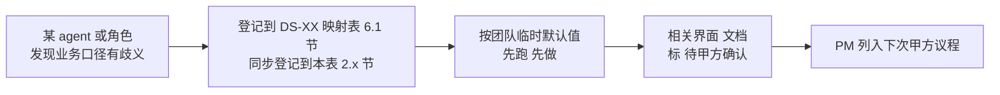

# 客户决策清单跟踪表

> **作用**：把所有 DS / 试点 / 评审 过程中产生的"**需要甲方拍板**"业务口径决策**集中跟踪**，避免散落在各 `DS-XX-data-availability-matrix.md` 或 handoff 里被遗忘 / 重复问 / 互相矛盾。
> **维护者**：PM（owner） + coordinator-agent（自动汇总）
> **更新频率**：每次试点 / 评审 / 甲方接触后立刻回填
> **关联**：
> - 团队公约 §3.1（决策不外包给 AI，业务承诺只能甲方拍板）
> - `data-lineage-policy.md`（每个未确认项关联 metric_id）
> - 各 `data/DS-{XX}-data-availability-matrix.md` §6.1（决策项来源）
> - `task-registry.yaml`（决策影响的任务进度）
> - **飞书投影**：Bitable「甲方决策清单」表（只读看板；本表更新后跑 `node scripts/sync-feishu-decision-board.mjs` 刷新，见 `feishu-decision-board.yaml`）

---

## 1. 总览看板（在最上面，方便扫一眼知道节奏）

| 状态 | 数量 | 说明 |
|------|------|------|
| 🔴 高优先级 / 阻塞中 | _自动汇总_ | 阻塞当前 DS-XX 上线或评审 |
| 🟡 中优先级 / 临时默认 | _自动汇总_ | 已用临时默认值跑通，但要在某 deadline 前确认 |
| 🟢 已确认 | _自动汇总_ | 甲方书面/纪要确认，已落 cfg_metric / DDL |
| ⚪ 已撤销 / 合并 | _自动汇总_ | 项目变更后该决策项不再需要 |

**当前未确认总数**：`_PM 每周回填_`
**最早 deadline**：`_PM 每周回填_`
**下次甲方接触日期**：`_PM 维护_`

---

## 2. 决策项注册表

> 字段说明：
> - **ID**：`Q{编号}` （按时间顺序递增）
> - **来源**：哪份文档 / 哪次试点 / 哪次评审产生
> - **影响 DS / metric_id**：决策影响的功能点 / 指标
> - **团队临时默认**：试点期间先按这个跑（不阻塞）
> - **状态**：🔴 阻塞 / 🟡 临时默认 / 🟢 已确认 / ⚪ 撤销
> - **Deadline**：必须在此前确认（否则视为认可临时默认）
> - **甲方决策**：甲方书面/纪要确认的内容（含决策时间 / 决策人 / 证据链接）
> - **落地**：决策后的 cfg_metric bump / DDL / 代码 PR 链接

### 2.1 来自 DS-25 软科学成果展示试点（2026-06-17 启动）

| ID | 标题 | 来源 | 影响 DS / metric_id | 团队临时默认 | 状态 | Deadline | 甲方决策 | 落地 |
|----|------|------|---------------------|------------|------|---------|---------|------|
| Q001 | "软科学"如何精确过滤 `dwd_zh_project.discipline` 字段？ | `data/DS-25-data-availability-matrix.md` §6.1 第 1 项 | DS-25 全部 / 所有 `M_SS_*` metric | `discipline LIKE '软科学%' OR '管理学%' OR '公共管理%' OR '应用经济%' OR '社会学%'` | 🟡 | _PM 待填_ | _待甲方_ | _待 data-agent_ |
| Q002 | 是否在自建 DWD 层做"软科学子集表" `dwd.dwd_ss_topic` | `data/DS-25-data-availability-matrix.md` §6.1 第 2 项 | DS-25 性能 / data-agent 工作量 | ✅ 做 | 🟡 | _PM 待填_ | _待甲方_ | — |
| Q003 | 市/区级地图下钻数据精度从哪来（ODS 只到省级） | `data/DS-25-data-availability-matrix.md` §6.1 第 3 项 | DS-25 §1 分布地图 | 关联 `dwd_org_reg_info.address` 解析；甲方接受省级最差 | 🟡 | _PM 待填_ | _待甲方_ | — |
| Q004 | "难题攻关历程时间轴"业务语义？ | `data/DS-25-data-availability-matrix.md` §6.1 第 4 项 | DS-25 §3 详情案例 / `M_SS_TIMELINE_*` | 立项→中期→结题，基于 `approval_time + research_period` 派生 | 🟡 | _PM 待填_ | _待甲方_ | — |
| Q005 | 互动传播功能（§5 评论/点赞/收藏/分享）Wave 0 是否实现 | `data/DS-25-data-availability-matrix.md` §6.1 第 5 项 | DS-25 §5 / 范围 ±10% | 占位 + 标"Wave 2 后纳入" | 🟡 | _PM 待填_ | _待甲方_ | — |
| Q006 | 国外软科学课题 `dwd_en_project` 是否纳入 DS-25 | `data/DS-25-data-availability-matrix.md` §6.1 第 6 项 | DS-25 范围 ±10% | 默认不纳入（DS-25 = 国内） | 🟡 | _PM 待填_ | _待甲方_ | — |
| Q007 | 项目"结题判定"逻辑 | `data/DS-25-data-availability-matrix.md` §6.1 第 7 项 | DS-25 §7 进展跟踪 / `M_SS_PROJECT_PROGRESS_PCT` | `final_report_abstract IS NOT NULL` 视为已结题 | 🟡 | _PM 待填_ | _待甲方_ | — |

### 2.2 来自 DS-XX 其他试点（占位，未来填充）

| ID | 标题 | 来源 | 影响 DS / metric_id | 团队临时默认 | 状态 | Deadline | 甲方决策 | 落地 |
|----|------|------|---------------------|------------|------|---------|---------|------|
| Q008 | — | — | — | — | — | — | — | — |

### 2.3 来自架构 / 平台决策

| ID | 标题 | 来源 | 影响 | 团队临时默认 | 状态 | Deadline | 甲方决策 | 落地 |
|----|------|------|------|------------|------|---------|---------|------|
| Q009 | 企业域 metric_id 要素代号用 `ENT` 还是 `E1`？ | `demo-ui-topic/docs/ia/enterprise/`（UX-ENT 试点，开放项 K-O1） | 全部 `M_ENT_*`(49 条) | 按派单先用 `M_ENT_*` | 🟢 | 2026-06-18 | **已会签：方案 B**（2026-06-18，人类架构师/PM 经决策门确认）—— 保留 `M_ENT_*`，修订 policy §3.2 注册全 7 要素助记表(E1=ENT/E2=CHAIN/E3=ORG/E4=TECH/E5=TALENT/E6=SVC/E7=POLICY)，`E1~E7` 保留为废弃别名。依据 `ARCH-ENT-milestone-review.md` | ✅ policy §3.2 已 bump v1.1.0 + changelog；49 条种子 `M_ENT_*` 无需改名；algorithm/api 可按此命名落地 |

### 2.4 来自企业分析战略分析 IA 试点（2026-06-18，UX-ENT）

| ID | 标题 | 来源 | 影响 DS / metric_id | 团队临时默认 | 状态 | Deadline | 甲方决策 | 落地 |
|----|------|------|---------------------|------------|------|---------|---------|------|
| Q010 | 企业类型（外企/高企/小微/上市）精确判定规则？ | `ENT-wireframe.md` P1（K-O2） | E-21 / `M_ENT_TYPE_COUNT`/`M_ENT_TYPE_RATIO` | is_foreign/is_high_tech/is_sme/is_listed 按映射报告规则判定 | 🟡 | _PM 待填_ | _待甲方_ | _待 algorithm-agent_ |
| Q011 | "创新型企业"口径（=高企∪专精特新∪瞪羚∪独角兽？） | `ENT-wireframe.md` P0（K-O3） | E-20 / `M_ENT_INNOVATIVE_COUNT` | 王惠底稿：专精特新∪小巨人∪制造业单项冠军∪创新型中小企业（2026-08-27 徐滕强；非甲方闭合） | 🟡 | _PM 待填_ | _待甲方_ | seed + calc-logic 已按临时默认改挂项目 DWD（COVER-STAT-L01） |
| Q012 | 行政区划下钻精度（到市 / 到区县） | `ENT-wireframe.md` P1（K-O4） | E-21 地图下钻 | 到市级（参考 DS-25 Q003） | 🟡 | _PM 待填_ | _待甲方_ | — |
| Q013 | 领域"覆盖广度/深度"计算口径（领域全集/权重） | `ENT-wireframe.md` P2（K-O5） | E-22 / `M_ENT_DOMAIN_COVERAGE_*` | chain_score+产品/专利贡献加权 | 🟡 | _PM 待填_ | _待算法 lead+甲方_ | — |
| Q014 | 技术力/商业力/竞争力指标库构成与默认权重 | `ENT-wireframe.md` P3/P10（K-O6） | E-23/E-24/E-30 / `M_ENT_TECH_POWER_SCORE` 等 | 沿用现有原型默认权重（专利25%等） | 🟡 | _PM 待填_ | _待甲方_ | _待 algorithm-agent_ |
| Q015 | 招引/培育推荐指数阈值与权重 | `ENT-wireframe.md` P6（K-O9） | E-26/E-27 / `M_ENT_ATTRACTION_INDEX`/`M_ENT_CULTIVATION_INDEX` | 产业相关度+政策匹配+生态连接度等权 | 🟡 | _PM 待填_ | _待甲方_ | COVER-STAT `ATTRACT_SCORE`/`CULTIVATE_SCORE` 二次分缺口已暴露（2026-08-28）：团队临时等权不升 🟢；不与 INDEX 合并；不结项 |
| Q016 | 多城市对标默认城市集合 | `ENT-wireframe.md` P5（K-O8） | E-25 / `M_ENT_CITY_*` | 北京/上海/苏州/广州 | 🟡 | _PM 待填_ | _待甲方_ | — |
| Q017 | 供应链核心供应商阈值 + 断链风险评级规则 | `ENT-wireframe.md` P8（K-O10） | E-28 / `M_ENT_SUPPLY_CHAIN_RISK`/`M_ENT_CORE_SUPPLIER_COUNT` | chain_score 阈值+中心性算法 | 🟢 | 2026-08-11 | **按团队临时默认升格为项目基线闭合**（2026-08-11，监管人会话指示；非甲方书面纪要）。锁定口径：①供应商范围=直接一级；②核心供应商=投资关系金额 TOP5（无份额字段时的代理，chain_score 可作辅证）；③关键节点=`centrality_norm≥80`（加权 PageRank min-max×100）；④关系强度按投资金额分档（>1 亿=强 / 1000 万~1 亿=中 / <1000 万=弱）；⑤断链风险复用 B1：失信 3.0+异常 1.5+处罚 1.0 加权 min-max，等级 `<0.3` 低 / `0.3~0.6` 中 / `>0.6` 高；图谱风险类型=单点依赖/节点异常/路径脆弱。上线前建议补甲方书面确认。 | ✅ `cfg_metric-ENT-seed.yaml` 去 pending_data_lead(Q017)；demo/lumen `metricSeed`/`readinessSeed`/`entGapCatalog` 同步；风险页移除 Q017 PendingBadge |
| Q018 | 痛难点诊断维度与阈值（依赖专家知识库） | `ENT-wireframe.md` P9（K-O11） | E-29 / `M_ENT_PAINPOINT_*` | 技术/市场/融资/管理四维 | 🟢 | 2026-08-11 | **按团队临时默认升格为项目基线闭合**（2026-08-11，监管人会话指示；非甲方书面纪要）。锁定口径：①诊断维度=技术研发/市场拓展/融资/管理（招标四维，不含人才/政策）；②命中规则=研发投入同比下降→技术、营收同比下降→市场、融资轮次停滞→融资；管理维无稳定时序则 `insufficient` 暂不判断；③严重度仅阅读优先级：降幅 `>30%` 高 / `10%~30%` 中 / `<10%` 低，不转企业得分或排名；④与行业差距沿用 A3 产业链分组 + P25/P75 基线，展示原始差值不设硬阈值。上线前建议补甲方书面确认。 | ✅ `cfg_metric-ENT-seed.yaml` 去 pending_data_lead(Q018)；demo/lumen 镜像同步；风险页移除 Q018 PendingBadge |
| Q019 | `M_ENT_MARKET_SHARE` 市场份额无数据源，采购 / 降级 / 下架？ | `cfg_metric-ENT-seed.yaml`(no_source) + QA-ENT 核验（K-O7） | E-24 商业力 / `M_ENT_MARKET_SHARE` | 暂置空 + 不实现，UI 标 ❌ 无来源 | 🟡 | _PM 待填_ | _待甲方/采购决策（市调数据采购 or 永久下架）_ | **FE L03a 已落（2026-06-22）**：`metricSeed.ts` 加 `M_ENT_MARKET_SHARE` 占位项 `mapping_status='❌'`；`PendingBadge` 自动渲染 ⚠️ + Tooltip"该指标暂无数据源（Q019），Wave 0 暂置空"。algorithm-agent 已标 no_source 不实现 |

### 2.5 来自全系统角色权限体系设计（2026-06-22，product-agent）

> 来源：`agent-handoffs/产品整体定义/全系统角色权限体系设计.md` §13（配套 `权限点清单-菜单与按钮.md`）。权限为横切能力（D6），不计入 58 功能点 ±10%；确认前 Wave 0 按临时默认运行，相关界面加 ⚠️"权限口径待甲方确认"。

| ID | 标题 | 来源 | 影响 | 团队临时默认 | 状态 | Deadline | 甲方决策 | 落地 |
|----|------|------|------|------------|------|---------|---------|------|
| Q020 | 用户级别档数与命名（本稿 L0–L4 五档） | `全系统角色权限体系设计.md` §15 R-01 | 全系统鉴权模型 | L0 访客/L1 注册/L2 专业/L3 内部/L4 管理 五档 | 🟡 | _PM 待填_ | _待甲方_ | _待 architect 评审_ |
| Q021 | 各级别准入条件（注册 / 实名认证 / 内部审批） | §15 R-02 | SSO 接入 / 注册流程 | L1 注册即得、L2 实名认证、L3 内部审批 | 🟡 | _PM 待填_ | _待甲方_ | — |
| Q022 | 数据密级分层（公开/内部/敏感/涉密 4 级）及各级别可见映射 | §15 R-03 / §9.1 | 全系统数据列级权限 | §9.1 四级映射 | 🟡 | _PM 待填_ | _待甲方_ | _待 data/api-agent_ |
| Q023 | 敏感字段清单（联系方式/法人/财务/名单/尽调…） | §15 R-04 / §9.2 | 企业/人才/政策脱敏 | §9.2 样板清单 | 🟡 | _PM 待填_ | _待甲方_ | — |
| Q024 | 数据范围过滤维度（是否按区域 / 单位限定可见数据） | §15 R-05 / §9.3 | 行级数据权限 | 按所属区域 + 单位过滤 | 🟡 | _PM 待填_ | _待甲方_ | — |
| Q025 | 导出配额与水印策略（L1/L2 配额数） | §15 R-06 | 导出功能 | L1 低配额、L2 中配额、L3 不限 + 水印 | 🟡 | _PM 待填_ | _待甲方_ | — |
| Q026 | 生态企业用户能否升级到 L2 分析（认证后） | §15 R-07 | 企业主题分析级开通 | 认证后可 L2 | 🟡 | _PM 待填_ | _待甲方_ | — |
| Q027 | 接待大屏是否完全无登录（L0 公开） | §15 R-08 | 接待场景/大屏 | 是，L0 公开 | 🟡 | _PM 待填_ | _待甲方_ | — |
| Q028 | 讲解员/设备运维是团队角色 vs 甲方现场人员 | §15 R-09 | L4 子角色归属 | 甲方现场 + 我方支持 | 🟡 | _PM 待填_ | _待甲方_ | — |
| Q029 | 展示/专题后台用户与权限管理是否同一套（SSO 统一） | §15 R-10 | 统一权限服务边界（D6） | 同一套 SSO + 统一权限服务 | 🟡 | _PM 待填_ | _待甲方/架构师_ | _待 architect_ |
| Q030 | 展示系统 30 个二级页面（DS-01~30）各自的「最低用户级别 + 屏幕类型(大/中/小)呈现」口径 | `权限点清单-菜单与按钮.md` §2.1/§2.5 | 展示系统全部二级页面菜单与屏幕适配 | 见 §2.1 表（团队默认：态势/全景/监测/成果/政策全景/人才态势=L0；评估/规划/政策分析/数据视窗/图谱指标算法=L1；推演/推荐/图服务=L2；大屏纯展示无个人定义、中屏最全无酷炫、小屏裁剪） | 🟡 | _PM 待填_ | _待甲方/架构师_ | _待 architect 评审_ |
| Q031 | 企业分析概览 E-20 在 L1「仅结论条」的精确范围（哪些 KPI/趋势/TopN/下钻对 L1 隐藏 vs 显示） | `UX-权限交互规范-企业维度.md` §1.7/§6（E-PERM-L01） | E-20 `menu:ent:dash` L1 降级呈现 | L1 = 结论条 + 企业检索入口；KPI×5/趋势/全国分布/TopN 下钻等按降级态处理（菜单可进、内容受限） | 🟡 | **L03b 启动前** | _待产品/甲方_ | **FE L03a 部分落（2026-06-22，commit a85dd57）**：`EnterpriseOverview.tsx` 标题旁已挂 `<PendingBadge pendingRef="Q031" hint="概览页内容范围与命名 待甲方确认（D-3 去重后）" />`；UX §8.2 段落级 mask（L1 仅 JudgmentStrip + 检索入口的灰显态）**留 L03b**（需先确认本项口径再实施）。`PM-决策-E-PERM-L03a-签字单.md` D8 |
| Q032 | 企业 E-21/E-22 去重后 IA 与命名统一（移除概览"结构洞察"tab 是否需业务确认；"痛难点诊断↔企业发展支持"命名统一；"企业全景"归门户 E-33） | `UX-权限交互规范-企业维度.md` §1（D-3 去重，E-PERM-L01） | 企业分析层 IA / 验收目录命名 | 采方案 B（独立页 `menu:ent:type`/`domain` 权威）；概览页移除"结构洞察"tab；命名统一为"痛难点诊断" | 🟡 | **下次甲方接触** | _待产品/甲方_ | **FE L03a 已落（2026-06-22，commit a85dd57）**：① `EnterpriseOverview.tsx` 删除 `structure` 主 tab + `analysis-tabs` 整组（企业全景/类型概览/领域概览）；② 独立页 `/enterprise/{type,domain}-distribution` 为唯一权威；③ 老链接 `/enterprise/analysis` + 3 子路径加 301 重定向；④ E-33 企业全景归门户 `/development/key-enterprises`（不在分析层重复）；⑤ 当前命名沿用"企业发展支持"（pain-points 路由保留旧 path），待甲方确认是否切回"痛难点诊断"。**待 PM 在评审会向甲方确认本方案** |
| Q-REPORT-PAID-01 | 报告 PDF 是否作为**用户级付费权益**（与 L0–L4 能力轴正交）；免费用户是否仅止于非深度分析；HTML 创建 vs PDF **导出**分权 | `PLAN-报告创建与PDF付费权益-方案B.md`（2026-08-11） | 全专题「创建报告 / 导出」；顶栏权益角标；关联 Q020/Q025 | **团队临时默认（方案 B，已拍板）**：≥L2 可创建并查看 HTML；用户级 `paid` 才可**导出** PDF；**L3/L4 默认 paid=true，L2 默认 false 且演示可切换为 L2+付费**；顶栏两枚角标；Wave 0 **仅 UI 锁**；任务 `PERM-REPORT-PAID-UI-L01` | 🟡 | Demo UI 锁可先落；上线前须甲方确认商业档 | _待甲方 + 产品/架构_ | _确认后升 🟢；Wave 1 拆码 + SSO 下发_ |

### 2.6 来自企业维度 2026-07-12 PDR 评审会

> **来源**：`企业维度20260712会议纪要.md`（2026-07-12）· 同步至 `PM-PDR-ENT-{SEARCH,COMPARE,PROFILE}-评审纪要.md` §3.2/§3.3 Δ 表  
> **姓名对照**：C宝吖～ = 高颖；知行一 = 唐绍祖（算法）；丽影 = 曹丽影  
> **维护**：2026-07-13 coordinator 依据详录登记

**PDR Δ 表 ↔ 清单 ID 速查**

| PDR 纪要 | Δ ID | 清单 ID |
|----------|------|---------|
| SEARCH | Δ-1 ~ Δ-4 | Q033 ~ Q036 |
| SEARCH / COMPARE | — | Q037 |
| SEARCH / PROFILE | Δ-3 / Δ-P1 | Q035 |
| PROFILE | Δ-P3 ~ Δ-P5 | Q038 ~ Q041、Q045 |
| OVERVIEW（非 Trio，同期会议） | — | Q042 ~ Q044 |
| 产业服务机构（非 Trio） | — | Q046 |

| ID | 标题 | 来源 | 影响 DS / REQ / 模块 | 团队临时默认 | 状态 | Deadline | PDR Δ | 落地 |
|----|------|------|----------------------|------------|------|----------|-------|------|
| Q033 | 智能搜索不做大模型 NL，仅关键词 + 多字段匹配 | 企业维度 2026-07-12 会议纪要 · 智能搜索条款 | SEARCH / E-20~E-22 | 多字段匹配检索，不走 NL 解析 | 🟢 | — | SEARCH Δ-1 | 待回写 Decision 055 + ENT-search-design |
| Q034 | 查企业/智能搜索结果统一横向长卡片（类列表），取消卡片/表格双视图切换 | 同上 · 结果列表展示 | SEARCH / E-20 | 类企查查单行/长卡片列表 | 🟡 | V1 会签前 | SEARCH Δ-2 | 高颖修订 wireframe/USM；曹丽影 UI |
| Q035 | 企业导出：≤1000 条异步下载 + 个人中心记录；单企业 Excel→PDF + 水印（平台名+用户名）；批量打包 PDF | 同上 · 导出限制 | SEARCH + PROFILE / 导出 | 按会议规格实现；关联权限 Q025 | 🟡 | 查询联调前 | SEARCH Δ-3 · PROFILE Δ-P1 | 徐滕强 + 前端；郭万迎裁定 vs Decision 072 |
| Q036 | 高级筛选本期不做条件重复组合（AND/OR 嵌套），简化版实现 | 同上 · 高级筛选 | SEARCH | 简单条件叠加；企查版后续评估 | 🟢 | 高筛开发前 | SEARCH Δ-4 | 高颖 + 曹丽影 + 徐滕强定规则 |
| Q037 | 空态推荐默认展示重点/明星企业列表 ≤30 条，不按用户行为个性化 | 同上 · 推荐企业空态 | SEARCH + COMPARE | 固定重点/明星列表 ≤30 | 🟡 | 对比栏/推荐开发前 | COMPARE Δ-C3 | 高颖原型 + 徐滕强接口 |
| Q038 | 重点企业识别阈值：先用专利数；技术交易额等暂无数据搁置 | 同上 · 重点企业阈值 | KEYENT / 重点企业 | 专利数阈值初版 | 🟡 | 算法 demo 更新前 | PROFILE Δ-P4 | 唐绍祖 | **2026-10-26 临时落地（团队默认值，仍 🟡 待甲方确认）**：`key_enterprise` = 国高新(`high_tech`) ∪ 小巨人(`little_giant`)，28,132 家已写入 `demo_gkxlumenx_dwd.enterprise_tag` 并经 ETL 同步 ES；正式算法口径（专利数阈值等）仍按本行原计划由唐绍祖出，届时覆盖重打 |
| Q039 | 重点企业在内部评审模式加「?」溯源说明（计算口径文案） | 同上 · 重点企业溯源 | KEYENT + PROFILE 提示 | 问号浮层 + 算法说明一致 | 🟡 | demo 更新时 | PROFILE Δ-P4 | 高颖文案 + 唐绍祖算法说明 |
| Q040 | 企业上下游生态图谱：先用图数据库 demo（实体+关系 API）占坑，后续灌招投标/产业链数据 | 同上 · 生态图谱 | PROFILE 关联页签 / E-28 | 图库 demo API 占坑 | 🟡 | 图谱模块开发前 | PROFILE Δ-P3 | 徐滕强 + **唐绍祖**（算法） |
| Q041 | 明星企业：固定明星企业表；基础指标我方出数；视频/团队/介绍 CMS 人工维护；团队成员画像字段、排序、人物照片与外部人物主页的发布/授权口径待闭合 | 同上 · 明星企业；`agent-handoffs/产品整体定义/E-31-企业发展/E-34-明星企业介绍/USM-ENT-STAR.md` | KEYENT / E-34 | 内部评审显示字段、来源、发布与授权状态；非评审演示仅使用匿名 DEMO 成员及具备演示授权的中性人物素材；正式态只展示 CMS 已发布且照片/外链授权有效的内容 | 🟡 | 门户 CMS 对接后、E-34 正式实现前 | PROFILE Δ-P5 / ENT-MOD-STAR-PACK-L01 | 高颖 + CMS 运营（外部）确认；郭万迎闭环。**DATA-ENT-CMS-VS-APP-PARTITION-L01（2026-07-16）**：产品/团队/媒体/历程/口碑已分区为 CMS（见 `CMS-read-contract-E31.md` §3.3–3.5）；基础量化指标属 APP（`ADS-facts-contract-E31.md` §3.2）；照片/外链须 `publish_status=published` ∧ 授权=authorized |
| Q042 | 地图缩放展示粒度：全球→国家→区→深圳明细；深圳级先热力再放大显名称 | 同上 · 地图缩放 | OVERVIEW / E-21 | 研发拿到真实数据后商定细则 | 🟡 | 真实数据到位后 | —（OVERVIEW 待 PDR） | 徐滕强 + 前端 + 研发 |
| Q043 | 企业总览删除「上期对比」类说明，不再自行扩展 | 同上 · 企业总览 | OVERVIEW / E-20 | 删除该类说明区块 | 🟢 | 近期原型修订 | — | 高颖 |
| Q044 | 企业分布情况仅保留地图+列表+区域切换，不搬展示系统多余条件；默认最新数据 | 同上 · 企业分布 | OVERVIEW / E-21 | 地图+列表+区域切换 | 🟢 | UI 出稿同步 | — | 高颖 + 曹丽影 |
| Q045 | 竞争力/重点企业等算法描述与 demo、前端内部评审「?」说明保持一致 | 同上 · 算法一致性 | 全 ENT 指标展示 | 算法变更时同步改前端问号文案 | 🟡 | 每次算法迭代 | PROFILE M7 | 唐绍祖 + 高颖 |
| Q046 | 产业服务机构概况模块参照企业查询设计，调度智能体跑 UI/需求结构 | 同上 · 产业服务机构 | E6 产业服务链 | 企业模块定版后 AI 推导一版 | 🟡 | 企业模块定版后 | —（非 Trio） | 高颖 + 侯佳伟 |
| Q047 | E-33 重点企业规模/领域统计的正式 metric_id、ADS 来源、地域聚合、多标签计数及论文/专利关键词到产业链的映射口径 | `bid-reference/智慧服务门户系统-要素相关.md` E-33；`agent-handoffs/产品整体定义/E-31-企业发展/E-33-重点企业概览/USM-ENT-KEYPANO.md` | E-33 重点企业概览 | 资质荣誉复用系统通用枚举并允许多标签重复计数；地域按国家/省/市；关键词映射与三项统计在正式口径确认前标 `DEMO`，不生成虚构排名 | 🟡 | E-33 门1 PDR 前 | ENT-MOD-KEYPANO-PACK-L01 | 何老师 + 唐绍祖 + 徐滕强确认；郭万迎闭环。**PARTITION-L01**：三项统计 **纯 APP**；建议 metric `M_ENT_KEY_QUAL_SCALE` / `M_ENT_KEY_DOMAIN_COUNT` / `M_ENT_KEY_DOMAIN_EVIDENCE`（见 `ADS-facts-contract-E31.md` §3.1）；**禁止**手填进 CMS；关键词映射 🔧 算法写 ADS |
| Q048 | E-34 明星企业候选名单、发布准入、`sort_order`、入选标准、标准版本更新与基础量化指标 metric_id / 数据来源 | `bid-reference/智慧服务门户系统-要素相关.md` E-34；`agent-handoffs/产品整体定义/E-31-企业发展/E-34-明星企业介绍/USM-ENT-STAR.md` | E-34 明星企业介绍 | 当前未来产业配置 `0..N` 家固定 DEMO 名单；名单条目与基础介绍发布后进入前台，按 `sort_order` 默认第一家；1 家直接展示，2 家及以上提供可搜索选择器；首屏展示入选理由，标准未定稿时标“待配置”；专利数、研发投入占比、人才比例在正式口径确认前标 `DEMO`，不展示权重、阈值或排名 | 🟡 | E-34 门1 PDR 前 | ENT-MOD-STAR-PACK-L01 | 何老师 + 唐绍祖 + CMS 运营确认；郭万迎闭环。**PARTITION-L01**：名单/`sort_order`/标准正文 → **CMS**；专利数/`M_ENT_STAR_RD_RATIO`/人才比 → **APP**（`ADS-facts-contract-E31.md` §3.2）；「共 N 家」= 对 CMS 已发布名单的 APP `COUNT`，非算法 TopN。COVER-STAT-L01 已写 `M_ENT_STAR_ENTERPRISE_COUNT`（不改名 ROSTER_COUNT）；仍 🟡 |
| Q049 | E-35 深圳企业统计的正式 metric_id / ADS、趋势可比性、规模分级、产业目录及产业链领域映射、深圳本地企业 CMS 接口 | `bid-reference/智慧服务门户系统-要素相关.md` E-35；`agent-handoffs/产品整体定义/E-31-企业发展/E-35-深圳企业介绍/USM-ENT-SHENZHEN.md` | E-35 深圳企业介绍 | 固定深圳市；**目录分组本轮改走 Q068 的 15 集群**（不再把八产业 DEMO 当现行上限）；规模暂按大/中/小/微展示并标待确认；趋势少于两个连续可比点时隐藏；本地企业定位/优势只展示 CMS 已发布内容 | 🟡 | E-35 门1 PDR 前 | ENT-MOD-SHENZHEN-PACK-L01 | 何老师 + 徐滕强 + 唐绍祖 + CMS 运营确认；郭万迎闭环。**PARTITION-L01**：数量对比/趋势/规模/领域计数 → **APP**；定位/优势/专家分析 → **CMS** `sz_enterprise_intro`；`future_industry_code` **只读兼容**，新写入 `cluster_id`/`industry_id`，与 E-32/E-34 **APP 同源（Q068）**；DEMO 内「规上/大中小微」与「大中小微」枚举须在闭合前统一 |
| Q050 | 久新 CMS 已发布只读 API 与应用侧消费契约对齐：字段名、错误码、幂等键、`enterprise_code` join、禁止下发权重/阈值 | `DATA-ENT-CMS-VS-APP-PARTITION-L01`；`CMS-read-contract-E31.md` | E-33/E-34/E-35 × 久新对接 | 以 `CMS-read-contract-E31.md` 为消费契约真源；久新可内部实现任意，但发布面须覆盖信封字段 + content_type；应用侧不读久新内部库表 | 🟡 | 久新联调启动前 | DATA-ENT-CMS-VS-APP-PARTITION-L01 | 徐滕强（聚合）+ 侯佳伟（Java Facade）+ 久新接口负责人签字；郭万迎闭环 |
| Q-ENT-ROLE-ALIGN-01 | 企业分析产品角色口径：废止「科研人员」正式角色；统一为源需求「政府、园区、投资机构」；门户公开浏览保留「访客」（接待场景） | `§1.1.1.2.4.2.3 企业分析`；展示系统总论接待场景；`USM-E-31` v0.6 + E-33/34/35 | E-31~E-35 / 企业分析 | **本轮决策（对齐源需求，非甲方拍板）**：业务故事只使用政府/园区/投资机构；E-34/E-35 公开介绍可使用访客；原「科研人员」故事改挂投资机构或政府 | ⚪ | 2026-08-03 | ENT-MOD-OVERVIEW-PDR-G1 | 郭万迎监管；高颖体验共签；product-agent 已改 USM |
| Q-OPS-01 | 非 E-37 的维护管理能力（`LF-ENT-OPS-A2~A5` / `B1~B4` / `C1~C6`）是否增补 acceptance-catalog 正式叶子编号 | `ENT-MOD-OPS-PACK-L01`；`TRACE-ENTOPS-维护管理.yaml` v0.2；`企业维护管理-能力全清单.md` v0.2 | ENT-OPS 维护管理（全量 15 项） | TRACE 用 `E-37` + `LF-ENT-OPS-*` + bid/深化规格章节追溯；不静默删除任何一级能力（含分析配置六分区） | 🟡 | 维护管理门1 PDR 前 | ENT-MOD-OPS-PACK-L01 | 郭万迎闭环；何老师/徐滕强会签编目 |
| Q-OPS-02 | 企业主体写侧归属：久新 CMS 独占 vs 本系统「维护管理」可写运营层（关联 Q050） | 同上；`CMS-read-contract-E31.md` | ENT-OPS · 企业主体（A2） | 临时默认：本菜单提供可写运营层 UI；ODS 工商只读+纠错；正式以久新契约为准 | 🟡 | 久新联调 / UX-L01 前 | ENT-MOD-OPS-UX-L01 | 淮政玮拍板路径；郭万迎推进；徐滕强+久新接口负责人 |
| Q-OPS-03 | 分析配置 C1–C6 是否计入招标验收叶子，以及源需求服务岗位正式名称（深化规格仅写 OPS/SYS 实现映射） | `企业完整深化规格.md#维护管理`；`TRACE-ENTOPS-维护管理.yaml` | ENT-OPS · 分析配置 | 临时默认：菜单六分区必保留（占位）；产品角色标「待业务确认」，不得把 OPS/SYS 倒灌为源需求岗位 | 🟡 | 维护管理门1 PDR 前 | ENT-MOD-OPS-PACK-L01 | 郭万迎闭环；何老师会签；淮政玮路径确认 |
| Q-OPS-04 | A5「企业发展可视化配置」与 catalog E-36 的验收边界（配置写侧 vs 前台可视化消费） | §1.1.1.2.4.5.4.3；`catalog-topic-enterprise.yaml#E-36` | ENT-OPS · A5 / E-36 | 临时默认：A5=维护管理内配置写侧；前台只读消费已发布配置结果；不把分析页塞进维护菜单 | 🟡 | UX-L01 / 门1 PDR 前 | ENT-MOD-OPS-UX-L01 | 高颖体验边界；郭万迎合规闭环 |

### 2.x 来自科技资讯实体抽取预研（E-TECH-NEWS-ENTITY-PDR · 2026-07-27）

| ID | 标题 | 来源 | 影响 DS / metric_id | 团队临时默认 | 状态 | Deadline | 甲方决策 | 落地 |
|----|------|------|---------------------|------------|------|---------|---------|------|
| Q051 | 「产业」实体边界：赛道名 / 产业链节点 / 统计口径产业目录，三者如何取舍？ | `designs/tech-news-entity-extraction/PDR.md` §3 | 科技资讯实体抽取 / entity-v0.1 | 临时按常见赛道关键词表（新能源汽车/半导体/人工智能等）启发式抽取，UI 标⚠️待甲方确认 | 🟡 | Wave1 LLM 实跑前 | _待甲方_ | PDR-L01 mock；schema-v0.1 |
| Q052 | 「事件类型」枚举是否采纳临时 7 类（product_release/tech_breakthrough/delivery/certification/collaboration/policy_publish/other）？ | 同上 §4 | 科创事件结构化 | 按临时 7 类跑通沙箱；未命中归 other | 🟡 | schema 升 v1.0 前 | _待甲方_ | PDR-L01 mock；prompt-entity-v0.1 |

### 2.y 来自产业链数据源分析（CHAIN-INST-DATA-ANALYSIS-L01 · 2026-07-29）

> **来源**：`agent-delivery/data/data-design/产业链/产业链-ODS到DWD字段映射分析报告(v3).md` + `国内机构库-ODS到DWD字段映射分析报告.md`
> **登记人**：[human:李伟]（架构师）
> **背景**：分析 ODS 入站库（`183.240.141.251:3318/gkx`）产业链相关源表后发现的阻塞项；v5 目标 DWD 为 14 张表。**本轮灌数分析只参考 4 张表**：`dwd_industry_chain_info` / `dwd_org_industry_tags` / `dwd_org_industry_product_tags` / `dwd_industry_chain_news_info`（其他供应方表暂无参考价值）。2026-08-06 / 08-07 复核：可派生 12 条 L0 / 1273 节点（可选 41 条 L1）；tags/product_tags 各 20000 行。**2026-08-25 资讯裁定**：`dwd_industry_chain_news_info` 合规交付、禁止业务使用；资讯改用 `dwd_org_important_news_info` + 行业分析要素库。**Q053 编码归一已于 2026-08-07 由架构师冻结（INB 升格为平台主键）**。

| ID | 标题 | 来源 | 影响 DS / metric_id | 团队临时默认 | 状态 | Deadline | 甲方决策 | 落地 |
|----|------|------|---------------------|------------|------|---------|---------|------|
| Q053 | 产业链编码体系：ODS INB vs 国标 Mock，采用哪套作平台主键？ | `DEC-CHAIN-Q053-CODE-NORMALIZATION-20260807.md`；Step2；`gkx-platform-business-keys.md` | 全部 CHAIN DWD 的 `chain_id`/`node_id`/`industry_id` 及 Nebula VID | **采用 INB 原文升格**：`chain_id=chain_code=INB*`，`node_id=node_code=INB*`，L0 的 `industry_id=chain_id`；国标不进主键，仅可选对照表 | 🟢 | — | **2026-08-07 human:李伟（架构）**：技术主键冻结为 INB；国标展示/对接另开对照表，不回写主键。非对外业务文案口径，无需等甲方改主键 | v5 §3.2 + 平台主键表已改；ETL 可按 INB 灌结构子集；历史国标 Mock 须迁移或隔离 |
| Q054 | 投融资数据：本轮 4 张参考表均无投融资字段，`investment_event` 无法由本轮源灌数；正式投融资源表与到位时间待定 | Step2 §3/§4.5（仅 4 表） | `industry_chain_investment_event` / `investment_participant` | 继续 Mock + 🧪 MockBadge | 🔴 | chain 投融资灌数前 | _待数据供应方 / 甲方_ | _待正式源表确认后 data-agent 灌数_ |
| Q055 | 国内机构库主体表全空（`dwd_org_reg_info` / `dwd_org_sc_info` / `dwd_org_hels_info` 均 0 行），机构数据何时到位？ | `国内机构库-ODS到DWD字段映射分析报告.md` | 机构库多数字段无源；`realdata_research_org_stat` 仅 4 个基础字段可灌；Nebula `institution` Tag 仅能灌 4 个字段 | 仅灌 `dwd_org_innovation_carrier`（1,404 行）可用字段；其余 Mock | 🔴 | 机构库灌数启动前 | _待数据供应方 / 甲方_ | _待数据到位后 data-agent 灌数_ |

### 2.z 来自企业检索字典/码表盘点（DATA-ENT-DICT-CATALOG-L01 · 2026-07-29）

> **来源**：`agent-delivery/data/data-design/企业/ENT-DICT-CATALOG-L01.md`  
> **登记人**：`agent:data-agent`（监管 `human:淮政玮`）  
> **背景**：结果区地域级联与省市区国标树割裂；企业类型/规模/上市状态前后端枚举不一致。  
> **闭合**：2026-07-29 项目负责人 `human:淮政玮` 会话逐项确认 → 全升 🟢。

| ID | 标题 | 来源 | 影响 DS / metric_id | 团队临时默认 | 状态 | Deadline | 甲方决策 | 落地 |
|----|------|------|---------------------|------------|------|---------|---------|------|
| Q056 | 「区域」业务口径：京津冀/长三角/大湾区；热门科创城市；全球范围 | `ENT-DICT-CATALOG-L01.md`；`regionOptions.ts` | 结果区地域筛选 / `region_scope` / `region_scope_member` | 法定边界初始化成员 + 运营可改；热门城市运营维护+Mock；全球=G20主要科创城市 | 🟢 | — | **2026-07-29 human:淮政玮**：①区域包运营可维护、按法定边界初始化；②热门科创城市运营可自行维护、需 Mock；③全球=G20 国家主要科创城市 | **L02+L03**：建表灌种 + `/meta/region-scopes`；L03 全量 code_region 3349 行 + 热门19/G20 30 Mock 扩种 |
| Q057 | 「企业类型」筛选项语义：工商注册类型 vs 资质/性质标签 | 同上；关联 Q010；FE `filterFieldSchema` vs `meta/company-types` | 高筛 company_type / tags_flat / `M_ENT_TYPE_*` | 拆双字段：工商→`company-types`；资质→`tag_dict`；废弃 FE 混选项 | 🟢 | — | **2026-07-29 human:淮政玮**：①拆成「工商类型」+「资质标签」；②接线时纠正双字段、旧混选项 mock 废弃 | L02：`/tags`→`gkxlumenx_dwd.tag_dict`；**FE-L05 done** 双字段已接线；**2026-07-29 CI+现网冒烟通过**（监管确认） |
| Q058 | 企业规模枚举：大中小微 vs 规上 | 同上；对齐《统计上大中小微型企业划分办法(2017)》；规上=工业营收≥2000万调查范围 | 高筛 enterprise_scale / `is_above_scale` / E-35（关联 Q049） | `enterprise_scale`∈{大型,中型,小型,微型}；`is_above_scale` 独立布尔可叠加 | 🟢 | — | **2026-07-29 human:淮政玮**：四档+规上独立标签且可叠加（规上∩大型合法） | **L02** meta 四档+`is_above_scale`；**L06** ETL/ES；**FE-L05** 去五档互斥；**CI+现网冒烟通过** |
| Q059 | 上市状态闭合集与 ODS 多值串派生 | 同上；实数 `dwd_org_base_info.stock_type/listed_status` 逗号多值 | 高筛 listing_status / ES keyword | 企业级：`上市`/`未上市`/`退市`；ETL 拆证券明细后派生；不含拟上市 | 🟢 | — | **2026-07-29 human:淮政玮**：①闭合集上市/未上市/退市（不含拟上市）；②多市场「上市+退市」企业级算上市；③UI 与落库均显示「上市」（不加「已」） | **L02** meta；**L06 ETL done**（ODS 10996）；**FE-L05** 三态接线；**CI+现网冒烟通过** |

### 2.aa 来自综合智能分析 · 区域创新要素（demo-ui-topic · 2026-08-13）

> **来源**：招标 §8.2.3 要素影响关联 / 贡献路径；原型 `RegionalInnovationElements` 原诚实空态  
> **登记人**：`agent:frontend`（会话确认方案 A：演示闭合）  
> **背景**：正式因果贡献算法未发布；演示需可走通「要素 → 产业/成果」路径交互，不得伪称正式归因已闭合

| ID | 标题 | 来源 | 影响 DS / metric_id | 团队临时默认 | 状态 | Deadline | 甲方决策 | 落地 |
|----|------|------|---------------------|------------|------|---------|---------|------|
| Q-SYNTH-E-02 | 区域创新要素「贡献路径」正式算法口径（因果归因 vs 关联强度、靶点定义、归一规则） | 系统方案 §8.2.3；`elementMock.ts` / `M_SYNTH_ELEM_CONTRIB` | 区域创新要素分析 / `M_SYNTH_ELEM_CONTRIB` | 演示态：`normalize(typeScore×w)` 映射产业/成果靶点，列表展示 Top6；UI 标 🧪+⚠️「非因果归因」 | 🟡 | 正式算法 METRIC-OPEN / 甲方会签前 | _待算法 lead + 甲方_ | **demo-ui-topic 2026-08-13**：工作台列表 + 报告证据段已展示演示路径；正式 ADS/公式未接 |

**执行类待办（不单独升 Q，记入会议纪要 / task-registry）**

| 待办 | 责任人 | 时间节点 |
|------|--------|----------|
| 四级地域筛选等通用组件封装（全球/G20、全国、区域、深圳） | 曹丽影 | UI 定版后 |
| `region_scope` 法定边界成员种子 + G20/热门城市 Mock（Q056） | data-agent / L02–L03 | **L03 done**；hot 19 / G20 30 / code_region 3349；大鹏新区 bind 仍开放 |
| 上市状态 ETL：ODS 逗号串 → 证券明细 → 企业级 listing_status（Q059） | data-agent / **L06 done** | 2026-07-29；**CI+现网冒烟已通过**（监管 human:淮政玮） |
| 产业链 ETL 灌数脚本（`industry_chain` / `industry_chain_node` / `industry_chain_entity_rel` 等 v5 目标表；**Q053 已冻结 INB**） | coordinator 派单 | **可排期**：按方案 A 灌结构子集；资讯/投融资仍受 Q054 等约束 |
| 机构→产业链映射建立（NLP 或人工标注，填补 INST-02 关联缺失） | algorithm-agent | 机构数据到位后 |

### 2.aa 来自政策模块 E7（补录 · PM-DECISION-BACKFILL-L01 · 2026-08-01）

> **来源**：`agent-handoffs/政策模块-E7/`（DATA-POLICY-metric-seed / ALGO-POLICY-fullset / QA-POLICY-acceptance-report / PROD-POLICY-definition §6）
> **登记人**：`agent:coordinator-agent`（监管 `human:淮政玮`）· 补录原因：QPOL 项此前只存在于政策 handoff，未登记中央决策表（违反 §3.1）
> **编号说明**：政策侧正式编号仅 QPOL-01~03；产品侧另有 🟡-01~07 平行清单，其中 🟡-01/02/04/06 并入 QPOL-02（权重·阈值族）、🟡-03 并入 QPOL-03；🟡-05/🟡-07 无对应正式编号，本次升格登记为 QPOL-05/QPOL-07（**QPOL-04/06 编号空缺不使用**，避免与历史"QPOL-01/02/03 + 🟡-04/05/07"并写混淆）
> **风险**：QA 验收报告结论——上述口径不闭合则政策页 A1/A2/A3/B1/B4 统计数字存在返工（关联 GL-03）

| ID | 标题 | 来源 | 影响 DS / metric_id | 团队临时默认 | 状态 | Deadline | 甲方决策 | 落地 |
|----|------|------|---------------------|------------|------|---------|---------|------|
| QPOL-01 | 政策「类型」一级分类规则（取 `topic_type` / `ma_contenttypenew` / `complextaginfojson`？） | `DATA-POLICY-metric-seed.md` §4；`cfg_metric-POLICY-seed.yaml` | P-03~P-07 / `M_POLICY_TYPE_DIST` | ODS `topic_type` 主题分类归一；缺失时回退 `ma_contenttypenew` | 🟡 | _PM 待填_ | _待甲方_ | METRIC-OPEN-L01 已入 gap/seed；UI ⚠️；待甲方 |
| QPOL-02 | 力度/效果/焦点/短板/机遇/布局/三维框架的指标体系、权重与阈值（含产品侧 🟡-01/02/04/06） | `DATA-POLICY-metric-seed.md` §4；`ALGO-POLICY-fullset.md` §6；`PROD-POLICY-definition.md` §6 | A1/A2/B1/B4、P-20/P-73 / `M_POLICY_INTENSITY_*`/`FOCUS_INDEX`/`EFFECT_SCORE`/`SHORTBOARD_COUNT`/`OPPORTUNITY_COUNT`/`LAYOUT_REC_COUNT` 等 | 种子文档等权打分；算法侧 `settings_policy.yaml` 经验权重（焦点 0.4/0.35/0.25）；产品演示力度权重 补贴40%+税收25%+数量20%+周期15% ——**三处临时值不一致，确认时须一并归一**。**【2026-11-05 增补 · human:淮政玮 拍板（POL-EFFECT-CALIBER-V2-L01）】区域效果板双指标先行去随机：效果评分=有效率×0.5+力度均值×50、落地实效=有效政策占比（demo/lumen 双仓 effect.py 已同步）；三维正本与权重仍待甲方归一，本增补只锁定「确定性、无随机分量」这一底线** | 🟡 | _PM 待填_ | _待甲方_ | METRIC-OPEN 定义卡已固化三处冲突；待甲方归一后改 settings |
| QPOL-03 | 政策关联度 / 产业适配 / 政策-主体匹配的相似度与判定规则（含产品侧 🟡-03） | `DATA-POLICY-metric-seed.md` §4；`ALGO-POLICY-fullset.md` §6 | A3、P-38 / `M_POLICY_RELATION_DEGREE`/`M_POLICY_INDUSTRY_FIT` | 共现/特征重合；产业适配用标签余弦相似度；匹配阈值 0.6 | 🟡 | _PM 待填_ | _待甲方_ | METRIC-OPEN 定义卡已写临时规则；待甲方 |
| QPOL-05 | 国内/国际政策是否合并入统计及归一化（原产品侧 🟡-05 升格） | `PROD-POLICY-definition.md` §6 | P-17、P-72、P-31 | 仅统计国内；国际单列不进综合分 | 🟡 | _PM 待填_ | _待甲方_ | METRIC-OPEN scope_notes 已采用临时默认；待甲方 |
| QPOL-07 | 政策「连续性」度量口径（原产品侧 🟡-07 升格） | `PROD-POLICY-definition.md` §6 | P-17 / `M_POLICY_CONTINUITY_INDEX` | 相邻年度均有发文的年份占比 | 🟡 | _PM 待填_ | _待甲方_ | 暂并 `M_POLICY_TIMESERIES`；独立 metric 待确认后升格 |

### 2.ab 来自产业链模块 E2（补录 · PM-DECISION-BACKFILL-L01 · 2026-08-01）

> **来源**：`agent-handoffs/产业链分析-CHAIN/DATA-CHAIN-db-design.md` §12（集中定义）；指标挂载以 `cfg_metric-CHAIN-seed.yaml` `pending_ref` 为准（共 29 条指标）
> **登记人**：`agent:coordinator-agent`（监管 `human:淮政玮`）· 补录原因：同 §2.aa，QC 项未登记中央决策表
> **与既有项关系**：Q053（编码体系）/ Q054（投融资 ODS 空表）是**数据侧**阻塞；本节 QC 是**业务口径**决策，二者互补不重复（QC07 数据到位依赖 Q054）

| ID | 标题 | 来源 | 影响 DS / metric_id | 团队临时默认 | 状态 | Deadline | 甲方决策 | 落地 |
|----|------|------|---------------------|------------|------|---------|---------|------|
| QC01 | 产业链完整度口径 | `DATA-CHAIN-db-design.md` §12 | `M_CHAIN_SZ_COMPLETENESS`/`M_CHAIN_COMPLETENESS_SCORE` | 按节点覆盖比例 | 🟡 | _PM 待填_ | _待甲方_ | — |
| QC02 | 关键环节判定阈值（含高价值/战略/集中度） | 同上 | `M_CHAIN_SZ_KEY_NODE_COVERAGE`/`KEY_NODE_COUNT`/`HIGH_VALUE_RATIO`/`STRATEGIC_IMPORTANCE`/`CONCENTRATION_INDEX` | 企业数量 Top20% | 🟡 | _PM 待填_ | _待甲方_ | — |
| QC03 | 产业周期判定模型（含技术成熟度） | 同上 | `M_CHAIN_CYCLE_STAGE`/`STAGE_SCORE`/`PHASE_DETERMINATION`/`TECH_MATURITY_SCORE` | 基于增速趋势 | 🟡 | _PM 待填_ | _待甲方_ | — |
| QC04 | 瓶颈类型细分口径（含断链风险） | 同上 | `M_CHAIN_BOTTLENECK_COUNT`/`SEVERITY`/`TYPE_DIST`/`BREAK_RISK_COUNT` | 5 维（技术/人才/市场/资本/政策） | 🟡 | _PM 待填_ | _待甲方_ | — |
| QC05 | 区域指数权重（原「三维等权」；维度集合见 QC11） | 同上 + `DEC-CHAIN-REG-INDEX-DIM-FOUR-FORCE-20260806` | `M_CHAIN_REGION_INDEX`/`ENTERPRISE_POWER`/`ACADEMIC_POWER`/`SUPPORT_POWER`/`COMPETITIVENESS_INDEX` | **临时默认随 QC11**：Demo 按四力下 12 个预设叶子等权演示（合计 100%）；正式维度数/权重以王慧·邵总对齐国标 + 甲方确认后为准；原「等权 1/3」仅作历史算法三维草案 | 🟡 | _PM 待填_ | _待甲方（与 QC11 一并确认）_ | Demo 已切四力叶子权重；确认后同步 cfg_metric |
| QC06 | 产业市场规模计算口径：链下企业年报营收加总（仅企业）vs 外购市调；ENT 营收字段/统计年细节 | seed `M_CHAIN_MARKET_SIZE`；v5 §5.5；Step2 §4.5 | `M_CHAIN_MARKET_SIZE`/`M_CHAIN_MARKET_GROWTH` | **2026-08-07 human:李伟**：平台默认 = Σ 产业链关联企业年报营收（只计企业，不计其他主体）；**非 ODS 直灌**；结果落 ADS。ENT 年报字段名与是否含境外营收等细节待与 ENT/数据 Lead 对齐 | 🟡 | ENT 年报字段冻结前 | _计算方式已架构确认；细字段待 ENT 对齐（无需采购市调作默认）_ | cfg_metric 升 v0.2.0；UI 计算未接线前仍可 🧪 |
| QC07 | 投融资数据来源（资讯 NLP 抽金额 vs 采购三方库） | 同上 + seed definition | `M_CHAIN_INVEST_TOTAL`/`M_CHAIN_INVEST_COUNT` | ❌ 暂缺（关联 Q054 投融资 ODS 空表） | 🔴 | _PM 待填_ | _待甲方/数据供应方_ | — |
| QC08 | 对标城市集合与权重 | 同上 | `M_CHAIN_SZ_ADVANTAGE_SCORE`/`M_CHAIN_SZ_ADVANTAGE_RANK` | 北上广深苏杭（与企业域 Q016 对标集合宜一并确认） | 🟡 | _PM 待填_ | _待甲方_ | — |
| QC09 | 布局推荐权重与阈值 | 同上 | `M_CHAIN_LAYOUT_RECOMMEND_COUNT`/`M_CHAIN_LAYOUT_PRIORITY_SCORE` | 多因子等权 | 🟡 | _PM 待填_ | _待甲方_ | — |
| QC10 | 产业周期结果「多产业周期对比」中对标产业如何产生？系统自动推荐 / 固定战略产业池 / 用户另选对标？ | `CHAIN-TOPIC-DIAGNOSIS` UX/Wireframe 周期结果；算法 Bid「支持与其他产业的周期位置对比」 | 产业运行诊断 F-DIAG-02 / 多产业周期对比（关联 QC03） | **临时默认**：分析对象仍单选 1 个产业；对比表为服务端系统对标结果的固定演示清单（含本产业 + 对标产业），**不**来自对比篮多选；UI 旁注「系统对标（演示）」+ ⚠️ QC10；确认前不开放结果区自选对标交互 | 🟡 | 下次甲方接触 / PDR 前 | _待甲方_ | Demo：`CHAIN-DIAG-F02-CYCLE-COMPARISON` + 旁注已落；确认后改交互并去 ⚠️ |
| QC11 | 区域产业指数评价「评价维度」命名与国标映射：原型四力 vs 算法三维 vs 国标分类 | 会议纪要（2026-08-06）+ `DEC-CHAIN-REG-INDEX-DIM-FOUR-FORCE-20260806`；展示 Bid `.2.3` 未写死维度名；算法 Bid `.3.10` 写三大核心维度 | `CHAIN-TOPIC-REGIONAL` F-REG-02 预设指标分组 / `GAP-CHAIN-REG-METRICS`；关联 QC05 权重 | **临时默认（原型加工词）**：UI 用商业力/技术力/学术力/支撑力；归属分别为 商业化能力·营收·融资事件 / 专利·技术成熟度·技术壁垒 / 科研机构·高校论文·人才结构 / 服务机构·政策覆盖率·配套生态；**允许后台映射国标**；页面 ⚠️ 待王慧/邵总对齐；**不**改竞争力 Tab Bid 固定三维 | 🟡 | 王慧/邵总对齐国标后 / PDR 前 | _待王慧/邵总（国标）+ 甲方书面_ | 五件套已落临时默认；确认后更新维度名/折叠规则并去 ⚠️；同步复核 QC05。**注**：自定义指标/权重/评价对象已按 Bid 必达恢复（`DEC-CHAIN-REG-INDEX-CUSTOM-CONFIG-20260806`），与本项维度命名无关 |

### 2.ac 来自产业服务/产业综合分析算法设计（2026-08-04，algorithm-agent）

> **来源**：`docs/产业服务算法设计说明.md` §10、`docs/产业综合分析算法设计说明.md` §15（demo-algo-ent-analysis）
> **登记人**：`agent:algorithm-agent`（监管 `human:唐绍祖`）
> **说明**：SVC/COMP 均为算法设计阶段产生的业务口径歧义，全部沿用团队临时默认先出设计，不阻塞本阶段 review；确认后由 data-agent/algorithm-agent 落地到 `cfg_metric`、`cfg_model_registry`、DDL 与 `settings_*`。

| ID | 标题 | 来源 | 影响 DS / metric_id | 团队临时默认 | 状态 | Deadline | 甲方决策 | 落地 |
|----|------|------|---------------------|------------|------|---------|---------|------|
| Q060 | 六类服务机构技术力指标权重与阈值 | `产业服务算法设计说明.md` §6/§10；Gate-0 2026-08-18 | `M_SVC_TECH_POWER_*` / SVC 模型 3~8 | **项目临时基线**：五维等权归一写 `svc_tech_power_score`；缺源字段用 org_id 确定性代理并标 mock；`pending_client` | 🟡 | 上线前 | _待甲方_ | Gate-0 seed 已写演示分；正式定义卡待唐绍祖 |
| Q061 | 服务链短板判定阈值与短板成因词典 | 同上 §4/§10 | `M_SVC_CHAIN_GAP_*` / SVC 模型 1 | `<45` 短板、`>=70` 优势，成因词典规则版 | 🟡 | _PM 待填_ | _待甲方_ | — |
| Q062 | 服务关系强度/层次/密度口径 | 同上 §5/§10 | `M_SVC_RELATION_*` / SVC 模型 2 | 4:4:2 强度、1/N-hop 层次、密度/连通分量 | 🟡 | _PM 待填_ | _待甲方_ | — |
| Q063 | 机构潜力、深圳连接度数据源 | 同上 §7/§8/§10 | `M_SVC_ATTRACTION_*`/`M_SVC_CULTIVATION_*` / SVC 模型 9~10 | 融资/关系边代理，正式源待定 | 🟡 | _PM 待填_ | _待甲方_ | — |
| Q064 | 技术/人才专题库数据源、区域归属、实体 UID 未定稿 | `产业综合分析算法设计说明.md` §4/§6/§15 | `M_COMP_REGION_*_OUTCOME_*` / COMP 模型 1~4 | 论文/专利 ODS + 招聘/成果库代理；企业注册地/作者机构/申请人地址解析；`ent:{code}`/`res:{code}`/`tal:{id}` 草案 | 🟡 | _PM 待填_ | _待甲方_ | _待 data/algorithm-agent_ |
| Q065 | 科技创新成果评价指标体系、权重、阈值 | 同上 §4/§15 | `M_COMP_REGION_TECH_OUTCOME_*` / COMP 模型 1 | 基础科学/应用科技/科研机构 0.35/0.40/0.25；`>=70` 优势、`<45` 短板 | 🟡 | _PM 待填_ | _待甲方_ | — |
| Q066 | 人才/要素评价维度、人才全量范围、类型/层次/领域结构与权重 | 同上 §6/§9~§12/§15 | `M_COMP_REGION_TALENT_OUTCOME_*`/`M_COMP_ELEMENT_*` / COMP 模型 3、6~9 | 人才四维等权；要素七类等权；类型/层次/领域 0.35/0.30/0.35 | 🟡 | _PM 待填_ | _待甲方_ | — |
| Q067 | 区域创新协同网络完整度/中心度/密度及关系边边界口径 | 同上 §13/§15 | `M_COMP_INNOV_SYNERGY_*` / COMP 模型 10 | 完整度=实体与关系类型覆盖、中心度=Top10 PageRank 均值、密度=实际边/全连接边；边界限定企业/科研/人才合作边 | 🟡 | _PM 待填_ | _待甲方_ | — |

### 2.ad 来自新型高端智库 110 项重跑（E-ZHIKU-PROTOTYPE-110 · R1-R6 · 2026-08-05 补登）

> **来源**：`agent-handoffs/产品整体定义/E-ZHIKU-新型高端智库/`（十叶子五件套 TRACE/METRIC-OPEN）+ `agent-handoffs/E-ZHIKU-PROTOTYPE-110-R{1..6}.md`
> **登记人**：`agent:frontend`（监管 `human:淮政玮`）· 补登原因：Q-ZHIKU 项此前仅存在于智库叶子 TRACE 与批次 handoff，未登记中央决策表（同 §2.aa 补录先例）
> **逐序号影响面**：见 `E-ZHIKU-新型高端智库/coverage-matrix-110-R重核.md`（演示态/口径待定 30 行）；UI 均已加评审层 ⚠️ / 🧪 诚实性标注，关闭评审模式 DOM 零泄漏（Q-ZHIKU-05 业务态声明除外）

| ID | 标题 | 来源 | 影响 DS / metric_id | 团队临时默认 | 状态 | Deadline | 甲方决策 | 落地 |
|----|------|------|---------------------|------------|------|---------|---------|------|
| Q-ZHIKU-01 | 智库产品角色正式口径（分析/审核/协作三角色，PLANNER/SURVEYOR 等命名） | 各叶子 USM §角色；R1-R5 handoff | 全部十叶子 USM 角色定义 | 按 USM 三角色跑通演示，评审层 ⚠️ 角标 | 🟡 | _PM 待填_ | _待甲方_ | _确认后各 USM 升版去 ⚠️_ |
| Q-ZHIKU-02 | 拆解表序号 52（热点分析）/101（图表样式切换）/105（一键跳转原文）页面归属未在原型规划方案给出 | `METRIC-OPEN-E-ZHIKU-核对记录.md`；coverage-matrix 52/101/105 | 序号 52/101/105 页面归属 | 52→洞察详情、101→智能问数、105→报告详情弹窗（已 ✅⚠️ 落地） | 🟡 | _PM 待填_ | _待甲方/PM_ | — |
| Q-ZHIKU-03 | 权限体系 L0-L4 与智库模块角色的映射（拆解表未给出；关联 Q020-Q030 权限族） | 同上；全模块 IA §2 | 智库全模块鉴权 | 原型阶段不做登录/权限拦截 | 🟡 | _PM 待填_ | _待甲方_ | _待 architect（随 Q020 族一并）_ |
| Q-ZHIKU-04 | 智库算法定义卡族：人才指数(76)/驾驶舱预测(78)/竞争格局区域对比指数(84)/成果评估四维得分(87)/趋势预测(41)/热点指数(52)/聚类·语义网络·NL2SQL·自动摘要等 | 各叶子 TRACE gaps；R2-R5 handoff 遗留风险 | `ZHIKU-TM-TALENT-INDEX`/`ZHIKU-TT-TREND-FORECAST`/`ZHIKU-SP-HOTSPOT-INDEX` 等 D1 missing 指标 + 演示态 AI 能力 | 等权重/规则演示态占位，UI 红问号或 🧪，禁止参与真实排名与对外决策展示 | 🟡 | 上线前 | _待算法 Lead（唐绍祖）出定义卡 + 甲方确认_ | _落地后指标 D1 转 aligned、去演示态_ |
| Q-ZHIKU-05 | 人才画像·心理信息（62）采集与展示边界（诚信记录/意识形态/情感聚类等高敏感字段） | `USM-ZHIKU-TALENT-POOL.md`；S4/R3 handoff | talent/profile 心理信息 Tab | 演示态呈现 + 常驻 ⚠️ 边界声明（业务态文案，关评审模式仍保留），不提供导出 | 🟡 | 上线前（合规高优） | _待甲方 + 郭万迎（合规）书面确认_ | _确认前禁止对外展示该 Tab_ |
| Q-ZHIKU-06 | 战略咨询成果案例（54）投资额/ROI/满意度等财务口径 | R5 handoff §遗留风险；`TRACE-ZHIKU-STRATEGY-REPORT.yaml` | strategy/case-show 案例统计 | Mock 数值 + 🧪 标注，不作真实财务陈述 | 🟡 | _PM 待填_ | _待甲方_ | — |
| Q-ZHIKU-07 | 智谱（问数服务）/智树（看板服务）三方承建集成接口契约与 Java REST 聚合形态（序号 55-57） | R5 handoff §遗留风险；`TRACE-ZHIKU-SMART-QUERY.yaml` | strategy/smart-query 数据接入/看板 | 前端 Mock 闭环演示；正式接口按架构铁律走 Java REST 聚合，不由前端直连三方 | 🟡 | 三方联调启动前 | _待 PM 组织三方联席 + 架构师会签_ | _待 api-agent 落契约_ |
| Q-SVCCHAIN-01 | 服务机构技术力评价模型算法定义卡缺失（维度口径/归一化基准/默认权重；招标 §2.4.2.7.3） | `TRACE-SVCCHAIN-ORG-ANALYSIS.yaml` #open_questions；TOPIC-SVCCHAIN-R1 handoff | `M_SVC_ORG_TECH_SCORE`（D1 draft）技术力评估视图 | 演示态"对比集合内最大值归一 × 用户权重"，UI ⓘ橙点 + ⚠️ + 🧪，禁止参与对外决策展示 | 🟡 | 上线前 | _待算法 Lead（唐绍祖）出定义卡 + 甲方确认_ | _落地后 D1 转 aligned、去演示态_ |
| Q-SVCCHAIN-02 | 服务深度得分与市场热度评级判读口径未定（曲线斜率/波动→评级映射；招标 §2.4.2.7.1/7.2.2） | 同上；`SVC-ALGO-STAT-21-L01` 第 16 条（2026-08-28）；**LUMEN-SVC-JAVA-SVC-REPORT-ARTIFACT-L01 评审（2026-10-28）** | `M_SVC_ORG_COVERAGE_DEPTH`（D1 draft）/`M_SVC_ORG_MARKET_HEAT`（D1 missing）；**STAT 第 16 条 `M_SVC_CHAIN_SEGMENT_AVG_DEPTH`（已挂起）** | 深度=服务强度归一 0-100（🧪）；热度评级演示规则分档，红问号只显治理引用不显伪 8 件套。**2026-08-28 侯佳伟**：生态页「环节平均服务深度」1A 挂起——分子用本条深度分，分母环节成员另见 Q-SVCCHAIN-08。**不另开新号。** **2026-10-28 api-agent 评审补充**：报告 PDF 覆盖明细行以 depth≥80 标「强」、<80 标「薄弱」——该阈值是全栈孤例口径（前端/算法均无同值），归本条甲方判读口径一并确认；确认前 PDF 标注仅作演示参考。另：深圳对比 metrics 的 metric_id 全为包级 id（M_SVC_SZ_SCALE 挂 tech/density），归因粒度问题在 algo 侧填数，已给供应方问题清单口径（DATA-SUPPLIER-Q）建议核查。 | 🟡 | 上线前 | _待算法 Lead（唐绍祖）出定义卡 + 甲方确认_ | _落地后补 8 件套与就绪度_ |
| Q-SVCCHAIN-03 | 瓶颈堵点识别算法与专家规则库口径未定（薄弱/空白/瓶颈判据、生态影响力评分合成；招标 §2.4.2.7.4.2/7.5.2） | `TRACE-SVCCHAIN-ECOSYSTEM.yaml` #open_questions；TOPIC-SVCCHAIN-R2 handoff | `M_SVC_CHAIN_BOTTLENECK`（D1 missing）/`M_SVC_GRAPH_INFLUENCE`（D1 missing）服务链短板与图谱统计 | 演示规则=环节机构数 0→空白、≤1→薄弱、平均深度<55→瓶颈（🧪⚠️）；影响力评分不输出伪数值 | 🟡 | 上线前 | _待算法 Lead（唐绍祖）出定义卡 + 甲方确认_ | _落地后 UI 去演示态、补 8 件套_ |
| Q-SVCCHAIN-04 | 深圳服务链统一评价框架未定（指标构成、链完整度算法、城市基准数据源、梯队分档；招标 §2.4.2.7.8） | 同上；`SVC-ALGO-STAT-21-L01` 第 20/21 条（2026-08-28） | `M_SVC_SZ_TIER`（D1 draft）；**STAT 第 20 条 `M_SVC_SZ_CHAIN_COMPLETENESS`（已 1A 挂起）**；**STAT 第 21 条 `M_SVC_SZ_COMPARE_METRIC`（已锁 1B2A3A）** | 演示框架=机构数量/平均技术力/网络密度三指标 + 确定性城市基准数据；完整度诚实排除不渲染。**2026-08-28 侯佳伟**：第 20 条 1A 挂起。第 21 条 1B2A3A——对比页**仅**深圳机构数跟第 11 条圈定 **1355**（替换 fixture 1240）；北上广/全国平均 **不灌**（城市基准源仍待甲方）；平均技术力归 **Q-SVCCHAIN-01 / 唐绍祖**；网络密度归 GRAPH / **Q-SVCCHAIN-03**，本 STAT 叶不进 IMPL。**不另开新号。** | 🟡 | 上线前 | _待算法 Lead + 数据 Lead 出框架 + 甲方确认_ | _城市基准数据源需甲方指定_ |
| Q-SVCCHAIN-05 | 招引/培育推荐模型正式口径未定（指标权重默认值、量化来源、名单入围阈值、推荐理由/培育建议生成规则；招标 §2.4.2.7.6/7.7） | `TRACE-SVCCHAIN-RECOMMEND.yaml` #open_questions；TOPIC-SVCCHAIN-R2 handoff；`SVC-ALGO-STAT-21-L01` 第 19 条（2026-08-28） | `M_SVC_REC_ATTRACT_SCORE`/`M_SVC_REC_CULTIVATE_SCORE`（D1 draft）；**STAT 第 19 条 `M_SVC_REC_CANDIDATE_CNT`（已锁 不写 ADS）** | 演示规则=加权求和 + 短板命中建议标签，模型区常驻"演示模型口径"声明 + 🧪⚠️。**2026-08-28 侯佳伟 1B2A3A**：候选数=当前名单 length，**不写 ADS**（像会话篮）；招引无外部候选库（量化来源未定）；培育筛领域另见 Q-SVCCHAIN-08；解挂后培育人口跟圈定 3525。**不另开新号。** | 🟡 | 上线前 | _2026-10-22 算法侧试点口径已签（王惠四维＋维度内/维度间等权，human:唐绍祖；见 `agent-handoffs/服务机构-SVC/SVC-MODEL-REC-COSIGN-L01.md`）；正式权重/量化来源/名单阈值/建议规则待甲方确认_ | _确认前名单不作对外招商承诺_ |
| Q-SVCCHAIN-06 | 门户"专题服务"统计口径与数据源未定（全球/全国服务机构统计范围与来源、类型/规模分档字典、区域归属口径、重点机构遴选参数；招标展示系统 §1.1.1.1.1.1.1.33） | `TRACE-SVCCHAIN-PORTAL.yaml` #open_questions；TOPIC-SVCCHAIN-R2C handoff；Gate-0 2026-08-18；`SVC-ALGO-STAT-21-L01` 第 6 条 | `M_SVC_PT_*` 10 枚（D1 draft）门户专题服务五页 | **项目临时基线（Demo）**：圈定池确定性聚合写 `svc_metric_*` / `svc_region_dist`；重点机构按技术力 Top；UI ⚠🧪。**2026-08-28 侯佳伟改锁 `M_SVC_PT_GLOBAL_TOTAL`**：无全球名录时格子先用圈定 **3525**（现网全广东），悬停「目前只有国内数据，全球待接入」；**不用**缩放 89600、**不**空着；本年新增=本条折线相邻年差。**同日锁 `M_SVC_PT_GLOBAL_TYPE_DIST` 1A2A3B**：同一 3525 出三类环图（高校/科研院所/企业；现网几乎全是企业），同样仅国内提醒。**同日锁 `M_SVC_PT_REGION_ORG` 1A2A3B**：同一 3525 出省级（现网仅广东），国家行不造；同样仅国内提醒。**同日锁 `M_SVC_PT_GLOBAL_SCALE_DIST` 后改锁 A（总则）**：ODS 不加列；人数 = 年报财务 `employees_number` 补数；ADS 卡面加列与 ODS **同名**；**统一灌数** 写 `svc_metric_dist`（category/value）。**同日锁 `M_SVC_PT_KEYORG_SCALE` 1A2A3B**：读卡面 `org_size` / `employees_number` / `operating_revenue`，不按指标另灌。**同日锁 `M_SVC_PT_SZ_TOTAL` 1A2A3B**：深圳介绍格子=圈定 `city` 深圳 **1355**；本年新增=本 ID series 相邻年差；**不加列**，T2 同一批写 fact/series；不用旧号 `M_SVC_SZ_SCALE`。**同日锁 `M_SVC_PT_SZ_TYPE_DIST` 1A2A3B**：深圳 1355、三类同第 7 条（高校/院所/企业）；不加列；T2 写本 ID dist。**同日锁 `M_SVC_PT_SZ_REGION_ORG` 1A2A3B**：深圳 1355 按卡面 `area` 出区；十区口径、现网有几区出几区不造假区；写本 ID，不用旧号 `M_SVC_SZ_DISTRICT`。**同日第 14 条 `M_SVC_PT_SZ_FIELD_DIST` 1A 挂起**（不进 IMPL）；领域×六环节无源见 **Q-SVCCHAIN-08**。**同日第 15 条 `M_SVC_PT_CHAIN_NODE_ORG` 1A 挂起**（不进 IMPL；与第 14 条同一卡点）。门户 `M_SVC_PT_*` 本批 STAT 至此全部锁完（6–13 灌数 / 14–15 挂起）。见 Q-SVCCHAIN-07。真源：`SVC-ALGO-STAT-21-L01-侯佳伟待办.md` 文首跨条总则。 | 🟡 | 上线前 | _待数据 Lead + 甲方确认口径_；全球总数条已由专题 Owner 改锁 1C/2国内/3A，上线前仍须甲方书面 | Gate-0 写 ADS 的 89600 **不得**再作为全球总数验收；IMPL 灌本 ID=3525+国内累加 series；门户须有仅国内提醒 |
| Q-SVCCHAIN-07 | **全球名录港澳台/海外现网抽不出**：门户「全球服务机构总数」无法成真数。海外表 0 行；港澳台有主体表但套不上国内圈定规则 v1.1，拼国内卫星表也对不上。 | `SVC-ALGO-STAT-21-L01` 第 6 条（2026-08-27 Demo `demo_gkxlumenx_ods` 实查；08-28 改锁）；关联 Q-SVCCHAIN-06 / Q-SVC-010 | `M_SVC_PT_GLOBAL_TOTAL`（及后续全球分布/类型等依赖全球人口的 `M_SVC_PT_*`） | **2026-08-28 侯佳伟改锁**：①全球格子先写圈定 3525（现网全广东），提醒目前没有全球、只有国内；②悬停「目前只有国内数据，全球待接入」；③本年新增=本条历年相邻年差；④圈定 **不** UNION 港澳台/海外。作废 08-27 的「格子不能写 3525 / 诚实空」。现网事实未变：`dwd_forg_base_info`=0；港/台/澳主体 40000/40000/792，∩ circle=0；国内主表 province 港/澳/台=0；无港澳台经营/行业卫星表；JOIN 国内共用表台/澳=0，香港仅融资 6 / 投资 4 / 要闻 14（无国标行业列）。待甲方+供方拍：(1) 海外表何时灌数？(2) 港澳台是否另写准入规则？(3) 何时把门户从国内切片换成真全球？ | 🟡 | 上线前 | _待甲方 + 供方_ | 底稿 `SVC-ALGO-STAT-21-L01-侯佳伟待办.md` §6；IMPL **灌**本 ID=3525+series；UI ⚠️ 仅国内；**不升 🟢** |
| Q-SVCCHAIN-08 | **领域×六环节无源，STAT 真数做不出。** 门户深圳介绍（`M_SVC_PT_SZ_FIELD_DIST`）与产业分布热力（`M_SVC_PT_CHAIN_NODE_ORG`）要的是：机构池 × 产业轴 × 服务链六环节计数。产品 **CT-SVC-PT-01**：六环节唯一来源 = 分析侧「服务链生态」前端常量 `CHAIN_STAGES`（`stage-research` 研发与科研合作 / `stage-ip` 知识产权与标准 / `stage-transfer` 技术转移与孵化 / `stage-pilot` 中试熟化 / `stage-testing` 检测认证 / `stage-market` 市场化服务）；门户只复用，**不许另造** unknown 第七档，**不许**拿产业链 L0 节点或 15 集群当环节。**(1) ODS 无表**：SVC 无独有 ODS；33 张共用机构要素库。无 `org×领域×环节` 服务记录。主表仅国标 `industry` / `industry_l1..l4`（可能空，Q-SVC-009）；Demo 无 `business_scope`。产业链 `dwd_org_industry_tags` 是企业 `credit_code` 挂链，属 CHAIN，SVC 本轮不映射。**(2) DWD 无表**：仅 `svc_org_circle`（hang + 命中列名 JSON `hit_fields` + 服务六类候选）/ 图 hang / 融资事件。**(3) DIM 无 8×6 码表**：SVC DIM 只有服务六类 FINANCE/IP/HR/MKT/CONSULT/INNOV（词表 `svc_rule_demo_kw_v1`），≠ 八领域、≠ 六环节。8 领域只在前端 `SERVICE_FIELDS`。15 集群在 `demo_gkxlumenx_dim.industry_cluster`（Q068），只可作产业下拉，不可作环节轴。**(4) 主表抽不出**：国标行业只能关键词弱对照部分领域（医药/软件等），量子/深海/人工智能基本对不上，「科学研究和技术服务业」不能整筐倒进某一领域。六环节无源列；六类把检测/中试/转移/研发揉在 INNOV，切不开。**(5) 已拍**：2026-08-28 侯佳伟第 14 条 **1A 挂起**——不进 `SVC-ALGO-STAT-21-IMPL-L01`，不灌 `svc_metric_dist` 本 ID；页面六列仍画 `CHAIN_STAGES`，数用 fixture/空 + 🧪⚠️。禁止把 fixture 验收成 live。第 15 条同一卡点 **1A 挂起**（不进 IMPL，不灌本 ID）。**同日第 16 条 `M_SVC_CHAIN_SEGMENT_AVG_DEPTH` 1A 挂起**（生态页平均深度；不进 IMPL）。分子另卡 **Q-SVCCHAIN-02**。**同日第 17 条 `M_SVC_CHAIN_SEGMENT_ORG_COUNT` 1A 挂起**（生态页每站家数；不进 IMPL）。**同日第 18 条 `M_SVC_ORG_COVERAGE_BREADTH` 1A 挂起**（机构分析页服务广度=覆盖领域去重数；不要环节/深度分；仍无 org×领域记录）。**同日第 19 条 `M_SVC_REC_CANDIDATE_CNT` 1B 不写 ADS**：培育名单按领域筛仍撞本条；招引侧外部库见 Q-SVCCHAIN-05；解挂后培育人口跟圈定 3525。**不另开新号。** | `SVC-ALGO-STAT-21-L01` 第 14–19 条（2026-08-28 Demo 存储清单 + CT-SVC-PT-01）；关联 Q-SVCCHAIN-06、Q-SVC-009/010、Q068、Q-SVCCHAIN-02、Q-SVCCHAIN-05 | `M_SVC_PT_SZ_FIELD_DIST`（已挂起）/ `M_SVC_PT_CHAIN_NODE_ORG`（已挂起）/ `M_SVC_CHAIN_SEGMENT_AVG_DEPTH`（已挂起）/ `M_SVC_CHAIN_SEGMENT_ORG_COUNT`（已挂起）/ `M_SVC_ORG_COVERAGE_BREADTH`（已挂起）/ `M_SVC_REC_CANDIDATE_CNT`（已锁不写 ADS）；验收 TOPIC-PT-009 / TOPIC-PT-004 / TOPIC-ECO-002 / TOPIC-ECO-001 / TOPIC-ORG-003 / TOPIC-REC-003 | **临时默认**：本批不实现真矩阵 / 真平均深度 / 真环节家数 / 真服务广度；候选数不灌 ADS。UI 复用 `CHAIN_STAGES` / `SERVICE_FIELDS` + fixture/空 + 🧪⚠️。解挂须供方提供机构×领域（×六环节）服务记录（平均深度另须深度分公式，见 Q-SVCCHAIN-02；招引另须外部候选库，见 Q-SVCCHAIN-05；或甲方书面接受不交付）。禁止六类/国标行业/产业链节点冒充。 | 🟡 | 上线前 | _待供方补服务记录表 + 甲方确认是否仍要该矩阵_ | 底稿 `SVC-ALGO-STAT-21-L01-侯佳伟待办.md` 序号 14–19 §6；IMPL **跳过灌数** 挂起 ID + 第 19 条；**不升 🟢** |
| Q-SVCCHAIN-09 | 服务机构产业领域分析（05.7.1）产业过滤口径未定：按所选产业过滤矩阵行列的粒度（集群级 / L0 码级 / 细分码级）与演示默认产业取值（招标 §1.1.1.2.4.2.7） | `05.7.1-服务机构产业领域分析.md` §1/§7；**LUMEN-SVC-FE-WALK-OPT-L01 走查（2026-11-02）**：用户选生物医药出人工智能结果——根因 industry 未透传 org_coverage 链路，已修（topic-py 白名单 + algo matrix 过滤 + 前端去写死码） | `M_SVC_ORG_COVERAGE_BREADTH` / `M_SVC_ORG_COVERAGE_DEPTH` 覆盖矩阵列 | 团队临时默认：①产业下拉全量走 DB 码表（`dim.industry_cluster_map` 50 行新码，禁前端写死码）；②默认产业=动态目录第一个集群的第一个 L0；③过滤=码直等 + dim 桥名前缀互匹配（同 engine 读面）；④筛后无命中=诚实空态 `industry_filter_no_match`；⑤UI ⚠️「产业过滤口径待甲方确认」角标 | 🟡 | 上线前 | _待甲方确认过滤粒度与默认产业_ | _确认后去 ⚠️ 角标；粒度若需到细分码另扩 cascader 层级_ |
| Q-SYNTH-01 | 区域创新活力指数综合评价模型无算法定义卡（指标体系正式清单/维度权重/归一化基准/指数合成公式；招标 §2.4.2.8.1.2；算法库 §10.5） | `TRACE-SYNTH-VITALITY.yaml` #open_questions（承接旧 `TRACE-SYNTH-REGION`）；`SYNTH-MOD-VITALITY-PACK-L01` | `M_SYNTH_VIT_INDEX`（D1 missing；别名 `M_SYNTH_VITALITY_INDEX`）/`M_SYNTH_VIT_INDICATOR`（D1 draft）活力指数总览与排名 | 演示态=四维等权 + 对比集合内最大值归一合成指数，UI 红问号/ⓘ橙点 + 🧪⚠️，排名禁止对外决策展示；一级维度以算法库科技/产业/人才/政策为准 | 🟡 | 上线前 | _待算法 Lead（唐绍祖）出定义卡 + 甲方确认_ | COVER-STAT-L01 已写 `M_SYNTH_VIT_RANK`（二次 RANK 挂 INDEX，当前无法执行）；指数本身未写。仍 🟡 |
| Q-SYNTH-V-01 | 细化 Q-SYNTH-01：四维权重合计规则、阈值来源与产品侧「计算方法」展示口径（是否允许临时默认权重表） | `TRACE-SYNTH-VITALITY.yaml`；USM-VIT-02 | `M_SYNTH_VIT_WEIGHT` / `M_SYNTH_VIT_DIM_SCORE` | Pack1 展示临时默认权重 + ⚠️「待甲方确认」+ 红问号；不伪闭合正式公式 | 🟡 | METRIC-OPEN 前 | _待算法 Lead + 语义 Owner（王惠）_ | _确认后写入方法说明正式文案_ |
| Q-SYNTH-V-02 | 综合智能分析三叶共享系统默认三元组（目标区域=深圳、对比范围=全国重点城市、时间=最近3年）及「默认跑批秒开 / 改条件后台任务」是否与甲方正式一致 | `USM-SYNTH-VITALITY.md` / `USM-SYNTH-COLLAB.md`；`CT-SYN-CTX`；DEC-VIT/COLLAB-BATCH-DEFAULT-20260810 | 活力/要素/协同默认秒开结果面 + 改条件场景化可视阶段；**「当天复用 / 重新分析」另见 Q-ANALYSIS-01** | 团队临时默认：深圳×全国重点城市×近3年秒开；改条件须「开始分析」，过程阶段按各叶场景改写 | 🟡 | V1-HIFI 前 | _待 PM 向甲方确认_ | _确认后可去掉临时默认角标_ |
| Q-SYNTH-02 | 区域创新要素评价模型口径未定（要素分类字典、四维评价（规模/质量/结构/流动）权重与分级阈值、要素影响关联算法；招标 §2.4.2.8.2.2/8.2.3） | 同上（ELEMENT Pack 承接） | `M_SYNTH_ELEMENT_SCORE`/`M_SYNTH_ELEMENT_CONTRIB`（均 D1 missing）要素分析页 | 演示态=四维等权评分 + 贡献度按要素规模占比推导（🧪⚠️）；影响关联仅演示相关性描述不作因果结论 | 🟡 | 上线前 | _待算法 Lead（唐绍祖）出定义卡 + 甲方确认_ | COVER-STAT-L01 已写 `M_SYNTH_ELEM_RANK`（二次 RANK 挂 INDEX，当前无法执行）；指数本身未写。仍 🟡 |
| Q-SYNTH-03 | 区域创新协同度计算模型与协同效果评估口径未定（完整度/中心度/密度、主体关系边权重、协同度合成公式、协同-产出关联评估方法；招标 §2.4.2.8.3.2/8.3.3；算法库 §10.10） | `TRACE-SYNTH-COLLAB.yaml` #open_questions；`SYNTH-MOD-COLLAB-PACK-L01` | `M_SYNTH_COLLAB_COMPLETENESS/CENTRALITY/DENSITY/INDEX/OUTPUT_CORR` 协同分析页 | 演示态=三指标可复现临时公式 + 归一化等权合成（🧪⚠️）；废止「密度×强度」作为权威；相关结果仅描述关联，禁止参与真实评估 | 🟡 | 上线前 | _待算法 Lead（唐绍祖）出定义卡 + 语义 Owner（王惠）及甲方确认_ | _落地后 UI 去演示态、补 8 件套_ |
| Q-SYNTH-C-01 | 细化 Q-SYNTH-03：完整度/中心度/密度的正式分母、图类型、边去重与权重、筛选子图和区域聚合口径 | `TRACE-SYNTH-COLLAB.yaml`；US-COLLAB-02 | `M_SYNTH_COLLAB_COMPLETENESS/CENTRALITY/DENSITY/RELATION_INPUT` | 完整度=有有效关系主体/有效主体；中心度=degree/(N-1)；密度=2E/[N(N-1)]，均为团队临时演示口径并标 🧪⚠️ | 🟡 | METRIC-OPEN 前 | _待算法 Lead + 语义 Owner_ | _确认后替换公式与方法说明_ |
| Q-SYNTH-C-02 | 细化 Q-SYNTH-03：三指标标准化、权重、历史校准窗口，以及高效集群/孤立主体判据 | `TRACE-SYNTH-COLLAB.yaml`；US-COLLAB-04 | `M_SYNTH_COLLAB_INDEX`、集群与孤立主体诊断 | 三指标归一化后等权合成；集群/孤立仅按演示数据确定性标注，全部带 🧪⚠️ | 🟡 | METRIC-OPEN 前 | _待算法 Lead + 语义 Owner + 甲方_ | _确认后固化模型版本与判据_ |
| Q-SYNTH-C-03 | 细化 Q-SYNTH-03：协同—创新产出关联的产出指标、样本粒度、Pearson/Spearman 选择与最小样本数 | `TRACE-SYNTH-COLLAB.yaml`；US-COLLAB-06 | `M_SYNTH_COLLAB_OUTPUT_CORR`、协同效果评估与报告 | 演示数据集：产出=联合发明专利数；方法=Pearson；最小样本=3；样本不足不画散点、不出系数；禁止因果表述 | 🟡 | METRIC-OPEN 前 | _待算法 Lead + 语义 Owner + 甲方_ | **demo-ui-topic 2026-08-13**：协同效果评估区接通演示 Pearson + 散点（深圳/北京/上海×近3/5年）；正式 ADS/公式未接 |
| Q-SYNTH-C-04 | 细化 Q-SYNTH-03：优化合作路径策略建议的生成方式、证据引用、人工审核与发布边界 | `TRACE-SYNTH-COLLAB.yaml`；US-COLLAB-04/06；招标 §8.3.3 | 优势不足、策略建议与协同效率报告 | 建议逐条关联指标/集群/孤立主体证据并标「待审核」；未确认前不自动发布、不作自动决策 | 🟡 | V1-HIFI 前 | _待产品 Owner + 算法 Lead + 甲方_ | _确认后固化建议模板/规则与审核流_ |
| Q-SYNTH-C-05 | 细化 Q-SYNTH-03：产业领域筛选 taxonomy、主体标签映射，以及联合专利/合作项目/人才流动 ODS→DWD 字段可用性 | `TRACE-SYNTH-COLLAB.yaml`；招标 §8.3.1/8.3.2；PDR 贴源硬交付 | 图谱筛选、`M_SYNTH_COLLAB_RELATION_INPUT`、三指标输入 | taxonomy 暂只读专题库一级分类；贴源未核验项标 `pending_ods` + ⚠️🧪，禁止前端自造关系事实 | 🟡 | METRIC-OPEN 前 | _待 GDF + data-agent + 语义 Owner_ | _贴源报告与 readiness matrix 闭合后接入_ |

### 2.ae 来自服务机构维度数据分析报告（SVC-DATA-ANALYSIS-L01 · 2026-08-05 v2.2 实查定论）

> **来源**：`data/data-design/服务机构/SVC-DATA-ANALYSIS-L01-数据分析报告.md` v2.2 §4（基于 ODS 库实查 `SHOW CREATE TABLE` + 字段值分布）
> **登记人**：`human:侯佳伟`（执行人/监管人，coordinator_dispatch）
> **v2.2 修订说明**：v2.1 基于建表 DDL 修正了 industry 字段不存在的问题，但仍假设 org_type 可作服务机构准入主路径。v2.2 经 ODS 库直连实查（`gkxlumenx_ods.dwd_org_base_info` 20000 行），**推翻 v2.1 的 org_type 主准入假设**——org_type 非空率 100% 但内容全是工商组织形式（"有限责任公司(自然人独资)"等），**无任何服务机构语义关键词**，不能圈定服务机构池。同时正名 district 字段（v2.1 误记为 area）。新增 Q-SVC-010（准入阻断级决策）。

| ID | 标题 | 来源 | 影响 DS / metric_id | 团队临时默认 | 状态 | Deadline | 甲方决策 | 落地 |
|----|------|------|---------------------|------------|------|---------|---------|------|
| Q-SVC-001 | 服务机构 vs 一般企业边界 | v2.2 报告 §1.5/§4.2 | `service_org` 准入 / 全部 SVC 指标 | **v2.2：org_type 不可用，仅靠 business_scope 尽力而为 + 人工复核，UI 带「待核验」** | 🔴 | _PM 待填_ | _待甲方+供方（关联 Q-SVC-010）_ | _确认后落 svc_rule_v2.2_ |
| Q-SVC-004 | district 抽取规则（深圳各区） | v2.2 报告 §1.3/§4.2 | `service_org.district` / `M_SVC_SZ_DISTRICT` | **v2.2 实查：字段名是 district（不是 area），是直字段，无需地址解析** | 🟢 **可关闭** | — | — | _直接用 district 字段，关闭此项_ |
| Q-SVC-005 | 服务机构主表 base_info 量级口径（live 20,000 vs 口头 711 万） | v2.2 报告 §3.1/§4.2（ODS 实查确认 20000 行） | `M_SVC_ORG_CNT` 量级可信度 | 标 ⚠️ 样例；UI 不伪闭合 | 🟡 | _PM 待填_ | _待供应方澄清 711 万口径（关联 Q055）_ | _确认后去 ⚠️ 样例角标_ |
| Q-SVC-006 | financing_info/invest_info 跨要素库取数（归属金融要素库，ODS 实查 0 行空表） | v2.2 报告 §1.4/§3.2/§4.2（派单人确认+ODS实查） | `M_SVC_INVEST_Y` 全量 / `service_org_financing` | **派单人确认两表归属金融要素库**（`市场研究.xlsx` 金融要素库 Sheet，各11字段定义完整）；但 **ODS 库（gkxlumenx_ods）实查两表均为 0 行空表**（表结构已建，数据未灌入）。需确认：(1) 金融要素库是否纳入本次交付范围？(2) 何时灌数？M_SVC_INVEST_Y 维持 🟡 有定义但无数据 | 🟡 | _PM 待填_ | _待确认交付范围+灌数计划_ | _灌数后激活 service_org_financing_ |
| Q-SVC-007 | 服务质量/成功案例/合作伙伴三方源是否供应 | v2.2 报告 §3.3/§4.2 | M3 模型 1/3~7/9~10 关键输入 | 无三方源时相关 M3 模型标 Wave2 置灰 | 🟡 | _PM 待填_ | _待甲方/供应方确认是否供应_ | _供应后解除置灰_ |
| Q-SVC-008 | ~~industry 码表~~ → ~~org_type 主准入+business_scope 辅助~~ → **business_scope 关键词词典（唯一可用信号）** | v2.2 报告 §1.5/§4.2 | `service_type` 打标签 / `M_SVC_ORG_CNT` 分组 | 算法侧维护 business_scope→六类关键词词典；UI 标「待核验」；**org_type 不再用于准入**；准确率有上限 | 🟡 | _PM 待填_ | _待 algorithm-agent 出词典 + 甲方确认_ | Demo 临时六类词表已落盘 `storage/SVC/seeds/svc_rule_demo_kw_v1.md`（不关闭本项、不升 live）；确认后落 `svc_rule_v2.2` |
| Q-SVC-009 | **承诺文档 xlsx 的 industry 字段与实际建表不符**：xlsx 列 industry 等7字段，实际 `dwd_org_base_info` 建表无任何 industry 字段（**v2.2 ODS 库实查确认**）。请供方核验：(1) industry 是否后续补建？(2) 还是长期以 business_scope 替代？ | v2.2 报告 §1.5.1/§4.2 | 六类精确分类主路径 / `M_SVC_INDUSTRY_LAYOUT` | 临时按 business_scope + 人工复核；精确六类分类待此答复 | 🟡 | _PM 待填_ | _待供应方书面澄清 industry 字段落地情况_ | _补建则升级为主路径；不补则长期人工复核_ |
| Q-SVC-010 | **服务机构准入本身无可靠主路径**：正式 ODS 侧 industry/org_type/business_scope 均不可靠。Demo 库 `demo_gkxlumenx_ods.dwd_org_base_info` **无 business_scope 列**。是否：(1) 接受尽力而为 + 人工复核？(2) 六类降级？(3) 等供方补字段？ | v2.2 报告 §1.5/§4.2/§6.2；`DEMO-SVC-FULL` Gate-0 | **全部 SVC 功能**（准入/分类/指标/模型） | **项目临时基线（Demo）**：`name_cn` + `industry_l*_name`（有则加 `business_scope`）关键词词典圈定；命中&lt;10 则退回全表；一律 `pending_client_confirm` + UI「待核验」；规则版 `svc_rule_demo_kw_v1`。**上线前仍须甲方+供方共同决策** | 🟡 | 上线前 | _待甲方+供方（关联 Q-SVC-001/008/009）_ | 临时词表文档 `data-design/storage/SVC/seeds/svc_rule_demo_kw_v1.md`（`DATA-SVC-STORAGE-GAP-L02`）；Gate-0 `entan/svcseed.py` 已随停机删除；正式准入等供方；**不伪闭合 live**。港澳台/海外抽不出 **不扩本项**，见 **Q-SVCCHAIN-07** |
| Q-SVC-011 | **招引/培育推荐的产业切片缺 3 条 L0 链挂链数据**：dim 表（`industry_cluster_map`）承诺 8 集群 15 链，但 `demo_gkxlumenx_dwd.enterprise_industry_chain` 只灌了 7 条 L0（人工智能 INB1309 / 生物医药 INB2503 / 机器人 INB1204 / 传感器 INB1323 / 具身智能 INB1354 / 合成生物 INB2505 / 智能网联汽车 INB1209）；**集成电路 INB1303 / 软件 INB1306 / 智能终端 INB1333 共 0 行**，导致「新一代信息技术/集成电路」等路径下招引/培育名单诚实空。是补灌挂链数据还是前端收窄产业目录（隐藏无数据链）？ | 2026-11-07 用户走查（引入服务机构推荐切回集成电路变空）；`gkx_svc_service/repo.py` ranking_list 实查 | 引入服务机构推荐分析 / 培育服务机构推荐分析的产业切片（`portal/ranking` chain_codes 过滤） | **诚实空 + 空态文案说明「该产业链暂无挂链机构数据」**；不伪造数据、不静默回退全量名单；代码链路已修复（无白名单误杀，空即真无数据） | 🟡 | 上线前 | _待甲方确认产业目录范围 + 供方补数据_ | 前端空态已有；待供方灌 INB1303/1306/1333 挂链数据后自动出数，无需改码 |

### 2.af 来自科技指数 DS-08「科技指数New」规划（2026-08-09）

> **来源**：`bid-reference/科技信息展示系统和科技专题服务系统.md` §1.1.1.1.4.1.8（科技指数：指标展示 5 叶子 + 指数可视化 7 叶子 + 排行榜 7 叶子）；`acceptance-catalog/catalog-display-7modules.yaml` DS-08（`judgment: 细化`，批注：指数展示与智库管理机制混在一起，建议拆清展示侧与后台评审侧边界）
> **登记人**：`agent:frontend-agent`（监管 `human:淮政玮`）· 登记原因：「科技指数New」菜单规划前置决策，未闭合前排任务有返工风险
> **关联**：王惠指标体系（口径）× 唐绍祖算法体系（`demo-algo-science/算法设计说明.md` 公共约定 + `innov/index/`）× `metrics/` seed 真源（TINDEX 域待建）

| ID | 标题 | 来源 | 影响 DS / metric_id | 团队临时默认 | 状态 | Deadline | 甲方决策 | 落地 |
|----|------|------|---------------------|------------|------|---------|---------|------|
| Q-TINDEX-01 | DS-08 边界拆分：科技指数「展示侧」（指标展示/可视化/排行榜 19 叶子）vs「同行评议专家智库管理机制」（遴选/登记/推荐/管理 + 评议结果公开公示负责机制）是否拆为独立后台模块 | catalog DS-08 批注；bid §1.1.1.1.4.1.8 首段 | DS-08 全部 | 「科技指数New」只做展示侧；评议管理机制标「待拆分」不进本期定义 | 🟡 | 门1 PDR 前 | _待甲方 + PM_ | _确认后拆/合 catalog 条目并回写 route_ |
| Q-TINDEX-02 | 评价范围与细分领域分类口径：学科领域分类 / 行业分类 / 研究领域分支方向如何映射为可展示的分类评价指标树 | bid §1.1.1.1.4.1.8 首段「根据学科领域分类、行业分类及各研究领域的分支方向确立评价范围和细分领域」 | DS-08 指标树 / `M_TINDEX_*`（待注册） | demo 沿用现 tech-index 四维框架（创新能力/科技影响力/发展潜力/保障能力）+ 示例领域集；分类字典标 🟡 | 🟡 | 门1 PDR 前 | _待甲方（王惠口径底稿输入）_ | _确认后 data-agent 正式化 `cfg_metric-TINDEX-seed.yaml`_ |
| Q-TINDEX-03 | 指标权重体系口径：一级 40/30/20/10（现 demo 沿袭值）是否为甲方认可权重；二三级指标权重与熵权法/AHP 合成方法的采用边界 | bid §1.1.1.1.4.1.8.1.5 指标权重展示；算法公共约定（`算法设计说明.md` §公共约定） | DS-08 排行榜综合指数 / `M_TINDEX_*` 权重字段 | 沿用 40/30/20/10 + 子级现值跑 demo，UI ⚠️ 待确认；算法侧权重落 `cfg_index_weight` 配置不硬编码 | 🟡 | 门1 PDR 前 | _待甲方 + 王惠/唐绍祖双签（§1.4.1 授权链）_ | _确认后 bump seed `version` + `cfg_index_weight` 权重版本_ |
| Q-TINDEX-04 | 「科技指数New」与老「科技指数」菜单并存/替换策略及正式命名 | 2026-08-09 规划会话（新增菜单诉求） | DS-08 route / 展示系统菜单 | demo 阶段并存（New 页走真源驱动，老页保留对照）；上线前定替换/下线策略 | 🟡 | V1 会签前 | _待 PM + 高颖（体验）_ | _确认后回写 catalog DS-08 route 与权限点清单_ |

### 2.ag 来自产业链「10+5 产业集群」全站目录（2026-08-17）

> **来源**：2026-08-17 内部讨论（徐滕强 / 李伟 / 淮政玮）；存储真源 `data/data-design/storage/CHAIN/stores/mysql/dim-industry-cluster.md`；任务说明书 `agent-handoffs/产业链分析-CHAIN/CHAIN-INDUSTRY-CLUSTER-全站改-任务说明书.md`
> **登记人**：`human:李伟` · 原因：对外产业目录从招标 20+8 / 产品八大切到深圳 3.0「10+5」，属业务口径，不能只写在存储设计里

| ID | 标题 | 来源 | 影响 DS / metric_id | 团队临时默认 | 状态 | Deadline | 甲方决策 | 落地 |
|----|------|------|---------------------|------------|------|---------|---------|------|
| Q068 | 对外产业目录是否由招标「20+8 / 八大未来」切换为深圳 3.0「10+5」产业集群，并作为企业 / 产业链 / 展示 / **政策 / 服务链**共用下拉？ | 2026-08-17 内部讨论；`dim-industry-cluster.md`；李伟 2026-08-17：政策、服务链也跟 15 | 产业链/企业/展示/E7 政策/E7 服务链全部产业选择器；关联 Q049 `future_industry_code`、政策旧 `ind-*`、DEC-CHAIN-PORTAL-OVERVIEW 顶部选择器 | 固定 15 个集群（编码 `CL-SEI-01`～`10`、`CL-FUT-01`～`05`），1:N 映射现有 L0；无映射空态；政策技术领域不换；UI 标 ⚠️ 待甲方确认；招标原文不改写 | 🟡 | 全站选择器上线前 / 下次甲方接触 | _待甲方 + PM（对外说法）_ | 全站目录主责仍 `CHAIN-INDUSTRY-CLUSTER-SUPP-L01`。**E-32 切片**（排名/对比按 15；`M_ENT_FUTURE_INDUSTRY_COVERAGE_COUNT` 分母先按 5 个未来集群）的 seed/formula 对齐并入 **`ENT-SYNTH-METRIC-COVER-P01`**，不另开叶。P7 已锁；DEC 高颖已补签（2026-08-17）。**2026-09-02**：Demo DIM 按现网 12 条 L0 重映；`CL-FUT-02`/`CL-FUT-04` 与 `CL-SEI-01`/`CL-SEI-08` 共享（监管人会话确认，仍 🟡） |

### 2.ag-e32 来自 E-32 门 3 开放项（并入 137 覆盖父单 · 2026-08-25）

> **来源**：`PM-PDR-E32` / `ENT-E32-data-gap-catalog.yaml` / `PM-DG-E32-企业整体概况-拍板纪要.md`  
> **登记人**：`agent:coordinator-agent`（门 3 拍板后按 human:淮政玮指示）  
> **规则**：Q 号不改；执行与公式对齐只走 **`ENT-SYNTH-METRIC-COVER-P01`**（Wave1 STAT），禁止再为这三条单开 METRIC-OPEN 叶。不升 🟢。Q068 全站目录不并入本表行，只并 E-32 指标切片（见 §2.ag Q068 落地列）。

| ID | 标题 | 来源 | 影响 DS / metric_id | 团队临时默认 | 状态 | Deadline | 甲方决策 | 落地 |
|----|------|------|---------------------|------------|------|---------|---------|------|
| Q-E32-01 | 企业科研人数加工逻辑、正式口径；覆盖未来产业数动态分母 / metric 定义 | `PM-PDR-E32`；METRIC-OPEN-ENT-E32 | `M_ENT_RESEARCHER_COUNT`；`M_ENT_FUTURE_INDUSTRY_COVERAGE_COUNT` | 科研人数=最新年 development_employee ∪ rd_staff 再 SUM；禁从业人数/RD 金额；选未来产业是 API。覆盖数分母跟 Q068 五个未来集群 | 🟡 | P01 Wave1 前 / 上线前甲方确认 | _待甲方 + 王惠口径 / 唐绍祖公式_ | COVER-STAT-L01 已写 seed；2026-08-31 ODS 空置率 100%（国内 517597 / 国外 18193 全 NULL）；仍 🟡 |
| Q-E32-02 | 企业分布四级地域（全球/全国/区域/深圳）数据来源、层级边界、默认深圳、地图/列表聚合口径 | `PM-PDR-E32`；METRIC-OPEN-ENT-E32 | `M_ENT_REGIONAL_COUNT` | Wave 0 固定样例；正式地理统计确认前不得当真 | 🟡 | P01 Wave1 前 / 上线前甲方确认 | _待甲方 + 数据/业务_ | **`ENT-SYNTH-METRIC-COVER-P01`** |

### 2.ah 来自展示系统原始需求指标盘点（SCI-DISPLAY-METRIC-L123-INV · 2026-08-20）

> **来源**：`bid-reference/科技信息展示系统和科技专题服务系统.md` §1.1.1.1（七大模块）；盘点稿 `agent-delivery/metrics/inventory/展示系统/SCI-DISPLAY-METRIC-L123-INV.md`
> **登记人**：`agent:product-agent` · 监管 `human:王惠` · **不替甲方拍板、本单不改 YAML**
> **说明**：本批是展示 §1.1.1.1 **全量**指标盘点的开放项，不限于影响力。科技指数分类树/权重继续用既有 `Q-TINDEX-02` / `Q-TINDEX-03`，此处不重复建项。2026-08-20 修订：影响力仅为统称分列的方法示例。

| ID | 标题 | 来源 | 影响 DS / metric_id | 团队临时默认 | 状态 | Deadline | 甲方决策 | 落地 |
|----|------|------|---------------------|------------|------|---------|---------|------|
| Q069 | 展示侧统称指标（**影响力仅为示例**；同等适用于科技发展指标、创新能力等）在原文已列对象/要素后，各分列行的对象范围、统计窗口与公式是否各自独立？统称本身能否作为可计算指标？ | 展示 §1.1.1.1 全量盘点；统称分列方法示例见盘点稿 §4 | 展示 D1 前 `TMP_SCI_*` / 待注册；禁止统称单行交差 | **项目临时默认**：台账按原文对象分列展示名称；公式未定义项标 ⚠️「原文未定义」；**不得**用专题公式冒充展示口径 | 🟡 | 王惠审盘点后 / 上线前 | _待甲方 + 语义 Owner 王惠_ | 审过再派 data-agent 按 metrics/README §2.1–2.2 正式化 |
| Q070 | 展示「创新价值 / 创新能力指数 / 城市·湾区创新能力 / 科技竞争力 / 经费投入产出」与专题已登记口径（`M_ENT_INNOVATION_INDEX`、`M_SYNTH_VIT_INDEX`、`M_CHAIN_COMPETITIVENESS_INDEX`、`M_ENT_COMPETITIVENESS_SCORE` 等）是同一指标直接引用，还是对象不同仅可 analog？ | 展示 §1.1.1.1.4.1.4 / .5 / .6 / §1.1.1.1.1；专题 ENT/SYNTH/CHAIN seed | `TMP_SCI_006` 等 analog 行 | **临时默认**：展示原文摘句保留；专题口径只作对照、不覆盖摘句；UI 若借用专题数须标 analog + ⚠️ | 🟡 | 门1 展示指标注册前 | _待甲方 + 王惠_ | 确认 exact/analog 后再注册正式 metric_id |
| Q071 | 带子指标举例的主题（**科学/技术影响力为该方法一例**）其 L2 举例与按对象分列的 L1 是否同一计数？其它主题（如湾区创新能力子指标）是否同样禁止重复加总？ | 展示 §1.1.1.1.4.1.7.3.4 / .5 等；盘点稿 alias 行 | `TMP_SCI_033`–`038` 等；alias `AG_SCI_INFL` / `AG_TECH_INFL` | **临时默认**：L1 主题与分列行并存、用 alias 关联；**禁止重复加总**；公式仍原文未定义 | 🟡 | 王惠审盘点后 | _待甲方 + 王惠_ | 确认后写入 D1 定义关系（parent/alias） |
| Q072 | DS-02 科学技术全景：覆盖不到字段（技术点描述/发展状态、实体强度与年份、路径正文/类型/年份）是改用例「设计无资源」还是 Nebula Tag/Edge 扩列？ | LOOP DATA handoff 2026-11-07；`TS-L2-DS02-*-DEMO-FIX-R20261107-DATA` | DS-02 需规 21/22/24/25/27/28/30/31 | — | 🟢 | 2026-11-07 | **监管人 human:淮政玮 拍板「另开 Tag/Edge 扩列」**（非用例改设计无资源；非甲方书面，属工程演示闭环）。落地任务 `TS-L2-DS02-SCHEMA-EXPAND-L01`。不开工 `SYSINT-TECHGRAPH-02-L02/L03`。 | ⬜ schema DDL + 入图/读图投影待 `SCHEMA-EXPAND-L01` |

### 2.ai 来自分析任务发起原则（I2-12 · 2026-08-20）

> **来源**：`产品实现规程.md` I2-12 / 附录 E；`demo-ui-topic/src/app/system-tasks/analysisTaskGate.ts`  
> **登记人**：`agent:product-agent` · **编号**：`Q-ANALYSIS-01`（不用 Q069，该号已由 §2.ah 展示指标盘点占用）  
> **与 Q-SYNTH-V-02 分工**：Q-SYNTH-V-02 管综合智能分析三叶的「默认秒开 vs 改条件须开始分析」；本项管**全专题异步分析**的**结果复用窗口**与「重新分析」。

**监管人会话已锁定的 4 条（2026-08-20；非甲方书面纪要）**

1. 「当天」窗口 = **北京时间自然日**（`Asia/Shanghai` 00:00–24:00），不是滚动 24 小时，也不跟数据更新批次走。  
2. 同用户、同分析类型、同条件，当日再点「开始分析」默认打开已有成功结果；**另提供「重新分析」可强制重跑**。  
3. 次日 00:00 后自动允许新建：**符合预期**。  
4. 失败 / 撤回 **不占用**「当天已跑过」配额。

| ID | 标题 | 来源 | 影响 DS / metric_id | 团队临时默认 | 状态 | Deadline | 甲方决策 | 落地 |
|----|------|------|---------------------|------------|------|---------|---------|------|
| Q-ANALYSIS-01 | 异步分析「当天已跑过直接打开结果」：窗口如何定义？同条件当日是否允许「重新分析」强制重跑？ | `产品实现规程.md` I2-12 / 附录 E；`analysisTaskGate.ts` | 专题全部异步分析工作区（`demo-ui-topic` / `lumen-ui-topic`）；展示系统若有同类 Job 同样适用；与 Q-SYNTH-V-02 互补 | **2026-08-20 锁定**：①窗口 = `Asia/Shanghai` **自然日**；②锚点 = `completedAt`（缺省 `createdAt`）；③仅 `succeeded` 占配额；失败/撤回/排队/运行中不占；④「开始分析」命中当天成功 → 打开该结果；⑤条件栏另提供 **「重新分析」**，显式点击才 `create`（仍受同指纹 `queued`/`running` 单飞约束）；⑥次日 00:00 后允许新建。评审层可旁注本 ID。 | 🟡 | 上线前补甲方书面 | **监管人会话锁定项目临时基线**（2026-08-20；非甲方书面）。上线前建议补甲方书面升 🟢。 | **demo-ui-topic** 已有当天复用（`findSucceededAnalysisToday`），**缺「重新分析」入口**（当前再点开始分析仍 `restore_result`）；**lumen-ui-topic** 当天复用与「重新分析」均待对齐 I2-12。确认书面后去评审旁注。 |

---

### 2.aj 来自 METRIC 赋号 loop（2026-08-22）

> **来源**：`metrics/request/_work/METRIC-SEMANTIC-QUESTIONS.md` + `id-assign/*-questions.yaml`  
> **登记人**：`agent:coordinator-agent` · **编号**：Q072+ 对照叶级 `Q-MO-*`  
> **公式/类型未签**：建议 `algorithm_type` 在赋号卡，不进本表。**不升 🟢**。不派 `human:唐绍祖`（8/25 前只做 A1）。  
> **不写 seed**。UI ⚠️ 待甲方确认后才撤。

| ID | 标题 | 来源 | 影响 DS / metric_id | 团队临时默认 | 状态 | Deadline | 甲方决策 | 落地 |
|----|------|------|---------------------|------------|------|---------|---------|------|
| Q072（Q-MO-ENT-01） | 专题企业类型字典 | `TOPIC-ENT-METRIC-OPEN-L01` | M_ENT_TYPE_DIST_TOPIC | A · 招标四类（外企/高企/小微/上市）；多标签允许重复计入类型、占比分母仍为企业去重数 | 🟡 | 上线前甲方确认 | _待甲方_ | COVER-STAT-L01 已按 A 写 seed；对象另暂定 KEY_TOTAL（专利≥50）；仍 🟡 |
| Q073（Q-MO-ENT-02） | 区域「规模」口径 | `TOPIC-ENT-METRIC-OPEN-L01` | M_ENT_REGIONAL_COUNT_TOPIC | A · 数量=企业去重数；规模=该区域企业最新营收合计（缺失则规模面空，不伪造）；占比=区域企业数/当期… | 🟡 | 上线前甲方确认 | _待甲方_ | QUESTIONS.md + 赋号卡草稿；不写 seed |
| Q074（Q-MO-ENT-03） | 技术力维名（04 指标库 vs 05 五维） | `TOPIC-ENT-METRIC-OPEN-L01` | M_ENT_TECH_POWER_SCORE | A · 05.3 `.5.5` 五维（人才/创新/转化/合作/投入），reuse M_ENT_TECH_… | 🟡 | 上线前甲方确认 | _待甲方_ | QUESTIONS.md + 赋号卡草稿；不写 seed |
| Q075（Q-MO-ENT-04） | 商业力维名（04 vs 05 六维） | `TOPIC-ENT-METRIC-OPEN-L01` | M_ENT_BUSINESS_POWER_SCORE | A · 05.3 `.5.6` 六维（市场/产品/品牌/技术合作/链覆盖/关键环节），reuse M_E… | 🟡 | 上线前甲方确认 | _待甲方_ | QUESTIONS.md + 赋号卡草稿；不写 seed |
| Q076（Q-MO-ENT-05） | 「深圳相关企业」对象范围 | `TOPIC-ENT-METRIC-OPEN-L01` | M_ENT_SZ_LIST_TOPIC | D · 跟 SZ_COUNT：`region_id LIKE '4403%'` 且上链；禁止 headquarters_city（2026-08-31 human:徐滕强 团队暂定；不作废 A/B/C） | 🟡 | 上线前甲方确认 | _待甲方_ | COVER-STAT-L01 已按 D 写 seed；仍 🟡 |
| Q077（Q-MO-ENT-06） | 多城市对标对照集合 | `TOPIC-ENT-METRIC-OPEN-L01` | M_ENT_CITY_COMPARE_TOPIC | A · 05 seq 141 全国加权参照（深圳 vs 全国聚合） | 🟡 | 上线前甲方确认 | _待甲方_ | QUESTIONS.md + 赋号卡草稿；不写 seed |
| Q078（Q-MO-ENT-07） | 招引三维名称 | `TOPIC-ENT-METRIC-OPEN-L01` | M_ENT_ATTRACTION_INDEX | A · 05.3 `.5.7` 产业相关/政策匹配/深圳连接，reuse M_ENT_ATTRACTIO… | 🟡 | 上线前甲方确认 | _待甲方_ | QUESTIONS.md + 赋号卡草稿；不写 seed |
| Q079（Q-MO-ENT-08） | 培育三维名称 | `TOPIC-ENT-METRIC-OPEN-L01` | M_ENT_CULTIVATION_INDEX | A · 05.3 `.5.8` 产业相关/政策匹配/企业潜力，reuse M_ENT_CULTIVATI… | 🟡 | 上线前甲方确认 | _待甲方_ | QUESTIONS.md + 赋号卡草稿；不写 seed |
| Q080（Q-MO-ENT-09） | 痛难点诊断维 | `TOPIC-ENT-METRIC-OPEN-L01` | M_ENT_PAINPOINT_TOPIC | A · 05.3 `.5.3` 经营/盈利/效率/人才，新号 M_ENT_PAINPOINT_TOPIC | 🟡 | 上线前甲方确认 | _待甲方_ | QUESTIONS.md + 赋号卡草稿；不写 seed |
| Q081（Q-MO-ENT-10） | 竞争力评估框架 | `TOPIC-ENT-METRIC-OPEN-L01` | M_ENT_COMPETITIVENESS_SCORE | A · 05.3 `.5.1` 固定四维（规模/财务/人力/市场），reuse M_ENT_COMPET… | 🟡 | 上线前甲方确认 | _待甲方_ | QUESTIONS.md + 赋号卡草稿；不写 seed |
| Q082（Q-MO-TECH-01） | Q-MO-TECH-01 | `TOPIC-TECH-METRIC-OPEN-L01` | — | A · 独立号 M_TECH_SZ_ASSESS（深圳综合评估包） | 🟡 | 上线前甲方确认 | _待甲方_ | QUESTIONS.md + 赋号卡草稿；不写 seed |
| Q083（Q-MO-TECH-02） | Q-MO-TECH-02 | `TOPIC-TECH-METRIC-OPEN-L01` | — | A · third_party（九新/实现类 G3 Job，不伪展开公式） | 🟡 | 上线前甲方确认 | _待甲方_ | QUESTIONS.md + 赋号卡草稿；不写 seed |
| Q084（Q-MO-ORG-01） | 新增科研机构的「新增」判定 | `TOPIC-ORG-METRIC-OPEN-L01` | M_ORG_NEW_TREND | A · 统计窗口内首次进入「选定产业/技术领域 × 专题科研机构名录」的机构去重计数 | 🟡 | 上线前甲方确认 | _待甲方_ | QUESTIONS.md + 赋号卡草稿；不写 seed |
| Q085（Q-MO-ORG-02） | 科研关注度是否独立核及合成方式 | `TOPIC-ORG-METRIC-OPEN-L01` | M_ORG_ATTENTION_TREND | A · 独立 ID；由新增数量+增长速率合成关注度趋势（04 seq 65）；05 未单列专叶仍 map… | 🟡 | 上线前甲方确认 | _待甲方_ | QUESTIONS.md + 赋号卡草稿；不写 seed |
| Q086（Q-MO-ORG-03） | 布局叶「领域科技综合实力」是否并入布局核 | `TOPIC-ORG-METRIC-OPEN-L01` | M_ORG_TECH_LAYOUT | A · 并入 M_ORG_TECH_LAYOUT 展示面，不另造 ID；布局核保持分布 STAT | 🟡 | 上线前甲方确认 | _待甲方_ | QUESTIONS.md + 赋号卡草稿；不写 seed |
| Q087（Q-MO-ORG-04） | 深圳现状解读与优势/痛点专叶是否重复覆盖 | `TOPIC-ORG-METRIC-OPEN-L01` | M_ORG_SZ_STATUS, M_ORG_SZ_ADVANTAGE, M_ORG_SZ_PAINPOINT | A · 现状解读为独立 MIXED 报告核；优势/痛点专叶另算，本核不重复算覆盖 | 🟡 | 上线前甲方确认 | _待甲方_ | QUESTIONS.md + 赋号卡草稿；不写 seed |
| Q088（Q-MO-ORG-05） | 合作强度 / 类型 / 核心节点是否拆子 ID | `TOPIC-ORG-METRIC-OPEN-L01` | M_ORG_COLLAB_CHAIN | A · 一条 GRAPH ID 覆盖网络及强度/类型/核心节点展示面 | 🟡 | 上线前甲方确认 | _待甲方_ | QUESTIONS.md + 赋号卡草稿；不写 seed |
| Q089（Q-MO-ORG-06） | 可配置技术力 vs 综合科研实力 vs 领域科技综合实力 | `TOPIC-ORG-METRIC-OPEN-L01` | M_ORG_TECH_SCORE | A · 本 ID=用户可配置多机构技术力对比（【算法补】）；综合科研实力非十招标独立叶不另造 ID； 领… | 🟡 | 上线前甲方确认 | _待甲方_ | QUESTIONS.md + 赋号卡草稿；不写 seed |
| Q090（Q-MO-ORG-07） | 招引 / 扶持推荐指数分项维名（04 vs 05 vs catalog R-*） | `TOPIC-ORG-METRIC-OPEN-L01` | M_ORG_ATTRACT_SCORE, M_ORG_CULTIVATE_SCORE | A · 内部默认跟 05.4 算法叶——招引 seq 154（学术影响力/科技成果/团队实力）； 扶持 … | 🟡 | 上线前甲方确认 | _待甲方_ | QUESTIONS.md + 赋号卡草稿；不写 seed |
| Q091（Q-MO-ORG-08） | 深圳科研机构优势对标维 | `TOPIC-ORG-METRIC-OPEN-L01` | M_ORG_SZ_ADVANTAGE | A · 05.4 seq 151（成果 / 经费 / 人才） | 🟡 | 上线前甲方确认 | _待甲方_ | QUESTIONS.md + 赋号卡草稿；不写 seed |
| Q092（Q-MO-ORG-09） | 深圳科研机构痛难点诊断维 | `TOPIC-ORG-METRIC-OPEN-L01` | M_ORG_SZ_PAINPOINT | A · 05.4 seq 152（项目 / 转化 / 人才 / 产业合作） | 🟡 | 上线前甲方确认 | _待甲方_ | QUESTIONS.md + 赋号卡草稿；不写 seed |
| Q093（Q-MO-TALENT-01） | 机构分布主口径：前 N 机构人才数 vs 区域机构数 | `TOPIC-TALENT-METRIC-OPEN-L01` | M_TALENT_ORG_DIST | A · 前 N 家机构的人才数量与占比（SRS 04 seq 86–87） | 🟡 | 上线前甲方确认 | _待甲方_ | QUESTIONS.md + 赋号卡草稿；不写 seed |
| Q094（Q-MO-TALENT-02） | 供给结构维：学历毕业序列 vs 职称/年龄存量 | `TOPIC-TALENT-METRIC-OPEN-L01` | M_TALENT_SUPPLY_STRUCT | A · 历年学士/硕士/博士毕业数量 + 存量以学历为主（05） | 🟡 | 上线前甲方确认 | _待甲方_ | QUESTIONS.md + 赋号卡草稿；不写 seed |
| Q095（Q-MO-TALENT-03） | 学术力分项维名与是否单列 | `TOPIC-TALENT-METRIC-OPEN-L01` | M_TALENT_ACADEMIC_SCORE | A · 一条综合指数；分项跟 05（成果数量/学术影响力/专业技能），04 H 指数等不展开、不单列 | 🟡 | 上线前甲方确认 | _待甲方_ | QUESTIONS.md + 赋号卡草稿；不写 seed |
| Q096（Q-MO-TALENT-04） | 产业力对象：个人转化贡献 vs 企业人才综合实力 | `TOPIC-TALENT-METRIC-OPEN-L01` | M_TALENT_INDUSTRY_SCORE | A · 人才个人专利转化/项目/商业化贡献（04；对象=人） | 🟡 | 上线前甲方确认 | _待甲方_ | QUESTIONS.md + 赋号卡草稿；不写 seed |
| Q097（Q-MO-TALENT-05） | 高校新培育是否包含预测/新兴/校企专核 | `TOPIC-TALENT-METRIC-OPEN-L01` | M_TALENT_UNIV_NEW | A · 仅 05：新增识别、培养趋势、学科/技术方向、校际对比 | 🟡 | 上线前甲方确认 | _待甲方_ | QUESTIONS.md + 赋号卡草稿；不写 seed |
| Q098（Q-MO-TALENT-06） | 引入/培育分项维与建议文本是否单列 ID | `TOPIC-TALENT-METRIC-OPEN-L01` | M_TALENT_ATTRACT_SCORE, M_TALENT_CULTIVATE_SCORE | A · 各一条综合指数；名单规模同核 STAT 面；分项与建议文本不单列 | 🟡 | 上线前甲方确认 | _待甲方_ | QUESTIONS.md + 赋号卡草稿；不写 seed |
| Q099（Q-MO-TALENT-07） | 深圳现状是否拆成计数 + 优劣势两条 ID | `TOPIC-TALENT-METRIC-OPEN-L01` | M_TALENT_SZ_STATUS | A · 一条 MIXED（计数对比 + 优劣势/短板）；供需仍走独立 ID | 🟡 | 上线前甲方确认 | _待甲方_ | QUESTIONS.md + 赋号卡草稿；不写 seed |
| Q100（Q-MO-TALENT-08） | 关系链路径/节点画像是否单列 ID | `TOPIC-TALENT-METRIC-OPEN-L01` | M_TALENT_RELATION_NET | A · 一条网络结构 ID；最短路径与节点画像为呈现，不单列 | 🟡 | 上线前甲方确认 | _待甲方_ | QUESTIONS.md + 赋号卡草稿；不写 seed |
| Q101（Q-MO-TALENT-09） | 深圳供需：第三方评价指数 vs 供给减需求算术 | `TOPIC-TALENT-METRIC-OPEN-L01` | M_TALENT_SZ_SUPPLY_DEMAND | A · 第三方供需评价指数（缺口/盈余及趋势），不展开算术差 | 🟡 | 上线前甲方确认 | _待甲方_ | QUESTIONS.md + 赋号卡草稿；不写 seed |
| Q102（Q-MO-TALENT-10） | 「重点人才」分析对象如何圈定 | `TOPIC-TALENT-METRIC-OPEN-L01` | M_TALENT_REGIONAL_DIST, M_TALENT_ORG_DIST, M_TALENT_RELATION_NET | A · 第三方名录/标签圈定的分析对象集（识别 `.7.1` 仅前置，不单列 ID） | 🟡 | 上线前甲方确认 | _待甲方_ | QUESTIONS.md + 赋号卡草稿；不写 seed |
| Q103（Q-MO-QUERY-01） | 查询结果·人才结构的分箱字典 | `TOPIC-QUERY-METRIC-OPEN-L01` | M_TALENT_STRUCT_QUERY | D · 学历为主分箱，职称/年龄为同一 ID 下可切换维 | 🟡 | 上线前甲方确认 | _待甲方_ | QUESTIONS.md + 赋号卡草稿；不写 seed |
| Q104（Q-MO-QUERY-02） | 查询结果·科研机构「绩效」核 | `TOPIC-QUERY-METRIC-OPEN-L01` | M_ORG_PERF_QUERY | A · 结果集内关联论文数 COUNT | 🟡 | 上线前甲方确认 | _待甲方_ | QUESTIONS.md + 赋号卡草稿；不写 seed |
| Q105（Q-MO-QUERY-03） | 查询结果·技术热度的分母 | `TOPIC-QUERY-METRIC-OPEN-L01` | M_TECH_HEAT_QUERY | A · 当前结果集内 term 频次 TF | 🟡 | 上线前甲方确认 | _待甲方_ | QUESTIONS.md + 赋号卡草稿；不写 seed |
| Q106（Q-MO-QUERY-04） | 查询结果·服务类型字典 | `TOPIC-QUERY-METRIC-OPEN-L01` | M_SVC_TYPE_DIST_QUERY | A · 结果集内服务机构主数据 svc_type / org_type | 🟡 | 上线前甲方确认 | _待甲方_ | QUESTIONS.md + 赋号卡草稿；不写 seed |
| Q107（Q-MO-QUERY-05） | 查询结果·资讯传播趋势的时间桶 | `TOPIC-QUERY-METRIC-OPEN-L01` | M_COMMON_INFO_TREND_QUERY | A · 自然月 × 资讯条数 COUNT | 🟡 | 上线前甲方确认 | _待甲方_ | QUESTIONS.md + 赋号卡草稿；不写 seed |
| Q108（Q-MO-DS01-01） | 要素数量统计是否计入会议/期刊/项目/成果 | `DS-01-METRIC-OPEN-L01` | M_INNOV_FACTOR_COUNT | A · 计入；无基础指标叶走 ADS 列表计数，不另造 CNT ID | 🟡 | 上线前甲方确认 | _待甲方_ | QUESTIONS.md + 赋号卡草稿；不写 seed |
| Q109（Q-MO-DS01-02） | 专家学者影响力取第三方学术力还是 H 指数族 | `DS-01-METRIC-OPEN-L01` | M_INNOV_SCHOLAR_INFLUENCE | A · 第三方学术力（seq 162）不展开；H 指数/引用/论文数为叙事 | 🟡 | 上线前甲方确认 | _待甲方_ | QUESTIONS.md + 赋号卡草稿；不写 seed |
| Q110（Q-MO-DS01-03） | 课题是否并入项目影响力对象 | `DS-01-METRIC-OPEN-L01` | M_INNOV_PROJECT_INFLUENCE | A · 课题并入项目，一条 ID | 🟡 | 上线前甲方确认 | _待甲方_ | QUESTIONS.md + 赋号卡草稿；不写 seed |
| Q111（Q-MO-DS01-04） | 服务机构影响力是否等同 B 轨技术力 | `DS-01-METRIC-OPEN-L01` | M_SVC_ORG_TECH_SCORE | A · reuse M_SVC_ORG_TECH_SCORE，不新编 | 🟡 | 上线前甲方确认 | _待甲方_ | QUESTIONS.md + 赋号卡草稿；不写 seed |
| Q112（Q-MO-DS01-05） | 专利影响力被引与 SEP 一条还是两条 | `DS-01-METRIC-OPEN-L01` | M_INNOV_PATENT_INFLUENCE | A · 一条 ID；被引为主、SEP 为辅子项 | 🟡 | 上线前甲方确认 | _待甲方_ | QUESTIONS.md + 赋号卡草稿；不写 seed |
| Q113（Q-MO-DS01-06） | 事件关注度口径 | `DS-01-METRIC-OPEN-L01` | M_INNOV_EVENT_ATTENTION | A · 传播/讨论热度（被关注和讨论的程度） | 🟡 | 上线前甲方确认 | _待甲方_ | QUESTIONS.md + 赋号卡草稿；不写 seed |
| Q114（Q-MO-DS01-07） | 事件影响力对象范围 | `DS-01-METRIC-OPEN-L01` | M_INNOV_EVENT_INFLUENCE | A · 行业+区域+舆情综合，权重待公式会签 | 🟡 | 上线前甲方确认 | _待甲方_ | QUESTIONS.md + 赋号卡草稿；不写 seed |
| Q115（Q-MO-DS01-08） | 事件重要性分级如何切高/中/低 | `DS-01-METRIC-OPEN-L01` | M_INNOV_EVENT_IMPORTANCE | A · 由关注度+影响力自动分级，阈值待唐绍祖签 | 🟡 | 上线前甲方确认 | _待甲方_ | QUESTIONS.md + 赋号卡草稿；不写 seed |
| Q116（Q-MO-DS02-01） | Q-MO-DS02-01 | `DS-02-METRIC-OPEN-L01` | — | A · 同一 ID（同源不同面） | 🟡 | 上线前甲方确认 | _待甲方_ | QUESTIONS.md + 赋号卡草稿；不写 seed |
| Q117（Q-MO-DS02-02） | Q-MO-DS02-02 | `DS-02-METRIC-OPEN-L01` | — | A · 分行两号（KEYNODE=识别+样式；PRIORITY=重要度级别） | 🟡 | 上线前甲方确认 | _待甲方_ | QUESTIONS.md + 赋号卡草稿；不写 seed |
| Q118（Q-MO-DS02-03） | Q-MO-DS02-03 | `DS-02-METRIC-OPEN-L01` | — | A · 一条 MODEL（xlsx 行 19 合并；边权排序已由 TOP5 覆盖） | 🟡 | 上线前甲方确认 | _待甲方_ | QUESTIONS.md + 赋号卡草稿；不写 seed |
| Q119（Q-MO-DS02-04） | Q-MO-DS02-04 | `DS-02-METRIC-OPEN-L01` | — | A · 一条 ID、两个 COUNT 面（与 TOPIC-TECH TEMP 同结构） | 🟡 | 上线前甲方确认 | _待甲方_ | QUESTIONS.md + 赋号卡草稿；不写 seed |
| Q120（Q-MO-DS02-05） | Q-MO-DS02-05 | `DS-02-METRIC-OPEN-L01` | — | A · 共享（同口径：technology 对齐 COUNT DISTINCT） | 🟡 | 上线前甲方确认 | _待甲方_ | QUESTIONS.md + 赋号卡草稿；不写 seed |
| Q121（Q-MO-DS03-01） | 技术规模（气泡大小）统计的是成果体量、应用规模还是投入？ | `DS-03-METRIC-OPEN-L01` | M_TECH_OUTPUT_SCALE | D · 成果与应用的综合体量（不含资金） | 🟡 | 上线前甲方确认 | _待甲方_ | QUESTIONS.md + 赋号卡草稿；不写 seed |
| Q122（Q-MO-DS03-02） | 本页「技术话题热度」是否与专题「技术热点热度指数」同口径？ | `DS-03-METRIC-OPEN-L01` | M_TECH_TOPIC_HEAT | B · 不同口径，本页独立 M_TECH_TOPIC_HEAT（话题/关键词热力读面） | 🟡 | 上线前甲方确认 | _待甲方_ | QUESTIONS.md + 赋号卡草稿；不写 seed |
| Q123（Q-MO-DS03-03） | 本页「技术发展阶段」是否与专题「技术阶段判定」同口径同号？ | `DS-03-METRIC-OPEN-L01` | M_TECH_LIFE_STAGE | A · 同口径同号 M_TECH_LIFE_STAGE（本页读 ADS，专题跑 Job） | 🟡 | 上线前甲方确认 | _待甲方_ | QUESTIONS.md + 赋号卡草稿；不写 seed |
| Q124（Q-MO-DS03-04） | 评估综合得分的分项构成与权重以哪套为准？ | `DS-03-METRIC-OPEN-L01` | M_TECH_COMPOSITE_SCORE | A · 只读 ADS 已落库加权总分，权重不在本页展开 | 🟡 | 上线前甲方确认 | _待甲方_ | QUESTIONS.md + 赋号卡草稿；不写 seed |
| Q125（Q-MO-DS03-05） | 技术成熟度与技术发展阶段是否同一标尺？ | `DS-03-METRIC-OPEN-L01` | M_TECH_MATURITY_LEVEL | A · 两轴独立（成熟水平 vs 生命周期阶段），保留两号 | 🟡 | 上线前甲方确认 | _待甲方_ | QUESTIONS.md + 赋号卡草稿；不写 seed |
| Q126（Q-MO-DS03-06） | 技术关联强度的边权如何取？ | `DS-03-METRIC-OPEN-L01` | M_TECH_REL_STRENGTH | A · 05 seq 105 关系抽取边权重 | 🟡 | 上线前甲方确认 | _待甲方_ | QUESTIONS.md + 赋号卡草稿；不写 seed |
| Q127（Q-MO-DS04-01） | 城市对标维：招标三维 vs 186 四维 | `DS-04-METRIC-OPEN-L01` | M_INNOV_CITY_BENCHMARK_GLOBAL | B · 读面标签用招标三维，计算底物跟 186 四维（科技/产业/人才/政策） | 🟡 | 上线前甲方确认 | _待甲方_ | QUESTIONS.md + 赋号卡草稿；不写 seed |
| Q128（Q-MO-DS04-02） | 城市创新能力要素集合 | `DS-04-METRIC-OPEN-L01` | M_INNOV_CITY_FACTOR_GLOBAL | B · 例示三要素为展示标签，计算跟 seq 187 要素维，一条 ID | 🟡 | 上线前甲方确认 | _待甲方_ | QUESTIONS.md + 赋号卡草稿；不写 seed |
| Q129（Q-MO-DS04-03） | 载体多维排名是否按维拆 ID | `DS-04-METRIC-OPEN-L01` | M_INNOV_CARRIER_RANK_GLOBAL | A · 一条 MIXED（总体/领域/地区名次，依赖同一指数） | 🟡 | 上线前甲方确认 | _待甲方_ | QUESTIONS.md + 赋号卡草稿；不写 seed |
| Q130（Q-MO-DS04-04） | 城市创新能力排名是否拆指数值 + 名次；能否复用 SYNTH / DS-06 | `DS-04-METRIC-OPEN-L01` | M_INNOV_CITY_RANK_GLOBAL | A · 一条 MIXED（名次为主、计算方法可查看） | 🟡 | 上线前甲方确认 | _待甲方_ | QUESTIONS.md + 赋号卡草稿；不写 seed |
| Q131（Q-MO-DS04-05） | 人才创新指数是否与智库 seq 184 / DS-06 深圳重点人才指数同产品 | `DS-04-METRIC-OPEN-L01` | M_INNOV_CITY_TALENT_INDEX_GLOBAL | A · 本页全球封装独立 ID | 🟡 | 上线前甲方确认 | _待甲方_ | QUESTIONS.md + 赋号卡草稿；不写 seed |
| Q132（Q-MO-DS05-01） | 湾区「创新比例」分子分母 | `DS-05-METRIC-OPEN-L01` | M_INNOV_GBA_INNOV_RATIO | A · 分子=创新产值（与 M_INNOV_GBA_OUTPUT_VALUE 同核）；分母=区域生产总值 | 🟡 | 上线前甲方确认 | _待甲方_ | QUESTIONS.md + 赋号卡草稿；不写 seed |
| Q133（Q-MO-DS05-02） | 招标四因子 vs seq 186 四维（CAPACITY 子指标身份） | `DS-05-METRIC-OPEN-L01` | M_INNOV_GBA_CAPACITY_INDEX, M_INNOV_GBA_RES_INDEX, M_INNOV_GBA_ORG_INDEX, M_INNOV_GBA_MECH_INDEX, M_INNOV_GBA_ENV_INDEX, M_INNOV_GBA_SUBINDEX_CONTRIB | A · 本页正式身份用招标四因子（资源/机构/机制/环境）。186 仅作计算路径对照（mapped 读面… | 🟡 | 上线前甲方确认 | _待甲方_ | QUESTIONS.md + 赋号卡草稿；不写 seed |
| Q134（Q-MO-DS05-03） | 「专利及论文数量」加总规则 | `DS-05-METRIC-OPEN-L01` | M_INNOV_GBA_PATENT_PAPER | A · 加总 COUNT(专利)+COUNT(论文)；授权量走独立 M_INNOV_GBA_PATENT… | 🟡 | 上线前甲方确认 | _待甲方_ | QUESTIONS.md + 赋号卡草稿；不写 seed |
| Q135（Q-MO-DS05-04） | 「创新产值」统计对象 | `DS-05-METRIC-OPEN-L01` | M_INNOV_GBA_OUTPUT_VALUE | A · 高技术产业（制造业）增加值 | 🟡 | 上线前甲方确认 | _待甲方_ | QUESTIONS.md + 赋号卡草稿；不写 seed |
| Q136（Q-MO-DS05-05） | 「创新投入」统计对象 | `DS-05-METRIC-OPEN-L01` | M_INNOV_GBA_INVEST | A · R&D 经费内部支出（不含人力折合全时当量） | 🟡 | 上线前甲方确认 | _待甲方_ | QUESTIONS.md + 赋号卡草稿；不写 seed |
| Q137（Q-MO-DS06-01） | 城际对比维：招标分项 vs 186 四维 | `DS-06-METRIC-OPEN-L01` | M_INNOV_CITY_COMPARE_SZ | B · 读面标签用招标分项，计算底物跟 186 四维（科技/产业/人才/政策），一条 ID | 🟡 | 上线前甲方确认 | _待甲方_ | QUESTIONS.md + 赋号卡草稿；不写 seed |
| Q138（Q-MO-DS06-02） | 深圳重点人才指数是否与智库 seq 184 / DS-04 全球人才创新指数同产品 | `DS-06-METRIC-OPEN-L01` | M_INNOV_CITY_TALENT_INDEX_SZ | A · 本页深圳封装独立 ID；类型建议 third_party | 🟡 | 上线前甲方确认 | _待甲方_ | QUESTIONS.md + 赋号卡草稿；不写 seed |
| Q139（Q-MO-DS06-03） | 深圳科技竞争力四子项是否拆 ID；能否套用湾区 SWOT | `DS-06-METRIC-OPEN-L01` | M_INNOV_CITY_COMPETE_SZ | A · 一条 MIXED（优势领域 / 薄弱环节 / 发展潜力 / 发展水平共核） | 🟡 | 上线前甲方确认 | _待甲方_ | QUESTIONS.md + 赋号卡草稿；不写 seed |
| Q140（Q-MO-DS07-01） | POLICY-GUARD 七条 ELEMENT 用 INNOV 还是 POLICY？ | `DS-07-METRIC-OPEN-L01` | M_INNOV_PG_COUNT_DIST | A · 全部用 INNOV（M_INNOV_PG_*），与 E7 M_POLICY_* 分域 | 🟡 | 上线前甲方确认 | _待甲方_ | QUESTIONS.md + 赋号卡草稿；不写 seed |
| Q141（Q-MO-DS07-02） | 科学网络三类中心性一条 MIXED 还是拆三条 GRAPH？ | `DS-07-METRIC-OPEN-L01` | M_INNOV_SCI_CENTRALITY | A · 一条 MIXED（度/接近/中介 + 图谱 + 排名） | 🟡 | 上线前甲方确认 | _待甲方_ | QUESTIONS.md + 赋号卡草稿；不写 seed |
| Q142（Q-MO-DS07-03） | 专利数量是否拆申请 / 授权两条？ | `DS-07-METRIC-OPEN-L01` | M_INNOV_TINN_PATENT_COUNT | A · 一条 STAT；申请与授权为切片 | 🟡 | 上线前甲方确认 | _待甲方_ | QUESTIONS.md + 赋号卡草稿；不写 seed |
| Q143（Q-MO-DS07-04） | 扶持力度广度 / 深度是否拆号？ | `DS-07-METRIC-OPEN-L01` | M_INNOV_PG_INTENSITY | A · 一条 MIXED（广度≈覆盖，深度≈效果/成本，对照 167） | 🟡 | 上线前甲方确认 | _待甲方_ | QUESTIONS.md + 赋号卡草稿；不写 seed |
| Q144（Q-MO-DS07-05） | 引导力三性是否拆号？ | `DS-07-METRIC-OPEN-L01` | M_INNOV_PG_GUIDE | A · 一条 MODEL（前瞻性/系统性/针对性综合分） | 🟡 | 上线前甲方确认 | _待甲方_ | QUESTIONS.md + 赋号卡草稿；不写 seed |
| Q145（Q-MO-DS07-06） | 政策实施效果前后对比与 168 指数是否一条？ | `DS-07-METRIC-OPEN-L01` | M_INNOV_PG_EFFECT | A · 一条 MIXED（前后对比读面 + 168 效果指数） | 🟡 | 上线前甲方确认 | _待甲方_ | QUESTIONS.md + 赋号卡草稿；不写 seed |
| Q146（Q-MO-DS08-01） | 科技指数值是一条 ID（区域为切面）还是拆全国/区域两号 | `DS-08-METRIC-OPEN-L01` | M_INNOV_SCIINDEX_VALUE | A · 一条 ID；全国单值与 GIS 区域热力是同一读数的空间切面 | 🟡 | 上线前甲方确认 | _待甲方_ | QUESTIONS.md + 赋号卡草稿；不写 seed |
| Q147（Q-MO-DS08-02） | 专家H指数数据源：外采只读 vs 本页自算 Hirsch | `DS-08-METRIC-OPEN-L01` | M_INNOV_EXPERT_HINDEX | A · 第三方外采只读（seq 162 学术力分项含 H），不展开 Hirsch | 🟡 | 上线前甲方确认 | _待甲方_ | QUESTIONS.md + 赋号卡草稿；不写 seed |
| Q148（Q-MO-DS08-03） | 专家科研活跃度分子 | `DS-08-METRIC-OPEN-L01` | M_INNOV_EXPERT_ACTIVITY | A · 论文数量（对照 162 成果数量/动态）；项目/学术活动为叙事不进公式 | 🟡 | 上线前甲方确认 | _待甲方_ | QUESTIONS.md + 赋号卡草稿；不写 seed |
| Q149（Q-MO-DS09-01） | 规划页「本地」范围 | `DS-09-METRIC-OPEN-L01` | M_INNOV_PLAN_LOCAL_ADV | B · 用户选定规划区域；未选时内部默认深圳 | 🟡 | 上线前甲方确认 | _待甲方_ | QUESTIONS.md + 赋号卡草稿；不写 seed |
| Q150（Q-MO-DS09-02） | 产业界↔学术界流动如何判定 | `DS-09-METRIC-OPEN-L01` | M_INNOV_PLAN_TALENT_FLOW | A · 以任职单位类型为主（企业 vs 高校/院所）；论文署名与项目承担单位只作叙事、不进公式 | 🟡 | 上线前甲方确认 | _待甲方_ | QUESTIONS.md + 赋号卡草稿；不写 seed |
| Q151（Q-MO-DS09-03） | 重叠度等级 vs 竞争情报等级是否同核 | `DS-09-METRIC-OPEN-L01` | M_INNOV_RES_GRADE, M_INNOV_RES_CI_LEVEL | A · 两条 ID（GRADE=重叠度分档；CI_LEVEL=情报强弱分值） | 🟡 | 上线前甲方确认 | _待甲方_ | QUESTIONS.md + 赋号卡草稿；不写 seed |
| Q152（Q-MO-DS09-04） | 规划页「区域竞争力/潜力」vs 186「创新活力」vs SYNTH-VITALITY | `DS-09-METRIC-OPEN-L01` | M_INNOV_KEYD_COMPETITIVENESS, M_INNOV_KEYD_POTENTIAL | A · 独立两条 INNOV 号；186 只作语义读面对照；不改挂 SYNTH / 不 reuse 湾区… | 🟡 | 上线前甲方确认 | _待甲方_ | QUESTIONS.md + 赋号卡草稿；不写 seed |
| Q153（Q-MO-ZHIKU-01） | 问题热度与潜力是否拆核 | `ZHIKU-METRIC-OPEN-L01` | ZHIKU-S5-ISSUE-HEAT-SCORE | A · 一条综合核（热度+潜力），不拆新 ZHIKU-S* | 🟡 | 上线前甲方确认 | _待甲方_ | QUESTIONS.md + 赋号卡草稿；不写 seed |
| Q154（Q-MO-ZHIKU-02） | 人才地图分布计数对象 | `ZHIKU-METRIC-OPEN-L01` | ZHIKU-S4-TALENT-MAP-DIST-TOTAL | A · 当前视图命中的 geo point 去重（人/机构可同点） | 🟡 | 上线前甲方确认 | _待甲方_ | QUESTIONS.md + 赋号卡草稿；不写 seed |
| Q155（Q-MO-ZHIKU-03） | 社会网络节点总数是否含边/社区 | `ZHIKU-METRIC-OPEN-L01` | ZHIKU-S2-NETWORK-NODE-TOTAL | A · 只计当前结果 distinct node_id；边/社区/中心性不另造 ID | 🟡 | 上线前甲方确认 | _待甲方_ | QUESTIONS.md + 赋号卡草稿；不写 seed |
| Q-CMS-POL-01 | 政策失效同步久新 CMS：存量（按占比推算~百万级）是否同步？增量通知时效？ | `CMS-JX-POL-WEBHOOK-L01` 范围裁决；`CMS-JX-POL-EXPIRED-L01`（已上线 `c18060c`） | 久新 CMS 政策时效展示链路 | **2026-10-19 暂定**：①存量失效**不同步**（对接日前失效不推送）；②增量通知时效 **T+1**（每日拉 expired 增量即满足）→ 依此口径 `CMS-JX-POL-WEBHOOK-L01` webhook 单**不实施**（YAGNI：T+1 拉取已覆盖，实时推送无增量价值），expired 接口即全部失效同步通道 | 🟡 | 久新书面/纪要确认前维持暂定 | **监管人 human:徐滕强 会话裁定（2026-10-19，非久新书面）**；久新确认后升 🟢 并关闭 webhook 单 | 落地：expired 接口已含 `updated_after` 增量参数；久新对接 MD 建议 T+1 拉取节奏（每日 02:00 后，对齐老设计兜底时刻） |

---

## 3. 工作流（如何使用本表）

### 3.1 决策项**新增**（任何角色发现业务口径需甲方拍板时）

**规则**：
- **谁发现谁登记**（不要寄望别人代登）
- 用 markdown 表格新增一行，状态默认 🟡
- 临时默认值不能为空（否则阻塞 = 🔴）
- handoff 末尾"开放项"必须引用本表 ID（如 `Q001`）

### 3.2 决策项**确认**（甲方接触后）

**关键节点**：
- **甲方书面确认**：邮件 / 微信文本截图 / 会议纪要 PDF — 三选一存档，链接放"甲方决策"列
- **口语确认不算数**：除非有录音 + PM 文字回放，否则视为 🟡
- **决策导致返工时**：决策栏写"原临时默认 → 新决策 → 返工任务 T-XXX"

### 3.3 决策项**撤销/合并**

- 项目变更导致该决策项不再需要 → 状态 ⚪，决策栏写撤销原因 + 时间
- 两个决策项重复 → 合并到较早的 ID，新 ID 状态 ⚪

---

## 4. PM 周度维护清单

每周一上午 5 min：

- [ ] 扫一眼本表 §1 总览看板
- [ ] 🔴 阻塞项每个走一遍，决定是否升级（升级给甲方项目经理 / 升级到下次决策会）
- [ ] 🟡 已超 Deadline 的 → 邮件甲方"如未在 {T+3 工作日} 回复，视为认可临时默认"
- [ ] 下次甲方接触日期 → 把所有 🟡 列入议程
- [ ] 已确认的 🟢 → 检查 data-agent / ui-agent 是否落地（cfg_metric 更新 / ⚠️ 角标移除）

---

## 5. 升级机制

| 情况 | 谁升级 | 升级给谁 | 触发时长 |
|------|--------|---------|---------|
| 🟡 已超 Deadline | PM | 甲方对接人 + 抄送项目经理 | 立即 |
| 🟡 跨 2 个 Deadline 仍未确认 | PM | 甲方项目经理（升一级） | 立即 |
| 🟡 跨 3 个 Deadline | PM + 公司领导 | 甲方分管领导 | 立即 |
| 甲方多个对接人意见冲突 | PM | 升到甲方项目经理 | 立即 |
| 团队认为甲方决策超 ±10% 范围 | PM + 架构师 | 公司商务 + 甲方项目经理 | 立即 |

---

## 6. 与其他文档的关系

| 本表 | 关联文档 | 关系 |
|------|---------|------|
| 决策项注册（§2） | 各 `data/DS-{XX}-data-availability-matrix.md` §6.1 | 本表是"全局汇总"，DS-XX 表是"局部详情"；新增决策先在 DS-XX 表登记，同步抄到本表 |
| 落地栏 | `cfg_metric` 表 / DDL 文件 | 决策确认后 data-agent 更新 cfg_metric，本表落地栏链接 PR |
| 落地栏 | `task-registry.yaml` | 大决策导致的返工任务在 task-registry 注册，本表引用 task ID |
| ⚠️ 角标 | UI 代码 / wireframe | ui-agent / ux-agent 看本表状态，决定是否标 ⚠️ |
| 评审 / 验收 | `acceptance-compliance-policy.md` | 验收时所有 🟡 项必须有 PM 升级证据，所有 🟢 项必须有落地链接 |

---

## 7. 历史归档（已撤销 / 合并）

> 此处保留所有 ⚪ 状态的决策项历史，方便 retro 复盘"哪些口径反复变更"。

_暂无_

---

**本表由 PM owner；任何 agent 发现新决策项时主动 append；coordinator-agent 在每次试点结束时校验 task-registry 与本表的状态一致性。**

## 8. 专题一张图本轮误增定义项（2026-11-07 已撤回）

> 撤回依据：用户明确“功能都开发好了，现在就是灌数据”。本会话误将现有功能的数据补齐扩大为全组重定义；下列三项保留审计记录，状态统一为⚪撤回，不作为本次灌数的前置。G1/G4原灌数文档已有的逐项来源/算法待定仍按原文处理，不以本节重开会签，也不改变其余既有Q号。

| 编号 | 待确认问题 | 已核事实与影响 | 当前执行边界（未签业务默认） | 状态 | 确认角色 / 放行条件 |
|---|---|---|---|---|---|
| Q-ONEMAP-01 | 一张图G2/G3是否必须为全产业从业人数/分桶，还是可另设“已披露企业样本”指标并显式显示覆盖率、统计年？ | 国内DWD无总人数列；入站镜像2025年深圳匹配年报3,158家，仅78家人数非空（含1家0），77家正人数与现有产业标签桥匹配0；不能由这些样本推算全产业人数。 | 原全口径字段继续null；研发人数、未知人数及境外0值均不得顶替。上游样本只作探查，不擅自改指标名称或发布。 | ⚪ 撤回：范围扩张 | PM组织甲方/产品确认对象及是否接受样本；王惠口径、唐绍祖公式按现行会签流程；补齐产业桥和输入链后才能放行EMP单。 |
| Q-ONEMAP-02 | G1“产业规模”是产业总产值/增加值/完整营收，还是允许使用已披露企业营业收入？地域、完整年度和覆盖率要求是什么？ | 正式财务万元字段存在，但2021–2025深圳每年只有544–625家有正收入，上市源同企业/年存在季度和年度并存、多源冲突及负值；不能直接相加称深圳产业规模。 | 原scale/trend无可靠口径继续空态；不插值、不给原型值赋真源、不用金额最大或正值过滤代替报表选择。 | ⚪ 撤回：范围扩张 | PM组织业务/甲方确认规模语义与样本范围；数据/算法签完整年报、多源去重、单位和覆盖率；再正式化metric及放行SCALE单。 |
| Q-ONEMAP-03 | G4评价的是“某产业×深圳行政区”还是全产业的区综合指数？指标体系、权重、归一化截面和统计期如何定义？ | 当前接口传industry_code但原候选只存九区，城市级M_CHAIN_REGION_INDEX是部分支持且mock，不能直接复用作九区指数。 | 指数空态；不复制同组九区值冒充不同产业指数，不人工估分，不复用城市得分填区。 | ⚪ 撤回：范围扩张 | PM/产品组织业务确认评价对象；王惠/唐绍祖会签定义、公式及缺失处理，徐滕强/架构确认存储与读法；INDEX-DEF签收后另建计算实现单。 |

上述确认角色与问题内容仅保留历史，不再触发本次灌数前置。现有功能、产业码、指标ID与读取落点按原实现执行；发现实际数据源缺口仅逐项记录。任何DDL仍先与用户沟通。
