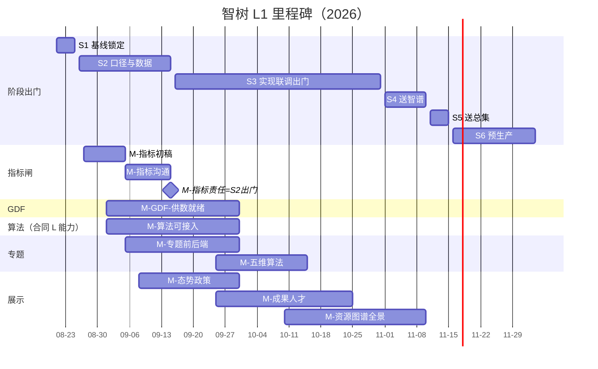

# 进度（L1）

上级：[INDEX](./INDEX.md) · 范围：[../01-范围.md](../01-范围.md) · LT 细表：各 [系统-*.md](./INDEX.md)

落盘：2026-08-25（倒排自 L1 出门日）。阶段 Owner：**郭万迎**。指标：**王惠**。算法：**唐绍祖**。GDF：**辜少彬**。专题域 Owner 见 [系统-04](./系统-04-科技专题服务.md)。展示模块负责人 **待定**。

日期真源：本表 + [`project-plan.yaml`](../../../../project-plan.yaml)。细项 / depends / 四时点 → 各系统页；本页只挂指针。

**用语**：F/L = 功能合同 / 算法合同（指标进度表）。产品线写「展示」「专题」，勿混用。

---

## 0. 里程碑甘特（倒排 · 仅 L1）

大屏 Track-L：智树未确认 → 不进实条（见 `FE-LARGE-PENDING-L01`）。

---

## 1. 三线共用：指标闸口（S2，出门 2026-09-15）

| ID | 里程碑 | 目标日期 | 出门条件 | 对齐 project-plan | 对齐总集 | 关联 LT / registry |
|---|---|---|---|---|---|---|
| M-指标初稿 | 全部指标初稿并列出缺项 | 2026-09-05 | 三线同一套可评 | N-S2-02 | 展示【02】8/27–9/5 | [系统-01](./系统-01-指标与数据闸.md) `LT-1-*` |
| M-指标沟通 | 数据能否撑住；三方可排期 | 2026-09-05～09-15 | 支撑结论+时间点 | N-S2-01 输入 | 收到 9.15 | 同上 |
| M-指标责任 | 责任人+完成日 | **2026-09-15** | **S2 出门** | N-S2-02 | — | 同上 |

---

## 2. 数据中台 GDF

| ID | 里程碑 | 目标日期 | 出门条件 | 对齐 | 关联 |
|---|---|---|---|---|---|
| M-GDF-供数就绪 | 主路径贴源+Mapping+ADS 可读；支撑专题/展示 9.30 批联调 | **2026-09-30** | 报价内主路径可重复供数 | 对齐 N-S3-02/03 用数窗 | [系统-02](./系统-02-数据中台GDF.md) |

分批后段供数跟展示 10-25 / 11-10，不另设第二 L1 出门（见系统-02 `LT-2B-*`）。

---

## 3. 算法能力（服务展示∪专题；合同集合见 F∩L / F−L / L−F）

| ID | 里程碑 | 目标日期 | 出门条件 | 对齐 project-plan | 对齐总集 | 关联 |
|---|---|---|---|---|---|---|
| M-算法可接入 | 报价内算法/模型可被业务分批接入（**原「专题算法库模型」正名**） | **2026-09-30** | 不含模型 3/4/5 | N-S3-01 | 勿与【06】语义工具库 930 混淆 | [系统-03](./系统-03-算法-功能合同与算法合同.md) |

业务线「接入算法」出门仍跟专题/展示闸（10/15、10/25、11/10），本线不设第二业务出门日。

---

## 4. 科技专题服务

| ID | 里程碑 | 目标日期 | 出门条件 | 对齐 project-plan | 对齐总集【04】 | 关联 |
|---|---|---|---|---|---|---|
| M-专题前后端 | 智树侧页面+接口收口；算法可未齐 | **2026-09-30** | 五维骨架可演示 | N-S3-02 | 统一收到 9.30 | [系统-04](./系统-04-科技专题服务.md) · 小屏 [系统-06](./系统-06-多端小屏.md) |
| M-五维算法 | 五维接到算法可演示 | **2026-10-15** | 接上可接入算法 | N-S3-04 | 综合表内到 10/15 | 系统-04 `LT-4-*-ALGOIN` |

域 Owner（指标进度表真源）：企业/综合 **徐滕强**；产业链 **李伟**；产业服务 **侯佳伟**；政策 **淮政玮**。

---

## 5. 科技信息展示

| ID | 里程碑 | 目标日期 | 出门条件 | 对齐 project-plan | 对齐总集【02】 | 关联 |
|---|---|---|---|---|---|---|
| M-态势政策 | 态势+政策跟踪；部分算法 | **2026-09-30** | 两模块可演示 | N-S3-03 | 智树 9.30 | [系统-05](./系统-05-科技信息展示.md) · 小屏系统-06 |
| M-成果人才 | 成果+人才；算法分批 | **2026-10-25** | 两模块可演示 | N-S3-05 | 10/9–10/30 | 系统-05 |
| M-资源图谱全景 | 资源+图谱+全景；算法分批 | **2026-11-10** | 三模块可演示；≠核验包已交 | N-S4-02 | 交智谱同窗 | 系统-05 |

模块/菜单负责人：**待定**。人才/资源/图谱=界面+对接；全景除「科技创新生态服务」外只跳转。

---

## 6. L1 总表（按日期）

| 里程碑 | 日期 | 线 | Sx | Owner | 摘要 | 关联 |
|---|---|---|---|---|---|---|
| M-指标初稿 | 09-05 | 共用 | S2 | 王惠 | 初稿+缺项 | 系统-01 |
| M-指标沟通 | 09-05～15 | 共用 | S2 | 王惠 | 支撑+三方时间 | 系统-01 |
| M-指标责任 | **09-15** | 共用 | **S2出门** | 王惠 | 责任锁定 | 系统-01 |
| M-GDF-供数就绪 | **09-30** | GDF | S3 | 辜少彬 | 主路径可联调 | 系统-02 |
| M-算法可接入 | **09-30** | 算法 | S3 | 唐绍祖 | 报价内可接入 | 系统-03 |
| M-专题前后端 | **09-30** | 专题 | S3 | 域 Owner 分管 | 前后端收口 | 系统-04 |
| M-态势政策 | **09-30** | 展示 | S3 | 待定 | 态势+政策 | 系统-05 |
| M-五维算法 | **10-15** | 专题 | S3 | 域 Owner+唐 | 五维接入 | 系统-04 |
| M-成果人才 | **10-25** | 展示 | S3 | 待定 | 成果+人才 | 系统-05 |
| S3 出门 | **10-31** | 阶段 | **S3** | 郭万迎 | 内收口 | — |
| M-资源图谱全景 | **11-10** | 展示 | S4 | 待定 | 三模块 | 系统-05 |
| 送智谱 | **11-10** | 阶段 | **S4** | 郭万迎 | 核验材料 | — |
| 送总集 | **11-15** | 阶段 | **S5** | 郭万迎 | 同包 | — |
| 预生产 | **12-04** | 阶段 | **S6** | 郭万迎 | 预生产 | — |

S1（08-25）细项见 `project-plan`。索引：[里程碑-registry依赖.md](./里程碑-registry依赖.md)。
