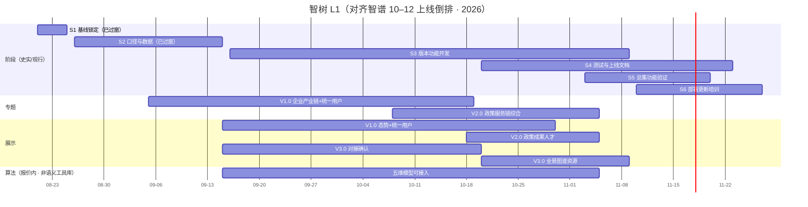

# 进度（L1）

上级：[INDEX](./INDEX.md) · 范围：[../01-范围.md](../01-范围.md) · LT 细表：各 [系统-*.md](./INDEX.md)

落盘：2026-08-25。**倒排刷新：2026-10-13**（真源 [`（内部）智谱10-12月份系统上线倒排计划.xlsx`](./（内部）智谱10-12月份系统上线倒排计划.xlsx) · 工作表「11月倒排计划」）。阶段 Owner：**郭万迎**。指标：**王惠**。算法：**唐绍祖**。GDF：**辜少彬**。专题 V1.0 批次 **徐滕强**；专题 V2.0 / 展示各版批次 **淮政玮**。测试（专题/展示）：**黄敬洲**。算法测试：**淮政玮**。

日期真源：**本表（跟智谱倒排）**；阶段机器真源仍写 [`project-plan.yaml`](../../../../project-plan.yaml)（已同步）。细项 / depends / 四时点 → 各系统页。

**用语**：F/L = 功能合同 / 算法合同。产品线写「展示」「专题」。久新行（专题 V2.0 久新、算法 V2.0 久新）**对照不写入智树完成口径**。

**对照旧闸（2026-08-25）**：原「态势+政策 9.30 / 专题前后端 9.30 / 算法可接入 9.30 / 五维算法 10.15 / 成果人才 10.25 / 资源图谱全景 11.10 / 送智谱 11.10 / 送总集 11.15 / 预生产 12.04」已作废，改按下表版本出门。S1/S2 日历已过窗，计划日保留史实，**不伪标 done**。

---

## 0. 里程碑甘特（倒排 · 仅 L1）

今日 **2026-10-13** → 日历在 **S3（版本功能开发）**。

大屏 Track-L：智树未确认 → 不进实条（`FE-LARGE-PENDING-L01`）。GDF / 指标闸未出现在智谱倒排，见 §1–2。

---

## 1. 三线共用：指标闸口（S2，出门 2026-09-15 · **已过窗**）

智谱倒排未单列指标。计划日不改写。出门核验未回填实际时点。

| ID | 里程碑 | 目标日期 | 出门条件 | 对齐 project-plan | 对齐总集 | 关联 LT / registry |
|---|---|---|---|---|---|---|
| M-指标初稿 | 全部指标初稿并列出缺项 | 2026-09-05 | 三线同一套可评 | N-S2-02 | 展示【02】8/27–9/5 | [系统-01](./系统-01-指标与数据闸.md) `LT-1-*` |
| M-指标沟通 | 数据能否撑住；三方可排期 | 2026-09-05～09-15 | 支撑结论+时间点 | N-S2-01 输入 | 收到 9.15 | 同上 |
| M-指标责任 | 责任人+完成日 | **2026-09-15** | **S2 出门** | N-S2-02 | — | 同上 |

---

## 2. 数据中台 GDF（智谱倒排未单列）

| ID | 里程碑 | 目标日期 | 出门条件 | 对齐 | 关联 |
|---|---|---|---|---|---|
| M-GDF-供数就绪 | 主路径贴源+Mapping+ADS 可读 | **2026-09-30**（原闸，已过窗） | 报价内主路径可重复供数 | 须赶上下列版本开发窗 | [系统-02](./系统-02-数据中台GDF.md) |

使用窗跟版本：**专题 V1.0 10-19** / **展示 V1.0 10-30** / **专题 V2.0+展示 V2.0+算法 11-05** / **展示 V3.0 11-09**。不另设第二 L1 出门。

---

## 3. 算法能力（深度挖掘算法 1130 · 智树 V2.0）

倒排系统名「深度挖掘算法（1130）」下 **唐绍祖** 包；同系统「V2.0（久新）·李乐」不写入智树口径。勿与 10 月表「语义计算工具库」混淆。

| ID | 里程碑 | 目标日期 | 出门条件 | 对齐 project-plan | 倒排状态 | 关联 |
|---|---|---|---|---|---|---|
| M-算法可接入 | 报价内模型（企业/产业链/产业服务链/政策/综合）可被业务接入 | **2026-11-05** | 不含模型 3/4/5 | N-S3-01 | 功能开发 **开发中** 9/15–11/5 | [系统-03](./系统-03-算法-功能合同与算法合同.md) |
| M-算法-系统测试 | 功能/兼容/集成/性能 | **2026-11-12** | 用例评审 11/6–11/7 | — | 待启动 · 淮政玮 | 同上 |
| M-算法-总集验证 | 总集侧功能验证 | **2026-11-10** | 倒排未填完成日 | N-S5-01 分批 | 待启动 · 郭万迎 | — |
| M-算法-上线申请 | 上线前文档评审及申请 | **2026-11-15** | 倒排未填完成日 | N-S4-01 分批 | 待启动 · 郭万迎 | — |
| M-算法-部署 | 上线部署 | **2026-11-17** | 倒排未填完成日 | N-S6-01 分批 | 待启动 · 郭万迎 | — |
| M-算法-培训 | 用户培训 | **2026-11-20** | 倒排未填完成日 | — | 待启动 · 郭万迎 | — |

用例编制 10/15–11/5 **编制中**（淮政玮）。上线文档 10/20–11/12（郭万迎）。

---

## 4. 科技专题服务

版本单元格把「产业服务链」写在 V1.0，功能开发任务把「服务链分析」写在 V2.0。**智树 LT 跟任务列**（V1=企业+产业链+统一用户；V2=政策+服务链+综合）。久新 V2.0 不计入。

| ID | 里程碑 | 目标日期 | 出门条件 | 对齐 project-plan | 倒排状态 | 关联 |
|---|---|---|---|---|---|---|
| M-专题-V1-开发 | 企业分析、产业链分析、统一用户集成 | **2026-10-19** | 功能开发出门 | N-S3-02 | **开发中** 9/5–10/19 · 徐滕强 | [系统-04](./系统-04-科技专题服务.md) |
| M-专题-V1-系统测试 | 系统测试 | **2026-11-02** | 用例评审 10/20–10/27 | — | 待启动 · 黄敬洲 | 系统-04 |
| M-专题-V1-总集验证 | 总集侧功能验证 | **2026-11-03** | 倒排未填完成日 | N-S5-01 分批 | 郭万迎 | — |
| M-专题-V1-上线 | 上线申请+部署 | **2026-11-10** | 倒排未填完成日 | N-S4/S6 分批 | 郭万迎 | — |
| M-专题-V2-开发 | 政策分析、服务链分析、综合分析 | **2026-11-05** | 功能开发出门 | N-S3-04 | **开发中** 10/8–11/5 · 淮政玮 | 系统-04 |
| M-专题-V2-系统测试 | 系统测试 | **2026-11-12** | 用例评审 11/2–11/7 | — | 待启动 · 黄敬洲 | 系统-04 |
| M-专题-V2-总集验证 | 总集侧功能验证 | **2026-11-10** | 倒排未填完成日 | N-S5-01 分批 | 待启动 · 郭万迎 | — |
| M-专题-V2-版本更新 | 版本更新 | **2026-11-15** | 倒排未填完成日 | N-S6-01 分批 | 待启动 · 郭万迎 | — |
| M-专题-培训 | 用户培训 | **2026-11-20** | 倒排未填完成日 | — | 待启动 · 郭万迎 | — |

V1 用例编制 9/6–10/20 **编制中**；V2 用例编制 9/6–11/2 **编制中**。V2 上线申请 11/17（未填完成日）。

域 Owner（指标进度表真源，≠ 倒排批次负责人）：企业/综合 **徐滕强**；产业链 **李伟**；产业服务 **侯佳伟**；政策 **淮政玮**。

---

## 5. 科技信息展示

政策跟踪从旧「态势+政策 9.30」改入 **V2.0**（与成果、人才同批）。

| ID | 里程碑 | 目标日期 | 出门条件 | 对齐 project-plan | 倒排状态 | 关联 |
|---|---|---|---|---|---|---|
| M-展示-V1-开发 | 科技发展态势、统一用户集成 | **2026-10-30** | 功能开发出门 | N-S3-03 | **进行中** 9/15–10/30 · 淮政玮 | [系统-05](./系统-05-科技信息展示.md) |
| M-展示-V1-系统测试 | 系统测试 | **2026-11-04** | 用例评审 10/25–10/28 | — | 待启动 · 淮政玮测、黄敬洲用例 | 系统-05 |
| M-展示-V1-总集验证 | 总集侧功能验证 | **2026-11-04** | 倒排未填完成日 | N-S5-01 分批 | 待启动 · 郭万迎 | — |
| M-展示-V2-开发 | 政策跟踪、成果展示、人才态势 | **2026-11-05** | 功能开发出门 | N-S3-05 | **待启动** 10/18–11/5 · 淮政玮 | 系统-05 |
| M-展示-V2-系统测试 | 系统测试 | **2026-11-12** | 用例评审 11/6–11/8 | — | 待启动 | 系统-05 |
| M-展示-V2-总集验证 | 总集侧功能验证 | **2026-11-13** | 倒排未填完成日 | N-S5-01 分批 | 待启动 · 郭万迎 | — |
| M-展示-V3-对接 | 全景/图谱/资源依赖沟通与对接方案 | **2026-10-20** | 方案确认 | N-S3-06 | **进行中** 9/15–10/20 · 淮政玮 | 系统-05 |
| M-展示-V3-开发 | 科技服务全景、知识图谱、数据资源 | **2026-11-09** | 功能开发出门 | N-S4-02 | **待启动** 10/20–11/9 · 淮政玮 | 系统-05 |
| M-展示-V3-系统测试 | 系统测试 | **2026-11-19** | 用例评审 11/9–11/12 | — | 待启动 | 系统-05 |
| M-展示-V3-总集验证 | 总集侧功能验证 | **2026-11-20** | 倒排未填完成日 | N-S5-01 | 待启动 · 郭万迎 | — |
| M-展示-V3-上线申请 | 上线前文档评审及申请 | **2026-11-23** | 倒排未填完成日 | N-S4-01 | 待启动 · 郭万迎 | — |
| M-展示-版本更新 | 版本更新 | **2026-11-26** | 倒排未填完成日 | N-S6-01 | 待启动 · 郭万迎 | — |
| M-展示-培训 | 用户培训 | **2026-11-27** | 倒排未填完成日 | — | 待启动 · 郭万迎 | — |

V1/V2「上线前文档评审 / 上线部署 / 版本更新」倒排**空白**，不编造日期；展示侧上线申请以 V3.0 **11-23** 为已填最晚点。人才/资源/图谱=界面+对接；全景除「科技创新生态服务」外只跳转。

---

## 6. L1 总表（按日期）

| 里程碑 | 日期 | 线 | Sx | Owner | 摘要 | 关联 |
|---|---|---|---|---|---|---|
| M-指标初稿 | 09-05 | 共用 | S2 已过窗 | 王惠 | 初稿+缺项 | 系统-01 |
| M-指标责任 | **09-15** | 共用 | S2出门 | 王惠 | 责任锁定 | 系统-01 |
| M-GDF-供数就绪 | **09-30** | GDF | 原闸已过窗 | 辜少彬 | 智谱倒排未单列 | 系统-02 |
| M-专题-V1-开发 | **10-19** | 专题 | S3 | 徐滕强 | 企业+产业链+统一用户 | 系统-04 |
| M-展示-V3-对接 | **10-20** | 展示 | S3 | 淮政玮 | 对接方案确认 | 系统-05 |
| M-展示-V1-开发 | **10-30** | 展示 | S3 | 淮政玮 | 态势+统一用户 | 系统-05 |
| S3 出门 | **11-09** | 阶段 | **S3** | 郭万迎 | 最晚功能开发（展示 V3） | — |
| M-专题-V1-总集验证 | **11-03** | 专题 | S5 起点 | 郭万迎 | 倒排未填完成日 | — |
| M-展示-V1-系统测试 | **11-04** | 展示 | S4 | 淮政玮 | 含总集验证同日 | — |
| M-专题-V2-开发 | **11-05** | 专题 | S3 | 淮政玮 | 政策+服务链+综合 | 系统-04 |
| M-展示-V2-开发 | **11-05** | 展示 | S3 | 淮政玮 | 政策+成果+人才 | 系统-05 |
| M-算法可接入 | **11-05** | 算法 | S3 | 唐绍祖 | 报价内五维模型 | 系统-03 |
| M-展示-V3-开发 | **11-09** | 展示 | S3 | 淮政玮 | 全景+图谱+资源 | 系统-05 |
| M-专题-V1-上线 | **11-10** | 专题 | S6 | 郭万迎 | 申请+部署 | — |
| M-专题-V2-总集验证 | **11-10** | 专题 | S5 | 郭万迎 | 与算法总集同日 | — |
| M-算法-总集验证 | **11-10** | 算法 | S5 | 郭万迎 | 倒排未填完成日 | — |
| M-专题-V1/V2/算法-系统测试 | **11-02 / 11-12 / 11-12** | 多线 | S4 | 黄敬洲 / 淮政玮 | 见 §3–4 | — |
| M-展示-V2-总集验证 | **11-13** | 展示 | S5 | 郭万迎 | | — |
| M-算法-上线申请 | **11-15** | 算法 | S4 | 郭万迎 | | — |
| M-专题-V2-版本更新 | **11-15** | 专题 | S6 | 郭万迎 | | — |
| M-算法-部署 | **11-17** | 算法 | S6 | 郭万迎 | | — |
| M-展示-V3-系统测试 | **11-19** | 展示 | S4 | 淮政玮 | 最晚系统测试 | — |
| M-专题-培训 / 算法-培训 | **11-20** | 专题/算法 | S6 | 郭万迎 | | — |
| M-展示-V3-总集验证 | **11-20** | 展示 | **S5出门** | 郭万迎 | 最晚总集验证 | — |
| M-展示-V3-上线申请 | **11-23** | 展示 | **S4出门** | 郭万迎 | 已填最晚上线申请 | — |
| M-展示-版本更新 | **11-26** | 展示 | S6 | 郭万迎 | | — |
| M-展示-培训 | **11-27** | 展示 | **S6出门** | 郭万迎 | 倒排无 12 月智树行 | — |

S1（08-25）细项见 `project-plan`。索引：[里程碑-registry依赖.md](./里程碑-registry依赖.md)。
