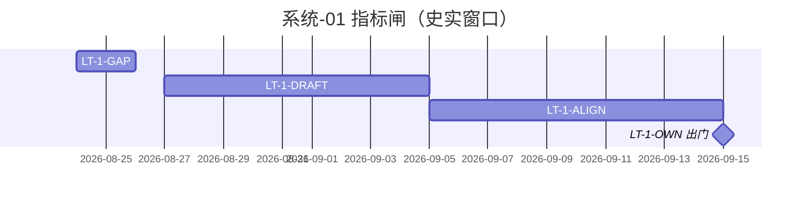

# 系统-01 · 指标与数据闸

上级：[INDEX](./INDEX.md) · L1：[02-进度.md](./02-进度.md)

**挂接**：M-指标初稿 / 沟通 / 责任（S2）。责任人：**王惠**（口径）；缺口输入 **唐绍祖**；卡点规则见指标进度表（STAT/COMPUTE→域 Owner，MODEL 等→唐绍祖）。

运作：规范/定义叶为主，一般不跑完整 A–E。四时点：计划倒排自 09-15（**史实，日历已过窗**）；实际未开工填 `—`。智谱 10–12 倒排未单列指标，本页不改写计划日、不伪标 done。

| LT-ID | 名称 | 计划开始 | 计划结束 | 实际开始 | 实际结束 | 责任人 | 段 | 前置 |
|---|---|---|---|---|---|---|---|---|
| LT-1-GAP | 三方/库缺口盘点（N-S2-01） | 2026-08-24 | 2026-08-26 | — | — | 唐绍祖（展示侧王惠协同） | 定义/盘点 | — |
| LT-1-DRAFT | 基础/图谱/模型指标初稿+缺项 | 2026-08-27 | 2026-09-05 | — | — | 王惠 | 定义 | LT-1-GAP |
| LT-1-ALIGN | 指标沟通复核（数据能否撑住） | 2026-09-05 | 2026-09-15 | — | — | 王惠 | 定义+会商 | LT-1-DRAFT；GDF 可读结论 |
| LT-1-OWN | 责任人+完成日锁定 = S2 出门 | 2026-09-14 | 2026-09-15 | — | — | 王惠 | 出门闸 | LT-1-ALIGN |
| LT-1-SRS-GAP | 算法库 vs 两大系统 565 指标口径 gap 调研（`METRIC-SRS-GAP-L01`） | 2026-10-27 | 2026-10-27 | 2026-10-27 | 2026-10-27 | 唐绍祖 | 定义/盘点 | 20261021 五百六十五份指标计算过程（`E-METRIC-ALGOLIB-LAUNCH-L01` 阶段 1） |
| LT-1-ALGOLIB | 565 指标更新入库 + 算法库上线灌输链路（`E-METRIC-ALGOLIB-LAUNCH-L01`） | 2026-10-23 | 2026-10-24 | 2026-10-23 | 2026-10-24 | 唐绍祖 | 定义/盘点+实现 | 20261021 批改源工程交付 |
| LT-1-POPUP3SYS | 三系统评审模式指标弹窗升级（`UI-METRIC-POPUP-3SYS-L01`） | 2026-10-28 | 2026-10-28 | 2026-10-28 | 2026-10-28 | 唐绍祖 | 实现+验收 | LT-1-ALGOLIB（20261027 批弹窗数据基准） |

> **LT-1-ALGOLIB（2026-10-28 补登）**：阶段 1 = 565 份 calc-logic MD（11 域）+ seed 566 条 + 12 readiness 矩阵 + 入库详情 xlsx；阶段 2 = 97 模型页 × 263 指标灌输链路（precompute 端点/flowRegistry 真源/AlgoShell 灌输按钮与进度条，Playwright 回归 94/94 零报错）。2026-10-24 依淮政玮反馈完成 calc-logic 正本全文并入 + repro 代码产物入仓；2026-10-28 入库查实（正本入仓见 METRIC-SRS-GAP-L01/产物/20261027三系统兼容升级/）后补录 registry 条目并补齐 GAP-5 件 repro、VIT 三件正本同步、门户十条件死链清洗，四落点审计 565/565 全绿。handoff 与产物在 `agent-delivery/agent-handoffs/指标算法库上线/E-METRIC-ALGOLIB-LAUNCH-L01.md` 与 `agent-delivery/metrics/`。本行不替代后续「三大系统兼容性指标 MD/py 升级」开发叶（输入=METRIC-SRS-GAP-L01 分级结果，另行建单）。

> **LT-1-POPUP3SYS（2026-10-28）**：补救清单第 5 项。编译器 `gen_popup_info.py`（入仓于 METRIC-SRS-GAP-L01/产物/20261027三系统兼容升级/） 把 20261027 批 573 份 md → 三仓 `metricPopupInfo.generated.{ts,js}`（565 keys，`_ZT`/`_ZS` 6 族按系统映射），弹窗新增「指标需规概述/指标计算逻辑/参考文献（国家机关→国内其他→外刊）/数据支持度」区块（长文本展开收起）。中台 `1c34a1d`、专题 `dab369f`、展示 `7619afc` 三 commit 已 push dev；Playwright 28/28 断言 100% PASS（0 console error / 0 pageerror，截图与验收日志已入仓（METRIC-SRS-GAP-L01/产物/20261027三系统兼容升级/e2e_shots/））。registry `UI-METRIC-POPUP-3SYS-L01`。

> **LT-1-SRS-GAP（2026-10-27 补登）**：任务号 `METRIC-SRS-GAP-L01`，status=ready_to_sign，registry 已登记。三份需求文档（科技专题服务算法库 / 展示+专题系统 / 政策对比核增）出现分类：跨系统 156 / 单系统 278 / 内部 131；跨系统差异五级：D2 口径级 19（需三方会签）/ D3 详略级 69 / D4 互补级 59 / D5 表述级 9 / D1 为 0；20261021 实现倾向：算法库 79（50.6%）/ 展示+专题 63（40.4%）/ 项目内部口径 12。成果已整体迁入 `agent-delivery/agent-handoffs/指标算法库上线/METRIC-SRS-GAP-L01/产物/`（handoff、xlsx 4-sheet、156 份逐指标报告、通俗解释、倾向性报告），迁入前校验产物内 0 处外仓路径引用。本行是调研登记，不替代后续「三大系统兼容性指标 MD/py 升级」的开发叶——该升级以本单分级结果为输入，落地时另行建单。

registry：`PLAN-S2-*` 等以看板为准；本页不抄 DoD。
