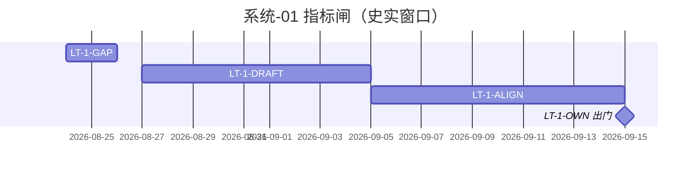

# 系统-01 · 指标与数据闸

上级：[INDEX](./INDEX.md) · L1：[02-进度.md](./02-进度.md)

**挂接**：M-指标初稿 / 沟通 / 责任（S2）。责任人：**王惠**（口径）；缺口输入 **唐绍祖**；卡点规则见指标进度表（STAT/COMPUTE→域 Owner，MODEL 等→唐绍祖）。

运作：规范/定义叶为主，一般不跑完整 A–E。四时点：计划倒排自 09-15（**史实，日历已过窗**）；实际未开工填 `—`。智谱 10–12 倒排未单列指标，本页不改写计划日、不伪标 done。

| LT-ID | 名称 | 计划开始 | 计划结束 | 实际开始 | 实际结束 | 责任人 | 段 | 前置 |
|---|---|---|---|---|---|---|---|---|
| LT-1-GAP | 三方/库缺口盘点（N-S2-01） | 2026-08-24 | 2026-08-26 | — | — | 唐绍祖（展示侧王惠协同） | 定义/盘点 | — |
| LT-1-DRAFT | 基础/图谱/模型指标初稿+缺项 | 2026-08-27 | 2026-09-05 | — | — | 王惠 | 定义 | LT-1-GAP |
| LT-1-ALIGN | 指标沟通复核（数据能否撑住） | 2026-09-05 | 2026-09-15 | — | — | 王惠 | 定义+会商 | LT-1-DRAFT；GDF 可读结论 |
| LT-1-OWN | 责任人+完成日锁定 = S2 出门 | 2026-09-14 | 2026-09-15 | — | — | 王惠 | 出门闸 | LT-1-ALIGN |

registry：`PLAN-S2-*` 等以看板为准；本页不抄 DoD。
