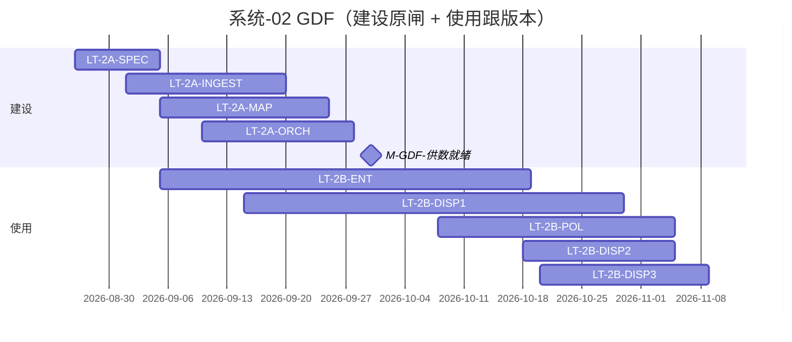

# 系统-02 · 数据中台 GDF

上级：[INDEX](./INDEX.md) · L1：`M-GDF-供数就绪`（09-30 原闸，**智谱倒排未单列**）

**建设 Owner：辜少彬**。使用侧验收：专题域 Owner；展示批次 **淮政玮**。

规范先行（LT-2A-SPEC）→ 建设长任务 → 使用长任务供展示/专题/算法读 ADS。禁止无闸写正式 `gkxlumenx_*`。

建设出门仍按原闸 09-30（已过窗）。**使用窗对齐智谱版本功能开发**：专题 V1.0 **10-19**、展示 V1.0 **10-30**、专题/展示 V2.0+算法 **11-05**、展示 V3.0 **11-09**。

## 2.A 建设

| LT-ID | 名称 | 计划开始 | 计划结束 | 实际开始 | 实际结束 | 责任人 | 段 | 前置 |
|---|---|---|---|---|---|---|---|---|
| LT-2A-SPEC | 贴源/Mapping/ADS 契约与协作规约冻结 | 2026-08-26 | 2026-09-05 | — | — | 辜少彬 | 规范 | — |
| LT-2A-INGEST | 主路径贴源齐套+周期复核 | 2026-09-01 | 2026-09-20 | — | — | 辜少彬 | A | LT-2A-SPEC |
| LT-2A-MAP | Mapping 产线可重复跑 | 2026-09-05 | 2026-09-25 | — | — | 辜少彬 | A/编排 | LT-2A-SPEC |
| LT-2A-ORCH | DAG/告警/亿集烟测 | 2026-09-10 | 2026-09-28 | — | — | 辜少彬 | 编排≈E轻 | LT-2A-MAP |
| LT-2A-READY | **M-GDF-供数就绪** | 2026-09-20 | 2026-09-30 | — | — | 辜少彬 | 出门闸 | LT-2A-INGEST+MAP |

## 2.B 使用（供业务长任务 · 跟版本窗）

| LT-ID | 名称 | 计划开始 | 计划结束 | 实际开始 | 实际结束 | 责任人 | 段 | 前置 |
|---|---|---|---|---|---|---|---|---|
| LT-2B-ENT | 企业维供数（专题 V1.0） | 2026-09-05 | 2026-10-19 | — | — | 辜少彬；验收徐滕强 | A | LT-2A-SPEC |
| LT-2B-CHAIN | 产业链供数（专题 V1.0） | 2026-09-08 | 2026-10-19 | — | — | 辜少彬；验收李伟 | A | LT-2A-SPEC |
| LT-2B-SVC | 产业服务/服务链供数（专题 V2.0 任务列） | 2026-10-08 | 2026-11-05 | — | — | 辜少彬；验收侯佳伟 | A | LT-2A-SPEC |
| LT-2B-POL | 政策维供数（专题 V2.0） | 2026-10-08 | 2026-11-05 | — | — | 辜少彬；验收淮政玮 | A | LT-2A-SPEC |
| LT-2B-COMP | 综合维供数（专题 V2.0） | 2026-10-08 | 2026-11-05 | — | — | 辜少彬；验收徐滕强 | A | LT-2A-SPEC |
| LT-2B-DISP1 | 展示 V1.0 态势供数 | 2026-09-15 | 2026-10-30 | — | — | 辜少彬；验收淮政玮 | A | LT-2A-SPEC |
| LT-2B-DISP2 | 展示 V2.0 政策/成果/人才供数 | 2026-10-18 | 2026-11-05 | — | — | 辜少彬；验收淮政玮 | A | LT-2A-READY |
| LT-2B-DISP3 | 展示 V3.0 全景/图谱/资源供数 | 2026-10-20 | 2026-11-09 | — | — | 辜少彬；验收淮政玮 | A | LT-2A-READY |

前置关系（使用 ← 建设）：业务 LT depends 对应 `LT-2B-*` 达联调闸门。已有叶例：`GDF-ENT-LIVE-PROBE-WEEKLY`、`ENT-DATA-IMPL-PATH`、`GDF-YIJI-FACTREL-SMOKE-L01`（以看板为准挂入总控）。
