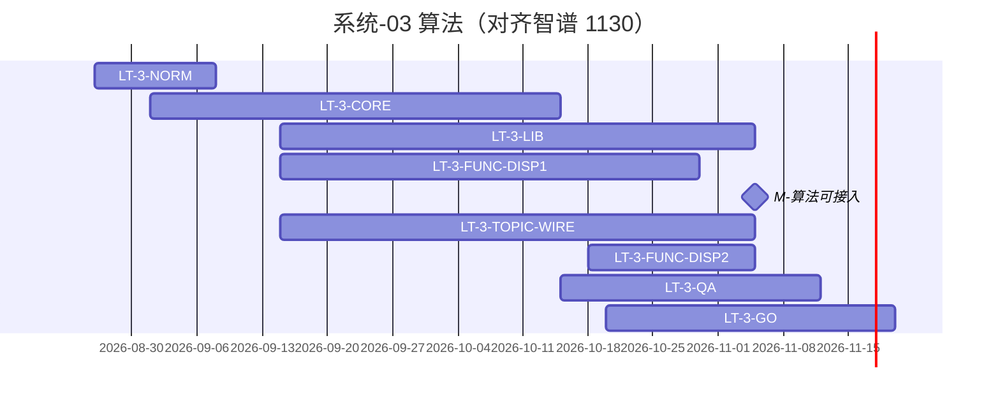

# 系统-03 · 算法（功能合同 F ∪ 算法合同 L）

上级：[INDEX](./INDEX.md) · L1：`M-算法可接入`（**2026-11-05**）

**重要**：此处 **F = 功能合同、L = 算法合同**。**不是**展示/专题系统缩写。本包算法能力**同时服务**科技信息展示与科技专题服务。

倒排真源：11 月表「深度挖掘算法（1130）」· **V2.0（企业分析模型，产业链分析，产业服务链分析、政策分析，综合智能分析模型）** · 功能开发 9/15–11/5 **开发中** · **唐绍祖**。同系统「V2.0（久新）·李乐」不计入。10 月表「语义计算工具库」= 总集【06】，勿混。

责任人：**唐绍祖**（算法实现）；测试/用例评审 **淮政玮**；上线文档与部署 **郭万迎**。STAT/COMPUTE 卡点仍回专题域 Owner（见系统-04）。

规范先行 → 按能力长任务（段 **B 为主**；必要 C；业务 E 挂展示/专题管线末）。

| LT-ID | 名称 | 计划开始 | 计划结束 | 实际开始 | 实际结束 | 责任人 | 段 | 前置 |
|---|---|---|---|---|---|---|---|---|
| LT-3-NORM | 注册/调用链/禁写表；展示∪专题差集闭合 | 2026-08-26 | 2026-09-08 | — | — | 唐绍祖 | 规范 | — |
| LT-3-CORE | 共用能力：基础指标·图谱 API·Runtime | 2026-09-01 | 2026-10-15 | — | — | 唐绍祖 | B | LT-3-NORM |
| LT-3-LIB | 算法合同 L：报价内五维模型可接入 = **M-算法可接入** | 2026-09-15 | 2026-11-05 | — | — | 唐绍祖 | B | LT-3-CORE |
| LT-3-FUNC-DISP1 | 功能合同侧·展示 V1.0 态势所需算法 | 2026-09-15 | 2026-10-30 | — | — | 唐绍祖 | B | LT-3-NORM；LT-2B-DISP1 |
| LT-3-TOPIC-WIRE | 专题五维接入算法 | 2026-09-15 | 2026-11-05 | — | — | 唐绍祖 + 域 Owner | B/C | LT-3-LIB；专题 V1/V2 开发窗 |
| LT-3-FUNC-DISP2 | 功能合同侧·展示 V2.0 政策/成果/人才算法 | 2026-10-18 | 2026-11-05 | — | — | 唐绍祖 | B | LT-3-LIB |
| LT-3-FUNC-DISP3 | 功能合同侧·展示 V3.0 图谱等算法分批 | 2026-10-20 | 2026-11-09 | — | — | 唐绍祖 | B | LT-3-LIB |
| LT-3-X | 联调台/网关（双系统入口） | 2026-09-01 | 2026-11-05 | — | — | 唐绍祖+前端 | 薄C/D | LT-3-NORM |
| LT-3-QA | 用例编制+评审+系统测试 | 2026-10-15 | 2026-11-12 | — | — | 淮政玮 | 测试 | LT-3-LIB |
| LT-3-GO | 上线文档 / 总集验证 / 申请 / 部署 / 培训 | 2026-10-20 | 2026-11-20 | — | — | 郭万迎 | 出门 | LT-3-QA |

模型 **3/4/5**：只分析，不开实现 LT。

倒排上线链（未填完成日的按下一日）：总集验证 **11-10** → 上线申请 **11-15** → 部署 **11-17** → 培训 **11-20**。

合同集合维护：指标进度导出 / A2 页差集；本页不复制 metric 行。
