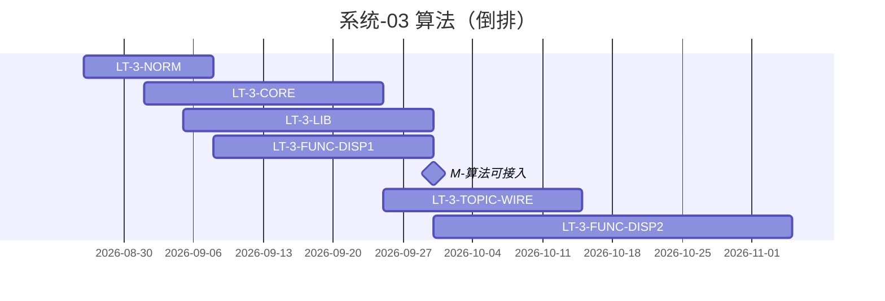

# 系统-03 · 算法（功能合同 F ∪ 算法合同 L）

上级：[INDEX](./INDEX.md) · L1：`M-算法可接入`（09-30）

**重要**：此处 **F = 功能合同、L = 算法合同**（指标进度「合同集合」：F∩L / F−L / L−F）。**不是**展示/专题系统缩写。本包算法能力**同时服务**科技信息展示与科技专题服务。

责任人：**唐绍祖**（算法实现）；差集/注册协同指标与架构。STAT/COMPUTE 卡点仍回专题域 Owner（见系统-04）。

规范先行 → 按能力长任务（段 **B 为主**；必要 C；业务 E 挂展示/专题管线末）。

| LT-ID | 名称 | 计划开始 | 计划结束 | 实际开始 | 实际结束 | 责任人 | 段 | 前置 |
|---|---|---|---|---|---|---|---|---|
| LT-3-NORM | 注册/调用链/禁写表；展示∪专题差集闭合 | 2026-08-26 | 2026-09-08 | — | — | 唐绍祖 | 规范 | — |
| LT-3-CORE | 共用能力：基础指标·图谱 API·Runtime | 2026-09-01 | 2026-09-25 | — | — | 唐绍祖 | B | LT-3-NORM |
| LT-3-LIB | 算法合同 L：报价内模型 1/2/6/7+综合可接入 | 2026-09-05 | 2026-09-30 | — | — | 唐绍祖 | B | LT-3-CORE |
| LT-3-FUNC-DISP1 | 功能合同侧·展示态势/政策所需算法首批 | 2026-09-08 | 2026-09-30 | — | — | 唐绍祖 | B | LT-3-NORM；LT-2B-DISP1 |
| LT-3-TOPIC-WIRE | 专题五维接入算法 | 2026-09-25 | 2026-10-15 | — | — | 唐绍祖 + 域 Owner | B/C | LT-3-LIB；M-专题前后端窗 |
| LT-3-FUNC-DISP2 | 功能合同侧·展示后段算法分批 | 2026-09-30 | 2026-11-05 | — | — | 唐绍祖 | B | LT-3-LIB |
| LT-3-X | 联调台/网关（双系统入口） | 2026-09-01 | 2026-10-15 | — | — | 唐绍祖+前端 | 薄C/D | LT-3-NORM |

模型 **3/4/5**：只分析，不开实现 LT。

合同集合维护：指标进度导出 / A2 页差集；本页不复制 metric 行。
