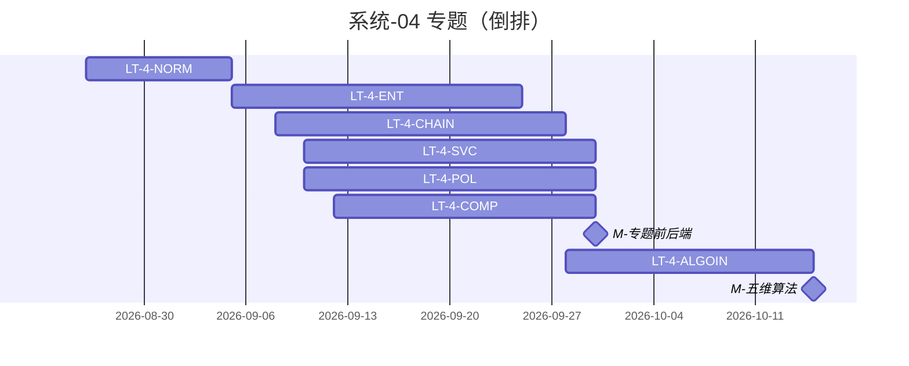

# 系统-04 · 科技专题服务

上级：[INDEX](./INDEX.md) · L1：`M-专题前后端`（09-30）、`M-五维算法`（10-15）

## 域 Owner（指标进度表真源）

| 域 | metric 前缀 | Owner | 出处 |
|---|---|---|---|
| 企业 | `M_ENT_` | **徐滕强** | `feishu-metric-board.yaml#topic_owner_map` / export `topic_owner_of` |
| 综合 | `M_SYNTH_` | **徐滕强** | 同上 |
| 产业链 | `M_CHAIN_` | **李伟** | 同上 |
| 产业服务 | `M_SVC_` | **侯佳伟** | 同上 |
| 政策 | `M_POLICY_` | **淮政玮** | 同上 |
| 其它未点名 | — | — | 不套 Owner |

机构/技术链/人才深度：**只分析，不开实现 LT**。

运作：各维 **规范闸 → 长任务 A–B–C–D–E**（同仓串行；联调闸门解锁）。小屏见 [系统-06](./系统-06-多端小屏.md)。

## 规范

| LT-ID | 名称 | 计划开始 | 计划结束 | 实际开始 | 实际结束 | 责任人 | 段 | 前置 |
|---|---|---|---|---|---|---|---|---|
| LT-4-NORM | 专题 IA/权限/调用链/USM 总规范 | 2026-08-26 | 2026-09-05 | — | — | 高颖+架构；域 Owner 会签 | 规范 | — |

## 分维长任务（倒排至 09-30 / 10-15）

| LT-ID | 名称 | 计划开始 | 计划结束 | 实际开始 | 实际结束 | 责任人 | 段 | 前置 |
|---|---|---|---|---|---|---|---|---|
| LT-4-ENT | 企业维闭环 | 2026-09-05 | 2026-09-25 | — | — | **徐滕强** | A–E | LT-4-NORM；LT-2B-ENT |
| LT-4-CHAIN | 产业链闭环 | 2026-09-08 | 2026-09-28 | — | — | **李伟** | A–E | LT-4-NORM；LT-2B-CHAIN |
| LT-4-SVC | 产业服务闭环 | 2026-09-10 | 2026-09-30 | — | — | **侯佳伟** | A–E | LT-4-NORM；LT-2B-SVC |
| LT-4-POL | 政策分析闭环 | 2026-09-10 | 2026-09-30 | — | — | **淮政玮** | A–E | LT-4-NORM；LT-2B-POL |
| LT-4-COMP | 综合智能分析闭环 | 2026-09-12 | 2026-09-30 | — | — | **徐滕强** | A–E | LT-4-NORM；LT-2B-COMP |
| LT-4-ALGOIN | 五维接入算法 + 管线末 E | 2026-09-28 | 2026-10-15 | — | — | 各域 Owner + **唐绍祖** | B/C/E | 上列维 ≥联调闸；LT-3-LIB |

总控落盘：`agent-handoffs/{维}/…-长任务总控.md`。D 段一故事一叶（CHAIN/SVC 已拍板粒度）。
