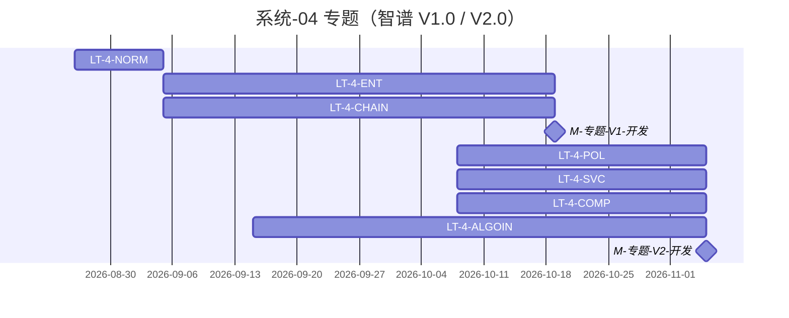

# 系统-04 · 科技专题服务

上级：[INDEX](./INDEX.md) · L1：`M-专题-V1-开发`（**10-19**）、`M-专题-V2-开发`（**11-05**）

倒排真源：11 月表「科技专题服务系统」。**久新 V2.0（李乐）对照不计入**。

版本单元格把「产业服务链」写在 V1.0，功能开发任务把「服务链分析」写在 V2.0。**本页 LT 跟任务列。**

## 域 Owner（指标进度表真源）

| 域 | metric 前缀 | Owner | 出处 |
|---|---|---|---|
| 企业 | `M_ENT_` | **徐滕强** | `feishu-metric-board.yaml#topic_owner_map` / export `topic_owner_of` |
| 综合 | `M_SYNTH_` | **徐滕强** | 同上 |
| 产业链 | `M_CHAIN_` | **李伟** | 同上 |
| 产业服务 | `M_SVC_` | **侯佳伟** | 同上 |
| 政策 | `M_POLICY_` | **淮政玮** | 同上 |
| 其它未点名 | — | — | 不套 Owner |

倒排批次负责人：V1.0 功能开发 **徐滕强**；V2.0 功能开发 **淮政玮**；测试 **黄敬洲**；上线文档/总集/部署/培训 **郭万迎**。

机构/技术链/人才深度：**只分析，不开实现 LT**。

运作：各维 **规范闸 → 长任务 A–B–C–D–E**（同仓串行；联调闸门解锁）。小屏见 [系统-06](./系统-06-多端小屏.md)。

## 规范

| LT-ID | 名称 | 计划开始 | 计划结束 | 实际开始 | 实际结束 | 责任人 | 段 | 前置 |
|---|---|---|---|---|---|---|---|---|
| LT-4-NORM | 专题 IA/权限/调用链/USM 总规范 | 2026-08-26 | 2026-09-05 | — | — | 高颖+架构；域 Owner 会签 | 规范 | — |

## 分维长任务（跟智谱版本）

| LT-ID | 名称 | 计划开始 | 计划结束 | 实际开始 | 实际结束 | 责任人 | 段 | 前置 |
|---|---|---|---|---|---|---|---|---|
| LT-4-ENT | 企业维闭环（V1.0） | 2026-09-05 | 2026-10-19 | — | — | **徐滕强** | A–E | LT-4-NORM；LT-2B-ENT |
| LT-4-CHAIN | 产业链闭环（V1.0） | 2026-09-05 | 2026-10-19 | — | — | **李伟** | A–E | LT-4-NORM；LT-2B-CHAIN |
| LT-4-SSO | 统一用户集成（V1.0 任务列） | 2026-09-05 | 2026-10-19 | — | — | **徐滕强** | C/D | LT-4-NORM |
| LT-4-SVC | 产业服务/服务链闭环（V2.0 任务列） | 2026-10-08 | 2026-11-05 | — | — | **侯佳伟** | A–E | LT-4-NORM；LT-2B-SVC |
| LT-4-POL | 政策分析闭环（V2.0） | 2026-10-08 | 2026-11-05 | — | — | **淮政玮** | A–E | LT-4-NORM；LT-2B-POL |
| LT-4-COMP | 综合智能分析闭环（V2.0） | 2026-10-08 | 2026-11-05 | — | — | **徐滕强** | A–E | LT-4-NORM；LT-2B-COMP |
| LT-4-ALGOIN | 五维接入算法 + 管线末 E | 2026-09-15 | 2026-11-05 | — | — | 各域 Owner + **唐绍祖** | B/C/E | 上列维 ≥联调闸；LT-3-LIB |

## 上线链（倒排直抄，不另建 registry）

| 版本 | 用例编制 | 用例评审 | 系统测试 | 上线文档 | 总集验证 | 申请/部署或更新 | 培训 |
|---|---|---|---|---|---|---|---|
| V1.0 | 9/6–10/20 编制中 · 黄敬洲 | 10/20–10/27 | 10/27–**11-02** · 黄敬洲 | 10/20–11/02 · 郭万迎 | **11-03**（未填完成日） | 申请+部署 **11-10** | — |
| V2.0 | 9/6–11/02 编制中 · 黄敬洲 | 11/02–11/07 | 11/07–**11-12** · 黄敬洲 | 11/08 起（未填完成日） | **11-10** | 版本更新 **11-15**；申请 11/17 | **11-20** |

总控落盘：`agent-handoffs/{维}/…-长任务总控.md`。D 段一故事一叶（CHAIN/SVC 已拍板粒度）。
