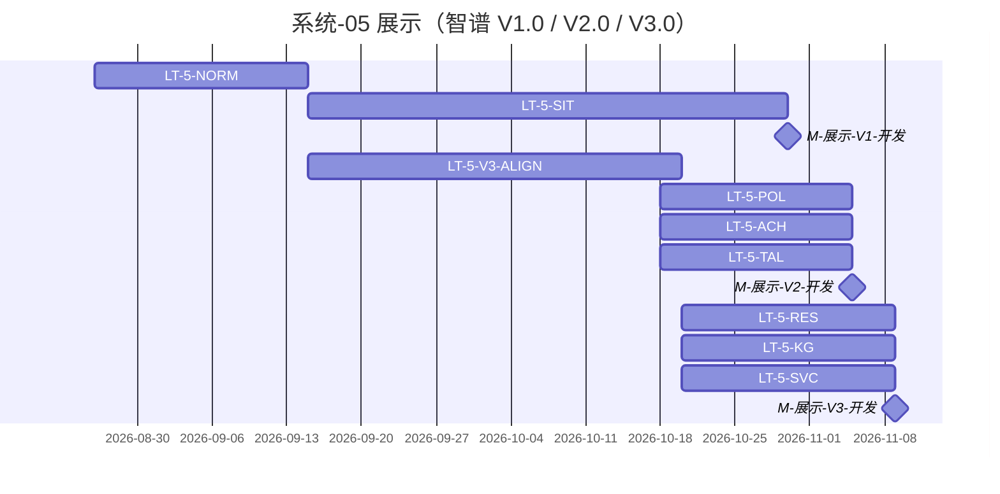

# 系统-05 · 科技信息展示

上级：[INDEX](./INDEX.md) · L1：`M-展示-V1-开发`（**10-30**）、`M-展示-V2-开发`（**11-05**）、`M-展示-V3-开发`（**11-09**）

**划分**：按 **模块 / 页面菜单**（态势、政策跟踪、成果、人才、数据资源、知识图谱、服务全景…）。  
**倒排批次负责人：淮政玮**（展示 V1.0 / V2.0 / V3.0 功能开发均挂此人）。测试用例 **黄敬洲**；V1/V3 系统测试倒排写 **淮政玮**；上线文档/总集/申请/更新/培训 **郭万迎**。

算法：分批接入；依赖 [系统-03](./系统-03-算法-功能合同与算法合同.md) `LT-3-FUNC-DISP*` 与 [系统-02](./系统-02-数据中台GDF.md) `LT-2B-DISP*`。大屏 Track-L：**blocked**（`FE-LARGE-PENDING-L01`），不授权实现长任务。

政策跟踪已从旧「态势+政策 9.30」改入 **V2.0**（与成果、人才同批）。V1/V2 的「上线申请 / 部署 / 版本更新」倒排空白，不编造。

运作：模块规范 → 长任务（对接页可薄 A；C/D 为主；管线末 E）。

可执行分解：[05-展示系统集成工作计划](./05-展示系统集成工作计划.md)（一页一条长任务，起止与人验写在该页）。出门日仍以倒排 / 本页为准。

| LT-ID | 名称（模块/菜单） | 计划开始 | 计划结束 | 实际开始 | 实际结束 | 责任人 | 段 | 前置 |
|---|---|---|---|---|---|---|---|---|
| LT-5-NORM | 展示页级契约/对接他队 API/BFF 边界规范 | 2026-08-26 | 2026-09-15 | — | — | 淮政玮（架构会签） | 规范 | — |
| LT-5-SIT | 科技发展态势（V1.0） | 2026-09-15 | 2026-10-30 | — | — | **淮政玮** | A–E | LT-5-NORM；LT-2B-DISP1；LT-3-FUNC-DISP1 |
| LT-5-SSO | 统一用户集成（V1.0） | 2026-09-15 | 2026-10-30 | — | — | **淮政玮** | C/D | LT-5-NORM |
| LT-5-POL | 科技政策跟踪（V2.0） | 2026-10-18 | 2026-11-05 | — | — | **淮政玮** | A–E | LT-5-NORM；LT-2B-DISP2 |
| LT-5-ACH | 科技成果展示（V2.0） | 2026-10-18 | 2026-11-05 | — | — | **淮政玮** | A–E | LT-5-NORM；LT-2B-DISP2 |
| LT-5-TAL | 科技人才态势（V2.0 · 界面+对接） | 2026-10-18 | 2026-11-05 | — | — | **淮政玮** | A–E | LT-5-NORM |
| LT-5-V3-ALIGN | V3.0 依赖沟通与对接方案确认 | 2026-09-15 | 2026-10-20 | — | — | **淮政玮** | 规范/对接 | LT-5-NORM |
| LT-5-RES | 科技数据资源（V3.0 · 对接） | 2026-10-20 | 2026-11-09 | — | — | **淮政玮** | A–E | LT-5-V3-ALIGN；LT-2B-DISP3 |
| LT-5-KG | 科技知识图谱（V3.0 · 对接） | 2026-10-20 | 2026-11-09 | — | — | **淮政玮** | A–E | LT-5-V3-ALIGN |
| LT-5-SVC | 科技服务全景（V3.0 · 跳转+生态服务子菜单） | 2026-10-20 | 2026-11-09 | — | — | **淮政玮** | A–E | LT-5-V3-ALIGN |
| LT-5-LARGE | 大屏 Track-L | — | — | — | — | 郭万迎（确认） | — | 智树书面确认前不开工 |

## 上线链（倒排直抄）

| 版本 | 用例编制 | 用例评审 | 系统测试 | 上线文档 | 总集验证 | 申请/更新 | 培训 |
|---|---|---|---|---|---|---|---|
| V1.0 | 10/20–10/31 · 黄敬洲 | 10/25–10/28 | 11/03–**11-04** · 淮政玮 | 10/20–11/04 · 郭万迎 | **11-04** | 倒排空白 | — |
| V2.0 | 10/20–11/05 · 黄敬洲 | 11/06–11/08 | 11/09–**11-12** · 淮政玮 | 10/20–11/12 · 郭万迎 | **11-13** | 倒排空白 | — |
| V3.0 | 10/25–11/09 · 黄敬洲 | 11/09–11/12 | 11/13–**11-19** · 淮政玮 | 11/13–11/20 · 郭万迎 | **11-20** | 申请 **11-23**；更新 **11-26** | **11-27** |

小屏批页：[系统-06](./系统-06-多端小屏.md)。
