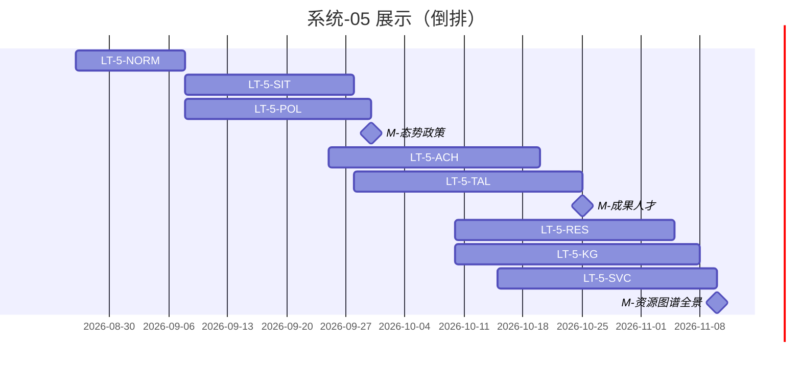

# 系统-05 · 科技信息展示

上级：[INDEX](./INDEX.md) · L1：`M-态势政策`（09-30）、`M-成果人才`（10-25）、`M-资源图谱全景`（11-10）

**划分**：按 **模块 / 页面菜单**（态势、政策跟踪、成果、人才、数据资源、知识图谱、服务全景…）。  
**负责人：待定**（定人前 LT 责任人列写「待定」；监管可暂挂阶段 Owner 郭万迎仅作计划跟踪，不代替模块 Owner）。

算法：**部分接入、其余分批**；依赖 [系统-03](./系统-03-算法-功能合同与算法合同.md) `LT-3-FUNC-DISP*` 与 [系统-02](./系统-02-数据中台GDF.md) `LT-2B-DISP*`。大屏 Track-L：**blocked**（`FE-LARGE-PENDING-L01`），不授权实现长任务。

运作：模块规范 → 长任务（对接页可薄 A；C/D 为主；管线末 E）。

| LT-ID | 名称（模块/菜单） | 计划开始 | 计划结束 | 实际开始 | 实际结束 | 责任人 | 段 | 前置 |
|---|---|---|---|---|---|---|---|---|
| LT-5-NORM | 展示页级契约/对接他队 API/BFF 边界规范 | 2026-08-26 | 2026-09-08 | — | — | 待定（架构会签） | 规范 | — |
| LT-5-SIT | 科技发展态势 | 2026-09-08 | 2026-09-28 | — | — | 待定 | A–E | LT-5-NORM；LT-2B-DISP1；LT-3-FUNC-DISP1 |
| LT-5-POL | 科技政策跟踪 | 2026-09-08 | 2026-09-30 | — | — | 待定 | A–E | 同上 |
| LT-5-ACH | 科技成果展示 | 2026-09-25 | 2026-10-20 | — | — | 待定 | A–E | LT-5-NORM；LT-2B-DISP2 |
| LT-5-TAL | 科技人才态势（界面+对接） | 2026-09-28 | 2026-10-25 | — | — | 待定 | A–E | LT-5-NORM |
| LT-5-RES | 科技数据资源（对接） | 2026-10-10 | 2026-11-05 | — | — | 待定 | A–E | LT-5-NORM；LT-2B-DISP2 |
| LT-5-KG | 科技知识图谱（对接） | 2026-10-10 | 2026-11-08 | — | — | 待定 | A–E | LT-5-NORM |
| LT-5-SVC | 科技服务全景（跳转+生态服务子菜单） | 2026-10-15 | 2026-11-10 | — | — | 待定 | A–E | LT-5-NORM |
| LT-5-LARGE | 大屏 Track-L | — | — | — | — | 郭万迎（确认） | — | 智树书面确认前不开工 |

小屏批页：[系统-06](./系统-06-多端小屏.md)。点名模块 Owner 后回填本表「责任人」列并改 L1「待定」。
